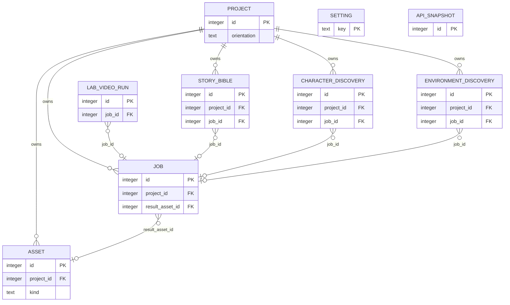

# Visio Studio: Database Structure

Status: Derived from `ANALYSIS.md` (originally Revision 3, now updated for Revision 4's transcription findings), specifically Section 4 ("Database and data model"), cross-referenced with Sections 3.7, 4.4, 5.1, 5.2 and 6.5 for field-level detail. No code or migrations exist yet — this document turns the "draft data model" in `ANALYSIS.md` Section 4.3 into a complete, implementable structure.

**Update (2026-10-05):** `ANALYSIS.md` Revision 4 confirmed the transcription endpoint's real response shape against the live GPU server. Section 4.3 (`transcript` table) and the JSON shapes in Section 5 below are updated accordingly — `transcript.words` now holds the whole verified response object, not a guessed-at array.

**Update (Phase 6, 2026-10-06):** no schema change. Section 5 now documents the `plan_scenes` job's `input` (it carries the cache key `input_hash` and what the scenes were made from) and `output` (the model's answer is kept verbatim in `output.answer`, next to the attempts, the token usage and the check counts), and Section 7 says how scenes are replaced. The cache key lives in `job.input`, not in a new column.

**Update (Phase 9, 2026-10-06):** no schema change. Section 5 now documents the real `generate_clip` `input` and `output` (the request is built once and stored, and every later attempt sends it again) and the `asset.provenance` of a clip and of a derived frame, and Section 7 says how a clip, its take and its selection are written. A *take* is a succeeded `generate_clip` job together with its clip asset: there is still no clip table.

**Update (Phase 12, 2026-10-08):** migration `0003`. A new job type, `draft_descriptions` (a paid call to the language model that writes every scene's video prompt and its first and last frame descriptions in one request). `project` gains `description_instructions`. `scene` gains `first_frame_description`, `last_frame_description`, `frame_descriptions_source` and `description_job_id` (the job that wrote the AI text). Section 5 documents the job's `input` and `output`, and Section 7 says how the drafts are written and which fields they may overwrite.

**Update (Phase 13, 2026-10-08):** migration `0004`. Two tables for the Image lab page, where Bitdeer's image API is tested by hand: `lab_run` (one call: the exact request, the raw response, timing and usage) and `lab_image` (an upload, or a result of a run). They belong to no project. Nothing existing changes. See Sections 4.8, 4.9 and 7.

**Update (Phase 15, 2026-10-08):** migration `0005`. `scene.frame_descriptions_source` (one source for the pair) is replaced by `first_frame_description_source` and `last_frame_description_source`, copied from the old column wherever the text exists. The AI drafting job no longer writes a last-frame description (a clip is made from its first frame alone): it writes the video prompt and the first-frame description, and clears an earlier AI-written last-frame description in the scenes it writes into. The prompt profile is now `ltx-2.3-first-frame`, and the `world` and `continuity` values in the job's answer changed. See Sections 4.4, 5 and 7.

**Update (Phase 16, 2026-10-08):** migration `0006`. A new job type, `write_image_prompt`: one paid call to the language model for one scene (a scene job, `scene_id` set), which turns the scene's first-frame description, video prompt, narration and the draft's `world` into a detailed prompt for the image model. `scene` gains `image_prompt`, `image_prompt_source` and `image_prompt_job_id` (the job that wrote the AI text). Whether an AI prompt is out of date is computed when it is read, from a hash of its inputs kept on that job (`job.input.inputs_sha256`): no flag is stored. A new global setting, `image_prompt_llm_model`. See Sections 3, 4.4, 4.5, 5, 6 and 7.

**Update (Phase 17, 2026-10-08):** migration `0007`. A new job type, `generate_frame`, and a new job provider, `image`: one paid image from the image model (Seedream through Bitdeer) for one scene (a scene job, `scene_id` set). Its result is an `asset` (`kind='frame'`, `source='ai'`) that becomes the scene's first frame, and the raw image the model returned is kept as a second asset. **No table or column is added**: the frame is a normal asset, `scene.first_frame_asset_id` already points at it, and the scene's earlier frames are the result frames of its succeeded `generate_frame` jobs (no list is stored). Whether an AI frame is out of date is computed when it is read, from the prompt its provenance recorded. Two new global settings, `image_model` and `max_parallel_image_generations` (the second was replaced by the shared `max_parallel_gpu_jobs` on 2026-10-13, see below). See Sections 4.2, 4.5, 5, 6 and 7.

**Update (Phase 18, 2026-10-09):** no schema change. A new global setting, `default_negative_prompt` (a text for the video model: no background music, singing or speech, no on-screen text, logos or watermarks, and common video artifacts). A `generate_clip` job sends the project's own `negative_prompt` when it has one, otherwise this default, and a new project starts with this text as its own `negative_prompt`. Before this, a project with a blank `negative_prompt` sent none, and the GPU server's own default applied. See Sections 4.1, 5 and 6.

**Update (Phase 19, 2026-10-09):** migration `0008`. LTX-2.5 runs next to LTX-2.3, and the video model is chosen per app, project and scene. `project` and `scene` gain a nullable `video_model` (`ltx-2.3` or `ltx-2.5`; NULL means "inherit": the scene takes the project's, the project takes the global setting `default_video_model`). **`job.project_id` becomes nullable** and `job.type` gains `lab_video` and `write_lab_video_prompt`: the new Video lab belongs to no project, and its jobs are normal background jobs. A new table, `lab_video_run`, holds what the Video lab lists and compares (the model, the prompt, the settings, and the stored clip). A clip's job and asset record which model made it. No `negative_prompt` is sent to LTX-2.5 (it has none), so the project's and the global negative prompts are LTX-2.3 only. See Sections 3, 4.1, 4.4, 4.5, 4.10, 5, 6 and 7.

**Update (Phase 20, 2026-10-09):** migration `0009`. A new job type, `auto_pipeline`: one run of the automatic flow of a project, which makes the jobs of the manual steps one step after the other and starts a step only when every scene has finished the one before. **No table or column is added**: the run keeps its state in `job.input` and `job.output` (including the ids of the jobs it made, so a restart continues where it was), and only the `job.type` CHECK gains the new value. A run is a project job (`scene_id` is NULL, `provider='local'`) and keeps a fixed marker in `provider_job_id` so the dispatcher checks it every tick. Its jobs are ordinary jobs of the existing types, with `input.auto_run_id` naming the run. See Sections 4.5, 5 and 7.

**Update (Phase 21, 2026-10-10):** migration `0010`. Two things from the GPU API 0.5.0 to 0.7.0. (1) **LTX-2.5 first-and-last-frame**: `POST /v1/ltx25/videos/interpolate` replaces the fallback to LTX-2.3, so a scene with a last frame is made by the chosen model's own endpoint (`first_frame_asset_id` and `last_frame_asset_id` in the body, no `negative_prompt`), and the Video lab can take an optional last frame (`lab_video_run.last_frame`). (2) **Breeze TTS 2 text-to-speech** (`POST /v1/breeze-tts/synthesize`): `job.type` gains `lab_voice` and `generate_voiceover`; new tables `voice` (a saved voice: a recording and its exact transcript) and `lab_voice_run` (what the new Voice lab lists); `project.voice_id` names the saved voice that speaks the script when the app makes the voiceover (`asset.kind='voiceover'`, `asset.source='ai'`, with `provenance.script_sha256`). The automatic flow gains a first step, `voiceover`. Breeze TTS 2 is licensed for research and non-commercial use only. See Sections 3, 4.1, 4.5, 4.10, 4.11, 4.12, 5 and 7.

**Update (Phase 22, 2026-10-11):** migration `0011`. The image model changes from Seedream (Bitdeer) to **Qwen-Image-2.1 on the GPU server** (`POST /v1/qwen-image21/images/generate`, added in GPU API 0.8.0). (1) `generate_frame` becomes a remote GPU job like `generate_clip` (`provider='gpu'`, restart rule `resume`, a `provider_job_id`, polled by the dispatcher) instead of one synchronous paid call. Its stored request holds the nearest of the model's seven picture shapes, a random seed and the mode (the new global setting `image_mode`, which replaces `image_model`). The label-band crop is gone: the frame is the model's picture scaled to cover the generation size and trimmed evenly. The `image` value stays in the `provider` CHECK, but no job uses it any more. (2) The Image lab gets Qwen next to Seedream. A Qwen run is a `lab_image` job (`job.type` gains `lab_image`), and `lab_run` gains a nullable `job_id` and the status `running`; Seedream runs are unchanged. (3) The prompt profile the language model writes image prompts with is now `qwen-image-2.1` (150 to 300 words, no "bottom tenth" rule). The model's weights are under the Qwen Research License (non-commercial use only). See Sections 4.5, 4.8, 5, 6 and 7.

**Update (Phase 23, 2026-10-11):** migration `0012`. **AI last frames**, so a clip can be made from a first and a last frame (the LTX first-and-last-frame endpoints already existed). (1) `job.type` gains `write_last_frame_prompt` (a paid call to the language model for one scene) and `generate_last_frame` (a remote GPU job for one scene, like `generate_frame`). (2) `scene` gains `last_frame_prompt`, `last_frame_prompt_source` and `last_frame_prompt_job_id`, the counterparts of the three `image_prompt` columns: the instruction that **edits the first frame into the last frame** with Qwen-Image-2.1's edit endpoint (`POST /v1/qwen-image21/images/edit`, with the first frame uploaded as a reference image). (3) The drafting job's prompt profile is now `ltx-first-last`: the model decides, scene by scene, whether the clip gets a last frame and writes its description into `scene.last_frame_description` (source `ai`), or answers null. **No column is added for the frame itself**: it is a normal frame asset, `scene.last_frame_asset_id` already points at it, and the earlier last frames of a scene are the result frames of its succeeded `generate_last_frame` jobs. Whether an AI last frame is out of date is computed (its prompt, or the first frame it edited, changed), never stored. (4) A scene whose draft `continuity` is `continues_action`, after a scene that has a last frame, **starts on that frame**: the app sets its `first_frame_asset_id` to the previous scene's last frame (the same asset row), in the transaction that attaches it. (5) The automatic run has two more steps, `last_frame_prompts` and `last_frames`. See Sections 3, 4.4, 4.5, 5 and 7.

**Update (Phase 24, 2026-10-11):** migration `0013`. **The Talking character lab**: a character picture speaks a line of dialogue, lip-synced, and the three labs become tabs of one Lab page (no schema change for that part). (1) The GPU server's audio-to-video endpoint (`POST /v1/ltx/videos/audio-to-video`, `AudioToVideoRequest`, LTX-2.3, quality recipe only) makes a clip to match a recorded speech and muxes that speech in unchanged. It is a `lab_video` job like any other Video lab run, and `lab_video_run` gains `audio_input` (`{"source": "voice_run" \| "voice", "id": n}`, NULL for every other clip); the job's input also carries `audio` (the file's path and type, copied when the run starts). The clip is as long as the speech (the smallest `8k + 1` frame count that is not shorter, at most 20 seconds). (2) `job.type` gains `write_talk_prompts` (a paid call to the language model that writes a voice instruction and a video prompt). (3) New tables `lab_character` (the cast: a name, a picture, a description the language model reads, an optional default voice) and `lab_talk_run` (one take: the dialogue, the picture, the prompts, and the three steps it is made in, each a job the other labs already run: `prompt_job_id`, `voice_run_id`, `video_run_id`). A take with `auto_continue` starts its next step by itself when the prompts job finishes and when the speech is stored; if a step cannot start, the reason is kept in `lab_talk_run.last_error`. See Sections 3, 4.10, 4.13, 4.14 and 5.

**Update (project cast, 2026-10-12):** migration `0014`. **A project's cast, so a character or a place looks the same in every scene.** (1) New tables `character` and `location` (Sections 4.15 and 4.16): the characters and places of a story, each with the text that describes it (found by one language model job that reads the script, edited by hand), the prompt for its **reference picture** and the picture itself. (2) `scene` gains `character_id` and `location_id` (the one character and the one place the scene shows; `character_id` is replaced by the table `scene_character` in migration `0015`, below), `cast_assignment_source` (`manual` \| `ai`) and `cast_assignment_job_id`. (3) `asset.kind` gains `reference` (a reference picture). (4) `job.type` gains `extract_cast`, `write_character_reference_prompt`, `generate_character_reference` and `assign_cast`. (5) A scene that shows a member has its first frame made by **the image model's edit endpoint, from the picture of each member** (the character is image 1, the place the next), instead of from words alone; the image prompt of such a scene is written for that (`QWEN_IMAGE_21_CHARACTER_EDIT`), and it carries the members in its inputs, so assigning a scene differently makes its prompt out of date. A scene that shows none is made as before. (6) A character's picture is asked for on a plain **white** backdrop, which is then removed (`rembg`), so the stored picture has a transparent backdrop; a place is kept whole. It is sent to the image model flattened on white again. (7) The automatic run has four more steps, between `scenes` and `descriptions`: `cast`, `cast_prompts`, `cast_images` and `cast_assignment`. (8) A scene's choice of cast counts as one of its inputs (`scene_cuts.has_inputs` and `NO_INPUTS`): replacing a scene, or changing its cut, asks first and then clears the choice, like a description or a frame. Nothing speaks in these stories: a character's voice is only a note for the language model. See Sections 3, 4.2, 4.4, 4.5, 4.15, 4.16, 5 and 7.

**Update (several characters in a scene, 2026-10-13):** migration `0015`. **A scene may show any number of characters.** (1) New table `scene_character` (Section 4.17): one row for each character a scene shows, with its `position` (the order of the character's reference picture: 0 is image 1). (2) `scene.character_id` is dropped. Every existing choice is copied into `scene_character` at position 0 first, so none is lost. (3) A scene made from the cast sends one reference picture for each character (images 1, 2, and so on, in `position` order) and then the place's. The image model's edit takes 10 pictures, so a scene shows at most **9** characters (`cast.MAX_SCENE_CHARACTERS`): code applies this limit (the `assign_cast` answer is cut there, a manual choice above it is refused with 422), and no prompt asks for any number of characters. (4) The prompts leave the number of characters to the model: `assign_cast` now answers with a list of names (`characters`) for each scene, and the profile `QWEN_IMAGE_21_CHARACTER_EDIT` (version 2) names each character by its image number. A character's entry in `cast.references` of the image prompt's inputs gains `name`, so the writer can tell several characters apart: the image prompts of scenes that show a character are therefore out of date once. (5) `NO_INPUTS` no longer holds `character_id`. A cut edit that clears a scene's inputs also deletes the scene's `scene_character` rows (`scenes.apply_cut_edit`). See Sections 3, 4.4, 4.17, 5 and 7.

**Update (parallel automatic run and two shared pools, 2026-10-13):** **No table or column is added.** (1) The automatic run (`auto_pipeline`) is no longer a queue of fourteen steps done one after the other: the steps are a graph. A step starts when the steps it *needs* are complete, and a scene (or a character, or a place) goes on to its next step as soon as its *own* input is ready (for example, a clip starts once its scene's frames are made, while other scenes' frames are still being made). The cast is found from the script at once, beside the voiceover. `job.output` of a run no longer has a `step` key (an older run's is ignored), and `problems[]` always had a `step`. (2) The per-job-type limits are gone. Two numbers limit all work, shared by every kind of job: `max_parallel_gpu_jobs` (the GPU server) and `max_parallel_paid_api_calls` (the paid inference API). They replace `max_parallel_generations` and `max_parallel_image_generations` (a saved value of either is never read), and there is no concurrency group any more. A new endpoint, `GET /api/jobs/capacity`, reports each pool's limit and what is running and waiting in it. See Sections 3.3, 4.5, 6 and 7.

**Update (MiniMax H3 reference: optional audio, a cast and the server's own GPUs and estimate, 2026-10-18):** migration `0020`, for GPU API 0.14.0 and 0.15.0. (1) `lab_video_run` gains `audio_references` (a list of `{"source": "voice_run" \| "voice", "id": n}`, in `<Audio N>` order; NULL for every other clip and for a reference clip made without audio). The audio of a MiniMax H3 reference clip is **optional** (0 to 2 audios in the Video lab, the server takes 3): the request field is the list `audio_asset_ids`, and the old single `audio_asset_id` is refused by the server. Runs made before the migration get a list of the one audio they had. `audio_input` stays, and for a reference clip holds the first audio (or NULL). (2) A reference run's `params` also hold `reference_roles` (what each picture is: `character_1`, `character_2`, `scene` or `other`), `audio_durations_s`, `audio_owners` (which character each audio is the voice of) and `ambience`, so a run loads back into the form. (3) The server now says how many GPUs a MiniMax H3 job got (`gpus`, 4 or 8) and about how long it will run once it starts (`estimated_run_seconds`), in its submit answer and in `GET /v1/jobs/{id}`. The app keeps both: `job.input.submit_answer` (`{gpus, estimated_run_seconds}`) at the submit and `job.output.remote` (refreshed at every poll). The dispatcher counts an H3 job as the server's `gpus` slots (4 until the server has said), instead of the fixed two. See Sections 4.10 and 6.

**Update (MiniMax H3 as a project, scene and app video model, and the default, 2026-10-18):** migration `0021`. `project.video_model` and `scene.video_model` accept `minimax-h3` as well as `ltx-2.3` and `ltx-2.5`: the two CHECK constraints are rebuilt (SQLite needs a table rebuild for that, which the migration does in batch mode), and no column is added. The downgrade first sets every `minimax-h3` value of those two columns to NULL ("inherit"), then puts the old constraints back. The `default_video_model` setting now defaults to `minimax-h3` **in the code only**: a value already saved is kept, so an install that saved `ltx-2.5` keeps it until the setting is changed. A clip made by MiniMax H3 is asked of one endpoint for both clip modes (`POST /v1/h3/videos/generate`), so its job `input` and its clip provenance also store the clip mode (`clip_mode`), which the endpoint alone no longer tells. It runs at 24 fps and in its own size (1344 x 768 or 768 x 1344), is never shorter than 124 frames (5.17 s) nor longer than 345 (14.4 s), and gets no negative prompt. A scene shorter than 5.17 s that has a last frame is made by LTX-2.5 instead (the clip's `model_note` says why). A scene's description drafted for H3 is one text of three fields (`integrated_multimodal_description`, `overall_soundscape`, `non_diegetic_music`), and `scene_prompt.prompt_for` turns either that or an LTX paragraph into the prompt of the model that makes the clip. The render timeline entries gain `source_frames`, the frames the clip needs at its own fps, so a 24 fps H3 clip in a project of another fps is not taken for too short. The `draft_descriptions` job input gains `video_model`, and its `profile` is `minimax-h3-scene` when the project's model is MiniMax H3. See Sections 3, 4.1, 4.4, 5, 6 and 7.

**Update (PHASE-002 shot-duration policy, 2026-10-20):** no schema change. Four new global settings in the `Shot duration` group, all integers in **whole seconds**: `h3_min_shot_seconds`, `shot_target_min_seconds`, `shot_target_max_seconds` and `h3_max_shot_seconds`. Each is between 1 and 14, where 14 is `H3_MAX_FRAMES // H3_FPS` (345 frames is 14.375 s, so 15 s is beyond what the GPU server accepts). They must stay in that order (each at or below the next): saving a value that breaks the order is refused, and `duration_policy.read_duration_policy` checks it again when it reads, because a reset can still break it. See Section 6.

**Update (PHASE-046 retire the narration pipeline, 2026-10-20):** migration `0022`. The voiceover-driven narration pipeline is removed, so later phases can build story projects without it. The Image lab, the Voice lab, the Video lab and the Character lab are unchanged. (1) `job` rows whose type is not one of the six lab types (`lab_image`, `lab_video`, `write_lab_video_prompt`, `lab_voice`, `write_character_look_prompt`, `write_character_take_prompt`) are deleted. `job.scene_id` and `idx_job_scene` are dropped, and the `job.type` CHECK is rebuilt with those six values (SQLite needs a table rebuild for that, which the migration does in batch mode). (2) The tables `scene_character`, `scene`, `character`, `location` and `transcript` are dropped. (3) `project` loses twelve columns: `min_scene_seconds`, `max_scene_seconds`, `style_prefix`, `prompt_suffix`, `negative_prompt`, `clip_sound_volume`, `cut_instructions`, `description_instructions`, `video_model`, `language`, `voiceover_asset_id` and `voice_id`, with the CHECK and the two foreign keys that went with them. What is left is `id`, `name`, `created_at`, `orientation`, the four sizes, `fps` and `script_text`. (4) The setting rows `default_video_model`, `default_negative_prompt` and `max_parallel_ffmpeg` are deleted, and the three are no longer settings. (5) `asset` is unchanged: its rows and files are never deleted, and its CHECK constraints keep every value, so a `voiceover`, `clip`, `final` or `reference` asset made earlier stays valid. (6) **There is no downgrade**: `downgrade()` raises `NotImplementedError`, because the deleted rows cannot be rebuilt. Restore a backup of `app.db`, or use the git tag `narration-final` (the last commit with the narration code, `git show narration-final:<path>`) with a database from before. Sections 4.3, 4.4, 4.15, 4.16 and 4.17 and the narration shapes of Section 5 are now short notes: the full text is at that tag (`git show narration-final:DATABASE_STRUCTURE.md`). The older updates above describe the schema as it was when each was written. See Sections 3, 4.1, 4.2, 4.5, 5, 6 and 7. Older than this phase and not changed by it: Sections 4.13 and 4.14 and the indexes of `lab_character` and `lab_talk_run` still describe the Talking character lab's first tables, which migration `0016` replaced with the Character lab's own tables (`library_character`, `character_look`, `character_look_candidate`, `character_reference` and `character_take`).

**Update (PHASE-003 story workspace, 2026-10-20):** no schema change and no migration. (1) The story is stored in the existing `project.script_text` column, which the app now calls the *story text* (the project page's "Story" editor); the column and the API field keep the name `script_text`. (2) Two new global settings in a new `Story` group: `story_words_per_minute` (default 150, from 60 to 300) and `story_max_minutes` (default 10, from 1 to 120, decision D-13). The estimated length of a story is its word count divided by the pace; a story above the limit still saves, with a warning. `GET /api/projects/{id}` (and the create and patch answers) gain `story_length` (`word_count`, `estimated_seconds`, `words_per_minute`, `limit_seconds`, `over_limit`), computed on read by `app/services/story_length.py`, never stored. (3) A new section 2.1, **Story artifact provenance (D-3)**, is the convention every later stage table follows. See Sections 2.1, 4.1, 6 and 7.

**Update (PHASE-004 Story Bible, 2026-10-20):** migration `0023`. The first story stage. (1) New table `story_bible` (Section 4.18): one immutable row per version of a project's StoryBible, following the provenance convention of Section 2.1 (`source`, `job_id`, `version`, `inputs`, `created_at`) plus `project_id` and `content` (the bible itself). `UNIQUE (project_id, version)`. (2) `job.type` gains `write_story_bible`: the CHECK is rebuilt in batch mode, so `job` now has seven types. Unlike the lab jobs, this one **belongs to a project** (`job.project_id` is set), with `provider='llm'` and the restart rule `never_rerun`; its `input` and `output` are in Section 5. (3) The settings `llm_provider` and `llm_model`, which nothing used since PHASE-046, become **the one story LLM setting** (labels "Story provider" and "Story model (Bitdeer)"): every story stage uses them (decision D-12). The built-in default model changes from `zai-org/GLM-5.3-Flash` to `zai-org/GLM-5.3`; a value already saved is kept. While Bitdeer is not available, `llm_provider` is set to `qwen38` on the Settings page (a temporary test setup, not a code change). (4) New endpoints under `/api/projects/{id}/story-bible` (run, read, read one version). Whether the newest version is out of date is **computed on every read** from `inputs.story_sha256` and the project's current `script_text`, never stored. See Sections 2.1, 3, 4.5, 4.18, 5, 6 and 7.

**Update (PHASE-005 character and environment discovery, 2026-10-20):** migration `0024`. The second and third story stages: two focused calls that list the story's characters and its environments. (1) Two new tables, `character_discovery` and `environment_discovery` (Sections 4.19 and 4.20). Each is the shape of `story_bible`: one immutable row per run, which is one **version of the whole list** (the set carries the version, the provenance and the `content`; there is no row per character), following Section 2.1. `inputs` records the story hash **and the StoryBible version the list was made from** (`artifacts: [{"kind": "story_bible", "id", "version"}]`). `UNIQUE (project_id, version)` in each table, so the two lists are numbered separately. (2) `job.type` gains `discover_characters` and `discover_environments`: the CHECK is rebuilt in batch mode, so `job` now has nine types. They are **two job types and not one with a kind**, because the job store merges a second click into any waiting or running job of the same type for the project, so a single type would make the character run block the environment run; with two, both run at once (and beside scene discovery of PHASE-006, D-15). Both belong to a project, are `provider='llm'` with the restart rule `never_rerun`, and use the story model setting (D-12). (3) No setting is added. (4) New endpoints under `/api/projects/{id}/discovery/{kind}` (`kind` is `characters` or `environments`: run, read, read one version). A run is refused (422) when there is no saved story, no StoryBible, or when the newest StoryBible is out of date with the saved story. Whether the newest version of a list is out of date is **computed on every read**: the story text hashes differently from `inputs.story_sha256`, or the project has a newer StoryBible than the one recorded. Relations between characters are not stored (D-14). See Sections 3, 4.5, 4.19, 4.20, 5 and 7.

**How to read this document:** every table and field name is taken directly from `ANALYSIS.md`. Where `ANALYSIS.md` describes behaviour in prose but doesn't spell out a concrete SQL type, default, index, or constraint, I chose a simple, standard convention and marked it. **Section 8 ("Assumptions and additions beyond ANALYSIS.md") lists every one of those choices in one place** so you can confirm or correct them before anything is built. Nothing in Sections 1–7 should surprise you if you've read `ANALYSIS.md`; it's the same model, just made concrete.

---

## Contents

1. [Engine and tooling](#1-engine-and-tooling)
2. [Design principles behind the structure](#2-design-principles-behind-the-structure)
3. [Entity-relationship overview](#3-entity-relationship-overview)
4. [Tables](#4-tables)
5. [JSON column shapes](#5-json-column-shapes)
6. [Global settings stored in `setting`](#6-global-settings-stored-in-setting)
7. [How the pipeline writes to these tables](#7-how-the-pipeline-writes-to-these-tables)
8. [Assumptions and additions beyond ANALYSIS.md](#8-assumptions-and-additions-beyond-analysismd)

---

## 1. Engine and tooling

(Source: `ANALYSIS.md` Section 4.1)

- **SQLite** for iteration 1 — one file on the Docker `data` volume, no separate database container, no credentials. PostgreSQL is dropped because the reason for it (a separate worker process, and the database doubling as a job queue) no longer applies with one backend process and no queue table.
- **SQLAlchemy 2.x** for models, **Alembic** for migrations, so the code stays portable if you move to PostgreSQL later.
- **WAL mode and foreign keys** turned on (`PRAGMA journal_mode=WAL;` and `PRAGMA foreign_keys=ON;`).
- **JSON columns** (SQLAlchemy's `JSON` type) hold the exact request/response payloads sent to providers. SQLite has no native JSON storage class — these are stored as `TEXT` and serialized/validated by SQLAlchemy at the application layer.
- **Switch to PostgreSQL when:** you host it, add users, or run more than one backend process (Section 4.1). The cost is a connection-string change, running the same Alembic migrations against Postgres, and copying data.

---

## 2. Design principles behind the structure

(Source: `ANALYSIS.md` Section 4.2, "Manual-first, AI-ready")

- **An artifact is the same thing no matter who made it.** A frame is an `asset` row whether you uploaded it or a model generated it — only a `source` field changes.
- **Every unit of background work is a `job` row** (a lab image, a lab clip, a lab speech, a prompt written by the language model) holding its input and output, so the UI can show activity.
- The principles about scenes, clips and frames that used to be here described the narration pipeline, which migration `0022` removed (see the update at the top).

### 2.1 Story artifact provenance (D-3)

*Added in PHASE-003; decision D-3 in `Implementation_phases.md`.* This convention applies to every table that holds the result of a story stage (the Story Bible, the discovered characters, environments and scenes, the definitions, events, shots and so on), starting with PHASE-004. It does not change any table that exists today. A stage's own section in this document says which columns below it uses and fills in the stage-specific ones.

Every artifact row has these columns:

| Column | Type | Null | Meaning |
|---|---|---|---|
| `source` | TEXT | NOT NULL | `ai` or `manual` (`CHECK (source IN ('ai', 'manual'))`). Who wrote the content: the language model, or a person. |
| `job_id` | INTEGER | NULL | The `job` that produced it (`REFERENCES job(id) ON DELETE SET NULL`). NULL for a manual artifact. The job holds the attempts, the token usage and the model's raw answer. |
| `version` | INTEGER | NOT NULL | 1 for the first artifact, then 2, 3 and so on. Each regeneration or edit is a **new row** with the next version: a stored version is never changed, so anything built from it can still say exactly what it was built from. A stage may instead keep one row per artifact and a separate version table; its section says which. |
| `inputs` | JSON | NOT NULL | What the artifact was built from: `{"story_sha256": "<hex>", "artifacts": [{"kind": "story_bible", "id": 12, "version": 3}]}`. `story_sha256` is the SHA-256 of the exact `project.script_text` the stage read (the story text itself is not versioned). `artifacts` lists each upstream artifact by kind, id and version. Either part may be empty when the stage did not read it. |
| `created_at` | DATETIME | NOT NULL | When the row was written. |

```sql
-- The shape every stage table starts from (stage-specific columns are added to it).
source      TEXT     NOT NULL CHECK (source IN ('ai', 'manual')),
job_id      INTEGER  REFERENCES job(id) ON DELETE SET NULL,
version     INTEGER  NOT NULL,
inputs      JSON     NOT NULL,
created_at  DATETIME NOT NULL DEFAULT CURRENT_TIMESTAMP
```

Rules that go with it:

- **Staleness is computed when an artifact is read, never stored as a flag.** An artifact is out of date when the story text now hashes to something other than its `story_sha256`, or when any upstream artifact in `inputs.artifacts` has a newer version than the one recorded. This is the same "worked out when read" rule the app already uses (for example `job.input.inputs_sha256`). PHASE-039 reads these records; nothing has to be added to old rows later.
- **AI output never overwrites a manual artifact.** An AI run writes a new version next to the manual one, and a person chooses to use it. Author text is only replaced by an explicit action of the user.
- **Where a stage needs more than one row per run** (for example a set of discovered characters), the rows of one run share the run's `version` and `inputs`, or the set has a parent row that carries them. The stage's section says which.

---

## 3. Entity-relationship overview

A `project` owns its `asset` rows and, from PHASE-004, its `story_bible` rows and, from PHASE-005, its `character_discovery` and `environment_discovery` rows. Every other table is global and holds no `project_id`, except `job`, whose `project_id` is nullable: the tables are `setting`, `api_snapshot`, and, from Phase 13, `lab_run` and `lab_image`, from Phase 19, `lab_video_run`, from Phase 21, `voice` and `lab_voice_run`, and the Character lab's own tables. They describe the app, the GPU server or a manual test, not one video. The labs' jobs are rows of `job` too, with a NULL `project_id` (Phase 19). Migration `0022` dropped the tables of the narration pipeline: `transcript`, `scene`, `character`, `location` and `scene_character`.



`SETTING` and `API_SNAPSHOT` have no edges to `PROJECT` — they are global, as described in Sections 3.7 and 6.5.

**Foreign keys, precisely** (the diagram above is a visual aid; this list is authoritative):

| From | Column | To | Nullable |
|---|---|---|---|
| `asset` | `project_id` | `project.id` | No |
| `job` | `project_id` | `project.id` | Yes: a lab job belongs to no project, so it is NULL (Phase 19). A story job (`write_story_bible`, PHASE-004) belongs to its project. |
| `job` | `result_asset_id` | `asset.id` | Yes (until the job succeeds) |
| `story_bible` | `project_id` | `project.id` | No (`CASCADE`). PHASE-004 |
| `story_bible` | `job_id` | `job.id` | Yes (the `write_story_bible` job that wrote the version; `SET NULL` if that job row is ever removed, and NULL for a manual version). PHASE-004 |
| `character_discovery` | `project_id` | `project.id` | No (`CASCADE`). PHASE-005 |
| `character_discovery` | `job_id` | `job.id` | Yes (the `discover_characters` job that wrote the version; `SET NULL` if that job row is ever removed, and NULL for a manual version). PHASE-005 |
| `environment_discovery` | `project_id` | `project.id` | No (`CASCADE`). PHASE-005 |
| `environment_discovery` | `job_id` | `job.id` | Yes (the `discover_environments` job that wrote the version; `SET NULL` if that job row is ever removed, and NULL for a manual version). PHASE-005 |
| `lab_video_run` | `job_id` | `job.id` | Yes (the `lab_video` job that makes the run's clip; `SET NULL` if that job row is ever removed). Phase 19 |
| `lab_voice_run` | `job_id` | `job.id` | Yes (the `lab_voice` job that makes the run's speech; `SET NULL` if that job row is ever removed). Phase 21 |
| `lab_voice_run` | `voice_id` | `voice.id` | Yes (the saved voice that read the text; `SET NULL`). Phase 21 |
| `lab_character` | `voice_id` | `voice.id` | Yes (the character's default saved voice; `SET NULL`). Phase 24 |
| `lab_talk_run` | `character_id` | `lab_character.id` | Yes (the cast character the take started from; `SET NULL`). Phase 24 |
| `lab_talk_run` | `voice_id` | `voice.id` | Yes (the saved voice that reads the line; `SET NULL`). Phase 24 |
| `lab_talk_run` | `prompt_job_id` | `job.id` | Yes (the `write_talk_prompts` job; `SET NULL`). Phase 24 |
| `lab_talk_run` | `voice_run_id` | `lab_voice_run.id` | Yes (the speech the take made or reuses; `SET NULL`). Phase 24 |
| `lab_talk_run` | `video_run_id` | `lab_video_run.id` | Yes (the lip-synced clip; `SET NULL`). Phase 24 |

(The last five rows describe the Talking character lab's first tables, which migration `0016` replaced; see the update at the top.)

Migration `0022` also removed the circular references the narration tables created (`project.voiceover_asset_id` and `asset`, `scene.description_job_id` and `job.scene_id`, and the project cast's): none is left.

---

## 4. Tables

Each table below shows: its purpose, a column reference table, and illustrative SQL DDL (SQLite dialect). Model names below match the PascalCase names used in `ANALYSIS.md` Section 4.3; table names are the lowercase `snake_case` SQL identifiers I'm proposing for them (see Section 8).

### 4.1 `project`

One row per project. Since migration `0022` it holds only the name, the orientation and the sizes it is made at, the frame rate and an optional story text (`script_text`, shown as "Story" in the app). From PHASE-003 the project page is the story workspace: it edits the story text and shows its estimated length (Section 6, group `Story`). The story's own stage artifacts follow the convention in Section 2.1.

| Column | Type | Null | Default | Description |
|---|---|---|---|---|
| `id` | INTEGER | NOT NULL | auto | Primary key |
| `name` | TEXT | NOT NULL | — | The project's name |
| `created_at` | DATETIME | NOT NULL | now | |
| `orientation` | TEXT | NOT NULL | — | `portrait` \| `landscape` — chosen first (decision 2) |
| `gen_width` | INTEGER | NOT NULL | from orientation | The size a clip is made at; multiple of 64 |
| `gen_height` | INTEGER | NOT NULL | from orientation | Same rule as `gen_width` |
| `out_width` | INTEGER | NOT NULL | from orientation | Final video width |
| `out_height` | INTEGER | NOT NULL | from orientation | Final video height |
| `fps` | INTEGER | NOT NULL | 24 | Frame rate |
| `script_text` | TEXT | NULL | — | The story text, kept exactly as pasted (no trimming); `NULL` until then, and when it is only whitespace. At most 100,000 characters. The column keeps its name; the app calls it the story |

```sql
CREATE TABLE project (
    id                 INTEGER PRIMARY KEY,
    name               TEXT NOT NULL,
    created_at         DATETIME NOT NULL DEFAULT CURRENT_TIMESTAMP,
    orientation        TEXT NOT NULL CHECK (orientation IN ('portrait', 'landscape')),
    gen_width          INTEGER NOT NULL,
    gen_height         INTEGER NOT NULL,
    out_width          INTEGER NOT NULL,
    out_height         INTEGER NOT NULL,
    fps                INTEGER NOT NULL DEFAULT 24,
    script_text        TEXT
);
```

The twelve columns migration `0022` dropped (`min_scene_seconds`, `max_scene_seconds`, `style_prefix`, `prompt_suffix`, `negative_prompt`, `clip_sound_volume`, `cut_instructions`, `description_instructions`, `video_model`, `language`, `voiceover_asset_id`, `voice_id`) are documented at the tag `narration-final`.

### 4.2 `asset`

Any file on disk — uploaded or generated — that belongs to one project. The Image lab's project-frames picker reads a project's `frame` assets. Since migration `0022` no code writes an `asset` row (`services/assets.add_asset` stays for a later phase), and the table is unchanged: its CHECK constraints keep every `kind` and `source`, so a `voiceover`, `clip`, `final` or `reference` asset made earlier stays valid, and its file stays on disk. (Source: Section 4.2 and 4.3.)

| Column | Type | Null | Default | Description |
|---|---|---|---|---|
| `id` | INTEGER | NOT NULL | auto | Primary key |
| `project_id` | INTEGER, FK → `project.id` | NOT NULL | — | Owning project |
| `kind` | TEXT | NOT NULL | — | `voiceover` \| `frame` \| `clip` \| `final` \| `reference` (`reference`: the reference picture of a cast member of the retired narration pipeline) |
| `path` | TEXT | NOT NULL | — | Server-generated (UUID) path on the `data` volume |
| `mime` | TEXT | NOT NULL | — | MIME type |
| `size_bytes` | INTEGER | NOT NULL | — | File size |
| `duration_s` | REAL | NULL | — | Audio/video kinds only |
| `width` | INTEGER | NULL | — | Image/video kinds only. For an uploaded frame: the size as displayed, after the EXIF orientation is applied (Phase 8) |
| `height` | INTEGER | NULL | — | Image/video kinds only. Same rule as `width` |
| `sha256` | TEXT | NOT NULL | — | Content hash |
| `source` | TEXT | NOT NULL | — | `upload` \| `ai` \| `derived` |
| `provenance` | JSON | NULL | empty | provider/model/prompt/seed — empty (NULL) for uploads. An asset made earlier by a model keeps the provenance it was written with (Section 5) |
| `created_at` | DATETIME | NOT NULL | now | |

```sql
CREATE TABLE asset (
    id          INTEGER PRIMARY KEY,
    project_id  INTEGER NOT NULL REFERENCES project(id) ON DELETE CASCADE,
    kind        TEXT NOT NULL CHECK (kind IN ('voiceover', 'frame', 'clip', 'final', 'reference')),
    path        TEXT NOT NULL,
    mime        TEXT NOT NULL,
    size_bytes  INTEGER NOT NULL,
    duration_s  REAL,
    width       INTEGER,
    height      INTEGER,
    sha256      TEXT NOT NULL,
    source      TEXT NOT NULL CHECK (source IN ('upload', 'ai', 'derived')),
    provenance  JSON,
    created_at  DATETIME NOT NULL DEFAULT CURRENT_TIMESTAMP
);
```

### 4.3 `transcript`

**Removed in migration `0022`.** The table held the transcription endpoint's word times and the script words matched onto them. The full text of this section is at the tag `narration-final`.

### 4.4 `scene`

**Removed in migration `0022`.** The table held one cut of a story with its description, frames and chosen clip. The full text of this section is at the tag `narration-final`.

### 4.5 `job`

Every unit of background work. This is where running-job information lives, so a restart never loses track of a 5–10 minute GPU job. Since migration `0022` the only job types were the six lab ones, migration `0023` (PHASE-004) added the first story job, `write_story_bible`, and migration `0024` (PHASE-005) added `discover_characters` and `discover_environments`. (Source: Section 3.3, 4.2, 4.3.)

| Column | Type | Null | Default | Description |
|---|---|---|---|---|
| `id` | INTEGER | NOT NULL | auto | Primary key |
| `project_id` | INTEGER, FK → `project.id` | NULL | — | Owning project. NULL for the labs' jobs, which belong to no project; the Activity page shows them under the lab's name (Phases 19 and 21). Set for a story job (`write_story_bible`, PHASE-004; `discover_characters` and `discover_environments`, PHASE-005), which the Activity page shows under the project's name |
| `type` | TEXT | NOT NULL | — | `lab_image` \| `lab_video` \| `write_lab_video_prompt` \| `lab_voice` \| `write_character_look_prompt` \| `write_character_take_prompt` \| `write_story_bible` \| `discover_characters` \| `discover_environments` (`lab_video` and `write_lab_video_prompt`: Phase 19, the Video lab; `lab_voice`: Phase 21, Breeze TTS; `lab_image`: Phase 22, a run of the Image lab on the GPU server; the two `write_character_*` types: the Character lab's prompt writers; `write_story_bible`: PHASE-004, the Story Bible stage; the two `discover_*` types: PHASE-005, character and environment discovery). The narration types (`transcribe`, `plan_scenes`, `draft_descriptions`, `write_image_prompt`, `generate_frame`, `generate_clip`, `render_final`, `auto_pipeline`, `generate_voiceover`, `write_last_frame_prompt`, `generate_last_frame`, `extract_cast`, `write_character_reference_prompt`, `generate_character_reference`, `assign_cast`) were removed in migration `0022`, with their rows |
| `status` | TEXT | NOT NULL | `'queued'` | `queued` \| `running` \| `succeeded` \| `failed` \| `cancelled` |
| `phase` | TEXT | NULL | — | Free-text UI label, e.g. "queued on cluster" |
| `provider` | TEXT | NOT NULL | — | `gpu` \| `llm` \| `image` (Phase 17: the image model at the Bitdeer address; **no job uses it since Phase 22**, and the CHECK keeps it) \| `local` (no job type is local now, and the CHECK keeps it) |
| `provider_job_id` | TEXT | NULL | — | The external server's job id, once submitted |
| `input` | JSON | NOT NULL | — | Exact request sent: prompt, seed, server URL, etc. |
| `output` | JSON | NULL | — | Raw provider answer (LLM JSON, token usage, etc.) |
| `result_asset_id` | INTEGER, FK → `asset.id` | NULL | — | Set on success |
| `attempt` | INTEGER | NOT NULL | 1 | Retry counter |
| `error` | TEXT | NULL | — | The server's error text, if failed |
| `created_at` | DATETIME | NOT NULL | now | |
| `started_at` | DATETIME | NULL | — | |
| `finished_at` | DATETIME | NULL | — | |
| `last_checked_at` | DATETIME | NULL | — | Last time the dispatcher polled this job |

```sql
CREATE TABLE job (
    id               INTEGER PRIMARY KEY,
    project_id       INTEGER REFERENCES project(id) ON DELETE CASCADE,
    type             TEXT NOT NULL CHECK (type IN ('lab_image', 'lab_video', 'write_lab_video_prompt', 'lab_voice', 'write_character_look_prompt', 'write_character_take_prompt', 'write_story_bible', 'discover_characters', 'discover_environments')),
    status           TEXT NOT NULL DEFAULT 'queued'
                       CHECK (status IN ('queued', 'running', 'succeeded', 'failed', 'cancelled')),
    phase            TEXT,
    provider         TEXT NOT NULL CHECK (provider IN ('gpu', 'llm', 'image', 'local')),
    provider_job_id  TEXT,
    input            JSON NOT NULL,
    output           JSON,
    result_asset_id  INTEGER REFERENCES asset(id) ON DELETE SET NULL,
    attempt          INTEGER NOT NULL DEFAULT 1,
    error            TEXT,
    created_at       DATETIME NOT NULL DEFAULT CURRENT_TIMESTAMP,
    started_at       DATETIME,
    finished_at      DATETIME,
    last_checked_at  DATETIME
);
```

The dispatcher loop (Section 3.3) is the main reader/writer of this table: each tick it checks every `running` job, starts downloads for finished ones, resubmits pre-empted ones, and starts `queued` jobs, oldest first, while their pool has a free slot. There are **two shared pools** (`jobs/pools.py`): `gpu`, every job whose handler's provider is `gpu` (the labs' images, clips and speeches), limited by the setting `max_parallel_gpu_jobs`; and `paid_api`, every job whose provider is `llm` or `image` (every language model call set to Bitdeer, the story stages included; one whose role is set to Qwen3.8 counts in `gpu` instead), limited by `max_parallel_paid_api_calls`. A job type has no limit of its own and no handler names a group: a new job type joins the pool of its provider. A `local` job type would be a pool of its own, and its handler's `concurrency_limit` says how many; none exists now. A queued job whose pool is full shows the phase "waiting for a free GPU server slot" or "waiting for a free paid API slot". Both limits are read at every tick, and a lower number never stops a job that is running.

### 4.6 `setting`

Global settings edited in the UI (Section 3.7) — a simple key/value table. **Project-scoped** settings are **not** stored here; they live as columns directly on `project` (Section 4.1 above). See Section 6 below for exactly which keys live in this table.

| Column | Type | Null | Default | Description |
|---|---|---|---|---|
| `key` | TEXT | NOT NULL (PK) | — | e.g. `gpu_api_base_url` |
| `value` | JSON | NOT NULL | — | The setting's value |
| `updated_at` | DATETIME | NOT NULL | now | |

```sql
CREATE TABLE setting (
    key        TEXT PRIMARY KEY,
    value      JSON NOT NULL,
    updated_at DATETIME NOT NULL DEFAULT CURRENT_TIMESTAMP
);
```

### 4.7 `api_snapshot`

The recorded GPU API contract (Section 6.5) — the guide, the OpenAPI spec, and any other swagger document you add. Checked before every submission so a server update can't silently change what gets sent.

| Column | Type | Null | Default | Description |
|---|---|---|---|---|
| `id` | INTEGER | NOT NULL | auto | Primary key |
| `source` | TEXT | NOT NULL | — | `guide` \| `openapi` \| a custom name you add |
| `url` | TEXT | NOT NULL | — | The source's path, relative to the server URL its `base` names (so a new tunnel address doesn't invalidate it). Includes any query string, for example `/v1/guide?format=json`. (Phase 4) |
| `fetched_at` | DATETIME | NOT NULL | now | |
| `fingerprint` | TEXT | NOT NULL | — | The document's `content_hash` if present, else SHA-256 of the canonical JSON |
| `server_content_hash` | TEXT | NULL | — | The server's own hash field, if the document has one |
| `api_version` | TEXT | NULL | — | Version string from the guide, if present |
| `body` | JSON | NOT NULL | — | The fetched document |
| `state` | TEXT | NOT NULL | `'pending'` | `approved` \| `pending` |
| `approved_at` | DATETIME | NULL | — | Set when you click Approve |

```sql
CREATE TABLE api_snapshot (
    id                  INTEGER PRIMARY KEY,
    source              TEXT NOT NULL,
    url                 TEXT NOT NULL,
    fetched_at          DATETIME NOT NULL DEFAULT CURRENT_TIMESTAMP,
    fingerprint         TEXT NOT NULL,
    server_content_hash TEXT,
    api_version         TEXT,
    body                JSON NOT NULL,
    state               TEXT NOT NULL DEFAULT 'pending' CHECK (state IN ('approved', 'pending')),
    approved_at         DATETIME
);
```

Older snapshots are kept as history (Section 6.5: "Older versions stay as history") — rows are never overwritten, only inserted. To find the current baseline for a source, read the most recently **approved** row with that `source` **and** `url`, ordered by `fetched_at` and then `id`. Matching on `url` as well means a source whose path changes has no baseline and is "not approved", instead of showing a huge difference against a different document. (Phase 4.)

A changed source is stored once as a `pending` row per version: the guard inserts a pending row only if none with the same `fingerprint`, `source` and `url` exists that is newer than the latest approved row. A pending row is never converted to approved. Approving inserts a new `approved` row, so a simulated or real change always leaves the earlier approved, pending and approved rows behind as history.

### 4.8 `lab_run`

One manual test of an image model from the Image lab page (Phase 13, extended in Phase 22). A **Seedream** run is one synchronous call and **not** a `job` in the sense of the other labs: a call of 25 to 40 s that the page waits for. A **Qwen-Image-2.1** run (Phase 22) takes minutes, so it is a `lab_image` job (`job_id` set, `job.project_id` NULL) and its row is created `running`; the job's `finish` step stores the image, sets `status='succeeded'`, `seconds` and `response`, and adds the `lab_image`, in one transaction with the finished job. **A job that fails or is cancelled leaves the row `running`**, so the page reads the job's status as well (`api/image_lab.py`). Which model made a run is its `endpoint`: `/v1/qwen-image21/images/generate`, or a Bitdeer path. A row keeps what is needed to compare runs later: the exact request, the raw response, the timing and the usage. Runs are never deleted in iteration 1.

| Column | Type | Null | Default | Description |
|---|---|---|---|---|
| `id` | INTEGER | NOT NULL | auto | Primary key |
| `created_at` | DATETIME | NOT NULL | now | |
| `mode` | TEXT | NOT NULL | — | `text_to_image` \| `image_to_image` (the `image` field on `/images/generations`) \| `edit` (`POST /images/edits`, multipart). A Qwen run is always `text_to_image` |
| `endpoint` | TEXT | NOT NULL | — | The path called, for example `/images/generations` |
| `model` | TEXT | NOT NULL | — | The model sent, for example `seedream-5.0-lite` |
| `prompt` | TEXT | NOT NULL | — | |
| `params` | JSON | NOT NULL | — | What the form held besides the prompt: `size`, `watermark` (true, false or null for "not sent"), `seed`, `sequential_max_images`, `image_field_as`, `edit_field_name`, `extra`. A Qwen run holds `engine: "qwen"`, `qwen_mode` (`quality` or `fast`), `aspect_ratio`, `expected_size`, `seed` and `steps` instead |
| `reference_images` | JSON | NOT NULL | — | `[{"source": "lab" \| "asset", "id": 7}]`, in the order they were sent. Not named `references`, which is an SQL keyword |
| `status` | TEXT | NOT NULL | — | `running` (Phase 22: a Qwen run whose job has not finished it) \| `succeeded` \| `failed` |
| `http_status` | INTEGER | NULL | — | Absent when there was no answer at all (a timeout or a refused connection), and always absent for a Qwen run |
| `error` | TEXT | NULL | — | A readable message, including the Cloudflare and Bitdeer cases |
| `seconds` | REAL | NULL | — | How long the call took |
| `request_bytes` | INTEGER | NULL | — | The size of the body that was sent |
| `usage` | JSON | NULL | — | The `usage` block of the answer, as returned |
| `request` | JSON | NOT NULL | — | The request as sent, with every image replaced by `<image: N bytes>` |
| `response` | JSON | NULL | — | The answer, with every `b64_json` replaced by `<image: N bytes>`. For a Qwen run: the server's last status (`remote`), `expected_size` and `returned_size` |
| `job_id` | INTEGER, FK → `job.id` | NULL | — | The `lab_image` job that makes a run on the GPU server (Phase 22). NULL for a Seedream run. `ON DELETE SET NULL` |

```sql
CREATE TABLE lab_run (
    id               INTEGER PRIMARY KEY,
    created_at       DATETIME NOT NULL DEFAULT CURRENT_TIMESTAMP,
    mode             TEXT NOT NULL CHECK (mode IN ('text_to_image', 'image_to_image', 'edit')),
    endpoint         TEXT NOT NULL,
    model            TEXT NOT NULL,
    prompt           TEXT NOT NULL,
    params           JSON NOT NULL,
    reference_images JSON NOT NULL,
    status           TEXT NOT NULL CHECK (status IN ('running', 'succeeded', 'failed')),
    http_status      INTEGER,
    error            TEXT,
    seconds          REAL,
    request_bytes    INTEGER,
    usage            JSON,
    request          JSON NOT NULL,
    response         JSON,
    job_id           INTEGER REFERENCES job(id) ON DELETE SET NULL
);
```

### 4.9 `lab_image`

An image the lab holds: one the user uploaded, or one a run produced. Files live under `media/lab/` and are served at `/media/lab/...`. A project's frames are **not** copied here: a run refers to them by their `asset` id in `lab_run.reference_images`.

| Column | Type | Null | Default | Description |
|---|---|---|---|---|
| `id` | INTEGER | NOT NULL | auto | Primary key |
| `created_at` | DATETIME | NOT NULL | now | |
| `origin` | TEXT | NOT NULL | — | `upload` \| `result` |
| `run_id` | INTEGER, FK → `lab_run.id` | NULL | — | The run that produced a result. NULL for an upload. `ON DELETE SET NULL` |
| `output_index` | INTEGER | NULL | — | The position among the run's results, from 0 |
| `path` | TEXT | NOT NULL | — | Relative to the media folder, for example `lab/3f9c....jpg` |
| `mime` | TEXT | NOT NULL | — | |
| `width`, `height` | INTEGER | NOT NULL | — | As displayed |
| `size_bytes` | INTEGER | NOT NULL | — | |
| `sha256` | TEXT | NOT NULL | — | |

```sql
CREATE TABLE lab_image (
    id           INTEGER PRIMARY KEY,
    created_at   DATETIME NOT NULL DEFAULT CURRENT_TIMESTAMP,
    origin       TEXT NOT NULL CHECK (origin IN ('upload', 'result')),
    run_id       INTEGER REFERENCES lab_run(id) ON DELETE SET NULL,
    output_index INTEGER,
    path         TEXT NOT NULL,
    mime         TEXT NOT NULL,
    width        INTEGER NOT NULL,
    height       INTEGER NOT NULL,
    size_bytes   INTEGER NOT NULL,
    sha256       TEXT NOT NULL
);
```

### 4.10 `lab_video_run`

One video the Video lab made, or is making (Phase 19). The lab belongs to no project, so its work runs as `lab_video` jobs with a NULL `project_id`. The job holds the status, the phase, the exact request and the server's answers (so a run resumes after a restart or a pre-emption); this row holds what the page lists and compares. The runs that one "run on both models" click starts share a `group_key`, and have the same prompt, first frame, size, length, recipe and seed, so the clips differ only by the model. Nothing is deleted in this iteration. Files live under `media/lab/` and are served at `/media/lab/...`.

| Column | Type | Null | Default | Description |
|---|---|---|---|---|
| `id` | INTEGER | NOT NULL | auto | Primary key |
| `created_at` | DATETIME | NOT NULL | now | |
| `job_id` | INTEGER, FK → `job.id` | NULL | — | The `lab_video` job. `ON DELETE SET NULL` |
| `group_key` | TEXT | NULL | — | Shared by the runs one click started (a random hex string) |
| `video_model` | TEXT | NOT NULL | — | `ltx-2.3` \| `ltx-2.5` |
| `endpoint` | TEXT | NOT NULL | — | The GPU server path the request goes to, for example `/v1/ltx25/videos/generate` |
| `prompt` | TEXT | NOT NULL | — | The prompt as sent (trimmed) |
| `params` | JSON | NOT NULL | — | What the form held and what was sent: `mode`, `orientation`, `width`, `height`, `fps`, `duration_s`, `num_frames`, `seed` and `negative_prompt` (only an LTX-2.3 run has one) |
| `first_frame` | JSON | NULL | — | `{"source": "lab" \| "asset", "id": n}`: an Image lab image, or a project's frame asset. NULL for text-to-video. Never copied: the run refers to it |
| `last_frame` | JSON | NULL | — | Same shape as `first_frame`. Only on a run that moves from a first to a last frame (needs a first frame): LTX-2.5 uses `POST /v1/ltx25/videos/interpolate`, LTX-2.3 keyframe interpolation. Phase 21 |
| `audio_input` | JSON | NULL | — | `{"source": "voice_run" \| "voice", "id": n}`: the recorded speech a lip-synced clip was made to match (`POST /v1/ltx/videos/audio-to-video`, LTX-2.3 only). NULL for every other clip. Never copied: the run refers to a Voice lab run, or to a saved voice. Phase 24. For a MiniMax H3 reference clip it holds the first of `audio_references`, or NULL when there is none |
| `audio_references` | JSON | NULL | — | A list of `{"source": "voice_run" \| "voice", "id": n}`: the audios of a MiniMax H3 reference clip, in the order the prompt names them (`<Audio 1>`, `<Audio 2>`), sent as `audio_asset_ids`. NULL for every other clip and for a reference clip made without audio. Migration `0020` |
| `path` | TEXT | NULL | — | The stored clip, relative to the media folder (`lab/<32 hex>.mp4`). NULL until the job has finished |
| `size_bytes` | INTEGER | NULL | — | |
| `sha256` | TEXT | NULL | — | |
| `width`, `height` | INTEGER | NULL | — | As ffprobe reads the clip |
| `frame_count` | INTEGER | NULL | — | Counted from the file |
| `duration_s` | REAL | NULL | — | |
| `audio` | JSON | NULL | — | `{codec, sample_rate, channels}`, NULL when the clip has no sound |

```sql
CREATE TABLE lab_video_run (
    id           INTEGER PRIMARY KEY,
    created_at   DATETIME NOT NULL DEFAULT CURRENT_TIMESTAMP,
    job_id       INTEGER REFERENCES job(id) ON DELETE SET NULL,
    group_key    TEXT,
    video_model  TEXT NOT NULL CHECK (video_model IN ('ltx-2.3', 'ltx-2.5')),
    endpoint     TEXT NOT NULL,
    prompt       TEXT NOT NULL,
    params       JSON NOT NULL,
    first_frame  JSON,
    last_frame   JSON,
    audio_input  JSON,
    audio_references JSON,
    path         TEXT,
    size_bytes   INTEGER,
    sha256       TEXT,
    width        INTEGER,
    height       INTEGER,
    frame_count  INTEGER,
    duration_s   REAL,
    audio        JSON
);
```

### 4.11 `voice`

A saved voice (Phase 21): a clean recording and its exact transcript, which Breeze TTS 2 clones. A voice comes from an upload (`POST /api/voices`: the recording is received, checked with ffprobe: WAV, MP3, M4A or FLAC and audio only, and stored under `media/lab/`) or from a Voice lab run (`POST /api/lab/voices/runs/{id}/save-voice`: the voice points at the run's own file, nothing is copied). A voice is never deleted, like every stored file; its name and transcript can be edited, its recording never changes. A job copies the recording's path and the transcript into its own `input` when it is created, so editing a voice changes nothing for a speech already under way.

| Column | Type | Null | Default | Description |
|---|---|---|---|---|
| `id` | INTEGER | NOT NULL | auto | Primary key |
| `created_at` | DATETIME | NOT NULL | now | |
| `name` | TEXT | NOT NULL | — | At most 80 characters |
| `path` | TEXT | NOT NULL | — | The stored recording, relative to the media folder (`lab/<32 hex>.<ext>`) |
| `mime` | TEXT | NOT NULL | — | `audio/wav`, `audio/mpeg`, `audio/mp4` or `audio/flac` |
| `size_bytes` | INTEGER | NOT NULL | — | |
| `sha256` | TEXT | NOT NULL | — | |
| `duration_s` | REAL | NOT NULL | — | |
| `transcript` | TEXT | NOT NULL | — | What the recording says, word for word (at most 1,000 characters: the server's limit for `reference_text`) |
| `origin` | TEXT | NOT NULL | — | `upload` \| `lab_run` |
| `lab_voice_run_id` | INTEGER | NULL | — | The run the recording came from (`origin='lab_run'`). Not a foreign key: only a note |

```sql
CREATE TABLE voice (
    id               INTEGER PRIMARY KEY,
    created_at       DATETIME NOT NULL DEFAULT CURRENT_TIMESTAMP,
    name             TEXT NOT NULL,
    path             TEXT NOT NULL,
    mime             TEXT NOT NULL,
    size_bytes       INTEGER NOT NULL,
    sha256           TEXT NOT NULL,
    duration_s       REAL NOT NULL,
    transcript       TEXT NOT NULL,
    origin           TEXT NOT NULL CHECK (origin IN ('upload', 'lab_run')),
    lab_voice_run_id INTEGER
);
```

### 4.12 `lab_voice_run`

One speech the Voice lab made, or is making (Phase 21). Like `lab_video_run`, the lab belongs to no project, so its work runs as `lab_voice` jobs with a NULL `project_id`; the job holds the status, the phase and the exact request. A run is one request, so its text is at most 1,000 characters.

| Column | Type | Null | Default | Description |
|---|---|---|---|---|
| `id` | INTEGER | NOT NULL | auto | Primary key |
| `created_at` | DATETIME | NOT NULL | now | |
| `job_id` | INTEGER, FK → `job.id` | NULL | — | The `lab_voice` job. `ON DELETE SET NULL` |
| `mode` | TEXT | NOT NULL | — | `design` (a voice made from a description), `clone` (a saved voice reads the text) \| `direction` (a saved voice, steered by the instruction) |
| `text` | TEXT | NOT NULL | — | The text to speak (trimmed) |
| `instruction` | TEXT | NULL | — | design: the voice description (optional). direction: how to say it. clone: NULL |
| `voice_id` | INTEGER, FK → `voice.id` | NULL | — | The saved voice (clone and direction). `ON DELETE SET NULL` |
| `params` | JSON | NOT NULL | — | `{"seed": n, "cfg_scale": x}`. The seed is random when the form left it empty; `cfg_scale` is 4 with an instruction and 1 without, as the server recommends |
| `path` | TEXT | NULL | — | The stored WAV, relative to the media folder (`lab/<32 hex>.wav`). NULL until the job has finished |
| `size_bytes` | INTEGER | NULL | — | |
| `sha256` | TEXT | NULL | — | |
| `duration_s` | REAL | NULL | — | As ffprobe reads the file |

```sql
CREATE TABLE lab_voice_run (
    id           INTEGER PRIMARY KEY,
    created_at   DATETIME NOT NULL DEFAULT CURRENT_TIMESTAMP,
    job_id       INTEGER REFERENCES job(id) ON DELETE SET NULL,
    mode         TEXT NOT NULL CHECK (mode IN ('design', 'clone', 'direction')),
    text         TEXT NOT NULL,
    instruction  TEXT,
    voice_id     INTEGER REFERENCES voice(id) ON DELETE SET NULL,
    params       JSON NOT NULL,
    path         TEXT,
    size_bytes   INTEGER,
    sha256       TEXT,
    duration_s   REAL
);
```

### 4.13 `lab_character`

A character of the Talking character lab's cast (Phase 24): a name, the picture that pins how it looks, and what to say about it to the language model that writes a take's prompts (it cannot see the picture, so the description is all it knows). Like every lab table it belongs to no project. A character is created and edited, never deleted in this iteration.

| Column | Type | Null | Default | Description |
|---|---|---|---|---|
| `id` | INTEGER | NOT NULL | auto | Primary key |
| `created_at` | DATETIME | NOT NULL | now | |
| `name` | TEXT | NOT NULL | — | At most 80 characters |
| `description` | TEXT | NOT NULL | `''` | Who they are and what they look like. At most 2,000 characters |
| `image` | JSON | NOT NULL | — | `{"source": "lab" \| "asset", "id": n}`: an Image lab image, or a project's frame asset. Never copied: the character refers to it |
| `voice_id` | INTEGER, FK → `voice.id` | NULL | — | The default saved voice (clone, or direction when `voice_instruction` is set). `ON DELETE SET NULL` |
| `voice_instruction` | TEXT | NULL | — | A description of the voice: with a saved voice it steers the delivery (direction); alone it makes a new voice (design). At most 500 characters |

```sql
CREATE TABLE lab_character (
    id                 INTEGER PRIMARY KEY,
    created_at         DATETIME NOT NULL DEFAULT CURRENT_TIMESTAMP,
    name               TEXT NOT NULL,
    description        TEXT NOT NULL DEFAULT '',
    image              JSON NOT NULL,
    voice_id           INTEGER REFERENCES voice(id) ON DELETE SET NULL,
    voice_instruction  TEXT
);
```

### 4.14 `lab_talk_run`

One take of the Talking character lab (Phase 24): a line of dialogue spoken by a character picture. A take is made in up to three steps, each a job the other labs already run, so the take row only links them: `prompt_job_id` (a `write_talk_prompts` job), `voice_run_id` (a `lab_voice_run`, made for the take or reused from an earlier one) and `video_run_id` (a `lab_video_run` made by the audio-to-video endpoint). The speech and the clip are therefore also listed by the Voice lab and the Video lab. Each step is a paid call and starts only from a click; with `auto_continue` the backend starts the next one by itself when the prompts job finishes and when the speech is stored. Nothing is deleted in this iteration.

| Column | Type | Null | Default | Description |
|---|---|---|---|---|
| `id` | INTEGER | NOT NULL | auto | Primary key |
| `created_at` | DATETIME | NOT NULL | now | |
| `dialogue` | TEXT | NOT NULL | — | The line the character says (trimmed, at most 1,000 characters: one request of the speech model) |
| `character_id` | INTEGER, FK → `lab_character.id` | NULL | — | The cast character the take started from. `ON DELETE SET NULL` |
| `image` | JSON | NOT NULL | — | `{"source": "lab" \| "asset", "id": n}`: the picture the speaker is made from (the video's literal first frame) |
| `character_note` | TEXT | NULL | — | What the author said about the character, word for word. It wins over the cast character's description; with neither, the prompt of the Image lab run that made the picture is used |
| `delivery_note` | TEXT | NULL | — | How the line is said |
| `voice_mode` | TEXT | NULL | — | `design` \| `clone` \| `direction` when the take makes a new speech. NULL when it reuses one |
| `voice_id` | INTEGER, FK → `voice.id` | NULL | — | The saved voice (clone and direction). `ON DELETE SET NULL` |
| `voice_instruction` | TEXT | NULL | — | What steers the speech model. Written by the author, or copied from the prompts job's output only where it was empty |
| `video_prompt` | TEXT | NULL | — | What the video model shows. Same rule as `voice_instruction` |
| `orientation` | TEXT | NOT NULL | — | `portrait` \| `landscape` |
| `video_seed` | INTEGER | NULL | — | NULL: a random seed for each clip |
| `negative_prompt` | TEXT | NULL | — | NULL: the pipeline's own default |
| `auto_continue` | BOOLEAN | NOT NULL | 0 | 1 for a take made with "run all" |
| `last_error` | TEXT | NULL | — | Why the take could not start its next step by itself. NULL when there is nothing to say |
| `prompt_job_id` | INTEGER, FK → `job.id` | NULL | — | The `write_talk_prompts` job. NULL when the prompts were written by hand. `ON DELETE SET NULL` |
| `voice_run_id` | INTEGER, FK → `lab_voice_run.id` | NULL | — | The take's speech. `ON DELETE SET NULL` |
| `video_run_id` | INTEGER, FK → `lab_video_run.id` | NULL | — | The take's clip. `ON DELETE SET NULL` |

Which step is next is never stored: it is worked out from the rows. The video prompt is always needed, and so is a voice instruction while a speech is still to be made from a description or directed; then the speech, then the clip.

```sql
CREATE TABLE lab_talk_run (
    id                 INTEGER PRIMARY KEY,
    created_at         DATETIME NOT NULL DEFAULT CURRENT_TIMESTAMP,
    dialogue           TEXT NOT NULL,
    character_id       INTEGER REFERENCES lab_character(id) ON DELETE SET NULL,
    image              JSON NOT NULL,
    character_note     TEXT,
    delivery_note      TEXT,
    voice_mode         TEXT CHECK (voice_mode IS NULL OR voice_mode IN ('design', 'clone', 'direction')),
    voice_id           INTEGER REFERENCES voice(id) ON DELETE SET NULL,
    voice_instruction  TEXT,
    video_prompt       TEXT,
    orientation        TEXT NOT NULL CHECK (orientation IN ('portrait', 'landscape')),
    video_seed         INTEGER,
    negative_prompt    TEXT,
    auto_continue      BOOLEAN NOT NULL DEFAULT 0,
    last_error         TEXT,
    prompt_job_id      INTEGER REFERENCES job(id) ON DELETE SET NULL,
    voice_run_id       INTEGER REFERENCES lab_voice_run(id) ON DELETE SET NULL,
    video_run_id       INTEGER REFERENCES lab_video_run(id) ON DELETE SET NULL
);
```

### Recommended indexes

Not specified explicitly in `ANALYSIS.md`, but implied by the access patterns it describes (the dispatcher repeatedly scanning jobs by status/type — Section 3.3):

```sql
CREATE INDEX idx_asset_project       ON asset (project_id);
CREATE INDEX idx_job_project         ON job (project_id);
CREATE INDEX idx_job_status          ON job (status);
CREATE INDEX idx_job_type_status     ON job (type, status);
CREATE INDEX idx_api_snapshot_source ON api_snapshot (source, fetched_at);
CREATE INDEX idx_lab_run_created     ON lab_run (created_at);
CREATE INDEX idx_lab_run_job         ON lab_run (job_id);
CREATE INDEX idx_lab_image_run       ON lab_image (run_id);
CREATE INDEX idx_lab_image_created   ON lab_image (created_at);
CREATE INDEX idx_lab_video_run_created ON lab_video_run (created_at);
CREATE INDEX idx_lab_video_run_group   ON lab_video_run (group_key);
CREATE INDEX idx_lab_video_run_job     ON lab_video_run (job_id);
CREATE INDEX idx_voice_created         ON voice (created_at);
CREATE INDEX idx_lab_voice_run_created ON lab_voice_run (created_at);
CREATE INDEX idx_lab_voice_run_job     ON lab_voice_run (job_id);
CREATE INDEX idx_lab_character_created ON lab_character (created_at);
CREATE INDEX idx_lab_talk_run_created  ON lab_talk_run (created_at);
CREATE INDEX idx_lab_talk_run_voice_run ON lab_talk_run (voice_run_id);
CREATE INDEX idx_story_bible_project   ON story_bible (project_id);
```

### 4.15 `character`

**Removed in migration `0022`.** The table held a project's characters and their reference pictures. The full text is at the tag `narration-final`.

### 4.16 `location`

**Removed in migration `0022`.** The table held a project's places and their reference pictures. The full text is at the tag `narration-final`.

### 4.17 `scene_character`

**Removed in migration `0022`.** The table held the characters each scene showed. The full text is at the tag `narration-final`.

### 4.18 `story_bible`

*Added in PHASE-004 (migration `0023`).* The Story Bible stage's result: one row per **version** of a project's StoryBible (`Path_ahead.md` Section 6), written by the `write_story_bible` job. It follows the artifact provenance convention of Section 2.1: every run adds a new row with the next `version`, and a stored row is never changed, so version 1 stays readable after version 2 exists. A manual version (a later phase, PHASE-037) is another row with `source='manual'` and a NULL `job_id`.

| Column | Type | Null | Default | Description |
|---|---|---|---|---|
| `id` | INTEGER | NOT NULL | auto | Primary key |
| `project_id` | INTEGER, FK → `project.id` | NOT NULL | — | The story project. `ON DELETE CASCADE` |
| `version` | INTEGER | NOT NULL | — | 1, 2, 3 and so on, per project (`UNIQUE (project_id, version)`). The job reads the highest version and adds one; one job runs per project at a time |
| `source` | TEXT | NOT NULL | — | `ai` \| `manual` |
| `job_id` | INTEGER, FK → `job.id` | NULL | — | The `write_story_bible` job. `ON DELETE SET NULL`. The job holds the attempts, the token usage and the request |
| `inputs` | JSON | NOT NULL | — | `{"story_sha256": "<hex>", "artifacts": []}`. `story_sha256` is the SHA-256 (hex, UTF-8) of the exact story text the job read, which is the text saved when Run was pressed. `artifacts` is empty: the bible reads nothing but the story |
| `content` | JSON | NOT NULL | — | The bible (see below) |
| `created_at` | DATETIME | NOT NULL | now | |

`content`, checked by `services/story_bible_writer.check_bible` before it is stored:

```json
{
  "title": "The Seventh Floor",
  "language": "en",
  "genre": ["supernatural horror", "psychological mystery"],
  "tone": ["slow burn", "ominous", "increasingly disturbing"],
  "visual_style": "photorealistic cinematic horror",
  "time_period": "present day",
  "storytelling_style": { "narration": "controlled storyteller whose tension increases gradually" },
  "world_rules": ["Supernatural events should initially appear plausible."]
}
```

| Field | Rule |
|---|---|
| `title` | text, 1 to 120 characters |
| `language` | always `"en"`, written by the code (the app works in English only); the model is not asked for it |
| `genre` | 1 to 4 texts of at most 60 characters |
| `tone` | 1 to 5 texts of at most 60 characters |
| `visual_style` | text, 1 to 300 characters |
| `time_period` | text, 1 to 120 characters |
| `storytelling_style.narration` | text, 1 to 400 characters |
| `world_rules` | 0 to 10 texts of at most 300 characters (a missing list is stored as `[]`) |

Every text is stored on one line (whitespace collapsed), and a repeat in a list that differs only in case is dropped. An answer that breaks a rule is not stored: the attempt counts as unusable and is retried within the job's two attempts.

```sql
CREATE TABLE story_bible (
    id          INTEGER PRIMARY KEY,
    project_id  INTEGER NOT NULL REFERENCES project(id) ON DELETE CASCADE,
    version     INTEGER NOT NULL,
    source      TEXT NOT NULL CHECK (source IN ('ai', 'manual')),
    job_id      INTEGER REFERENCES job(id) ON DELETE SET NULL,
    inputs      JSON NOT NULL,
    content     JSON NOT NULL,
    created_at  DATETIME NOT NULL DEFAULT CURRENT_TIMESTAMP,
    UNIQUE (project_id, version)
);
```

**Out of date** is never stored. `GET /api/projects/{id}/story-bible` says the newest version is out of date when `sha256(project.script_text)` differs from its `inputs.story_sha256`, or when the story is now empty (`services/story_bible.is_out_of_date`).

### 4.19 `character_discovery`

*Added in PHASE-005 (migration `0024`).* The character discovery stage's result (`Path_ahead.md` Section 7): one row per **version of the project's list of characters**, written by the `discover_characters` job. It follows the artifact provenance convention of Section 2.1 exactly as `story_bible` does (Section 4.18): every run adds a new row with the next `version`, and a stored row is never changed, so version 1 stays readable after version 2 exists. The characters of one run are **one row**: the set carries the version, the provenance and the list, and there is no row per character. (A later phase that links a character to the Character Lab, PHASE-008, refers to a character by its `id` slug inside a version.)

| Column | Type | Null | Default | Description |
|---|---|---|---|---|
| `id` | INTEGER | NOT NULL | auto | Primary key |
| `project_id` | INTEGER, FK → `project.id` | NOT NULL | — | The story project. `ON DELETE CASCADE` |
| `version` | INTEGER | NOT NULL | — | 1, 2, 3 and so on, per project (`UNIQUE (project_id, version)`); separate from the environments' numbering. The job reads the highest version and adds one; one `discover_characters` job runs per project at a time |
| `source` | TEXT | NOT NULL | — | `ai` \| `manual` |
| `job_id` | INTEGER, FK → `job.id` | NULL | — | The `discover_characters` job. `ON DELETE SET NULL`. The job holds the attempts, the token usage and the request |
| `inputs` | JSON | NOT NULL | — | `{"story_sha256": "<hex>", "artifacts": [{"kind": "story_bible", "id": 7, "version": 2}]}`. `story_sha256` is the SHA-256 (hex, UTF-8) of the exact story text the job read (the text saved when Run was pressed). `artifacts` names the StoryBible version the job read |
| `content` | JSON | NOT NULL | — | `{"characters": [ {"id", "name", "description"}, ... ]}` (see below) |
| `created_at` | DATETIME | NOT NULL | now | |

`content`, checked by `services/discovery_writer.check_items` before it is stored:

```json
{
  "characters": [
    { "id": "arjun", "name": "Arjun", "description": "Young man who moves into the apartment." },
    { "id": "landlord", "name": "Landlord", "description": "Gives Arjun a strange warning about upstairs." },
    { "id": "arjuns_mother", "name": "Arjun's mother", "description": "Only heard, as the voice Arjun recognises at the end." }
  ]
}
```

| Field | Rule |
|---|---|
| list | 1 to 30 items |
| `id` | a slug: lower case letters, digits and underscores, starting with a letter, at most 48 characters. The model's text is trimmed and lower-cased first. Every id in the list is different (a repeat is an error, never merged silently) |
| `name` | text, 1 to 80 characters |
| `description` | text, 1 to 300 characters |

Every text is stored on one line (whitespace collapsed). Nothing else is asked for or stored: no appearance, wardrobe, voice or height (the definition stage, PHASE-009, adds those), and **no relation between characters** (D-14). A character at another age ("Young Arjun") is a separate item. An answer that breaks a rule is not stored: the attempt counts as unusable and is retried within the job's two attempts. A bare list is accepted in place of the object.

```sql
CREATE TABLE character_discovery (
    id          INTEGER PRIMARY KEY,
    project_id  INTEGER NOT NULL REFERENCES project(id) ON DELETE CASCADE,
    version     INTEGER NOT NULL,
    source      TEXT NOT NULL CHECK (source IN ('ai', 'manual')),
    job_id      INTEGER REFERENCES job(id) ON DELETE SET NULL,
    inputs      JSON NOT NULL,
    content     JSON NOT NULL,
    created_at  DATETIME NOT NULL DEFAULT CURRENT_TIMESTAMP,
    UNIQUE (project_id, version)
);
CREATE INDEX idx_character_discovery_project ON character_discovery (project_id);
```

**Out of date** is never stored. `GET /api/projects/{id}/discovery/characters` says the newest version is out of date when `sha256(project.script_text)` differs from its `inputs.story_sha256`, when the story is now empty, or when the project's newest `story_bible` version is higher than the one in `inputs.artifacts` (`services/discovery.is_out_of_date`).

### 4.20 `environment_discovery`

*Added in PHASE-005 (migration `0024`).* The environment discovery stage's result (`Path_ahead.md` Section 8), written by the `discover_environments` job. **Exactly the shape of `character_discovery`** (Section 4.19): the same columns, the same `UNIQUE (project_id, version)`, the same provenance and the same out-of-date rule, with its own version numbering and its own index (`idx_environment_discovery_project`). Only `content` differs:

```json
{
  "environments": [
    { "id": "arjun_apartment", "name": "Arjun's Apartment", "description": "Large, sparse apartment on the top floor." },
    { "id": "arjun_bedroom", "name": "Arjun's Bedroom", "description": "Bedroom where the footsteps are heard." }
  ]
}
```

The rules for the list and for each item are those of Section 4.19. An environment is a place a film would build and show again when the story returns to it; a room inside a larger place is its own item when the story spends time in it. States of an environment (night, fire damage) are a later phase (PHASE-016).

---

## 5. JSON column shapes

The shapes of the narration jobs and of the assets they made were removed with migration `0022`: `transcript.words` and `script_words`, and the `job.input` and `job.output` of `transcribe`, `plan_scenes`, `draft_descriptions`, `write_image_prompt`, `generate_frame`, `write_last_frame_prompt`, `generate_last_frame`, `generate_clip`, `render_final`, `generate_voiceover`, the cast jobs and `auto_pipeline`. Their full text is at the tag `narration-final` (`git show narration-final:DATABASE_STRUCTURE.md`). The shapes of the lab jobs follow.

### `job.input` and `job.output` for a `lab_image` job (Phase 22)

A `lab_image` job is one run of the Image lab on Qwen-Image-2.1, with `project_id` NULL (so it is listed on the Activity page as "Image lab"). It is created together with its `lab_run` row (`lab_run.job_id`), with `dedupe=False`: each click is a GPU run of its own. The request is built and checked against the approved GPU API when the run is created, so `start` only submits it, and a later attempt sends the very same one:

```json
{
  "requested": "lab_image",
  "run_id": 14,
  "image_model": "qwen-image-2.1",
  "image_mode": "fast",
  "aspect_ratio": "9:16",
  "expected_size": { "width": 1536, "height": 2752 },
  "endpoint": "/v1/qwen-image21/images/generate",
  "request": { "prompt": "...", "mode": "fast", "seed": 91834, "aspect_ratio": "9:16" },
  "server_url": "http://host.docker.internal:8012"
}
```

`request` may also hold `num_inference_steps` (quality mode only, when the form set it) and `partition`. While it runs, `output` is the server's progress (`remote`). In one transaction at the end, the image goes into `media/lab/` as a `lab_image` (`origin='result'`, `output_index` 0, exactly as returned), the `lab_run` becomes `succeeded` (`seconds` is from the click, so it includes the wait for the GPU), and the job succeeds with `{"remote": {...}, "run_id": 14, "returned_size": {...}, "purge": {...}}`. At most 2 run at once (`jobs/generate_lab_image.CONCURRENCY_LIMIT`), in a pool of their own. The failure rules are those of `RemoteImageHandler` (`jobs/remote_image.py`).

### `asset.provenance`

An uploaded asset has no provenance. The shapes for an AI first frame, an AI last frame, the raw image behind them, a clip, a derived frame and the final video were removed with migration `0022`, because no code makes those assets now. An asset made earlier keeps the provenance it was written with. The shapes are at the tag `narration-final`.

### `job.input` and `job.output` for a `lab_video` job (Phase 19)

A `lab_video` job belongs to no project (`project_id` is NULL) and makes one clip on one model for the Video lab. It is a remote job (`provider='gpu'`: it is submitted, polled, downloaded, cleaned up and cancelled through the GPU server, with a retry after a pre-emption) and counts in the GPU pool (`max_parallel_gpu_jobs`) with every other GPU job. Its request is built and checked **when the run is created** (`services/video_lab.create_runs`, against the approved GPU API's limits, so a wrong request is refused before it costs a GPU run) and stored in `input` from the start. A resubmission sends that same request, with the same seed. Each click is a paid run of its own: none is merged into an earlier one.

```json
{
  "requested": "lab_video",
  "run_id": 2,
  "video_model": "ltx-2.5",
  "endpoint": "/v1/ltx25/videos/generate",
  "request": {
    "prompt": "A wide shot establishes ... A hard cut transitions to ...",
    "width": 1088, "height": 1920, "num_frames": 121, "frame_rate": 24.0, "seed": 42,
    "mode": "quality", "enhance_prompt": false
  },
  "first_frame": { "source": "lab", "id": 24 },
  "server_url": "http://host.docker.internal:8012",
  "uploads": [{ "filename": "lab-frame-lab-24.png", "remote_asset_id": "b8454c2be9594d408c8e4cb9c3157f76" }],
  "body": { "...": "request, plus images: [{asset_id, frame_idx: 0, strength: 1.0}] when there is a first frame" }
}
```

`first_frame` is null for text-to-video (no upload, and no `images` in the body). Since Phase 21 `last_frame` (same shape, null when there is none, and only with a first frame) names the image the clip ends on: both frames are fitted and uploaded, and the body goes to `/v1/ltx25/videos/interpolate` (`first_frame_asset_id`, `last_frame_asset_id`) or `/v1/ltx/videos/keyframe-interpolation` (`keyframes`). Each attempt fits the image to the run's size (centred) and uploads it again. An LTX-2.3 run has `negative_prompt` in `request` when the form gave one; an LTX-2.5 run never does. On success, in one transaction: `UPDATE lab_video_run` (`path`, `size_bytes`, `sha256`, `width`, `height`, `frame_count`, `duration_s`, `audio`), `UPDATE job` (`status='succeeded'`, `output`), and the clip is already in `media/lab/`:

```json
{
  "run_id": 2,
  "clip": { "frame_count": 121, "num_frames": 121, "width": 1088, "height": 1920, "fps": 24.0, "duration_s": 5.04,
            "size_bytes": 4119521, "audio": { "codec": "aac", "sample_rate": 48000, "channels": 2 } },
  "remote": { "status": "succeeded", "pipeline": "ltx25:text-to-video", "...": "..." },
  "purge": { "removed_asset_ids": [], "kept_asset_ids": [] }
}
```

The clip is not an `asset` (an asset belongs to a project): `lab_video_run.path` points at the file.

### `job.input` and `job.output` for a `write_lab_video_prompt` job (Phase 19)

One paid call to the language model that turns a short idea into a multi-shot prompt for LTX-2.5, for the Video lab. It belongs to no project, writes nothing to any table but its own `job` row, and is a local-style job (everything happens in `start`, no provider job id). It follows the other language model jobs: it starts only from a click, saves the exact request before the call and every answer the moment it arrives, tries at most twice (the second only for a rate limit, a server error, no answer or an unusable answer; a refusal is never retried), is never cached, and is never re-run by a restart (`never_rerun`). It uses `llm_base_url` and the `description_llm_model` setting.

```json
{
  "requested": "lab_video_prompt",
  "inputs": { "idea": "An old fisherman mends his net ...", "shots": 3, "duration_s": 9.0, "first_frame": "a grey harbour at dawn" },
  "profile": { "id": "ltx-2.5-multi-shot", "version": 1 },
  "instructions_sha256": "sha256:...",
  "server_url": "https://api-inference.bitdeer.ai/v1",
  "endpoint": "/chat/completions",
  "request": { "model": "zai-org/GLM-5.3", "messages": ["..."], "stream": true, "...": "..." }
}
```

`output` holds the attempts and token usage like the other model jobs, plus `answer` (the model's JSON, verbatim), and, on success, `prompt` (one line of text), `word_count`, `cuts` (how many cuts the prompt names), `warnings` (a list of text: the number of cuts differs from the shots asked for, a shot list, quoted words the idea did not give, a time, a word count outside 40 to 200) and `seconds`. The page puts `prompt` in the form only when the user chooses to.

**A lip-synced clip (Phase 24).** A `lab_video` job made for the Talking character lab has the endpoint `/v1/ltx/videos/audio-to-video` and one more key in `input`: `"audio": {"source": "voice_run" | "voice", "id": 3, "path": "lab/<32 hex>.wav", "mime": "audio/wav"}`, copied when the run is created (the same rule as a speech's reference voice). Its `request` has no `mode` and no `enhance_prompt` (the endpoint has neither), and `num_frames` is the smallest `8k + 1` that is at least as long as the speech. `start` uploads the first frame, then the speech, and sends `images` (the frame at index 0) and `audio_asset_id` with `audio_start_time: 0`; `submitted.uploads` lists both uploads. The finished clip keeps the speech as its sound, unchanged.

### `job.input` and `job.output` for a `write_talk_prompts` job (Phase 24)

One paid call to the language model that writes the two prompts of a take in the Talking character lab: `voice_instruction` (what steers Breeze TTS 2) and `video_prompt` (what the lip-sync video model shows: the speaker and the act of speaking, never the words, which it is given as audio). It belongs to no project and is a local-style job like `write_lab_video_prompt`, with the same rules (a click starts it, the request is saved before the call and every answer the moment it arrives, at most two tries, never cached, `never_rerun`). It is started by `POST /api/lab/talk/prompt-drafts` (the page fills its form from the output) or as the first step of a take, and then `lab_talk_run.prompt_job_id` points at it. When it finishes, the texts are copied onto that take where the take has none (what the author wrote stays), and a take set to continue by itself starts its next step.

```json
{
  "requested": "talk_prompts",
  "take_id": 7,
  "inputs": {
    "dialogue": "You shouldn't be up here after dark.",
    "character": "A lighthouse keeper in his sixties with a grey beard ...",
    "delivery": "Gruff but quietly worried.",
    "voice_kind": "design"
  },
  "profile": { "id": "ltx-2.3-audio-to-video", "version": 1 },
  "instructions_sha256": "sha256:...",
  "server_url": "https://api-inference.bitdeer.ai/v1",
  "endpoint": "/chat/completions",
  "request": { "model": "zai-org/GLM-5.3", "messages": ["..."], "stream": true, "...": "..." }
}
```

`take_id` is only there for a take's job. `character` is what the author wrote, else the cast character's description, else the prompt of the Image lab run that made the picture, else null. `voice_kind` is `design` (describe the voice and its delivery), `direction` (describe only the delivery) or `none` (a clone, or a reused speech: no instruction). `output` holds the attempts and token usage like the other model jobs, plus `answer` (the model's JSON, verbatim), and, on success, `voice_instruction` (empty when `voice_kind` is `none`), `video_prompt`, `word_count`, `warnings` (a list of text: a word count outside 40 to 140, quoted words, a cut or a time, subtitles) and `seconds`.

### `job.input` and `job.output` for a `lab_voice` job (Phase 21)

A `lab_voice` job is a remote job on the GPU server's Breeze TTS 2 endpoint (`POST /v1/breeze-tts/synthesize`), run by `jobs/synthesize_speech.py`. One request takes at most 1,000 characters of text, and makes about two minutes of speech at most (more is cut off by the server, not refused). The handler is written for a list of pieces made one after the other, each as a job on the server, all with the same recording, seed and guidance; a `lab_voice` run is always one piece. (Until migration `0022` a project's whole script was split into pieces here, to make its voiceover.)

`input` at creation (`reference` is null for `design`, and `instruction` null for `clone`):

```json
{
  "requested": "lab_voice",
  "run_id": 9,
  "mode": "clone",
  "chunks": ["The text to say."],
  "instruction": null,
  "seed": 42,
  "cfg_scale": 1.0,
  "reference": { "voice_id": 3, "path": "lab/5d1e...e2.wav", "mime": "audio/wav", "text": "Exactly what the recording says." }
}
```

`reference` copies the voice's path, mime and transcript as they are at that moment.

Each submission adds what was sent and where the job is:

```json
{
  "done": ["7a2c...", "b91d..."],
  "remote_reference_id": "3f2a9c1e4b7d4a6c9e8f1a2b3c4d5e6f",
  "server_url": "http://host.docker.internal:8012",
  "endpoint": "/v1/breeze-tts/synthesize",
  "body": { "text": "...", "seed": 42, "cfg_scale": 1.0,
            "reference_audio_asset_id": "3f2a...", "reference_text": "..." }
}
```

`done` holds the server's job ids of the pieces that are made, in order; `provider_job_id` is the piece being made. When it succeeds, `finish` adds it to `done` and submits the next piece (`UPDATE job` sets the new `provider_job_id` and `input` together), so a pre-emption (`requeue`, up to 3 attempts) or a restart continues with the first piece that is not in `done`, and the uploaded recording (`remote_reference_id`) is reused (a `400 invalid asset reference` uploads it again once). Nothing is purged on the server before the end, because purging a piece also deletes the uploads no other job uses.

After the last piece: every piece is downloaded to a temp file, joined with FFmpeg's concat demuxer into one mono 24 kHz 16-bit WAV (a single piece is used as it is), checked with ffprobe, and then, in one transaction, the file moves to `media/lab/`, `UPDATE lab_voice_run` (`path`, `size_bytes`, `sha256`, `duration_s`) and `UPDATE job` (`status='succeeded'`, `output`). Then every server job is purged and `output.purge` (one answer per piece) is merged in.

`output` of a `lab_voice` job is `{"run_id": 9, "speech": {"duration_s": 4.2, "sample_rate": 24000, "channels": 1, "size_bytes": 201644}}`. A job cannot be cancelled once it runs on the server.

### `job.input` and `job.output` for a `write_story_bible` job (PHASE-004)

A `write_story_bible` job belongs to a project (`project_id` set), is `provider='llm'` with the restart rule `never_rerun` (a backend restart fails it; the user presses Re-run), and is created with `dedupe=True`: while one is queued or running for the project, a second click returns that job. `services/story_bible.start_run` creates it with a **copy of the saved story**, so the version made is tied to the text saved when Run was pressed even if the story is edited while the job waits:

```json
{ "story_text": "When Arjun moved into his new apartment...", "story_sha256": "9f2c..." }
```

When the job starts it resolves the story model (`llm_target.resolve` with `STORY_MODEL_KEY`, the `llm_model` and `llm_provider` settings) and adds what it sent, before it sends it:

```json
{
  "story_text": "...", "story_sha256": "9f2c...",
  "instructions_sha256": "sha256:51ab...",
  "server_url": "https://api-inference.bitdeer.ai/v1",
  "endpoint": "/chat/completions",
  "request": { "model": "zai-org/GLM-5.3", "messages": [ {"role": "system", "content": "..."}, {"role": "user", "content": "<the story>"} ],
               "max_tokens": 12000, "stream": true, "response_format": {"type": "json_object"}, "reasoning_effort": "high" }
}
```

For Qwen3.8 `endpoint` is `/v1/qwen38/generate`, and only the messages of `request` are sent (the server uses its own token limit and always reasons). `jobs/llm_call.ask_model` makes at most two attempts: the second only for a rate limit, a server error, no answer, or an answer that cannot be used (cut off, not JSON, a missing field, a text over its limit). A refusal (HTTP 400, 401, 403, 404, 422) is never retried. After every attempt the job's `output` holds what is known so far:

```json
{
  "attempts": [ { "outcome": "answered", "http_status": 200, "message": null, "finish_reason": "stop",
                  "response_id": "...", "elapsed_s": 41.2,
                  "usage": { "prompt_tokens": 412, "completion_tokens": 903, "reasoning_tokens": 780 } } ],
  "answer": { "title": "...", "language": "en", "genre": ["..."], "...": "the checked content" },
  "answer_usable": true, "content": null, "usage": { "prompt_tokens": 412, "completion_tokens": 903, "reasoning_tokens": 780 }
}
```

`answer` is the **checked** content (the same object stored in `story_bible.content`), not the model's raw text; the raw text of the last unusable answer is kept in `content` (at most 20,000 characters) when no answer could be used. On success, in **one transaction**, the job inserts the `story_bible` row (the next version, `source='ai'`, `inputs.story_sha256` from the job's input) and finishes with `{...the output above, "content": null, "story_bible_id": 7, "version": 2, "seconds": 43.8}`. If the job was cancelled meanwhile, nothing is stored. If no answer could be used, the job fails with `error` = "The Story Bible could not be written: <why>", and no row is written.

### `job.input` and `job.output` for a `discover_characters` or `discover_environments` job (PHASE-005)

The two jobs have the same shape and differ only in the list they ask for. Each belongs to a project, is `provider='llm'` with the restart rule `never_rerun`, and is created with `dedupe=True`: while one of **its own type** is queued or running for the project, a second click returns that job. A character job and an environment job do not merge, so both can run at the same time. `services/discovery.start_run` creates the job only when the project has a saved story and a StoryBible that is up to date with it (otherwise the API answers 422), with a **copy of the saved story** and the **id and version of the StoryBible it will read**:

```json
{ "story_text": "When Arjun moved into his new apartment...", "story_sha256": "9f2c...",
  "story_bible_id": 7, "story_bible_version": 2 }
```

When the job starts it resolves the story model (the same `llm_model` and `llm_provider` settings as the Story Bible, D-12), loads the StoryBible row named by `story_bible_id` (a stored row never changes, so this is the bible that was current at the click; the job fails with "The Story Bible this run was started with could not be found." if it is missing), and adds what it sent, before it sends it: `instructions_sha256`, `server_url`, `endpoint` and `request`, as for the Story Bible. The `request` has the same fields as the Story Bible's; its system message is the kind's own instructions (minimal output, no appearance, wardrobe, voice or relations) and its user message is `STORY BIBLE (JSON):` followed by the bible's `content`, then `STORY:` followed by the story text. `jobs/llm_call.ask_model` makes at most two attempts under the rules described for the Story Bible, and `output` holds what is known after every attempt (`attempts`, `answer` = the **checked** content, `answer_usable`, `content`, `usage`). On success, in **one transaction**, the job inserts the row (`character_discovery` or `environment_discovery`: the next version, `source='ai'`, `inputs.story_sha256` from the job's input, `inputs.artifacts` = the StoryBible id and version) and finishes with `{...the output above, "content": null, "discovery_id": 3, "version": 2, "count": 4, "story_bible_version": 2, "seconds": 38.1}`. If the job was cancelled meanwhile, nothing is stored. If no answer could be used, the job fails with `error` = "The characters could not be found: <why>" (or "The environments could not be found: <why>"), and no row is written. The phase labels are `preparing the prompt`, `asking the language model (attempt N of 2)` and `saving the characters` or `saving the environments`.

For Qwen3.8 the limit of 32,000 characters of messages (Section 6) applies to the instructions (about 1,700 characters), the StoryBible (about 1,000) and the story together, so a story of more than about 29,000 characters is refused with a readable failure on the job.


---

## 6. Global settings stored in `setting`

(Source: Section 3.7.) Only the **globally** scoped rows from that section's table belong here. The **project**-scoped ones are columns on `project` (Section 4.1), not rows here.

| `key` | Example `value` | Default |
|---|---|---|
| `gpu_api_base_url` | `"http://host.docker.internal:8012"` | first-run default from `GPU_API_BASE_URL` env var |
| `transcription_url` | `""` | blank = same as `gpu_api_base_url` |
| `gpu_partition` | `""` | blank = cluster default |
| `llm_base_url` | `"https://api-inference.bitdeer.ai/v1"` | from `BITDEEP_BASE_URL` env var |
| `llm_provider` | `"bitdeer"` | where the **story role** ("Story provider") is answered: `bitdeer` (GLM, the model below) or `qwen38` (Qwen3.8-27B on the GPU server, `POST /v1/qwen38/generate`, reasoning on, at `gpu_api_base_url`). A fixed list of choices. Every story stage uses this one role (D-12): since PHASE-004 the Story Bible, and since PHASE-005 character and environment discovery. Qwen3.8 ignores `max_tokens` and accepts at most 32,000 characters of messages, so with the Story Bible's instructions (about 1,800 characters; discovery adds the bible, about 1,000 more, so its limit is about 29,000) a story of more than about 30,000 characters (roughly 5,000 words: about 33 minutes at the default pace, well above the 10-minute limit of D-13) is refused on Qwen3.8 and needs Bitdeer |
| `llm_model` | `"zai-org/GLM-5.3"` | the Bitdeer model for the story role (the full GLM-5.3, not Flash; the default was `zai-org/GLM-5.3-Flash` until PHASE-004, and a value already saved is kept); not used when `llm_provider` is `qwen38` |
| `description_llm_provider` | `"bitdeer"` | the same choice for the description role (the Video lab's prompt writer and the character take prompts) |
| `description_llm_model` | `"zai-org/GLM-5.3"` | the Bitdeer model that writes the Video lab and character take prompts; uses `llm_base_url`; not used when `description_llm_provider` is `qwen38` |
| `image_prompt_llm_provider` | `"bitdeer"` | the same choice for the image prompt role (the character look prompts) |
| `image_prompt_llm_model` | `"zai-org/GLM-5.3-Flash"` | the Bitdeer model that writes the image prompt of a character look; uses `llm_base_url`; not used when `image_prompt_llm_provider` is `qwen38` |
| `image_mode` | `"quality"` | how Qwen-Image-2.1 makes the Character lab's pictures (Phase 22; it replaces `image_model`, which named a Bitdeer model): `quality` (the base model, 40 steps) or `fast` (the Turbo model, 8 steps). A fixed list of choices. The two are different models, so one seed gives a different picture in each. The Image lab chooses its own mode |
| `h3_min_shot_seconds` | `1` | whole seconds, from 1 to 14. The shortest shot MiniMax H3 may be asked for (PHASE-002; 1 s = 39 frames, safe per PHASE-001 V1). A shot below it never reaches generation. Must be at or below `shot_target_min_seconds` |
| `shot_target_min_seconds` | `2` | whole seconds, from 1 to 14. The shortest shot the planning stages are asked for. Passed to prompts as a parameter, never written into prompt text. Must be between `h3_min_shot_seconds` and `shot_target_max_seconds` |
| `shot_target_max_seconds` | `10` | whole seconds, from 1 to 14. The longest shot the planning stages are asked for. Must be between `shot_target_min_seconds` and `h3_max_shot_seconds` |
| `h3_max_shot_seconds` | `14` | whole seconds, from 1 to 14. The longest shot H3 may be asked for. The upper limit is `H3_MAX_FRAMES // H3_FPS` (345 frames at 24 fps is 14.375 s); 15 s would need 362 frames. Must be at or above `shot_target_max_seconds` |
| `story_words_per_minute` | `150` | from 60 to 300 (PHASE-003, group `Story`). The speaking pace used to estimate a story's finished length: its word count divided by this. A common narration pace, a starting value and not a measurement. Affects only the estimate (`services/story_length.py`) |
| `story_max_minutes` | `10` | from 1 to 120 (PHASE-003, group `Story`; D-13). A story estimated above this many minutes shows a warning on the project page. It is never refused: the story still saves |
| `max_parallel_gpu_jobs` | `4` | from 1 to 100. How many jobs run on the GPU server at once, **all kinds together**: the labs' images, clips and speeches, and the language-model calls (the story stages included) set to the GPU server's Qwen3.8. Each image job loads about 31 GB of model weights first, so the number should be one your GPU server can handle. Replaces `max_parallel_generations` and `max_parallel_image_generations` |
| `max_parallel_paid_api_calls` | `8` | from 1 to 100. How many calls run on the paid inference API (Bitdeer) at once, **all kinds together**: the story stages and the Video lab and Character lab prompts, for the roles whose provider is Bitdeer |
| `poll_interval_seconds` | `15` | |
| `api_contract_sources` | `[{"name": "guide", "base": "gpu", "path": "/v1/guide?format=json"}, {"name": "openapi", "base": "gpu", "path": "/openapi.json"}]` | the two sources shown, no environment variable (Phase 4) |

`api_contract_sources` is a list, not a text or number, so it has its own endpoints (`PUT` and `DELETE /api/gpu/contract/sources`) and the generic settings API answers 404 for it. Each entry has a `name` (`[a-z0-9][a-z0-9_-]{0,39}`, unique, and it is what `api_snapshot.source` holds), a `base` (`gpu` means the GPU server URL, `transcription` means the transcription URL, which falls back to the GPU server URL when blank) and a `path` (starts with one `/`, at most 500 characters, no whitespace and no `#`; a query string is allowed). One to five entries, and no two with the same `base` and `path`. This replaces the earlier example `["guide", "openapi"]`, which could not say which server a source lives on.

Precedence, per Section 3.7: a value saved here wins; if no row exists for a key, the backend falls back to the matching environment variable (first-run default); if neither exists, a built-in default. Secrets (`BITDEEP_API_KEY`) are **never** stored in this table — they stay in `.env` only, per Section 3.7's rule that secrets stay out of the UI entirely.

**Internal rows (added in Phase 2).** The table also holds rows the app writes for itself. They are not settings: the settings API never lists, saves or resets them, and they are not in the table above. They live in the same table so that remembered state needs no new table or migration. The code lists them in `INTERNAL_KEYS` (`backend/app/core/settings.py`), and a new one must be added there.

| `key` | `value` | Written by |
|---|---|---|
| `gpu_connection_last_test` | `{reachable, called_url, elapsed_ms, http_status, default_partition, error, checked_at}` — the last GPU server connection test. `called_url` is the address after Docker mapping. The result counts only while it matches the address that would be called now, so a test of an old URL never stands in for the current one. | The Test connection button (Phase 2), through `app/services/gpu_status.py`. Phase 4's banner reads it, and later phases (the contract guard, the dispatcher) may write it through the same module (ANALYSIS.md Section 3.3, "Keeps the DB current"). |
| `gpu_contract_last_check` | `{status, checked_at, sources: [{name, called_url, status, message, approved_fingerprint, current_fingerprint}]}` — the last check of the recorded GPU API. `status` is `ok`, `changed`, `not_approved` or `unreachable` (per source also `unreadable`). It counts only while its sources and `called_url`s equal the ones that would be used now. "Not approved" is never read from here: it is computed from `api_snapshot` on every read. | `contract_guard.check()` and `approve()` (Phase 4), read through `gpu_status.system_status()` for the banner on every page. |

---

## 7. How the pipeline writes to these tables

Mapping the flow onto table writes, so the structure's fit with the actual workflow is traceable step by step. Since migration `0022` the rows below are the project's own and the labs'; the table writes of the narration steps (transcription, scene planning, descriptions, prompts, frames, clips, the render, the cast, the automatic run and the voiceover) are at the tag `narration-final`.

| Step (Section 1 flow) | Tables touched |
|---|---|
| Create project, pick orientation | `INSERT project` (orientation + size/fps defaults filled in per orientation) |
| Paste the story | `UPDATE project.script_text` (PHASE-003). The estimated length is not written: `GET /api/projects/{id}` works it out from the text and the two `Story` settings on every read |
| Test an image model by hand (Image lab) | **Run on Seedream** (Phase 13): one synchronous call, not a `job` (a call of 25 to 40 s that the page waits for; the Video lab below, whose runs take minutes, does use jobs). The endpoint validates the form, reads each reference (a `lab_image` or a `kind='frame'` `asset`, as an upright RGB JPEG at quality 90, scaled down above 36 megapixels), and ends its read transaction before the call. The call runs in a task of its own, so a browser that goes away does not lose it. **After the call**, in one transaction: `INSERT lab_run` (the form, the request and the answer with every image replaced by its size, `http_status`, `seconds`, `usage`, `error`) and one `INSERT lab_image` (`origin='result'`) for each returned image, whose file was first checked with Pillow and moved to `media/lab/`. A call that failed, was refused or was ignored is a `lab_run` too (`status='failed'`, with `error`). **Upload**: `INSERT lab_image` (`origin='upload'`) after the image is checked. Nothing is retried, cached or deleted, and no `asset` row is written: a project's frame is only read, by its `asset` id. **Run on Qwen-Image-2.1** (Phase 22): not a synchronous call, because it takes minutes. `POST /api/lab/images/qwen-runs` validates the form and checks that the approved GPU API has the image endpoint (422 otherwise), then, in one transaction: `INSERT lab_run` (`status='running'`, `endpoint='/v1/qwen-image21/images/generate'`, `params`, the request), `INSERT job` (`type='lab_image'`, `provider='gpu'`, `project_id` NULL, `dedupe=False`, `input.run_id`) and `UPDATE lab_run.job_id`. It answers 202 at once, and the page polls the run. The job submits, is polled, and its `finish` step, in one transaction, does `INSERT lab_image` (`origin='result'`, the file moved to `media/lab/`), `UPDATE lab_run` (`status='succeeded'`, `seconds`, `response`) and `UPDATE job` (`succeeded`). A job that fails or is cancelled leaves `lab_run.status='running'`; the API reports such a run as `failed` from the job's status and error. |
| Try prompts on both models, with cuts (Video lab) | **Run** (Phase 19): `INSERT lab_video_run` and `INSERT job` (`type='lab_video'`, `provider='gpu'`, `project_id` NULL) for each chosen model, in **one transaction**, only from a click. Every request is built and checked first, against the limits of the approved GPU API (a model the approved API has no endpoint for refuses the whole click), with the same seed, size, length, recipe, prompt and first frame for both, and `lab_video_run.job_id` is set. The dispatcher starts the jobs while the GPU pool (`max_parallel_gpu_jobs`) has free slots. **Start**: the first frame (if any) is fitted to the run's size and uploaded, and the job is submitted to the stored endpoint, `UPDATE job` setting `provider_job_id` and the exact body. **On success**, in one transaction: the file moves to `media/lab/`, `UPDATE lab_video_run` (the file and what ffprobe read) and `UPDATE job` (`status='succeeded'`, `output`); then the server's job is purged. Nothing is retried beyond pre-emption and an expired result, cached, merged or deleted, and no `asset` row is written. **Write a multi-shot prompt**: `INSERT job` (`type='write_lab_video_prompt'`, `provider='llm'`, `project_id` NULL) with the idea in `input.inputs`; its answer is `job.output.prompt`, and nothing else is written. The Activity page lists both under "Video lab". |
| Write the Story Bible (PHASE-004) | `POST /api/projects/{id}/story-bible/run`: `INSERT job` (`type='write_story_bible'`, `provider='llm'`, `project_id` set, `dedupe=True`, `input` = a copy of `script_text` and its SHA-256). Nothing is written to `story_bible` yet. **Start**: `UPDATE job.input` with the exact request, then the paid call (`jobs/llm_call.ask_model`, at most two attempts, `output` updated after every attempt). **On success**, in one transaction: `INSERT story_bible` (the next version, `source='ai'`, `inputs.story_sha256`, `content`) and `UPDATE job` (`succeeded`, `output.story_bible_id`, `output.version`). A job that fails writes no row. Re-running adds a version and changes no earlier row. **Out of date** is computed by `GET .../story-bible` on every read: nothing is written when the story is edited |
| Find the characters and the environments (PHASE-005) | `POST /api/projects/{id}/discovery/{kind}/run` (`kind` is `characters` or `environments`): refused with 422 when there is no saved story, no `story_bible` row, or the newest `story_bible` is out of date with the story. Otherwise `INSERT job` (`type='discover_characters'` or `'discover_environments'`, `provider='llm'`, `project_id` set, `dedupe=True` per type, `input` = a copy of `script_text`, its SHA-256 and the StoryBible's id and version). Nothing is written to the discovery tables yet. The two jobs may run at the same time. **Start**: load the `story_bible` row, `UPDATE job.input` with the exact request, then the paid call (`jobs/llm_call.ask_model`, at most two attempts). **On success**, in one transaction: `INSERT character_discovery` (or `environment_discovery`: the next version, `source='ai'`, `inputs`, `content`) and `UPDATE job` (`succeeded`, `output.discovery_id`, `output.version`). A job that fails writes no row. Re-running adds a version and changes no earlier row. **Out of date** is computed by `GET .../discovery/{kind}` on every read: nothing is written when the story is edited or the StoryBible is re-run |
| Make speech in the Voice lab, and save voices | **Run** (Phase 21): `INSERT lab_voice_run` and `INSERT job` (`type='lab_voice'`, `provider='gpu'`, `project_id` NULL) in **one transaction**, only from a click, after the form is checked (mode and its fields, 1,000 characters of text, a saved voice for clone and direction); `lab_voice_run.job_id` is set. **Start**: the saved voice's recording is uploaded once, the job is submitted and `UPDATE job` sets `provider_job_id` and the exact body. **On success**: see Section 5. **Save a voice**: `INSERT voice` from an upload (the file goes to `media/lab/` after ffprobe accepts it) or from a finished run (the voice points at the run's file; the transcript starts as the run's text). Editing a voice is `UPDATE voice` of `name` and `transcript` only. Nothing is retried beyond pre-emption, cached, merged or deleted. The Activity page lists the jobs under "Voice lab". |

Throughout, the **GPU API contract guard** (Section 6.5) reads/writes `api_snapshot` independently of any one project, and the **Settings page** (Section 3.7) reads/writes `setting` independently of any one project.

---

## 8. Assumptions and additions beyond ANALYSIS.md

`ANALYSIS.md` Section 4.3 gives field names and a one-line purpose for each; it does not specify SQL-level detail. Everything below is my addition to make the model concrete, listed here instead of buried silently in the tables above, so you can tell what's sourced versus what's a convention I picked:

1. **Primary keys:** plain `INTEGER PRIMARY KEY` (SQLite rowid) on every table except `setting` (keyed by `key`). This is the simplest option for a single-file SQLite database. `ANALYSIS.md` only mentions UUIDs for on-disk **file names** (Section 3.5), not database primary keys.
2. **Table names:** lowercase `snake_case`, singular (`project`, `asset`, `job`, `setting`, `api_snapshot`), mapped from the PascalCase model names in `ANALYSIS.md`.
3. **Cascade rules:** `ON DELETE CASCADE` from `project` to its owned rows (`asset`, `job`), and `ON DELETE SET NULL` for the optional asset reference on `job` (so deleting one asset doesn't delete a whole job). `ANALYSIS.md` doesn't state delete behaviour anywhere; this is a reasonable default, not a documented rule.
4. **Indexes** beyond the primary/foreign keys (Section 4, "Recommended indexes") are my suggestions based on the dispatcher's described access patterns (Section 3.3), not a list given in `ANALYSIS.md`.
5. **`job.input` / `job.output` JSON shapes.** Those of the labs' jobs were built in Phases 19 to 22 (the `lab_video` and `write_lab_video_prompt` shapes of Phase 19 were checked against mock servers that answer like the real ones, not yet against the real GPU server; the `lab_voice` shape of Phase 21 was run on a scratch database against a mocked GPU server, including a pre-emption of the second of three pieces, not yet against the real Breeze TTS endpoint); the rest are my reasonable fill-ins consistent with the prose description and should be treated as a starting point, not a spec.
6. **Timestamp population** (`DEFAULT CURRENT_TIMESTAMP`) is a SQLite/SQLAlchemy convention I chose; `ANALYSIS.md` doesn't describe how timestamp columns get their values.
7. **`CHECK` constraints** for the enum-like fields (`kind`, `source`, `status`, `type`, `provider`, `state`) enforce exactly the allowed values listed in `ANALYSIS.md` Section 4.3 — these values are sourced, the `CHECK` mechanism itself is my addition for data integrity at the database level (SQLite has no native enum type).

None of the above requires a different design — they're implementation choices within the model `ANALYSIS.md` already settled on. If you'd prefer different choices (e.g., UUID primary keys, plural table names, no `CHECK` constraints), they're easy to change before any migration is written, since no code exists yet.
