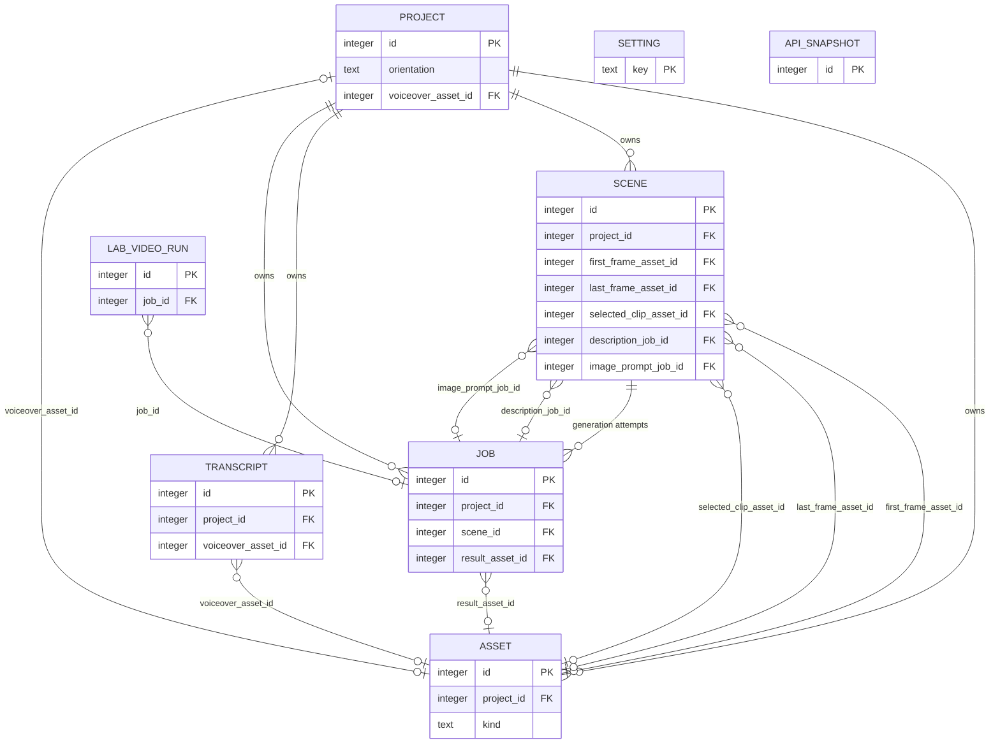

# Visio Studio: Database Structure

Status: Derived from `ANALYSIS.md` (originally Revision 3, now updated for Revision 4's transcription findings), specifically Section 4 ("Database and data model"), cross-referenced with Sections 3.7, 4.4, 5.1, 5.2 and 6.5 for field-level detail. No code or migrations exist yet — this document turns the "draft data model" in `ANALYSIS.md` Section 4.3 into a complete, implementable structure.

**Update (2026-10-05):** `ANALYSIS.md` Revision 4 confirmed the transcription endpoint's real response shape against the live GPU server. Section 4.3 (`transcript` table) and the JSON shapes in Section 5 below are updated accordingly — `transcript.words` now holds the whole verified response object, not a guessed-at array.

**Update (Phase 6, 2026-10-06):** no schema change. Section 5 now documents the `plan_scenes` job's `input` (it carries the cache key `input_hash` and what the scenes were made from) and `output` (the model's answer is kept verbatim in `output.answer`, next to the attempts, the token usage and the check counts), and Section 7 says how scenes are replaced. The cache key lives in `job.input`, not in a new column.

**Update (Phase 9, 2026-10-06):** no schema change. Section 5 now documents the real `generate_clip` `input` and `output` (the request is built once and stored, and every later attempt sends it again) and the `asset.provenance` of a clip and of a derived frame, and Section 7 says how a clip, its take and its selection are written. A *take* is a succeeded `generate_clip` job together with its clip asset: there is still no clip table.

**Update (Phase 12, 2026-10-08):** migration `0003`. A new job type, `draft_descriptions` (a paid call to the language model that writes every scene's video prompt and its first and last frame descriptions in one request). `project` gains `description_instructions`. `scene` gains `first_frame_description`, `last_frame_description`, `frame_descriptions_source` and `description_job_id` (the job that wrote the AI text). Section 5 documents the job's `input` and `output`, and Section 7 says how the drafts are written and which fields they may overwrite.

**Update (Phase 13, 2026-10-08):** migration `0004`. Two tables for the Image lab page, where Bitdeer's image API is tested by hand: `lab_run` (one call: the exact request, the raw response, timing and usage) and `lab_image` (an upload, or a result of a run). They belong to no project. Nothing existing changes. See Sections 4.8, 4.9 and 7.

**Update (Phase 15, 2026-10-08):** migration `0005`. `scene.frame_descriptions_source` (one source for the pair) is replaced by `first_frame_description_source` and `last_frame_description_source`, copied from the old column wherever the text exists. The AI drafting job no longer writes a last-frame description (a clip is made from its first frame alone): it writes the video prompt and the first-frame description, and clears an earlier AI-written last-frame description in the scenes it writes into. The prompt profile is now `ltx-2.3-first-frame`, and the `world` and `continuity` values in the job's answer changed. See Sections 4.4, 5 and 7.

**Update (Phase 16, 2026-10-08):** migration `0006`. A new job type, `write_image_prompt`: one paid call to the language model for one scene (a scene job, `scene_id` set), which turns the scene's first-frame description, video prompt, narration and the draft's `world` into a detailed prompt for the image model. `scene` gains `image_prompt`, `image_prompt_source` and `image_prompt_job_id` (the job that wrote the AI text). Whether an AI prompt is out of date is computed when it is read, from a hash of its inputs kept on that job (`job.input.inputs_sha256`): no flag is stored. A new global setting, `image_prompt_llm_model`. See Sections 3, 4.4, 4.5, 5, 6 and 7.

**Update (Phase 17, 2026-10-08):** migration `0007`. A new job type, `generate_frame`, and a new job provider, `image`: one paid image from the image model (Seedream through Bitdeer) for one scene (a scene job, `scene_id` set). Its result is an `asset` (`kind='frame'`, `source='ai'`) that becomes the scene's first frame, and the raw image the model returned is kept as a second asset. **No table or column is added**: the frame is a normal asset, `scene.first_frame_asset_id` already points at it, and the scene's earlier frames are the result frames of its succeeded `generate_frame` jobs (no list is stored). Whether an AI frame is out of date is computed when it is read, from the prompt its provenance recorded. Two new global settings, `image_model` and `max_parallel_image_generations` (the second was replaced by the shared `max_parallel_gpu_jobs` on 2026-10-13, see below). See Sections 4.2, 4.5, 5, 6 and 7.

**Update (Phase 18, 2026-10-09):** no schema change. A new global setting, `default_negative_prompt` (a text for the video model: no background music, singing or speech, no on-screen text, logos or watermarks, and common video artifacts). A `generate_clip` job sends the project's own `negative_prompt` when it has one, otherwise this default, and a new project starts with this text as its own `negative_prompt`. Before this, a project with a blank `negative_prompt` sent none, and the GPU server's own default applied. See Sections 4.1, 5 and 6.

**Update (Phase 19, 2026-10-09):** migration `0008`. LTX-2.5 runs next to LTX-2.3, and the video model is chosen per app, project and scene. `project` and `scene` gain a nullable `video_model` (`ltx-2.3` or `ltx-2.5`; NULL means "inherit": the scene takes the project's, the project takes the global setting `default_video_model`). **`job.project_id` becomes nullable** and `job.type` gains `lab_video` and `write_lab_video_prompt`: the new Video lab belongs to no project, and its jobs are normal background jobs. A new table, `lab_video_run`, holds what the Video lab lists and compares (the model, the prompt, the settings, and the stored clip). A clip's job and asset record which model made it. No `negative_prompt` is sent to LTX-2.5 (it has none), so the project's and the global negative prompts are LTX-2.3 only. See Sections 3, 4.1, 4.4, 4.5, 4.10, 5, 6 and 7.

**Update (Phase 20, 2026-10-09):** migration `0009`. A new job type, `auto_pipeline`: one run of the automatic flow of a project, which makes the jobs of the manual steps one step after the other and starts a step only when every scene has finished the one before. **No table or column is added**: the run keeps its state in `job.input` and `job.output` (including the ids of the jobs it made, so a restart continues where it was), and only the `job.type` CHECK gains the new value. A run is a project job (`scene_id` is NULL, `provider='local'`) and keeps a fixed marker in `provider_job_id` so the dispatcher checks it every tick. Its jobs are ordinary jobs of the existing types, with `input.auto_run_id` naming the run. See Sections 4.5, 5 and 7.

**Update (Phase 21, 2026-10-10):** migration `0010`. Two things from the GPU API 0.5.0 to 0.7.0. (1) **LTX-2.5 first-and-last-frame**: `POST /v1/ltx25/videos/interpolate` replaces the fallback to LTX-2.3, so a scene with a last frame is made by the chosen model's own endpoint (`first_frame_asset_id` and `last_frame_asset_id` in the body, no `negative_prompt`), and the Video lab can take an optional last frame (`lab_video_run.last_frame`). (2) **Breeze TTS 2 text-to-speech** (`POST /v1/breeze-tts/synthesize`): `job.type` gains `lab_voice` and `generate_voiceover`; new tables `voice` (a saved voice: a recording and its exact transcript) and `lab_voice_run` (what the new Voice lab lists); `project.voice_id` names the saved voice that speaks the script when the app makes the voiceover (`asset.kind='voiceover'`, `asset.source='ai'`, with `provenance.script_sha256`). The automatic flow gains a first step, `voiceover`. Breeze TTS 2 is licensed for research and non-commercial use only. See Sections 3, 4.1, 4.5, 4.10, 4.11, 4.12, 5 and 7.

**Update (Phase 22, 2026-10-11):** migration `0011`. The image model changes from Seedream (Bitdeer) to **Qwen-Image-2.1 on the GPU server** (`POST /v1/qwen-image21/images/generate`, added in GPU API 0.8.0). (1) `generate_frame` becomes a remote GPU job like `generate_clip` (`provider='gpu'`, restart rule `resume`, a `provider_job_id`, polled by the dispatcher) instead of one synchronous paid call. Its stored request holds the nearest of the model's seven picture shapes, a random seed and the mode (the new global setting `image_mode`, which replaces `image_model`). The label-band crop is gone: the frame is the model's picture scaled to cover the generation size and trimmed evenly. The `image` value stays in the `provider` CHECK, but no job uses it any more. (2) The Image lab gets Qwen next to Seedream. A Qwen run is a `lab_image` job (`job.type` gains `lab_image`), and `lab_run` gains a nullable `job_id` and the status `running`; Seedream runs are unchanged. (3) The prompt profile the language model writes image prompts with is now `qwen-image-2.1` (150 to 300 words, no "bottom tenth" rule). The model's weights are under the Qwen Research License (non-commercial use only). See Sections 4.5, 4.8, 5, 6 and 7.

**Update (Phase 23, 2026-10-11):** migration `0012`. **AI last frames**, so a clip can be made from a first and a last frame (the LTX first-and-last-frame endpoints already existed). (1) `job.type` gains `write_last_frame_prompt` (a paid call to the language model for one scene) and `generate_last_frame` (a remote GPU job for one scene, like `generate_frame`). (2) `scene` gains `last_frame_prompt`, `last_frame_prompt_source` and `last_frame_prompt_job_id`, the counterparts of the three `image_prompt` columns: the instruction that **edits the first frame into the last frame** with Qwen-Image-2.1's edit endpoint (`POST /v1/qwen-image21/images/edit`, with the first frame uploaded as a reference image). (3) The drafting job's prompt profile is now `ltx-first-last`: the model decides, scene by scene, whether the clip gets a last frame and writes its description into `scene.last_frame_description` (source `ai`), or answers null. **No column is added for the frame itself**: it is a normal frame asset, `scene.last_frame_asset_id` already points at it, and the earlier last frames of a scene are the result frames of its succeeded `generate_last_frame` jobs. Whether an AI last frame is out of date is computed (its prompt, or the first frame it edited, changed), never stored. (4) A scene whose draft `continuity` is `continues_action`, after a scene that has a last frame, **starts on that frame**: the app sets its `first_frame_asset_id` to the previous scene's last frame (the same asset row), in the transaction that attaches it. (5) The automatic run has two more steps, `last_frame_prompts` and `last_frames`. See Sections 3, 4.4, 4.5, 5 and 7.

**Update (Phase 24, 2026-10-11):** migration `0013`. **The Talking character lab**: a character picture speaks a line of dialogue, lip-synced, and the three labs become tabs of one Lab page (no schema change for that part). (1) The GPU server's audio-to-video endpoint (`POST /v1/ltx/videos/audio-to-video`, `AudioToVideoRequest`, LTX-2.3, quality recipe only) makes a clip to match a recorded speech and muxes that speech in unchanged. It is a `lab_video` job like any other Video lab run, and `lab_video_run` gains `audio_input` (`{"source": "voice_run" \| "voice", "id": n}`, NULL for every other clip); the job's input also carries `audio` (the file's path and type, copied when the run starts). The clip is as long as the speech (the smallest `8k + 1` frame count that is not shorter, at most 20 seconds). (2) `job.type` gains `write_talk_prompts` (a paid call to the language model that writes a voice instruction and a video prompt). (3) New tables `lab_character` (the cast: a name, a picture, a description the language model reads, an optional default voice) and `lab_talk_run` (one take: the dialogue, the picture, the prompts, and the three steps it is made in, each a job the other labs already run: `prompt_job_id`, `voice_run_id`, `video_run_id`). A take with `auto_continue` starts its next step by itself when the prompts job finishes and when the speech is stored; if a step cannot start, the reason is kept in `lab_talk_run.last_error`. See Sections 3, 4.10, 4.13, 4.14 and 5.

**Update (project cast, 2026-10-12):** migration `0014`. **A project's cast, so a character or a place looks the same in every scene.** (1) New tables `character` and `location` (Sections 4.15 and 4.16): the characters and places of a story, each with the text that describes it (found by one language model job that reads the script, edited by hand), the prompt for its **reference picture** and the picture itself. (2) `scene` gains `character_id` and `location_id` (the one character and the one place the scene shows; `character_id` is replaced by the table `scene_character` in migration `0015`, below), `cast_assignment_source` (`manual` \| `ai`) and `cast_assignment_job_id`. (3) `asset.kind` gains `reference` (a reference picture). (4) `job.type` gains `extract_cast`, `write_character_reference_prompt`, `generate_character_reference` and `assign_cast`. (5) A scene that shows a member has its first frame made by **the image model's edit endpoint, from the picture of each member** (the character is image 1, the place the next), instead of from words alone; the image prompt of such a scene is written for that (`QWEN_IMAGE_21_CHARACTER_EDIT`), and it carries the members in its inputs, so assigning a scene differently makes its prompt out of date. A scene that shows none is made as before. (6) A character's picture is asked for on a plain **white** backdrop, which is then removed (`rembg`), so the stored picture has a transparent backdrop; a place is kept whole. It is sent to the image model flattened on white again. (7) The automatic run has four more steps, between `scenes` and `descriptions`: `cast`, `cast_prompts`, `cast_images` and `cast_assignment`. (8) A scene's choice of cast counts as one of its inputs (`scene_cuts.has_inputs` and `NO_INPUTS`): replacing a scene, or changing its cut, asks first and then clears the choice, like a description or a frame. Nothing speaks in these stories: a character's voice is only a note for the language model. See Sections 3, 4.2, 4.4, 4.5, 4.15, 4.16, 5 and 7.

**Update (several characters in a scene, 2026-10-13):** migration `0015`. **A scene may show any number of characters.** (1) New table `scene_character` (Section 4.17): one row for each character a scene shows, with its `position` (the order of the character's reference picture: 0 is image 1). (2) `scene.character_id` is dropped. Every existing choice is copied into `scene_character` at position 0 first, so none is lost. (3) A scene made from the cast sends one reference picture for each character (images 1, 2, and so on, in `position` order) and then the place's. The image model's edit takes 10 pictures, so a scene shows at most **9** characters (`cast.MAX_SCENE_CHARACTERS`): code applies this limit (the `assign_cast` answer is cut there, a manual choice above it is refused with 422), and no prompt asks for any number of characters. (4) The prompts leave the number of characters to the model: `assign_cast` now answers with a list of names (`characters`) for each scene, and the profile `QWEN_IMAGE_21_CHARACTER_EDIT` (version 2) names each character by its image number. A character's entry in `cast.references` of the image prompt's inputs gains `name`, so the writer can tell several characters apart: the image prompts of scenes that show a character are therefore out of date once. (5) `NO_INPUTS` no longer holds `character_id`. A cut edit that clears a scene's inputs also deletes the scene's `scene_character` rows (`scenes.apply_cut_edit`). See Sections 3, 4.4, 4.17, 5 and 7.

**Update (parallel automatic run and two shared pools, 2026-10-13):** **No table or column is added.** (1) The automatic run (`auto_pipeline`) is no longer a queue of fourteen steps done one after the other: the steps are a graph. A step starts when the steps it *needs* are complete, and a scene (or a character, or a place) goes on to its next step as soon as its *own* input is ready (for example, a clip starts once its scene's frames are made, while other scenes' frames are still being made). The cast is found from the script at once, beside the voiceover. `job.output` of a run no longer has a `step` key (an older run's is ignored), and `problems[]` always had a `step`. (2) The per-job-type limits are gone. Two numbers limit all work, shared by every kind of job: `max_parallel_gpu_jobs` (the GPU server) and `max_parallel_paid_api_calls` (the paid inference API). They replace `max_parallel_generations` and `max_parallel_image_generations` (a saved value of either is never read), and there is no concurrency group any more. A new endpoint, `GET /api/jobs/capacity`, reports each pool's limit and what is running and waiting in it. See Sections 3.3, 4.5, 6 and 7.

**How to read this document:** every table and field name is taken directly from `ANALYSIS.md`. Where `ANALYSIS.md` describes behaviour in prose but doesn't spell out a concrete SQL type, default, index, or constraint, I chose a simple, standard convention and marked it. **Section 8 ("Assumptions and additions beyond ANALYSIS.md") lists every one of those choices in one place** so you can confirm or correct them before anything is built. Nothing in Sections 1–7 should surprise you if you've read `ANALYSIS.md`; it's the same model, just made concrete.

---

## Contents

1. [Engine and tooling](#1-engine-and-tooling)
2. [Design principles behind the structure](#2-design-principles-behind-the-structure)
3. [Entity-relationship overview](#3-entity-relationship-overview)
4. [Tables](#4-tables)
5. [JSON column shapes](#5-json-column-shapes)
6. [Global settings stored in `setting`](#6-global-settings-stored-in-setting)
7. [How the pipeline writes to these tables](#7-how-the-pipeline-writes-to-these-tables)
8. [Assumptions and additions beyond ANALYSIS.md](#8-assumptions-and-additions-beyond-analysismd)

---

## 1. Engine and tooling

(Source: `ANALYSIS.md` Section 4.1)

- **SQLite** for iteration 1 — one file on the Docker `data` volume, no separate database container, no credentials. PostgreSQL is dropped because the reason for it (a separate worker process, and the database doubling as a job queue) no longer applies with one backend process and no queue table.
- **SQLAlchemy 2.x** for models, **Alembic** for migrations, so the code stays portable if you move to PostgreSQL later.
- **WAL mode and foreign keys** turned on (`PRAGMA journal_mode=WAL;` and `PRAGMA foreign_keys=ON;`).
- **JSON columns** (SQLAlchemy's `JSON` type) hold word timings and the exact request/response payloads sent to providers. SQLite has no native JSON storage class — these are stored as `TEXT` and serialized/validated by SQLAlchemy at the application layer.
- **Switch to PostgreSQL when:** you host it, add users, or run more than one backend process (Section 4.1). The cost is a connection-string change, running the same Alembic migrations against Postgres, and copying data.

---

## 2. Design principles behind the structure

(Source: `ANALYSIS.md` Section 4.2, "Manual-first, AI-ready")

- **An artifact is the same thing no matter who made it.** A scene description is text on the scene whether you typed it or an LLM drafted it — only a `source` field changes. A frame is an `asset` row whether you uploaded it or a model generated it.
- **Every unit of background work is a `job` row** (transcribe, plan scenes, generate a clip, render) holding its input and output, so the UI can show activity. This is the same table for manual-era and AI-era work.
- **"Ready to generate" is computed, not stored.** A scene is ready when it has a description and a first frame (the last frame is optional since Phase 14) — the backend checks this from existing columns; there's no `is_ready` flag to keep in sync.
- **There is no separate `Clip` table.** A generation attempt is a `job`, its result is an `asset`, and the `scene` points at whichever asset is the chosen take. This is what makes "regenerate" and "pick another take" work without new tables: a retake is just another `job` row producing another `asset`, and you repoint `scene.selected_clip_asset_id`.
- **Frames are assets referenced by id**, not owned exclusively by one scene, so a frame can be reused by a later scene (this is also what lets chained continuity — Section 5.7 of `ANALYSIS.md` — be added later with zero schema change: scene N+1's first frame would just point at scene N's last-frame asset).

---

## 3. Entity-relationship overview

Seventeen tables (the three newest, `character`, `location` and `scene_character`, belong to one project: its cast, Sections 4.15, 4.16 and 4.17), all scoped under one `project` except the global ones (`setting`, `api_snapshot`, and, from Phase 13, `lab_run` and `lab_image`, from Phase 19, `lab_video_run`, from Phase 21, `voice` and `lab_voice_run`, and, from Phase 24, `lab_character` and `lab_talk_run`), which hold no `project_id` because they describe the app, the GPU server or a manual test, not one video. The Video lab's jobs are rows of `job` too, with a NULL `project_id` (Phase 19).



`SETTING` and `API_SNAPSHOT` have no edges to `PROJECT` — they are global, as described in Sections 3.7 and 6.5.

**Foreign keys, precisely** (the diagram above is a visual aid; this list is authoritative):

| From | Column | To | Nullable |
|---|---|---|---|
| `asset` | `project_id` | `project.id` | No |
| `project` | `voiceover_asset_id` | `asset.id` | Yes (until the voiceover is uploaded) |
| `transcript` | `project_id` | `project.id` | No |
| `transcript` | `voiceover_asset_id` | `asset.id` | Yes (the voiceover the transcript was made from; `SET NULL` if that asset row is ever removed). Added in Phase 5. |
| `scene` | `project_id` | `project.id` | No |
| `scene` | `first_frame_asset_id` | `asset.id` | Yes (until uploaded) |
| `scene` | `last_frame_asset_id` | `asset.id` | Yes (until uploaded) |
| `scene` | `selected_clip_asset_id` | `asset.id` | Yes (until a clip is generated) |
| `scene` | `description_job_id` | `job.id` | Yes (until an AI draft writes into the scene; `SET NULL` if that job row is ever removed). Added in Phase 12. |
| `scene` | `image_prompt_job_id` | `job.id` | Yes (until the AI writes the scene's image prompt; `SET NULL` if that job row is ever removed). Added in Phase 16. |
| `job` | `project_id` | `project.id` | Yes: NULL only for the Video lab's jobs (`lab_video`, `write_lab_video_prompt`), which belong to no project. Every other job type always has one. Phase 19 |
| `job` | `scene_id` | `scene.id` | Yes (only per-scene job types set this) |
| `job` | `result_asset_id` | `asset.id` | Yes (until the job succeeds) |
| `lab_video_run` | `job_id` | `job.id` | Yes (the `lab_video` job that makes the run's clip; `SET NULL` if that job row is ever removed). Phase 19 |
| `lab_voice_run` | `job_id` | `job.id` | Yes (the `lab_voice` job that makes the run's speech; `SET NULL` if that job row is ever removed). Phase 21 |
| `lab_voice_run` | `voice_id` | `voice.id` | Yes (the saved voice that read the text; `SET NULL`). Phase 21 |
| `project` | `voice_id` | `voice.id` | Yes (the saved voice that speaks the script; `SET NULL`). Phase 21 |
| `lab_character` | `voice_id` | `voice.id` | Yes (the character's default saved voice; `SET NULL`). Phase 24 |
| `lab_talk_run` | `character_id` | `lab_character.id` | Yes (the cast character the take started from; `SET NULL`). Phase 24 |
| `lab_talk_run` | `voice_id` | `voice.id` | Yes (the saved voice that reads the line; `SET NULL`). Phase 24 |
| `lab_talk_run` | `prompt_job_id` | `job.id` | Yes (the `write_talk_prompts` job; `SET NULL`). Phase 24 |
| `lab_talk_run` | `voice_run_id` | `lab_voice_run.id` | Yes (the speech the take made or reuses; `SET NULL`). Phase 24 |
| `lab_talk_run` | `video_run_id` | `lab_video_run.id` | Yes (the lip-synced clip; `SET NULL`). Phase 24 |
| `character` | `project_id` | `project.id` | No (`CASCADE`). Project cast |
| `character` | `reference_prompt_job_id` | `job.id` | Yes (the `write_character_reference_prompt` job; `SET NULL`). Project cast |
| `character` | `reference_asset_id` | `asset.id` | Yes (the reference picture; `SET NULL`). Project cast |
| `location` | `project_id` | `project.id` | No (`CASCADE`). Project cast |
| `location` | `reference_prompt_job_id` | `job.id` | Yes (the `write_character_reference_prompt` job; `SET NULL`). Project cast |
| `location` | `reference_asset_id` | `asset.id` | Yes (the reference picture; `SET NULL`). Project cast |
| `scene_character` | `scene_id` | `scene.id` | No (`CASCADE`). Project cast, several characters |
| `scene_character` | `character_id` | `character.id` | No (`CASCADE`). Project cast, several characters |
| `scene` | `location_id` | `location.id` | Yes (the one place the scene shows; `SET NULL`). Project cast |
| `scene` | `cast_assignment_job_id` | `job.id` | Yes (the `assign_cast` job that chose; `SET NULL`). Project cast |

Note the one circular-looking reference: `asset.project_id` points at `project`, and `project.voiceover_asset_id` points back at `asset`. This isn't a problem in practice because of the order things happen in (Section 1 of `ANALYSIS.md`): the project row is created first with `voiceover_asset_id` left `NULL`, the voiceover file is uploaded afterwards as an `asset` row, and only then is `project.voiceover_asset_id` updated to point at it.

Phase 12 adds a second pair: `scene.description_job_id` points at `job`, and `job.scene_id` points back at `scene`. Both are nullable, and a `draft_descriptions` job is project-level (`scene_id` is NULL), so it survives the replacement of the scenes. The ORM marks `description_job_id` with `use_alter` for the same reason as the voiceover link.

Phase 16 adds a third: `scene.image_prompt_job_id` points at `job`. Unlike a draft, a `write_image_prompt` job is a scene job (`scene_id` is set, `ON DELETE CASCADE`), so merging a scene away, or replacing the scenes, deletes the jobs that wrote its prompt, and their paid answers with them. The API therefore refuses a cut edit of such a scene, and a proposal, while one of these jobs is queued or running (as it does for a clip job). `image_prompt_job_id` is `use_alter` too.

Phase 23 adds a fourth, `scene.last_frame_prompt_job_id`, with the same rules: a `write_last_frame_prompt` job is a scene job (`ON DELETE CASCADE`), so a cut edit of the scene, and a proposal, are refused while one is queued or running, and so while a `generate_last_frame` job is. `last_frame_prompt_job_id` is `use_alter` too.

The project cast adds a cycle of its own: `job.scene_id` → `scene`, `scene.location_id` → `location`, and `location.reference_prompt_job_id` → `job` (a character's `reference_prompt_job_id` is written the same way; the characters of a scene are rows of `scene_character`, which nothing points back at). `character.reference_prompt_job_id` and `location.reference_prompt_job_id` are `use_alter` (the way `scene.description_job_id` is), and so is `scene.cast_assignment_job_id`. The cast jobs belong to the project, not to a scene (`scene_id` is NULL; a reference job names its member in `input.cast_kind` and `input.cast_id`), so they survive the replacement of the scenes. Replacing the scenes removes the scenes' own choices of who they show, and leaves the cast itself as it is.

---

## 4. Tables

Each table below shows: its purpose, a column reference table, and illustrative SQL DDL (SQLite dialect). Model names below match the PascalCase names used in `ANALYSIS.md` Section 4.3; table names are the lowercase `snake_case` SQL identifiers I'm proposing for them (see Section 8).

### 4.1 `project`

One row per video. Holds output settings (pre-filled from orientation — Section 4.4), the project-scoped settings from Section 3.7 (scene length limits, guidelines, clip sound volume), and the script/voiceover inputs.

| Column | Type | Null | Default | Description |
|---|---|---|---|---|
| `id` | INTEGER | NOT NULL | auto | Primary key |
| `name` | TEXT | NOT NULL | — | The project's name |
| `created_at` | DATETIME | NOT NULL | now | |
| `orientation` | TEXT | NOT NULL | — | `portrait` \| `landscape` — chosen first (decision 2) |
| `gen_width` | INTEGER | NOT NULL | from orientation | Sent to LTX; multiple of 64 |
| `gen_height` | INTEGER | NOT NULL | from orientation | Sent to LTX; multiple of 64 |
| `out_width` | INTEGER | NOT NULL | from orientation | Final video width |
| `out_height` | INTEGER | NOT NULL | from orientation | Final video height |
| `fps` | INTEGER | NOT NULL | 24 | Frame rate |
| `min_scene_seconds` | REAL | NOT NULL | 2.0 | Shortest allowed scene |
| `max_scene_seconds` | REAL | NOT NULL | 6.0 | Longest allowed scene (your 5–6 s cap) |
| `style_prefix` | TEXT | NULL | blank | Guideline: style, sent as LTX's `Style:` prefix |
| `prompt_suffix` | TEXT | NULL | blank | Guideline: camera/lighting/colour/pacing, always appended |
| `negative_prompt` | TEXT | NULL | the `default_negative_prompt` setting's text when the project is created (blank if that setting is blank) | Guideline: what to avoid. When it is blank, a clip is made with the `default_negative_prompt` setting instead (Section 6). LTX-2.3 only: LTX-2.5 has no negative prompt and is never sent one (Phase 19) |
| `clip_sound_volume` | REAL | NOT NULL | 0.2 | 0 = off; otherwise each clip's own sound, as a share of the voiceover's level (0.2 = 14 dB under the voice, 0.05 = 26 dB). The render measures the loudness of the voiceover and of each clip, so every clip lands at the same distance under the voice |
| `cut_instructions` | TEXT | NULL | blank | Extra instructions for the AI that proposes cuts |
| `description_instructions` | TEXT | NULL | blank | Extra instructions for the AI that drafts the video prompts and first-frame descriptions: places and recurring subjects (animals, objects, people where needed), look, sound wishes (Phase 12; wording of Phase 15) |
| `script_text` | TEXT | NULL | — | Pasted in step B of the flow; `NULL` until then |
| `video_model` | TEXT | NULL | — | `ltx-2.3` \| `ltx-2.5`. The video model that makes this project's clips. NULL means "use the app's default" (the `default_video_model` setting, Section 6). A scene's own `video_model` wins over it. Phase 19 |
| `language` | TEXT | NOT NULL | `'en'` | Voiceover language (English-only decision) |
| `voiceover_asset_id` | INTEGER, FK → `asset.id` | NULL | — | Set once the voiceover is uploaded, or made from the script (`asset.source` `upload` or `ai`) |
| `voice_id` | INTEGER, FK → `voice.id` | NULL | — | The saved voice that speaks the script when the app makes the voiceover (Breeze TTS). `ON DELETE SET NULL`. Phase 21 |

```sql
CREATE TABLE project (
    id                 INTEGER PRIMARY KEY,
    name               TEXT NOT NULL,
    created_at         DATETIME NOT NULL DEFAULT CURRENT_TIMESTAMP,
    orientation        TEXT NOT NULL CHECK (orientation IN ('portrait', 'landscape')),
    gen_width          INTEGER NOT NULL,
    gen_height         INTEGER NOT NULL,
    out_width          INTEGER NOT NULL,
    out_height         INTEGER NOT NULL,
    fps                INTEGER NOT NULL DEFAULT 24,
    min_scene_seconds  REAL NOT NULL DEFAULT 2.0,
    max_scene_seconds  REAL NOT NULL DEFAULT 6.0,
    style_prefix       TEXT,
    prompt_suffix      TEXT,
    negative_prompt    TEXT,
    clip_sound_volume  REAL NOT NULL DEFAULT 0.2,
    cut_instructions   TEXT,
    description_instructions TEXT,
    script_text        TEXT,
    video_model        TEXT CHECK (video_model IS NULL OR video_model IN ('ltx-2.3', 'ltx-2.5')),
    language           TEXT NOT NULL DEFAULT 'en',
    voiceover_asset_id INTEGER REFERENCES asset(id) ON DELETE SET NULL,
    voice_id           INTEGER REFERENCES voice(id) ON DELETE SET NULL
);
```

### 4.2 `asset`

Any file on disk — uploaded or generated. Covers the voiceover, every frame, every generated clip, and the final render. (Source: Section 4.2 and 4.3.)

| Column | Type | Null | Default | Description |
|---|---|---|---|---|
| `id` | INTEGER | NOT NULL | auto | Primary key |
| `project_id` | INTEGER, FK → `project.id` | NOT NULL | — | Owning project |
| `kind` | TEXT | NOT NULL | — | `voiceover` \| `frame` \| `clip` \| `final` \| `reference` (`reference`: the reference picture of a cast member, with the raw image it was made from and, for a character, the cut-out; which member points at it is told by `character.reference_asset_id` or `location.reference_asset_id`, not by the kind, the way `frame` covers first and last frames) |
| `path` | TEXT | NOT NULL | — | Server-generated (UUID) path on the `data` volume |
| `mime` | TEXT | NOT NULL | — | MIME type |
| `size_bytes` | INTEGER | NOT NULL | — | File size |
| `duration_s` | REAL | NULL | — | Audio/video kinds only |
| `width` | INTEGER | NULL | — | Image/video kinds only. For an uploaded frame: the size as displayed, after the EXIF orientation is applied (Phase 8) |
| `height` | INTEGER | NULL | — | Image/video kinds only. Same rule as `width` |
| `sha256` | TEXT | NOT NULL | — | Content hash |
| `source` | TEXT | NOT NULL | — | `upload` \| `ai` \| `derived` |
| `provenance` | JSON | NULL | empty | provider/model/prompt/seed — empty (NULL) for uploads, including the frames uploaded in Phase 8. A frame made by the image model (`source='ai'`, Phase 17) records the prompt, the mode, the seed and the sizes, and so does the raw image behind it (Section 5) |
| `created_at` | DATETIME | NOT NULL | now | |

```sql
CREATE TABLE asset (
    id          INTEGER PRIMARY KEY,
    project_id  INTEGER NOT NULL REFERENCES project(id) ON DELETE CASCADE,
    kind        TEXT NOT NULL CHECK (kind IN ('voiceover', 'frame', 'clip', 'final', 'reference')),
    path        TEXT NOT NULL,
    mime        TEXT NOT NULL,
    size_bytes  INTEGER NOT NULL,
    duration_s  REAL,
    width       INTEGER,
    height      INTEGER,
    sha256      TEXT NOT NULL,
    source      TEXT NOT NULL CHECK (source IN ('upload', 'ai', 'derived')),
    provenance  JSON,
    created_at  DATETIME NOT NULL DEFAULT CURRENT_TIMESTAMP
);
```

### 4.3 `transcript`

Word times from the transcription endpoint, plus those same times matched onto your script. Replaces what Revision 1 called "Alignment." (Source: `ANALYSIS.md` Section 4.3 and 5.1, Revision 4.)

**Update (Revision 4 of `ANALYSIS.md`):** the transcription endpoint is now live — `POST /v1/parakeet/transcribe` on your GPU server — and its real response shape is confirmed, not a draft. It returns more than a bare word list: a full transcript string, per-word *and* per-segment timestamps, and timing metadata. The `words` column below now holds that whole object verbatim (still satisfying "raw endpoint output, exactly as returned"), not just an extracted array. See Section 5 for the exact shape.

| Column | Type | Null | Default | Description |
|---|---|---|---|---|
| `id` | INTEGER | NOT NULL | auto | Primary key |
| `project_id` | INTEGER, FK → `project.id` | NOT NULL | — | Owning project |
| `provider` | TEXT | NOT NULL | — | Which transcription endpoint produced this, e.g. `"parakeet"` |
| `language` | TEXT | NOT NULL | — | The language you expect the voiceover to be in (e.g. `"en"`), used only for your own records and any future matching logic. **Not sent to the endpoint** — Parakeet auto-detects among 25 languages and has no `language` request field. |
| `words` | JSON | NOT NULL | — | The endpoint's raw response, exactly as returned: `{transcription, processing_time, word_timestamps, segment_timestamps, metadata}` — see Section 5 |
| `script_words` | JSON | NOT NULL | — | Script words with matched times, built from `words.word_timestamps`: `[{index, word, start, end, matched, paragraph}]` — see Section 5 |
| `created_at` | DATETIME | NOT NULL | now | |
| `voiceover_asset_id` | INTEGER, FK → `asset.id` | NULL | — | The voiceover asset this transcript was made from. (Phase 5, migration `0002`) |
| `script_sha256` | TEXT | NOT NULL | — | SHA-256 (hex) of the project's `script_text` exactly as stored at the moment of matching. (Phase 5, migration `0002`) |

```sql
CREATE TABLE transcript (
    id                 INTEGER PRIMARY KEY,
    project_id         INTEGER NOT NULL REFERENCES project(id) ON DELETE CASCADE,
    provider           TEXT NOT NULL,
    language           TEXT NOT NULL,
    words              JSON NOT NULL,
    script_words       JSON NOT NULL,
    created_at         DATETIME NOT NULL DEFAULT CURRENT_TIMESTAMP,
    voiceover_asset_id INTEGER REFERENCES asset(id) ON DELETE SET NULL,
    script_sha256      TEXT NOT NULL
);
```

**Out of date (Phase 5).** The ANALYSIS.md model does not say how to tell that a transcript no longer fits its inputs, so Phase 5 added the two columns above. A transcript is out of date when `voiceover_asset_id` differs from the project's current `voiceover_asset_id` (reason `voiceover_changed`), or when `script_sha256` differs from the SHA-256 of the project's current `script_text` (reason `script_changed`). An all-blank script is stored as `NULL` and hashes as the empty string. Uploading the same file again creates a new asset, so it counts as a changed voiceover. The newest transcript of a project (by `id`) is the one that counts.

### 4.4 `scene`

One cut = one clip (called "Segment" in Revision 1 of `ANALYSIS.md`). The central table: it accumulates the cut timing, the description, the first frame, an optional last frame, and the chosen take. (Source: Section 4.3, 5.2, 5.7.)

| Column | Type | Null | Default | Description |
|---|---|---|---|---|
| `id` | INTEGER | NOT NULL | auto | Primary key |
| `project_id` | INTEGER, FK → `project.id` | NOT NULL | — | Owning project |
| `index` | INTEGER | NOT NULL | — | Order within the project |
| `start_s` | REAL | NOT NULL | — | Start time in the voiceover |
| `end_s` | REAL | NOT NULL | — | End time in the voiceover |
| `text` | TEXT | NOT NULL | — | This scene's slice of the script: its words joined by single spaces. Phase 7 finds a scene's words again by matching this text against the transcript's `script_words` |
| `cut_source` | TEXT | NOT NULL | — | `ai` \| `rule` \| `manual` — who placed the cut that ends this scene |
| `cut_note` | TEXT | NULL | — | Why it needs a look, if it does |
| `scene_description` | TEXT | NULL | — | The motion prompt sent to the video model (with the project's style prefix and suffix around it) |
| `scene_description_source` | TEXT | NULL | — | `manual` \| `ai` |
| `first_frame_description` | TEXT | NULL | — | What the first frame should show, at the instant just before the motion begins: a guide for making the frame, by hand now and by an image model later (Phase 12; Phase 15 wording) |
| `last_frame_description` | TEXT | NULL | — | What the last frame shows: the same shot as the first frame, a moment later, where the motion ends. Since Phase 23 the drafting model writes it (source `ai`) for the scenes where pinning the end of the clip helps, and answers null for the rest; between Phase 15 and 23 the AI never wrote it. When the author wrote it, it is sent to the drafting model as context so the video prompt can end on it, and it is never overwritten |
| `first_frame_description_source` | TEXT | NULL | — | `manual` \| `ai`. Who wrote `first_frame_description`; NULL while it is blank (Phase 15, replaces the pair's `frame_descriptions_source`) |
| `last_frame_description_source` | TEXT | NULL | — | `manual` \| `ai`. Who wrote `last_frame_description`; NULL while it is blank. A draft that writes into the scene replaces an `ai` text, or clears it when the model decides the scene gets no last frame (then it also clears an `ai` `last_frame_prompt` and takes an AI-made last frame off the scene); the author's text is never touched (Phase 15, changed in Phase 23) |
| `description_job_id` | INTEGER, FK → `job.id` | NULL | — | The `draft_descriptions` job that last wrote AI text into this scene (the video prompt or the first-frame description). Kept after the user edits a text, so the draft in `job.output.drafts` can be compared with what the user made of it. `ON DELETE SET NULL`. Lets a scene be traced to the exact request and answer (Phase 12) |
| `image_prompt` | TEXT | NULL | — | The detailed prompt for the image model that makes the first frame: one paragraph, written by the AI (a `write_image_prompt` job) or by hand. Phase 17 sends it to the image model (Qwen-Image-2.1 on the GPU server since Phase 22, Seedream before). Whether it is out of date is computed, never stored (Section 5) (Phase 16) |
| `image_prompt_source` | TEXT | NULL | — | `manual` \| `ai`. Who wrote `image_prompt`; NULL while it is blank. A prompt is the author's unless its source is `ai`, and the author's is never overwritten (Phase 16) |
| `image_prompt_job_id` | INTEGER, FK → `job.id` | NULL | — | The `write_image_prompt` job that last wrote AI text into `image_prompt`. A job that reused an earlier answer counts, and its `output.cache_hit_of_job_id` names the job that paid. Kept after the user edits the text, so the job's request and answer can be compared with what the user made of it. `ON DELETE SET NULL` (Phase 16) |
| `last_frame_prompt` | TEXT | NULL | — | The instruction for the image model that edits the scene's first frame into its last frame: what changes, and that everything else stays as it is. The model sees the first frame as its reference picture, so it does not describe the scene again. Written by the AI (a `write_last_frame_prompt` job, from `last_frame_description`) or by hand. Whether it is out of date is computed, never stored (Section 5) (Phase 23) |
| `last_frame_prompt_source` | TEXT | NULL | — | `manual` \| `ai`. Who wrote `last_frame_prompt`; NULL while it is blank. The author's prompt is never overwritten (Phase 23) |
| `last_frame_prompt_job_id` | INTEGER, FK → `job.id` | NULL | — | The `write_last_frame_prompt` job that last wrote AI text into `last_frame_prompt`, kept after the user edits it. `ON DELETE SET NULL` (Phase 23) |
| `first_frame_asset_id` | INTEGER, FK → `asset.id` | NULL | — | The scene's first frame. Required for a clip (Phase 14: a scene is ready with a description and a first frame) |
| `last_frame_asset_id` | INTEGER, FK → `asset.id` | NULL | — | Optional (Phase 14). When set, the scene's clip is made from both frames (keyframe interpolation on LTX-2.3, `/interpolate` on LTX-2.5) and ends on it. When NULL, the clip is made from the first frame alone (image-to-video). There is no separate on/off flag: the clip mode is derived from this column (`scene_inputs.clip_mode`). The frame is an upload, or since Phase 23 one the image model made by editing the first frame; a scene that continues the previous scene's action also uses the previous scene's last frame as its first frame (the same `asset` row in both columns) |
| `use_clip_sound` | BOOLEAN | NOT NULL | true | Per-scene switch; false mutes this scene's own sound |
| `selected_clip_asset_id` | INTEGER, FK → `asset.id` | NULL | — | Which generated take is used in the final render |
| `video_model` | TEXT | NULL | — | `ltx-2.3` \| `ltx-2.5`. The video model that makes this scene's clips. NULL means "use the project's" (and, when that is NULL too, the app's default). It changes the clips made from now on: a clip already made keeps the model it was made with (Phase 19) |
| `location_id` | INTEGER, FK → `location.id` | NULL | — | The one place this scene shows, or NULL. The characters it shows (none, one or several) are rows of `scene_character` (Section 4.17). A scene that shows a character or a place has its first frame made by the image model's edit, from each member's reference picture, and waits until those pictures exist. `ON DELETE SET NULL` (project cast) |
| `cast_assignment_source` | TEXT | NULL | — | `manual` \| `ai`. Who chose the scene's characters (`scene_character`) and `location_id`; NULL until somebody has chosen. A choice of *nobody* is a choice: the source is set, the scene has no `scene_character` rows and `location_id` is NULL. The author's choice (`manual`) is never overwritten by the AI (project cast) |
| `cast_assignment_job_id` | INTEGER, FK → `job.id` | NULL | — | The `assign_cast` job that last chose for this scene, kept after the user changes the choice. `ON DELETE SET NULL`, and `use_alter` like the other job columns of `scene` (project cast) |

```sql
CREATE TABLE scene (
    id                        INTEGER PRIMARY KEY,
    project_id                INTEGER NOT NULL REFERENCES project(id) ON DELETE CASCADE,
    "index"                   INTEGER NOT NULL,
    start_s                   REAL NOT NULL,
    end_s                     REAL NOT NULL,
    text                      TEXT NOT NULL,
    cut_source                TEXT NOT NULL CHECK (cut_source IN ('ai', 'rule', 'manual')),
    cut_note                  TEXT,
    scene_description         TEXT,
    scene_description_source  TEXT CHECK (scene_description_source IN ('manual', 'ai')),
    first_frame_description   TEXT,
    last_frame_description    TEXT,
    first_frame_description_source TEXT CHECK (first_frame_description_source IN ('manual', 'ai')),
    last_frame_description_source  TEXT CHECK (last_frame_description_source IN ('manual', 'ai')),
    description_job_id        INTEGER REFERENCES job(id) ON DELETE SET NULL,
    image_prompt              TEXT,
    image_prompt_source       TEXT CHECK (image_prompt_source IN ('manual', 'ai')),
    image_prompt_job_id       INTEGER REFERENCES job(id) ON DELETE SET NULL,
    last_frame_prompt         TEXT,
    last_frame_prompt_source  TEXT CHECK (last_frame_prompt_source IN ('manual', 'ai')),
    last_frame_prompt_job_id  INTEGER REFERENCES job(id) ON DELETE SET NULL,
    first_frame_asset_id      INTEGER REFERENCES asset(id) ON DELETE SET NULL,
    last_frame_asset_id       INTEGER REFERENCES asset(id) ON DELETE SET NULL,
    use_clip_sound            BOOLEAN NOT NULL DEFAULT 1,
    selected_clip_asset_id    INTEGER REFERENCES asset(id) ON DELETE SET NULL,
    video_model               TEXT CHECK (video_model IS NULL OR video_model IN ('ltx-2.3', 'ltx-2.5')),
    location_id               INTEGER REFERENCES location(id) ON DELETE SET NULL,
    cast_assignment_source    TEXT CHECK (cast_assignment_source IN ('manual', 'ai')),
    cast_assignment_job_id    INTEGER REFERENCES job(id) ON DELETE SET NULL,
    UNIQUE (project_id, "index")
);
```

Scene readiness ("a description plus a first frame present"; the last frame is optional since Phase 14, and earlier phases required both frames) is **computed** by the backend from these columns at read time — there is deliberately no `is_ready` column (Section 4.2 and 4.3's design notes). The clip mode (`first_frame` or `first_and_last`) is computed the same way, from `last_frame_asset_id`, and is fixed for a clip job when the job first starts (Section 5, `generate_clip`).

### 4.5 `job`

Every unit of background work: transcribe, plan scenes, generate a clip, render the final video. This is where running-job information lives, so a restart never loses track of a 5–10 minute GPU job. (Source: Section 3.3, 4.2, 4.3.)

| Column | Type | Null | Default | Description |
|---|---|---|---|---|
| `id` | INTEGER | NOT NULL | auto | Primary key |
| `project_id` | INTEGER, FK → `project.id` | NULL | — | Owning project. NULL only for the Video lab's jobs (`lab_video`, `write_lab_video_prompt`) and the Voice lab's (`lab_voice`), which belong to no project; the Activity page shows them under "Video lab" and "Voice lab" (Phases 19 and 21) |
| `scene_id` | INTEGER, FK → `scene.id` | NULL | — | Set only for per-scene jobs (`generate_clip`, and since Phase 16 `write_image_prompt`, since Phase 17 `generate_frame`, and since Phase 23 `write_last_frame_prompt` and `generate_last_frame`) |
| `type` | TEXT | NOT NULL | — | `transcribe` \| `plan_scenes` \| `draft_descriptions` \| `write_image_prompt` \| `generate_frame` \| `generate_clip` \| `render_final` \| `lab_video` \| `write_lab_video_prompt` \| `auto_pipeline` \| `lab_voice` \| `generate_voiceover` \| `lab_image` \| `write_last_frame_prompt` \| `generate_last_frame` \| `write_talk_prompts` \| `extract_cast` \| `write_character_reference_prompt` \| `generate_character_reference` \| `assign_cast` (`extract_cast`, `write_character_reference_prompt` and `assign_cast`: paid calls to the language model for the project's cast, and `generate_character_reference`: a remote GPU job, one per character or place, whose input names it in `cast_kind` (`character` \| `location`) and `cast_id`; `write_talk_prompts`: Phase 24, the Talking character lab; `lab_video` and `write_lab_video_prompt`: Phase 19, the Video lab; `auto_pipeline`: Phase 20, the automatic flow; `lab_voice` and `generate_voiceover`: Phase 21, Breeze TTS; `lab_image`: Phase 22, a run of the Image lab on the GPU server; `write_last_frame_prompt` and `generate_last_frame`: Phase 23, the last frame) |
| `status` | TEXT | NOT NULL | `'queued'` | `queued` \| `running` \| `succeeded` \| `failed` \| `cancelled` |
| `phase` | TEXT | NULL | — | Free-text UI label, e.g. "queued on cluster" |
| `provider` | TEXT | NOT NULL | — | `gpu` \| `llm` \| `image` (Phase 17: the image model at the Bitdeer address; **no job uses it since Phase 22**, when `generate_frame` moved to `gpu`, and the CHECK keeps it) \| `local` |
| `provider_job_id` | TEXT | NULL | — | The external server's job id, once submitted. An `auto_pipeline` run keeps the fixed marker `auto` here instead: it is not an id on any server, it only makes the dispatcher check the run at every tick |
| `input` | JSON | NOT NULL | — | Exact request sent: prompt, seed, server URL, etc. |
| `output` | JSON | NULL | — | Raw provider answer (LLM JSON, token usage, etc.) |
| `result_asset_id` | INTEGER, FK → `asset.id` | NULL | — | Set on success |
| `attempt` | INTEGER | NOT NULL | 1 | Retry counter |
| `error` | TEXT | NULL | — | The server's error text, if failed |
| `created_at` | DATETIME | NOT NULL | now | |
| `started_at` | DATETIME | NULL | — | |
| `finished_at` | DATETIME | NULL | — | |
| `last_checked_at` | DATETIME | NULL | — | Last time the dispatcher polled this job |

```sql
CREATE TABLE job (
    id               INTEGER PRIMARY KEY,
    project_id       INTEGER REFERENCES project(id) ON DELETE CASCADE,
    scene_id         INTEGER REFERENCES scene(id) ON DELETE CASCADE,
    type             TEXT NOT NULL CHECK (type IN ('transcribe', 'plan_scenes', 'draft_descriptions', 'write_image_prompt', 'generate_frame', 'generate_clip', 'render_final', 'lab_video', 'write_lab_video_prompt', 'auto_pipeline', 'lab_voice', 'generate_voiceover', 'lab_image', 'write_last_frame_prompt', 'generate_last_frame', 'write_talk_prompts', 'extract_cast', 'write_character_reference_prompt', 'generate_character_reference', 'assign_cast')),
    status           TEXT NOT NULL DEFAULT 'queued'
                       CHECK (status IN ('queued', 'running', 'succeeded', 'failed', 'cancelled')),
    phase            TEXT,
    provider         TEXT NOT NULL CHECK (provider IN ('gpu', 'llm', 'image', 'local')),
    provider_job_id  TEXT,
    input            JSON NOT NULL,
    output           JSON,
    result_asset_id  INTEGER REFERENCES asset(id) ON DELETE SET NULL,
    attempt          INTEGER NOT NULL DEFAULT 1,
    error            TEXT,
    created_at       DATETIME NOT NULL DEFAULT CURRENT_TIMESTAMP,
    started_at       DATETIME,
    finished_at      DATETIME,
    last_checked_at  DATETIME
);
```

The dispatcher loop (Section 3.3) is the main reader/writer of this table: each tick it checks every `running` job, starts downloads for finished ones, resubmits pre-empted ones, and starts `queued` jobs, oldest first, while their pool has a free slot. There are **two shared pools** (`jobs/pools.py`): `gpu`, every job whose handler's provider is `gpu` (transcription, speech, reference pictures, first and last frames, clips, and the labs' clips, images and speeches), limited by the setting `max_parallel_gpu_jobs`; and `paid_api`, every job whose provider is `llm` or `image` (every language model call), limited by `max_parallel_paid_api_calls`. A job type has no limit of its own and no handler names a group: a new job type joins the pool of its provider. A `local` job type (`render_final`, `auto_pipeline`) is a pool of its own, and its handler's `concurrency_limit` says how many. A queued job whose pool is full shows the phase "waiting for a free GPU server slot" or "waiting for a free paid API slot". Both limits are read at every tick, and a lower number never stops a job that is running. Since Phase 20 an `auto_pipeline` job is a `running` job that does no work itself: its handler's `poll` is the whole run (it reads this table, creates the next jobs, and moves on), so a run is checked every tick like a job on the GPU server and survives a restart (`restart_rule='resume'`). At most 5 runs are `running` at once (a constant).

### 4.6 `setting`

Global settings edited in the UI (Section 3.7) — a simple key/value table. **Project-scoped** settings (scene length limits, guidelines, clip sound volume) are **not** stored here; they live as columns directly on `project` (Section 4.1 above) and `scene.use_clip_sound`. See Section 6 below for exactly which keys live in this table.

| Column | Type | Null | Default | Description |
|---|---|---|---|---|
| `key` | TEXT | NOT NULL (PK) | — | e.g. `gpu_api_base_url` |
| `value` | JSON | NOT NULL | — | The setting's value |
| `updated_at` | DATETIME | NOT NULL | now | |

```sql
CREATE TABLE setting (
    key        TEXT PRIMARY KEY,
    value      JSON NOT NULL,
    updated_at DATETIME NOT NULL DEFAULT CURRENT_TIMESTAMP
);
```

### 4.7 `api_snapshot`

The recorded GPU API contract (Section 6.5) — the guide, the OpenAPI spec, and any other swagger document you add. Checked before every submission so a server update can't silently change what gets sent.

| Column | Type | Null | Default | Description |
|---|---|---|---|---|
| `id` | INTEGER | NOT NULL | auto | Primary key |
| `source` | TEXT | NOT NULL | — | `guide` \| `openapi` \| a custom name you add |
| `url` | TEXT | NOT NULL | — | The source's path, relative to the server URL its `base` names (so a new tunnel address doesn't invalidate it). Includes any query string, for example `/v1/guide?format=json`. (Phase 4) |
| `fetched_at` | DATETIME | NOT NULL | now | |
| `fingerprint` | TEXT | NOT NULL | — | The document's `content_hash` if present, else SHA-256 of the canonical JSON |
| `server_content_hash` | TEXT | NULL | — | The server's own hash field, if the document has one |
| `api_version` | TEXT | NULL | — | Version string from the guide, if present |
| `body` | JSON | NOT NULL | — | The fetched document |
| `state` | TEXT | NOT NULL | `'pending'` | `approved` \| `pending` |
| `approved_at` | DATETIME | NULL | — | Set when you click Approve |

```sql
CREATE TABLE api_snapshot (
    id                  INTEGER PRIMARY KEY,
    source              TEXT NOT NULL,
    url                 TEXT NOT NULL,
    fetched_at          DATETIME NOT NULL DEFAULT CURRENT_TIMESTAMP,
    fingerprint         TEXT NOT NULL,
    server_content_hash TEXT,
    api_version         TEXT,
    body                JSON NOT NULL,
    state               TEXT NOT NULL DEFAULT 'pending' CHECK (state IN ('approved', 'pending')),
    approved_at         DATETIME
);
```

Older snapshots are kept as history (Section 6.5: "Older versions stay as history") — rows are never overwritten, only inserted. To find the current baseline for a source, read the most recently **approved** row with that `source` **and** `url`, ordered by `fetched_at` and then `id`. Matching on `url` as well means a source whose path changes has no baseline and is "not approved", instead of showing a huge difference against a different document. (Phase 4.)

A changed source is stored once as a `pending` row per version: the guard inserts a pending row only if none with the same `fingerprint`, `source` and `url` exists that is newer than the latest approved row. A pending row is never converted to approved. Approving inserts a new `approved` row, so a simulated or real change always leaves the earlier approved, pending and approved rows behind as history.

### 4.8 `lab_run`

One manual test of an image model from the Image lab page (Phase 13, extended in Phase 22). A **Seedream** run is one synchronous call and **not** a `job` in the sense of the other labs: a call of 25 to 40 s that the page waits for. A **Qwen-Image-2.1** run (Phase 22) takes minutes, so it is a `lab_image` job (`job_id` set, `job.project_id` NULL) and its row is created `running`; the job's `finish` step stores the image, sets `status='succeeded'`, `seconds` and `response`, and adds the `lab_image`, in one transaction with the finished job. **A job that fails or is cancelled leaves the row `running`**, so the page reads the job's status as well (`api/image_lab.py`). Which model made a run is its `endpoint`: `/v1/qwen-image21/images/generate`, or a Bitdeer path. A row keeps what is needed to compare runs later: the exact request, the raw response, the timing and the usage. Runs are never deleted in iteration 1.

| Column | Type | Null | Default | Description |
|---|---|---|---|---|
| `id` | INTEGER | NOT NULL | auto | Primary key |
| `created_at` | DATETIME | NOT NULL | now | |
| `mode` | TEXT | NOT NULL | — | `text_to_image` \| `image_to_image` (the `image` field on `/images/generations`) \| `edit` (`POST /images/edits`, multipart). A Qwen run is always `text_to_image` |
| `endpoint` | TEXT | NOT NULL | — | The path called, for example `/images/generations` |
| `model` | TEXT | NOT NULL | — | The model sent, for example `seedream-5.0-lite` |
| `prompt` | TEXT | NOT NULL | — | |
| `params` | JSON | NOT NULL | — | What the form held besides the prompt: `size`, `watermark` (true, false or null for "not sent"), `seed`, `sequential_max_images`, `image_field_as`, `edit_field_name`, `extra`. A Qwen run holds `engine: "qwen"`, `qwen_mode` (`quality` or `fast`), `aspect_ratio`, `expected_size`, `seed` and `steps` instead |
| `reference_images` | JSON | NOT NULL | — | `[{"source": "lab" \| "asset", "id": 7}]`, in the order they were sent. Not named `references`, which is an SQL keyword |
| `status` | TEXT | NOT NULL | — | `running` (Phase 22: a Qwen run whose job has not finished it) \| `succeeded` \| `failed` |
| `http_status` | INTEGER | NULL | — | Absent when there was no answer at all (a timeout or a refused connection), and always absent for a Qwen run |
| `error` | TEXT | NULL | — | A readable message, including the Cloudflare and Bitdeer cases |
| `seconds` | REAL | NULL | — | How long the call took |
| `request_bytes` | INTEGER | NULL | — | The size of the body that was sent |
| `usage` | JSON | NULL | — | The `usage` block of the answer, as returned |
| `request` | JSON | NOT NULL | — | The request as sent, with every image replaced by `<image: N bytes>` |
| `response` | JSON | NULL | — | The answer, with every `b64_json` replaced by `<image: N bytes>`. For a Qwen run: the server's last status (`remote`), `expected_size` and `returned_size` |
| `job_id` | INTEGER, FK → `job.id` | NULL | — | The `lab_image` job that makes a run on the GPU server (Phase 22). NULL for a Seedream run. `ON DELETE SET NULL` |

```sql
CREATE TABLE lab_run (
    id               INTEGER PRIMARY KEY,
    created_at       DATETIME NOT NULL DEFAULT CURRENT_TIMESTAMP,
    mode             TEXT NOT NULL CHECK (mode IN ('text_to_image', 'image_to_image', 'edit')),
    endpoint         TEXT NOT NULL,
    model            TEXT NOT NULL,
    prompt           TEXT NOT NULL,
    params           JSON NOT NULL,
    reference_images JSON NOT NULL,
    status           TEXT NOT NULL CHECK (status IN ('running', 'succeeded', 'failed')),
    http_status      INTEGER,
    error            TEXT,
    seconds          REAL,
    request_bytes    INTEGER,
    usage            JSON,
    request          JSON NOT NULL,
    response         JSON,
    job_id           INTEGER REFERENCES job(id) ON DELETE SET NULL
);
```

### 4.9 `lab_image`

An image the lab holds: one the user uploaded, or one a run produced. Files live under `media/lab/` and are served at `/media/lab/...`. A project's frames are **not** copied here: a run refers to them by their `asset` id in `lab_run.reference_images`.

| Column | Type | Null | Default | Description |
|---|---|---|---|---|
| `id` | INTEGER | NOT NULL | auto | Primary key |
| `created_at` | DATETIME | NOT NULL | now | |
| `origin` | TEXT | NOT NULL | — | `upload` \| `result` |
| `run_id` | INTEGER, FK → `lab_run.id` | NULL | — | The run that produced a result. NULL for an upload. `ON DELETE SET NULL` |
| `output_index` | INTEGER | NULL | — | The position among the run's results, from 0 |
| `path` | TEXT | NOT NULL | — | Relative to the media folder, for example `lab/3f9c....jpg` |
| `mime` | TEXT | NOT NULL | — | |
| `width`, `height` | INTEGER | NOT NULL | — | As displayed |
| `size_bytes` | INTEGER | NOT NULL | — | |
| `sha256` | TEXT | NOT NULL | — | |

```sql
CREATE TABLE lab_image (
    id           INTEGER PRIMARY KEY,
    created_at   DATETIME NOT NULL DEFAULT CURRENT_TIMESTAMP,
    origin       TEXT NOT NULL CHECK (origin IN ('upload', 'result')),
    run_id       INTEGER REFERENCES lab_run(id) ON DELETE SET NULL,
    output_index INTEGER,
    path         TEXT NOT NULL,
    mime         TEXT NOT NULL,
    width        INTEGER NOT NULL,
    height       INTEGER NOT NULL,
    size_bytes   INTEGER NOT NULL,
    sha256       TEXT NOT NULL
);
```

### 4.10 `lab_video_run`

One video the Video lab made, or is making (Phase 19). The lab belongs to no project, so its work runs as `lab_video` jobs with a NULL `project_id`. The job holds the status, the phase, the exact request and the server's answers (so a run resumes after a restart or a pre-emption like a scene's clip); this row holds what the page lists and compares. The runs that one "run on both models" click starts share a `group_key`, and have the same prompt, first frame, size, length, recipe and seed, so the clips differ only by the model. Nothing is deleted in this iteration. Files live under `media/lab/` and are served at `/media/lab/...`.

| Column | Type | Null | Default | Description |
|---|---|---|---|---|
| `id` | INTEGER | NOT NULL | auto | Primary key |
| `created_at` | DATETIME | NOT NULL | now | |
| `job_id` | INTEGER, FK → `job.id` | NULL | — | The `lab_video` job. `ON DELETE SET NULL` |
| `group_key` | TEXT | NULL | — | Shared by the runs one click started (a random hex string) |
| `video_model` | TEXT | NOT NULL | — | `ltx-2.3` \| `ltx-2.5` |
| `endpoint` | TEXT | NOT NULL | — | The GPU server path the request goes to, for example `/v1/ltx25/videos/generate` |
| `prompt` | TEXT | NOT NULL | — | The prompt as sent (trimmed) |
| `params` | JSON | NOT NULL | — | What the form held and what was sent: `mode`, `orientation`, `width`, `height`, `fps`, `duration_s`, `num_frames`, `seed` and `negative_prompt` (only an LTX-2.3 run has one) |
| `first_frame` | JSON | NULL | — | `{"source": "lab" \| "asset", "id": n}`: an Image lab image, or a project's frame asset. NULL for text-to-video. Never copied: the run refers to it |
| `last_frame` | JSON | NULL | — | Same shape as `first_frame`. Only on a run that moves from a first to a last frame (needs a first frame): LTX-2.5 uses `POST /v1/ltx25/videos/interpolate`, LTX-2.3 keyframe interpolation. Phase 21 |
| `audio_input` | JSON | NULL | — | `{"source": "voice_run" \| "voice", "id": n}`: the recorded speech a lip-synced clip was made to match (`POST /v1/ltx/videos/audio-to-video`, LTX-2.3 only). NULL for every other clip. Never copied: the run refers to a Voice lab run, or to a saved voice. Phase 24 |
| `path` | TEXT | NULL | — | The stored clip, relative to the media folder (`lab/<32 hex>.mp4`). NULL until the job has finished |
| `size_bytes` | INTEGER | NULL | — | |
| `sha256` | TEXT | NULL | — | |
| `width`, `height` | INTEGER | NULL | — | As ffprobe reads the clip |
| `frame_count` | INTEGER | NULL | — | Counted from the file |
| `duration_s` | REAL | NULL | — | |
| `audio` | JSON | NULL | — | `{codec, sample_rate, channels}`, NULL when the clip has no sound |

```sql
CREATE TABLE lab_video_run (
    id           INTEGER PRIMARY KEY,
    created_at   DATETIME NOT NULL DEFAULT CURRENT_TIMESTAMP,
    job_id       INTEGER REFERENCES job(id) ON DELETE SET NULL,
    group_key    TEXT,
    video_model  TEXT NOT NULL CHECK (video_model IN ('ltx-2.3', 'ltx-2.5')),
    endpoint     TEXT NOT NULL,
    prompt       TEXT NOT NULL,
    params       JSON NOT NULL,
    first_frame  JSON,
    last_frame   JSON,
    audio_input  JSON,
    path         TEXT,
    size_bytes   INTEGER,
    sha256       TEXT,
    width        INTEGER,
    height       INTEGER,
    frame_count  INTEGER,
    duration_s   REAL,
    audio        JSON
);
```

### 4.11 `voice`

A saved voice (Phase 21): a clean recording and its exact transcript, which Breeze TTS 2 clones. A voice comes from an upload (`POST /api/voices`: the recording is received, checked with ffprobe by the voiceover's rules, WAV, MP3, M4A or FLAC and audio only, and stored under `media/lab/`) or from a Voice lab run (`POST /api/lab/voices/runs/{id}/save-voice`: the voice points at the run's own file, nothing is copied). A voice is never deleted, like every stored file; its name and transcript can be edited, its recording never changes. A job copies the recording's path and the transcript into its own `input` when it is created, so editing a voice changes nothing for a speech already under way.

| Column | Type | Null | Default | Description |
|---|---|---|---|---|
| `id` | INTEGER | NOT NULL | auto | Primary key |
| `created_at` | DATETIME | NOT NULL | now | |
| `name` | TEXT | NOT NULL | — | At most 80 characters |
| `path` | TEXT | NOT NULL | — | The stored recording, relative to the media folder (`lab/<32 hex>.<ext>`) |
| `mime` | TEXT | NOT NULL | — | `audio/wav`, `audio/mpeg`, `audio/mp4` or `audio/flac` |
| `size_bytes` | INTEGER | NOT NULL | — | |
| `sha256` | TEXT | NOT NULL | — | |
| `duration_s` | REAL | NOT NULL | — | |
| `transcript` | TEXT | NOT NULL | — | What the recording says, word for word (at most 1,000 characters: the server's limit for `reference_text`) |
| `origin` | TEXT | NOT NULL | — | `upload` \| `lab_run` |
| `lab_voice_run_id` | INTEGER | NULL | — | The run the recording came from (`origin='lab_run'`). Not a foreign key: only a note |

```sql
CREATE TABLE voice (
    id               INTEGER PRIMARY KEY,
    created_at       DATETIME NOT NULL DEFAULT CURRENT_TIMESTAMP,
    name             TEXT NOT NULL,
    path             TEXT NOT NULL,
    mime             TEXT NOT NULL,
    size_bytes       INTEGER NOT NULL,
    sha256           TEXT NOT NULL,
    duration_s       REAL NOT NULL,
    transcript       TEXT NOT NULL,
    origin           TEXT NOT NULL CHECK (origin IN ('upload', 'lab_run')),
    lab_voice_run_id INTEGER
);
```

### 4.12 `lab_voice_run`

One speech the Voice lab made, or is making (Phase 21). Like `lab_video_run`, the lab belongs to no project, so its work runs as `lab_voice` jobs with a NULL `project_id`; the job holds the status, the phase and the exact request. A run is one request, so its text is at most 1,000 characters.

| Column | Type | Null | Default | Description |
|---|---|---|---|---|
| `id` | INTEGER | NOT NULL | auto | Primary key |
| `created_at` | DATETIME | NOT NULL | now | |
| `job_id` | INTEGER, FK → `job.id` | NULL | — | The `lab_voice` job. `ON DELETE SET NULL` |
| `mode` | TEXT | NOT NULL | — | `design` (a voice made from a description), `clone` (a saved voice reads the text) \| `direction` (a saved voice, steered by the instruction) |
| `text` | TEXT | NOT NULL | — | The text to speak (trimmed) |
| `instruction` | TEXT | NULL | — | design: the voice description (optional). direction: how to say it. clone: NULL |
| `voice_id` | INTEGER, FK → `voice.id` | NULL | — | The saved voice (clone and direction). `ON DELETE SET NULL` |
| `params` | JSON | NOT NULL | — | `{"seed": n, "cfg_scale": x}`. The seed is random when the form left it empty; `cfg_scale` is 4 with an instruction and 1 without, as the server recommends |
| `path` | TEXT | NULL | — | The stored WAV, relative to the media folder (`lab/<32 hex>.wav`). NULL until the job has finished |
| `size_bytes` | INTEGER | NULL | — | |
| `sha256` | TEXT | NULL | — | |
| `duration_s` | REAL | NULL | — | As ffprobe reads the file |

```sql
CREATE TABLE lab_voice_run (
    id           INTEGER PRIMARY KEY,
    created_at   DATETIME NOT NULL DEFAULT CURRENT_TIMESTAMP,
    job_id       INTEGER REFERENCES job(id) ON DELETE SET NULL,
    mode         TEXT NOT NULL CHECK (mode IN ('design', 'clone', 'direction')),
    text         TEXT NOT NULL,
    instruction  TEXT,
    voice_id     INTEGER REFERENCES voice(id) ON DELETE SET NULL,
    params       JSON NOT NULL,
    path         TEXT,
    size_bytes   INTEGER,
    sha256       TEXT,
    duration_s   REAL
);
```

### 4.13 `lab_character`

A character of the Talking character lab's cast (Phase 24): a name, the picture that pins how it looks, and what to say about it to the language model that writes a take's prompts (it cannot see the picture, so the description is all it knows). Like every lab table it belongs to no project. A character is created and edited, never deleted in this iteration.

| Column | Type | Null | Default | Description |
|---|---|---|---|---|
| `id` | INTEGER | NOT NULL | auto | Primary key |
| `created_at` | DATETIME | NOT NULL | now | |
| `name` | TEXT | NOT NULL | — | At most 80 characters |
| `description` | TEXT | NOT NULL | `''` | Who they are and what they look like. At most 2,000 characters |
| `image` | JSON | NOT NULL | — | `{"source": "lab" \| "asset", "id": n}`: an Image lab image, or a project's frame asset. Never copied: the character refers to it |
| `voice_id` | INTEGER, FK → `voice.id` | NULL | — | The default saved voice (clone, or direction when `voice_instruction` is set). `ON DELETE SET NULL` |
| `voice_instruction` | TEXT | NULL | — | A description of the voice: with a saved voice it steers the delivery (direction); alone it makes a new voice (design). At most 500 characters |

```sql
CREATE TABLE lab_character (
    id                 INTEGER PRIMARY KEY,
    created_at         DATETIME NOT NULL DEFAULT CURRENT_TIMESTAMP,
    name               TEXT NOT NULL,
    description        TEXT NOT NULL DEFAULT '',
    image              JSON NOT NULL,
    voice_id           INTEGER REFERENCES voice(id) ON DELETE SET NULL,
    voice_instruction  TEXT
);
```

### 4.14 `lab_talk_run`

One take of the Talking character lab (Phase 24): a line of dialogue spoken by a character picture. A take is made in up to three steps, each a job the other labs already run, so the take row only links them: `prompt_job_id` (a `write_talk_prompts` job), `voice_run_id` (a `lab_voice_run`, made for the take or reused from an earlier one) and `video_run_id` (a `lab_video_run` made by the audio-to-video endpoint). The speech and the clip are therefore also listed by the Voice lab and the Video lab. Each step is a paid call and starts only from a click; with `auto_continue` the backend starts the next one by itself when the prompts job finishes and when the speech is stored. Nothing is deleted in this iteration.

| Column | Type | Null | Default | Description |
|---|---|---|---|---|
| `id` | INTEGER | NOT NULL | auto | Primary key |
| `created_at` | DATETIME | NOT NULL | now | |
| `dialogue` | TEXT | NOT NULL | — | The line the character says (trimmed, at most 1,000 characters: one request of the speech model) |
| `character_id` | INTEGER, FK → `lab_character.id` | NULL | — | The cast character the take started from. `ON DELETE SET NULL` |
| `image` | JSON | NOT NULL | — | `{"source": "lab" \| "asset", "id": n}`: the picture the speaker is made from (the video's literal first frame) |
| `character_note` | TEXT | NULL | — | What the author said about the character, word for word. It wins over the cast character's description; with neither, the prompt of the Image lab run that made the picture is used |
| `delivery_note` | TEXT | NULL | — | How the line is said |
| `voice_mode` | TEXT | NULL | — | `design` \| `clone` \| `direction` when the take makes a new speech. NULL when it reuses one |
| `voice_id` | INTEGER, FK → `voice.id` | NULL | — | The saved voice (clone and direction). `ON DELETE SET NULL` |
| `voice_instruction` | TEXT | NULL | — | What steers the speech model. Written by the author, or copied from the prompts job's output only where it was empty |
| `video_prompt` | TEXT | NULL | — | What the video model shows. Same rule as `voice_instruction` |
| `orientation` | TEXT | NOT NULL | — | `portrait` \| `landscape` |
| `video_seed` | INTEGER | NULL | — | NULL: a random seed for each clip |
| `negative_prompt` | TEXT | NULL | — | NULL: the pipeline's own default |
| `auto_continue` | BOOLEAN | NOT NULL | 0 | 1 for a take made with "run all" |
| `last_error` | TEXT | NULL | — | Why the take could not start its next step by itself. NULL when there is nothing to say |
| `prompt_job_id` | INTEGER, FK → `job.id` | NULL | — | The `write_talk_prompts` job. NULL when the prompts were written by hand. `ON DELETE SET NULL` |
| `voice_run_id` | INTEGER, FK → `lab_voice_run.id` | NULL | — | The take's speech. `ON DELETE SET NULL` |
| `video_run_id` | INTEGER, FK → `lab_video_run.id` | NULL | — | The take's clip. `ON DELETE SET NULL` |

Which step is next is never stored: it is worked out from the rows. The video prompt is always needed, and so is a voice instruction while a speech is still to be made from a description or directed; then the speech, then the clip.

```sql
CREATE TABLE lab_talk_run (
    id                 INTEGER PRIMARY KEY,
    created_at         DATETIME NOT NULL DEFAULT CURRENT_TIMESTAMP,
    dialogue           TEXT NOT NULL,
    character_id       INTEGER REFERENCES lab_character(id) ON DELETE SET NULL,
    image              JSON NOT NULL,
    character_note     TEXT,
    delivery_note      TEXT,
    voice_mode         TEXT CHECK (voice_mode IS NULL OR voice_mode IN ('design', 'clone', 'direction')),
    voice_id           INTEGER REFERENCES voice(id) ON DELETE SET NULL,
    voice_instruction  TEXT,
    video_prompt       TEXT,
    orientation        TEXT NOT NULL CHECK (orientation IN ('portrait', 'landscape')),
    video_seed         INTEGER,
    negative_prompt    TEXT,
    auto_continue      BOOLEAN NOT NULL DEFAULT 0,
    last_error         TEXT,
    prompt_job_id      INTEGER REFERENCES job(id) ON DELETE SET NULL,
    voice_run_id       INTEGER REFERENCES lab_voice_run(id) ON DELETE SET NULL,
    video_run_id       INTEGER REFERENCES lab_video_run(id) ON DELETE SET NULL
);
```

### Recommended indexes

Not specified explicitly in `ANALYSIS.md`, but implied by the access patterns it describes (the dispatcher repeatedly scanning jobs by status/type — Section 3.3; scenes read in order — Section 4.3):

```sql
CREATE INDEX idx_asset_project       ON asset (project_id);
CREATE INDEX idx_transcript_project  ON transcript (project_id);
CREATE INDEX idx_scene_project       ON scene (project_id);
CREATE INDEX idx_job_project         ON job (project_id);
CREATE INDEX idx_job_scene           ON job (scene_id);
CREATE INDEX idx_job_status          ON job (status);
CREATE INDEX idx_job_type_status     ON job (type, status);
CREATE INDEX idx_api_snapshot_source ON api_snapshot (source, fetched_at);
CREATE INDEX idx_lab_run_created     ON lab_run (created_at);
CREATE INDEX idx_lab_run_job         ON lab_run (job_id);
CREATE INDEX idx_lab_image_run       ON lab_image (run_id);
CREATE INDEX idx_lab_image_created   ON lab_image (created_at);
CREATE INDEX idx_lab_video_run_created ON lab_video_run (created_at);
CREATE INDEX idx_lab_video_run_group   ON lab_video_run (group_key);
CREATE INDEX idx_lab_video_run_job     ON lab_video_run (job_id);
CREATE INDEX idx_voice_created         ON voice (created_at);
CREATE INDEX idx_lab_voice_run_created ON lab_voice_run (created_at);
CREATE INDEX idx_lab_voice_run_job     ON lab_voice_run (job_id);
CREATE INDEX idx_lab_character_created ON lab_character (created_at);
CREATE INDEX idx_lab_talk_run_created  ON lab_talk_run (created_at);
CREATE INDEX idx_lab_talk_run_voice_run ON lab_talk_run (voice_run_id);
CREATE INDEX idx_character_project     ON character (project_id);
CREATE INDEX idx_location_project      ON location (project_id);
CREATE INDEX idx_scene_character_character ON scene_character (character_id);
```

### 4.15 `character`

A character of one project's story (project cast): who it is, what it looks like, and the **reference picture** that pins the look, so every scene that shows it is made from the same picture. The text is written by the language model that reads the script (an `extract_cast` job) and is edited by hand. The picture is made in two steps, each a job of its own (Section 5): the prompt (`write_character_reference_prompt`) and the image (`generate_character_reference`). The rows of a project are replaced together when the cast is found again (`cast.replace_cast`); a character is never deleted on its own in this iteration.

| Column | Type | Null | Default | Description |
|---|---|---|---|---|
| `id` | INTEGER | NOT NULL | auto | Primary key |
| `project_id` | INTEGER, FK → `project.id` | NOT NULL | — | Owning project. `ON DELETE CASCADE` |
| `name` | TEXT | NOT NULL | — | As the script writes it. Unique within the project's characters in practice (an edit that would repeat a name is refused), because a scene's character is chosen by name from a closed list |
| `appearance_description` | TEXT | NOT NULL | — | What a picture shows: apparent age, build, skin, face, hair, clothing, what the character carries. The reference prompt is written from it, and it is what the language model is told about the character in a scene's image prompt |
| `personality_description` | TEXT | NULL | — | How the character carries themselves: guides the bearing and the expression of the picture |
| `voice_description` | TEXT | NULL | — | A note for the language model only. **Nothing speaks** in these stories (a narrator tells them), so it is never sent to speech synthesis |
| `reference_prompt` | TEXT | NULL | — | The prompt for the image model, written by the AI or by hand. The prompt never holds the character's name |
| `reference_prompt_job_id` | INTEGER, FK → `job.id` | NULL | — | The `write_character_reference_prompt` job that wrote `reference_prompt`. NULL for a prompt written by hand (the page shows it as the user's, and an automatic run keeps it). `ON DELETE SET NULL`, and `use_alter` (a cycle through `scene` otherwise) |
| `reference_asset_id` | INTEGER, FK → `asset.id` | NULL | — | The reference picture (`kind='reference'`): the cut-out with a transparent backdrop, or, when the backdrop could not be removed, the picture on its white backdrop. A new picture replaces it and the old one stays on disk. `ON DELETE SET NULL` |
| `status` | TEXT | NOT NULL | `pending` | `pending` (nothing yet) \| `prompted` (the prompt is written) \| `ready` (the picture is made) \| `failed` (the picture job failed and the character has no picture; one that has a picture stays `ready`) |
| `created_at` | DATETIME | NOT NULL | now | |

```sql
CREATE TABLE character (
    id                       INTEGER PRIMARY KEY,
    project_id               INTEGER NOT NULL REFERENCES project(id) ON DELETE CASCADE,
    name                     TEXT NOT NULL,
    appearance_description   TEXT NOT NULL,
    personality_description  TEXT,
    voice_description        TEXT,
    reference_prompt         TEXT,
    reference_prompt_job_id  INTEGER REFERENCES job(id) ON DELETE SET NULL,
    reference_asset_id       INTEGER REFERENCES asset(id) ON DELETE SET NULL,
    status                   TEXT NOT NULL DEFAULT 'pending'
                             CHECK (status IN ('pending', 'prompted', 'ready', 'failed')),
    created_at               DATETIME NOT NULL DEFAULT CURRENT_TIMESTAMP
);
```

### 4.16 `location`

A place of one project's story (a palace, a forest): the same as a `character` without a personality or a voice. Its reference picture is an empty establishing view of the place and is kept whole (the place *is* the background, so nothing is cut out), in the nearest shape to the project's frame.

| Column | Type | Null | Default | Description |
|---|---|---|---|---|
| `id` | INTEGER | NOT NULL | auto | Primary key |
| `project_id` | INTEGER, FK → `project.id` | NOT NULL | — | Owning project. `ON DELETE CASCADE` |
| `name` | TEXT | NOT NULL | — | As the script writes it |
| `appearance_description` | TEXT | NOT NULL | — | What an empty picture of the place shows: the buildings or landscape, materials, colours, light, time of day, mood. No people |
| `reference_prompt` | TEXT | NULL | — | As for a character |
| `reference_prompt_job_id` | INTEGER, FK → `job.id` | NULL | — | As for a character |
| `reference_asset_id` | INTEGER, FK → `asset.id` | NULL | — | The reference picture (`kind='reference'`). `ON DELETE SET NULL` |
| `status` | TEXT | NOT NULL | `pending` | As for a character |
| `created_at` | DATETIME | NOT NULL | now | |

```sql
CREATE TABLE location (
    id                       INTEGER PRIMARY KEY,
    project_id               INTEGER NOT NULL REFERENCES project(id) ON DELETE CASCADE,
    name                     TEXT NOT NULL,
    appearance_description   TEXT NOT NULL,
    reference_prompt         TEXT,
    reference_prompt_job_id  INTEGER REFERENCES job(id) ON DELETE SET NULL,
    reference_asset_id       INTEGER REFERENCES asset(id) ON DELETE SET NULL,
    status                   TEXT NOT NULL DEFAULT 'pending'
                             CHECK (status IN ('pending', 'prompted', 'ready', 'failed')),
    created_at               DATETIME NOT NULL DEFAULT CURRENT_TIMESTAMP
);
```

### 4.17 `scene_character`

The characters a scene shows. A scene shows none, one or several, so they are rows here and not a column of `scene` (migration `0015` replaced `scene.character_id` with this table). The rows are written by the `assign_cast` job and by `PATCH /api/projects/{id}/scenes/{scene_id}/cast`, both through `cast.set_scene_characters`, which replaces all the scene's rows at once. A scene shows at most 9 characters (`cast.MAX_SCENE_CHARACTERS`: the image model's edit takes 10 pictures, and the place's is one of them); code applies the limit.

| Column | Type | Null | Default | Description |
|---|---|---|---|---|
| `scene_id` | INTEGER, FK → `scene.id` | NOT NULL | — | The scene. Part of the primary key. `ON DELETE CASCADE`: merging a scene away or replacing the scenes removes its rows |
| `character_id` | INTEGER, FK → `character.id` | NOT NULL | — | The character. Part of the primary key, so a character is listed once for a scene. `ON DELETE CASCADE`: finding the cast again removes the rows of the characters it replaces |
| `position` | INTEGER | NOT NULL | — | The order of the characters' reference pictures when the scene's first frame is made: 0 is image 1, 1 is image 2, and so on (the place's picture comes after the last character). It is part of the scene's image prompt inputs, so changing the order makes that prompt out of date |

```sql
CREATE TABLE scene_character (
    scene_id      INTEGER NOT NULL REFERENCES scene(id) ON DELETE CASCADE,
    character_id  INTEGER NOT NULL REFERENCES character(id) ON DELETE CASCADE,
    position      INTEGER NOT NULL,
    PRIMARY KEY (scene_id, character_id)
);
CREATE INDEX idx_scene_character_character ON scene_character (character_id);
```

---

## 5. JSON column shapes

### `transcript.words` — exactly as the transcription endpoint returns it (`ANALYSIS.md` Section 5.1, confirmed live against the real `POST /v1/parakeet/transcribe` response on 2026-10-05)

```json
{
  "transcription": "Welcome to the show.",
  "processing_time": 4.12,
  "word_timestamps": [
    { "word": "Welcome", "start": 0.00, "end": 0.48 },
    { "word": "to",      "start": 0.48, "end": 0.62 }
  ],
  "segment_timestamps": [
    { "text": "Welcome to the show.", "start": 0.00, "end": 1.20, "word_count": 4 }
  ],
  "metadata": { "total_segments": 1, "total_words": 4, "duration": 1.20 }
}
```

This is the whole object the endpoint returns, stored as-is. `word_timestamps` is what the matching step (below) reads; `segment_timestamps`, `transcription` and `metadata` are kept too, in case the scene-cut step (`ANALYSIS.md` Section 5.2) finds the segment boundaries useful as an extra signal, or for debugging a mismatch against the script.

### `transcript.script_words` — your script's words after matching (Section 5.1)

```json
[
  { "index": 0, "word": "Welcome", "start": 0.00, "end": 0.48, "matched": true,  "paragraph": 0 },
  { "index": 1, "word": "to",      "start": 0.48, "end": 0.62, "matched": true,  "paragraph": 0 }
]
```

`word` is the script's own token, with its punctuation, exactly as written. `matched` is `false` when the recogniser did not hear the word: its `start` and `end` are then interpolated between the neighbouring matched words. `paragraph` (0-based, added in Phase 5) is the number of the blank-line-separated paragraph the word is in, so later phases get the paragraph breaks (scene-break hints, `ANALYSIS.md` Section 5.2) without parsing the script again. Times are not guaranteed to be strictly increasing: the recogniser itself sometimes returns a zero-length word or a word that starts before the previous one ended.

### `job.input` and `job.output` for a `transcribe` job (Phase 5)

At creation, `input` is `{"voiceover_asset_id": 14}`. The handler replaces it as it learns more, so after the submission it holds the exact request:

```json
{
  "voiceover_asset_id": 14,
  "server_url": "http://host.docker.internal:8012",
  "upload": { "filename": "voiceover-14.m4a", "size_bytes": 496020, "remote_asset_id": "3f2a9c1e4b7d4a6c9e8f1a2b3c4d5e6f" },
  "endpoint": "/v1/parakeet/transcribe",
  "body": { "audio_asset_id": "3f2a9c1e4b7d4a6c9e8f1a2b3c4d5e6f", "partition": "main" }
}
```

`partition` is in `body` only when the GPU partition setting is not blank. `provider_job_id` holds the server's job id. When the job succeeds, `output` is a summary, and the full transcript lives in the `transcript` row it points to:

```json
{
  "transcript_id": 1,
  "processing_time": 59.53,
  "script_words": 137,
  "matched": 130,
  "interpolated": 7,
  "spoken_words": 134,
  "extra_spoken": 4,
  "warnings": []
}
```

### `job.input` and `job.output` for a `plan_scenes` job (Phase 6)

A `plan_scenes` job is a paid call to the language model (`ANALYSIS.md` Section 5.2 and 6.2). It has no `provider_job_id` (there is no remote job to check), and a restart never re-runs it.

At creation, `input` records what the user confirmed and what the proposal is made from:

```json
{
  "transcript_id": 1,
  "voiceover_asset_id": 14,
  "script_sha256": "9b7e...",
  "run_again": false,
  "accept_mismatch": false,
  "discard_scenes_with_inputs": false
}
```

`voiceover_asset_id` and `script_sha256` are what the scenes are made from: the scenes of the newest succeeded `plan_scenes` job are **out of date** when either differs from the project's current value (reasons `voiceover_changed` and `script_changed`, the same rule as the transcript in Section 4.3). The handler then adds the exact request, before the call is made:

```json
{
  "server_url": "https://api-inference.bitdeer.ai/v1",
  "endpoint": "/chat/completions",
  "request": { "model": "zai-org/GLM-5.3-Flash", "messages": ["..."], "max_tokens": 32000,
               "stream": true, "stream_options": { "include_usage": true },
               "response_format": { "type": "json_object" }, "reasoning_effort": "high" },
  "input_hash": "sha256:430e4650..."
}
```

`input_hash` is the cache key (`ANALYSIS.md` Section 6.2, rule 3): the SHA-256 of the canonical JSON of the address that is called and the request body. The same hash means the same inputs, so the earlier answer is reused without a call, unless the user chose Run again. It lives in `job.input` rather than in a column (Phase 6 decision), and the lookup reads the project's newest 100 `plan_scenes` jobs.

`output` is written after every attempt (so a paid answer is never lost) and replaced by the final value when the job succeeds:

```json
{
  "source": "ai",
  "cache_hit_of_job_id": null,
  "fallback_reason": null,
  "answer": { "scenes": [
    { "last_word": 57, "words_before_cut": "the lazy dog", "words_after_cut": "Then the fox" }
  ] },
  "answer_usable": true,
  "content": null,
  "attempts": [
    { "outcome": "answered", "http_status": 200, "message": null, "finish_reason": "stop",
      "response_id": "726d3d94...", "elapsed_s": 12.8,
      "usage": { "prompt_tokens": 1492, "completion_tokens": 2242, "reasoning_tokens": 1792 } }
  ],
  "usage": { "prompt_tokens": 1492, "completion_tokens": 2242, "reasoning_tokens": 1792 },
  "checks": { "entries": 16, "exact": 16, "moved": 0, "flagged": 0, "dropped": 0 },
  "splitter": { "cuts_added": 0, "cuts_removed": 0 },
  "scene_count": 16,
  "flagged_scenes": 0
}
```

- `source` is `ai`, or `rule` when the model could not be used (two failed attempts, or a refusal such as HTTP 400) and the rule-based splitter proposed the cuts alone. Then `fallback_reason` says why, and `answer` is `null`.
- `answer` is the model's list of scenes exactly as it answered (verbatim, from `ANALYSIS.md` Section 5.2). It is set only on the job that paid for it. A job that reused an earlier answer holds `answer: null` and `cache_hit_of_job_id`, which names the job that did pay, and `usage` is `null`. `answer_usable` is true when `answer` can be used again.
- `content` is the model's raw text, kept only when it could not be used (at most 20,000 characters). The model's reasoning text is not stored.
- `attempts[].outcome` is `answered`, `unusable` (an answer that could not be read, or that was cut off), or the kind of failure: `unreachable`, `rate_limited`, `server_error`, `refused`, `bad_answer`.
- `usage.reasoning_tokens` are hidden thinking tokens. They are part of `completion_tokens` and billed as output. Bitdeer reports them at the top level of `usage`.
- `checks` counts the model's entries: `exact` (number and checksum words agree), `moved` (a nearby word fit the checksum words), `flagged` (they fit nowhere nearby), `dropped` (unusable). `splitter` counts the cuts the rule-based splitter added and removed to keep scenes within the project's limits.

### `job.input` and `job.output` for a `draft_descriptions` job (Phase 12, reworked in Phase 15)

A `draft_descriptions` job is a paid call to the language model (`ANALYSIS.md` Section 6.2). It writes, for every scene of a project in **one request**, the video prompt (into `scene.scene_description`) and the first-frame description (into `scene.first_frame_description`). Since Phase 15 it never writes a last-frame description: a clip is made from its first frame alone, and a last frame is something the author adds by hand. Jobs from Phase 12 to 14 (profile `ltx-2.3-keyframe`) have the older shapes: `world.characters`, a `last_frame` in the answer and in `drafts`, `continues_shot`, and no `cleared`. Like `plan_scenes` it has no `provider_job_id`, and a restart never re-runs it. It is a project-level job: `scene_id` is NULL, so replacing the scenes does not delete it.

**Phase 23.** The active profile is `ltx-first-last` (`services/description_profiles.py`). The model now decides, scene by scene, whether the clip gets a last frame: each entry of the answer's `scenes` gains `last_frame` (a text, or null for a scene that gets none), and each entry of `output.drafts` gains `last_frame` and `detached_last_frame_asset_id`. A last frame is written only where the end of the clip is a visible change of the subject inside the same shot, where the next scene continues the action, or where a recurring subject must stay identical; ambient scenes, large camera moves, scenes under about 3 seconds, and ends that would show another place or light get null. It is written as "the same shot, one moment later", because it is made by editing the first frame. The author's own `last_frame_description` is `FIXED` like the other two texts: sent, never overwritten, answered null (`input.scenes_sent[].fixed.last_frame`). The profile has two sets of video prompt rules: for a scene **with** a last frame (only the motion between the two frames, a static camera) and for one **without** (the first-frame rules of earlier profiles). When the model gives no last frame for a scene the draft writes into, an AI-written `last_frame_description` is cleared (`cleared: ["last_frame"]`), together with an AI-written `last_frame_prompt` and an AI-made last frame (`scene.last_frame_asset_id` is set to NULL, the asset and its file stay, and `detached_last_frame_asset_id` names it), so the clip mode matches the new video prompt. A last frame the author wrote or uploaded is never touched. A scene whose video prompt and first-frame description the author both wrote is skipped, as before.

At creation, `input` records only the click:

```json
{ "requested": "draft", "run_again": false }
```

The handler adds the exact request, before the call is made:

```json
{
  "profile": { "id": "ltx-2.3-first-frame", "version": 2 },
  "instructions_sha256": "sha256:9d1c...",
  "scenes_sent": [
    { "scene_id": 30, "index": 0, "start_s": 0.0, "end_s": 3.2, "text": "In the beginning...",
      "fixed": { "video_prompt": false, "first_frame": false, "last_frame": false } }
  ],
  "server_url": "https://api-inference.bitdeer.ai/v1",
  "endpoint": "/chat/completions",
  "request": { "model": "zai-org/GLM-5.3", "messages": ["..."], "max_tokens": 32000,
               "stream": true, "stream_options": { "include_usage": true },
               "response_format": { "type": "json_object" }, "reasoning_effort": "high" },
  "input_hash": "sha256:7ac2..."
}
```

- `profile` names the **prompt profile** that wrote the instructions (`services/description_profiles.py`): everything that depends on the video model (its prompt rules, its worked example, its text checks). `version` is raised by hand whenever the profile's text changes, and `instructions_sha256` is the SHA-256 of the full system message, so runs can be grouped by instruction set even if a version bump is forgotten.
- `scenes_sent` is the snapshot the request was built from. The save writes only scenes whose `scene_id`, times and `text` still equal it. `fixed` marks the fields the user wrote: they are sent to the model as context, and never overwritten. `fixed.last_frame` is context only: it is `true` when the author wrote a last-frame description, which goes into the user message as a `FIXED last_frame (...)` line so the video prompt can end on it. The model is never asked for a last frame, and the system message and the answer shape do not mention one. An AI-written last-frame description from an old draft is not sent.
- `request` is the whole body (system and user messages included), so any draft can be read back exactly as it was asked for.
- `input_hash` is the cache key, built like `plan_scenes`' (the address and the request body). The same hash reuses the stored answer unless the user chose Run again.

`output` is written after every attempt, and replaced by the final value when the job succeeds:

```json
{
  "answer": {
    "world": { "subjects": [ { "name": "the paper boat", "description": "..." } ],
               "places": [ { "name": "the cobbled lane", "description": "..." } ] },
    "scenes": [ { "scene": 1, "continuity": "new_place", "first_frame": "...",
                  "video_prompt": "..." } ]
  },
  "answer_usable": true,
  "content": null,
  "attempts": [ { "outcome": "answered", "http_status": 200, "message": null, "finish_reason": "stop",
                  "response_id": "…", "elapsed_s": 41.2,
                  "usage": { "prompt_tokens": 3100, "completion_tokens": 9800, "reasoning_tokens": 6100 } } ],
  "usage": { "prompt_tokens": 3100, "completion_tokens": 9800, "reasoning_tokens": 6100 },
  "cache_hit_of_job_id": null,
  "drafts": [ { "scene_id": 30, "index": 0, "continuity": "new_place",
                "video_prompt": "...", "first_frame": "...",
                "warnings": [], "written": ["video_prompt", "first_frame"],
                "cleared": ["last_frame"] } ],
  "skipped": { "all_fixed": 2, "changed_while_drafting": 0, "missing_in_answer": 0 },
  "dropped_entries": 0,
  "seconds": 41.9
}
```

- `answer` is the model's JSON verbatim, set only on the job that paid for it. A job that reused an earlier answer holds `answer: null` and `cache_hit_of_job_id`. `world` (the subjects and places the model fixed once and reused: animals, objects and people where the script needs them) and `continuity` (`new_place`, `same_place_new_angle` or `continues_action`: the same place, subject and framing as the previous scene, with the first frame showing where the previous scene's motion ended) are kept for analysis, and for the image step that will use them later. They are not shown in the UI. A last frame the model writes anyway is ignored (only `video_prompt` and `first_frame` are read).
- `drafts` is what the checks made of each scene's draft (empty fields and fields over 4,000 characters are dropped). `warnings` are the profile's text rules and word limit that the text breaks. They never block saving. `written` lists the fields that really reached the scene, and `cleared` lists `last_frame` when the save removed an AI-written last-frame description from the scene (only in a scene the draft wrote into; the author's is never touched).
- `skipped.all_fixed` counts scenes with nothing the AI may write, `changed_while_drafting` the scenes whose id, times or text changed after the request was built, and `missing_in_answer` the scenes the model did not return. `dropped_entries` counts answer entries that named a scene that does not exist, or one already answered, or were not objects.
- A text the author wrote (`source = 'manual'`) is sent to the model as `FIXED` and the model answers `null` for it; any text the model returns for a fixed field is ignored. Only the fixed fields are answered `null`: the instructions say so explicitly since profile version 2. With version 1 the model also left out the first-frame description of a scene whose video prompt the author had written (draft job 84), so version 2 adds "every other field of that scene must still be written".
- `scene.description_job_id` points at this job for every scene that received at least one AI field.

### `job.input` and `job.output` for a `write_image_prompt` job (Phase 16)

A `write_image_prompt` job is a paid call to the language model (`ANALYSIS.md` Section 6.2), made for **one scene** (`job.scene_id` is set, so it is deleted with its scene). It turns the scene's first-frame description, video prompt and narration, the project's frame shape, style and instructions, and the draft's `world` and `continuity`, into one detailed prompt for the image model, and writes it into `scene.image_prompt` (source `ai`). Like the other language model jobs it has no `provider_job_id`, a restart never re-runs it, and it makes at most 2 attempts.

At creation, `input` records only the click:

```json
{ "requested": "write", "run_again": false }
```

`requested` is `write` (one scene) or `write_all` (the "Write image prompts" button, one job for each scene that needed one). The handler adds the exact request, before the call is made:

```json
{
  "profile": { "id": "seedream-5.0-lite", "version": 1 },
  "instructions_sha256": "sha256:0d74...",
  "scene_sent": { "scene_id": 29, "index": 0, "start_s": 0.0, "end_s": 5.84, "text": "What if I told you..." },
  "source_draft_job_id": 86,
  "world_from_job_id": 85,
  "inputs_sha256": "sha256:9adc...",
  "server_url": "https://api-inference.bitdeer.ai/v1",
  "endpoint": "/chat/completions",
  "request": { "model": "zai-org/GLM-5.3-Flash", "messages": ["..."], "max_tokens": 8000,
               "stream": true, "stream_options": { "include_usage": true },
               "response_format": { "type": "json_object" }, "reasoning_effort": "high" },
  "input_hash": "sha256:a3f2..."
}
```

- `profile` names the **image prompt profile** (`services/image_prompt_profiles.py`): the rules the prompt must follow, one worked example and the text checks. The whole system message counts as profile text, so `version` is raised by hand on any change to it or to the generic instructions in `services/image_prompt_writer.py`. `instructions_sha256` is the SHA-256 of the system message, as for drafts.
- `inputs_sha256` is the SHA-256 of what the model was told about the scene: orientation, generation width and height, style prefix, description instructions, `world`, the narration, `continuity`, the first-frame description and the video prompt. **A prompt is out of date when the scene's inputs now hash differently** from this value on the job `scene.image_prompt_job_id` points at (or when that job is gone). The model and the profile are not part of it, so a new profile does not mark prompts out of date by itself: they are written again with "Write again".
- `source_draft_job_id` is the draft job the `world` and `continuity` were read from: the scene's own (`scene.description_job_id`), or, for a scene whose texts were all written by hand, the project's newest successful draft, or null. `world_from_job_id` is the job that paid for that `world`: a draft that reused an answer holds `answer: null`, so it is the job named by its `cache_hit_of_job_id` (for example 85 behind 86). Drafts from before Phase 15 call the subjects `characters`; both are read.
- `scene_sent` is the snapshot the request was built from. The save writes only when the scene's id, times and text still equal it.
- `input_hash` is the cache key (the address and the request body, built like the other jobs'). It is looked up among this scene's earlier jobs only. The same hash reuses the stored answer unless the user chose Write again.

`output` is written after every attempt, and replaced by the final value when the job succeeds:

```json
{
  "answer": { "image_prompt": "A calm open sea stretches out..." },
  "answer_usable": true,
  "content": null,
  "attempts": [ { "outcome": "answered", "http_status": 200, "message": null, "finish_reason": "stop",
                  "response_id": "…", "elapsed_s": 2.7,
                  "usage": { "prompt_tokens": 1789, "completion_tokens": 324, "reasoning_tokens": 57 } } ],
  "usage": { "prompt_tokens": 1789, "completion_tokens": 324, "reasoning_tokens": 57 },
  "cache_hit_of_job_id": null,
  "image_prompt": "A calm open sea stretches out...",
  "word_count": 214,
  "warnings": [],
  "seconds": 2.8
}
```

- `answer` is the model's JSON verbatim, set only on the job that paid for it. A job that reused an earlier answer holds `answer: null`, `answer_usable: false` and `cache_hit_of_job_id`. `image_prompt` is what was saved: the answer's text made into one line.
- `warnings` are the profile's word range (120 to 220) and wording rules (words about text, captions, logos or watermarks, and quality tags such as 8k). They never block saving.
- A job fails, and writes nothing, when the scene's cut changed while it ran ("The scene's cut changed while the image prompt was being written..."), or when the author wrote a prompt meanwhile ("You wrote this image prompt while the AI was writing one, so yours was kept."). A paid answer already received stays in `output`, and the cache can reuse it.

### `job.input` and `job.output` for a `generate_frame` job (Phase 17, rewritten in Phase 22)

A `generate_frame` job is one first frame made by **Qwen-Image-2.1 on the GPU server** (`ANALYSIS.md` Section 6.2), for **one scene** (`job.scene_id` is set, so it is deleted with its scene; a cut edit, a proposal and the proposal's save refuse while one is active). `provider='gpu'`. It is a remote job like `generate_clip`: `start` submits and saves the server's job id (`provider_job_id`), the dispatcher polls it, and `finish` downloads the PNG. The restart rule is `resume`. Nothing is cached, and a new job always means a new random seed. There is no price per image. (Before Phase 22 it was one paid synchronous call to Bitdeer's Seedream, `provider='image'`, never re-run; jobs from then keep their old `input` and `output`: `geometry`, `usage`, `crop_bottom`.)

At creation, `input` records only the click:

```json
{ "requested": "generate", "replace_upload": false, "first_frame_at_click": null }
```

`requested` is `generate` (one scene) or `generate_all` (the "Generate first frames" button). `replace_upload` is true only when the click confirmed replacing a first frame the user uploaded, and `first_frame_at_click` is the asset id the scene's first frame was at the click (null for an empty slot). When the job starts, a first frame that is not the AI's is replaced only if `replace_upload` is true **and** it is still the asset in `first_frame_at_click`; otherwise the job fails, free, before anything is sent. The first `start` adds the exact request, before it is submitted, and **it is built once**: every later attempt (after a pre-emption, an expired result or a server that could not be reached) sends this same stored request with the same seed.

```json
{
  "scene_sent": { "scene_id": 29, "index": 0, "start_s": 0.0, "end_s": 5.84, "text": "What if I told you..." },
  "image_prompt": "A calm open sea stretches out...",
  "image_prompt_source": "ai",
  "image_prompt_job_id": 109,
  "replacing_asset_id": null,
  "frame_size": { "width": 1088, "height": 1920 },
  "image_model": "qwen-image-2.1",
  "image_mode": "quality",
  "aspect_ratio": "9:16",
  "expected_size": { "width": 1536, "height": 2752 },
  "endpoint": "/v1/qwen-image21/images/generate",
  "request": { "prompt": "A calm open sea stretches out...", "mode": "quality",
               "seed": 1734250911, "aspect_ratio": "9:16" },
  "server_url": "http://host.docker.internal:8012"
}
```

- `request` is what the server gets: `prompt`, `mode` (the global setting `image_mode`: `quality` is the base model at 40 steps, `fast` the Turbo model at 8), `seed` (random, 0 to 2147483647), `aspect_ratio` and, only when the setting `gpu_partition` is not blank, `partition`. There is no size field (the shape sets it), no negative prompt (the model has none) and no `num_inference_steps` (the server's own applies; it refuses a number in `fast` mode). `server_url` is added when the submit answers.
- `aspect_ratio` is the nearest of the model's seven shapes (`1:1`, `4:3`, `3:4`, `3:2`, `2:3`, `16:9`, `9:16`) to the project's generation size, compared by the ratio of the sides (`image_models.pick_aspect_ratio`: 1088x1920 gives `9:16`, 1920x1088 gives `16:9`). `expected_size` is that shape's native 2K size. `frame_size` is the generation size the frame is fitted to, as it was when the job started.
- The job fails, free, when the **approved GPU API has no `/v1/qwen-image21/images/generate` endpoint** (Settings: check the API and approve it). Like every GPU job it also waits while the API is changed or not approved.
- `replacing_asset_id` is the scene's first frame when the job started (null for an empty slot): the frame is attached only if the scene still has that frame at the save.

While it runs, `output` is the server's progress, saved at every poll; when the image is stored it also holds `raw_asset_id` and `returned_size`, and the final value replaces it when the job succeeds:

```json
{
  "remote": { "status": "succeeded", "pipeline": "qwen-image21:generate", "partition": "background",
              "typical_run_seconds": 180.0, "typical_basis": "...", "created_at": "2026-10-11T00:31:00Z",
              "started_at": "2026-10-11T00:31:20Z", "finished_at": "2026-10-11T00:34:12Z" },
  "raw_asset_id": 202,
  "returned_size": { "width": 1536, "height": 2752 },
  "frame_asset_id": 203,
  "attached": true,
  "not_attached_reason": null,
  "replaced_asset_id": null,
  "purge": { "removed_asset_ids": [], "kept_asset_ids": [] }
}
```

- **The server may keep a result for one download only** (its guide for version 0.9.0 says so), so `finish` downloads once and stores the raw image (`raw_asset_id`) as an asset **before anything else is done with it**. A later failure keeps that asset and names it in the error.
- **The frame** is the raw PNG scaled until it covers `frame_size` and trimmed evenly from both sides (`frame_images.render_frame_png`, the same function that prepares a frame for a clip). For the orientation defaults that trims about 1.5% (1088x1920 from 1536x2752). There is no label to cut off, so there is no band and no geometry rule. A returned size other than `expected_size` is only recorded; it never fails the job.
- `frame_asset_id` (also `job.result_asset_id`) is the finished frame. `attached` says whether it became the scene's first frame. When the scene's cut or its first frame changed while the image was made, the frame is kept, `attached` is false, `not_attached_reason` says why, and **the job still succeeds**: the image is usable, and it is listed among the scene's earlier frames. `replaced_asset_id` is the frame the scene had, set only when the new frame was attached. The earlier frames of a scene are computed from these: the `result_asset_id` of its succeeded `generate_frame` jobs, plus each job's `replaced_asset_id`.
- Failures follow the clip job's rules (`jobs/remote_image.py`): a dropped connection never fails the job; a pre-emption is submitted again unchanged, up to 3 attempts; a result that answers 410 is waited for while the server still says it is ready, then submitted again (that costs only GPU time); anything else the server refuses (422...) fails the job with its message. A failed job keeps what it has: `raw_asset_id` names the image when it was already stored.
- The job can be cancelled while it is queued or running on the server (`DELETE /v1/jobs/{id}`), but not while its result is being fetched and stored (`phases.FINISHING_PHASES`).

### `job.input` and `job.output` for a `write_last_frame_prompt` job (Phase 23)

A `write_last_frame_prompt` job is the counterpart of `write_image_prompt` for the last frame: a paid call to the language model for **one scene** (`job.scene_id` is set), which turns the scene's last frame description, first frame (its description and the image prompt it was made from), video prompt and narration, the project's style and instructions, and the draft's `world` and `continuity`, into the instruction that edits the first frame into the last frame. It writes `scene.last_frame_prompt` (source `ai`). It follows the same rules as `write_image_prompt`: only from a click (or an automatic run), no `provider_job_id`, never re-run after a restart, at most 2 attempts, the same request is never paid for twice (`input_hash`, looked up among this scene's earlier jobs, unless the user chose Write again), the answer is saved the moment it arrives, and nothing is overwritten that the author wrote. It calls the model of the setting `image_prompt_llm_model`.

At creation, `input` records only the click: `{ "requested": "write" | "write_all", "run_again": false }`. The handler adds, before the call, the same fields as `write_image_prompt` (`profile`, `instructions_sha256`, `scene_sent`, `source_draft_job_id`, `world_from_job_id`, `inputs_sha256`, `server_url`, `endpoint`, `request`, `input_hash`), with a different profile:

```json
{ "profile": { "id": "qwen-image-2.1-edit", "version": 1 }, "inputs_sha256": "sha256:4be1...", "...": "..." }
```

- The profile is an **image prompt profile** (`services/image_prompt_profiles.py`, `QWEN_IMAGE_21_EDIT`) and the request is built by `services/last_frame_prompt_writer.py`. Its rules: 40 to 120 words of instruction sentences, open with the changes, name each subject by its world name, end with one sentence that keeps everything else (camera, framing, lens look, light, palette, background, the subject's looks), only changes that fit one continuous shot (no new place, angle, zoom or jump in time), no negatives and nothing written in the picture, a person only if the first frame has one. They come from Qwen's published guidance and have not been tested against this model's output here: check them against real frames and raise `version` when they change.
- `inputs_sha256` is the SHA-256 of what the model was told: style prefix, description instructions, `world`, narration, `continuity`, the first-frame description, the scene's `image_prompt`, the last frame description and the video prompt. The frame's size is **not** part of it, and neither is anything the first frame's prompt hashes alone, so rewriting this prompt never makes the first frame's prompt out of date. **A last frame prompt is out of date when the scene's inputs now hash differently** from this value on the job `scene.last_frame_prompt_job_id` points at (or when that job is gone).

`output` has the same shape as a `write_image_prompt` job's, with the answer `{"edit_prompt": "..."}` and the saved text under `edit_prompt`:

```json
{ "answer": { "edit_prompt": "Move the snail from the left edge of the mossy stone to the centre..." },
  "answer_usable": true, "attempts": ["..."], "usage": { "prompt_tokens": 2104, "completion_tokens": 211, "reasoning_tokens": 40 },
  "cache_hit_of_job_id": null, "edit_prompt": "Move the snail from the left edge of the mossy stone to the centre...",
  "word_count": 86, "warnings": [], "seconds": 3.1 }
```

`warnings` are the profile's word range and wording rules (words about text or logos, quality tags, negatives such as "no" or "without", and wording that changes the shot such as a zoom or a new angle). They never block saving. A job fails, and writes nothing, when the scene's cut changed while it ran, or when the author wrote a last frame prompt meanwhile.

### `job.input` and `job.output` for a `generate_last_frame` job (Phase 23)

A `generate_last_frame` job is one last frame made by **editing the scene's first frame** with Qwen-Image-2.1's edit endpoint on the GPU server (`POST /v1/qwen-image21/images/edit`, `QwenImageEditRequest`), for **one scene** (`job.scene_id` is set; a cut edit, a proposal and the proposal's save refuse while one is active). `provider='gpu'`, restart rule `resume`. It is a remote job like `generate_frame` and shares everything that job does once the image is made (`jobs/scene_frame.py`): the raw PNG is stored first, then fitted to the generation size, then attached under the write lock.

At creation, `input` records only the click:

```json
{ "requested": "generate", "replace_upload": false, "last_frame_at_click": null }
```

`requested` is `generate` or `generate_all` (the "Generate last frames" button). `replace_upload` and `last_frame_at_click` work as `replace_upload` and `first_frame_at_click` do for a first frame: an uploaded last frame is replaced only when the click confirmed that very frame. The first `start` adds the exact request, and **it is built once**: every later attempt sends the same stored request with the same seed.

```json
{
  "scene_sent": { "scene_id": 29, "index": 0, "start_s": 0.0, "end_s": 5.84, "text": "What if I told you..." },
  "edit_prompt": "Move the snail from the left edge of the mossy stone to the centre...",
  "last_frame_prompt_source": "ai",
  "last_frame_prompt_job_id": 131,
  "replacing_asset_id": null,
  "reference": { "first_frame_asset_id": 203, "sent_asset_id": 202, "is_raw": true },
  "frame_size": { "width": 1088, "height": 1920 },
  "image_model": "qwen-image-2.1",
  "image_mode": "quality",
  "aspect_ratio": "9:16",
  "expected_size": { "width": 1536, "height": 2752 },
  "endpoint": "/v1/qwen-image21/images/edit",
  "request": { "prompt": "Move the snail from the left edge...", "mode": "quality", "seed": 905512, "aspect_ratio": "9:16" },
  "server_url": "http://host.docker.internal:8012",
  "uploads": [ { "asset_id": 202, "filename": "reference-202.png", "size_bytes": 5120044, "remote_asset_id": "5d1f..." } ],
  "body": { "prompt": "Move the snail from the left edge...", "mode": "quality", "seed": 905512, "aspect_ratio": "9:16",
            "reference_image_asset_ids": ["5d1f..."] }
}
```

- `reference` says which picture was edited. `first_frame_asset_id` is the scene's first frame when the job started (the frame is attached only if the scene still has it). `sent_asset_id` is the file that was uploaded: when the image model made the first frame, its **raw 2K image** (`provenance.raw_asset_id`, `is_raw: true`) with `aspect_ratio` set to the shape the first frame asked for, so the result goes through the identical fit and crop and stays aligned with the first frame (two frames that differ in framing would make the video model slide the whole picture). For a first frame the author uploaded there is no raw image: the normalised PNG that the video model gets (`derived_frames.frame_to_send`, `is_raw: false`) is sent, `aspect_ratio` is **left out** of the request (the server then follows the shape of the reference, at about 4 megapixels), and `expected_size` is null.
- `request` holds `prompt`, `mode` (the setting `image_mode`), `seed`, `aspect_ratio` (when there is one) and `partition` (when the setting is not blank); it has no reference ids, because the server's asset ids belong to one upload. `uploads` and `body` are written when the submit answers, and are written again by every attempt: **the reference is uploaded again at every start**, because the server deletes the inputs of a job when it ends. A 400 "invalid asset reference" (the server lost an upload) uploads again, once.
- The job fails, free, when the **approved GPU API has no `/v1/qwen-image21/images/edit` endpoint**, when the scene has no current last frame prompt, or when it has no first frame (the blocks of `services/last_frames.scene_block`).

`output` is the server's progress while it runs, and the same as a `generate_frame` job's at the end (`raw_asset_id`, `returned_size`, `frame_asset_id`, `attached`, `not_attached_reason`, `replaced_asset_id`, `purge`), plus `chained_scene_ids`: the scenes whose first frame this frame became (below). The frame is attached only if the scene's cut is unchanged, its last frame is still the asset at the start (`replacing_asset_id`), and its first frame is still `reference.first_frame_asset_id` (`services/last_frames.attach_block`); otherwise it is kept among the earlier last frames, `attached` is false, and **the job still succeeds**. The earlier last frames of a scene are computed from these: the `result_asset_id` of its succeeded `generate_last_frame` jobs, plus each job's `replaced_asset_id`. Failures follow `generate_frame`'s rules (`jobs/remote_image.py`).

### `job.input` and `job.output` for a `lab_image` job (Phase 22)

A `lab_image` job is one run of the Image lab on Qwen-Image-2.1, with `project_id` NULL (so it is listed on the Activity page as "Image lab"). It is created together with its `lab_run` row (`lab_run.job_id`), with `dedupe=False`: each click is a GPU run of its own. The request is built and checked against the approved GPU API when the run is created, so `start` only submits it, and a later attempt sends the very same one:

```json
{
  "requested": "lab_image",
  "run_id": 14,
  "image_model": "qwen-image-2.1",
  "image_mode": "fast",
  "aspect_ratio": "9:16",
  "expected_size": { "width": 1536, "height": 2752 },
  "endpoint": "/v1/qwen-image21/images/generate",
  "request": { "prompt": "...", "mode": "fast", "seed": 91834, "aspect_ratio": "9:16" },
  "server_url": "http://host.docker.internal:8012"
}
```

`request` may also hold `num_inference_steps` (quality mode only, when the form set it) and `partition`. While it runs, `output` is the server's progress (`remote`). In one transaction at the end, the image goes into `media/lab/` as a `lab_image` (`origin='result'`, `output_index` 0, exactly as returned), the `lab_run` becomes `succeeded` (`seconds` is from the click, so it includes the wait for the GPU), and the job succeeds with `{"remote": {...}, "run_id": 14, "returned_size": {...}, "purge": {...}}`. At most 2 run at once (`jobs/generate_lab_image.CONCURRENCY_LIMIT`), in a pool of their own. The failure rules are those of `generate_frame`.

### `asset.provenance` — empty for uploads (Section 4.3)

An uploaded asset (the voiceover, a frame) has no provenance. Two shapes are built and checked against the real server (Phase 9), and a third, for the final video, is under the `render_final` job below (Phase 10). Two more, for the images the image model makes, are below (Phase 17).

**An AI first frame** (`kind='frame'`, `source='ai'`, `mime='image/png'`, `width` and `height` the project's generation size at that time):

```json
{
  "role": "first_frame",
  "provider": "gpu_server",
  "model": "qwen-image-2.1",
  "mode": "quality",
  "seed": 1734250911,
  "aspect_ratio": "9:16",
  "endpoint": "/v1/qwen-image21/images/generate",
  "pipeline": "qwen-image21:generate",
  "server_url": "http://host.docker.internal:8012",
  "provider_job_id": "7c1e0b9a...",
  "job_id": 120,
  "scene_id": 29,
  "scene_start_s": 0.0,
  "scene_end_s": 5.84,
  "prompt": "A calm open sea stretches out...",
  "image_prompt_source": "ai",
  "image_prompt_job_id": 109,
  "expected_size": { "width": 1536, "height": 2752 },
  "returned_size": { "width": 1536, "height": 2752 },
  "resized_to": { "width": 1088, "height": 1920 },
  "raw_asset_id": 202
}
```

`prompt` is the image prompt the frame was made from. **A frame is out of date when this differs from the scene's `image_prompt` now** (both trimmed; a cleared prompt counts as changed; a frame with no `prompt` counts as out of date). It is computed when the scenes are read and is never stored. An uploaded frame is never out of date. A frame made before Phase 22 (by Seedream) has the older shape (`provider: "bitdeer"`, `requested_size`, `crop_bottom`, `geometry`, `usage`, `seconds`); only `prompt` is read back, so it is judged the same way.

**The raw image** (`kind='frame'`, `source='ai'`, `mime='image/png'`, the size the model returned, for example 1536x2752): the PNG exactly as the server sent it. It is never attached to a scene. (A raw image from before Phase 22 is a JPEG with `role: "seedream_raw"` and a label in its corner.)

```json
{ "role": "image_raw", "provider": "gpu_server", "model": "qwen-image-2.1", "mode": "quality", "seed": 1734250911,
  "aspect_ratio": "9:16", "endpoint": "/v1/qwen-image21/images/generate", "pipeline": "qwen-image21:generate",
  "server_url": "http://host.docker.internal:8012", "provider_job_id": "7c1e0b9a...", "job_id": 120,
  "scene_id": 29, "prompt": "A calm open sea stretches out...", "expected_size": { "width": 1536, "height": 2752 } }
```

The clip job treats an AI frame like any other first frame: `derived_frames.frame_to_send` makes its derived PNG at the generation size (the same pixels, when the sizes match).

**An AI last frame** (Phase 23: `kind='frame'`, `source='ai'`, `mime='image/png'`, the generation size) has the same shape as an AI first frame, with the edit's own values:

```json
{
  "role": "last_frame",
  "provider": "gpu_server", "model": "qwen-image-2.1", "mode": "quality", "seed": 905512, "aspect_ratio": "9:16",
  "endpoint": "/v1/qwen-image21/images/edit", "pipeline": "qwen-image21:edit",
  "server_url": "http://host.docker.internal:8012", "provider_job_id": "7c1e0b9a...", "job_id": 140,
  "scene_id": 29, "scene_start_s": 0.0, "scene_end_s": 5.84,
  "prompt": "Move the snail from the left edge of the mossy stone to the centre...",
  "last_frame_prompt_source": "ai", "last_frame_prompt_job_id": 131,
  "reference_asset_id": 203, "reference_sent_asset_id": 202,
  "expected_size": { "width": 1536, "height": 2752 }, "returned_size": { "width": 1536, "height": 2752 },
  "resized_to": { "width": 1088, "height": 1920 }, "raw_asset_id": 204
}
```

`prompt` is the edit prompt, and `reference_asset_id` is the first frame that was edited. **A last frame is out of date when `prompt` differs from the scene's `last_frame_prompt` now (both trimmed), or when `reference_asset_id` is not the scene's `first_frame_asset_id` now**: a new first frame therefore marks the last frame out of date by itself. Computed when the scenes are read, never stored; an uploaded last frame is never out of date. The raw image (`role: "image_raw"`) is kept like a first frame's.

**A last frame used as the next scene's first frame** is the same asset row, referenced by both scenes' columns. Its `role` stays `last_frame`, so it is *not* judged against the next scene's image prompt: it is current while it is the previous scene's `last_frame_asset_id`, and out of date once it is not, or once the scene no longer continues the previous scene's action (`first_frames.frame_out_of_date`, `chain_source_id`).

**A clip** (`kind='clip'`, `source='ai'`, `mime='video/mp4'`; `duration_s`, `width` and `height` are the clip's own, read by ffprobe):

```json
{
  "provider": "gpu",
  "pipeline": "ltx:keyframe-interpolation",
  "endpoint": "/v1/ltx/videos/keyframe-interpolation",
  "mode": null,
  "clip_mode": "first_and_last",
  "server_url": "http://host.docker.internal:8012",
  "provider_job_id": "e3b5bc1ba0044303a976b6c4b6fd0885",
  "job_id": 25,
  "scene_id": 33,
  "scene_start_s": 18.96,
  "scene_end_s": 22.28,
  "prompt": "The sun rises slowly above a calm sea ...",
  "negative_prompt": null,
  "seed": 1527961933,
  "fps": 24.0,
  "num_frames": 81,
  "target_frames": 80,
  "frame_count": 81,
  "first_frame_asset_id": 60,
  "last_frame_asset_id": 61,
  "audio": { "codec": "aac", "sample_rate": 48000, "channels": 2 }
}
```

`scene_start_s` and `scene_end_s` are the range the clip was made for: a *take* is out of date when the scene's range differs from them by more than 0.0005 s (a cut was edited). `frame_count` is counted from the file's packets by ffprobe, and a clip is only stored when it has at least `target_frames`. `target_frames` is what the scene lasts on the project's fps grid, `num_frames` what LTX was asked for (the smallest 8k + 1 at or above it). `first_frame_asset_id` and `last_frame_asset_id` are the derived PNGs that were sent. `audio` is null for a clip without sound.

Since Phase 14 the shape above is the keyframe clip (`clip_mode` `first_and_last`). `mode` is the LTX mode the request named (`"quality"` for image-to-video, null for keyframe interpolation, which has no such field) and `clip_mode` says which frames the clip was made from (`first_frame` or `first_and_last`, derived from `endpoint`). A clip made from the first frame alone has `"endpoint": "/v1/ltx/videos/generate"`, `"pipeline": "ltx:text-to-video"` (the server's name for the whole `/generate` endpoint, which also does image-to-video; it says nothing about the mode), `"mode": "quality"`, `"clip_mode": "first_frame"` and `"last_frame_asset_id": null`. Clips made before Phase 14 have no `mode` or `clip_mode`: the page reads their mode from `endpoint` (`video_generator.clip_mode_for`).

Since Phase 19 a clip also records which video model made it: `video_model` (`ltx-2.3` or `ltx-2.5`), `video_model_requested` (the model that was asked for), `video_model_source` (`regenerate`, `scene`, `project` or `global`: the level that chose it) and `model_note` (why the two differ, otherwise null). They differ only when a model has no endpoint for the clip mode (a fallback to LTX-2.3 that says so in `model_note`). Since Phase 21 LTX-2.5 has one for both modes, so a scene with a last frame is made by LTX-2.5's own `POST /v1/ltx25/videos/interpolate` (`"pipeline": "ltx25:interpolate"`, `"clip_mode": "first_and_last"`, `mode` as sent, `negative_prompt` null). An earlier clip that fell back keeps its LTX-2.3 `endpoint` and its `model_note`. A clip made by LTX-2.5 has `"endpoint": "/v1/ltx25/videos/generate"`, `"pipeline": "ltx25:text-to-video"`, `"mode": "quality"` (the DFR recipe) and `"negative_prompt": null`, because that endpoint has no such field. A clip from before Phase 19 has none of the four new keys: the page tells its model from `endpoint` (`video_generator.model_for`: every older clip is LTX-2.3).

**A derived frame** (`kind='frame'`, `source='derived'`, `mime='image/png'`, `width` and `height` the generation size): the uploaded frame as it is sent to the video model, made by `frame_images.normalise_frame` at the project's generation size at submission.

```json
{ "derived_from_asset_id": 56, "width": 1088, "height": 1920, "normalise_version": 1 }
```

An existing derived asset with identical provenance, whose file is still there, is reused instead of making another one. The original upload is never changed.

### `job.input` and `job.output` for a `generate_clip` job (Phase 9, first-frame clips added in Phase 14)

A `generate_clip` job belongs to a scene (`scene_id`). It is a remote job: `provider='gpu'`, and `provider_job_id` is the server's job id once the submit has answered. A resubmission (pre-emption, an expired result, Resubmit after "not found on this server") reuses the row with `attempt + 1`.

**The request is built once**, the first time the job starts, and is stored before anything is uploaded. Every later attempt sends that stored request again to the same stored endpoint (same seed, same files, uploaded again), because the server's guide says to resubmit a pre-empted job unchanged. A new seed comes only with a new job (Generate or Regenerate).

**The clip mode is chosen at that first start** (Phase 14), from the scene's frames as they are then: a scene with a last frame uses keyframe interpolation (`clip_mode` `first_and_last`), a scene without one uses image-to-video from its first frame (`clip_mode` `first_frame`). The mode, the endpoint and the frames are stored in `input`, so a frame added or removed after the click changes nothing for a job already prepared. A job stored before Phase 14 has both frames and the keyframe `endpoint` but no `clip_mode`: it resumes as a keyframe job.

**The video model is chosen at the same moment** (Phase 19): the model in `input.video_model` (set at creation by Regenerate's picker, for that one take), else the scene's `video_model`, else the project's, else the `default_video_model` setting (`video_models.resolve`). The endpoint follows from the model and the clip mode (`video_generator.endpoint_for`). The first start stores `video_model` (the model that makes the clip), `video_model_requested`, `video_model_source` and `model_note` next to the endpoint. Like the mode, the model is fixed once the job has started: changing a scene's or a project's model afterwards changes nothing for a job already prepared, and a Resubmit sends the same request to the same model.

At creation, `input` is `{"requested": "generate"}` (or `"generate_all"`), with `"video_model": "ltx-2.3" | "ltx-2.5"` added when Regenerate picked a model for this take. The first start adds what the request is made from and the request itself, and each submission adds the server address, the uploads and the exact body sent. The two-frame shape (keyframe interpolation):

```json
{
  "requested": "generate",
  "scene": { "index": 4, "start_s": 18.96, "end_s": 22.28 },
  "fps": 24,
  "target_frames": 80,
  "clip_mode": "first_and_last",
  "first_frame": { "original_asset_id": 56, "sent_asset_id": 60 },
  "last_frame":  { "original_asset_id": 57, "sent_asset_id": 61 },
  "endpoint": "/v1/ltx/videos/keyframe-interpolation",
  "request": {
    "prompt": "Style: cinematic-realistic. A lighthouse beam sweeps ... static camera, soft warm light",
    "width": 1088, "height": 1920, "num_frames": 81, "frame_rate": 24.0, "seed": 1527961933
  },
  "server_url": "http://host.docker.internal:8012",
  "uploads": [
    { "asset_id": 60, "filename": "frame-60.png", "size_bytes": 62331, "remote_asset_id": "b8454c2be9594d408c8e4cb9c3157f76" },
    { "asset_id": 61, "filename": "frame-61.png", "size_bytes": 149663, "remote_asset_id": "06a782eb169040b7829df707f225f5df" }
  ],
  "body": {
    "prompt": "...", "width": 1088, "height": 1920, "num_frames": 81, "frame_rate": 24.0, "seed": 1527961933,
    "keyframes": [
      { "asset_id": "b8454c2be9594d408c8e4cb9c3157f76", "frame_idx": 0,  "strength": 1.0 },
      { "asset_id": "06a782eb169040b7829df707f225f5df", "frame_idx": 80, "strength": 1.0 }
    ]
  }
}
```

`request` is the body without its frames, which need the server's asset ids. `negative_prompt` is in it only when there is one to send: the project's own, or else the `default_negative_prompt` setting (it replaces the server's built-in default, so it is left out, and that default kept, only when both are blank), and `partition` only when the setting is not blank. There is no `enhance_prompt` on the keyframe endpoint, and `crf` is not sent. `sent_asset_id` is the derived PNG (see `asset.provenance`), `original_asset_id` the uploaded frame it came from.

The one-frame shape (image-to-video, `POST /v1/ltx/videos/generate`) differs in four places: `clip_mode`, `last_frame` (null), `endpoint`, and a `request` that names the mode and carries no keyframes. There is one upload, and the body attaches the frame as the literal first frame:

```json
{
  "requested": "generate",
  "scene": { "index": 0, "start_s": 0.0, "end_s": 5.76 },
  "fps": 24,
  "target_frames": 138,
  "clip_mode": "first_frame",
  "first_frame": { "original_asset_id": 76, "sent_asset_id": 82 },
  "last_frame": null,
  "endpoint": "/v1/ltx/videos/generate",
  "request": {
    "prompt": "Style: ... The sun rises slowly above a calm sea ...",
    "width": 1088, "height": 1920, "num_frames": 145, "frame_rate": 24.0, "seed": 253772241,
    "mode": "quality", "enhance_prompt": false
  },
  "server_url": "http://host.docker.internal:8012",
  "uploads": [
    { "asset_id": 82, "filename": "frame-82.png", "size_bytes": 62331, "remote_asset_id": "6b7b6a4451d74269bc91fdbff9f522aa" }
  ],
  "body": {
    "prompt": "...", "width": 1088, "height": 1920, "num_frames": 145, "frame_rate": 24.0, "seed": 253772241,
    "mode": "quality", "enhance_prompt": false,
    "images": [{ "asset_id": "6b7b6a4451d74269bc91fdbff9f522aa", "frame_idx": 0, "strength": 1.0 }]
  }
}
```

`mode` and `enhance_prompt` are always sent, so neither relies on a server default (`fast` would silently ignore the negative prompt, and a prompt rewrite is not returned). `negative_prompt` and `partition` are added only as described above. `orientation`, `duration_seconds` and `crf` are never sent.

An LTX-2.5 clip (Phase 19) has the same one-frame shape with `"endpoint": "/v1/ltx25/videos/generate"`, `"video_model": "ltx-2.5"` and a `request` that carries `mode: "quality"` (the DFR recipe) and `enhance_prompt: false` but **never a `negative_prompt`**: the endpoint has no such field, so neither the project's nor the default negative prompt is sent. `auto_duration` is never sent either: the voiceover sets the length. The same stored `request` and the same body shape (`images` with the frame at `frame_idx` 0) go to either model.

While the job runs, `output` holds the server's last answer: `{"remote": {"status", "pipeline", "partition", "typical_run_seconds", "typical_basis", "created_at", "started_at", "finished_at"}}`. When the clip is stored the job succeeds in the same transaction as the asset and the scene's selected take, and `output` becomes:

```json
{
  "clip": {
    "frame_count": 81, "target_frames": 80, "num_frames": 81,
    "width": 1088, "height": 1920, "fps": 24.0, "duration_s": 3.375, "size_bytes": 1119521,
    "audio": { "codec": "aac", "sample_rate": 48000, "channels": 2 }
  },
  "remote": { "status": "succeeded", "pipeline": "ltx:keyframe-interpolation", "typical_run_seconds": 577.4, "...": "..." },
  "purge": { "removed_asset_ids": ["06a7...", "b845..."], "kept_asset_ids": [] }
}
```

`purge` is what the server answered when the finished job was deleted there (best effort: `{"error": "..."}` when it could not be, which never fails the clip). A job that fails on the server, or whose clip cannot be used, is purged too and keeps `output.purge`. A cancelled job holds `output.cancel`, the server's answer to the cancel (`{"cancelled": true, "reason": null}`, or `{"cancelled": false, "error": "..."}` when the server did not know the job), and is not purged.

### `job.input` and `job.output` for a `lab_video` job (Phase 19)

A `lab_video` job belongs to no project (`project_id` and `scene_id` are NULL) and makes one clip on one model for the Video lab. It is a remote job exactly like `generate_clip` (`provider='gpu'`, the same polling, pre-emption, download retry, cleanup and cancel) and counts in the GPU pool (`max_parallel_gpu_jobs`) with every other GPU job. Unlike a scene's clip, its request is built and checked **when the run is created** (`services/video_lab.create_runs`, against the approved GPU API's limits, so a wrong request is refused before it costs a GPU run) and stored in `input` from the start. A resubmission sends that same request, with the same seed. Each click is a paid run of its own: none is merged into an earlier one.

```json
{
  "requested": "lab_video",
  "run_id": 2,
  "video_model": "ltx-2.5",
  "endpoint": "/v1/ltx25/videos/generate",
  "request": {
    "prompt": "A wide shot establishes ... A hard cut transitions to ...",
    "width": 1088, "height": 1920, "num_frames": 121, "frame_rate": 24.0, "seed": 42,
    "mode": "quality", "enhance_prompt": false
  },
  "first_frame": { "source": "lab", "id": 24 },
  "server_url": "http://host.docker.internal:8012",
  "uploads": [{ "filename": "lab-frame-lab-24.png", "remote_asset_id": "b8454c2be9594d408c8e4cb9c3157f76" }],
  "body": { "...": "request, plus images: [{asset_id, frame_idx: 0, strength: 1.0}] when there is a first frame" }
}
```

`first_frame` is null for text-to-video (no upload, and no `images` in the body). Since Phase 21 `last_frame` (same shape, null when there is none, and only with a first frame) names the image the clip ends on: both frames are fitted and uploaded, and the body goes to `/v1/ltx25/videos/interpolate` (`first_frame_asset_id`, `last_frame_asset_id`) or `/v1/ltx/videos/keyframe-interpolation` (`keyframes`). Each attempt fits the image to the run's size (centred, as a scene's frame is) and uploads it again. An LTX-2.3 run has `negative_prompt` in `request` when the form gave one; an LTX-2.5 run never does. On success, in one transaction: `UPDATE lab_video_run` (`path`, `size_bytes`, `sha256`, `width`, `height`, `frame_count`, `duration_s`, `audio`), `UPDATE job` (`status='succeeded'`, `output`), and the clip is already in `media/lab/`:

```json
{
  "run_id": 2,
  "clip": { "frame_count": 121, "num_frames": 121, "width": 1088, "height": 1920, "fps": 24.0, "duration_s": 5.04,
            "size_bytes": 4119521, "audio": { "codec": "aac", "sample_rate": 48000, "channels": 2 } },
  "remote": { "status": "succeeded", "pipeline": "ltx25:text-to-video", "...": "..." },
  "purge": { "removed_asset_ids": [], "kept_asset_ids": [] }
}
```

The clip is not an `asset` (an asset belongs to a project): `lab_video_run.path` points at the file. There is no check of the frame count against a scene's length, because a lab run has no scene.

### `job.input` and `job.output` for a `write_lab_video_prompt` job (Phase 19)

One paid call to the language model that turns a short idea into a multi-shot prompt for LTX-2.5, for the Video lab. It belongs to no project, writes nothing to any table but its own `job` row, and is a local-style job (everything happens in `start`, no provider job id). It follows the other language model jobs: it starts only from a click, saves the exact request before the call and every answer the moment it arrives, tries at most twice (the second only for a rate limit, a server error, no answer or an unusable answer; a refusal is never retried), is never cached, and is never re-run by a restart (`never_rerun`). It uses `llm_base_url` and the `description_llm_model` setting.

```json
{
  "requested": "lab_video_prompt",
  "inputs": { "idea": "An old fisherman mends his net ...", "shots": 3, "duration_s": 9.0, "first_frame": "a grey harbour at dawn" },
  "profile": { "id": "ltx-2.5-multi-shot", "version": 1 },
  "instructions_sha256": "sha256:...",
  "server_url": "https://api-inference.bitdeer.ai/v1",
  "endpoint": "/chat/completions",
  "request": { "model": "zai-org/GLM-5.3", "messages": ["..."], "stream": true, "...": "..." }
}
```

`output` holds the attempts and token usage like the other model jobs, plus `answer` (the model's JSON, verbatim), and, on success, `prompt` (one line of text), `word_count`, `cuts` (how many cuts the prompt names), `warnings` (a list of text: the number of cuts differs from the shots asked for, a shot list, quoted words the idea did not give, a time, a word count outside 40 to 200) and `seconds`. The page puts `prompt` in the form only when the user chooses to.

**A lip-synced clip (Phase 24).** A `lab_video` job made for the Talking character lab has the endpoint `/v1/ltx/videos/audio-to-video` and one more key in `input`: `"audio": {"source": "voice_run" | "voice", "id": 3, "path": "lab/<32 hex>.wav", "mime": "audio/wav"}`, copied when the run is created (the same rule as a speech's reference voice). Its `request` has no `mode` and no `enhance_prompt` (the endpoint has neither), and `num_frames` is the smallest `8k + 1` that is at least as long as the speech. `start` uploads the first frame, then the speech, and sends `images` (the frame at index 0) and `audio_asset_id` with `audio_start_time: 0`; `submitted.uploads` lists both uploads. The finished clip keeps the speech as its sound, unchanged.

### `job.input` and `job.output` for a `write_talk_prompts` job (Phase 24)

One paid call to the language model that writes the two prompts of a take in the Talking character lab: `voice_instruction` (what steers Breeze TTS 2) and `video_prompt` (what the lip-sync video model shows: the speaker and the act of speaking, never the words, which it is given as audio). It belongs to no project and is a local-style job like `write_lab_video_prompt`, with the same rules (a click starts it, the request is saved before the call and every answer the moment it arrives, at most two tries, never cached, `never_rerun`). It is started by `POST /api/lab/talk/prompt-drafts` (the page fills its form from the output) or as the first step of a take, and then `lab_talk_run.prompt_job_id` points at it. When it finishes, the texts are copied onto that take where the take has none (what the author wrote stays), and a take set to continue by itself starts its next step.

```json
{
  "requested": "talk_prompts",
  "take_id": 7,
  "inputs": {
    "dialogue": "You shouldn't be up here after dark.",
    "character": "A lighthouse keeper in his sixties with a grey beard ...",
    "delivery": "Gruff but quietly worried.",
    "voice_kind": "design"
  },
  "profile": { "id": "ltx-2.3-audio-to-video", "version": 1 },
  "instructions_sha256": "sha256:...",
  "server_url": "https://api-inference.bitdeer.ai/v1",
  "endpoint": "/chat/completions",
  "request": { "model": "zai-org/GLM-5.3", "messages": ["..."], "stream": true, "...": "..." }
}
```

`take_id` is only there for a take's job. `character` is what the author wrote, else the cast character's description, else the prompt of the Image lab run that made the picture, else null. `voice_kind` is `design` (describe the voice and its delivery), `direction` (describe only the delivery) or `none` (a clone, or a reused speech: no instruction). `output` holds the attempts and token usage like the other model jobs, plus `answer` (the model's JSON, verbatim), and, on success, `voice_instruction` (empty when `voice_kind` is `none`), `video_prompt`, `word_count`, `warnings` (a list of text: a word count outside 40 to 140, quoted words, a cut or a time, subtitles) and `seconds`.

### `job.input`, `job.output` and the `final` asset for a `render_final` job (Phase 10)

A `render_final` job belongs to the project (`scene_id` is NULL). It is a local job: `provider='local'`, no `provider_job_id`, and everything happens in FFmpeg child processes on this machine. Only one is active per project at a time (a second click returns the active job). A restart queues a running render again with the same attempt number, and it renders the same stored timeline from the start.

**The timeline** is the description of Section 8 of `ANALYSIS.md` ("Render from a timeline description"). It is built by the click, under the write lock, from the scenes as they are at that moment, and stored in `job.input`; the handler reads nothing else. What changes afterwards (a take, a cut, the volume, a clip sound switch) does not affect that render.

```json
{
  "requested": "render",
  "timeline": {
    "version": 1,
    "fps": 24,
    "width": 1080,
    "height": 1920,
    "clip_sound_volume": 0.2,
    "voiceover": { "asset_id": 75, "duration_s": 15.04 },
    "total_frames": 361,
    "clips": [
      { "scene_id": 44, "scene_index": 0, "start_s": 0.0,  "end_s": 5.76, "start_frame": 0,   "frames": 138, "asset_id": 87, "clip_sound": true },
      { "scene_id": 45, "scene_index": 1, "start_s": 5.76, "end_s": 9.48, "start_frame": 138, "frames": 90,  "asset_id": 86, "clip_sound": false }
    ]
  }
}
```

`frames` is `frame_counts.target_frames(start_s, end_s, fps)` of the scene (Phase 9's function), so the frames add up to `total_frames`, the frame index of the last boundary, and the video is as long as the voiceover to within one frame. `start_frame` is the scene's first frame in the video. `asset_id` is the scene's selected clip. `clip_sound` is the scene's `use_clip_sound`. A scene shorter than one frame at the project's fps takes no time and is left out. `width` and `height` are the project's output size.

On success, in one transaction: `INSERT asset` (`kind='final'`, `source='derived'`, `mime='video/mp4'`, `duration_s`, `width`, `height` of the file, and the provenance below) and `UPDATE job` (`status='succeeded'`, `result_asset_id`, `output`). Earlier renders stay.

```json
{
  "final": {
    "frame_count": 361, "fps": 24.0, "width": 1080, "height": 1920, "duration_s": 15.041667, "size_bytes": 6504578,
    "audio": { "codec": "aac", "sample_rate": 48000, "channels": 2, "duration_s": 15.04 }
  },
  "voiceover_loudness_lufs": -35.9,
  "clips": [
    { "scene_index": 0, "sound": "clip", "loudness_lufs": -11.3, "gain_db": -38.6 },
    { "scene_index": 1, "sound": "muted", "loudness_lufs": null, "gain_db": null }
  ],
  "seconds": { "trim": 1.2, "join": 2.6 }
}
```

`clips[].sound` says where a scene's sound came from: `"clip"` (the clip's own sound), `"muted"` (the scene's switch is off: silence of the same length), `"off (volume 0)"` (the project's clip sound volume is 0: silence) or `"none in the clip"` (the clip has no sound: silence). `voiceover_loudness_lufs` is the voiceover's integrated loudness and `clips[].loudness_lufs` is that of the part of the clip the scene uses (EBU R128, in LUFS, both measured as 48 kHz stereo, as the mix hears them: a mono voiceover on two channels is 3 dB louder than the file alone); `clips[].gain_db` is the gain the render gave the clip's sound (0 or less). A level is `null` when nothing was measured: a muted or silent scene, a volume of 0, or a clip that is silent or too short to measure (its gain is then the plain volume in dB). `seconds` is the time of the two stages.

```json
{
  "job_id": 40, "timeline_version": 1, "voiceover_asset_id": 75, "clip_asset_ids": [87, 86, 90],
  "clip_sound_volume": 0.2, "clip_sound_level": "share of the voiceover's measured loudness",
  "voiceover_loudness_lufs": -35.9, "muted_scene_indexes": [], "fps": 24, "frame_count": 361,
  "ffmpeg_version": "7.1.5-0+deb13u1",
  "video": "libx264 crf 18 preset medium yuv420p", "audio": "aac 192k 48000 Hz stereo"
}
```

That is the provenance of the `final` asset. `muted_scene_indexes` lists the scenes (0-based) whose switch was off.

**How the file is made.** Stage 1, per clip: the picture is cut to exactly `frames` frames at the project's fps, scaled to cover the output size and centre-cropped to it (a 1088 wide clip for a 1080 wide video only loses 4 pixels on each side); the sound is converted to 48 kHz stereo, lowered by the clip's gain (`volume=<gain>dB`, from the measured loudness of the voiceover and of the clip: `min(0, voice + 20 * log10(clip_sound_volume) - clip)`, in LUFS and dB), cut to the same length, faded for 20 ms at both ends (the fade-out sits where the clip's own sound ends, since LTX sound is 17 to 45 ms shorter than its video), and padded with silence to exactly `round(frames * 48000 / fps)` samples; a muted scene or a clip without sound gets that much silence. The result is a MOV with `libx264 -crf 12 -preset veryfast -bf 0` and PCM 16-bit sound. Stage 2: the MOVs are joined with the concat demuxer, and the clips' sound, already at its level, is mixed under the voiceover with `amix=inputs=2:duration=first:dropout_transition=0:normalize=0` (the voiceover first; `normalize=0` keeps it at its own level, where the default would lower it by 6 dB); a mono voiceover is made stereo with `pan`, because the automatic conversion lowers it by 3 dB. The result is encoded with `libx264 -crf 18 -preset medium -profile:v high -pix_fmt yuv420p -r <fps> -fps_mode cfr`, AAC 192 kb/s and `-movflags +faststart`.

### `job.input` and `job.output` for a `lab_voice` and a `generate_voiceover` job (Phase 21)

Both are remote jobs on the GPU server's Breeze TTS 2 endpoint (`POST /v1/breeze-tts/synthesize`) and share one handler (`jobs/synthesize_speech.py`). They differ in where the text comes from and what is done with the finished WAV. One request takes at most 1,000 characters of text, and makes about two minutes of speech at most (more is cut off by the server, not refused), so a project's script is split into pieces (`services/speech_chunks.split_script`: whole sentences, then clauses, then words, and a Chinese, Japanese or Korean character counts double). The pieces are made one after the other, each as a job on the server, all with the same recording, seed and guidance, so the voice stays the same. A `lab_voice` run is always one piece.

`input` at creation (`reference` is null for `design`, and `instruction` null for `clone` and for a project's voiceover):

```json
{
  "requested": "voiceover",
  "chunks": ["First 1000 characters of the script.", "The rest."],
  "instruction": null,
  "seed": 42,
  "cfg_scale": 1.0,
  "script_sha256": "9c1f...",
  "reference": { "voice_id": 3, "path": "lab/5d1e...e2.wav", "mime": "audio/wav", "text": "Exactly what the recording says." }
}
```

A `lab_voice` job has `"requested": "lab_voice"`, `run_id` and `mode` instead of `script_sha256`. `reference` copies the voice's path, mime and transcript as they are at that moment.

Each submission adds what was sent and where the job is:

```json
{
  "done": ["7a2c...", "b91d..."],
  "remote_reference_id": "3f2a9c1e4b7d4a6c9e8f1a2b3c4d5e6f",
  "server_url": "http://host.docker.internal:8012",
  "endpoint": "/v1/breeze-tts/synthesize",
  "body": { "text": "...", "seed": 42, "cfg_scale": 1.0,
            "reference_audio_asset_id": "3f2a...", "reference_text": "..." }
}
```

`done` holds the server's job ids of the pieces that are made, in order; `provider_job_id` is the piece being made. When it succeeds, `finish` adds it to `done` and submits the next piece (`UPDATE job` sets the new `provider_job_id` and `input` together), so a pre-emption (`requeue`, up to 3 attempts) or a restart continues with the first piece that is not in `done`, and the uploaded recording (`remote_reference_id`) is reused (a `400 invalid asset reference` uploads it again once). Nothing is purged on the server before the end, because purging a piece also deletes the uploads no other job uses.

After the last piece: every piece is downloaded to a temp file, joined with FFmpeg's concat demuxer into one mono 24 kHz 16-bit WAV (a single piece is used as it is), checked with ffprobe, and then, in one transaction:

- `lab_voice`: the file moves to `media/lab/`, `UPDATE lab_voice_run` (`path`, `size_bytes`, `sha256`, `duration_s`) and `UPDATE job` (`status='succeeded'`, `output`).
- `generate_voiceover`: the file moves to `media/<project_id>/`, `INSERT asset` (`kind='voiceover'`, `source='ai'`, `mime='audio/wav'`, `duration_s`, `provenance`), `UPDATE project SET voiceover_asset_id`, and `UPDATE job` (`status='succeeded'`, `result_asset_id`, `output`). The earlier voiceover and its file stay.

Then every server job is purged and `output.purge` (one answer per piece) is merged in. `asset.provenance` of an AI voiceover:

```json
{ "model": "breeze-tts-2", "voice_id": 3, "script_sha256": "9c1f...", "parts": 2, "seed": 42, "cfg_scale": 1.0, "job_id": 188 }
```

`output` of a `generate_voiceover` job is `{"asset_id": 77, "duration_s": 63.4, "parts": 2, "voice_id": 3}`; of a `lab_voice` job `{"run_id": 9, "speech": {"duration_s": 4.2, "sample_rate": 24000, "channels": 1, "size_bytes": 201644}}`. A voiceover is out of date when the script's hash is no longer `provenance.script_sha256` (`services/voiceover_generation.is_current`); the transcript then becomes stale too, because the voiceover's id changed. Neither job can be cancelled once it runs on the server (the same as a transcription).

### `job.input` and `job.output` for the cast jobs (project cast)

Four job types make and use a project's cast. All of them belong to the project. The three that call the language model share one rule set (`jobs/llm_call.py`, the rules of `plan_scenes`): they only start from a click or from an automatic run, **at most 2 attempts** (the second only for a rate limit, a server error, no answer, or an answer that cannot be used; a refusal is never retried), every answer is saved on the job the moment it arrives (`output.answer`, next to `attempts`, `usage` and `content` for an unusable answer), a restart never re-runs one (`never_rerun`), and logs hold ids and token counts, never a prompt. Unlike the scene prompts they keep no request-hash cache: a click is a new paid call.

- **`extract_cast`** (`provider='llm'`, one per project, model `description_llm_model`). Reads `project.script_text` (at most 1,500 words) with the style and the description instructions, and answers `{"characters": [{"name", "appearance", "personality", "voice"}], "locations": [{"name", "appearance"}]}`, cleaned (no blank or repeated names, at most 12 characters and 10 places; two empty lists are a usable answer: the story has no cast). The save **replaces the whole cast** (`character` and `location` rows) and clears every scene's choice, in one transaction, and refuses (the job fails) when a reference prompt, a reference picture or an `assign_cast` job is queued or running. `input.script_sha256` is the hash of the script it read, so the page can tell the cast was found in an earlier script, and an automatic run knows a script that gave no cast has been read. `output` adds `characters` and `locations` (counts).
- **`write_character_reference_prompt`** (`provider='llm'`, one per member, model `image_prompt_llm_model`). `input.cast_kind` (`character` \| `location`) and `input.cast_id` name the member; `input.generate_after` (true when the click asked for a picture and the member had no prompt) makes the save create the `generate_character_reference` job in the same transaction. It writes `{"image_prompt": ...}` from the member's description and the style (never its name), under the profile `QWEN_IMAGE_21_CHARACTER_SHEET` (a standing figure on a plain white seamless backdrop, soft even light) or `QWEN_IMAGE_21_LOCATION_SHEET` (an empty establishing view), checked by the same `image_prompt_writer.check_prompt` the scene prompts use. The save sets `reference_prompt`, `reference_prompt_job_id` and, while the member has no picture, `status='prompted'`. `input` also holds `profile` (`id`, `version`), `instructions_sha256`, `inputs_sha256` and the exact `request`. A prompt the user writes in the page sets `reference_prompt_job_id` to NULL.
- **`generate_character_reference`** (`provider='gpu'`, restart rule `resume`, one per member, like `generate_frame`: `RemoteImageHandler` does submit, poll and download; the request is built once and stored, so a later attempt sends the same one). `input.cast_kind`, `input.cast_id`, then `member_sent` (`kind`, `id`, `name`), `reference_prompt`, `endpoint` (`/v1/qwen-image21/images/generate`), `aspect_ratio` (`2:3` for a character, the nearest shape to the project's frame for a place) and `request`. **The picture is stored exactly as it came first** (`asset.kind='reference'`, `source='ai'`, `provenance.role='reference_raw'`; the server may keep a result for one download only), and `output.raw_asset_id` names it. For a character the backdrop is then removed (`services/background_removal.py`, `rembg`, model `isnet-general-use`, downloaded on first use into `$DATA_DIR/rembg`) and the cut-out is stored as a second asset (`source='derived'`, `provenance.role='reference_cutout'`, `raw_asset_id`); it becomes `reference_asset_id`. **Removing the backdrop is best effort**: when it fails (the model cannot be downloaded, or no subject is found), the raw picture on its white backdrop is the reference, `output.background_removed` is false, `output.background_warning` says why, and the job still succeeds. A place is kept whole. `output` ends with `reference_asset_id`, `background_removed` and `purge`. The member's `status` becomes `ready` in the transaction that finishes the job. A job that fails marks a member that has **no** picture `failed`; one that has a picture stays `ready`.
- **`assign_cast`** (`provider='llm'`, one per project, model `llm_model`). Sends the narration of every scene and the cast as a closed list (a name and a short description each), and answers `{"scenes": [{"scene": 1, "characters": ["Name", ...], "location": "Name or null"}]}`. Code maps the names to ids; a name that is not on the lists counts as none (`output.unknown_names`), a name repeated in a scene is kept once, a scene the answer leaves out counts as showing neither (`output.missing_scenes`), and an answer that covers fewer than half of the scenes is unusable. A scene gets any number of characters (the prompt asks for no number: the model judges from the narration; code keeps the first 9, the image model's limit, see Section 4.17) and **one** place at most. A single name in place of the list, and the old `"character"` field, are still read. The save refuses when any scene changed while the model worked (`input.scenes_sent` holds each scene's id, times and words), keeps every scene whose `cast_assignment_source` is `manual` (`output.kept_manual`), and writes the rest with source `ai` and `cast_assignment_job_id` (the scene's `scene_character` rows are replaced with the chosen characters in `position` order); a choice of nobody is written too.

**A scene made from the cast.** When the scene has a `scene_character` row or `scene.location_id` is set, `write_image_prompt` uses the profile `QWEN_IMAGE_21_CHARACTER_EDIT` (version 2) and its inputs gain `cast.references` (`image`: 1, 2, and so on for the characters in `position` order, the next number for the place; `kind`; `name`, for a character only; `appearance`). A scene without cast has no `cast` key in its inputs, so its `inputs_sha256`, and so whether its prompt is out of date, is exactly what it was before the cast existed. The job's `input.cast_references` names the members. `generate_frame` then calls the **edit** endpoint (`/v1/qwen-image21/images/edit`) instead of the generate one: `input.references` lists `{cast_kind, cast_id, asset_id}` in the order they are sent, and `input.uploads` records each upload (`flattened_on_white` is true for a character, whose transparent picture is flattened on white before it is sent). The references are uploaded again at every start, because the server deletes a job's inputs when it ends. The frame's provenance gains `references`. The job (and the page, and an automatic run) refuses while a member of the scene has no picture yet.

### `job.input` and `job.output` for an `auto_pipeline` job (Phase 20)

One run of the automatic flow of a project. It belongs to the project (`scene_id` is NULL), is a local job (`provider='local'`) and does no work itself: it makes the jobs of the manual steps. The steps are a graph (see "Which steps wait for which" below): steps that do not depend on each other run at the same time, and a scene (or a character, or a place) goes on to its next step as soon as its own input is ready. How many of those jobs run at once is not the run's business: it makes every job that is ready, and the dispatcher starts them as the two shared pools allow. Only one is active per project at a time (a second start returns the active one), and a run starts only when no other job of the project is waiting or running. It is **resumable** (`restart_rule='resume'`): `start` saves the marker `auto` in `provider_job_id`, so the dispatcher calls the handler's `poll` at every tick, and all of the run's state is in the row, so a restart continues where it was.

The fourteen steps (since the project cast; ten since Phase 23, eight since Phase 21, seven before), in the order the page lists them (which is also a valid order to look at them in, see below), with what the run makes in each and when a target (a scene, or the project) counts as done. Each reuses the rule of the manual step, so a run never makes what its button would refuse:

| Step (`key`) | Job it makes | One job per | Done when |
|---|---|---|---|
| `voiceover` | `generate_voiceover` | project | the project has a voiceover the user uploaded, or one the app made from the script as it is now (`asset.provenance.script_sha256` equals the script's hash). Otherwise the run makes one, in the project's saved voice (`project.voice_id`); a script that changed since is made again. Phase 21 |
| `transcribe` | `transcribe` | project | there is a transcript that is not out of date |
| `scenes` | `plan_scenes` | project | there are scenes that are not out of date, and no proposal is active |
| `cast` | `extract_cast` | project | the project has a cast (a run never finds it again by itself: that replaces the cast and its pictures), or the newest `extract_cast` job succeeded for this very script and found nobody |
| `cast_prompts` | `write_character_reference_prompt` | character or place | the member has a reference prompt (one written by hand counts). A project with no cast has no target: the step is complete at once |
| `cast_images` | `generate_character_reference` | character or place | the member has a reference picture (it is never replaced by a run). A target's problems are named after the member |
| `cast_assignment` | `assign_cast` | project | every scene has a choice of characters and place (nobody is a choice), or the project has no cast |
| `descriptions` | `draft_descriptions` | project | every scene has a `scene_description`, and no draft is active |
| `image_prompts` | `write_image_prompt` | scene | the scene has an image prompt that is not out of date, or its first frame was uploaded (no prompt is needed) |
| `first_frames` | `generate_frame` | scene | the scene has a first frame that is not an out-of-date AI frame (an upload is never replaced). A scene that continues the previous scene's action and whose previous scene has a last frame (**chained**) counts as done here: its first frame is that last frame, and it is made in the step below (Phase 23) |
| `last_frame_prompts` | `write_last_frame_prompt` | scene (only a scene that has a last frame description) | the scene has a last frame prompt that is not out of date, or its last frame was uploaded (Phase 23) |
| `last_frames` | `generate_last_frame` | scene (a scene that has a last frame description, and a chained scene) | the scene has a last frame that is not an out-of-date AI frame, and, for a chained scene, its first frame is the previous scene's last frame, or the author's own upload (Phase 23) |
| `clips` | `generate_clip` | scene | the scene has a selected clip, or is shorter than one frame |
| `render` | `render_final` | project | a render this run made has succeeded |

**Which steps wait for which.** `Step.needs` are the steps that must be *complete* before a step makes any job (what it reads is only final then). `Step.follows` are the steps it *streams behind*: each of its targets waits only for the **same** scene, character or place in those steps (`Target.waits_for`, a list of `(step, target)` pairs), so its job starts the moment that one is done. A step is complete when all its targets are done **and** the steps it follows are complete. Every step comes after what it needs and follows in the list, which is checked when the module loads.

| Step | Needs | Follows (and what each target waits for) |
|---|---|---|
| `voiceover` | nothing | |
| `transcribe` | `voiceover` | |
| `scenes` | `transcribe` (the cuts need each word's start time) | |
| `cast` | nothing (it reads only the script, so it starts at once, beside the voiceover) | |
| `cast_prompts` | `cast` | |
| `cast_images` | `cast` | `cast_prompts`: a member waits for its own prompt |
| `cast_assignment` | `scenes`, `cast` (it reads names and appearances, not pictures) | |
| `descriptions` | `scenes` (one call for the project; it does not read the cast) | |
| `image_prompts` | `descriptions`, `cast_assignment` (the prompt names who is in the scene) | |
| `first_frames` | `descriptions`, `cast_assignment` | `image_prompts` (the scene's own prompt) and `cast_images` (only the members the scene shows, in `scene_character` and `location_id`) |
| `last_frame_prompts` | `descriptions`, `cast_assignment` | `image_prompts` (text only: the prompt is not written from the first frame) |
| `last_frames` | `descriptions`, `cast_assignment` | `first_frames` and `last_frame_prompts` (the scene's own), and, for a scene that continues the previous scene's action, the previous scene's `last_frames` |
| `clips` | `descriptions`, `cast_assignment` | `first_frames` and `last_frames` (the scene's own; a scene with no last frame has no target there, so there is nothing to wait for) |
| `render` | every other step | |

`input` is what the user confirmed when starting, the two questions the manual "Propose scenes" asks:

```json
{ "accept_mismatch": false, "discard_scenes_with_inputs": false }
```

`output` is the whole state of the run. A new object is written on every change (the JSON rule). `jobs` names every job the run made, by step and target (a scene's id as text, `project`, or, in the two cast steps with a job per member, `character:3` or `location:1`), oldest first: the number of tries of a target is the length of its list, so it survives a restart.

```json
{
  "steps": {
    "voiceover":     { "status": "skipped", "done": 1,  "total": 1 },
    "transcribe":    { "status": "skipped", "done": 1,  "total": 1 },
    "scenes":        { "status": "done",    "done": 1,  "total": 1 },
    "cast":          { "status": "done",    "done": 1,  "total": 1 },
    "cast_prompts":  { "status": "done",    "done": 3,  "total": 3 },
    "cast_images":   { "status": "done",    "done": 3,  "total": 3 },
    "cast_assignment": { "status": "done",  "done": 1,  "total": 1 },
    "descriptions":  { "status": "done",    "done": 1,  "total": 1 },
    "image_prompts": { "status": "done",    "done": 12, "total": 12 },
    "first_frames":  { "status": "running", "done": 9,  "total": 12 },
    "last_frame_prompts": { "status": "running", "done": 5, "total": 8 },
    "last_frames":   { "status": "pending", "done": 0,  "total": 0 },
    "clips":         { "status": "pending", "done": 0,  "total": 0 },
    "render":        { "status": "pending", "done": 0,  "total": 0 }
  },
  "jobs": {
    "scenes": { "project": [101] },
    "cast_images": { "character:1": [120], "character:2": [121], "location:1": [122] },
    "image_prompts": { "44": [105, 118], "45": [106] },
    "first_frames": { "44": [130], "45": [131, 140] }
  },
  "problems": [
    { "step": "first_frames", "scene_id": 47, "scene_number": 4, "tries": 3,
      "message": "Tried 3 times without success. The last try: HTTP 429 ..." }
  ]
}
```

`steps[].status` is `pending` (not reached: what it needs is not complete), `running` (reached and not complete: **any number of steps can be `running` at once**), `done`, `skipped` (the step was already complete when the run got to it, so it made no job for it) or `failed` (a step that had a problem when the run stopped). A run made before the steps went on at the same time also stored `step`, the one step it was at; it is ignored. The page also shows `stopped` for the step a cancelled run was at; it is never stored. `done` and `total` count the step's targets (1 and 1 for a project step), and are 0 until the run reaches the step. `phase` reads "9 of 14 steps done; running: make first frames (9 of 12), write last frame prompts (5 of 8), make last frames (0 of 8), 1 more" (at most three running steps are named). `problems` is what cannot go on: a scene (or the project) that had its tries, or that no job can be made for (a block with the reason: a scene longer than the project's maximum, out-of-date scenes, a mismatch not confirmed). It is replaced on every tick.

**Each tick** (`poll`), in one read and at most one transaction: the run reads the database and looks at every step in turn. A step it has passed (`done`, `skipped`) is not looked at again; a step whose `needs` are not all complete is not reached and makes no job; every other step is evaluated, and a step that turns out complete lets the steps after it be looked at in the same tick. For each target of a step that is not done, in this order, the run: waits when a job of the step is queued or running for it (whoever started it); waits when a target it waits for (`waits_for`) is not done and can still go on; reports it when no job can be made or it has had **3 jobs from this run in this step** (`MAX_TRIES`); and otherwise makes the next job. The jobs of all the steps are made in one transaction, so a tick may make jobs of several steps. A retry of a step that asks the language model sends `input.run_again = true`, so it does not reuse the stored answer of the failed try. Every job it makes has `input.auto_run_id` (the run's id), next to the input the manual button gives it. When the run is about to make jobs it takes the write lock first (`lock_scenes`) and reads again under it, like the buttons do, then `INSERT job` for each (`commit=False`) and `UPDATE job` of the run (`phase`, `output`, `last_checked_at`) are committed **together**: a crash leaves both or neither, and a job is never made twice. If the run was cancelled meanwhile, the transaction is rolled back.

**Targets that wait (Phase 23, widened with the parallel run).** A target that waits (`Target.waits_for`) is decided after the others in `plan_step`, and counts as in progress only while **every** target it waits for that is not done is itself going on (it has a job, or is about to get one): if one of them cannot go on (it has a problem, used its tries, or its step was not reached), the waiting one adds nothing, and the run stops with that target's reason instead of waiting forever. A target that is done, or that does not exist, is not waited for. This is how a chained scene waits: it has no job of its own in the `last_frames` step until the scene before it has delivered, because its first frame is that scene's last frame, which the app puts there when the last frame is attached, and its own last frame (if it gets one) is edited from that first frame. At every tick, before it reads the steps, the run also moves any last frame that was made **before** the run to the scene that continues it (`last_frames.apply_chains`, with the write lock, only when there is something to move), because no job of this run would attach it.

**When it stops.** A run fails (`status='failed'`, `error` says how many steps are done and names each step with its problems, and each of those steps' status is `failed`) only when it has at least one problem and nothing is left that could still succeed (no target of **any** step has a job queued or running or is about to get one), so the other scenes, and the other steps, finish first. As a way out, a run that has no problem, nothing going on and is not finished also stops, with a message that nothing can be started and which steps are not complete; this should not happen, and is there so a run never waits forever. A manual change that blocks the run (the scenes became out of date, a proposal was started) is a problem too: the run stops with that reason instead of guessing. Starting again makes a new run, which skips what is already done. It succeeds (`output` as above, every step `done` or `skipped`) once the render it made has succeeded.

**Cancel** works on a queued or a running run (`POST /api/jobs/{id}/cancel`). It also cancels the jobs the run made that have not started; a job that is already running finishes on its own, and its result stays. Nothing is sent to the GPU server for the run itself (the marker is not an id there).

**Paid calls are retried by the run, on purpose.** Every other paid job runs only from a click and is never retried. A run is one click, which the page asks for first and which says that a failed scene is tried up to 3 times in a step, and each try can be paid. A paid job that a restart interrupted is still failed by the dispatcher (`never_rerun` is its own handler's rule), and the run then counts it as one try. The clip step follows "Generate all ready scenes": a scene that already has a selected clip is not made again, even if its first frame changed since.

---

## 6. Global settings stored in `setting`

(Source: Section 3.7.) Only the **globally** scoped rows from that section's table belong here. The **project**-scoped ones are columns on `project` (Section 4.1) or `scene` (Section 4.4), not rows here.

| `key` | Example `value` | Default |
|---|---|---|
| `gpu_api_base_url` | `"http://host.docker.internal:8012"` | first-run default from `GPU_API_BASE_URL` env var |
| `transcription_url` | `""` | blank = same as `gpu_api_base_url` |
| `gpu_partition` | `""` | blank = cluster default |
| `llm_base_url` | `"https://api-inference.bitdeer.ai/v1"` | from `BITDEEP_BASE_URL` env var |
| `llm_model` | `"zai-org/GLM-5.3-Flash"` | the model that proposes the scene cuts |
| `description_llm_model` | `"zai-org/GLM-5.3"` | the model that drafts scene descriptions (Phase 12); uses `llm_base_url` |
| `image_prompt_llm_model` | `"zai-org/GLM-5.3-Flash"` | the model that writes each scene's image prompt, one call per scene (Phase 16); uses `llm_base_url` |
| `image_mode` | `"quality"` | how Qwen-Image-2.1 makes each scene's first frame (Phase 22; it replaces `image_model`, which named a Bitdeer model): `quality` (the base model, 40 steps) or `fast` (the Turbo model, 8 steps). A fixed list of choices. The two are different models, so one seed gives a different picture in each. The Image lab chooses its own mode |
| `default_video_model` | `"ltx-2.5"` | the video model that makes clips when neither the scene nor its project chooses one (Phase 19); one of `ltx-2.3` or `ltx-2.5` (a fixed set of choices: the page shows a choice list and any other value is refused). A project's `video_model` wins over it, and a scene's over the project's; Regenerate can pick a model for one take |
| `default_negative_prompt` | `"background music, music, soundtrack, ... jump cut, scene change"` | the negative prompt sent to **LTX-2.3** when a project's own is blank, and the text a new project starts with (Phase 18); LTX-2.5 has no negative prompt and is never sent one (Phase 19); the built-in text is a comma-separated list of what to keep out (music, singing, speech, on-screen text, logos, common video artifacts); blank allowed (then the GPU server's own default applies) |
| `max_parallel_gpu_jobs` | `4` | from 1 to 100. How many jobs run on the GPU server at once, **all kinds together**: clips (and the Video lab's), first and last frames, reference pictures, transcription, speech. Each image job loads about 31 GB of model weights first, so the number should be one your GPU server can handle. Replaces `max_parallel_generations` and `max_parallel_image_generations` |
| `max_parallel_paid_api_calls` | `8` | from 1 to 100. How many calls run on the paid inference API (Bitdeer) at once, **all kinds together**: scene proposals, the cast, descriptions, image prompts, last frame prompts and the labs' prompt writers |
| `poll_interval_seconds` | `15` | |
| `max_parallel_ffmpeg` | `1` | no range enforced |
| `api_contract_sources` | `[{"name": "guide", "base": "gpu", "path": "/v1/guide?format=json"}, {"name": "openapi", "base": "gpu", "path": "/openapi.json"}]` | the two sources shown, no environment variable (Phase 4) |

`api_contract_sources` is a list, not a text or number, so it has its own endpoints (`PUT` and `DELETE /api/gpu/contract/sources`) and the generic settings API answers 404 for it. Each entry has a `name` (`[a-z0-9][a-z0-9_-]{0,39}`, unique, and it is what `api_snapshot.source` holds), a `base` (`gpu` means the GPU server URL, `transcription` means the transcription URL, which falls back to the GPU server URL when blank) and a `path` (starts with one `/`, at most 500 characters, no whitespace and no `#`; a query string is allowed). One to five entries, and no two with the same `base` and `path`. This replaces the earlier example `["guide", "openapi"]`, which could not say which server a source lives on.

Precedence, per Section 3.7: a value saved here wins; if no row exists for a key, the backend falls back to the matching environment variable (first-run default); if neither exists, a built-in default. Secrets (`BITDEEP_API_KEY`) are **never** stored in this table — they stay in `.env` only, per Section 3.7's rule that secrets stay out of the UI entirely.

**Internal rows (added in Phase 2).** The table also holds rows the app writes for itself. They are not settings: the settings API never lists, saves or resets them, and they are not in the table above. They live in the same table so that remembered state needs no new table or migration. The code lists them in `INTERNAL_KEYS` (`backend/app/core/settings.py`), and a new one must be added there.

| `key` | `value` | Written by |
|---|---|---|
| `gpu_connection_last_test` | `{reachable, called_url, elapsed_ms, http_status, default_partition, error, checked_at}` — the last GPU server connection test. `called_url` is the address after Docker mapping. The result counts only while it matches the address that would be called now, so a test of an old URL never stands in for the current one. | The Test connection button (Phase 2), through `app/services/gpu_status.py`. Phase 4's banner reads it, and later phases (the contract guard, the dispatcher) may write it through the same module (ANALYSIS.md Section 3.3, "Keeps the DB current"). |
| `gpu_contract_last_check` | `{status, checked_at, sources: [{name, called_url, status, message, approved_fingerprint, current_fingerprint}]}` — the last check of the recorded GPU API. `status` is `ok`, `changed`, `not_approved` or `unreachable` (per source also `unreadable`). It counts only while its sources and `called_url`s equal the ones that would be used now. "Not approved" is never read from here: it is computed from `api_snapshot` on every read. | `contract_guard.check()` and `approve()` (Phase 4), read through `gpu_status.system_status()` for the banner on every page. |

---

## 7. How the pipeline writes to these tables

Mapping the flow in `ANALYSIS.md` Section 1 onto table writes, so the structure's fit with the actual workflow is traceable step by step:

| Step (Section 1 flow) | Tables touched |
|---|---|
| Create project, pick orientation | `INSERT project` (orientation + size/fps/scene-length/volume defaults filled in per Section 4.4) |
| Upload voiceover, paste script | `INSERT asset` (`kind='voiceover'`) → `UPDATE project.voiceover_asset_id`, `UPDATE project.script_text` |
| Transcribe audio, match to script | `INSERT job` (`type='transcribe'`) → on success, `INSERT transcript` (`words`, `script_words`, `voiceover_asset_id`, `script_sha256`) and `UPDATE job` (`status='succeeded'`, `output`) in one transaction |
| AI picks cut words, code times them | `INSERT job` (`type='plan_scenes'`, `provider='llm'`; the exact request and its `input_hash` are saved to `job.input`, and the LLM's answer to `job.output` the moment it arrives) → on success, in **one transaction**: `UPDATE job` (`status='succeeded'`, `output`), `DELETE` all of the project's `scene` rows and `INSERT` the new ones, one per cut (`index` 0 to n-1, `cut_source`/`cut_note` set). Deleting a scene also deletes the `job` rows that point at it (`scene_id` is `ON DELETE CASCADE`: there are none before `generate_clip` exists), and `asset` files are never touched. When scenes with inputs exist, the replacement only happens if the click confirmed it. |
| Review and adjust cuts (human checkpoint) | One edit, one transaction, and no `job` row (Phase 7). The transaction takes the write lock first (a no-op `UPDATE` of the project's scenes), then reads the scenes and rebuilds only the scenes next to the cut. A scene that continues keeps its `id`: `UPDATE` of `start_s`, `end_s`, `text`, `cut_source`, `cut_note`. **Add** a cut: the left part keeps the id, the right part is a new `INSERT`. **Remove** a cut: the earlier scene keeps its id, and the later one is `DELETE`d (its `job` rows go with it, `ON DELETE CASCADE`). **Move** a cut: both scenes keep their ids. A cut you add or move sets `cut_source='manual'`; the cut at the other end of a rebuilt scene keeps its source. A rebuilt scene's `cut_note` is cleared. The scenes after the edit are renumbered through temporary negative `index` values, because `UNIQUE (project_id, index)` is checked row by row (`index` stays 0 to n-1 with no gaps). When a rebuilt scene has inputs, the edit is refused (HTTP 409) until it is confirmed. Confirming sets `scene_description`, `scene_description_source`, `first_frame_description`, `last_frame_description`, `first_frame_description_source`, `last_frame_description_source`, `description_job_id`, `image_prompt`, `image_prompt_source`, `image_prompt_job_id`, `first_frame_asset_id`, `last_frame_asset_id` and `selected_clip_asset_id` to NULL on the rebuilt scenes only (`use_clip_sound` stays). Files and `asset` rows are never touched. |
| AI drafts the scene descriptions | **Draft** (Phase 12, reworked in Phase 15): `INSERT job` (`type='draft_descriptions'`, `provider='llm'`, `input={"requested": "draft", "run_again": ...}`), only from a click and only when scenes exist, are not out of date, no proposal is running, and at most one job of this type is active. The handler builds the request from the active prompt profile, saves it to `job.input` before the call, saves the model's answer to `job.output` the moment it arrives, then writes the drafts in **one transaction**: it takes the write lock first (`lock_scenes`), and for each scene whose id, times and text still equal `input.scenes_sent` it `UPDATE`s `scene_description` + `scene_description_source='ai'` when the description is blank or was written by AI, and `first_frame_description` + `first_frame_description_source='ai'` when it is blank or was written by AI (each text is judged by its own source), and sets `description_job_id`; when the scene was written into and its `last_frame_description` was written by AI (an old draft), that text and its source are set to NULL, because the AI no longer writes last frames and the old text would not fit the new ones; then `UPDATE job` (`status='succeeded'`, `output`). A text the user wrote (`source='manual'`) is never overwritten. Editing a drafted text in the UI sets only that text's source to `manual` (a cleared text has no source), so an author's last-frame description never locks the first-frame description. An author's last-frame description is sent to the model as context (`FIXED last_frame`) and is never overwritten or cleared. |
| AI writes the image prompts | **Write** (Phase 16): `INSERT job` (`type='write_image_prompt'`, `provider='llm'`, `scene_id=<scene>`, `input={"requested": "write" \| "write_all", "run_again": ...}`), only from a click. The endpoints take the write lock first (`lock_scenes`) and refuse (422) when there are no scenes, a proposal or a draft is running, the scenes are out of date, the scene has neither a first-frame description nor a video prompt, or its prompt was written by the user. "Write image prompts" creates one job for each scene that has text to work from, no job running, and no prompt or an AI prompt that is out of date, all in one transaction (`commit=False`); a scene's own button creates one, or returns the job already active for it. **Start**: the handler repeats the refusals, reads the scene's `world` and `continuity` from the draft job that wrote it (`description_job_id`, following a reused answer to the job that paid) or the project's newest successful draft, builds the request from the active image prompt profile, and `UPDATE job.input` with the request and both hashes before the call. It then looks for an earlier job of this scene with the same `input_hash` and a usable answer, unless the click was Write again, and otherwise asks the model (at most 2 attempts, `UPDATE job.output` after each). **Save**, in one transaction that takes the write lock first: when the scene's id, times and text still equal `input.scene_sent` and its prompt is blank or was written by AI, `UPDATE scene` sets `image_prompt`, `image_prompt_source='ai'` and `image_prompt_job_id`, and `UPDATE job` (`status='succeeded'`, `output`); otherwise nothing is written and the job fails with the reason. Editing the prompt in the UI sets `image_prompt_source='manual'` (a cleared prompt has no source), and the job id stays. **Out of date** is computed on every read (`services/image_prompts.prompt_states`): the hash of the scene's inputs now against `inputs_sha256` on the job `image_prompt_job_id` points at. A scene that has a job queued or running cannot have its cut changed, and the scenes cannot be proposed again, because deleting the scene would delete the job and its paid answer. |
| AI makes the first frames | **Generate** (Phase 17, changed in Phase 22): `INSERT job` (`type='generate_frame'`, `provider='gpu'`, `scene_id=<scene>`, `input={"requested": "generate" \| "generate_all", "replace_upload": ..., "first_frame_at_click": <asset id or null>}`), only from a click. The endpoints take the write lock first (`lock_scenes`) and refuse (422) for the project-level reasons of the image prompts (no scenes, a proposal or a draft running, out-of-date scenes) and, per scene, when the scene has no image prompt, its prompt is being written, or its AI prompt is out of date. "Generate first frames" creates one job for each scene with a current prompt, no job running, and no first frame or an AI first frame that is out of date, all in one transaction (`commit=False`); **an uploaded first frame is skipped**. A scene's own button creates one, or returns the job already active for it, and answers **409** when the scene's first frame is an upload and the request did not set `replace_upload`. Like every GPU job, it counts in the GPU pool (`max_parallel_gpu_jobs`), and one starts only while the GPU API is approved. **Start**: the handler repeats the refusals and the manual-first rule (a free failure, before anything is sent), checks that the approved API has the image endpoint, works out the shape and a random seed, saves the exact request to `job.input` (once), submits it and saves the server's job id (`mark_submitted`). **Poll**: the dispatcher asks the server at every tick (`queued on cluster`, `running on cluster`). **Finish**, when the server says `succeeded`: download the PNG to a temporary file, `INSERT asset` for the raw image (`kind='frame'`, `source='ai'`, exactly as returned) **before anything else**, scale the picture to cover the generation size and trim it (a PNG), and, in **one transaction** that holds the write lock: `INSERT asset` for the frame (`source='ai'`, provenance in Section 5), `UPDATE scene.first_frame_asset_id` **only when** the scene's id, times and text still equal `input.scene_sent` and its first frame is still `input.replacing_asset_id`, and `UPDATE job` (`status='succeeded'`, `result_asset_id`, `output`). When the scene changed meanwhile the frame is kept but not attached (`output.attached=false`, with the reason) and the job still succeeds. Then the job is purged on the server (best effort). A job can be cancelled while it is queued or running on the server, not while its result is being fetched. A pre-emption is submitted again unchanged (up to 3 attempts), and a restart keeps polling a submitted job (`resume`). Merging a scene away or replacing the scenes would delete its jobs, so `edit_cut`, `propose_scenes` and the proposal's save refuse while a frame job is active. |
| Go back to an earlier first frame | **Use this** (Phase 17): `UPDATE scene.first_frame_asset_id`, only to an asset that is one of the scene's earlier frames: the `result_asset_id` of one of its succeeded `generate_frame` jobs, or the `output.replaced_asset_id` of one (an upload that a frame was made over). Nothing is inserted or deleted, and the frame in use stays in the list. A frame uploaded and then replaced by hand (not by a frame job) is not listed: its file stays on disk. |
| AI writes the last frame prompts | **Write** (Phase 23): `INSERT job` (`type='write_last_frame_prompt'`, `provider='llm'`, `scene_id=<scene>`, `input={"requested": "write" \| "write_all", "run_again": ...}`), only from a click (or an automatic run). The endpoints take the write lock first (`lock_scenes`) and refuse (422) for the project-level reasons of the image prompts (no scenes, a proposal or a draft running, out-of-date scenes) and, per scene, when it has no `last_frame_description` or its prompt was written by the user. "Write last frame prompts" creates one job for each scene that has a last frame description, no job running, and no prompt or an AI prompt that is out of date, all in one transaction (`commit=False`). **Start**: the handler repeats the refusals, builds the request from the profile `qwen-image-2.1-edit` and saves it to `job.input` before the call, saves the answer to `job.output` the moment it arrives, then in one transaction that holds the write lock `UPDATE scene` sets `last_frame_prompt`, `last_frame_prompt_source='ai'` and `last_frame_prompt_job_id`, only when the scene's cut is unchanged and the user has not written a prompt meanwhile. No asset is inserted. |
| AI makes the last frames | **Generate** (Phase 23): `INSERT job` (`type='generate_last_frame'`, `provider='gpu'`, `scene_id=<scene>`, `input={"requested": "generate" \| "generate_all", "replace_upload": ..., "last_frame_at_click": <asset id or null>}`), only from a click (or an automatic run). The endpoints take the write lock first and refuse (422) for the project-level reasons above and, per scene, when it has no last frame prompt, its prompt is being written or is out of date, it has no first frame, or its first frame is being made; **409** when the last frame is an upload and the request did not set `replace_upload`. "Generate last frames" creates one job for each scene with a current last frame prompt and a first frame, no job running, and no last frame or an AI last frame that is out of date, all in one transaction; **an uploaded last frame is skipped**. **Start**: the first time, the reference picture is chosen (the first frame's raw image, or the normalised PNG for an uploaded first frame; for the latter `INSERT asset` of the derived PNG, `source='derived'`, unless an identical one exists) and `UPDATE job.input` holds the request before anything is sent; then the reference is uploaded and the job is submitted to `/v1/qwen-image21/images/edit`, `UPDATE job` setting `provider_job_id`, `uploads` and `body`. **On success**, in one transaction that holds the write lock: `INSERT asset` for the raw image (`role='image_raw'`) and the fitted frame (`role='last_frame'`), and, when the scene's cut, its last frame and its first frame are still what they were at the start, `UPDATE scene.last_frame_asset_id`, then the chaining below; then `UPDATE job` (`status='succeeded'`, `result_asset_id`, `output`). Otherwise the frame is kept among the earlier last frames and the job still succeeds. |
| Go back to an earlier last frame, and chain scenes | **Use this** (Phase 23): `UPDATE scene.last_frame_asset_id`, only to an asset that is one of the scene's earlier last frames (the `result_asset_id` of a succeeded `generate_last_frame` job, or an `output.replaced_asset_id`). **Chaining** (`last_frames.apply_chains`): for each scene whose draft `continuity` is `continues_action` and whose previous scene has a `last_frame_description`, `UPDATE scene.first_frame_asset_id` to the previous scene's `last_frame_asset_id` (the same asset row, nothing is inserted). It changes a scene only when that last frame is current (an AI last frame that is out of date is made again first) and the scene's own first frame is empty or the AI's (**an uploaded first frame is never replaced**). It runs in the transaction that attaches a last frame, after "Use this", after an uploaded last frame, and at every tick of an automatic run. "Generate first frames" skips a chained scene. |
| Per scene: description, first frame, optional last frame | **Description** (Phase 8): `UPDATE scene` sets `scene_description` (trimmed, at most 4,000 characters) and `scene_description_source='manual'`; a blank description sets both to NULL. **Frame**: `INSERT asset` (`kind='frame'`, `source='upload'`, the original file exactly as uploaded, `width` and `height` as displayed), then `UPDATE scene.first_frame_asset_id` or `last_frame_asset_id`, in one transaction. Remove sets the column to NULL, and the `asset` row and the file stay. Replacing a frame inserts a new asset and repoints the column. **Normalised frames are not stored in this phase**: the preview is rendered on request at the project's current generation size, because that size can change after an upload. Phase 9 normalises again at submission with the same function (`services/frame_images.normalise_frame`) and stores the exact file it sends as a `derived` frame asset. Readiness is computed (`services/scene_inputs.missing_inputs`: a description and a first frame, since Phase 14 the last frame is optional) and never stored, and so is the clip mode (`scene_inputs.clip_mode`: a last frame attached means keyframe interpolation, none means image-to-video). |
| Generate one clip per scene | **Generate** (Phase 9): `INSERT job` (`type='generate_clip'`, `provider='gpu'`, `scene_id=<scene>`), only for a ready scene (a description and a first frame) that is not longer than the project's maximum and has no active clip job; "Generate all ready scenes" inserts one per scene that is ready and has no selected take, all in one transaction. The dispatcher starts the job while the GPU pool (`max_parallel_gpu_jobs`) has a free slot (read every tick). **Start**: the first time, the clip mode is read from the scene (a last frame attached: keyframe interpolation, otherwise image-to-video from the first frame), then `INSERT asset` for each frame as sent (`kind='frame'`, `source='derived'`, a PNG at the generation size, unless an identical one exists; one frame, or two for keyframe interpolation) and `UPDATE job.input` with the `clip_mode`, the `endpoint` and the request, before anything is uploaded; then the frame or frames are uploaded, the job is submitted to the stored endpoint, and `UPDATE job` sets `provider_job_id` and the exact body (nothing in between). **Each tick** `UPDATE job` sets `phase`, `last_checked_at` and `output.remote`. **On success**, in one transaction: `INSERT asset` (`kind='clip'`, `source='ai'`, `provenance` as in Section 5), `UPDATE job` (`status='succeeded'`, `result_asset_id`, `output`) and `UPDATE scene.selected_clip_asset_id` (the new take is the selected one); then the server's job is purged and `job.output.purge` is merged in. A pre-emption is `UPDATE job SET status='queued', attempt=attempt+1, provider_job_id=NULL` (up to 3 attempts). A proposal replaces the scenes, which deletes their jobs (`ON DELETE CASCADE`), so it is refused while a clip job is active; a cut edit is refused for the scenes it would change while they have one. |
| Preview clips, regenerate or mute (human checkpoint) | **Regenerate**: another `job` (new random seed) and `asset` row, which becomes the selected take. **Select take**: `UPDATE scene.selected_clip_asset_id`, only to the clip of a succeeded `generate_clip` job of that scene. **Clip sound**: `UPDATE scene.use_clip_sound`. **Cancel**: for a queued job, `status='cancelled'`; for a running one the server is asked first (`DELETE /v1/jobs/{id}`), and when it does not answer nothing changes; the server's answer is merged into `output.cancel`. Takes are never deleted. A take whose `provenance.scene_start_s` and `scene_end_s` no longer equal the scene's is shown as out of date. |
| Trim, join, mix, render final video | **Render** (Phase 10): in one transaction that holds the write lock (`lock_scenes`, so a cut edit cannot change a scene halfway), the endpoint reads the scenes and the selected takes, refuses with 422 when `renders.render_block` gives a reason (no voiceover or scenes, a proposal active, the scenes out of date, a scene with no selected clip, or a selected clip with fewer frames than the scene now needs), builds the timeline and `INSERT job` (`type='render_final'`, `provider='local'`, `input={"requested": "render", "timeline": ...}`). A render that is already queued or running is returned instead. The dispatcher starts it while fewer than `max_parallel_ffmpeg` renders are `running`. **Each step** `UPDATE job.phase` (checking the clips, trimming clip i of n, joining the clips and mixing the sound, checking the video, saving the video). The temporary files live in `/data/tmp` and are removed afterwards. **On success**, in one transaction: `INSERT asset` (`kind='final'`, `source='derived'`, provenance as in Section 5) and `UPDATE job` (`status='succeeded'`, `result_asset_id`, `output`). A render never changes a `scene` row and never deletes anything; every earlier render stays as a succeeded job with its `final` asset. Only a queued render can be cancelled. A restart queues a running render again, and it renders the same timeline from the start. |
| Test an image model by hand (Image lab) | **Run on Seedream** (Phase 13): one synchronous call, not a `job` (a call of 25 to 40 s that the page waits for; the Video lab below, whose runs take minutes, does use jobs). The endpoint validates the form, reads each reference (a `lab_image` or a `kind='frame'` `asset`, as an upright RGB JPEG at quality 90, scaled down above 36 megapixels), and ends its read transaction before the call. The call runs in a task of its own, so a browser that goes away does not lose it. **After the call**, in one transaction: `INSERT lab_run` (the form, the request and the answer with every image replaced by its size, `http_status`, `seconds`, `usage`, `error`) and one `INSERT lab_image` (`origin='result'`) for each returned image, whose file was first checked with Pillow and moved to `media/lab/`. A call that failed, was refused or was ignored is a `lab_run` too (`status='failed'`, with `error`). **Upload**: `INSERT lab_image` (`origin='upload'`), the same checks as a scene's frame. Nothing is retried, cached or deleted, and no `scene` or `asset` row is read for writing: a project's frame is only read, by its `asset` id. **Run on Qwen-Image-2.1** (Phase 22): not a synchronous call, because it takes minutes. `POST /api/lab/images/qwen-runs` validates the form and checks that the approved GPU API has the image endpoint (422 otherwise), then, in one transaction: `INSERT lab_run` (`status='running'`, `endpoint='/v1/qwen-image21/images/generate'`, `params`, the request), `INSERT job` (`type='lab_image'`, `provider='gpu'`, `project_id` NULL, `dedupe=False`, `input.run_id`) and `UPDATE lab_run.job_id`. It answers 202 at once, and the page polls the run. The job submits, is polled, and its `finish` step, in one transaction, does `INSERT lab_image` (`origin='result'`, the file moved to `media/lab/`), `UPDATE lab_run` (`status='succeeded'`, `seconds`, `response`) and `UPDATE job` (`succeeded`). A job that fails or is cancelled leaves `lab_run.status='running'`; the API reports such a run as `failed` from the job's status and error. |
| Choose the video model (app, project, scene, one take) | **Phase 19.** `UPDATE setting` for `default_video_model`; `UPDATE project.video_model` (through the project's settings, NULL means the app's default); `UPDATE scene.video_model` (its own endpoint, NULL means the project's); and **Regenerate**'s model, which is only `job.input.video_model` of the new job and is never saved on the scene. The model is resolved when a clip job first starts (Section 5, `generate_clip`), so none of these changes a job already prepared or a clip already made. A scene that has a last frame is made by the chosen model's own first-and-last-frame endpoint (since Phase 21; before it, by LTX-2.3 whatever was chosen, and the clip's provenance said so). |
| Try prompts on both models, with cuts (Video lab) | **Run** (Phase 19): `INSERT lab_video_run` and `INSERT job` (`type='lab_video'`, `provider='gpu'`, `project_id` NULL) for each chosen model, in **one transaction**, only from a click. Every request is built and checked first, against the limits of the approved GPU API (a model the approved API has no endpoint for refuses the whole click), with the same seed, size, length, recipe, prompt and first frame for both, and `lab_video_run.job_id` is set. The dispatcher starts the jobs while the GPU pool (`max_parallel_gpu_jobs`) has free slots. **Start**: the first frame (if any) is fitted to the run's size and uploaded, and the job is submitted to the stored endpoint, `UPDATE job` setting `provider_job_id` and the exact body. **On success**, in one transaction: the file moves to `media/lab/`, `UPDATE lab_video_run` (the file and what ffprobe read) and `UPDATE job` (`status='succeeded'`, `output`); then the server's job is purged. Nothing is retried beyond what a scene's clip is (pre-emption, an expired result), cached, merged or deleted, and no `scene` or `asset` row is written. **Write a multi-shot prompt**: `INSERT job` (`type='write_lab_video_prompt'`, `provider='llm'`, `project_id` NULL) with the idea in `input.inputs`; its answer is `job.output.prompt`, and nothing else is written. The Activity page lists both under "Video lab". |
| Run every step automatically | **Start** (Phase 20): `INSERT job` (`type='auto_pipeline'`, `provider='local'`, `scene_id` NULL, `input={"accept_mismatch": ..., "discard_scenes_with_inputs": ...}`), only from a click, and only when the project has a script and a voiceover, or a saved voice to make one with (an AI voiceover made from an earlier script also needs the voice), and no other job waiting or running (422 otherwise); 409 until the recording-differs-from-the-script warning and the replacement of scenes that have inputs are confirmed, the same two questions as "Propose scenes" (and only when the run will propose scenes). A run that is already active is returned instead. **Start of the job**: `UPDATE job` sets `provider_job_id='auto'` (the marker) and the first `phase` and `output`. **Each tick** (`poll`): read-only when nothing needs making; otherwise one transaction that holds the write lock (`lock_scenes`) with `INSERT job` for each job the step needs (the same `type`, `provider`, `scene_id` and `input` as the manual button, plus `input.auto_run_id`, and `input.run_again=true` on a retry that asks the language model) and `UPDATE job` of the run (`phase`, `output`, `last_checked_at`). Each of those jobs then runs under its own handler's rules. **On success** (`finish`): `UPDATE job` (`status='succeeded'`, `output`). **On failure**: `UPDATE job` (`status='failed'`, `error`). **Cancel**: `status='cancelled'` for the run, and for each job it made that is still `queued`. The run changes no `scene`, `asset` or `transcript` row itself: every write to those is its jobs'. |
| Make speech in the Voice lab, and save voices | **Run** (Phase 21): `INSERT lab_voice_run` and `INSERT job` (`type='lab_voice'`, `provider='gpu'`, `project_id` NULL) in **one transaction**, only from a click, after the form is checked (mode and its fields, 1,000 characters of text, a saved voice for clone and direction); `lab_voice_run.job_id` is set. **Start**: the saved voice's recording is uploaded once, the job is submitted and `UPDATE job` sets `provider_job_id` and the exact body. **On success**: see Section 5. **Save a voice**: `INSERT voice` from an upload (the file goes to `media/lab/` after ffprobe accepts it) or from a finished run (the voice points at the run's file; the transcript starts as the run's text). Editing a voice is `UPDATE voice` of `name` and `transcript` only. Nothing is retried beyond pre-emption, cached, merged or deleted. The Activity page lists the jobs under "Voice lab". |
| Make the voiceover from the script | **Choose a voice**: `UPDATE project SET voice_id` (`PATCH /api/projects/{id}`; 422 for a voice that does not exist). **Make** (Phase 21): `INSERT job` (`type='generate_voiceover'`, `provider='gpu'`, `scene_id` NULL), only from a click (or from an automatic run's first step), and only when there is a script and a chosen voice that exists, the script needs at most 30 pieces, and no transcription or automatic run is active (422 or 409 otherwise). A job already active is returned instead. **On success**: see Section 5; `project.voiceover_asset_id` points at the new asset, which makes the transcript out of date. |

Throughout, the **GPU API contract guard** (Section 6.5) reads/writes `api_snapshot` independently of any one project, and the **Settings page** (Section 3.7) reads/writes `setting` independently of any one project.

---

## 8. Assumptions and additions beyond ANALYSIS.md

`ANALYSIS.md` Section 4.3 gives field names and a one-line purpose for each; it does not specify SQL-level detail. Everything below is my addition to make the model concrete, listed here instead of buried silently in the tables above, so you can tell what's sourced versus what's a convention I picked:

1. **Primary keys:** plain `INTEGER PRIMARY KEY` (SQLite rowid) on every table except `setting` (keyed by `key`). This is the simplest option for a single-file SQLite database. `ANALYSIS.md` only mentions UUIDs for on-disk **file names** (Section 3.5), not database primary keys.
2. **Table names:** lowercase `snake_case`, singular (`project`, `asset`, `scene`, `job`, `transcript`, `setting`, `api_snapshot`), mapped from the PascalCase model names in `ANALYSIS.md`.
3. **Cascade rules:** `ON DELETE CASCADE` from `project` to its owned rows (`asset`, `transcript`, `scene`, `job`), and `ON DELETE SET NULL` for the optional asset references on `scene` and `job` (so deleting one asset doesn't delete a whole scene). `ANALYSIS.md` doesn't state delete behaviour anywhere; this is a reasonable default, not a documented rule.
4. **Indexes** beyond the primary/foreign keys (Section 4, "Recommended indexes") are my suggestions based on the dispatcher's described access patterns (Section 3.3), not a list given in `ANALYSIS.md`.
5. **`job.input` / `job.output` JSON shapes.** The `transcribe`, `plan_scenes`, `draft_descriptions`, `write_image_prompt`, `generate_clip` and `render_final` shapes were built and checked against the real servers (and, for the render, the image's FFmpeg) in Phases 5, 6, 9, 10, 12 and 16 (the `lab_video` and `write_lab_video_prompt` shapes of Phase 19 were checked against mock servers that answer like the real ones, not yet against the real GPU server; the `auto_pipeline` shape of Phase 20 was walked through on a scratch database with the child jobs' results set by hand, not yet against the real servers; the `lab_voice` and `generate_voiceover` shapes of Phase 21 were run on a scratch database against a mocked GPU server, including a pre-emption of the second of three pieces, not yet against the real Breeze TTS endpoint), and the `transcript.words` shape (as of 2026-10-05) and the model's `answer` inside `plan_scenes` output are verbatim from a real response (`ANALYSIS.md` Section 5.1 and 5.2); the rest are my reasonable fill-ins consistent with the prose description and should be treated as a starting point, not a spec.
6. **`scene.index`** is assumed zero-based and contiguous per project; `ANALYSIS.md` doesn't state the numbering convention explicitly.
7. **`project.language` default `'en'`** reflects the English-only decision (Revision 3 decisions table) but isn't given as a literal column default in `ANALYSIS.md`.
8. **Timestamp population** (`DEFAULT CURRENT_TIMESTAMP`) is a SQLite/SQLAlchemy convention I chose; `ANALYSIS.md` doesn't describe how timestamp columns get their values.
9. **`CHECK` constraints** for the enum-like fields (`kind`, `source`, `status`, `type`, `provider`, `cut_source`, `scene_description_source`, `state`) enforce exactly the allowed values listed in `ANALYSIS.md` Section 4.3 — these values are sourced, the `CHECK` mechanism itself is my addition for data integrity at the database level (SQLite has no native enum type).

None of the above requires a different design — they're implementation choices within the model `ANALYSIS.md` already settled on. If you'd prefer different choices (e.g., UUID primary keys, plural table names, no `CHECK` constraints), they're easy to change before any migration is written, since no code exists yet.
