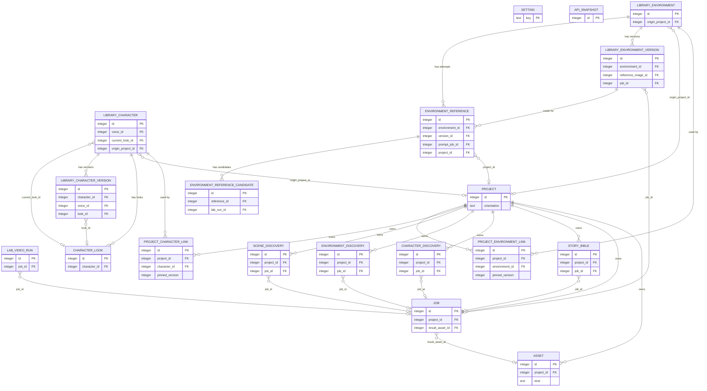

# Visio Studio: Database Structure

Status: Derived from `ANALYSIS.md` (originally Revision 3, now updated for Revision 4's transcription findings), specifically Section 4 ("Database and data model"), cross-referenced with Sections 3.7, 4.4, 5.1, 5.2 and 6.5 for field-level detail. No code or migrations exist yet — this document turns the "draft data model" in `ANALYSIS.md` Section 4.3 into a complete, implementable structure.

**Update (2026-10-05):** `ANALYSIS.md` Revision 4 confirmed the transcription endpoint's real response shape against the live GPU server. Section 4.3 (`transcript` table) and the JSON shapes in Section 5 below are updated accordingly — `transcript.words` now holds the whole verified response object, not a guessed-at array.

**Update (Phase 6, 2026-10-06):** no schema change. Section 5 now documents the `plan_scenes` job's `input` (it carries the cache key `input_hash` and what the scenes were made from) and `output` (the model's answer is kept verbatim in `output.answer`, next to the attempts, the token usage and the check counts), and Section 7 says how scenes are replaced. The cache key lives in `job.input`, not in a new column.

**Update (Phase 9, 2026-10-06):** no schema change. Section 5 now documents the real `generate_clip` `input` and `output` (the request is built once and stored, and every later attempt sends it again) and the `asset.provenance` of a clip and of a derived frame, and Section 7 says how a clip, its take and its selection are written. A *take* is a succeeded `generate_clip` job together with its clip asset: there is still no clip table.

**Update (Phase 12, 2026-10-08):** migration `0003`. A new job type, `draft_descriptions` (a paid call to the language model that writes every scene's video prompt and its first and last frame descriptions in one request). `project` gains `description_instructions`. `scene` gains `first_frame_description`, `last_frame_description`, `frame_descriptions_source` and `description_job_id` (the job that wrote the AI text). Section 5 documents the job's `input` and `output`, and Section 7 says how the drafts are written and which fields they may overwrite.

**Update (Phase 13, 2026-10-08):** migration `0004`. Two tables for the Image lab page, where Bitdeer's image API is tested by hand: `lab_run` (one call: the exact request, the raw response, timing and usage) and `lab_image` (an upload, or a result of a run). They belong to no project. Nothing existing changes. See Sections 4.8, 4.9 and 7.

**Update (Phase 15, 2026-10-08):** migration `0005`. `scene.frame_descriptions_source` (one source for the pair) is replaced by `first_frame_description_source` and `last_frame_description_source`, copied from the old column wherever the text exists. The AI drafting job no longer writes a last-frame description (a clip is made from its first frame alone): it writes the video prompt and the first-frame description, and clears an earlier AI-written last-frame description in the scenes it writes into. The prompt profile is now `ltx-2.3-first-frame`, and the `world` and `continuity` values in the job's answer changed. See Sections 4.4, 5 and 7.

**Update (Phase 16, 2026-10-08):** migration `0006`. A new job type, `write_image_prompt`: one paid call to the language model for one scene (a scene job, `scene_id` set), which turns the scene's first-frame description, video prompt, narration and the draft's `world` into a detailed prompt for the image model. `scene` gains `image_prompt`, `image_prompt_source` and `image_prompt_job_id` (the job that wrote the AI text). Whether an AI prompt is out of date is computed when it is read, from a hash of its inputs kept on that job (`job.input.inputs_sha256`): no flag is stored. A new global setting, `image_prompt_llm_model`. See Sections 3, 4.4, 4.5, 5, 6 and 7.

**Update (Phase 17, 2026-10-08):** migration `0007`. A new job type, `generate_frame`, and a new job provider, `image`: one paid image from the image model (Seedream through Bitdeer) for one scene (a scene job, `scene_id` set). Its result is an `asset` (`kind='frame'`, `source='ai'`) that becomes the scene's first frame, and the raw image the model returned is kept as a second asset. **No table or column is added**: the frame is a normal asset, `scene.first_frame_asset_id` already points at it, and the scene's earlier frames are the result frames of its succeeded `generate_frame` jobs (no list is stored). Whether an AI frame is out of date is computed when it is read, from the prompt its provenance recorded. Two new global settings, `image_model` and `max_parallel_image_generations` (the second was replaced by the shared `max_parallel_gpu_jobs` on 2026-10-13, see below). See Sections 4.2, 4.5, 5, 6 and 7.

**Update (Phase 18, 2026-10-09):** no schema change. A new global setting, `default_negative_prompt` (a text for the video model: no background music, singing or speech, no on-screen text, logos or watermarks, and common video artifacts). A `generate_clip` job sends the project's own `negative_prompt` when it has one, otherwise this default, and a new project starts with this text as its own `negative_prompt`. Before this, a project with a blank `negative_prompt` sent none, and the GPU server's own default applied. See Sections 4.1, 5 and 6.

**Update (Phase 19, 2026-10-09):** migration `0008`. LTX-2.5 runs next to LTX-2.3, and the video model is chosen per app, project and scene. `project` and `scene` gain a nullable `video_model` (`ltx-2.3` or `ltx-2.5`; NULL means "inherit": the scene takes the project's, the project takes the global setting `default_video_model`). **`job.project_id` becomes nullable** and `job.type` gains `lab_video` and `write_lab_video_prompt`: the new Video lab belongs to no project, and its jobs are normal background jobs. A new table, `lab_video_run`, holds what the Video lab lists and compares (the model, the prompt, the settings, and the stored clip). A clip's job and asset record which model made it. No `negative_prompt` is sent to LTX-2.5 (it has none), so the project's and the global negative prompts are LTX-2.3 only. See Sections 3, 4.1, 4.4, 4.5, 4.10, 5, 6 and 7.

**Update (Phase 20, 2026-10-09):** migration `0009`. A new job type, `auto_pipeline`: one run of the automatic flow of a project, which makes the jobs of the manual steps one step after the other and starts a step only when every scene has finished the one before. **No table or column is added**: the run keeps its state in `job.input` and `job.output` (including the ids of the jobs it made, so a restart continues where it was), and only the `job.type` CHECK gains the new value. A run is a project job (`scene_id` is NULL, `provider='local'`) and keeps a fixed marker in `provider_job_id` so the dispatcher checks it every tick. Its jobs are ordinary jobs of the existing types, with `input.auto_run_id` naming the run. See Sections 4.5, 5 and 7.

**Update (Phase 21, 2026-10-10):** migration `0010`. Two things from the GPU API 0.5.0 to 0.7.0. (1) **LTX-2.5 first-and-last-frame**: `POST /v1/ltx25/videos/interpolate` replaces the fallback to LTX-2.3, so a scene with a last frame is made by the chosen model's own endpoint (`first_frame_asset_id` and `last_frame_asset_id` in the body, no `negative_prompt`), and the Video lab can take an optional last frame (`lab_video_run.last_frame`). (2) **Breeze TTS 2 text-to-speech** (`POST /v1/breeze-tts/synthesize`): `job.type` gains `lab_voice` and `generate_voiceover`; new tables `voice` (a saved voice: a recording and its exact transcript) and `lab_voice_run` (what the new Voice lab lists); `project.voice_id` names the saved voice that speaks the script when the app makes the voiceover (`asset.kind='voiceover'`, `asset.source='ai'`, with `provenance.script_sha256`). The automatic flow gains a first step, `voiceover`. Breeze TTS 2 is licensed for research and non-commercial use only. See Sections 3, 4.1, 4.5, 4.10, 4.11, 4.12, 5 and 7.

**Update (Phase 22, 2026-10-11):** migration `0011`. The image model changes from Seedream (Bitdeer) to **Qwen-Image-2.1 on the GPU server** (`POST /v1/qwen-image21/images/generate`, added in GPU API 0.8.0). (1) `generate_frame` becomes a remote GPU job like `generate_clip` (`provider='gpu'`, restart rule `resume`, a `provider_job_id`, polled by the dispatcher) instead of one synchronous paid call. Its stored request holds the nearest of the model's seven picture shapes, a random seed and the mode (the new global setting `image_mode`, which replaces `image_model`). The label-band crop is gone: the frame is the model's picture scaled to cover the generation size and trimmed evenly. The `image` value stays in the `provider` CHECK, but no job uses it any more. (2) The Image lab gets Qwen next to Seedream. A Qwen run is a `lab_image` job (`job.type` gains `lab_image`), and `lab_run` gains a nullable `job_id` and the status `running`; Seedream runs are unchanged. (3) The prompt profile the language model writes image prompts with is now `qwen-image-2.1` (150 to 300 words, no "bottom tenth" rule). The model's weights are under the Qwen Research License (non-commercial use only). See Sections 4.5, 4.8, 5, 6 and 7.

**Update (Phase 23, 2026-10-11):** migration `0012`. **AI last frames**, so a clip can be made from a first and a last frame (the LTX first-and-last-frame endpoints already existed). (1) `job.type` gains `write_last_frame_prompt` (a paid call to the language model for one scene) and `generate_last_frame` (a remote GPU job for one scene, like `generate_frame`). (2) `scene` gains `last_frame_prompt`, `last_frame_prompt_source` and `last_frame_prompt_job_id`, the counterparts of the three `image_prompt` columns: the instruction that **edits the first frame into the last frame** with Qwen-Image-2.1's edit endpoint (`POST /v1/qwen-image21/images/edit`, with the first frame uploaded as a reference image). (3) The drafting job's prompt profile is now `ltx-first-last`: the model decides, scene by scene, whether the clip gets a last frame and writes its description into `scene.last_frame_description` (source `ai`), or answers null. **No column is added for the frame itself**: it is a normal frame asset, `scene.last_frame_asset_id` already points at it, and the earlier last frames of a scene are the result frames of its succeeded `generate_last_frame` jobs. Whether an AI last frame is out of date is computed (its prompt, or the first frame it edited, changed), never stored. (4) A scene whose draft `continuity` is `continues_action`, after a scene that has a last frame, **starts on that frame**: the app sets its `first_frame_asset_id` to the previous scene's last frame (the same asset row), in the transaction that attaches it. (5) The automatic run has two more steps, `last_frame_prompts` and `last_frames`. See Sections 3, 4.4, 4.5, 5 and 7.

**Update (Phase 24, 2026-10-11):** migration `0013`. **The Talking character lab**: a character picture speaks a line of dialogue, lip-synced, and the three labs become tabs of one Lab page (no schema change for that part). (1) The GPU server's audio-to-video endpoint (`POST /v1/ltx/videos/audio-to-video`, `AudioToVideoRequest`, LTX-2.3, quality recipe only) makes a clip to match a recorded speech and muxes that speech in unchanged. It is a `lab_video` job like any other Video lab run, and `lab_video_run` gains `audio_input` (`{"source": "voice_run" \| "voice", "id": n}`, NULL for every other clip); the job's input also carries `audio` (the file's path and type, copied when the run starts). The clip is as long as the speech (the smallest `8k + 1` frame count that is not shorter, at most 20 seconds). (2) `job.type` gains `write_talk_prompts` (a paid call to the language model that writes a voice instruction and a video prompt). (3) New tables `lab_character` (the cast: a name, a picture, a description the language model reads, an optional default voice) and `lab_talk_run` (one take: the dialogue, the picture, the prompts, and the three steps it is made in, each a job the other labs already run: `prompt_job_id`, `voice_run_id`, `video_run_id`). A take with `auto_continue` starts its next step by itself when the prompts job finishes and when the speech is stored; if a step cannot start, the reason is kept in `lab_talk_run.last_error`. See Sections 3, 4.10, 4.13, 4.14 and 5.

**Update (project cast, 2026-10-12):** migration `0014`. **A project's cast, so a character or a place looks the same in every scene.** (1) New tables `character` and `location` (Sections 4.15 and 4.16): the characters and places of a story, each with the text that describes it (found by one language model job that reads the script, edited by hand), the prompt for its **reference picture** and the picture itself. (2) `scene` gains `character_id` and `location_id` (the one character and the one place the scene shows; `character_id` is replaced by the table `scene_character` in migration `0015`, below), `cast_assignment_source` (`manual` \| `ai`) and `cast_assignment_job_id`. (3) `asset.kind` gains `reference` (a reference picture). (4) `job.type` gains `extract_cast`, `write_character_reference_prompt`, `generate_character_reference` and `assign_cast`. (5) A scene that shows a member has its first frame made by **the image model's edit endpoint, from the picture of each member** (the character is image 1, the place the next), instead of from words alone; the image prompt of such a scene is written for that (`QWEN_IMAGE_21_CHARACTER_EDIT`), and it carries the members in its inputs, so assigning a scene differently makes its prompt out of date. A scene that shows none is made as before. (6) A character's picture is asked for on a plain **white** backdrop, which is then removed (`rembg`), so the stored picture has a transparent backdrop; a place is kept whole. It is sent to the image model flattened on white again. (7) The automatic run has four more steps, between `scenes` and `descriptions`: `cast`, `cast_prompts`, `cast_images` and `cast_assignment`. (8) A scene's choice of cast counts as one of its inputs (`scene_cuts.has_inputs` and `NO_INPUTS`): replacing a scene, or changing its cut, asks first and then clears the choice, like a description or a frame. Nothing speaks in these stories: a character's voice is only a note for the language model. See Sections 3, 4.2, 4.4, 4.5, 4.15, 4.16, 5 and 7.

**Update (several characters in a scene, 2026-10-13):** migration `0015`. **A scene may show any number of characters.** (1) New table `scene_character` (Section 4.17): one row for each character a scene shows, with its `position` (the order of the character's reference picture: 0 is image 1). (2) `scene.character_id` is dropped. Every existing choice is copied into `scene_character` at position 0 first, so none is lost. (3) A scene made from the cast sends one reference picture for each character (images 1, 2, and so on, in `position` order) and then the place's. The image model's edit takes 10 pictures, so a scene shows at most **9** characters (`cast.MAX_SCENE_CHARACTERS`): code applies this limit (the `assign_cast` answer is cut there, a manual choice above it is refused with 422), and no prompt asks for any number of characters. (4) The prompts leave the number of characters to the model: `assign_cast` now answers with a list of names (`characters`) for each scene, and the profile `QWEN_IMAGE_21_CHARACTER_EDIT` (version 2) names each character by its image number. A character's entry in `cast.references` of the image prompt's inputs gains `name`, so the writer can tell several characters apart: the image prompts of scenes that show a character are therefore out of date once. (5) `NO_INPUTS` no longer holds `character_id`. A cut edit that clears a scene's inputs also deletes the scene's `scene_character` rows (`scenes.apply_cut_edit`). See Sections 3, 4.4, 4.17, 5 and 7.

**Update (parallel automatic run and two shared pools, 2026-10-13):** **No table or column is added.** (1) The automatic run (`auto_pipeline`) is no longer a queue of fourteen steps done one after the other: the steps are a graph. A step starts when the steps it *needs* are complete, and a scene (or a character, or a place) goes on to its next step as soon as its *own* input is ready (for example, a clip starts once its scene's frames are made, while other scenes' frames are still being made). The cast is found from the script at once, beside the voiceover. `job.output` of a run no longer has a `step` key (an older run's is ignored), and `problems[]` always had a `step`. (2) The per-job-type limits are gone. Two numbers limit all work, shared by every kind of job: `max_parallel_gpu_jobs` (the GPU server) and `max_parallel_paid_api_calls` (the paid inference API). They replace `max_parallel_generations` and `max_parallel_image_generations` (a saved value of either is never read), and there is no concurrency group any more. A new endpoint, `GET /api/jobs/capacity`, reports each pool's limit and what is running and waiting in it. See Sections 3.3, 4.5, 6 and 7.

**Update (MiniMax H3 reference: optional audio, a cast and the server's own GPUs and estimate, 2026-10-18):** migration `0020`, for GPU API 0.14.0 and 0.15.0. (1) `lab_video_run` gains `audio_references` (a list of `{"source": "voice_run" \| "voice", "id": n}`, in `<Audio N>` order; NULL for every other clip and for a reference clip made without audio). The audio of a MiniMax H3 reference clip is **optional** (0 to 2 audios in the Video lab, the server takes 3): the request field is the list `audio_asset_ids`, and the old single `audio_asset_id` is refused by the server. Runs made before the migration get a list of the one audio they had. `audio_input` stays, and for a reference clip holds the first audio (or NULL). (2) A reference run's `params` also hold `reference_roles` (what each picture is: `character_1`, `character_2`, `scene` or `other`), `audio_durations_s`, `audio_owners` (which character each audio is the voice of) and `ambience`, so a run loads back into the form. (3) The server now says how many GPUs a MiniMax H3 job got (`gpus`, 4 or 8) and about how long it will run once it starts (`estimated_run_seconds`), in its submit answer and in `GET /v1/jobs/{id}`. The app keeps both: `job.input.submit_answer` (`{gpus, estimated_run_seconds}`) at the submit and `job.output.remote` (refreshed at every poll). The dispatcher counts an H3 job as the server's `gpus` slots (4 until the server has said), instead of the fixed two. See Sections 4.10 and 6.

**Update (MiniMax H3 as a project, scene and app video model, and the default, 2026-10-18):** migration `0021`. `project.video_model` and `scene.video_model` accept `minimax-h3` as well as `ltx-2.3` and `ltx-2.5`: the two CHECK constraints are rebuilt (SQLite needs a table rebuild for that, which the migration does in batch mode), and no column is added. The downgrade first sets every `minimax-h3` value of those two columns to NULL ("inherit"), then puts the old constraints back. The `default_video_model` setting now defaults to `minimax-h3` **in the code only**: a value already saved is kept, so an install that saved `ltx-2.5` keeps it until the setting is changed. A clip made by MiniMax H3 is asked of one endpoint for both clip modes (`POST /v1/h3/videos/generate`), so its job `input` and its clip provenance also store the clip mode (`clip_mode`), which the endpoint alone no longer tells. It runs at 24 fps and in its own size (1344 x 768 or 768 x 1344), is never shorter than 124 frames (5.17 s) nor longer than 345 (14.4 s), and gets no negative prompt. A scene shorter than 5.17 s that has a last frame is made by LTX-2.5 instead (the clip's `model_note` says why). A scene's description drafted for H3 is one text of three fields (`integrated_multimodal_description`, `overall_soundscape`, `non_diegetic_music`), and `scene_prompt.prompt_for` turns either that or an LTX paragraph into the prompt of the model that makes the clip. The render timeline entries gain `source_frames`, the frames the clip needs at its own fps, so a 24 fps H3 clip in a project of another fps is not taken for too short. The `draft_descriptions` job input gains `video_model`, and its `profile` is `minimax-h3-scene` when the project's model is MiniMax H3. See Sections 3, 4.1, 4.4, 5, 6 and 7.

**Update (PHASE-002 shot-duration policy, 2026-10-20):** no schema change. Four new global settings in the `Shot duration` group, all integers in **whole seconds**: `h3_min_shot_seconds`, `shot_target_min_seconds`, `shot_target_max_seconds` and `h3_max_shot_seconds`. Each is between 1 and 14, where 14 is `H3_MAX_FRAMES // H3_FPS` (345 frames is 14.375 s, so 15 s is beyond what the GPU server accepts). They must stay in that order (each at or below the next): saving a value that breaks the order is refused, and `duration_policy.read_duration_policy` checks it again when it reads, because a reset can still break it. See Section 6.

**Update (PHASE-046 retire the narration pipeline, 2026-10-20):** migration `0022`. The voiceover-driven narration pipeline is removed, so later phases can build story projects without it. The Image lab, the Voice lab, the Video lab and the Character lab are unchanged. (1) `job` rows whose type is not one of the six lab types (`lab_image`, `lab_video`, `write_lab_video_prompt`, `lab_voice`, `write_character_look_prompt`, `write_character_take_prompt`) are deleted. `job.scene_id` and `idx_job_scene` are dropped, and the `job.type` CHECK is rebuilt with those six values (SQLite needs a table rebuild for that, which the migration does in batch mode). (2) The tables `scene_character`, `scene`, `character`, `location` and `transcript` are dropped. (3) `project` loses twelve columns: `min_scene_seconds`, `max_scene_seconds`, `style_prefix`, `prompt_suffix`, `negative_prompt`, `clip_sound_volume`, `cut_instructions`, `description_instructions`, `video_model`, `language`, `voiceover_asset_id` and `voice_id`, with the CHECK and the two foreign keys that went with them. What is left is `id`, `name`, `created_at`, `orientation`, the four sizes, `fps` and `script_text`. (4) The setting rows `default_video_model`, `default_negative_prompt` and `max_parallel_ffmpeg` are deleted, and the three are no longer settings. (5) `asset` is unchanged: its rows and files are never deleted, and its CHECK constraints keep every value, so a `voiceover`, `clip`, `final` or `reference` asset made earlier stays valid. (6) **There is no downgrade**: `downgrade()` raises `NotImplementedError`, because the deleted rows cannot be rebuilt. Restore a backup of `app.db`, or use the git tag `narration-final` (the last commit with the narration code, `git show narration-final:<path>`) with a database from before. Sections 4.3, 4.4, 4.15, 4.16 and 4.17 and the narration shapes of Section 5 are now short notes: the full text is at that tag (`git show narration-final:DATABASE_STRUCTURE.md`). The older updates above describe the schema as it was when each was written. See Sections 3, 4.1, 4.2, 4.5, 5, 6 and 7. Older than this phase and not changed by it: Sections 4.13 and 4.14 and the indexes of `lab_character` and `lab_talk_run` still describe the Talking character lab's first tables, which migration `0016` replaced with the Character lab's own tables (`library_character`, `character_look`, `character_look_candidate`, `character_reference` and `character_take`).

**Update (PHASE-003 story workspace, 2026-10-20):** no schema change and no migration. (1) The story is stored in the existing `project.script_text` column, which the app now calls the *story text* (the project page's "Story" editor); the column and the API field keep the name `script_text`. (2) Two new global settings in a new `Story` group: `story_words_per_minute` (default 150, from 60 to 300) and `story_max_minutes` (default 10, from 1 to 120, decision D-13). The estimated length of a story is its word count divided by the pace; a story above the limit still saves, with a warning. `GET /api/projects/{id}` (and the create and patch answers) gain `story_length` (`word_count`, `estimated_seconds`, `words_per_minute`, `limit_seconds`, `over_limit`), computed on read by `app/services/story_length.py`, never stored. (3) A new section 2.1, **Story artifact provenance (D-3)**, is the convention every later stage table follows. See Sections 2.1, 4.1, 6 and 7.

**Update (PHASE-004 Story Bible, 2026-10-20):** migration `0023`. The first story stage. (1) New table `story_bible` (Section 4.18): one immutable row per version of a project's StoryBible, following the provenance convention of Section 2.1 (`source`, `job_id`, `version`, `inputs`, `created_at`) plus `project_id` and `content` (the bible itself). `UNIQUE (project_id, version)`. (2) `job.type` gains `write_story_bible`: the CHECK is rebuilt in batch mode, so `job` now has seven types. Unlike the lab jobs, this one **belongs to a project** (`job.project_id` is set), with `provider='llm'` and the restart rule `never_rerun`; its `input` and `output` are in Section 5. (3) The settings `llm_provider` and `llm_model`, which nothing used since PHASE-046, become **the one story LLM setting** (labels "Story provider" and "Story model (Bitdeer)"): every story stage uses them (decision D-12). The built-in default model changes from `zai-org/GLM-5.3-Flash` to `zai-org/GLM-5.3`; a value already saved is kept. While Bitdeer is not available, `llm_provider` is set to `qwen38` on the Settings page (a temporary test setup, not a code change). (4) New endpoints under `/api/projects/{id}/story-bible` (run, read, read one version). Whether the newest version is out of date is **computed on every read** from `inputs.story_sha256` and the project's current `script_text`, never stored. See Sections 2.1, 3, 4.5, 4.18, 5, 6 and 7.

**Update (PHASE-005 character and environment discovery, 2026-10-20):** migration `0024`. The second and third story stages: two focused calls that list the story's characters and its environments. (1) Two new tables, `character_discovery` and `environment_discovery` (Sections 4.19 and 4.20). Each is the shape of `story_bible`: one immutable row per run, which is one **version of the whole list** (the set carries the version, the provenance and the `content`; there is no row per character), following Section 2.1. `inputs` records the story hash **and the StoryBible version the list was made from** (`artifacts: [{"kind": "story_bible", "id", "version"}]`). `UNIQUE (project_id, version)` in each table, so the two lists are numbered separately. (2) `job.type` gains `discover_characters` and `discover_environments`: the CHECK is rebuilt in batch mode, so `job` now has nine types. They are **two job types and not one with a kind**, because the job store merges a second click into any waiting or running job of the same type for the project, so a single type would make the character run block the environment run; with two, both run at once (and beside scene discovery of PHASE-006, D-15). Both belong to a project, are `provider='llm'` with the restart rule `never_rerun`, and use the story model setting (D-12). (3) No setting is added. (4) New endpoints under `/api/projects/{id}/discovery/{kind}` (`kind` is `characters` or `environments`: run, read, read one version). A run is refused (422) when there is no saved story, no StoryBible, or when the newest StoryBible is out of date with the saved story. Whether the newest version of a list is out of date is **computed on every read**: the story text hashes differently from `inputs.story_sha256`, or the project has a newer StoryBible than the one recorded. Relations between characters are not stored (D-14). See Sections 3, 4.5, 4.19, 4.20, 5 and 7.

**Update (PHASE-006 scene discovery, 2026-10-20):** migration `0025`. The fourth story stage: the story divided into its scenes, **each scene tied to the exact slice of the author's story it owns**. (1) New table `scene_discovery` (Section 4.21): the same shape as `character_discovery`, one immutable row per run, which is one version of the whole scene list, following Section 2.1; `inputs` records the story hash and the StoryBible version it read. `UNIQUE (project_id, version)`. Each scene in `content` has `index`, `id`, `title`, `description`, `starts_with`, `start`, `end` and `text`. **The model gives only `id`, `title`, `description` and `starts_with`** (the scene's opening words, copied from the story); **code sets the rest**: scene 1 starts at character 0, every later scene starts at the word where its opening words are found, each scene ends where the next begins and the last ends at the end of the story, and `text` is `story[start:end]`. So the scenes' texts joined in order are the whole story, byte for byte, with no gap, overlap or skipped word. Scenes carry **no character or environment ids** (D-15). (2) `job.type` gains `discover_scenes`: the CHECK is rebuilt in batch mode, so `job` now has ten types. It is its own job type, so it runs beside the two PHASE-005 discovery jobs. It belongs to a project, is `provider='llm'` with the restart rule `never_rerun`, and uses the story model setting (D-12). (3) No setting is added. (4) New endpoints under `/api/projects/{id}/scenes` (run, read, read one version). A run is refused (422) on the same conditions as the PHASE-005 runs: no saved story, no StoryBible, or a StoryBible out of date with the story. Whether the newest version is out of date is **computed on every read**, as for the lists of PHASE-005. See Sections 3, 4.5, 4.21, 5 and 7.

**Update (PHASE-007 character versioning, 2026-10-20):** migration `0026`. Every production-relevant change of a library character is kept as an **immutable version**, so a project can later pin one (PHASE-008). (1) New table `library_character_version` (Section 4.27): one row per version, never changed once written, numbered from 1 per character (`UNIQUE (character_id, version)`). It freezes the character's `profile` (twelve fields), its voice (`voice_id`, `voice_description`) and its current look: `look_id` plus `look_references`, the exact picture of every angle at that moment, so redoing an angle later (which updates `character_reference` in place) cannot change an old version. `library_character` stays the editable head. It follows the provenance convention of Section 2.1 where it applies (`source`, `version`, `created_at`); there is no job and no upstream artifact, and `source` is `manual` for every change made in the lab. (2) `character_take` gains a nullable `character_version`: the character's newest version when the take was made. (3) A version is added by `services/character_versions.record_version_if_changed` when the profile changes, when the voice or the voice description changes, when a look turns ready (it becomes the current look), and when an earlier ready look is made current again (`PUT /api/lab/characters/{id}/current-look`). A save that changes nothing adds no version, and archiving is not a version change. While the current look is being redone, the newest version's look part is carried forward; the redo adds its own version once the look is ready again. (4) No `job.type` change, so `job` is not rebuilt. No backfill: a character made before this migration has no version until its next change, which writes version 1. (5) **Documentation catch-up:** the Character lab's tables, which migration `0016` and later added without documentation, are now described in Sections 4.22 to 4.26; Sections 4.13 and 4.14 (the tables `0016` replaced) say so. See Sections 3, 4.22 to 4.27 and 7.

**Update (PHASE-008 character links, 2026-10-20):** migration `0027`. A story project's discovered characters are **backed by library characters, and the project pins one version of each**. (1) New table `project_character_link` (Section 4.28): one row per linked discovered character, found by `(project_id, discovery_id)` (`discovery_id` is the slug `id` inside `character_discovery.content`, the only thing that ties a link to the list, so a re-run of discovery that keeps an id keeps its link). It names the library character (`character_id`), the **pinned version** (`pinned_version`, a plain number, found by `(character_id, pinned_version)` in `library_character_version`), `how` (`created` or `mapped`) and `discovery_version` (the list version it was linked from). `UNIQUE (project_id, discovery_id)` and `UNIQUE (project_id, character_id)`: a discovered character is linked once, and a project uses a library character for one entry only. (2) `library_character` gains the nullable `origin_project_id` (FK → `project.id`, `SET NULL`) and `origin_discovery_id`, which mark a character the pipeline made for a project. (3) **A pin never moves because of a lab edit.** "A newer version is available" is computed on read (`newest version > pinned_version`) and never stored. (4) A pipeline-made character is created with its `name` from the discovery, its `notes` from the one-line description, and an **empty `species` and `appearance`** until PHASE-009 writes them; its version 1 has `source='ai'`. `character_card` leaves those two lines out when empty. (5) No `job.type` change: every link action is a synchronous database write, so `job` is not rebuilt. No backfill. See Sections 3, 4.22, 4.28 and 7.

**Update (PHASE-009 character definition, 2026-10-20):** migration `0028`. The fifth story stage: **one model call per linked character writes its structured definition** (`Path_ahead.md` Section 11), which is saved on the library character as a **new version that the project pins**. (1) `library_character` gains a nullable JSON `definition` (the character's current definition, Section 4.22). `library_character_version` gains `definition` (the definition frozen in that version), `job_id` (FK → `job.id`, `SET NULL`: the job that wrote the version; NULL for a manual one) and `inputs` (the D-3 inputs of Section 2.1: the story hash and the StoryBible and character-list versions the definition was made from; NULL for a manual one) (Section 4.27). The definition holds `visual_identity`, `default_wardrobe`, `voice_identity`, `behavior` and `era` (the shape is in Section 5). (2) `job.type` gains `define_character`: the CHECK is rebuilt in batch mode, so `job` now has eleven types. It is **one job per character** (`input.discovery_id` names it), belongs to the project, is `provider='llm'` with the restart rule `never_rerun`, and uses the story model setting (D-12). `jobs/store.create_job` gained an optional `dedupe_key`: a second click for **the same character** returns that character's waiting or running job, while different characters' jobs run side by side when the pool allows. (3) A definition run **overwrites the lab profile fields it fills**: `age`, `gender`, `species`, `has_visible_mouth`, `appearance`, `outfit`, `personality`, `voice_description`, `era_kind`, `era_years` and `era_setting`; it never changes `name` or `notes`. The text written over stays readable in the earlier version. The new version has `source='ai'`, and **the project's pin moves to it** (the pipeline's own change: a lab edit never moves a pin). A later lab edit **carries the definition forward** into its own version, so a hand edit does not lose it. When `record_version_if_changed` is given `inputs`, it also compares them, so the same text made from newer inputs is a new version and the provenance stays current. (4) A character the user **chose from the library** (`project_character_link.how = 'mapped'`) is overwritten only after the request confirms it (`confirm_overwrite`), and "Define all" skips it. (5) Whether a definition is **out of date** is computed on every read from the pinned version's `inputs` (the story text, the newest StoryBible, and the entry's name and description in the list), never stored. (6) No setting is added. New endpoints under `/api/projects/{id}/character-definitions` (read, run all, run one). See Sections 2.1, 3, 4.5, 4.22, 4.27, 5 and 7.

**Update (PHASE-010 canonical character images, 2026-10-20):** migration `0029`. The sixth story stage: **each defined character gets its look made by the pipeline, with nobody choosing a master**, by reusing the Character Lab's look pipeline. (1) `character_look` gains `project_id` (FK → `project.id`, `SET NULL`, indexed by `idx_character_look_project`), `discovery_id` (TEXT, the slug of the discovered character in that project) and `inputs` (JSON, the D-3 provenance: `project_id`, `discovery_id`, `character_version` = the version the project pinned when the look started, and `definition_sha256` = a hash of the definition it was made from) (Section 4.23). All three are NULL for a look made by hand in the lab, and **a non-NULL `project_id` is what makes a look a pipeline look**. (2) **No job type is added and no table**: the work is the lab's own jobs (`write_character_look_prompt`, then `lab_image` runs). (3) A pipeline look makes **one candidate** (a lab look still makes four), and once that picture is stored the look takes it as its master itself (D-5), then makes the four other angles as before. (4) When a pipeline look turns `ready`, in the same transaction that sets the status, `library_character.current_look_id` is set, `library_character_version` gets the next version (`source='ai'`, `job_id` = the look's prompt job, `inputs` = the `inputs` of the version the project pinned, so the Character Definition stage still reads its definition as current) and **the project's pin moves to it** (the pipeline's own change). A look made in the lab still writes a `manual` version and **never moves a pin**; redoing an angle of a pipeline look writes a new `ai` version and moves the pin again. (5) Whether images are `failed` (the look's own status, or the job of its prompt, its candidate or an angle failed) or `out_of_date` (the definition now pinned differs from the one the look recorded) is **computed on every read**, never stored. (6) No setting is added. New endpoints under `/api/projects/{id}/character-images` (read, run all, run one). See Sections 4.23, 5 and 7.

**Update (PHASE-047 character relations, 2026-10-20):** migration `0030`. The project says who is the same person at another age, a twin, or family of whom, and the definitions and the images use it. (1) New table `character_relations` (Section 4.29): the shape of `character_discovery`, one immutable row per version of the project's whole list of relations, found by the `discover_relations` job (`source` `ai`) or saved by the user (`manual`), keyed by the discovery slug ids; **a library character never carries a relation** (D-14, amended). (2) `job.type` gains `discover_relations`: the CHECK is rebuilt in batch mode, so `job` now has twelve types. (3) `character_look.status` gains `waiting` (Section 4.23): a pipeline look for a same-face variant that waits for its base's images; no job exists until it starts. The CHECK is rebuilt in batch mode. (4) The `inputs` of a definition version gain `relations_sha256` and, when the project has relations, a `character_relations` artifact (Section 4.27); the `inputs` of a pipeline look gain `relation_kind`, `base` and `resemblance_sha256` (Section 4.23). A row made before this has none of them and reads as having no relations. The downgrade drops the table, deletes `discover_relations` jobs and `waiting` looks, and restores both CHECKs. No data is touched on upgrade. Section 7 has the new row.

**Update (PHASE-012 environment library, 2026-10-20):** migration `0032`. The Character Lab gets a library of **environments** (places) with versions and a canonical reference picture. (1) `job.type` gains `write_environment_prompt`: the CHECK is rebuilt in batch mode, so `job` now has fourteen types. It is a lab job (`project_id` NULL, `provider='llm'`) that writes the prompt of one reference picture. (2) Four new tables, all global (no `project_id`): `library_environment` (Section 4.31, the editable head), `library_environment_version` (Section 4.32, one immutable profile snapshot per version, with the canonical picture `reference_image_id` chosen for it), `environment_reference` (Section 4.33, one attempt to make a version's picture) and `environment_reference_candidate` (Section 4.34, the four candidate pictures of an attempt, each a `lab_run`). (3) **A version freezes its text and its picture together**: an edit adds the next version with **no** picture, and the older version keeps its own; only the **newest** version's picture can be chosen or replaced (**tightened in PHASE-013:** a newest version that a project pins and that already has its picture is frozen too). There is no foreign key from the head to a version: the newest version is the one with the highest `version`. No column of an existing table changed, and no data is moved. See Sections 4.31 to 4.34, 5 and 7.

**Update (PHASE-011 character and narrator voices, 2026-10-20):** migration `0031`. The seventh story stage: **each defined character, and the narrator, gets a saved voice made by the pipeline**, with nobody choosing a sample. (1) `job.type` gains `design_voice`: the CHECK is rebuilt in batch mode, so `job` now has thirteen types. One job writes one voice description (one paid call to the story model); in the same transaction that marks it succeeded it queues **one design-mode Voice lab run**. (2) `lab_voice_run` gains five nullable columns: `project_id` (FK → `project.id`, `SET NULL`, indexed), `subject` (`character` or `narrator`), `discovery_id` (the slug of the discovered character), `design_job_id` (FK → `job.id`, `SET NULL`: the `design_voice` job that wrote the description) and `inputs` (JSON, the D-3 inputs the voice is compared with). A run made by hand has none of the five (Section 4.12). (3) New table `narrator_voice` (Section 4.30): the shape of `story_bible`, one immutable row per derivation (`ai`) or hand choice (`manual`) of the project's narrator voice. (4) When the run's speech is stored, `lab_voice` calls `story_voices.on_voice_finished`, which saves the `voice` row from the run and, for a character, sets `library_character.voice_id`, adds a new `ai` `library_character_version` and moves the project's pin to it (the same way PHASE-010 does for a look). A character has **no** new column: the voice is the library character's own `voice_id`. "Out of date" is never stored: a character voice is compared by `inputs.voice_facts_sha256`, a derived narrator voice by `inputs.narration_sha256`. See Sections 4.2, 4.12, 4.30, 5 and 7.

**Update (PHASE-013 environment definition and project link, 2026-10-21):** migration `0033`. A story project's discovered environments are **backed by library environments, the project pins one version of each**, and the eighth story stage **defines each environment with one model call and makes its canonical reference picture by itself**. (1) New table `project_environment_link` (Section 4.35): the shape of `project_character_link`, one row per linked discovered environment, found by `(project_id, discovery_id)`, naming the library environment, the **pinned version** (a plain number), `how` (`created` or `mapped`) and `discovery_version`; `UNIQUE (project_id, discovery_id)` and `UNIQUE (project_id, environment_id)`. (2) `library_environment` gains `origin_project_id` (FK → `project.id`, `SET NULL`), `origin_discovery_id` and a nullable JSON `definition` (Section 4.31). `library_environment_version` gains `definition`, `job_id` (FK → `job.id`, `SET NULL`) and `inputs` (the D-3 provenance, Section 4.32). The definition is `Path_ahead.md` Section 13's (architecture, layout, `visual_identity`, `important_landmarks`, `atmosphere.baseline`, `continuity_rules`) plus a top-level `era`; the shape is in Section 5. (3) `environment_reference` gains `project_id` (FK → `project.id`, `SET NULL`, indexed by `idx_environment_reference_project`) and `discovery_id` (Section 4.33): **a non-NULL `project_id` makes an attempt a pipeline attempt**, which starts **one** candidate (a lab attempt still starts four) and takes it as the version's canonical picture itself (D-5). (4) `job.type` gains `define_environment`: the CHECK is rebuilt in batch mode, so `job` now has fifteen types. It is **one job per environment** (`input.discovery_id` names it, `dedupe_key`), belongs to the project, is `provider='llm'` with the restart rule `never_rerun`, and uses the story model setting (D-12). (5) A definition run **overwrites the lab profile fields it fills** (`description`, `atmosphere`, `era_kind`, `era_years`, `era_setting`) and never `name` or `notes`; the text written over stays readable in the earlier version. The new version has `source='ai'`, and **the project's pin moves to it** (the pipeline's own change: a lab edit never moves a pin). A later lab edit carries the definition forward. An environment the user **chose from the library** is overwritten only after the request confirms it (`confirm_overwrite`); **Define all** skips it, and skips one that is already defined and current. (6) A definition needs an **up-to-date list of scenes** (the model works out from it which scenes use the place, D-15), so a newer list of scenes marks a definition out of date. Whether a definition is **out of date** is computed on every read from the pinned version's `inputs`, never stored. (7) **The picture's freeze rule is tightened** (it was "only the newest version's picture can change" in PHASE-012): a version is frozen when it is not the newest, **or** a project pins it and it already has a picture. The picture prompt is now written from the attempt's own version, not the head. (8) No setting is added and no data is moved. The downgrade deletes every link and every `define_environment` job, drops the new columns and restores the `job.type` CHECK. New endpoints: `/api/projects/{id}/environment-links` (read, link all, create, map, unlink), `/api/projects/{id}/environment-definitions` (read, run all, run one, retry the picture) and `GET /api/lab/environments/{id}/projects`. See Sections 4.31 to 4.35, 5 and 7.

**Update (PHASE-014 scene definition, 2026-10-21):** migration `0034`. The ninth story stage: **each discovered scene is defined with one model call** (story context, environment and the state of it the scene needs, time and lighting, characters and the looks they need, mood, dramatic goal, and where each character starts and ends; `Path_ahead.md` Section 16). (1) `job.type` gains `define_scene`: the CHECK is rebuilt in batch mode, so `job` now has sixteen types. (2) One new table, `scene_definition` (Section 4.36): one immutable row per run for one scene, following Section 2.1, numbered per scene (`UNIQUE (project_id, scene_id, version)`), with `scene_id` the slug `id` of the scene in `scene_discovery.content`. A scene definition belongs to the project alone: **nothing is written to the Character Lab and no pin moves**. (3) `inputs` records the story hash, the scene's own hash (`scene_sha256`: its title, description and text and its neighbours' title and description) and the artifacts it was built from: the StoryBible and the three discovered lists, **plus the definition of each character and the environment the scene chose, and only those** (each with the library object's id, the pinned version, and `definition_sha256`). (4) **Out of date is worked out on every read**: the story or the StoryBible changed, the scene or its neighbours changed, or a chosen character or environment is no longer in the newest list, is linked to another library object, or has a different definition (compared by the definition's hash, not the pin's number, because images and voices move a pin without changing the definition). A character found again that the scene did not choose does not mark it. (5) A scene can only be defined when every discovered character and environment is linked and `defined`. `environment_state` and the look names are stored as requests in the model's own words; PHASE-016 resolves them. See Sections 4.36, 5 and 7.

**Update (PHASE-015 event extraction, 2026-10-21):** migration `0035`. The tenth story stage: **the events of each defined scene are listed with one model call per scene** (what happens, in story order, as `narration`, `dialogue`, `action`, `sound_event` and `pause` events; `Path_ahead.md` Section 17). (1) `job.type` gains `extract_events`: the CHECK is rebuilt in batch mode, so `job` now has seventeen types. (2) One new table, `scene_events` (Section 4.37): one immutable row per run for one scene, following Section 2.1, numbered per scene (`UNIQUE (project_id, scene_id, version)`), with `scene_id` the slug `id` of the scene in `scene_discovery.content`. A scene's events belong to the project alone: nothing is written to the Character Lab and no pin moves. (3) `content` is `{scene_id, events, uncovered}`. **Code sets the event ids** (`evt_1`, `evt_2`, ... in order) and `scene_id`; the model gives the types and fields. **Code checks that every `narration` and `dialogue` text is found in the scene's own text, in order, word by word** (case, punctuation and quote style ignored, the word matching of scene discovery); an answer that fails is refused and asked for once more. Text of the scene that no speech event covers is **not** an error: it is stored as `uncovered` warnings (`{text, after_event_id}`), because a sentence such as "Thump." legitimately becomes a `sound_event`. (4) `inputs` records the story hash, the scene text's hash (`scene_text_sha256`) and the artifacts it was built from: the StoryBible, the lists of characters and scenes, the scene's definition (`scene_definition` row id and version) and the definition of each character the scene chose (with `definition_sha256`). (5) **Out of date is worked out on every read**: the story or the StoryBible changed, the scene's text changed, the scene was defined again (a newer `scene_definition` version) or its definition is itself out of date, a character the scene chose is gone, relinked or has another definition, or a speaker is no longer in the newest list of characters. (6) A scene can only be extracted when its definition exists and is current. See Sections 4.37, 5 and 7.

**Update (PHASE-016 look and environment-state resolution, 2026-10-21):** migration `0036`. Between the scene stages and speech: **after all scenes are defined, one model call per project maps every look and environment state the scenes asked for to the default, an existing named look or state, or one new entry that equivalent requests share** (`Path_ahead.md` Sections 14 and 16), so no picture is made twice. (1) `job.type` gains `resolve_looks_states`: the CHECK is rebuilt in batch mode, so `job` now has eighteen types. (2) Three new tables. `character_named_look` (Section 4.38) and `environment_state` (Section 4.39) hold the **named looks of a library character** ("night clothes") and the **named states of a library environment** ("night"): `slug`, `name`, `description`, `source`, the project and job that created it, and the picture link PHASE-017 fills (`look_id` and `reference_image_id`, both NULL for now). **Decision Q-2 (owner, 2026-10-21): a named look is a new record that points at a look**; `character_look` stays one image-making attempt and is not changed. The canonical look or reference is the implicit **`default`** and has no row (`slug <> 'default'` is a CHECK). Both tables are **library-wide**: they belong to the library character or environment, not to one of its versions, so any project that uses it can reuse them, and creating one adds **no version and moves no pin** (PHASE-017 does that when the pictures exist). `look_state_resolution` (Section 4.40) is the project artifact: one immutable row per run, numbered per project (`UNIQUE (project_id, version)`), following Section 2.1. (3) **Code decides what the model sees.** A request that says "default" (or nothing), and a character left out of `character_looks`, is `default` and is never sent. Requests with the same words (ignoring case and spacing) for one character or environment are grouped into one, with the scenes that made it, so the model only merges requests that are worded differently. The model sees the requests and, for each character or environment that has one, its default and the named looks or states it already has; it answers `default`, an existing id of **that** subject, or a new id. Code checks every request is answered once, every target belongs to its own subject, every new id is well formed (`^[a-z][a-z0-9_]{0,39}$`, not `default`, not taken, not repeated), the names and one-line descriptions are within their limits, and every new entry is used; an answer that fails is asked for once more and then the job fails with the reason and stores nothing. When every request is the default, the model is not called. (4) `inputs` records the story hash and the artifacts: the StoryBible, the list of scenes, **every scene's definition** (`scene_definition` row id, version and `scene_id`) and the library character or environment each subject was linked to. **Out of date is worked out on every read**: the story, the StoryBible or the list of scenes changed, a scene was defined again or added since, or a character or environment is linked to another library object. (5) A resolution can only be run when every scene in the newest list is defined and current. Running again is always allowed; with nothing changed the model sees the records the earlier run created and reuses them, so nothing new is created. See Sections 4.38 to 4.40, 5 and 7.

**Update (PHASE-017 pictures of new looks and environment states, 2026-10-21):** migration `0037`. **Every new look and environment state PHASE-016 resolved gets its pictures, made once, as edits of the canonical picture.** (1) **No table and no job type is added**: the work is the Character Lab's own jobs, and the edit prompts are templates in code (`services/look_state_edit_prompts.py`), not written by a model. (2) `character_look` gains `named_look_id` (FK → `character_named_look.id`, `SET NULL`, indexed by `idx_character_look_named_look`) (Section 4.23): a look with it set holds the pictures of that named look, makes one candidate that is an edit of the canonical front picture, chooses its master by itself (D-5) and **never becomes the character's current look**. The two tables point at each other (`character_named_look.look_id` is the finished look). (3) `environment_state` gains `lab_run_id` (FK → `lab_run.id`, `SET NULL`: the edit run that makes the picture) and `inputs` (JSON, what it was made from); `reference_image_id` is filled when the picture is stored (Section 4.39). (4) `library_character_version` gains `named_looks` (JSON list, NOT NULL, default `'[]'`: the five pictures of each **ready** named look, as the version froze them) (Section 4.27), and `library_environment_version` gains `states` (JSON list, NOT NULL, default `'[]'`: the picture of each state that has one) (Section 4.32). (5) When a named look's five pictures exist, `character_named_look.look_id` is set and the character gets a new `ai` version that freezes them; when a state's picture is stored, `environment_state.reference_image_id` is set and the environment gets a new `ai` version that freezes it **and carries its canonical picture forward**. In both cases the project's pin moves to the new version, unless the link no longer points at that character or environment (or, for an environment, a newer version was made in the lab meanwhile), in which case the pictures stay on the record and the pin is left alone. (6) What is being made, failed or ready is **computed on every read** from the records, the looks, the runs and their jobs, never stored. No backfill: the two JSON lists default to empty. New endpoints under `/api/projects/{id}/look-state-images` and two read-only lab endpoints. See Sections 4.23, 4.27, 4.32, 4.38, 4.39, 5 and 7.

**Update (PHASE-018 speech unit planning, 2026-10-21):** migration `0038`. The first speech stage: **each scene's narration and dialogue events are cut into speech units with an estimated length** (`Path_ahead.md` Section 19), ready for speech synthesis (PHASE-019). (1) **No job type and no model call**: the planning is plain code (`services/speech_unit_planner.py`), so it runs inside the request that presses **Plan**, and `job.type` is not changed. (2) One new table, `speech_units` (Section 4.41): one immutable row per run for one scene, following Section 2.1, numbered per scene (`UNIQUE (project_id, scene_id, version)`), with `scene_id` the slug `id` of the scene in `scene_discovery.content`. **`job_id` is always NULL and `source` is `ai`** (made by the pipeline, not by a person): this is the one place where Section 2.1's "the job that produced it" has no job. (3) `content` is `{scene_id, units, warnings}`; code sets every unit's id (`su_1`, `su_2`, ... in order), `order`, `part` and `parts`. Narration units have `speaker_id` null. (4) `inputs` records the `scene_events` row (id and version) the units were cut from and the three **rules** used. (5) **Three new global settings** in a new `Speech` group (Section 6): `speech_words_per_minute`, `narration_unit_max_seconds` and `dialogue_shot_margin_seconds`. (6) **Out of date is worked out on every read**: the scene's events were extracted again or are themselves out of date, or a recorded rule no longer equals the effective rule (so changing the pace, the narration limit, the margin, or the planning target maximum or H3 maximum they depend on marks the plans out of date). (7) A scene can only be planned when its events exist and are current. See Sections 4.41, 5, 6 and 7.

**Update (PHASE-019 speech synthesis for speech units, 2026-10-21):** migration `0039`. The second speech stage: **every speech unit planned by PHASE-018 is spoken in the right saved voice, and the length of the audio is measured** (`Path_ahead.md` Sections 20 and 21), so timing comes from real audio and needs no transcription. (1) **A new job type, `synthesize_speech_unit`** (`provider='gpu'`, restart rule `resume`): one job per unit, a subclass of the shared `SpeechHandler` (Breeze TTS). `job` is rebuilt for the new CHECK, as in `0036`; no row changes. (2) One new table, `speech_unit_audio` (Section 4.42): one row per speech made or being made for one unit, written when the job is queued and filled in (`path`, `size_bytes`, `sha256`, `sample_rate` and the **measured** `duration_s`) in the same transaction that finishes the job. A row is not changed otherwise, and a speech made again adds a row. (3) `audio_key` is a hash of the text, the voice, the Breeze mode and the instruction, **not** of the unit's id (which a re-plan renumbers), so a unit that did not change keeps its audio. (4) The voice is the speaker's library character's saved voice **at the version the project pins** (PHASE-011), or the project's newest `narrator_voice`. A unit with a delivery emotion is **directed** (mode `direction`, an instruction written from the emotion, guidance 4); a unit with none is **cloned** (guidance 1). (5) **Out of date is worked out on every read**: a unit whose current key has no audio, but whose earlier audio exists for the same scene and unit id, is out of date, and the reasons (text, voice, delivery) come from comparing the two rows. A unit can only be made while its scene's plan is current. (6) `inputs` records the `speech_units` row (id and version) and where the voice came from. See Sections 4.5, 4.42, 5 and 7.

**Update (PHASE-020 shot planning, 2026-10-21):** migration `0040`. The Shot Planning stage (`Path_ahead.md` Sections 22, 23 and 39): **for each scene, a model turns the scene's events and the *measured* lengths of its speech units into an ordered list of shot skeletons.** (1) **A new job type, `plan_shots`** (`provider='llm'`, restart rule `never_rerun`, the story model, D-12): one job per scene, deduped by `scene_id`. `job` is rebuilt for the new CHECK, as in `0039`; no row changes. (2) One new table, `shot_plan` (Section 4.43): one immutable row per run for one scene, following Section 2.1 and numbered per scene (`UNIQUE (project_id, scene_id, version)`), as `scene_events` is. It is a project artifact: there is no pin. (3) `content` is `{scene_id, shots}`. Each shot lists `source_event_ids`, `speech_unit_ids` (Q-15), a `type` from a fixed list, a `target_duration` and a `description`; **code sets every shot's id (`shot_1`, ...) and `scene_id`** and checks coverage and order before anything is stored. (4) **A strict gate:** a scene can be planned only when its speech plan is current and every unit's speech is `ready` with a measured length. Estimates are never used. (5) `inputs` records the story hash, the artifacts (events, speech units, **one `speech_unit_audio` row per unit with its measured length**, the scene definition and the chosen character and environment definitions with their hashes) and the two target-range rules. (6) **Out of date is worked out on every read**: any of those inputs changed, a unit's speech was made again or is no longer ready, or the target range (`shot_target_min_seconds` / `shot_target_max_seconds`) differs from the one recorded. See Sections 4.5, 4.43, 5 and 7.

**Update (PHASE-021 scene timeline, 2026-10-21):** **no schema change and no migration.** Each scene's newest shot plan is laid out in seconds and checked, and a plan with problems is planned again by itself. (1) **The timeline is not stored**: it is worked out on every read (`services/scene_timeline.py`) from the newest `shot_plan` row, the measured lengths recorded in its `inputs` and the duration policy as it is now. (2) **One new global setting**, `shot_replan_max_tries` (group `Shot duration`, whole number, default 2, from 0 to 5; 0 turns automatic re-planning off), in Section 6. (3) **Two new optional JSON keys**: `job.input.replan` of a `plan_shots` job (`{attempt, problems, previous_shots}`, present only on an automatic re-plan) and `shot_plan.inputs.replan` (`{attempt, problems}`, written on the plan that re-plan saved), and a new `timeline_problems` list in a `plan_shots` job's `output`. Plans made before this phase have none of these and read as attempt 0. See Section 5, "The timeline of a shot plan".

**Update (PHASE-022 shot definition, 2026-10-21):** migration `0041`. The Shot Definition stage (`Path_ahead.md` Sections 26 and 27): **for each planned shot, a model writes its full cinematic specification.** (1) **A new job type, `define_shot`** (`provider='llm'`, restart rule `never_rerun`, the story model, D-12): one job per shot, deduped by `shot_key` (`scene_id/shot_id`). `job` is rebuilt for the new CHECK, as in `0040`; no row changes. (2) One new table, `shot_definition` (Section 4.44): one immutable row per run for one shot, following Section 2.1 and numbered per shot (`UNIQUE (project_id, scene_id, shot_id, version)`), with the id of the `shot_plan` row it was defined from. It is a project artifact: there is no pin. (3) `content` is the Section 26 specification. **Code writes `shot_id`, `scene_id`, `duration` (from the scene's timeline) and `audio_intent.dialogue` (from the shot's dialogue speech units); the model's values for them are ignored.** There is **no music field**. `composition.shot_size` must be one of seven sizes. (4) **A strict gate:** a shot can be defined only when its scene's shot plan is current and *ready for generation* (PHASE-021), and the project's `look_state_resolution` exists, is current and covers the scene. (5) `inputs` records the story hash, the artifacts (StoryBible, the scene definition, the shot plan, the look and state resolution, and the chosen character and environment definitions with their hashes) and the shot's length. (6) **Out of date is worked out on every read**: the scene's shots were planned again, the shot plan is itself out of date (which covers the story, the StoryBible, the scene, its events, speech and the definitions of its characters and environment), or the looks and states were resolved again or are out of date. See Sections 4.5, 4.44, 5 and 7.

**Update (PHASE-025 generation request, 2026-10-21):** migration `0044`. The generation plan (`Path_ahead.md` Section 29): **for each shot whose references are chosen, deterministic code works out the exact request the video model will be asked for.** (1) **No job and no new job type**: the request is planned by code in the request (and right after a manifest is chosen), so the `job.type` CHECK is unchanged. (2) One new table, `generation_request` (Section 4.47): one immutable row per planning of one shot, following Section 2.1 and numbered per shot (`UNIQUE (project_id, scene_id, shot_id, version)`). It is a project artifact: there is no pin. (3) `content` is the request: `route` (`reference` or `text`), `endpoint`, the frame count on H3's `17n + 5` grid at or above the shot's length, the size from the project's orientation, the ordered `pictures` (`<Picture n>`) and the ordered dialogue `audios` (`<Audio n>`, each `partially_copy`, with its start time inside the shot and whether its speaker is visible); narration is never in it. The seed and the partition are not planned here: they are chosen when the request is sent (PHASE-027). (4) `inputs` records the manifest, the shot definition, the shot plan and the audio row of each dialogue line, with the hard duration bounds and the orientation used. (5) **Out of date is computed on read** and never stored: the manifest was chosen again or is out of date, a line's audio was made again or is no longer ready, the shot's length changed, the hard bounds changed or the project's orientation changed. See Sections 4.47 and 5 ("The generation request") and 7.

**Update (PHASE-024 shot reference manifest, 2026-10-21):** migration `0043`. The reference manifest (`Path_ahead.md` Section 28, steps 1 and 3): **for each defined shot, deterministic code chooses the minimum set of pictures the shot is generated from.** (1) **No job and no new job type**: the choice is made by code in the request, so the `job.type` CHECK is unchanged. (2) One new table, `shot_reference_manifest` (Section 4.46): one immutable row per selection for one shot, following Section 2.1 and numbered per shot (`UNIQUE (project_id, scene_id, shot_id, version)`). It is a project artifact: there is no pin. (3) `content` is the manifest: the framing, the focus character, the ordered `references` (at most 9, the environment last) and the `catalog` of candidate pictures with their text descriptions; `method` is `deterministic` so that a later phase (PHASE-033) can record another method. (4) The pictures come from what the project **pins** (`library_character_version.look_references` and `named_looks`, `library_environment_version.reference_image_id` and `states`), for the look and state the scene resolved to, with the default look as the fallback for an angle the resolved look lacks. (5) `inputs` records the shot definition, the look and state resolution and the pinned definitions of the characters and the environment it used. (6) **Out of date is computed on read** and never stored: the shot was defined again or its definition is out of date, the looks and states were resolved again, or a pinned version it used has moved. See Sections 4.46 and 5 ("The shot reference manifest") and 7.

**Update (PHASE-023 shot continuity, 2026-10-21):** migration `0042`. The continuity check (`Path_ahead.md` Section 26, "Shot continuity"): **for each scene, a model judges whether the shots line up at every boundary, and the shots that do not are defined again.** (1) **A new job type, `check_shot_continuity`** (`provider='llm'`, restart rule `never_rerun`, the story model, D-12): one job per scene, deduped by `scene_id`. `job` is rebuilt for the new CHECK, as in `0041`; no row changes. (2) One new table, `shot_continuity_check` (Section 4.45): one immutable row per check of one scene, following Section 2.1 and numbered per scene (`UNIQUE (project_id, scene_id, version)`), with a `round` (how many re-definitions for continuity came before it). It is a project artifact: there is no pin. (3) `content` is `{boundaries, mismatch_count}`: **code lists the boundaries** (`b0` the scene's start and shot 1, `b1` ... the cuts, the last the final shot and the scene's end) with the two states compared, and the model only says whether each matches and what is wrong. (4) **The later shot of a failing cut is defined again** (the scene-start boundary defines the first shot again, the scene-end boundary the last), with what it must match passed as data: a **new optional `continuity` key** on a `define_shot` job's input (`{check_id, round, must_start_from, must_end_at, problems}`) and **`shot_definition.inputs.continuity`** (`{check_id, round}`) on the version it makes. (5) **One new global setting**, `shot_continuity_max_rounds` (group `Shot duration`, whole number, default 2, from 0 to 5), in Section 6. (6) **Out of date is worked out on every read**: a check covers the shot plan and the exact shot definitions it read; once any shot has a newer definition, the scene reads `not_checked`. Nothing waits for the check (generation is not gated by it). See Sections 4.5, 4.45, 5, 6 and 7.

**Update (PHASE-023 revision, cut repair, 2026-10-22):** migration `0045`. A mismatch of the continuity check belongs to a **cut** (a boundary), and a cut is repaired by one call that sees both shots. (1) **A new job type, `repair_shot_cut`** (`provider='llm'`, restart rule `never_rerun`, the story model, D-12): one job per cut, deduped by `cut_key` (`scene_id/boundary_id`), so cuts that share no shot are repaired side by side. `job` is rebuilt for the new CHECK, as in `0042`; no row changes. (2) **No table is added.** The job stores one new `shot_definition` row per shot it changes, and `shot_definition.inputs.continuity` becomes `{check_id, round, boundary_id}` (`boundary_id` is new). (3) The old one-sided path is gone: a `define_shot` job no longer takes a `continuity` input and the model is no longer shown a `CONTINUITY TO MATCH` block; an old job that still carries the key is read without it. See Section 5, "The shot continuity check" and "`job.input` and `job.output` for a `repair_shot_cut` job".

**Update (PHASE-026 H3 prompt compilation, 2026-10-22):** migration `0046`. The H3 Prompt Compilation stage (`Path_ahead.md` Section 30): **for each shot whose generation request is planned, one language-model call writes the creative pieces of the final prompt and code writes everything around them.** (1) **A new job type, `compile_shot_prompt`** (`provider='llm'`, restart rule `never_rerun`, the story model, D-12): one job per shot, deduped by `shot_key` (`scene_id/shot_id`), so shots are compiled side by side. `job` is rebuilt for the new CHECK, as in `0042` and `0045`; no row changes. (2) One new table, `shot_prompt` (Section 4.48): one immutable row per compilation of one shot, following Section 2.1 and numbered per shot (`UNIQUE (project_id, scene_id, shot_id, version)`). It is a project artifact: there is no pin. (3) `content` holds the finished `prompt`, its `format` (`reference`, the six-part format, or `generate`, the three-field format), the model's `pieces`, the labels (`subjects`, `speakers`), the `warnings` and the sizes. Code writes the headings, the label definitions, the retention lines, the audio lines, the start-time cues, the "nobody speaks" and unseen-speaker sentences and `non_diegetic_music: N/A` (D-10). (4) `inputs` records the generation request the prompt was compiled for, what that request was planned from, and the StoryBible and the character and environment definitions the model was shown. (5) **Out of date is computed on read** and never stored: the shot's request was planned again, or is itself out of date (which already covers its references, its definition, the shot plan and the looks and states). See Sections 4.48 and 5 ("The shot prompt" and "`job.input` and `job.output` for a `compile_shot_prompt` job") and 7.

**Update (PHASE-027 shot generation, 2026-10-22):** migration `0047`. The H3 Generation stage (`Path_ahead.md` Section 31): **each shot's compiled prompt, pictures and dialogue audio are sent to the video model, and the clip is stored as a take of the shot.** (1) **A new job type, `generate_shot`** (`provider='gpu'`, restart rule `resume`, like a lab video clip): one job per take, deduped by `shot_key` (`scene_id/shot_id`), so shots are generated side by side while one shot never runs twice at once. It is the Video lab's clip job with another place to put the result (`jobs/generate_shot.py` subclasses `jobs/generate_lab_video.py`); an H3 clip holds 4 or 8 GPUs of the shared pool as any other. `job` is rebuilt for the new CHECK, as in `0042`, `0045` and `0046`; no row changes. (2) One new table, `shot_take` (Section 4.49): one row per run of one shot's generation, numbered per shot (`UNIQUE (project_id, scene_id, shot_id, take_number)`). It is made when the job is queued and its file columns are filled in, in the same transaction that finishes the job. (3) **The selected take of a shot is its ready take with the newest `selected_at`.** `selected_at` is set when the job finishes and again when the user selects a take, so whichever happened last decides. (4) **Out of date is computed on read** and never stored: the shot's prompt was compiled again since the take was made, or is itself out of date (which already covers its request, references and definition). (5) Nothing is generated by itself; the buttons are Generate all, Generate scene and Generate or Regenerate per shot. (6) The lab's job reader accepts a new audio source, `speech_unit`, in `job.input.audios`. See Sections 4.49 and 5 ("The shot take" and "`job.input` and `job.output` for a `generate_shot` job") and 7.

**Update (PHASE-028 story render, 2026-10-22):** migration `0048`. The Final Render stage (`Path_ahead.md` Section 32): **the selected clip of every shot is trimmed to its shot, put on one timeline with the narration, and joined into one finished video.** (1) **A new job type, `render_story`** (`provider='local'`, restart rule `start_again`, one at a time): FFmpeg only, no GPU or language model. `job` is rebuilt for the new CHECK, as in `0042`, `0045`, `0046` and `0047`; no row changes. (2) One new table, `story_render` (Section 4.50): one row per **finished** story video, numbered per project (`UNIQUE (project_id, render_number)`). Unlike a take, it is written **only on success**, in the same transaction that marks the job succeeded, so a failed or cancelled render leaves no row (and no file in the media folder). The video is stored under `media/{project_id}/` and is **not** an `asset` row; `story_render.path` is its only record. `inputs` holds the timeline the render was made from (the same JSON the job froze in `job.input.timeline`), and `levels` what the render measured and changed per shot and for the narration. (3) **Out of date is computed on read (D-3)**: a render is out of date when a scene was added, removed or planned again, or a shot has another selected take (or none) than the one the render recorded; nothing is stored. A selected take that is itself out of date is allowed (owner decision): it is a *warning* on the render, recorded in `inputs.warnings`, not a refusal. (4) Nothing starts by itself: the owner presses Render (`POST /api/projects/{id}/story-renders/run`); one-click is PHASE-030.

**Update (PHASE-029 take validation, 2026-10-22):** migration `0049`. **Every generated take is checked in code, only a passing take is selected or rendered, and a clip that fails is generated again by itself.** (1) **A new job type, `check_shot_takes`** (`provider='local'`, restart rule `start_again`, one at a time): it checks the ready takes that have no stored check (made before this phase) and starts no GPU run. `job` is rebuilt for the new CHECK, as in `0047` and `0048`; no row changes. (2) **One new nullable JSON column, `shot_take.validation`** (Section 4.49, shape in Section 5): NULL means not checked. It is written by `jobs/generate_shot.py` in the transaction that finishes the job, or by `check_shot_takes`. The checks are pure rules in `services/take_validation.py` (decodes, has sound, the size and frame count asked for, long enough, the shot's length inside the H3 bounds). (3) **`selected_at` is set only for a take that passed**, and a shot's selected take is its ready take that passed, with the newest `selected_at`; so the render needs no change. (4) **One new global setting**, `shot_take_max_retries` (group `Shot duration`, default 2, from 0 to 5; 0 turns it off), in Section 6. A retry is a new `shot_take` and `generate_shot` job with a new seed (`shot_takes.queue_retry`); its count is `shot_take.inputs.retry.attempt`, so no column holds it. No backfill: a take made before this migration reads as not checked until **Check takes** (`POST /api/projects/{id}/shot-takes/check`) is pressed. See Sections 4.49, 5, 6 and 7.

**Update (PHASE-030 story pipeline, 2026-10-22):** migration `0050`. **One click takes a story project from its raw text to a rendered video.** (1) **A new job type, `story_pipeline`** (`provider='local'`, restart rule `resume`, at most 5 at once): the run that goes through the stages in dependency order, skips what is up to date, retries a failed target up to 3 jobs per stage per run, and can pause after the stages the user ticked. `job` is rebuilt for the new CHECK, as in `0047`, `0048` and `0049`; no row changes. (2) **No new table and no new column.** The run's state is `job.output` (shape in Section 5: each step's status and progress, the tries and errors per target, every job id the run made, problems, warnings, `paused_at` and `continued`) and `job.input` holds the choices made at Start (`pause_after`, `confirm_overwrite`). (3) The run writes nothing to the story tables itself: it calls each stage's own start function for each missing or out-of-date target, so the rows are the ones the stage buttons make (Section 7). (4) **Stop** is the existing job cancel; it also cancels the run's queued jobs. The downgrade deletes `story_pipeline` jobs and restores the CHECK.

**Update (PHASE-032 continuity shots, 2026-10-22): no migration, no new table, no new column, no new job type.** **A shot can continue the shot before it with no cut: it starts from the last frame of that shot's selected take, waits for it, and is out of date when that take is replaced.** (1) **`shot_plan.content.shots[].continues_previous`** (boolean): the Shot Planning model sets it, and code forces it `false` on the first shot of a scene. A plan stored before this phase has no such key and reads as `false`. (2) **`generation_request.content.anchor`** (`{from_shot_id, use, picture_order}`, `use` is `first_frame` or `reference`) is set when the shot continues the one before it, and absent otherwise. A continuity shot **with no dialogue** has route `first_frame` (the generate endpoint, no pictures and no audio; the anchor is its first frame, `picture_order` null). A continuity shot **with dialogue** keeps route `reference` and gets one more entry in `pictures` with `kind: "anchor"` (`lab_image_id` null, `subject_id` the previous shot, `view` `last_frame`) at `picture_order` (Q-7). (3) **The frame is cut only when the take is queued** (`shot_takes._queue`), from the previous shot's selected take at that shot's target duration (frame `boundary_frame(target) - 1`, kept inside the clip), and stored as an `asset` row: `kind='frame'`, `source='derived'`, `provenance = {kind: "continuity_anchor", take_id, take_number, shot_id, frame_index, target_seconds}`. A frame already cut from the same take at the same frame number is reused. (4) **`shot_take.inputs.anchor`** (`{from_shot_id, take_id, take_number, frame_index, asset_id, use}`) records which take the clip was made from; a take is out of date (computed on read, nothing stored) when the previous shot's selected take is another one, is gone, or is itself out of date. **`shot_take.inputs.chain`** (`true`) is set by **Generate all** and **Generate scene**: when such a take becomes its shot's selected take, `shot_takes.start_dependents` queues the shot that continues it. A single **Generate** or **Regenerate** sets no `chain` and never starts another shot. (5) A shot that continues another cannot be queued before that shot's status is `generated`. See Sections 4.43, 4.47, 4.49 and 5.

**Update (PHASE-033 LLM reference selection, 2026-10-22):** migration `0052`. **A shot's reference pictures can now be chosen by the language model** (`Path_ahead.md` Section 28, step 2), with the fixed rule of PHASE-024 as the fallback. (1) **A new job type, `select_shot_references`** (`provider='llm'`, restart rule `never_rerun`, deduped by `shot_key`, one job per shot; the story model role): it asks the model, checks the answer in code and stores the manifest in the transaction that finishes it. `job` is rebuilt for the new CHECK, as in `0047` to `0051`; no row changes. (2) **No new table and no new column.** `shot_reference_manifest.job_id`, always NULL until now, holds the job for a manifest the model's job made (the fixed rule still makes its manifests with no job, so `job_id` stays NULL for those). Which method chose a manifest is in its JSON `content`: `method` is `llm` or `deterministic`, each picture the model chose has a `reason`, and `fallback_reason` says why the fixed rule chose when the model was meant to (Section 5, "The shot reference manifest"). A manifest made before this revision reads as it was: `deterministic`, with no `reason` and no `fallback_reason`. (3) **A new setting, `reference_selection_method`** (`llm` by default, or `deterministic`; Section 6). (4) The model's answer is accepted only when every id is in the catalog, each visible character has 1 to 3 pictures (at most one of each view), the environment has exactly 1, at most 9 in all, and the picture of the look or state the scene uses is chosen wherever it exists; code sets the order (the focus character first, the environment last). An answer that fails is asked for once more, then (and when the call itself fails) the fixed rule chooses from the same catalog; the job fails only when that refuses too. (5) The story pipeline's `references` step is no longer inline: with the model it makes jobs.

**Update (PHASE-031 dialogue check, 2026-10-22):** migration `0051`. **A take whose shot carries dialogue is transcribed with Parakeet, and the heard words are compared with the shot's dialogue lines before the take can be selected or rendered.** (1) **A new job type, `check_take_dialogue`** (`provider='gpu'`, restart rule `resume`, deduped by `take_id`; a small Parakeet run on the GPU server): it uploads the take's stored clip, submits the transcription, polls, downloads the transcript, compares and stores the result. `job` is rebuilt for the new CHECK, as in `0047` to `0050`; no row changes. (2) **One new nullable JSON column, `shot_take.dialogue_check`** (Section 4.49, shape in Section 5): NULL means the dialogue was not checked, and it is always NULL for a take whose shot has no dialogue (such a shot is never transcribed). It is written by the `check_take_dialogue` job in the transaction that finishes it. The comparison is the pure rule in `services/dialogue_check.py`: both sides are normalized (Unicode NFKC, lower case, apostrophes dropped, other punctuation turned into spaces) and compared word by word with `difflib.SequenceMatcher`; a take passes when the similarity in percent is at least the new setting, and a clip where nothing was heard always fails. (3) **Selection:** a take with dialogue is selected only when its technical check **and** its dialogue check passed. `jobs/generate_shot.py` queues the `check_take_dialogue` job in the transaction that stores a clip that passed its technical check and sets no `selected_at`; the dialogue job sets it when the check passes (and leaves an existing `selected_at` alone). A failed dialogue check is a `kind: "clip"` failure: it goes through `shot_takes.queue_retry` with the same `shot_take_max_retries` limit. (4) **One new global setting**, `dialogue_match_threshold` (group `Shot duration`, percent, default 80, from 0 to 100), in Section 6. (5) Which lines a take must contain is recorded on it: `shot_take.inputs.dialogue` (a list of `{unit_id, label, text, starts_in_shot_seconds}`, copied from the generation request when the take is made); a take made before this migration has no such key and reads the lines from its generation request. No backfill: such a take with dialogue reads as not checked until **Check takes** (`POST /api/projects/{id}/shot-takes/check`), which now also queues the missing dialogue checks. See Sections 4.49, 5, 6 and 7.

**Update (PHASE-049 speech mode, 2026-10-22):** migration `0054`. **A project says how its story is spoken, once, when it is created.** (1) **One new column, `project.speech_mode`** (Section 4.1): `both`, `no_dialogue` or `no_narration`, NOT NULL, default `both` (every project made before this phase reads `both`), with the CHECK `ck_project_speech_mode_valid`. It is never changed after creation. (2) **No new table, no new job type.** The mode is copied into the `input` of the `extract_events` and `plan_shots` jobs (`speech_mode`; a job queued before this phase has none and reads `both`). The event types of `scene_events.content.events` follow it: no `dialogue` event for `no_dialogue` (a character's lines are `narration` events, copied from the story as written), no `narration` event for `no_narration`. Nothing already stored changes.

**Update (PHASE-037 editing of story-structure and scene artifacts, 2026-10-22): no migration, no new table, no new column, no new job type.** Every table below already allows `source = 'manual'` and a NULL `job_id` (Section 2.1), so the user's edits need no schema change. (1) **A saved edit is a new row, never a change to an old one**, with `source = 'manual'`, `job_id` NULL and the next `version`, in `story_bible` (Section 4.18), `character_discovery` and `environment_discovery` (Sections 4.19 and 4.20), `scene_discovery` (4.21), `scene_definition` (4.36), `scene_events` (4.37) and `speech_units` (4.41). (2) **A manual row records the same `inputs` a job would have recorded at that moment** (the story's SHA-256 and the upstream artifacts that were newest: the same keys, so out-of-date is worked out by the same code on read), so what the edit was made from is known and a later change upstream marks it out of date like any other version. Nothing new is stored. (3) **The content passes the same checks as the model's answer** (the stage's own writer: `check_bible`, `check_items`, `check_scenes`, `check_definition`, `check_answer` plus `check_coverage`); a refused edit writes nothing. Event ids (`evt_1`, ...) are set from the order, as for the model. (4) **A speech-unit edit is a re-split only**: the new `speech_units` row has `source = 'manual'`, its units come from the user's cuts, and the units of each event, joined, hold exactly the event's words. (5) **Running the model over a newest `manual` row asks first** (a 422 unless the request says `confirm_replace_manual`); the "all" actions (Define all, Extract all, Plan all) skip such rows, and the story pipeline lists them as consent items. The model's result is added as the next version on top; the manual version stays in the list. (6) A save is refused while a job for the same target is queued or running, and removing a character or environment that a scene's newest definition or events use is refused. See Sections 2.1 and 7.

**Update (PHASE-038 editing of directing and generation artifacts, prompt on hover and feedback, 2026-10-22): no migration, no new table, no new column, no new job type.** The same rule as PHASE-037 (Section 2.1): `source = 'manual'` and a NULL `job_id` were already allowed, so nothing changes in the schema. (1) **A saved edit is a new row, never a change to an old one**, with `source = 'manual'`, `job_id` NULL and the next `version`, in `shot_plan` (Section 4.43), `shot_definition` (4.44), `shot_reference_manifest` (4.46) and `shot_prompt` (4.48). (2) **A manual row records the `inputs` a job would have recorded at that moment**, so it goes out of date by the same code on read. (3) **The content passes the same checks as the model's answer** (`shot_planning_writer.check_shots` and the timeline checks, `shot_definition_writer.check_answer`, `reference_selection.manual`, `shot_prompt_writer.check_answer`); a refused edit writes nothing. A manual manifest has `content.method = "manual"`, and a manual prompt keeps the model's pieces as the user edited them, with everything else rebuilt by code. (4) **A new JSON key, `inputs.feedback = {text, base_version}`,** on a `shot_plan`, `shot_definition` or `shot_prompt` version that a model wrote from the user's note, and **`job.input.feedback = {text, base_version, previous}`** on the job that made it (Section 5). It is absent when there was no note, so every older row reads as before. A note applies once. (5) **A shot whose newest definition is manual is frozen in a continuity repair**, and every "all" action (Plan all, Define all, Select all, Compile all) skips a newest manual row; running the model over one needs `confirm_replace_manual`; the story pipeline lists them as consent items. (6) **A take records the prompt it was made from** in `shot_take.inputs.artifacts` (as since PHASE-027); the API now exposes it as `prompt_version`. (7) **The prompt behind an artifact is not stored again**: it is read from the job that made the artifact (`job.input.request` and `job.output`, or the media request) through `GET /api/jobs/{job_id}/prompt` and `GET /api/lab/images/{image_id}/prompt`. See Sections 2.1, 5 and 7.

**Update (PHASE-039 staleness across story artifacts, 2026-10-22): no migration, no new table, no new column, no new job type.** Everything new lives in JSON `inputs` and in code that reads it. (1) **One transitive, narrow staleness, computed on read and never stored** (Section 2.1): each stage still works out its own `out_of_date` status and reasons from what its rows recorded, and passes it down by reading its upstream's status; `services/staleness.py` only collects them into one overview in the order of the story pipeline (`GET /api/projects/{id}/staleness`). (2) **A new JSON key, `inputs.accepted = {from_id, from_version, stands_for: [row ids]}`,** on a row written by **Accept as is** (`POST /api/projects/{id}/staleness/accept`). Accepting keeps the content and writes a new version row (`source` `manual`, `job_id` NULL) whose `inputs` are rebuilt from what is current; `stands_for` lists the earlier row ids whose content the new row repeats exactly (empty when the content came out different). Whatever was built from one of those rows still counts as built from the new row (`services/provenance.same_row`), so accepting one artifact does not make everything below it stale. It starts no job and calls no model. It applies to the Story Bible, the three discovery lists, character relations, scene definitions, scene events, speech units, shot plans, shot definitions, shot reference manifests and shot prompts; the rest (definitions stored as library versions, pictures, voices, speech audio, generation requests, continuity checks, takes and renders) are made again instead. (3) **Narrower dependencies.** A shot plan no longer goes out of date because one speech line was made again: only when the new audio gives the scene's timeline a **blocking** problem; the generation request already records the audio of each line. A shot definition records `inputs.uses` (the looks and states it chose, for the characters and the environment it uses) and the plan shot's `skeleton_sha256`, and its recorded artifacts name only the characters it uses; a reference manifest's artifact records carry `variant` and `pictures_sha256` for each subject. A pin that moves for a reason a shot does not use (for example a new voice) leaves the shot current. (4) **Story render:** a render is out of date when a selected take is, or when the narration it used was made again, and a new render takes the narration from the speech made now. (5) **Look and state pictures** show `reasons` in the API when the canonical picture they were edited from was replaced; their `status` is unchanged. (6) **Replace picture** (`POST /api/projects/{id}/environment-definitions/{discovery_id}/replace-picture`): the picture of a pinned `library_environment_version` is frozen, so a new version is written with the same `definition`, `profile`, `states` and `inputs` and **no** picture, the project's `project_environment_link.pinned_version` moves to it, and the pipeline's own picture attempt (`environment_reference`) is started for it. The old picture stays with the old version. See Sections 2.1 and 4.31 to 4.35.

**Update (PHASE-040 selective regeneration, 2026-10-22): no migration, no new table, no new column, no new job type.** A `story_pipeline` run (PHASE-030) gains a **scope**, kept only in JSON. (1) `job.input.scope` is `"all"` (the default, and what a run without the key means) or `"out_of_date"`. A run of scope `out_of_date` looks only at targets whose output exists and is out of date (what each stage's `state()` already says), at targets that never existed but that its own work upstream makes necessary in a scene or group that already has output (for example a new shot after a scene was planned again), and at what is already being worked on; everything else is left as it is. (2) `job.output.steps[key].left_alone` counts the targets a run left as they are in that step (0 for a run of scope `all`; absent in runs made before this phase). They are not counted in `done` or `total`. Nothing about staleness is stored: it is still computed on read (D-3). The run writes no row of its own and makes the same jobs, takes, speech audio rows and renders the stage buttons make; those tables are append-only, and a shot keeps its earlier selected take until a new take passes its checks, so the earlier outputs stay available until a new one replaces them. See Section 5, "`job.input` and `job.output` for a `story_pipeline` job".

**Update (PHASE-041 review points, 2026-10-22):** migration `0055`. **A project saves the places the pipeline should stop and wait.** (1) **One new column, `project.review_points`** (Section 4.1): a JSON list of review point keys, NOT NULL, default `'[]'` (every project made before this phase has none, so nothing about it changes). The keys are `story_structure`, `images`, `scenes`, `shot_plans` and `shots` (`services/review_points.py`), stored in the order of the pipeline without repeats; `PATCH /api/projects/{id}` takes the whole list and refuses an unknown key. (2) **No new table, no new job type.** A `story_pipeline` run copies the list into `job.input.review_points` when it starts, so changing the setting does not change a run that is going. The run's `job.output` gains `review_at`, `reviewed`, `rejected` and `recheck` (Section 5). Approving and rejecting store nothing else: a rejected target is made again by its stage's own start function, so the rows are the ones the stage's own button would have made, and the artifacts are identical whether or not a review point is enabled. See Section 5, "`job.input` and `job.output` for a `story_pipeline` job".

**Update (PHASE-042 adopting library versions, 2026-10-23):** migration `0056`. **A project can move its pin to another version of a library character or environment.** (1) **One new nullable column on each link table, `provenance_version`** (`project_character_link` Section 4.28, `project_environment_link` Section 4.35): a plain number (not a foreign key, like `pinned_version`), NULL for every existing link, so nothing about them changes. It is the version of the same library item whose `inputs` still stand for the project's own definition. It is set only when a project **adopts** a version made by hand in the lab, which has no `inputs` (D-3), so the Character and Environment Definition stages can keep reading the project's definition as built from its story, and a changed story still marks it out of date. (2) **No new table, no new job type.** Adopting is a synchronous write of `pinned_version` and `provenance_version` (`services/library_adoption.py`); what depends on the pin goes out of date by the PHASE-039 rules and is made again by the user with "Regenerate out-of-date" (PHASE-040). (3) "A project is complete" (Q-9) is **read, not stored**: a project is complete when at least one `story_render` row exists for it.

**Update (PHASE-043 rapid exchange, 2026-10-23): no migration, no new table, no new column, no new job type.** **One shot can hold a quick back-and-forth between two characters: the clip cuts at each line.** (1) **`shot_plan.content.shots[].rapid_exchange`** (boolean): the Shot Planning model or the user sets it; a plan stored before this phase has no such key and reads as `false`. It is accepted only for a shot that carries two or three lines of dialogue (no narration) from exactly two speakers who take turns, and never together with `continues_previous`. (2) **`generation_request.content.exchange`** (`{cuts: [{shot, audio, speaker_id, at_s}]}`) is set for such a shot and absent (null) otherwise: one cut for each line in order, the first at 0 and each later one at its line's `starts_in_shot_seconds`. The route stays `reference`; both speakers must be visible with a character picture, and the shot cannot have a continuity anchor. (3) **`shot_prompt.content.pieces`** has `shot_1`, `shot_2`, ... instead of `shot`, and **`content.cuts`** (`[{shot, cue, audio_label, speaker, subject_label, text}]`) lists the internal shots; both are absent from the prompt of any other shot. The prompt's `detailed_description` holds `[Shot 1]` and then `[Shot n] At MM:SS.mmm, ...` for every later cut, written by code. (4) The skeleton that a shot definition is checked against gains `rapid_exchange: true` **only for an exchange shot**, so no other shot's definition becomes out of date. Section 5 (the shot plan, the generation request and the shot prompt) says the same where those artifacts are described.

**Update (PHASE-050 to PHASE-054 environment views, scene staging and shot-aware backgrounds, 2026-10-23):** migrations `0058`, `0059` and `0060`. **Two speakers in one room no longer get the same background.** A place is mapped, each scene is staged, a place gets several views, and every shot picks one. (1) **A spatial plan** (PHASE-050): `library_environment.definition` and `library_environment_version.definition` gain `spatial_plan` (`master_view`, `sides`, `zones`, Section 5); the canonical picture profile is `QWEN_IMAGE_21_ENVIRONMENT_SHEET` version 2. No column is added: it is part of the definition JSON. (2) **Scene staging** (PHASE-051, migration `0058`): new table `scene_staging` (Section 4.51), one immutable row per version of one scene's staging (where each character stands, the screen side, the background side, the axis and the moves), following Section 2.1. (3) **Environment views** (PHASE-052, migration `0059`): new tables `environment_view` (Section 4.52, a named view of a library environment, an edit of the master picture, never a version) and `environment_view_plan` (Section 4.53, one version of the views one environment needs in one project and which views cover each background side of each scene); `library_environment_version` gains `views` (JSON, default `'[]'`, Section 4.32), the pictures of the views a version froze. (4) **Views in states** (PHASE-053, migration `0060`): new table `environment_view_state` (Section 4.54), the picture of one view in one named state of the environment; the frozen `views` of a version hold them as `states`. (5) **Shots** (PHASE-054): no table or column. A shot definition's `content` gains `composition.view` (the id of the view behind the shot, or `establishing` for the master picture) and, for each entry of `characters`, `zone`, `screen_side` and `background_side`, written by code from the staging; its `inputs` gain `staging.sha256` (what the shot was staged from; the shot is out of date when it changes) and two artifacts (`scene_staging`, `environment_view_plan`). A scene that was never staged is defined as before, with none of these; a definition without them reads as out of date once its scene is staged. The reference catalog (`shot_reference_manifest`) now offers each view's picture under `view` = the view's slug, and its pictures in states under `variant` = the state's slug; the master stays `view` = `environment`. (6) `job.type` gains `stage_scene`, `plan_environment_views` and `write_environment_view_prompt`: the CHECK is rebuilt in batch mode (migrations `0058` and `0059`). All three belong to a project, are `provider='llm'` with the restart rule `never_rerun` and use the story model (D-12), except the prompt job, which uses the image-prompt model. (7) The story pipeline has two new steps, `scene_staging` and `environment_views`, and a new review point, `staging` (`services/review_points.py`, off by default; stored in `project.review_points` like the others). Nothing about staleness is stored: it is computed on read (D-3). Migration `0057` (the Music lab's `lab_music_run` table and its two job types) is not described in this document. See Sections 2.1, 4.32, 4.51 to 4.54 and 5.

**How to read this document:** every table and field name is taken directly from `ANALYSIS.md`. Where `ANALYSIS.md` describes behaviour in prose but doesn't spell out a concrete SQL type, default, index, or constraint, I chose a simple, standard convention and marked it. **Section 8 ("Assumptions and additions beyond ANALYSIS.md") lists every one of those choices in one place** so you can confirm or correct them before anything is built. Nothing in Sections 1–7 should surprise you if you've read `ANALYSIS.md`; it's the same model, just made concrete.

---

## Contents

1. [Engine and tooling](#1-engine-and-tooling)
2. [Design principles behind the structure](#2-design-principles-behind-the-structure)
3. [Entity-relationship overview](#3-entity-relationship-overview)
4. [Tables](#4-tables)
5. [JSON column shapes](#5-json-column-shapes)
6. [Global settings stored in `setting`](#6-global-settings-stored-in-setting)
7. [How the pipeline writes to these tables](#7-how-the-pipeline-writes-to-these-tables)
8. [Assumptions and additions beyond ANALYSIS.md](#8-assumptions-and-additions-beyond-analysismd)

---

## 1. Engine and tooling

(Source: `ANALYSIS.md` Section 4.1)

- **SQLite** for iteration 1 — one file on the Docker `data` volume, no separate database container, no credentials. PostgreSQL is dropped because the reason for it (a separate worker process, and the database doubling as a job queue) no longer applies with one backend process and no queue table.
- **SQLAlchemy 2.x** for models, **Alembic** for migrations, so the code stays portable if you move to PostgreSQL later.
- **WAL mode and foreign keys** turned on (`PRAGMA journal_mode=WAL;` and `PRAGMA foreign_keys=ON;`).
- **JSON columns** (SQLAlchemy's `JSON` type) hold the exact request/response payloads sent to providers. SQLite has no native JSON storage class — these are stored as `TEXT` and serialized/validated by SQLAlchemy at the application layer.
- **Switch to PostgreSQL when:** you host it, add users, or run more than one backend process (Section 4.1). The cost is a connection-string change, running the same Alembic migrations against Postgres, and copying data.

---

## 2. Design principles behind the structure

(Source: `ANALYSIS.md` Section 4.2, "Manual-first, AI-ready")

- **An artifact is the same thing no matter who made it.** A frame is an `asset` row whether you uploaded it or a model generated it — only a `source` field changes.
- **Every unit of background work is a `job` row** (a lab image, a lab clip, a lab speech, a prompt written by the language model) holding its input and output, so the UI can show activity.
- The principles about scenes, clips and frames that used to be here described the narration pipeline, which migration `0022` removed (see the update at the top).

### 2.1 Story artifact provenance (D-3)

*Added in PHASE-003; decision D-3 in `Implementation_phases.md`.* This convention applies to every table that holds the result of a story stage (the Story Bible, the discovered characters, environments and scenes, the definitions, events, shots and so on), starting with PHASE-004. It does not change any table that exists today. A stage's own section in this document says which columns below it uses and fills in the stage-specific ones.

Every artifact row has these columns:

| Column | Type | Null | Meaning |
|---|---|---|---|
| `source` | TEXT | NOT NULL | `ai` or `manual` (`CHECK (source IN ('ai', 'manual'))`). Who wrote the content: the language model, or a person. |
| `job_id` | INTEGER | NULL | The `job` that produced it (`REFERENCES job(id) ON DELETE SET NULL`). NULL for a manual artifact. The job holds the attempts, the token usage and the model's raw answer. |
| `version` | INTEGER | NOT NULL | 1 for the first artifact, then 2, 3 and so on. Each regeneration or edit is a **new row** with the next version: a stored version is never changed, so anything built from it can still say exactly what it was built from. A stage may instead keep one row per artifact and a separate version table; its section says which. |
| `inputs` | JSON | NOT NULL | What the artifact was built from: `{"story_sha256": "<hex>", "artifacts": [{"kind": "story_bible", "id": 12, "version": 3}]}`. `story_sha256` is the SHA-256 of the exact `project.script_text` the stage read (the story text itself is not versioned). `artifacts` lists each upstream artifact by kind, id and version. Either part may be empty when the stage did not read it. |
| `created_at` | DATETIME | NOT NULL | When the row was written. |

```sql
-- The shape every stage table starts from (stage-specific columns are added to it).
source      TEXT     NOT NULL CHECK (source IN ('ai', 'manual')),
job_id      INTEGER  REFERENCES job(id) ON DELETE SET NULL,
version     INTEGER  NOT NULL,
inputs      JSON     NOT NULL,
created_at  DATETIME NOT NULL DEFAULT CURRENT_TIMESTAMP
```

Rules that go with it:

- **Staleness is computed when an artifact is read, never stored as a flag.** An artifact is out of date when the story text now hashes to something other than its `story_sha256`, or when any upstream artifact in `inputs.artifacts` has a newer version than the one recorded. This is the same "worked out when read" rule the app already uses (for example `job.input.inputs_sha256`). PHASE-039 reads these records; nothing has to be added to old rows later.
- **Transitive, narrow and recorded (PHASE-039).** A stage that reads another stage's status is out of date whenever that stage is, so staleness passes down by itself; what it records is only what it used (a shot definition's `inputs.uses` and `skeleton_sha256`, a manifest's `variant` and `pictures_sha256`), so a change to something else leaves it current. Each stage's reasons function is the one place that says why, and `services/staleness.py` collects them into one overview.
- **`inputs.accepted` and `same_row` (PHASE-039).** "Accept as is" writes a new version with the same content and rebuilt `inputs`, plus `inputs.accepted = {from_id, from_version, stands_for}`. A check "was this built from the newest row?" is true for the newest row and for every id in its `stands_for`, so a downstream row built from an accepted-away version is not stale. `stands_for` is empty when the content changed while accepting.
- **AI output never overwrites a manual artifact.** An AI run writes a new version next to the manual one, and a person chooses to use it. Author text is only replaced by an explicit action of the user. (PHASE-037) A manual version of the story-structure and scene artifacts is a row like any other, with `source='manual'`, `job_id` NULL and the `inputs` a job would have recorded at the time of the save; a run over a newest manual row is refused until the user confirms it. (PHASE-038) The same holds for shot plans, shot definitions, reference manifests and compiled prompts, and a note from the user (`inputs.feedback`) is data given to the model, never a change to its instructions.
- **Where a stage needs more than one row per run** (for example a set of discovered characters), the rows of one run share the run's `version` and `inputs`, or the set has a parent row that carries them. The stage's section says which.

---

## 3. Entity-relationship overview

A `project` owns its `asset` rows and, from PHASE-004, its `story_bible` rows and, from PHASE-005, its `character_discovery` and `environment_discovery` rows and, from PHASE-006, its `scene_discovery` rows and, from PHASE-014, its `scene_definition` rows (one version of one scene's definition each) and, from PHASE-015, its `scene_events` rows (one version of one scene's events each) and, from PHASE-018, its `speech_units` rows (one version of one scene's speech units each) and, from PHASE-019, its `speech_unit_audio` rows (one speech of one unit each) and, from PHASE-020, its `shot_plan` rows (one version of one scene's shot plan each) and, from PHASE-022, its `shot_definition` rows (one version of one shot's specification each) and, from PHASE-023, its `shot_continuity_check` rows (one check of one scene's shots each) and, from PHASE-024, its `shot_reference_manifest` rows (one selection of one shot's reference pictures each) and, from PHASE-025, its `generation_request` rows (one planning of one shot's request to the video model each) and, from PHASE-026, its `shot_prompt` rows (one compilation of one shot's H3 prompt each) and, from PHASE-027, its `shot_take` rows (one run of one shot's generation each) and, from PHASE-028, its `story_render` rows (one finished story video each) and, from PHASE-016, its `look_state_resolution` rows (one version of the resolution of the looks and states its scenes asked for) and, from PHASE-008, its `project_character_link` rows (each links one of its discovered characters to a library character and pins a version of it) and, from PHASE-013, its `project_environment_link` rows (the same for its discovered environments) and, from PHASE-047, its `character_relations` rows (the relations between its discovered characters) and, from PHASE-011, its `narrator_voice` rows (the versions of its narrator's voice). Every other table is global and holds no `project_id`, except `job`, whose `project_id` is nullable: the tables are `setting`, `api_snapshot`, and, from Phase 13, `lab_run` and `lab_image`, from Phase 19, `lab_video_run`, from Phase 21, `voice` and `lab_voice_run` (since PHASE-011 a run the story pipeline made for a project names that project in its nullable `project_id`), and the Character lab's own tables (`library_character`, `character_look`, `character_look_candidate`, `character_reference`, `character_take` and, from PHASE-007, `library_character_version`, and, from PHASE-012, `library_environment`, `library_environment_version`, `environment_reference` and `environment_reference_candidate`, and, from PHASE-016, `character_named_look` and `environment_state`, the library's named looks and states). They describe the app, the GPU server or a manual test, not one video. The labs' jobs are rows of `job` too, with a NULL `project_id` (Phase 19). Migration `0022` dropped the tables of the narration pipeline: `transcript`, `scene`, `character`, `location` and `scene_character`.



`SETTING` and `API_SNAPSHOT` have no edges to `PROJECT` — they are global, as described in Sections 3.7 and 6.5.

**Foreign keys, precisely** (the diagram above is a visual aid; this list is authoritative):

| From | Column | To | Nullable |
|---|---|---|---|
| `asset` | `project_id` | `project.id` | No |
| `job` | `project_id` | `project.id` | Yes: a lab job belongs to no project, so it is NULL (Phase 19). A story job (`write_story_bible`, PHASE-004) belongs to its project. |
| `job` | `result_asset_id` | `asset.id` | Yes (until the job succeeds) |
| `story_bible` | `project_id` | `project.id` | No (`CASCADE`). PHASE-004 |
| `story_bible` | `job_id` | `job.id` | Yes (the `write_story_bible` job that wrote the version; `SET NULL` if that job row is ever removed, and NULL for a manual version). PHASE-004 |
| `character_discovery` | `project_id` | `project.id` | No (`CASCADE`). PHASE-005 |
| `character_discovery` | `job_id` | `job.id` | Yes (the `discover_characters` job that wrote the version; `SET NULL` if that job row is ever removed, and NULL for a manual version). PHASE-005 |
| `character_relations` | `project_id` | `project.id` | No (`CASCADE`). PHASE-047 |
| `character_relations` | `job_id` | `job.id` | Yes (the `discover_relations` job that wrote the version; `SET NULL`, and NULL for a manual version). PHASE-047 |
| `environment_discovery` | `project_id` | `project.id` | No (`CASCADE`). PHASE-005 |
| `environment_discovery` | `job_id` | `job.id` | Yes (the `discover_environments` job that wrote the version; `SET NULL` if that job row is ever removed, and NULL for a manual version). PHASE-005 |
| `scene_discovery` | `project_id` | `project.id` | No (`CASCADE`). PHASE-006 |
| `scene_discovery` | `job_id` | `job.id` | Yes (the `discover_scenes` job that wrote the version; `SET NULL` if that job row is ever removed, and NULL for a manual version). PHASE-006 |
| `lab_video_run` | `job_id` | `job.id` | Yes (the `lab_video` job that makes the run's clip; `SET NULL` if that job row is ever removed). Phase 19 |
| `lab_voice_run` | `job_id` | `job.id` | Yes (the `lab_voice` job that makes the run's speech; `SET NULL` if that job row is ever removed). Phase 21 |
| `lab_voice_run` | `voice_id` | `voice.id` | Yes (the saved voice that read the text; `SET NULL`). Phase 21 |
| `lab_voice_run` | `project_id` | `project.id` | Yes (the project the pipeline made the sample for; `SET NULL`; NULL for a run made by hand). PHASE-011 |
| `lab_voice_run` | `design_job_id` | `job.id` | Yes (the `design_voice` job that wrote the description; `SET NULL`). PHASE-011 |
| `narrator_voice` | `project_id` | `project.id` | No (`CASCADE`). PHASE-011 |
| `narrator_voice` | `voice_id` | `voice.id` | Yes (the saved voice; `SET NULL`). PHASE-011 |
| `narrator_voice` | `job_id` | `job.id` | Yes (the `design_voice` job of an `ai` version; `SET NULL`; NULL for a manual one). PHASE-011 |
| `lab_character` | `voice_id` | `voice.id` | Yes (the character's default saved voice; `SET NULL`). Phase 24 |
| `lab_talk_run` | `character_id` | `lab_character.id` | Yes (the cast character the take started from; `SET NULL`). Phase 24 |
| `lab_talk_run` | `voice_id` | `voice.id` | Yes (the saved voice that reads the line; `SET NULL`). Phase 24 |
| `lab_talk_run` | `prompt_job_id` | `job.id` | Yes (the `write_talk_prompts` job; `SET NULL`). Phase 24 |
| `lab_talk_run` | `voice_run_id` | `lab_voice_run.id` | Yes (the speech the take made or reuses; `SET NULL`). Phase 24 |
| `lab_talk_run` | `video_run_id` | `lab_video_run.id` | Yes (the lip-synced clip; `SET NULL`). Phase 24 |

(The five rows above for `lab_character` and `lab_talk_run` describe the Talking character lab's first tables, which migration `0016` replaced by the Character lab's tables below; see Sections 4.13 and 4.14.)

The Character lab's own foreign keys (documented in PHASE-007; the tables are Sections 4.22 to 4.27):

| From | Column | To | Nullable |
|---|---|---|---|
| `library_character` | `voice_id` | `voice.id` | Yes (the character's saved voice; `SET NULL`) |
| `library_character` | `current_look_id` | `character_look.id` | Yes (the look new takes are made from; `SET NULL`) |
| `character_look` | `character_id` | `library_character.id` | No (`CASCADE`) |
| `character_look` | `prompt_job_id` | `job.id` | Yes (the `write_character_look_prompt` job; `SET NULL`) |
| `character_look` | `reference_image_id` | `lab_image.id` | Yes (the author's own picture the look was started from; `SET NULL`) |
| `character_look` | `project_id` | `project.id` | Yes (the project the story pipeline made the look for; `SET NULL`). PHASE-010 |
| `character_look` | `named_look_id` | `character_named_look.id` | Yes (the named look whose pictures this look holds; `SET NULL`). PHASE-017 |
| `character_look_candidate` | `look_id` | `character_look.id` | No (`CASCADE`) |
| `character_look_candidate` | `lab_run_id` | `lab_run.id` | Yes (`SET NULL`) |
| `character_reference` | `look_id` | `character_look.id` | No (`CASCADE`) |
| `character_reference` | `lab_run_id` | `lab_run.id` | Yes (`SET NULL`) |
| `character_reference` | `lab_image_id` | `lab_image.id` | Yes (`SET NULL`) |
| `character_take` | `character_id` | `library_character.id` | No (`CASCADE`) |
| `character_take` | `look_id` | `character_look.id` | Yes (the look the take was made from; `SET NULL`) |
| `character_take` | `prompt_job_id` | `job.id` | Yes (`SET NULL`) |
| `character_take` | `image_run_id`, `last_frame_run_id` | `lab_run.id` | Yes (`SET NULL`) |
| `character_take` | `voice_run_id` | `lab_voice_run.id` | Yes (`SET NULL`) |
| `character_take` | `video_run_id` | `lab_video_run.id` | Yes (`SET NULL`) |
| `library_character_version` | `character_id` | `library_character.id` | No (`CASCADE`). PHASE-007 |
| `library_character_version` | `voice_id` | `voice.id` | Yes (the voice the version froze; `SET NULL`). PHASE-007 |
| `library_character_version` | `look_id` | `character_look.id` | Yes (the look the version froze; `SET NULL`). PHASE-007 |
| `library_character_version` | `job_id` | `job.id` | Yes (the `define_character` job that wrote the version; NULL for a manual version; `SET NULL`). PHASE-009 |
| `library_character` | `origin_project_id` | `project.id` | Yes (the project the pipeline made the character for; NULL for a character made in the lab; `SET NULL`). PHASE-008 |
| `project_character_link` | `project_id` | `project.id` | No (`CASCADE`). PHASE-008 |
| `project_character_link` | `character_id` | `library_character.id` | No (`CASCADE`). PHASE-008. The pinned version is **not** a foreign key: it is the number `pinned_version`, found by `(character_id, pinned_version)` |
| `project_environment_link` | `project_id` | `project.id` | No (`CASCADE`). PHASE-013 |
| `project_environment_link` | `environment_id` | `library_environment.id` | No (`CASCADE`). PHASE-013. The pinned version is **not** a foreign key: it is the number `pinned_version`, found by `(environment_id, pinned_version)` |
| `library_environment` | `origin_project_id` | `project.id` | Yes (the project the pipeline made this environment for; `SET NULL`). PHASE-013 |
| `library_environment_version` | `environment_id` | `library_environment.id` | No (`CASCADE`). PHASE-012 |
| `library_environment_version` | `reference_image_id` | `lab_image.id` | Yes (the canonical picture chosen for this version; `SET NULL`). PHASE-012 |
| `library_environment_version` | `job_id` | `job.id` | Yes (the `define_environment` job that wrote this version; `SET NULL`). PHASE-013 |
| `environment_reference` | `project_id` | `project.id` | Yes (the project whose pipeline made the attempt; `SET NULL`; a non-NULL value marks a pipeline attempt). PHASE-013 |
| `scene_definition` | `project_id` | `project.id` | No (`CASCADE`). PHASE-014 |
| `scene_definition` | `job_id` | `job.id` | Yes (the `define_scene` job that wrote the version; `SET NULL`, and NULL for a manual version). PHASE-014 |
| `scene_events` | `project_id` | `project.id` | No (`CASCADE`). PHASE-015 |
| `scene_events` | `job_id` | `job.id` | Yes (the `extract_events` job that wrote the version; `SET NULL`, and NULL for a manual version). PHASE-015 |
| `speech_units` | `project_id` | `project.id` | No (`CASCADE`). PHASE-018 |
| `speech_units` | `job_id` | `job.id` | Yes (`SET NULL`; always NULL, because the plan is made by code inside the request, not by a job). PHASE-018 |
| `speech_unit_audio` | `project_id` | `project.id` | No (`CASCADE`). PHASE-019 |
| `speech_unit_audio` | `voice_id` | `voice.id` | Yes (the saved voice that spoke the unit; `SET NULL`). PHASE-019 |
| `speech_unit_audio` | `job_id` | `job.id` | Yes (the `synthesize_speech_unit` job that made it; `SET NULL`). PHASE-019 |
| `shot_plan` | `project_id` | `project.id` | No (`CASCADE`). PHASE-020 |
| `shot_plan` | `job_id` | `job.id` | Yes (the `plan_shots` job that wrote the version; `SET NULL`). PHASE-020 |
| `shot_definition` | `project_id` | `project.id` | No (`CASCADE`). PHASE-022 |
| `shot_definition` | `shot_plan_id` | `shot_plan.id` | Yes (the plan row the shot was defined from; `SET NULL`). PHASE-022 |
| `shot_definition` | `job_id` | `job.id` | Yes (the `define_shot` job that wrote the version; `SET NULL`). PHASE-022 |
| `shot_continuity_check` | `project_id` | `project.id` | No (`CASCADE`). PHASE-023 |
| `shot_continuity_check` | `shot_plan_id` | `shot_plan.id` | Yes (the plan row the checked shots belong to; `SET NULL`). PHASE-023 |
| `shot_continuity_check` | `job_id` | `job.id` | Yes (the `check_shot_continuity` job that wrote the check; `SET NULL`). PHASE-023 |
| `shot_reference_manifest` | `project_id` | `project.id` | No (`CASCADE`). PHASE-024 |
| `shot_reference_manifest` | `shot_definition_id` | `shot_definition.id` | Yes (the specification row the pictures were chosen for; `SET NULL`). PHASE-024 |
| `shot_reference_manifest` | `job_id` | `job.id` | Yes (the `select_shot_references` job that made it, PHASE-033; NULL when the fixed rule made it; `SET NULL`). PHASE-024 |
| `generation_request` | `project_id` | `project.id` | No (`CASCADE`). PHASE-025 |
| `generation_request` | `shot_reference_manifest_id` | `shot_reference_manifest.id` | Yes (the manifest row the request was planned from; `SET NULL`). PHASE-025 |
| `generation_request` | `job_id` | `job.id` | Yes (always NULL for now: no job makes a request; `SET NULL`). PHASE-025 |
| `shot_prompt` | `project_id` | `project.id` | No (`CASCADE`). PHASE-026 |
| `shot_prompt` | `generation_request_id` | `generation_request.id` | Yes (the request row the prompt was compiled for; `SET NULL`). PHASE-026 |
| `shot_prompt` | `job_id` | `job.id` | Yes (the `compile_shot_prompt` job that made it; `SET NULL`). PHASE-026 |
| `shot_take` | `project_id` | `project.id` | No (`CASCADE`). PHASE-027 |
| `shot_take` | `shot_prompt_id` | `shot_prompt.id` | Yes (the prompt row the take was made from; `SET NULL`). PHASE-027 |
| `shot_take` | `generation_request_id` | `generation_request.id` | Yes (the request row the take was made from; `SET NULL`). PHASE-027 |
| `shot_take` | `job_id` | `job.id` | Yes (the `generate_shot` job that made it; `SET NULL`). PHASE-027 |
| `story_render` | `project_id` | `project.id` | No (`CASCADE`). PHASE-028 |
| `story_render` | `job_id` | `job.id` | Yes (the `render_story` job that made it; `SET NULL`). PHASE-028 |
| `look_state_resolution` | `project_id` | `project.id` | No (`CASCADE`). PHASE-016 |
| `look_state_resolution` | `job_id` | `job.id` | Yes (the `resolve_looks_states` job that wrote the version; `SET NULL`, and NULL for a manual version). PHASE-016 |
| `character_named_look` | `character_id` | `library_character.id` | No (`CASCADE`). PHASE-016 |
| `character_named_look` | `origin_project_id` | `project.id` | Yes (the project whose resolution created it; `SET NULL`). PHASE-016 |
| `character_named_look` | `job_id` | `job.id` | Yes (the `resolve_looks_states` job that created it; `SET NULL`). PHASE-016 |
| `character_named_look` | `look_id` | `character_look.id` | Yes (the look that holds its pictures; `SET NULL`; NULL until its five pictures exist, PHASE-017). PHASE-016 |
| `environment_state` | `environment_id` | `library_environment.id` | No (`CASCADE`). PHASE-016 |
| `environment_state` | `origin_project_id` | `project.id` | Yes (the project whose resolution created it; `SET NULL`). PHASE-016 |
| `environment_state` | `job_id` | `job.id` | Yes (the `resolve_looks_states` job that created it; `SET NULL`). PHASE-016 |
| `environment_state` | `reference_image_id` | `lab_image.id` | Yes (the state's picture; `SET NULL`; NULL until its picture is stored, PHASE-017). PHASE-016 |
| `environment_state` | `lab_run_id` | `lab_run.id` | Yes (the edit run that makes the state's picture; `SET NULL`). PHASE-017 |
| `environment_reference` | `environment_id` | `library_environment.id` | No (`CASCADE`). PHASE-012 |
| `environment_reference` | `version_id` | `library_environment_version.id` | No (the version the attempt was made for; `CASCADE`). PHASE-012 |
| `environment_reference` | `prompt_job_id` | `job.id` | Yes (the `write_environment_prompt` job; `SET NULL`). PHASE-012 |
| `environment_reference_candidate` | `reference_id` | `environment_reference.id` | No (`CASCADE`). PHASE-012 |
| `environment_reference_candidate` | `lab_run_id` | `lab_run.id` | Yes (the text-to-image run that makes the candidate; `SET NULL`). PHASE-012 |

Migration `0022` also removed the circular references the narration tables created (`project.voiceover_asset_id` and `asset`, `scene.description_job_id` and `job.scene_id`, and the project cast's): none is left.

---

## 4. Tables

Each table below shows: its purpose, a column reference table, and illustrative SQL DDL (SQLite dialect). Model names below match the PascalCase names used in `ANALYSIS.md` Section 4.3; table names are the lowercase `snake_case` SQL identifiers I'm proposing for them (see Section 8).

### 4.1 `project`

One row per project. Since migration `0022` it holds only the name, the orientation and the sizes it is made at, the frame rate and an optional story text (`script_text`, shown as "Story" in the app). From PHASE-003 the project page is the story workspace: it edits the story text and shows its estimated length (Section 6, group `Story`). The story's own stage artifacts follow the convention in Section 2.1.

| Column | Type | Null | Default | Description |
|---|---|---|---|---|
| `id` | INTEGER | NOT NULL | auto | Primary key |
| `name` | TEXT | NOT NULL | — | The project's name |
| `created_at` | DATETIME | NOT NULL | now | |
| `orientation` | TEXT | NOT NULL | — | `portrait` \| `landscape` — chosen first (decision 2) |
| `gen_width` | INTEGER | NOT NULL | from orientation | The size a clip is made at; multiple of 64 |
| `gen_height` | INTEGER | NOT NULL | from orientation | Same rule as `gen_width` |
| `out_width` | INTEGER | NOT NULL | from orientation | Final video width |
| `out_height` | INTEGER | NOT NULL | from orientation | Final video height |
| `fps` | INTEGER | NOT NULL | 24 | Frame rate |
| `script_text` | TEXT | NULL | — | The story text, kept exactly as pasted (no trimming); `NULL` until then, and when it is only whitespace. At most 100,000 characters. The column keeps its name; the app calls it the story |
| `speech_mode` | TEXT | NOT NULL | `'both'` | `both` \| `no_dialogue` \| `no_narration` — how the story is spoken (PHASE-049). Chosen when the project is created and never changed: `PATCH /api/projects/{id}` refuses it. `no_dialogue`: only a narrator speaks, and a character's lines are narration events. `no_narration`: nobody narrates, and what the text only tells is shown with action and sound events |
| `review_points` | JSON | NOT NULL | `'[]'` | The review points the project has enabled (PHASE-041): a list of `story_structure` \| `images` \| `scenes` \| `shot_plans` \| `shots`, in the order of the pipeline, without repeats. A run of the story pipeline stops at each one, once, after every step of that stage is complete and the run made something in it, and goes on when the user presses Continue. None by default. Changed by `PATCH /api/projects/{id}` (the whole list) |

```sql
CREATE TABLE project (
    id                 INTEGER PRIMARY KEY,
    name               TEXT NOT NULL,
    created_at         DATETIME NOT NULL DEFAULT CURRENT_TIMESTAMP,
    orientation        TEXT NOT NULL CHECK (orientation IN ('portrait', 'landscape')),
    gen_width          INTEGER NOT NULL,
    gen_height         INTEGER NOT NULL,
    out_width          INTEGER NOT NULL,
    out_height         INTEGER NOT NULL,
    fps                INTEGER NOT NULL DEFAULT 24,
    script_text        TEXT,
    speech_mode        TEXT NOT NULL DEFAULT 'both'
        CHECK (speech_mode IN ('both', 'no_dialogue', 'no_narration')),
    review_points      JSON NOT NULL DEFAULT '[]'
);
```

The twelve columns migration `0022` dropped (`min_scene_seconds`, `max_scene_seconds`, `style_prefix`, `prompt_suffix`, `negative_prompt`, `clip_sound_volume`, `cut_instructions`, `description_instructions`, `video_model`, `language`, `voiceover_asset_id`, `voice_id`) are documented at the tag `narration-final`.

### 4.2 `asset`

Any file on disk — uploaded or generated — that belongs to one project. The Image lab's project-frames picker reads a project's `frame` assets. Since migration `0022` no code writes an `asset` row (`services/assets.add_asset` stays for a later phase), and the table is unchanged: its CHECK constraints keep every `kind` and `source`, so a `voiceover`, `clip`, `final` or `reference` asset made earlier stays valid, and its file stays on disk. (Source: Section 4.2 and 4.3.)

| Column | Type | Null | Default | Description |
|---|---|---|---|---|
| `id` | INTEGER | NOT NULL | auto | Primary key |
| `project_id` | INTEGER, FK → `project.id` | NOT NULL | — | Owning project |
| `kind` | TEXT | NOT NULL | — | `voiceover` \| `frame` \| `clip` \| `final` \| `reference` (`reference`: the reference picture of a cast member of the retired narration pipeline) |
| `path` | TEXT | NOT NULL | — | Server-generated (UUID) path on the `data` volume |
| `mime` | TEXT | NOT NULL | — | MIME type |
| `size_bytes` | INTEGER | NOT NULL | — | File size |
| `duration_s` | REAL | NULL | — | Audio/video kinds only |
| `width` | INTEGER | NULL | — | Image/video kinds only. For an uploaded frame: the size as displayed, after the EXIF orientation is applied (Phase 8) |
| `height` | INTEGER | NULL | — | Image/video kinds only. Same rule as `width` |
| `sha256` | TEXT | NOT NULL | — | Content hash |
| `source` | TEXT | NOT NULL | — | `upload` \| `ai` \| `derived` |
| `provenance` | JSON | NULL | empty | provider/model/prompt/seed — empty (NULL) for uploads. An asset made earlier by a model keeps the provenance it was written with (Section 5) |
| `created_at` | DATETIME | NOT NULL | now | |

```sql
CREATE TABLE asset (
    id          INTEGER PRIMARY KEY,
    project_id  INTEGER NOT NULL REFERENCES project(id) ON DELETE CASCADE,
    kind        TEXT NOT NULL CHECK (kind IN ('voiceover', 'frame', 'clip', 'final', 'reference')),
    path        TEXT NOT NULL,
    mime        TEXT NOT NULL,
    size_bytes  INTEGER NOT NULL,
    duration_s  REAL,
    width       INTEGER,
    height      INTEGER,
    sha256      TEXT NOT NULL,
    source      TEXT NOT NULL CHECK (source IN ('upload', 'ai', 'derived')),
    provenance  JSON,
    created_at  DATETIME NOT NULL DEFAULT CURRENT_TIMESTAMP
);
```

### 4.3 `transcript`

**Removed in migration `0022`.** The table held the transcription endpoint's word times and the script words matched onto them. The full text of this section is at the tag `narration-final`.

### 4.4 `scene`

**Removed in migration `0022`.** The table held one cut of a story with its description, frames and chosen clip. The full text of this section is at the tag `narration-final`.

### 4.5 `job`

Every unit of background work. This is where running-job information lives, so a restart never loses track of a 5–10 minute GPU job. Since migration `0022` the only job types were the six lab ones, migration `0023` (PHASE-004) added the first story job, `write_story_bible`, migration `0024` (PHASE-005) added `discover_characters` and `discover_environments`, migration `0025` (PHASE-006) added `discover_scenes`, migration `0028` (PHASE-009) added `define_character`, migration `0030` (PHASE-047) added `discover_relations`, migration `0031` (PHASE-011) added `design_voice`, migration `0032` (PHASE-012) added `write_environment_prompt`, migration `0033` (PHASE-013) added `define_environment`, migration `0034` (PHASE-014) added `define_scene`, migration `0035` (PHASE-015) added `extract_events`, migration `0036` (PHASE-016) added `resolve_looks_states`, migration `0039` (PHASE-019) added `synthesize_speech_unit`, migration `0040` (PHASE-020) added `plan_shots`, and migration `0041` (PHASE-022) added `define_shot`, migration `0042` (PHASE-023) added `check_shot_continuity`, and migration `0045` (PHASE-023, cut repair) added `repair_shot_cut`, and migration `0046` (PHASE-026) added `compile_shot_prompt`, and migration `0047` (PHASE-027) added `generate_shot`, and migration `0048` (PHASE-028) added `render_story`, and migration `0049` (PHASE-029) added `check_shot_takes`, and migration `0050` (PHASE-030) added `story_pipeline`, and migration `0051` (PHASE-031) added `check_take_dialogue`, and migration `0052` (PHASE-033) added `select_shot_references`. (Source: Section 3.3, 4.2, 4.3.)

| Column | Type | Null | Default | Description |
|---|---|---|---|---|
| `id` | INTEGER | NOT NULL | auto | Primary key |
| `project_id` | INTEGER, FK → `project.id` | NULL | — | Owning project. NULL for the labs' jobs, which belong to no project; the Activity page shows them under the lab's name (Phases 19 and 21). Set for a story job (`write_story_bible`, PHASE-004; `discover_characters` and `discover_environments`, PHASE-005; `discover_scenes`, PHASE-006; `define_character`, PHASE-009; `discover_relations`, PHASE-047; `design_voice`, PHASE-011), which the Activity page shows under the project's name |
| `type` | TEXT | NOT NULL | — | `lab_image` \| `lab_video` \| `write_lab_video_prompt` \| `lab_voice` \| `write_character_look_prompt` \| `write_character_take_prompt` \| `write_story_bible` \| `discover_characters` \| `discover_environments` \| `discover_scenes` \| `define_character` \| `discover_relations` \| `design_voice` \| `write_environment_prompt` \| `define_environment` \| `define_scene` \| `extract_events` \| `resolve_looks_states` \| `synthesize_speech_unit` \| `plan_shots` \| `define_shot` \| `check_shot_continuity` \| `repair_shot_cut` \| `compile_shot_prompt` \| `generate_shot` \| `render_story` \| `check_shot_takes` \| `story_pipeline` \| `check_take_dialogue` \| `select_shot_references` (`select_shot_references`: PHASE-033, the language model's choice of one shot's reference pictures, a job of the project, `provider='llm'`, restart rule `never_rerun`, deduped by `shot_key`, so a shot is chosen once at a time and shots run side by side; `check_take_dialogue`: PHASE-031, the speech-recognition check of one take whose shot carries dialogue, a job of the project, `provider='gpu'`, restart rule `resume`, deduped by `take_id`, so a take is checked once at a time; `story_pipeline`: PHASE-030, one run of the whole story pipeline from the story's text to the rendered video, a job of the project, `provider='local'`, restart rule `resume`; it writes no story rows of its own and queues the stages' own jobs, its progress being its `output`; `check_shot_takes`: PHASE-029, the technical check of the takes that have none, a job of the project, `provider='local'`; `render_story`: PHASE-028, the story's finished video made by FFmpeg from the selected clips and the narration, a job of the project, `provider='local'`; `generate_shot`: PHASE-027, one take of one shot's clip made by MiniMax H3, a job of the project, `provider='gpu'`; `compile_shot_prompt`: PHASE-026, the compiled H3 prompt of one shot, a job of the project, `provider='llm'`; `repair_shot_cut`: PHASE-023 (cut repair), the repair of one cut between two shots of a story scene, a job of the project, `provider='llm'`; `check_shot_continuity`: PHASE-023, the continuity check of one story scene's shots, a job of the project, `provider='llm'`; `define_shot`: PHASE-022, the definition of one planned shot, a job of the project, `provider='llm'`; `plan_shots`: PHASE-020, the shot plan of one story scene, a job of the project, `provider='llm'`; `synthesize_speech_unit`: PHASE-019, the speech of one speech unit, a job of the project, `provider='gpu'`; `resolve_looks_states`: PHASE-016, the resolution of the looks and states of all the scenes, one job per project, `provider='llm'`; `lab_video` and `write_lab_video_prompt`: Phase 19, the Video lab; `lab_voice`: Phase 21, Breeze TTS; `lab_image`: Phase 22, a run of the Image lab on the GPU server; the two `write_character_*` types: the Character lab's prompt writers; `write_story_bible`: PHASE-004, the Story Bible stage; `discover_characters` and `discover_environments`: PHASE-005, character and environment discovery; `discover_scenes`: PHASE-006, scene discovery; `define_character`: PHASE-009, the definition of one character; `discover_relations`: PHASE-047, the relations between the characters; `design_voice`: PHASE-011, the description of one story voice; `define_environment`: PHASE-013, the definition of one story environment (a job of the project, `provider='llm'`); `extract_events`: PHASE-015, the events of one story scene (a job of the project, `provider='llm'`); `write_environment_prompt`: PHASE-012, the prompt of a library environment's reference picture, a lab job with no project). The narration types (`transcribe`, `plan_scenes`, `draft_descriptions`, `write_image_prompt`, `generate_frame`, `generate_clip`, `render_final`, `auto_pipeline`, `generate_voiceover`, `write_last_frame_prompt`, `generate_last_frame`, `extract_cast`, `write_character_reference_prompt`, `generate_character_reference`, `assign_cast`) were removed in migration `0022`, with their rows |
| `status` | TEXT | NOT NULL | `'queued'` | `queued` \| `running` \| `succeeded` \| `failed` \| `cancelled` |
| `phase` | TEXT | NULL | — | Free-text UI label, e.g. "queued on cluster" |
| `provider` | TEXT | NOT NULL | — | `gpu` \| `llm` \| `image` (Phase 17: the image model at the Bitdeer address; **no job uses it since Phase 22**, and the CHECK keeps it) \| `local` (no job type is local now, and the CHECK keeps it) |
| `provider_job_id` | TEXT | NULL | — | The external server's job id, once submitted |
| `input` | JSON | NOT NULL | — | Exact request sent: prompt, seed, server URL, etc. |
| `output` | JSON | NULL | — | Raw provider answer (LLM JSON, token usage, etc.) |
| `result_asset_id` | INTEGER, FK → `asset.id` | NULL | — | Set on success |
| `attempt` | INTEGER | NOT NULL | 1 | Retry counter |
| `error` | TEXT | NULL | — | The server's error text, if failed |
| `created_at` | DATETIME | NOT NULL | now | |
| `started_at` | DATETIME | NULL | — | |
| `finished_at` | DATETIME | NULL | — | |
| `last_checked_at` | DATETIME | NULL | — | Last time the dispatcher polled this job |

```sql
CREATE TABLE job (
    id               INTEGER PRIMARY KEY,
    project_id       INTEGER REFERENCES project(id) ON DELETE CASCADE,
    type             TEXT NOT NULL CHECK (type IN ('lab_image', 'lab_video', 'write_lab_video_prompt', 'lab_voice', 'write_character_look_prompt', 'write_character_take_prompt', 'write_story_bible', 'discover_characters', 'discover_environments', 'discover_scenes', 'define_character', 'discover_relations', 'design_voice', 'write_environment_prompt', 'define_environment', 'define_scene', 'extract_events', 'resolve_looks_states', 'synthesize_speech_unit', 'plan_shots', 'define_shot', 'check_shot_continuity', 'repair_shot_cut', 'compile_shot_prompt', 'generate_shot', 'render_story')),
    status           TEXT NOT NULL DEFAULT 'queued'
                       CHECK (status IN ('queued', 'running', 'succeeded', 'failed', 'cancelled')),
    phase            TEXT,
    provider         TEXT NOT NULL CHECK (provider IN ('gpu', 'llm', 'image', 'local')),
    provider_job_id  TEXT,
    input            JSON NOT NULL,
    output           JSON,
    result_asset_id  INTEGER REFERENCES asset(id) ON DELETE SET NULL,
    attempt          INTEGER NOT NULL DEFAULT 1,
    error            TEXT,
    created_at       DATETIME NOT NULL DEFAULT CURRENT_TIMESTAMP,
    started_at       DATETIME,
    finished_at      DATETIME,
    last_checked_at  DATETIME
);
```

The dispatcher loop (Section 3.3) is the main reader/writer of this table: each tick it checks every `running` job, starts downloads for finished ones, resubmits pre-empted ones, and starts `queued` jobs, oldest first, while their pool has a free slot. There are **two shared pools** (`jobs/pools.py`): `gpu`, every job whose handler's provider is `gpu` (the labs' images, clips and speeches), limited by the setting `max_parallel_gpu_jobs`; and `paid_api`, every job whose provider is `llm` or `image` (every language model call set to Bitdeer, the story stages included; one whose role is set to Qwen3.8 counts in `gpu` instead), limited by `max_parallel_paid_api_calls`. A job type has no limit of its own and no handler names a group: a new job type joins the pool of its provider. A `local` job type would be a pool of its own, and its handler's `concurrency_limit` says how many; none exists now. A queued job whose pool is full shows the phase "waiting for a free GPU server slot" or "waiting for a free paid API slot". Both limits are read at every tick, and a lower number never stops a job that is running.

### 4.6 `setting`

Global settings edited in the UI (Section 3.7) — a simple key/value table. **Project-scoped** settings are **not** stored here; they live as columns directly on `project` (Section 4.1 above). See Section 6 below for exactly which keys live in this table.

| Column | Type | Null | Default | Description |
|---|---|---|---|---|
| `key` | TEXT | NOT NULL (PK) | — | e.g. `gpu_api_base_url` |
| `value` | JSON | NOT NULL | — | The setting's value |
| `updated_at` | DATETIME | NOT NULL | now | |

```sql
CREATE TABLE setting (
    key        TEXT PRIMARY KEY,
    value      JSON NOT NULL,
    updated_at DATETIME NOT NULL DEFAULT CURRENT_TIMESTAMP
);
```

### 4.7 `api_snapshot`

The recorded GPU API contract (Section 6.5) — the guide, the OpenAPI spec, and any other swagger document you add. Checked before every submission so a server update can't silently change what gets sent.

| Column | Type | Null | Default | Description |
|---|---|---|---|---|
| `id` | INTEGER | NOT NULL | auto | Primary key |
| `source` | TEXT | NOT NULL | — | `guide` \| `openapi` \| a custom name you add |
| `url` | TEXT | NOT NULL | — | The source's path, relative to the server URL its `base` names (so a new tunnel address doesn't invalidate it). Includes any query string, for example `/v1/guide?format=json`. (Phase 4) |
| `fetched_at` | DATETIME | NOT NULL | now | |
| `fingerprint` | TEXT | NOT NULL | — | The document's `content_hash` if present, else SHA-256 of the canonical JSON |
| `server_content_hash` | TEXT | NULL | — | The server's own hash field, if the document has one |
| `api_version` | TEXT | NULL | — | Version string from the guide, if present |
| `body` | JSON | NOT NULL | — | The fetched document |
| `state` | TEXT | NOT NULL | `'pending'` | `approved` \| `pending` |
| `approved_at` | DATETIME | NULL | — | Set when you click Approve |

```sql
CREATE TABLE api_snapshot (
    id                  INTEGER PRIMARY KEY,
    source              TEXT NOT NULL,
    url                 TEXT NOT NULL,
    fetched_at          DATETIME NOT NULL DEFAULT CURRENT_TIMESTAMP,
    fingerprint         TEXT NOT NULL,
    server_content_hash TEXT,
    api_version         TEXT,
    body                JSON NOT NULL,
    state               TEXT NOT NULL DEFAULT 'pending' CHECK (state IN ('approved', 'pending')),
    approved_at         DATETIME
);
```

Older snapshots are kept as history (Section 6.5: "Older versions stay as history") — rows are never overwritten, only inserted. To find the current baseline for a source, read the most recently **approved** row with that `source` **and** `url`, ordered by `fetched_at` and then `id`. Matching on `url` as well means a source whose path changes has no baseline and is "not approved", instead of showing a huge difference against a different document. (Phase 4.)

A changed source is stored once as a `pending` row per version: the guard inserts a pending row only if none with the same `fingerprint`, `source` and `url` exists that is newer than the latest approved row. A pending row is never converted to approved. Approving inserts a new `approved` row, so a simulated or real change always leaves the earlier approved, pending and approved rows behind as history.

### 4.8 `lab_run`

One manual test of an image model from the Image lab page (Phase 13, extended in Phase 22). A **Seedream** run is one synchronous call and **not** a `job` in the sense of the other labs: a call of 25 to 40 s that the page waits for. A **Qwen-Image-2.1** run (Phase 22) takes minutes, so it is a `lab_image` job (`job_id` set, `job.project_id` NULL) and its row is created `running`; the job's `finish` step stores the image, sets `status='succeeded'`, `seconds` and `response`, and adds the `lab_image`, in one transaction with the finished job. **A job that fails or is cancelled leaves the row `running`**, so the page reads the job's status as well (`api/image_lab.py`). Which model made a run is its `endpoint`: `/v1/qwen-image21/images/generate`, or a Bitdeer path. A row keeps what is needed to compare runs later: the exact request, the raw response, the timing and the usage. Runs are never deleted in iteration 1.

| Column | Type | Null | Default | Description |
|---|---|---|---|---|
| `id` | INTEGER | NOT NULL | auto | Primary key |
| `created_at` | DATETIME | NOT NULL | now | |
| `mode` | TEXT | NOT NULL | — | `text_to_image` \| `image_to_image` (the `image` field on `/images/generations`) \| `edit` (`POST /images/edits`, multipart). A Qwen run is always `text_to_image` |
| `endpoint` | TEXT | NOT NULL | — | The path called, for example `/images/generations` |
| `model` | TEXT | NOT NULL | — | The model sent, for example `seedream-5.0-lite` |
| `prompt` | TEXT | NOT NULL | — | |
| `params` | JSON | NOT NULL | — | What the form held besides the prompt: `size`, `watermark` (true, false or null for "not sent"), `seed`, `sequential_max_images`, `image_field_as`, `edit_field_name`, `extra`. A Qwen run holds `engine: "qwen"`, `qwen_mode` (`quality` or `fast`), `aspect_ratio`, `expected_size`, `seed` and `steps` instead |
| `reference_images` | JSON | NOT NULL | — | `[{"source": "lab" \| "asset", "id": 7}]`, in the order they were sent. Not named `references`, which is an SQL keyword |
| `status` | TEXT | NOT NULL | — | `running` (Phase 22: a Qwen run whose job has not finished it) \| `succeeded` \| `failed` |
| `http_status` | INTEGER | NULL | — | Absent when there was no answer at all (a timeout or a refused connection), and always absent for a Qwen run |
| `error` | TEXT | NULL | — | A readable message, including the Cloudflare and Bitdeer cases |
| `seconds` | REAL | NULL | — | How long the call took |
| `request_bytes` | INTEGER | NULL | — | The size of the body that was sent |
| `usage` | JSON | NULL | — | The `usage` block of the answer, as returned |
| `request` | JSON | NOT NULL | — | The request as sent, with every image replaced by `<image: N bytes>` |
| `response` | JSON | NULL | — | The answer, with every `b64_json` replaced by `<image: N bytes>`. For a Qwen run: the server's last status (`remote`), `expected_size` and `returned_size` |
| `job_id` | INTEGER, FK → `job.id` | NULL | — | The `lab_image` job that makes a run on the GPU server (Phase 22). NULL for a Seedream run. `ON DELETE SET NULL` |

```sql
CREATE TABLE lab_run (
    id               INTEGER PRIMARY KEY,
    created_at       DATETIME NOT NULL DEFAULT CURRENT_TIMESTAMP,
    mode             TEXT NOT NULL CHECK (mode IN ('text_to_image', 'image_to_image', 'edit')),
    endpoint         TEXT NOT NULL,
    model            TEXT NOT NULL,
    prompt           TEXT NOT NULL,
    params           JSON NOT NULL,
    reference_images JSON NOT NULL,
    status           TEXT NOT NULL CHECK (status IN ('running', 'succeeded', 'failed')),
    http_status      INTEGER,
    error            TEXT,
    seconds          REAL,
    request_bytes    INTEGER,
    usage            JSON,
    request          JSON NOT NULL,
    response         JSON,
    job_id           INTEGER REFERENCES job(id) ON DELETE SET NULL
);
```

### 4.9 `lab_image`

An image the lab holds: one the user uploaded, or one a run produced. Files live under `media/lab/` and are served at `/media/lab/...`. A project's frames are **not** copied here: a run refers to them by their `asset` id in `lab_run.reference_images`.

| Column | Type | Null | Default | Description |
|---|---|---|---|---|
| `id` | INTEGER | NOT NULL | auto | Primary key |
| `created_at` | DATETIME | NOT NULL | now | |
| `origin` | TEXT | NOT NULL | — | `upload` \| `result` |
| `run_id` | INTEGER, FK → `lab_run.id` | NULL | — | The run that produced a result. NULL for an upload. `ON DELETE SET NULL` |
| `output_index` | INTEGER | NULL | — | The position among the run's results, from 0 |
| `path` | TEXT | NOT NULL | — | Relative to the media folder, for example `lab/3f9c....jpg` |
| `mime` | TEXT | NOT NULL | — | |
| `width`, `height` | INTEGER | NOT NULL | — | As displayed |
| `size_bytes` | INTEGER | NOT NULL | — | |
| `sha256` | TEXT | NOT NULL | — | |

```sql
CREATE TABLE lab_image (
    id           INTEGER PRIMARY KEY,
    created_at   DATETIME NOT NULL DEFAULT CURRENT_TIMESTAMP,
    origin       TEXT NOT NULL CHECK (origin IN ('upload', 'result')),
    run_id       INTEGER REFERENCES lab_run(id) ON DELETE SET NULL,
    output_index INTEGER,
    path         TEXT NOT NULL,
    mime         TEXT NOT NULL,
    width        INTEGER NOT NULL,
    height       INTEGER NOT NULL,
    size_bytes   INTEGER NOT NULL,
    sha256       TEXT NOT NULL
);
```

### 4.10 `lab_video_run`

One video the Video lab made, or is making (Phase 19). The lab belongs to no project, so its work runs as `lab_video` jobs with a NULL `project_id`. The job holds the status, the phase, the exact request and the server's answers (so a run resumes after a restart or a pre-emption); this row holds what the page lists and compares. The runs that one "run on both models" click starts share a `group_key`, and have the same prompt, first frame, size, length, recipe and seed, so the clips differ only by the model. Nothing is deleted in this iteration. Files live under `media/lab/` and are served at `/media/lab/...`.

| Column | Type | Null | Default | Description |
|---|---|---|---|---|
| `id` | INTEGER | NOT NULL | auto | Primary key |
| `created_at` | DATETIME | NOT NULL | now | |
| `job_id` | INTEGER, FK → `job.id` | NULL | — | The `lab_video` job. `ON DELETE SET NULL` |
| `group_key` | TEXT | NULL | — | Shared by the runs one click started (a random hex string) |
| `video_model` | TEXT | NOT NULL | — | `ltx-2.3` \| `ltx-2.5` |
| `endpoint` | TEXT | NOT NULL | — | The GPU server path the request goes to, for example `/v1/ltx25/videos/generate` |
| `prompt` | TEXT | NOT NULL | — | The prompt as sent (trimmed) |
| `params` | JSON | NOT NULL | — | What the form held and what was sent: `mode`, `orientation`, `width`, `height`, `fps`, `duration_s`, `num_frames`, `seed` and `negative_prompt` (only an LTX-2.3 run has one) |
| `first_frame` | JSON | NULL | — | `{"source": "lab" \| "asset", "id": n}`: an Image lab image, or a project's frame asset. NULL for text-to-video. Never copied: the run refers to it |
| `last_frame` | JSON | NULL | — | Same shape as `first_frame`. Only on a run that moves from a first to a last frame (needs a first frame): LTX-2.5 uses `POST /v1/ltx25/videos/interpolate`, LTX-2.3 keyframe interpolation. Phase 21 |
| `audio_input` | JSON | NULL | — | `{"source": "voice_run" \| "voice", "id": n}`: the recorded speech a lip-synced clip was made to match (`POST /v1/ltx/videos/audio-to-video`, LTX-2.3 only). NULL for every other clip. Never copied: the run refers to a Voice lab run, or to a saved voice. Phase 24. For a MiniMax H3 reference clip it holds the first of `audio_references`, or NULL when there is none |
| `audio_references` | JSON | NULL | — | A list of `{"source": "voice_run" \| "voice", "id": n}`: the audios of a MiniMax H3 reference clip, in the order the prompt names them (`<Audio 1>`, `<Audio 2>`), sent as `audio_asset_ids`. NULL for every other clip and for a reference clip made without audio. Migration `0020` |
| `path` | TEXT | NULL | — | The stored clip, relative to the media folder (`lab/<32 hex>.mp4`). NULL until the job has finished |
| `size_bytes` | INTEGER | NULL | — | |
| `sha256` | TEXT | NULL | — | |
| `width`, `height` | INTEGER | NULL | — | As ffprobe reads the clip |
| `frame_count` | INTEGER | NULL | — | Counted from the file |
| `duration_s` | REAL | NULL | — | |
| `audio` | JSON | NULL | — | `{codec, sample_rate, channels}`, NULL when the clip has no sound |

```sql
CREATE TABLE lab_video_run (
    id           INTEGER PRIMARY KEY,
    created_at   DATETIME NOT NULL DEFAULT CURRENT_TIMESTAMP,
    job_id       INTEGER REFERENCES job(id) ON DELETE SET NULL,
    group_key    TEXT,
    video_model  TEXT NOT NULL CHECK (video_model IN ('ltx-2.3', 'ltx-2.5')),
    endpoint     TEXT NOT NULL,
    prompt       TEXT NOT NULL,
    params       JSON NOT NULL,
    first_frame  JSON,
    last_frame   JSON,
    audio_input  JSON,
    audio_references JSON,
    path         TEXT,
    size_bytes   INTEGER,
    sha256       TEXT,
    width        INTEGER,
    height       INTEGER,
    frame_count  INTEGER,
    duration_s   REAL,
    audio        JSON
);
```

### 4.11 `voice`

A saved voice (Phase 21): a clean recording and its exact transcript, which Breeze TTS 2 clones. A voice comes from an upload (`POST /api/voices`: the recording is received, checked with ffprobe: WAV, MP3, M4A or FLAC and audio only, and stored under `media/lab/`) or from a Voice lab run (`POST /api/lab/voices/runs/{id}/save-voice`: the voice points at the run's own file, nothing is copied). A voice is never deleted, like every stored file; its name and transcript can be edited, its recording never changes. A job copies the recording's path and the transcript into its own `input` when it is created, so editing a voice changes nothing for a speech already under way.

| Column | Type | Null | Default | Description |
|---|---|---|---|---|
| `id` | INTEGER | NOT NULL | auto | Primary key |
| `created_at` | DATETIME | NOT NULL | now | |
| `name` | TEXT | NOT NULL | — | At most 80 characters |
| `path` | TEXT | NOT NULL | — | The stored recording, relative to the media folder (`lab/<32 hex>.<ext>`) |
| `mime` | TEXT | NOT NULL | — | `audio/wav`, `audio/mpeg`, `audio/mp4` or `audio/flac` |
| `size_bytes` | INTEGER | NOT NULL | — | |
| `sha256` | TEXT | NOT NULL | — | |
| `duration_s` | REAL | NOT NULL | — | |
| `transcript` | TEXT | NOT NULL | — | What the recording says, word for word (at most 1,000 characters: the server's limit for `reference_text`) |
| `origin` | TEXT | NOT NULL | — | `upload` \| `lab_run` |
| `lab_voice_run_id` | INTEGER | NULL | — | The run the recording came from (`origin='lab_run'`). Not a foreign key: only a note |

```sql
CREATE TABLE voice (
    id               INTEGER PRIMARY KEY,
    created_at       DATETIME NOT NULL DEFAULT CURRENT_TIMESTAMP,
    name             TEXT NOT NULL,
    path             TEXT NOT NULL,
    mime             TEXT NOT NULL,
    size_bytes       INTEGER NOT NULL,
    sha256           TEXT NOT NULL,
    duration_s       REAL NOT NULL,
    transcript       TEXT NOT NULL,
    origin           TEXT NOT NULL CHECK (origin IN ('upload', 'lab_run')),
    lab_voice_run_id INTEGER
);
```

### 4.12 `lab_voice_run`

One speech the Voice lab made, or is making (Phase 21). Like `lab_video_run`, the lab belongs to no project, so its work runs as `lab_voice` jobs with a NULL `project_id`; the job holds the status, the phase and the exact request. A run is one request, so its text is at most 1,000 characters.

| Column | Type | Null | Default | Description |
|---|---|---|---|---|
| `id` | INTEGER | NOT NULL | auto | Primary key |
| `created_at` | DATETIME | NOT NULL | now | |
| `job_id` | INTEGER, FK → `job.id` | NULL | — | The `lab_voice` job. `ON DELETE SET NULL` |
| `mode` | TEXT | NOT NULL | — | `design` (a voice made from a description), `clone` (a saved voice reads the text) \| `direction` (a saved voice, steered by the instruction) |
| `text` | TEXT | NOT NULL | — | The text to speak (trimmed) |
| `instruction` | TEXT | NULL | — | design: the voice description (optional). direction: how to say it. clone: NULL |
| `voice_id` | INTEGER, FK → `voice.id` | NULL | — | The saved voice (clone and direction). `ON DELETE SET NULL` |
| `params` | JSON | NOT NULL | — | `{"seed": n, "cfg_scale": x}`. The seed is random when the form left it empty; `cfg_scale` is 4 with an instruction and 1 without, as the server recommends |
| `path` | TEXT | NULL | — | The stored WAV, relative to the media folder (`lab/<32 hex>.wav`). NULL until the job has finished |
| `size_bytes` | INTEGER | NULL | — | |
| `sha256` | TEXT | NULL | — | |
| `duration_s` | REAL | NULL | — | As ffprobe reads the file |
| `project_id` | INTEGER, FK → `project.id` | NULL | — | PHASE-011 (migration `0031`). The project the story pipeline made this sample for. NULL for a run made by hand in the Voice lab or the Character Lab. `ON DELETE SET NULL` (named `fk_lab_voice_run_project_id_project`), indexed by `idx_lab_voice_run_project` |
| `subject` | TEXT | NULL | — | PHASE-011. `character` or `narrator` (`CHECK`, `ck_lab_voice_run_subject_valid`, NULL allowed): what the pipeline's sample is the voice of. NULL for a run made by hand |
| `discovery_id` | TEXT | NULL | — | PHASE-011. The slug of the discovered character a `character` sample is for. NULL otherwise |
| `design_job_id` | INTEGER, FK → `job.id` | NULL | — | PHASE-011. The `design_voice` job that wrote this run's description. `ON DELETE SET NULL` (named `fk_lab_voice_run_design_job_id_job`) |
| `inputs` | JSON | NULL | — | PHASE-011, the D-3 inputs of the voice that is made from this run: for a character `{"project_id", "discovery_id", "character_id", "character_version", "voice_facts_sha256"}`, for the narrator `{"project_id", "story_bible_version", "narration_sha256"}`. `voice_facts_sha256` and `narration_sha256` are the SHA-256 of the facts the model was shown. NULL for a run made by hand. It is what the voice's "out of date" is worked out from |

A run with `project_id` set is the sample the pipeline made. Its `design_job_id` job wrote `instruction`, and its `text` is the fixed sentence of a character (`voice_design_writer.CHARACTER_LINE`) or the start of the story (at most 300 characters) for the narrator. The saved voice made from it names the run in `voice.lab_voice_run_id`.

```sql
CREATE TABLE lab_voice_run (
    id           INTEGER PRIMARY KEY,
    created_at   DATETIME NOT NULL DEFAULT CURRENT_TIMESTAMP,
    job_id       INTEGER REFERENCES job(id) ON DELETE SET NULL,
    mode         TEXT NOT NULL CHECK (mode IN ('design', 'clone', 'direction')),
    text         TEXT NOT NULL,
    instruction  TEXT,
    voice_id     INTEGER REFERENCES voice(id) ON DELETE SET NULL,
    params       JSON NOT NULL,
    path         TEXT,
    size_bytes   INTEGER,
    sha256       TEXT,
    duration_s   REAL,
    -- PHASE-011 (migration 0031); NULL for a run made by hand
    project_id    INTEGER REFERENCES project(id) ON DELETE SET NULL,
    subject       TEXT CHECK (subject IS NULL OR subject IN ('character', 'narrator')),
    discovery_id  TEXT,
    design_job_id INTEGER REFERENCES job(id) ON DELETE SET NULL,
    inputs        JSON
);
```

### 4.13 `lab_character`

**Replaced in migration `0016`:** this table no longer exists. Its place is taken by `library_character` and its looks (Sections 4.22 to 4.25). The text below is the original description, kept for history.

A character of the Talking character lab's cast (Phase 24): a name, the picture that pins how it looks, and what to say about it to the language model that writes a take's prompts (it cannot see the picture, so the description is all it knows). Like every lab table it belongs to no project. A character is created and edited, never deleted in this iteration.

| Column | Type | Null | Default | Description |
|---|---|---|---|---|
| `id` | INTEGER | NOT NULL | auto | Primary key |
| `created_at` | DATETIME | NOT NULL | now | |
| `name` | TEXT | NOT NULL | — | At most 80 characters |
| `description` | TEXT | NOT NULL | `''` | Who they are and what they look like. At most 2,000 characters |
| `image` | JSON | NOT NULL | — | `{"source": "lab" \| "asset", "id": n}`: an Image lab image, or a project's frame asset. Never copied: the character refers to it |
| `voice_id` | INTEGER, FK → `voice.id` | NULL | — | The default saved voice (clone, or direction when `voice_instruction` is set). `ON DELETE SET NULL` |
| `voice_instruction` | TEXT | NULL | — | A description of the voice: with a saved voice it steers the delivery (direction); alone it makes a new voice (design). At most 500 characters |

```sql
CREATE TABLE lab_character (
    id                 INTEGER PRIMARY KEY,
    created_at         DATETIME NOT NULL DEFAULT CURRENT_TIMESTAMP,
    name               TEXT NOT NULL,
    description        TEXT NOT NULL DEFAULT '',
    image              JSON NOT NULL,
    voice_id           INTEGER REFERENCES voice(id) ON DELETE SET NULL,
    voice_instruction  TEXT
);
```

### 4.14 `lab_talk_run`

**Replaced in migration `0016`:** this table no longer exists. Its place is taken by `character_take` (Section 4.26). The text below is the original description, kept for history.

One take of the Talking character lab (Phase 24): a line of dialogue spoken by a character picture. A take is made in up to three steps, each a job the other labs already run, so the take row only links them: `prompt_job_id` (a `write_talk_prompts` job), `voice_run_id` (a `lab_voice_run`, made for the take or reused from an earlier one) and `video_run_id` (a `lab_video_run` made by the audio-to-video endpoint). The speech and the clip are therefore also listed by the Voice lab and the Video lab. Each step is a paid call and starts only from a click; with `auto_continue` the backend starts the next one by itself when the prompts job finishes and when the speech is stored. Nothing is deleted in this iteration.

| Column | Type | Null | Default | Description |
|---|---|---|---|---|
| `id` | INTEGER | NOT NULL | auto | Primary key |
| `created_at` | DATETIME | NOT NULL | now | |
| `dialogue` | TEXT | NOT NULL | — | The line the character says (trimmed, at most 1,000 characters: one request of the speech model) |
| `character_id` | INTEGER, FK → `lab_character.id` | NULL | — | The cast character the take started from. `ON DELETE SET NULL` |
| `image` | JSON | NOT NULL | — | `{"source": "lab" \| "asset", "id": n}`: the picture the speaker is made from (the video's literal first frame) |
| `character_note` | TEXT | NULL | — | What the author said about the character, word for word. It wins over the cast character's description; with neither, the prompt of the Image lab run that made the picture is used |
| `delivery_note` | TEXT | NULL | — | How the line is said |
| `voice_mode` | TEXT | NULL | — | `design` \| `clone` \| `direction` when the take makes a new speech. NULL when it reuses one |
| `voice_id` | INTEGER, FK → `voice.id` | NULL | — | The saved voice (clone and direction). `ON DELETE SET NULL` |
| `voice_instruction` | TEXT | NULL | — | What steers the speech model. Written by the author, or copied from the prompts job's output only where it was empty |
| `video_prompt` | TEXT | NULL | — | What the video model shows. Same rule as `voice_instruction` |
| `orientation` | TEXT | NOT NULL | — | `portrait` \| `landscape` |
| `video_seed` | INTEGER | NULL | — | NULL: a random seed for each clip |
| `negative_prompt` | TEXT | NULL | — | NULL: the pipeline's own default |
| `auto_continue` | BOOLEAN | NOT NULL | 0 | 1 for a take made with "run all" |
| `last_error` | TEXT | NULL | — | Why the take could not start its next step by itself. NULL when there is nothing to say |
| `prompt_job_id` | INTEGER, FK → `job.id` | NULL | — | The `write_talk_prompts` job. NULL when the prompts were written by hand. `ON DELETE SET NULL` |
| `voice_run_id` | INTEGER, FK → `lab_voice_run.id` | NULL | — | The take's speech. `ON DELETE SET NULL` |
| `video_run_id` | INTEGER, FK → `lab_video_run.id` | NULL | — | The take's clip. `ON DELETE SET NULL` |

Which step is next is never stored: it is worked out from the rows. The video prompt is always needed, and so is a voice instruction while a speech is still to be made from a description or directed; then the speech, then the clip.

```sql
CREATE TABLE lab_talk_run (
    id                 INTEGER PRIMARY KEY,
    created_at         DATETIME NOT NULL DEFAULT CURRENT_TIMESTAMP,
    dialogue           TEXT NOT NULL,
    character_id       INTEGER REFERENCES lab_character(id) ON DELETE SET NULL,
    image              JSON NOT NULL,
    character_note     TEXT,
    delivery_note      TEXT,
    voice_mode         TEXT CHECK (voice_mode IS NULL OR voice_mode IN ('design', 'clone', 'direction')),
    voice_id           INTEGER REFERENCES voice(id) ON DELETE SET NULL,
    voice_instruction  TEXT,
    video_prompt       TEXT,
    orientation        TEXT NOT NULL CHECK (orientation IN ('portrait', 'landscape')),
    video_seed         INTEGER,
    negative_prompt    TEXT,
    auto_continue      BOOLEAN NOT NULL DEFAULT 0,
    last_error         TEXT,
    prompt_job_id      INTEGER REFERENCES job(id) ON DELETE SET NULL,
    voice_run_id       INTEGER REFERENCES lab_voice_run(id) ON DELETE SET NULL,
    video_run_id       INTEGER REFERENCES lab_video_run(id) ON DELETE SET NULL
);
```

### Recommended indexes

Not specified explicitly in `ANALYSIS.md`, but implied by the access patterns it describes (the dispatcher repeatedly scanning jobs by status/type — Section 3.3):

```sql
CREATE INDEX idx_asset_project       ON asset (project_id);
CREATE INDEX idx_job_project         ON job (project_id);
CREATE INDEX idx_job_status          ON job (status);
CREATE INDEX idx_job_type_status     ON job (type, status);
CREATE INDEX idx_api_snapshot_source ON api_snapshot (source, fetched_at);
CREATE INDEX idx_lab_run_created     ON lab_run (created_at);
CREATE INDEX idx_lab_run_job         ON lab_run (job_id);
CREATE INDEX idx_lab_image_run       ON lab_image (run_id);
CREATE INDEX idx_lab_image_created   ON lab_image (created_at);
CREATE INDEX idx_lab_video_run_created ON lab_video_run (created_at);
CREATE INDEX idx_lab_video_run_group   ON lab_video_run (group_key);
CREATE INDEX idx_lab_video_run_job     ON lab_video_run (job_id);
CREATE INDEX idx_voice_created         ON voice (created_at);
CREATE INDEX idx_lab_voice_run_created ON lab_voice_run (created_at);
CREATE INDEX idx_lab_voice_run_job     ON lab_voice_run (job_id);
CREATE INDEX idx_lab_voice_run_project ON lab_voice_run (project_id);
CREATE INDEX idx_lab_character_created ON lab_character (created_at);
CREATE INDEX idx_lab_talk_run_created  ON lab_talk_run (created_at);
CREATE INDEX idx_lab_talk_run_voice_run ON lab_talk_run (voice_run_id);
CREATE INDEX idx_story_bible_project   ON story_bible (project_id);
CREATE INDEX idx_scene_discovery_project ON scene_discovery (project_id);
CREATE INDEX idx_library_character_created ON library_character (created_at);
CREATE INDEX idx_character_look_character ON character_look (character_id);
CREATE INDEX idx_character_look_project ON character_look (project_id);
CREATE INDEX idx_character_look_named_look ON character_look (named_look_id);
CREATE INDEX idx_character_look_candidate_look ON character_look_candidate (look_id);
CREATE INDEX idx_character_take_character ON character_take (character_id);
CREATE INDEX idx_character_take_created ON character_take (created_at);
CREATE INDEX idx_library_character_version_character ON library_character_version (character_id);
CREATE INDEX idx_project_character_link_character ON project_character_link (character_id);
CREATE INDEX idx_project_environment_link_environment ON project_environment_link (environment_id);
CREATE INDEX idx_library_environment_created ON library_environment (created_at);
CREATE INDEX idx_library_environment_version_environment ON library_environment_version (environment_id);
CREATE INDEX idx_environment_reference_environment ON environment_reference (environment_id);
CREATE INDEX idx_scene_definition_project_scene ON scene_definition (project_id, scene_id);
CREATE INDEX idx_scene_events_project_scene ON scene_events (project_id, scene_id);
CREATE INDEX idx_speech_units_project_scene ON speech_units (project_id, scene_id);
CREATE INDEX idx_speech_unit_audio_project_key ON speech_unit_audio (project_id, audio_key);
CREATE INDEX idx_speech_unit_audio_project_scene ON speech_unit_audio (project_id, scene_id);
CREATE INDEX idx_look_state_resolution_project ON look_state_resolution (project_id);
CREATE INDEX idx_environment_reference_project ON environment_reference (project_id);
CREATE INDEX idx_environment_reference_candidate_reference ON environment_reference_candidate (reference_id);
```

(The `lab_character` and `lab_talk_run` indexes above went with those tables in migration `0016`.)

### 4.15 `character`

**Removed in migration `0022`.** The table held a project's characters and their reference pictures. The full text is at the tag `narration-final`.

### 4.16 `location`

**Removed in migration `0022`.** The table held a project's places and their reference pictures. The full text is at the tag `narration-final`.

### 4.17 `scene_character`

**Removed in migration `0022`.** The table held the characters each scene showed. The full text is at the tag `narration-final`.

### 4.18 `story_bible`

*Added in PHASE-004 (migration `0023`).* The Story Bible stage's result: one row per **version** of a project's StoryBible (`Path_ahead.md` Section 6), written by the `write_story_bible` job. It follows the artifact provenance convention of Section 2.1: every run adds a new row with the next `version`, and a stored row is never changed, so version 1 stays readable after version 2 exists. A manual version (a later phase, PHASE-037) is another row with `source='manual'` and a NULL `job_id`.

| Column | Type | Null | Default | Description |
|---|---|---|---|---|
| `id` | INTEGER | NOT NULL | auto | Primary key |
| `project_id` | INTEGER, FK → `project.id` | NOT NULL | — | The story project. `ON DELETE CASCADE` |
| `version` | INTEGER | NOT NULL | — | 1, 2, 3 and so on, per project (`UNIQUE (project_id, version)`). The job reads the highest version and adds one; one job runs per project at a time |
| `source` | TEXT | NOT NULL | — | `ai` \| `manual` |
| `job_id` | INTEGER, FK → `job.id` | NULL | — | The `write_story_bible` job. `ON DELETE SET NULL`. The job holds the attempts, the token usage and the request |
| `inputs` | JSON | NOT NULL | — | `{"story_sha256": "<hex>", "artifacts": []}`. `story_sha256` is the SHA-256 (hex, UTF-8) of the exact story text the job read, which is the text saved when Run was pressed. `artifacts` is empty: the bible reads nothing but the story |
| `content` | JSON | NOT NULL | — | The bible (see below) |
| `created_at` | DATETIME | NOT NULL | now | |

`content`, checked by `services/story_bible_writer.check_bible` before it is stored:

```json
{
  "title": "The Seventh Floor",
  "language": "en",
  "genre": ["supernatural horror", "psychological mystery"],
  "tone": ["slow burn", "ominous", "increasingly disturbing"],
  "visual_style": "photorealistic cinematic horror",
  "time_period": "present day",
  "storytelling_style": { "narration": "controlled storyteller whose tension increases gradually" },
  "world_rules": ["Supernatural events should initially appear plausible."]
}
```

| Field | Rule |
|---|---|
| `title` | text, 1 to 120 characters |
| `language` | always `"en"`, written by the code (the app works in English only); the model is not asked for it |
| `genre` | 1 to 4 texts of at most 60 characters |
| `tone` | 1 to 5 texts of at most 60 characters |
| `visual_style` | text, 1 to 300 characters |
| `time_period` | text, 1 to 120 characters |
| `storytelling_style.narration` | text, 1 to 400 characters |
| `world_rules` | 0 to 10 texts of at most 300 characters (a missing list is stored as `[]`) |

Every text is stored on one line (whitespace collapsed), and a repeat in a list that differs only in case is dropped. An answer that breaks a rule is not stored: the attempt counts as unusable and is retried within the job's two attempts.

```sql
CREATE TABLE story_bible (
    id          INTEGER PRIMARY KEY,
    project_id  INTEGER NOT NULL REFERENCES project(id) ON DELETE CASCADE,
    version     INTEGER NOT NULL,
    source      TEXT NOT NULL CHECK (source IN ('ai', 'manual')),
    job_id      INTEGER REFERENCES job(id) ON DELETE SET NULL,
    inputs      JSON NOT NULL,
    content     JSON NOT NULL,
    created_at  DATETIME NOT NULL DEFAULT CURRENT_TIMESTAMP,
    UNIQUE (project_id, version)
);
```

**Out of date** is never stored. `GET /api/projects/{id}/story-bible` says the newest version is out of date when `sha256(project.script_text)` differs from its `inputs.story_sha256`, or when the story is now empty (`services/story_bible.is_out_of_date`).

### 4.19 `character_discovery`

*Added in PHASE-005 (migration `0024`).* The character discovery stage's result (`Path_ahead.md` Section 7): one row per **version of the project's list of characters**, written by the `discover_characters` job. It follows the artifact provenance convention of Section 2.1 exactly as `story_bible` does (Section 4.18): every run adds a new row with the next `version`, and a stored row is never changed, so version 1 stays readable after version 2 exists. The characters of one run are **one row**: the set carries the version, the provenance and the list, and there is no row per character. (A later phase that links a character to the Character Lab, PHASE-008, refers to a character by its `id` slug inside a version.)

| Column | Type | Null | Default | Description |
|---|---|---|---|---|
| `id` | INTEGER | NOT NULL | auto | Primary key |
| `project_id` | INTEGER, FK → `project.id` | NOT NULL | — | The story project. `ON DELETE CASCADE` |
| `version` | INTEGER | NOT NULL | — | 1, 2, 3 and so on, per project (`UNIQUE (project_id, version)`); separate from the environments' numbering. The job reads the highest version and adds one; one `discover_characters` job runs per project at a time |
| `source` | TEXT | NOT NULL | — | `ai` \| `manual` |
| `job_id` | INTEGER, FK → `job.id` | NULL | — | The `discover_characters` job. `ON DELETE SET NULL`. The job holds the attempts, the token usage and the request |
| `inputs` | JSON | NOT NULL | — | `{"story_sha256": "<hex>", "artifacts": [{"kind": "story_bible", "id": 7, "version": 2}]}`. `story_sha256` is the SHA-256 (hex, UTF-8) of the exact story text the job read (the text saved when Run was pressed). `artifacts` names the StoryBible version the job read |
| `content` | JSON | NOT NULL | — | `{"characters": [ {"id", "name", "description"}, ... ]}` (see below) |
| `created_at` | DATETIME | NOT NULL | now | |

`content`, checked by `services/discovery_writer.check_items` before it is stored:

```json
{
  "characters": [
    { "id": "arjun", "name": "Arjun", "description": "Young man who moves into the apartment." },
    { "id": "landlord", "name": "Landlord", "description": "Gives Arjun a strange warning about upstairs." },
    { "id": "arjuns_mother", "name": "Arjun's mother", "description": "Only heard, as the voice Arjun recognises at the end." }
  ]
}
```

| Field | Rule |
|---|---|
| list | 1 to 30 items |
| `id` | a slug: lower case letters, digits and underscores, starting with a letter, at most 48 characters. The model's text is trimmed and lower-cased first. Every id in the list is different (a repeat is an error, never merged silently) |
| `name` | text, 1 to 80 characters |
| `description` | text, 1 to 300 characters |

Every text is stored on one line (whitespace collapsed). Nothing else is asked for or stored: no appearance, wardrobe, voice or height (the definition stage, PHASE-009, adds those), and **no relation between characters** (a project's relations are their own artifact, Section 4.29, D-14). A character at another age ("Young Arjun") is a separate item. An answer that breaks a rule is not stored: the attempt counts as unusable and is retried within the job's two attempts. A bare list is accepted in place of the object.

```sql
CREATE TABLE character_discovery (
    id          INTEGER PRIMARY KEY,
    project_id  INTEGER NOT NULL REFERENCES project(id) ON DELETE CASCADE,
    version     INTEGER NOT NULL,
    source      TEXT NOT NULL CHECK (source IN ('ai', 'manual')),
    job_id      INTEGER REFERENCES job(id) ON DELETE SET NULL,
    inputs      JSON NOT NULL,
    content     JSON NOT NULL,
    created_at  DATETIME NOT NULL DEFAULT CURRENT_TIMESTAMP,
    UNIQUE (project_id, version)
);
CREATE INDEX idx_character_discovery_project ON character_discovery (project_id);
```

**Out of date** is never stored. `GET /api/projects/{id}/discovery/characters` says the newest version is out of date when `sha256(project.script_text)` differs from its `inputs.story_sha256`, when the story is now empty, or when the project's newest `story_bible` version is higher than the one in `inputs.artifacts` (`services/discovery.is_out_of_date`).

### 4.20 `environment_discovery`

*Added in PHASE-005 (migration `0024`).* The environment discovery stage's result (`Path_ahead.md` Section 8), written by the `discover_environments` job. **Exactly the shape of `character_discovery`** (Section 4.19): the same columns, the same `UNIQUE (project_id, version)`, the same provenance and the same out-of-date rule, with its own version numbering and its own index (`idx_environment_discovery_project`). Only `content` differs:

```json
{
  "environments": [
    { "id": "arjun_apartment", "name": "Arjun's Apartment", "description": "Large, sparse apartment on the top floor." },
    { "id": "arjun_bedroom", "name": "Arjun's Bedroom", "description": "Bedroom where the footsteps are heard." }
  ]
}
```

The rules for the list and for each item are those of Section 4.19. An environment is a place a film would build and show again when the story returns to it; a room inside a larger place is its own item when the story spends time in it. States of an environment (night, fire damage) are a later phase (PHASE-016).

### 4.21 `scene_discovery`

*Added in PHASE-006 (migration `0025`).* The scene discovery stage's result (`Path_ahead.md` Section 9): one row per **version of the project's list of scenes**, written by the `discover_scenes` job. It has **exactly the columns, constraints and provenance** of `character_discovery` (Section 4.19): `id`, `project_id` (`CASCADE`), `version` (`UNIQUE (project_id, version)`, numbered separately from the other two lists), `source` (`ai` or `manual`), `job_id` (`SET NULL`), `inputs` and `created_at`; `inputs` is `{"story_sha256": "<hex>", "artifacts": [{"kind": "story_bible", "id": 7, "version": 2}]}`. The scenes of one run are one row, and a stored row is never changed. Only `content` differs. It is checked and built by `services/scene_discovery_writer.check_scenes`:

```json
{
  "scenes": [
    {
      "index": 1,
      "id": "scene_move_in",
      "title": "The Warning",
      "description": "Arjun moves in and the landlord warns him never to go upstairs.",
      "starts_with": "When Arjun moved into his new apartment",
      "start": 0,
      "end": 224,
      "text": "When Arjun moved into his new apartment, ... “Exactly.”\n\n"
    },
    {
      "index": 2,
      "id": "scene_first_night",
      "title": "The First Footsteps",
      "description": "At 2:17 AM Arjun hears footsteps above and a voice like his mother's.",
      "starts_with": "Then, at exactly 2:17 AM, Arjun heard",
      "start": 224,
      "end": 391,
      "text": "Then, at exactly 2:17 AM, Arjun heard footsteps ... exactly like his mother.\n"
    }
  ]
}
```

| Field | Set by | Rule |
|---|---|---|
| list | the model | 1 to 60 scenes, in story order. The prompt asks for no number of scenes (it defines a scene: one place during one unbroken stretch of time); 60 only refuses a broken answer |
| `id` | the model | a slug, as for the other discovery lists (lower case letters, digits and underscores, starting with a letter, at most 48 characters); every id in the list is different. A scene is referred to by this id, within a version |
| `title` | the model | text, 1 to 80 characters, on one line (the prompt asks for English) |
| `description` | the model | text, 1 to 300 characters, on one line (the prompt asks for English) |
| `starts_with` | the model | the scene's opening words copied from the story: 1 to 200 characters, and at least 5 words (fewer only when fewer words are left in the story). It is kept as the model gave it, so the record shows what the model pointed at |
| `index` | code | 1, 2, 3 ... in list order (any `index` the model sends is ignored) |
| `start`, `end` | code | character offsets into the story the row was made from (`inputs.story_sha256`); `[start, end)` |
| `text` | code | exactly `story[start:end]`. **Never written by the model** |

**How the slices are made.** Words are the runs of non-whitespace characters of the story. When the opening words are looked for, case, punctuation and the style of quotation marks and apostrophes are ignored (`“Exactly.”` matches `"exactly"`, and `don’t` matches `don't`), and a mark that is nothing but punctuation (a lone `…`) is not a word. Scene 1 starts at character 0, and its `starts_with` must be the first words of the story. Every later scene starts at the **first character of the word** where its `starts_with` is found, looking forward from the start of the scene before it, so an opening quotation mark stays with the scene it opens, and a scene may begin in the middle of a paragraph. Each scene ends where the next one starts, and the last ends at the end of the story. So **the `text` of all the scenes, joined in order, is the whole story, byte for byte**: no gap, no overlap, no word skipped, whitespace between scenes kept at the end of the earlier scene. `check_scenes` checks that on every run before a version is stored.

An answer fails (and is retried within the job's two attempts) when the list is empty, longer than 60 or not a list; an `id` is badly formed or repeated; a `title`, `description` or `starts_with` is missing, empty or too long; the opening words have fewer than 5 words; the first scene does not begin at the story's first words; or the opening words of a later scene are not found after the start of the scene before it, or only found before it (the scenes are out of order). Nothing is stored for a failed run. A bare list is accepted in place of the object.

**Why `text` is stored as well as `start` and `end`.** `project.script_text` is edited in place and has no versions. Once the story changes the offsets point into a different text, but an older version of the scenes must stay readable (Section 2.1). The slice keeps each version self-contained, and it is what later stages read as the scene's part of the story: PHASE-015 checks a scene's speech events against it. Scenes carry **no character or environment ids** (D-15).

```sql
CREATE TABLE scene_discovery (
    id          INTEGER PRIMARY KEY,
    project_id  INTEGER NOT NULL REFERENCES project(id) ON DELETE CASCADE,
    version     INTEGER NOT NULL,
    source      TEXT NOT NULL CHECK (source IN ('ai', 'manual')),
    job_id      INTEGER REFERENCES job(id) ON DELETE SET NULL,
    inputs      JSON NOT NULL,
    content     JSON NOT NULL,
    created_at  DATETIME NOT NULL DEFAULT CURRENT_TIMESTAMP,
    UNIQUE (project_id, version)
);
CREATE INDEX idx_scene_discovery_project ON scene_discovery (project_id);
```

**Out of date** is never stored, and is worked out exactly as for the two lists of PHASE-005: `GET /api/projects/{id}/scenes` says the newest version is out of date when `sha256(project.script_text)` differs from its `inputs.story_sha256`, when the story is now empty, or when the project's newest `story_bible` version is higher than the one in `inputs.artifacts` (`services/discovery.is_out_of_date`).

### 4.22 `library_character`

*Documented in PHASE-007; the table was added by migration `0016` (Phase 25), and extended by `0027` (`origin_project_id`, `origin_discovery_id`) and `0028` (`definition`).* A character of the Character lab's library: reusable, and built once (profile, look, voice) to make pictures, speeches and clips from. Like every lab table it belongs to no project: a story project **links** its discovered characters to library characters and pins a version of each (Section 4.28), and a character the pipeline made for a project only records where it came from (`origin_*`). A character is never deleted, only archived (`archived`). The table is the **editable head** of the character: every change of what defines it for production is also kept as an immutable version (Section 4.27). The rules for the fields are in `services/character_library.py`.

| Column | Type | Null | Default | Description |
|---|---|---|---|---|
| `id` | INTEGER | NOT NULL | auto | Primary key |
| `created_at` | DATETIME | NOT NULL | now | |
| `updated_at` | DATETIME | NOT NULL | now | Set by code on every change |
| `name` | TEXT | NOT NULL | — | At most 80 characters |
| `age` | INTEGER | NULL | — | 0 to 2,000 |
| `gender` | TEXT | NOT NULL | `''` | Free text, at most 40 characters. The API offers every value already used as a suggestion (computed, no table) |
| `species` | TEXT | NOT NULL | `''` | Free text, at most 40 characters. The form requires one. Suggested the same way as `gender`. Empty for a character the pipeline made from a discovered character, until PHASE-009 writes it (the lab form still asks for it when the character is edited) |
| `era_kind` | TEXT | NOT NULL | `'present'` | `present` \| `past` \| `future` (`CHECK`) |
| `era_years` | INTEGER | NULL | — | 1 to 10,000 years for `past` and `future`; NULL for `present` |
| `era_setting` | TEXT | NULL | — | What that time looks like. At most 200 characters |
| `appearance` | TEXT | NOT NULL | `''` | The form requires it. At most 2,000 characters. Empty for a character the pipeline made from a discovered character, until PHASE-009 writes it |
| `outfit` | TEXT | NULL | — | At most 500 characters |
| `personality` | TEXT | NULL | — | At most 1,000 characters |
| `notes` | TEXT | NULL | — | Anything else that keeps the character consistent. At most 1,000 characters. For a character made from a discovered character it starts as the discovery's one-line description |
| `has_visible_mouth` | BOOLEAN | NOT NULL | 1 | 0 for a character with no mouth to lip-sync (a robot's screen face, an animal) |
| `voice_id` | INTEGER, FK → `voice.id` | NULL | — | The saved voice. NULL: the character is mute. `ON DELETE SET NULL` |
| `voice_description` | TEXT | NULL | — | What a voice audition's samples are made from. At most 500 characters |
| `current_look_id` | INTEGER, FK → `character_look.id` | NULL | — | The look new takes are made from. NULL until a look is ready. `ON DELETE SET NULL`. A circular reference with `character_look.character_id`, added by a second `ALTER` in migration `0016` |
| `archived` | BOOLEAN | NOT NULL | 0 | |
| `origin_project_id` | INTEGER, FK → `project.id` | NULL | — | PHASE-008 (migration `0027`). The project the pipeline made this character for (`project_character_link.how = 'created'`). NULL for a character made in the lab. `ON DELETE SET NULL`. Provenance only: it does not say which projects use the character (Section 4.28 does) |
| `origin_discovery_id` | TEXT | NULL | — | PHASE-008. The slug `id` of the discovered character it was made from, in that project |
| `definition` | JSON | NULL | — | PHASE-009 (migration `0028`). The character's current **structured definition** (Section 5, "The character definition"), written by a project's `define_character` job together with the profile fields it fills, or NULL when none was written. Read-only in the lab: no form edits it (editing definitions is PHASE-037). A lab edit leaves it as it is, and the new version carries it forward (Section 4.27) |

```sql
CREATE TABLE library_character (
    id                 INTEGER PRIMARY KEY,
    created_at         DATETIME NOT NULL DEFAULT CURRENT_TIMESTAMP,
    updated_at         DATETIME NOT NULL DEFAULT CURRENT_TIMESTAMP,
    name               TEXT NOT NULL,
    age                INTEGER,
    gender             TEXT NOT NULL DEFAULT '',
    species            TEXT NOT NULL DEFAULT '',
    era_kind           TEXT NOT NULL DEFAULT 'present' CHECK (era_kind IN ('present', 'past', 'future')),
    era_years          INTEGER,
    era_setting        TEXT,
    appearance         TEXT NOT NULL DEFAULT '',
    outfit             TEXT,
    personality        TEXT,
    notes              TEXT,
    has_visible_mouth  BOOLEAN NOT NULL DEFAULT 1,
    voice_id           INTEGER REFERENCES voice(id) ON DELETE SET NULL,
    voice_description  TEXT,
    current_look_id    INTEGER REFERENCES character_look(id) ON DELETE SET NULL,
    archived           BOOLEAN NOT NULL DEFAULT 0,
    origin_project_id  INTEGER REFERENCES project(id) ON DELETE SET NULL,
    origin_discovery_id TEXT,
    definition         JSON
);
```

### 4.23 `character_look`

*Documented in PHASE-007; added by migration `0016`, with `reference_image_id` added by `0018`, `project_id`, `discovery_id` and `inputs` added by `0029` (PHASE-010) and `named_look_id` added by `0037` (PHASE-017).* One attempt at a library character's reference pictures: a master picture on a white backdrop, plus four more angles made by editing it. **`version` numbers a character's looks from 1 and is not the character's version** (Section 4.27): a look is one set of pictures, a character version is a snapshot of the whole character. `status` starts at `waiting` for a same-face variant the story pipeline makes while its base's images are still being made (PHASE-047; no job exists yet, and it moves to `writing_prompt` by one conditional update when the base's pin has moved, or is replaced by a newer run), then moves `writing_prompt` → `choosing` (the candidates are ready and wait for one to be picked as the master) → `making_angles` → `ready`, or `failed`. The look becomes the character's `current_look_id` each time it turns `ready`. Redoing one angle of a `ready` look sets it back to `making_angles` until the new picture is stored.

| Column | Type | Null | Default | Description |
|---|---|---|---|---|
| `id` | INTEGER | NOT NULL | auto | Primary key |
| `created_at` | DATETIME | NOT NULL | now | |
| `character_id` | INTEGER, FK → `library_character.id` | NOT NULL | — | `ON DELETE CASCADE` |
| `version` | INTEGER | NOT NULL | — | The look's number within its character: the highest so far plus 1 |
| `status` | TEXT | NOT NULL | `'writing_prompt'` | `waiting` (PHASE-047) \| `writing_prompt` \| `choosing` \| `making_angles` \| `ready` \| `failed` (`CHECK`) |
| `prompt` | TEXT | NULL | — | The master prompt, once the language model has written it |
| `prompt_job_id` | INTEGER, FK → `job.id` | NULL | — | The `write_character_look_prompt` job. `ON DELETE SET NULL` |
| `error` | TEXT | NULL | — | Why the look failed |
| `reference_image_id` | INTEGER, FK → `lab_image.id` | NULL | — | The author's own picture the look was started from: its candidates are edits of it. NULL for a look made from the profile alone. `ON DELETE SET NULL` |
| `project_id` | INTEGER, FK → `project.id` | NULL | — | PHASE-010 (migration `0029`). The project the **story pipeline** made this look for. NULL for a look made in the lab. A look with a `project_id` makes one candidate, chooses its master by itself and, once `ready`, moves that project's pin (Section 7). `ON DELETE SET NULL` (the look then behaves as a lab look) |
| `discovery_id` | TEXT | NULL | — | PHASE-010. The slug id of the discovered character in that project. Together with `project_id` it finds the `project_character_link` to move |
| `inputs` | JSON | NULL | — | PHASE-010. The D-3 provenance of a pipeline look: `{"project_id", "discovery_id", "character_version", "definition_sha256"}`. NULL for a lab look. "Out of date" images are worked out by comparing `definition_sha256` with the definition the project pins now. A look for a named look (PHASE-017) records `{"project_id", "discovery_id", "slug", "source_version", "source_image_id", "resolution_version", "named_look_id"}` instead |
| `named_look_id` | INTEGER, FK → `character_named_look.id` | NULL | — | PHASE-017 (migration `0037`). Set only for a look that holds the pictures of a **named look** ("night clothes"). Such a look is made from a template prompt (no `write_character_look_prompt` job, so `prompt_job_id` stays NULL), starts at `choosing`, makes one candidate that is an edit of the canonical front picture (`reference_image_id`), takes it as its master by itself and, once `ready`, sets `character_named_look.look_id`. **It never becomes `current_look_id`**, and it is left out of the canonical look readings (the lab's looks list, the canonical-images status, "use this look"). `ON DELETE SET NULL` (named `fk_character_look_named_look_id_character_named_look`) |

```sql
CREATE TABLE character_look (
    id                  INTEGER PRIMARY KEY,
    created_at          DATETIME NOT NULL DEFAULT CURRENT_TIMESTAMP,
    character_id        INTEGER NOT NULL REFERENCES library_character(id) ON DELETE CASCADE,
    version             INTEGER NOT NULL,
    status              TEXT NOT NULL DEFAULT 'writing_prompt'
                        CHECK (status IN ('waiting', 'writing_prompt', 'choosing', 'making_angles', 'ready', 'failed')),
    prompt              TEXT,
    prompt_job_id       INTEGER REFERENCES job(id) ON DELETE SET NULL,
    error               TEXT,
    reference_image_id  INTEGER REFERENCES lab_image(id) ON DELETE SET NULL,
    project_id          INTEGER REFERENCES project(id) ON DELETE SET NULL,
    discovery_id        TEXT,
    inputs              JSON,
    named_look_id       INTEGER REFERENCES character_named_look(id) ON DELETE SET NULL
);
CREATE INDEX idx_character_look_character ON character_look (character_id);
CREATE INDEX idx_character_look_project ON character_look (project_id);
CREATE INDEX idx_character_look_named_look ON character_look (named_look_id);
```

### 4.24 `character_look_candidate`

*Documented in PHASE-007; added by migration `0016`.* One of the (usually four) master pictures made for a look to choose from. A pure link to the `lab_run` that made it: its status is read from that run, never copied here.

| Column | Type | Null | Default | Description |
|---|---|---|---|---|
| `id` | INTEGER | NOT NULL | auto | Primary key |
| `created_at` | DATETIME | NOT NULL | now | |
| `look_id` | INTEGER, FK → `character_look.id` | NOT NULL | — | `ON DELETE CASCADE` |
| `lab_run_id` | INTEGER, FK → `lab_run.id` | NULL | — | The Image lab run that made the picture. `ON DELETE SET NULL` |

```sql
CREATE TABLE character_look_candidate (
    id          INTEGER PRIMARY KEY,
    created_at  DATETIME NOT NULL DEFAULT CURRENT_TIMESTAMP,
    look_id     INTEGER NOT NULL REFERENCES character_look(id) ON DELETE CASCADE,
    lab_run_id  INTEGER REFERENCES lab_run(id) ON DELETE SET NULL
);
CREATE INDEX idx_character_look_candidate_look ON character_look_candidate (look_id);
```

### 4.25 `character_reference`

*Documented in PHASE-007; added by migration `0016`.* One angle picture of a look: the master (`front`) or one of the four edited angles. `UNIQUE (look_id, angle)`: **redoing an angle updates this row in place**, so the character keeps its old picture of that angle until the new one is ready. That is why a character version (Section 4.27) copies the picture ids instead of pointing at this row.

| Column | Type | Null | Default | Description |
|---|---|---|---|---|
| `id` | INTEGER | NOT NULL | auto | Primary key |
| `created_at` | DATETIME | NOT NULL | now | |
| `look_id` | INTEGER, FK → `character_look.id` | NOT NULL | — | `ON DELETE CASCADE` |
| `angle` | TEXT | NOT NULL | — | `front` \| `three_quarter` \| `profile` \| `back` \| `face` (`CHECK`) |
| `lab_run_id` | INTEGER, FK → `lab_run.id` | NULL | — | The run that is making, or made, the picture. `ON DELETE SET NULL` |
| `lab_image_id` | INTEGER, FK → `lab_image.id` | NULL | — | The picture exactly as the image model made it, on its white backdrop. NULL until it is stored. Later edits (another angle, a take's picture) are made from it. `ON DELETE SET NULL` |
| `cutout_path` | TEXT | NULL | — | The same picture with its backdrop removed, for display. NULL when the cut-out could not be made (the picture on white is still a usable reference) |
| `cutout_mime` | TEXT | NULL | — | |
| `cutout_width` | INTEGER | NULL | — | |
| `cutout_height` | INTEGER | NULL | — | |
| `cutout_size_bytes` | INTEGER | NULL | — | |
| `cutout_sha256` | TEXT | NULL | — | |

```sql
CREATE TABLE character_reference (
    id                 INTEGER PRIMARY KEY,
    created_at         DATETIME NOT NULL DEFAULT CURRENT_TIMESTAMP,
    look_id            INTEGER NOT NULL REFERENCES character_look(id) ON DELETE CASCADE,
    angle              TEXT NOT NULL CHECK (angle IN ('front', 'three_quarter', 'profile', 'back', 'face')),
    lab_run_id         INTEGER REFERENCES lab_run(id) ON DELETE SET NULL,
    lab_image_id       INTEGER REFERENCES lab_image(id) ON DELETE SET NULL,
    cutout_path        TEXT,
    cutout_mime        TEXT,
    cutout_width       INTEGER,
    cutout_height      INTEGER,
    cutout_size_bytes  INTEGER,
    cutout_sha256      TEXT,
    UNIQUE (look_id, angle)
);
```

### 4.26 `character_take`

*Documented in PHASE-007; added by migration `0016`, extended by `0019` (MiniMax H3) and by `0026` (`character_version`).* One thing made from a library character in the Character lab: a line of dialogue spoken (`audio`), a picture (`image`), or a clip (`video`), with or without dialogue. A take is made in up to four steps, each a job or run the other labs already run, so the row only links them: `prompt_job_id` (a `write_character_take_prompt` job writing the texts the other steps need, stored in `prompts`), then `image_run_id` (the first frame), `last_frame_run_id` (an optional last frame made by editing the first), `voice_run_id` (the speech) and `video_run_id` (the clip). Which step is next is never stored: it is worked out from the rows. `look_id` freezes the look the take was made from, and `character_version` the character's version at that moment, so a later look or version never changes an old take. `auto_continue` is 1 for a take made with "run all": each step starts by itself when the one before it ends.

| Column | Type | Null | Default | Description |
|---|---|---|---|---|
| `id` | INTEGER | NOT NULL | auto | Primary key |
| `created_at` | DATETIME | NOT NULL | now | |
| `character_id` | INTEGER, FK → `library_character.id` | NOT NULL | — | `ON DELETE CASCADE` |
| `look_id` | INTEGER, FK → `character_look.id` | NULL | — | The look the take was made from. `ON DELETE SET NULL` |
| `character_version` | INTEGER | NULL | — | The character's newest version number when the take was made (PHASE-007). NULL for a take made before the character had a version. A plain number, not a link: the version is found by `(character_id, character_version)` |
| `output` | TEXT | NOT NULL | — | `image` \| `audio` \| `video` (`CHECK`) |
| `action` | TEXT | NULL | — | What happens in the picture or clip, in the author's words. Ignored for audio |
| `dialogue` | TEXT | NULL | — | What the character says. NULL: no dialogue |
| `video_model` | TEXT | NULL | — | Video only: `ltx-2.3` \| `ltx-2.5` \| `minimax-h3` (`CHECK`, or NULL) |
| `lip_sync` | BOOLEAN | NOT NULL | 0 | |
| `framing` | TEXT | NOT NULL | `'medium'` | `close_up` \| `medium` \| `wide` (`CHECK`) |
| `orientation` | TEXT | NOT NULL | `'portrait'` | `portrait` \| `landscape` (`CHECK`) |
| `seed` | INTEGER | NULL | — | |
| `duration_s` | REAL | NULL | — | A clip with no dialogue (or an H3 clip not made to match its speech): its length in seconds. NULL when it follows the speech |
| `negative_prompt` | TEXT | NULL | — | LTX-2.3 only |
| `auto_continue` | BOOLEAN | NOT NULL | 0 | |
| `prompts` | JSON | NULL | — | `{"image_prompt", "last_frame_prompt", "video_prompt", "delivery_instruction"}`: only the texts this take's steps need, written by the language model or by hand |
| `prompt_job_id` | INTEGER, FK → `job.id` | NULL | — | The `write_character_take_prompt` job. `ON DELETE SET NULL` |
| `image_run_id` | INTEGER, FK → `lab_run.id` | NULL | — | The first frame the take made. `ON DELETE SET NULL` |
| `voice_run_id` | INTEGER, FK → `lab_voice_run.id` | NULL | — | The speech the take made. `ON DELETE SET NULL` |
| `video_run_id` | INTEGER, FK → `lab_video_run.id` | NULL | — | The clip. `ON DELETE SET NULL` |
| `audio_marker` | TEXT | NULL | — | MiniMax H3 with dialogue: `fully_copy` \| `partially_copy` \| `reference` \| `weak_reference` (`CHECK`, or NULL) |
| `match_audio_duration` | BOOLEAN | NOT NULL | 0 | The clip is as long as the speech |
| `num_inference_steps` | INTEGER | NULL | — | MiniMax H3: 4 to 100, or NULL for the pipeline's own default |
| `identity_refs` | BOOLEAN | NOT NULL | 0 | The look's pictures are sent as extra references after the frames |
| `first_frame` | JSON | NULL | — | `{"source": "lab" \| "asset", "id": n}` when the author picked the first frame instead of having one made |
| `make_last_frame` | BOOLEAN | NOT NULL | 0 | The last frame is made from the first |
| `last_frame` | JSON | NULL | — | The last frame, picked: the shape of `first_frame` |
| `last_frame_run_id` | INTEGER, FK → `lab_run.id` | NULL | — | The last frame the take made. `ON DELETE SET NULL` |
| `audio_input` | JSON | NULL | — | `{"source": "voice_run" \| "voice", "id": n}` when the author picked the speech instead of having one made |
| `last_error` | TEXT | NULL | — | Why the take could not start its next step by itself |

```sql
CREATE TABLE character_take (
    id                    INTEGER PRIMARY KEY,
    created_at            DATETIME NOT NULL DEFAULT CURRENT_TIMESTAMP,
    character_id          INTEGER NOT NULL REFERENCES library_character(id) ON DELETE CASCADE,
    look_id               INTEGER REFERENCES character_look(id) ON DELETE SET NULL,
    character_version     INTEGER,
    output                TEXT NOT NULL CHECK (output IN ('image', 'audio', 'video')),
    action                TEXT,
    dialogue              TEXT,
    video_model           TEXT CHECK (video_model IS NULL OR video_model IN ('ltx-2.3', 'ltx-2.5', 'minimax-h3')),
    lip_sync              BOOLEAN NOT NULL DEFAULT 0,
    framing               TEXT NOT NULL DEFAULT 'medium' CHECK (framing IN ('close_up', 'medium', 'wide')),
    orientation           TEXT NOT NULL DEFAULT 'portrait' CHECK (orientation IN ('portrait', 'landscape')),
    seed                  INTEGER,
    duration_s            REAL,
    negative_prompt       TEXT,
    auto_continue         BOOLEAN NOT NULL DEFAULT 0,
    prompts               JSON,
    prompt_job_id         INTEGER REFERENCES job(id) ON DELETE SET NULL,
    image_run_id          INTEGER REFERENCES lab_run(id) ON DELETE SET NULL,
    voice_run_id          INTEGER REFERENCES lab_voice_run(id) ON DELETE SET NULL,
    video_run_id          INTEGER REFERENCES lab_video_run(id) ON DELETE SET NULL,
    audio_marker          TEXT CHECK (audio_marker IS NULL OR audio_marker IN
                              ('fully_copy', 'partially_copy', 'reference', 'weak_reference')),
    match_audio_duration  BOOLEAN NOT NULL DEFAULT 0,
    num_inference_steps   INTEGER,
    identity_refs         BOOLEAN NOT NULL DEFAULT 0,
    first_frame           JSON,
    make_last_frame       BOOLEAN NOT NULL DEFAULT 0,
    last_frame            JSON,
    last_frame_run_id     INTEGER REFERENCES lab_run(id) ON DELETE SET NULL,
    audio_input           JSON,
    last_error            TEXT
);
CREATE INDEX idx_character_take_character ON character_take (character_id);
CREATE INDEX idx_character_take_created ON character_take (created_at);
```

### 4.27 `library_character_version`

*Added in PHASE-007 (migration `0026`) and extended by `0028` (`definition`, `job_id`, `inputs`) and `0037` (`named_looks`, PHASE-017).* One **immutable snapshot of what defines a library character for production**: its profile, its structured definition (PHASE-009), its voice and its current look with that look's exact pictures. A row is added (never changed) whenever one of those changes, so a project can later pin a version (PHASE-008) and still read exactly what it was. `library_character` (Section 4.22) stays the editable head; the newest version normally equals it. It follows the provenance convention of Section 2.1: `source`, `version` and `created_at`, and, since PHASE-009, `job_id` and `inputs`. Both are NULL for a version made by hand in the lab (nothing upstream), and set for a version a `define_character` job wrote: the job, and what the definition was made from. `UNIQUE (character_id, version)` numbers a character's versions from 1.

| Column | Type | Null | Default | Description |
|---|---|---|---|---|
| `id` | INTEGER | NOT NULL | auto | Primary key |
| `character_id` | INTEGER, FK → `library_character.id` | NOT NULL | — | `ON DELETE CASCADE` |
| `version` | INTEGER | NOT NULL | — | 1 for the first, then the newest number plus 1 |
| `source` | TEXT | NOT NULL | `'manual'` | `ai` or `manual` (`CHECK`). `manual` for every change made in the lab. `ai` for the version 1 of a character the pipeline made from a discovered character (PHASE-008), and for every version a `define_character` job writes (PHASE-009), whose text came from the model |
| `created_at` | DATETIME | NOT NULL | now | |
| `profile` | JSON | NOT NULL | — | The twelve profile fields by their column names in `library_character`: `name`, `age`, `gender`, `species`, `era_kind`, `era_years`, `era_setting`, `appearance`, `outfit`, `personality`, `notes`, `has_visible_mouth` |
| `voice_id` | INTEGER, FK → `voice.id` | NULL | — | The saved voice at that moment (NULL: mute). `ON DELETE SET NULL` |
| `voice_description` | TEXT | NULL | — | The voice description at that moment |
| `look_id` | INTEGER, FK → `character_look.id` | NULL | — | The current look at that moment, when it was `ready`; NULL when the character had none. `ON DELETE SET NULL` |
| `look_references` | JSON | NOT NULL | — | The look's pictures as they were: `[{"angle": "front", "lab_image_id": 41, "cutout_path": "lab/ab12.png" or null}, ...]`, sorted by angle name; `[]` when there is no look. Copied, not linked, so a later redo of an angle (which updates `character_reference` in place) never changes it |
| `definition` | JSON | NULL | — | PHASE-009. The structured definition the character held at that moment (Section 5, "The character definition"), or NULL when it had none. A version made by a lab edit **carries forward** the definition the character already has |
| `job_id` | INTEGER, FK → `job.id` | NULL | — | PHASE-009. The `define_character` job that wrote this version. NULL for a version made by hand. `ON DELETE SET NULL` (named `fk_library_character_version_job_id_job`) |
| `named_looks` | JSON | NOT NULL | `'[]'` | PHASE-017 (migration `0037`). The pictures of the character's named looks as the version froze them: `[{"slug", "named_look_id", "look_id", "references": [{"angle", "lab_image_id", "cutout_path"}]}]`, sorted by `slug`, only for a look that is `ready` (a named look whose pictures are being redone keeps the entry of the newest version). Copied, not linked, like `look_references` |
| `inputs` | JSON | NULL | — | PHASE-009, the D-3 inputs (Section 2.1): `{"project_id", "discovery_id", "story_sha256", "entry_sha256", "artifacts": [{"kind": "story_bible", "id", "version"}, {"kind": "character_discovery", "id", "version"}]}`. `entry_sha256` is the SHA-256 of the entry's name and one-line description as the model saw them. Since PHASE-047 it also has `relations_sha256` (the SHA-256 of the relations that name this character, as the model saw them; a version without it reads as having none) and, when the project had relations, `{"kind": "character_relations", "id", "version"}` in `artifacts`. NULL for a version made by hand. It is what "out of date" is worked out from, and it also says which project and which character of its list the definition was written for |

```sql
CREATE TABLE library_character_version (
    id                 INTEGER PRIMARY KEY,
    character_id       INTEGER NOT NULL REFERENCES library_character(id) ON DELETE CASCADE,
    version            INTEGER NOT NULL,
    source             TEXT NOT NULL DEFAULT 'manual' CHECK (source IN ('ai', 'manual')),
    created_at         DATETIME NOT NULL DEFAULT CURRENT_TIMESTAMP,
    profile            JSON NOT NULL,
    voice_id           INTEGER REFERENCES voice(id) ON DELETE SET NULL,
    voice_description  TEXT,
    look_id            INTEGER REFERENCES character_look(id) ON DELETE SET NULL,
    look_references    JSON NOT NULL,
    definition         JSON,
    job_id             INTEGER,
    inputs             JSON,
    named_looks        JSON NOT NULL DEFAULT '[]',
    UNIQUE (character_id, version),
    CONSTRAINT fk_library_character_version_job_id_job
        FOREIGN KEY (job_id) REFERENCES job(id) ON DELETE SET NULL
);
CREATE INDEX idx_library_character_version_character ON library_character_version (character_id);
```

**What adds a version** (`services/character_versions.record_version_if_changed`, called before the commit of the change itself, so the change and its version are saved together):

| Change | Where |
|---|---|
| The character is created | `character_library.create_character`: version 1 |
| The pipeline makes the character from a discovered character (PHASE-008) | `character_library.create_from_discovery`: version 1 with `source='ai'` |
| An existing character with no version is linked to a project (PHASE-008) | `character_links.map_to_existing`: version 1, so there is a version to pin |
| The profile is edited | `character_library.update_character` |
| The voice is set, cleared or chosen from an audition | `character_library.set_voice`, `choose_audition` |
| The voice description is edited | `character_library.set_voice_description` |
| A look turns `ready` (it becomes the current look), or an angle redone on a look turns it `ready` again | `character_looks._maybe_mark_ready` |
| An earlier ready look is made current again | `character_looks.use_look` (`PUT /api/lab/characters/{id}/current-look`) |
| The five pictures of a named look exist (PHASE-017) | `character_looks._finish_named_look`: sets `character_named_look.look_id`, then `pin_new_version` writes a version with `source='ai'` (no job) and the `inputs` of the pinned version, and moves the project's pin. The character's current look is not touched |
| A `define_character` job saves a definition (PHASE-009) | `character_definitions.save_definition`: writes `library_character.definition` and the profile fields it fills, then adds a version with `source='ai'`, `job_id` and `inputs`, in the same transaction that marks the job succeeded. It also moves the project's pin to that version |

The code builds the snapshot of the character as it is now and compares it with the newest version; a version is added **only when something differs**, so saving the same form twice adds none. The comparison includes the `definition`. When the caller passes `inputs` (a definition run), the `inputs` are compared too: the same definition made again from newer inputs (a changed story, a re-written StoryBible) is a new version, so the pinned version always says what it was made from. Archiving is not a version change. A look that is not `ready` is never frozen: while the current look is being redone (`making_angles`) its pictures are half old and half new, so the newest version's look part is carried forward, and the redo adds its own version when the look is ready again. **What a version changed** (`created`, `profile`, `definition`, `look`, `voice`, `named_looks`) is worked out on read by comparing a version with the one before it (`character_versions.changes_between`), never stored. The newest number is also `CharacterOut.version` in the API. The version number is the newest plus 1, as looks are numbered, so two changes committed at the same instant could collide on the unique constraint and one of them would fail; with one backend process that is very unlikely and it is accepted. There is no backfill: a character made before this migration has no version (`version: null`) until its next change.

### 4.28 `project_character_link`

*Added in PHASE-008 (migration `0027`).* Links one of a story project's **discovered characters** (Section 4.19) to a **library character** (Section 4.22) and **pins one version** of it (Section 4.27), so the Character Lab can change a character without silently changing a project (`Path_ahead.md` Sections 11 and 38). A row is found by `(project_id, discovery_id)`: `discovery_id` is the slug `id` of the discovered character inside `character_discovery.content`, and it is the **only** thing that ties the link to the list. So when discovery is run again, every id that is still in the newest list keeps its link with no matching code, a new id starts unlinked, and a link whose id is no longer in the list is kept and reported as "not in the newest list" (it applies again if a later run brings the id back). The rules are in `services/character_links.py`.

| Column | Type | Null | Default | Description |
|---|---|---|---|---|
| `id` | INTEGER | NOT NULL | auto | Primary key |
| `project_id` | INTEGER, FK → `project.id` | NOT NULL | — | `ON DELETE CASCADE` |
| `discovery_id` | TEXT | NOT NULL | — | The discovered character's slug `id` (`^[a-z][a-z0-9_]*$`, at most 48 characters) |
| `character_id` | INTEGER, FK → `library_character.id` | NOT NULL | — | The library character that backs it. `ON DELETE CASCADE` (a character is never deleted, only archived) |
| `pinned_version` | INTEGER | NOT NULL | — | The `library_character_version.version` the project uses. A plain number, found by `(character_id, pinned_version)`, as `character_take.character_version` is. **Never changed by a lab edit.** A mapping to a different character sets it to that character's newest version; moving it to another version of the same character is adoption (PHASE-042, `POST /api/lab/characters/{id}/adopt` for several projects, `PUT /api/projects/{id}/character-links/{discovery_id}/version` for one) |
| `how` | TEXT | NOT NULL | — | `created`: the pipeline made the library character from the discovery entry (`library_character.origin_*` name this project). `mapped`: the user chose an existing character (`CHECK`) |
| `provenance_version` | INTEGER | NULL | — | PHASE-042 (migration `0056`). A plain number. The `library_character_version.version` whose `inputs` stand for this project's own definition of the entry, set when the project adopts a version that has no `inputs` of its own (one made by hand in the lab). NULL: the pinned version's own `inputs` are used. Read by `library_adoption.effective_inputs`; cleared when a stage writes a new version that carries the project's `inputs`, and when the entry is mapped to another character |
| `discovery_version` | INTEGER | NOT NULL | — | The version of the discovered list (`character_discovery.version`) the link was made from. Provenance only |
| `created_at` | DATETIME | NOT NULL | now | |
| `updated_at` | DATETIME | NOT NULL | now | Set by code when an entry is mapped to another character or its pin moves |

```sql
CREATE TABLE project_character_link (
    id                INTEGER PRIMARY KEY,
    project_id        INTEGER NOT NULL REFERENCES project(id) ON DELETE CASCADE,
    discovery_id      TEXT NOT NULL,
    character_id      INTEGER NOT NULL REFERENCES library_character(id) ON DELETE CASCADE,
    pinned_version    INTEGER NOT NULL,
    how               TEXT NOT NULL CHECK (how IN ('created', 'mapped')),
    discovery_version INTEGER NOT NULL,
    created_at        DATETIME NOT NULL DEFAULT CURRENT_TIMESTAMP,
    updated_at        DATETIME NOT NULL DEFAULT CURRENT_TIMESTAMP,
    provenance_version INTEGER,
    CONSTRAINT uq_project_character_link_discovery UNIQUE (project_id, discovery_id),
    CONSTRAINT uq_project_character_link_character UNIQUE (project_id, character_id)
);
CREATE INDEX idx_project_character_link_character ON project_character_link (character_id);
```

`UNIQUE (project_id, discovery_id)`: a discovered character is linked once. `UNIQUE (project_id, character_id)`: a project uses a library character for one discovered character only, so "Young Arjun" and "Arjun" stay two characters (D-14: a relation between them is kept on the project, Section 4.29, never on the library character). The two unique keys are named explicitly because both would otherwise get the name `uq_project_character_link_project_id`.

**"A newer version is available"** is worked out on every read (`character_links.LinkInfo.newer_version_available`): the character's newest `library_character_version.version` is higher than `pinned_version`. It is information only and is never stored (Section 2.1). "Used by projects" in the lab is the same table read from the other side (`GET /api/lab/characters/{id}/projects`, `library_adoption.candidates`, which adds whether each project is complete, that is, has a `story_render` row, and whether it can adopt the newest version now).

**Adopting (PHASE-042).** `library_adoption.adopt_many` (several projects, all or none) and `adopt_one` (one entry) set `pinned_version` to the chosen version, which may be older or newer, and set `provenance_version`: NULL when the chosen version's own `inputs` name this project and entry; otherwise the previous pin's version when its `inputs` name them; otherwise the value it already had. An adoption is refused when the version does not exist, when the project has a `queued` or `running` job, or (environments) when the version has no picture. Nothing is made again.

---

### 4.29 `character_relations`

*Added in PHASE-047 (migration `0030`).* The project's relations between its discovered characters: one row per **version of the whole list of relations**, written by the `discover_relations` job (`ai`) or saved by the user from the Character relations panel (`manual`). It follows Section 2.1 exactly as `character_discovery` does (Section 4.19): a stored row is never changed, a new run or edit adds the next version, and "out of date" is never stored. A relation is kept on the project and keyed by the discovery slug ids, **never on a library character** (D-14, amended), so reusing a library character in another project brings no relation along.

| Column | Type | Null | Default | Description |
|---|---|---|---|---|
| `id` | INTEGER | NOT NULL | auto | Primary key |
| `project_id` | INTEGER, FK → `project.id` | NOT NULL | — | `ON DELETE CASCADE` |
| `version` | INTEGER | NOT NULL | — | 1, 2, 3 and so on, per project (`UNIQUE (project_id, version)`) |
| `source` | TEXT | NOT NULL | — | `ai` \| `manual` (`CHECK`) |
| `job_id` | INTEGER, FK → `job.id` | NULL | — | The `discover_relations` job. NULL for a manual version. `ON DELETE SET NULL` |
| `inputs` | JSON | NOT NULL | — | `{"story_sha256": "<hex>", "artifacts": [{"kind": "story_bible", "id", "version"}, {"kind": "character_discovery", "id", "version"}]}`: the story and the versions the list was made from (a manual version records the newest at the time of the edit) |
| `content` | JSON | NOT NULL | — | `{"relations": [ {"character", "kind", "of"}, ... ]}` (see below) |
| `created_at` | DATETIME | NOT NULL | now | |

`content`, checked by `services/character_relation_writer.check_relations` before it is stored (for the model's answer and for the user's edit alike):

```json
{
  "relations": [
    { "character": "young_arjun", "kind": "younger_self", "of": "arjun" },
    { "character": "mother", "kind": "parent", "of": "arjun" }
  ]
}
```

`{"character": A, "kind": K, "of": B}` reads "A is the K of B", and **B is the base**. Kinds: `younger_self`, `older_self` and `twin` (the same face: the picture is an edit of B's front picture), `parent`, `sibling` and `grandparent` (family: only B's traits are added to the prompt as words). `child` and `grandchild` are accepted and stored swapped (`parent`, `grandparent`).

| Rule | |
|---|---|
| ids | `character` and `of` are ids of the newest list of characters (slugs, trimmed and lower-cased first) |
| self | nobody is related to themselves |
| pair | one relation per pair of characters; the same fact written both ways (a twin or sibling, or a child and a parent) is kept once |
| same-face base | a character is the same-face variant of at most one other, and a base is never itself a variant, so there are no chains or loops |
| size | at most 60 relations |

```sql
CREATE TABLE character_relations (
    id          INTEGER PRIMARY KEY,
    project_id  INTEGER NOT NULL REFERENCES project(id) ON DELETE CASCADE,
    version     INTEGER NOT NULL,
    source      TEXT NOT NULL CHECK (source IN ('ai', 'manual')),
    job_id      INTEGER REFERENCES job(id) ON DELETE SET NULL,
    inputs      JSON NOT NULL,
    content     JSON NOT NULL,
    created_at  DATETIME NOT NULL DEFAULT CURRENT_TIMESTAMP,
    UNIQUE (project_id, version)
);
CREATE INDEX idx_character_relations_project ON character_relations (project_id);
```

**Out of date** is never stored. `GET /api/projects/{id}/character-relations` says the newest version is out of date when the story, the Story Bible or the list of characters is newer than `inputs` says, and lists the relations that name a character no longer in the list as `dropped` (they stand for nothing). A definition (Section 4.27) is out of date when the hash of the relations that name its character (`inputs.relations_sha256`) changed; a ready look (Section 4.23) when its relation or its base's front picture changed, or when a relative's traits did.

### 4.30 `narrator_voice`

*Added in PHASE-011 (migration `0031`).* One **version of the project's narrator voice**: the saved voice the story is narrated in. It follows Section 2.1 exactly as `story_bible` does (Section 4.18): a stored row is never changed, every derivation or hand choice adds the next `version`, the newest row is the current one, and "out of date" is never stored. A project with no row has no narrator voice yet.

| Column | Type | Null | Default | Description |
|---|---|---|---|---|
| `id` | INTEGER | NOT NULL | auto | Primary key |
| `project_id` | INTEGER, FK → `project.id` | NOT NULL | — | `ON DELETE CASCADE` |
| `version` | INTEGER | NOT NULL | — | 1, 2, 3, … per project. `UNIQUE (project_id, version)` |
| `source` | TEXT | NOT NULL | — | `ai` or `manual` (`CHECK`). `ai`: derived from the StoryBible by a `design_voice` job. `manual`: a saved voice the user chose |
| `voice_id` | INTEGER, FK → `voice.id` | NULL | — | The saved voice. `ON DELETE SET NULL` |
| `job_id` | INTEGER, FK → `job.id` | NULL | — | The `design_voice` job of an `ai` version. NULL for a manual one. `ON DELETE SET NULL` |
| `inputs` | JSON | NOT NULL | — | An `ai` version: `{"project_id", "story_bible_version", "narration_sha256"}`; `narration_sha256` is the SHA-256 of the narration style, tone and genres the model was shown. A `manual` version: `{}` |
| `created_at` | DATETIME | NOT NULL | now | |

```sql
CREATE TABLE narrator_voice (
    id          INTEGER PRIMARY KEY,
    project_id  INTEGER NOT NULL REFERENCES project(id) ON DELETE CASCADE,
    version     INTEGER NOT NULL,
    source      TEXT NOT NULL CHECK (source IN ('ai', 'manual')),
    voice_id    INTEGER REFERENCES voice(id) ON DELETE SET NULL,
    job_id      INTEGER REFERENCES job(id) ON DELETE SET NULL,
    inputs      JSON NOT NULL,
    created_at  DATETIME NOT NULL DEFAULT CURRENT_TIMESTAMP,
    UNIQUE (project_id, version)
);
CREATE INDEX idx_narrator_voice_project ON narrator_voice (project_id);
```

**Out of date** is never stored. `GET /api/projects/{id}/narrator-voice` reports an `ai` version as out of date when the newest StoryBible's narration facts no longer hash to `inputs.narration_sha256`. A `manual` version is never out of date (the user chose it), and deriving a voice over it asks the user to confirm first. A character's voice has no table of its own: it is the library character's `voice_id` (Section 4.22), and its status is worked out on read from the newest `design_voice` job, the run it queued and the pinned version's `inputs`.

### 4.31 `library_environment`

*Added in PHASE-012 (migration `0032`).* The editable head of an **environment** in the Character Lab: a place that is kept, versioned and illustrated. It is global (no `project_id`); a story project links its discovered environments to library environments and pins a version of each (Section 4.35, PHASE-013). An environment is never deleted: `archived` hides it.

| Column | Type | Null | Default | Description |
|---|---|---|---|---|
| `id` | INTEGER | NOT NULL | auto | Primary key |
| `created_at` | DATETIME | NOT NULL | now | |
| `updated_at` | DATETIME | NOT NULL | now | Set on every change |
| `name` | TEXT | NOT NULL | — | Required, at most 80 characters |
| `description` | TEXT | NOT NULL | `''` | What the place looks like. Required, at most 2,000 characters. The reference picture is drawn from it |
| `era_kind` | TEXT | NOT NULL | `'present'` | `present`, `past` or `future` (`CHECK`) |
| `era_years` | INTEGER | NULL | — | 1 to 10,000; needed when `era_kind` is `past` or `future`, and NULL for `present` |
| `era_setting` | TEXT | NULL | — | Optional, for example "Victorian London". At most 200 characters |
| `atmosphere` | TEXT | NULL | — | Optional, its usual mood and light. At most 500 characters |
| `notes` | TEXT | NULL | — | Optional. At most 1,000 characters |
| `archived` | BOOLEAN | NOT NULL | `0` | Hidden from the library list when true. Archiving is not a version change |
| `origin_project_id` | INTEGER, FK → `project.id` | NULL | — | PHASE-013 (migration `0033`). The project the pipeline made this environment for (`project_environment_link.how = 'created'`). NULL for an environment made in the lab. `ON DELETE SET NULL`. Provenance only: it does not say which projects use the environment (Section 4.35 does) |
| `origin_discovery_id` | TEXT | NULL | — | PHASE-013. The slug `id` of the discovered environment it was made from. Set together with `origin_project_id` |
| `definition` | JSON | NULL | — | PHASE-013. The **newest structured definition** the Environment Definition stage wrote (`Path_ahead.md` Section 13; the shape is in Section 5). NULL until one is written, and for an environment made by hand. It is the same document as the newest version's `definition`; the head carries it so the lab can show it without reading a version |

```sql
CREATE TABLE library_environment (
    id          INTEGER PRIMARY KEY,
    created_at  DATETIME NOT NULL DEFAULT CURRENT_TIMESTAMP,
    updated_at  DATETIME NOT NULL DEFAULT CURRENT_TIMESTAMP,
    name        TEXT NOT NULL,
    description TEXT NOT NULL DEFAULT '',
    era_kind    TEXT NOT NULL DEFAULT 'present' CHECK (era_kind IN ('present', 'past', 'future')),
    era_years   INTEGER,
    era_setting TEXT,
    atmosphere  TEXT,
    notes       TEXT,
    archived    BOOLEAN NOT NULL DEFAULT 0,
    origin_project_id   INTEGER REFERENCES project(id) ON DELETE SET NULL,
    origin_discovery_id TEXT,
    definition  JSON
);
CREATE INDEX idx_library_environment_created ON library_environment (created_at);
```

The head is the **current** profile. Every change that alters one of the seven profile fields, or the definition, adds a row to `library_environment_version` (Section 4.32) in the same transaction. A definition run **overwrites the profile fields it fills** (`description`, `atmosphere` and the era, from the definition) and never `name` or `notes`; a later lab edit **carries the definition forward** into its own version, so a hand edit does not lose it.

### 4.32 `library_environment_version`

*Added in PHASE-012 (migration `0032`) and extended by `0033` and, for `states`, `0037` (PHASE-017).* One **immutable snapshot of an environment's profile**, the same pattern as `library_character_version` (Section 4.27): `environment_versions.record_version_if_changed` adds the next `version` only when the profile differs from the newest one's (so saving the same form twice adds none), flushes and never commits. A stored row is never changed, except that `reference_image_id` is set when its canonical picture is chosen. What a version changed is **worked out on read**, never stored.

| Column | Type | Null | Default | Description |
|---|---|---|---|---|
| `id` | INTEGER | NOT NULL | auto | Primary key |
| `environment_id` | INTEGER, FK → `library_environment.id` | NOT NULL | — | `ON DELETE CASCADE` |
| `version` | INTEGER | NOT NULL | — | 1, 2, 3, … per environment. `UNIQUE (environment_id, version)` |
| `source` | TEXT | NOT NULL | `'manual'` | `ai` or `manual` (`CHECK`). `manual` for every change made in the lab. `ai` (PHASE-013) for version 1 of an environment the pipeline created from a discovered environment, and for a version a definition run writes |
| `created_at` | DATETIME | NOT NULL | now | |
| `profile` | JSON | NOT NULL | — | The seven profile fields as they were: `name`, `description`, `era_kind`, `era_years`, `era_setting`, `atmosphere`, `notes` (Section 5) |
| `reference_image_id` | INTEGER, FK → `lab_image.id` | NULL | — | The **canonical picture** of this version: the candidate the author chose, or the one picture the pipeline made, for this version's text. NULL until one is set, and always NULL on a version just added by an edit. `ON DELETE SET NULL` |
| `definition` | JSON | NULL | — | PHASE-013 (migration `0033`). The structured definition as the head held it when this version was written (Section 5). NULL for a version with none. A lab edit copies the head's definition forward unchanged |
| `job_id` | INTEGER, FK → `job.id` | NULL | — | PHASE-013. The `define_environment` job that wrote this version. NULL for a manual version and for the first version of an environment the pipeline created. `ON DELETE SET NULL` |
| `inputs` | JSON | NULL | — | PHASE-013. The D-3 inputs of Section 2.1 the definition was made from: `project_id`, `discovery_id`, the story hash, the entry's hash and the artifacts read (the StoryBible, the list of environments and the scenes, each with its version). NULL for a version made by hand |
| `states` | JSON | NOT NULL | `'[]'` | PHASE-017 (migration `0037`). The pictures of the environment's named states as the version froze them: `[{"slug", "state_id", "reference_image_id"}]`, sorted by `slug`, only for a state that has a picture |
| `views` | JSON | NOT NULL | `'[]'` | PHASE-052 (migration `0059`). The pictures of the environment's views as the version froze them: `[{"slug", "view_id", "reference_image_id", "states": [{"slug", "state_id", "reference_image_id"}]}]`, sorted by `slug`, only for a view that has a picture; `states` (PHASE-053) are the view's pictures in the environment's named states. The master picture is `reference_image_id` of the version itself, never an entry here |

```sql
CREATE TABLE library_environment_version (
    id                 INTEGER PRIMARY KEY,
    environment_id     INTEGER NOT NULL REFERENCES library_environment(id) ON DELETE CASCADE,
    version            INTEGER NOT NULL,
    source             TEXT NOT NULL DEFAULT 'manual' CHECK (source IN ('ai', 'manual')),
    created_at         DATETIME NOT NULL DEFAULT CURRENT_TIMESTAMP,
    profile            JSON NOT NULL,
    reference_image_id INTEGER REFERENCES lab_image(id) ON DELETE SET NULL,
    definition         JSON,
    job_id             INTEGER REFERENCES job(id) ON DELETE SET NULL,
    inputs             JSON,
    states             JSON NOT NULL DEFAULT '[]',
    views              JSON NOT NULL DEFAULT '[]',
    UNIQUE (environment_id, version)
);
CREATE INDEX idx_library_environment_version_environment ON library_environment_version (environment_id);
```

`environment_versions.record_version_if_changed` compares the profile and the `definition`, and, when a definition run passes `inputs`, those too: the same text made from newer inputs (the story changed) is a new version, so the pinned version always says what it was made from. What a version changed (`created`, `profile`, `definition`, `states`) is worked out on read. A version also freezes the pictures of the states the environment has (`states`), so a lab edit made after a state's picture exists keeps it, and a version written for a state's picture carries the canonical `reference_image_id` forward (`record_version_if_changed(..., carry_picture=True)`, only when the profile and the definition equal the newest version's); no other writer carries a picture forward.

**A picture belongs to the version it was made for.** An edit never copies the picture forward: the new version starts with none and the older version keeps its own. A picture can be chosen or replaced only while the version is **not frozen**, and a version is frozen when **either** holds (`environment_references.is_frozen` and the "newest" check): (1) it is no longer the environment's newest version, or (2) **a project pins it and it already has a picture**. So a pipeline picture cannot be swapped under a project, and a pinned version with no picture yet can still be given one. (`environment_references.choose` and the start of a lab attempt both refuse a frozen version.) The "chosen" candidate of an attempt is not stored: it is the candidate whose picture is the version's `reference_image_id`.

### 4.33 `environment_reference`

*Added in PHASE-012 (migration `0032`).* One **attempt to make the canonical picture** of one version: a model writes a prompt, then four pictures are drawn. The attempt belongs to the version it was started for (`version_id`), which is always the environment's newest version at that moment. Pressing the button again adds another attempt; none is ever changed after it is `ready` or `failed`.

| Column | Type | Null | Default | Description |
|---|---|---|---|---|
| `id` | INTEGER | NOT NULL | auto | Primary key |
| `created_at` | DATETIME | NOT NULL | now | |
| `environment_id` | INTEGER, FK → `library_environment.id` | NOT NULL | — | `ON DELETE CASCADE` |
| `version_id` | INTEGER, FK → `library_environment_version.id` | NOT NULL | — | The version the picture is made for. `ON DELETE CASCADE` |
| `status` | TEXT | NOT NULL | `'writing_prompt'` | `writing_prompt`, `ready` or `failed` (`CHECK`). `ready` means the four pictures were started, not that they are finished: each candidate's own state is read live from its `lab_run` |
| `prompt` | TEXT | NULL | — | The image prompt the model wrote, set when it is written |
| `prompt_job_id` | INTEGER, FK → `job.id` | NULL | — | The `write_environment_prompt` job. `ON DELETE SET NULL` |
| `error` | TEXT | NULL | — | Why the attempt failed, in words for the user |
| `project_id` | INTEGER, FK → `project.id` | NULL | — | PHASE-013 (migration `0033`). The project whose Environment Definition stage made this attempt. **A non-NULL `project_id` is what makes it a pipeline attempt**: it starts one candidate (a lab attempt starts four) and, once that picture is stored, the version takes it as its canonical picture itself (D-5). NULL for an attempt made in the lab. `ON DELETE SET NULL`, indexed |
| `discovery_id` | TEXT | NULL | — | PHASE-013. The slug id of the discovered environment in that project. With `project_id` it finds the `project_environment_link` |

```sql
CREATE TABLE environment_reference (
    id             INTEGER PRIMARY KEY,
    created_at     DATETIME NOT NULL DEFAULT CURRENT_TIMESTAMP,
    environment_id INTEGER NOT NULL REFERENCES library_environment(id) ON DELETE CASCADE,
    version_id     INTEGER NOT NULL REFERENCES library_environment_version(id) ON DELETE CASCADE,
    status         TEXT NOT NULL DEFAULT 'writing_prompt'
                   CHECK (status IN ('writing_prompt', 'ready', 'failed')),
    prompt         TEXT,
    prompt_job_id  INTEGER REFERENCES job(id) ON DELETE SET NULL,
    error          TEXT,
    project_id     INTEGER REFERENCES project(id) ON DELETE SET NULL,
    discovery_id   TEXT
);
CREATE INDEX idx_environment_reference_environment ON environment_reference (environment_id);
CREATE INDEX idx_environment_reference_project ON environment_reference (project_id);
```

An attempt is **frozen** when its version is no longer the environment's newest, **or** a project pins the version and it already has its picture (Section 4.32): this is worked out on read and not stored. The prompt of an attempt is written from **its own version's** frozen profile, not from the head, so a later edit never changes what a pinned version's picture was asked to show.

**Pipeline attempts.** A pipeline attempt reads as `ready` after its one candidate has been started. When that candidate's picture is stored (`jobs/generate_lab_image.py` calls `environment_references.on_candidate_image_stored`), the version's `reference_image_id` is set to it in the same step, if the version still has none. "Picture is `failed`" for a project is worked out on read from the attempt's own status and the jobs of its prompt and candidate (a `lab_image` job that fails leaves its `lab_run` `running`, so the job's status is the truth), and the author can press **Retry the picture**, which adds another attempt.

### 4.34 `environment_reference_candidate`

*Added in PHASE-012 (migration `0032`).* One of the **four candidate pictures** of an attempt. It holds nothing but the link to the text-to-image run: the run's status, error and picture are read live from `lab_run`, its `lab_image` and its job, the same way a character look's candidates are.

| Column | Type | Null | Default | Description |
|---|---|---|---|---|
| `id` | INTEGER | NOT NULL | auto | Primary key |
| `created_at` | DATETIME | NOT NULL | now | |
| `reference_id` | INTEGER, FK → `environment_reference.id` | NOT NULL | — | `ON DELETE CASCADE` |
| `lab_run_id` | INTEGER, FK → `lab_run.id` | NULL | — | The Qwen-Image text-to-image run (16:9, its own random seed). `ON DELETE SET NULL` |

```sql
CREATE TABLE environment_reference_candidate (
    id           INTEGER PRIMARY KEY,
    created_at   DATETIME NOT NULL DEFAULT CURRENT_TIMESTAMP,
    reference_id INTEGER NOT NULL REFERENCES environment_reference(id) ON DELETE CASCADE,
    lab_run_id   INTEGER REFERENCES lab_run(id) ON DELETE SET NULL
);
CREATE INDEX idx_environment_reference_candidate_reference ON environment_reference_candidate (reference_id);
```

The candidates are also in the Image lab's history, as any run is. Choosing one does not copy it: the version points at its `lab_image`. A pipeline attempt (Section 4.33) has exactly one.

### 4.35 `project_environment_link`

*Added in PHASE-013 (migration `0033`).* The environment twin of `project_character_link` (Section 4.28). Links one of a story project's **discovered environments** (`environment_discovery.content`) to a **library environment** (Section 4.31) and **pins one version** of it (Section 4.32), so the Character Lab can change a place without silently changing a project. A row is found by `(project_id, discovery_id)`; `discovery_id` is the slug `id` of the discovered environment, the only thing that ties the link to the list, so a re-run of discovery that keeps an id keeps its link, a new id starts unlinked, and a link whose id has left the list is kept and reported as "not in the newest list". The rules are in `services/environment_links.py`.

| Column | Type | Null | Default | Description |
|---|---|---|---|---|
| `id` | INTEGER | NOT NULL | auto | Primary key |
| `project_id` | INTEGER, FK → `project.id` | NOT NULL | — | `ON DELETE CASCADE` |
| `discovery_id` | TEXT | NOT NULL | — | The discovered environment's slug `id` (`^[a-z][a-z0-9_]*$`, at most 48 characters) |
| `environment_id` | INTEGER, FK → `library_environment.id` | NOT NULL | — | The library environment that backs it. `ON DELETE CASCADE` (an environment is never deleted, only archived) |
| `pinned_version` | INTEGER | NOT NULL | — | The `library_environment_version.version` the project uses. A plain number, found by `(environment_id, pinned_version)`. **Never changed by a lab edit.** It moves when the pipeline writes a new version for this project (the definition is saved), when the entry is mapped to another environment (which pins that environment's newest version), and when the project adopts a version (PHASE-042; the version needs a picture) |
| `how` | TEXT | NOT NULL | — | `created`: the pipeline made the library environment from the discovery entry (`library_environment.origin_*` name this project). `mapped`: the user chose an existing environment (`CHECK`) |
| `provenance_version` | INTEGER | NULL | — | PHASE-042 (migration `0056`). The environment twin of `project_character_link.provenance_version`: the `library_environment_version.version` whose `inputs` stand for this project's own definition, set when the project adopts a version made by hand in the lab. NULL: the pinned version's own `inputs` are used |
| `discovery_version` | INTEGER | NOT NULL | — | The version of the discovered list (`environment_discovery.version`) the link was made from. Provenance only |
| `created_at` | DATETIME | NOT NULL | now | |
| `updated_at` | DATETIME | NOT NULL | now | Set by code when an entry is mapped to another environment or its pin moves |

```sql
CREATE TABLE project_environment_link (
    id                INTEGER PRIMARY KEY,
    project_id        INTEGER NOT NULL REFERENCES project(id) ON DELETE CASCADE,
    discovery_id      TEXT NOT NULL,
    environment_id    INTEGER NOT NULL REFERENCES library_environment(id) ON DELETE CASCADE,
    pinned_version    INTEGER NOT NULL,
    how               TEXT NOT NULL CHECK (how IN ('created', 'mapped')),
    discovery_version INTEGER NOT NULL,
    created_at        DATETIME NOT NULL DEFAULT CURRENT_TIMESTAMP,
    updated_at        DATETIME NOT NULL DEFAULT CURRENT_TIMESTAMP,
    provenance_version INTEGER,
    CONSTRAINT uq_project_environment_link_discovery UNIQUE (project_id, discovery_id),
    CONSTRAINT uq_project_environment_link_environment UNIQUE (project_id, environment_id)
);
CREATE INDEX idx_project_environment_link_environment ON project_environment_link (environment_id);
```

`UNIQUE (project_id, discovery_id)`: a discovered environment is linked once. `UNIQUE (project_id, environment_id)`: a project uses a library environment for one discovered environment only, so "Apartment" and "Apartment at night" stay two environments. The two unique keys are named explicitly because both would otherwise get the name `uq_project_environment_link_project_id`.

**"A newer version is available"** is worked out on every read (`environment_links.LinkInfo.newer_version_available`): the environment's newest `library_environment_version.version` is higher than `pinned_version`. It is information only and is never stored (Section 2.1). "Used by projects" in the lab is the same table read from the other side (`GET /api/lab/environments/{id}/projects`, `environment_links.used_by`), and a version's "pinned by" list is the same rows grouped by `pinned_version`.

---

### 4.36 `scene_definition`

*Added in PHASE-014 (migration `0034`).* The Scene Definition stage's result (`Path_ahead.md` Section 16): one row per **version of one scene's definition**, written by the `define_scene` job. It has the provenance of the other story stages (Section 2.1): `source`, `job_id`, `version`, `inputs`, `created_at`. A scene's versions are numbered from 1 (`UNIQUE (project_id, scene_id, version)`), and a stored row is never changed: running a scene again adds the next version. `scene_id` is the slug `id` of the scene inside the project's newest `scene_discovery.content` and is the only thing that ties the row to the list, so a re-run of scene discovery that keeps an id keeps its definitions. It is not a foreign key. The rules are in `services/scene_definitions.py`.

| Column | Type | Null | Default | Description |
|---|---|---|---|---|
| `id` | INTEGER | NOT NULL | auto | Primary key |
| `project_id` | INTEGER, FK → `project.id` | NOT NULL | — | `ON DELETE CASCADE` |
| `scene_id` | TEXT | NOT NULL | — | The scene's slug `id` (`^[a-z][a-z0-9_]*$`, at most 48 characters) |
| `version` | INTEGER | NOT NULL | — | 1, 2, 3 ... for this scene (the highest plus 1 when the job saves) |
| `source` | TEXT | NOT NULL | — | `ai` or `manual` (`CHECK`). Always `ai` until definitions can be edited (PHASE-037) |
| `job_id` | INTEGER, FK → `job.id` | NULL | — | The `define_scene` job. `ON DELETE SET NULL` |
| `inputs` | JSON | NOT NULL | — | What the version was built from (Section 5, "The scene definition") |
| `content` | JSON | NOT NULL | — | The definition (Section 5, "The scene definition") |
| `created_at` | DATETIME | NOT NULL | now | |

```sql
CREATE TABLE scene_definition (
    id          INTEGER PRIMARY KEY,
    project_id  INTEGER NOT NULL REFERENCES project(id) ON DELETE CASCADE,
    scene_id    TEXT NOT NULL,
    version     INTEGER NOT NULL,
    source      TEXT NOT NULL CHECK (source IN ('ai', 'manual')),
    job_id      INTEGER REFERENCES job(id) ON DELETE SET NULL,
    inputs      JSON NOT NULL,
    content     JSON NOT NULL,
    created_at  DATETIME NOT NULL DEFAULT CURRENT_TIMESTAMP,
    CONSTRAINT uq_scene_definition_project_id UNIQUE (project_id, scene_id, version)
);
CREATE INDEX idx_scene_definition_project_scene ON scene_definition (project_id, scene_id);
```

### 4.37 `scene_events`

*Added in PHASE-015 (migration `0035`).* The Event Extraction stage's result (`Path_ahead.md` Section 17): one row per **version of one scene's list of events**, written by the `extract_events` job. It has exactly the shape and provenance of `scene_definition` (Section 4.36): `source`, `job_id`, `version`, `inputs`, `created_at`. A scene's versions are numbered from 1 (`UNIQUE (project_id, scene_id, version)`), and a stored row is never changed: running a scene again adds the next version. `scene_id` is the slug `id` of the scene inside the project's newest `scene_discovery.content` and is not a foreign key. The rules are in `services/scene_events.py` and `services/event_extraction_writer.py`.

| Column | Type | Null | Default | Description |
|---|---|---|---|---|
| `id` | INTEGER | NOT NULL | auto | Primary key |
| `project_id` | INTEGER, FK → `project.id` | NOT NULL | — | `ON DELETE CASCADE` |
| `scene_id` | TEXT | NOT NULL | — | The scene's slug `id` |
| `version` | INTEGER | NOT NULL | — | 1, 2, 3 ... for this scene (the highest plus 1 when the job saves) |
| `source` | TEXT | NOT NULL | — | `ai` or `manual` (`CHECK`). Always `ai` until events can be edited (PHASE-037) |
| `job_id` | INTEGER, FK → `job.id` | NULL | — | The `extract_events` job. `ON DELETE SET NULL` |
| `inputs` | JSON | NOT NULL | — | What the version was built from (Section 5, "The scene events") |
| `content` | JSON | NOT NULL | — | The events and the uncovered text (Section 5, "The scene events") |
| `created_at` | DATETIME | NOT NULL | now | |

```sql
CREATE TABLE scene_events (
    id          INTEGER PRIMARY KEY,
    project_id  INTEGER NOT NULL REFERENCES project(id) ON DELETE CASCADE,
    scene_id    TEXT NOT NULL,
    version     INTEGER NOT NULL,
    source      TEXT NOT NULL CHECK (source IN ('ai', 'manual')),
    job_id      INTEGER REFERENCES job(id) ON DELETE SET NULL,
    inputs      JSON NOT NULL,
    content     JSON NOT NULL,
    created_at  DATETIME NOT NULL DEFAULT CURRENT_TIMESTAMP,
    CONSTRAINT uq_scene_events_project_id UNIQUE (project_id, scene_id, version)
);
CREATE INDEX idx_scene_events_project_scene ON scene_events (project_id, scene_id);
```

---

### 4.38 `character_named_look`

*Added in PHASE-016 (migration `0036`).* A **named look of a library character** ("night clothes", "wet from the rain"). **Decision Q-2 (owner, 2026-10-21): a named look is a new record that points at a look**, so `character_look` (one image-making attempt, Section 4.23) is not changed. The character's canonical look is the implicit **`default`** and has **no row**. The table belongs to the **library character, not to one of its versions**: any project that links the character sees the same named looks, and creating one adds no `library_character_version` and moves no pin (PHASE-017 does that when its pictures exist: Section 4.23, `named_look_id`). Rows are written by the `resolve_looks_states` job (Section 4.40) in the transaction that saves the resolution; nothing edits a row in this phase. The rules are in `services/look_state_resolution.py`.

| Column | Type | Null | Default | Description |
|---|---|---|---|---|
| `id` | INTEGER | NOT NULL | auto | Primary key |
| `character_id` | INTEGER, FK → `library_character.id` | NOT NULL | — | The library character. `ON DELETE CASCADE` |
| `slug` | TEXT | NOT NULL | — | The look's id, `^[a-z][a-z0-9_]{0,39}$`, unique for the character (`UNIQUE (character_id, slug)`). `CHECK (slug <> 'default')` |
| `name` | TEXT | NOT NULL | — | A short name for people to read (up to 60 characters) |
| `description` | TEXT | NOT NULL | — | One line saying what the look is (up to 300 characters) |
| `source` | TEXT | NOT NULL | — | `ai` or `manual` (`CHECK`). Always `ai` in this phase |
| `origin_project_id` | INTEGER, FK → `project.id` | NULL | — | The project whose resolution created it. `ON DELETE SET NULL` |
| `job_id` | INTEGER, FK → `job.id` | NULL | — | The `resolve_looks_states` job that created it. `ON DELETE SET NULL` |
| `look_id` | INTEGER, FK → `character_look.id` | NULL | — | The look that holds its pictures. NULL until its five pictures exist; set by PHASE-017 (`character_looks._finish_named_look`) to the newest attempt that finished. `ON DELETE SET NULL` |
| `created_at` | DATETIME | NOT NULL | now | |

```sql
CREATE TABLE character_named_look (
    id                INTEGER PRIMARY KEY,
    character_id      INTEGER NOT NULL REFERENCES library_character(id) ON DELETE CASCADE,
    slug              TEXT NOT NULL CHECK (slug <> 'default'),
    name              TEXT NOT NULL,
    description       TEXT NOT NULL,
    source            TEXT NOT NULL CHECK (source IN ('ai', 'manual')),
    origin_project_id INTEGER REFERENCES project(id) ON DELETE SET NULL,
    job_id            INTEGER REFERENCES job(id) ON DELETE SET NULL,
    look_id           INTEGER REFERENCES character_look(id) ON DELETE SET NULL,
    created_at        DATETIME NOT NULL DEFAULT CURRENT_TIMESTAMP,
    CONSTRAINT uq_character_named_look_character_id UNIQUE (character_id, slug)
);
```

---

### 4.39 `environment_state`

*Added in PHASE-016 (migration `0036`).* The same for environments: a **named state of a library environment** ("night", "after the storm"). The environment's canonical reference is the implicit **`default`** and has no row. It belongs to the library environment, not to one of its versions, and is written by the same job. Its picture link is `reference_image_id` (a `lab_image`), NULL until PHASE-017 stores the picture (migration `0037` also added `lab_run_id` and `inputs`).

| Column | Type | Null | Default | Description |
|---|---|---|---|---|
| `id` | INTEGER | NOT NULL | auto | Primary key |
| `environment_id` | INTEGER, FK → `library_environment.id` | NOT NULL | — | The library environment. `ON DELETE CASCADE` |
| `slug` | TEXT | NOT NULL | — | The state's id, same pattern as `character_named_look.slug`; `UNIQUE (environment_id, slug)`; `CHECK (slug <> 'default')` |
| `name` | TEXT | NOT NULL | — | Up to 60 characters |
| `description` | TEXT | NOT NULL | — | Up to 300 characters |
| `source` | TEXT | NOT NULL | — | `ai` or `manual` (`CHECK`) |
| `origin_project_id` | INTEGER, FK → `project.id` | NULL | — | `ON DELETE SET NULL` |
| `job_id` | INTEGER, FK → `job.id` | NULL | — | `ON DELETE SET NULL` |
| `reference_image_id` | INTEGER, FK → `lab_image.id` | NULL | — | The state's picture. NULL until it is stored (PHASE-017, `look_state_images.on_state_image_stored`). `ON DELETE SET NULL` |
| `lab_run_id` | INTEGER, FK → `lab_run.id` | NULL | — | PHASE-017 (migration `0037`). The edit run (16:9, an edit of the pinned version's canonical picture) that makes the picture. NULL until a picture is started; pressing the button again after a failure replaces it. `ON DELETE SET NULL` (named `fk_environment_state_lab_run_id_lab_run`) |
| `inputs` | JSON | NULL | — | PHASE-017. What the picture was made from: `{"project_id", "discovery_id", "slug", "source_version", "source_image_id", "resolution_version", "environment_version"}`. It also says which project's link to move when the picture is stored |
| `created_at` | DATETIME | NOT NULL | now | |

```sql
CREATE TABLE environment_state (
    id                 INTEGER PRIMARY KEY,
    environment_id     INTEGER NOT NULL REFERENCES library_environment(id) ON DELETE CASCADE,
    slug               TEXT NOT NULL CHECK (slug <> 'default'),
    name               TEXT NOT NULL,
    description        TEXT NOT NULL,
    source             TEXT NOT NULL CHECK (source IN ('ai', 'manual')),
    origin_project_id  INTEGER REFERENCES project(id) ON DELETE SET NULL,
    job_id             INTEGER REFERENCES job(id) ON DELETE SET NULL,
    reference_image_id INTEGER REFERENCES lab_image(id) ON DELETE SET NULL,
    lab_run_id         INTEGER REFERENCES lab_run(id) ON DELETE SET NULL,
    inputs             JSON,
    created_at         DATETIME NOT NULL DEFAULT CURRENT_TIMESTAMP,
    CONSTRAINT uq_environment_state_environment_id UNIQUE (environment_id, slug)
);
```

---

### 4.40 `look_state_resolution`

*Added in PHASE-016 (migration `0036`).* The Look and Environment-State Resolution stage's result: one row per **version of the project's resolution**, written by the `resolve_looks_states` job. It follows Section 2.1 (`source`, `job_id`, `version`, `inputs`, immutable) and, unlike the scene tables, is one per **project**, so versions are numbered `UNIQUE (project_id, version)`. Running again adds the next version. The rules are in `services/look_state_resolution.py` and `services/look_state_resolution_writer.py`.

| Column | Type | Null | Default | Description |
|---|---|---|---|---|
| `id` | INTEGER | NOT NULL | auto | Primary key |
| `project_id` | INTEGER, FK → `project.id` | NOT NULL | — | `ON DELETE CASCADE` |
| `version` | INTEGER | NOT NULL | — | 1, 2, 3 ... (the highest plus 1 when the job saves) |
| `source` | TEXT | NOT NULL | — | `ai` or `manual` (`CHECK`). Always `ai` in this phase |
| `job_id` | INTEGER, FK → `job.id` | NULL | — | The `resolve_looks_states` job. `ON DELETE SET NULL` |
| `inputs` | JSON | NOT NULL | — | What the version was built from (Section 5, "The look and state resolution") |
| `content` | JSON | NOT NULL | — | What every scene's requests resolved to (Section 5) |
| `created_at` | DATETIME | NOT NULL | now | |

```sql
CREATE TABLE look_state_resolution (
    id          INTEGER PRIMARY KEY,
    project_id  INTEGER NOT NULL REFERENCES project(id) ON DELETE CASCADE,
    version     INTEGER NOT NULL,
    source      TEXT NOT NULL CHECK (source IN ('ai', 'manual')),
    job_id      INTEGER REFERENCES job(id) ON DELETE SET NULL,
    inputs      JSON NOT NULL,
    content     JSON NOT NULL,
    created_at  DATETIME NOT NULL DEFAULT CURRENT_TIMESTAMP,
    CONSTRAINT uq_look_state_resolution_project_id UNIQUE (project_id, version)
);
CREATE INDEX idx_look_state_resolution_project ON look_state_resolution (project_id);
```

---

### 4.41 `speech_units`

*Added in PHASE-018 (migration `0038`).* The Speech Planning stage's result (`Path_ahead.md` Section 19): one row per **version of one scene's plan of speech units**. It has the shape and provenance of `scene_events` (Section 4.37): `source`, `job_id`, `version`, `inputs`, `created_at`. A scene's versions are numbered from 1 (`UNIQUE (project_id, scene_id, version)`), and a stored row is never changed: planning a scene again adds the next version. `scene_id` is the slug `id` of the scene inside the project's newest `scene_discovery.content` and is not a foreign key. **There is no job**: the plan is made by code inside the request, so `job_id` is NULL. The rules are in `services/speech_units.py` and `services/speech_unit_planner.py`.

| Column | Type | Null | Default | Description |
|---|---|---|---|---|
| `id` | INTEGER | NOT NULL | auto | Primary key |
| `project_id` | INTEGER, FK → `project.id` | NOT NULL | — | `ON DELETE CASCADE` |
| `scene_id` | TEXT | NOT NULL | — | The scene's slug `id` |
| `version` | INTEGER | NOT NULL | — | 1, 2, 3 ... for this scene (the highest plus 1 when planned) |
| `source` | TEXT | NOT NULL | — | `ai` or `manual` (`CHECK`). Always `ai` until units can be edited (PHASE-037) |
| `job_id` | INTEGER, FK → `job.id` | NULL | — | Always NULL (no job). `ON DELETE SET NULL` |
| `inputs` | JSON | NOT NULL | — | The events and the rules the plan was made from (Section 5, "The speech units") |
| `content` | JSON | NOT NULL | — | The units and the warnings (Section 5, "The speech units") |
| `created_at` | DATETIME | NOT NULL | now | |

```sql
CREATE TABLE speech_units (
    id          INTEGER PRIMARY KEY,
    project_id  INTEGER NOT NULL REFERENCES project(id) ON DELETE CASCADE,
    scene_id    TEXT NOT NULL,
    version     INTEGER NOT NULL,
    source      TEXT NOT NULL CHECK (source IN ('ai', 'manual')),
    job_id      INTEGER REFERENCES job(id) ON DELETE SET NULL,
    inputs      JSON NOT NULL,
    content     JSON NOT NULL,
    created_at  DATETIME NOT NULL DEFAULT CURRENT_TIMESTAMP,
    CONSTRAINT uq_speech_units_project_id UNIQUE (project_id, scene_id, version)
);
CREATE INDEX idx_speech_units_project_scene ON speech_units (project_id, scene_id);
```

---

### 4.42 `speech_unit_audio`

*Added in PHASE-019 (migration `0039`).* The Speech stage's result (`Path_ahead.md` Sections 20 and 21): one row per **speech made, or being made, for one speech unit**. `synthesize_speech_unit` writes the row's file and measured length in the same transaction that finishes its job, so a finished job always has a stored speech. The file is stored under the project's folder in `media/`. `scene_id` and `unit_id` say which unit of which scene the speech was made for, but **the key is `audio_key`**, a hash of the text, the voice, the mode and the instruction: a re-plan renumbers the unit ids, and audio is found by its key, so a unit that did not change keeps its audio (and two lines with the same text in the same voice share one). A speech made again adds a row. The rules are in `services/speech_synthesis.py`.

| Column | Type | Null | Default | Description |
|---|---|---|---|---|
| `id` | INTEGER | NOT NULL | auto | Primary key |
| `project_id` | INTEGER, FK → `project.id` | NOT NULL | — | `ON DELETE CASCADE` |
| `scene_id` | TEXT | NOT NULL | — | The scene's slug `id` |
| `unit_id` | TEXT | NOT NULL | — | The unit's id in the plan it was made from (`su_1`, ...) |
| `kind` | TEXT | NOT NULL | — | `narration` or `dialogue` (`CHECK`) |
| `speaker_id` | TEXT | NULL | — | The discovered character's slug id; NULL for narration |
| `text` | TEXT | NOT NULL | — | The text that was spoken, as it was when the speech was queued |
| `mode` | TEXT | NOT NULL | — | `clone` (no delivery emotion) or `direction` (steered by `instruction`) (`CHECK`) |
| `instruction` | TEXT | NULL | — | What steered a `direction` speech, written from the unit's emotion |
| `voice_id` | INTEGER, FK → `voice.id` | NULL | — | The saved voice that spoke it. `ON DELETE SET NULL` |
| `audio_key` | TEXT | NOT NULL | — | SHA-256 of `{text, voice_id, mode, instruction}` |
| `job_id` | INTEGER, FK → `job.id` | NULL | — | The `synthesize_speech_unit` job. `ON DELETE SET NULL` |
| `path` | TEXT | NULL | — | The stored WAV, relative to `media/`. NULL until the job has stored it |
| `size_bytes` | INTEGER | NULL | — | Set with `path` |
| `sha256` | TEXT | NULL | — | Set with `path` |
| `duration_s` | FLOAT | NULL | — | The length **measured** with ffprobe. Set with `path` |
| `sample_rate` | INTEGER | NULL | — | Set with `path` |
| `inputs` | JSON | NOT NULL | — | The plan and the voice it was made from (Section 5, "The speech unit audio") |
| `created_at` | DATETIME | NOT NULL | now | |

```sql
CREATE TABLE speech_unit_audio (
    id          INTEGER PRIMARY KEY,
    project_id  INTEGER NOT NULL REFERENCES project(id) ON DELETE CASCADE,
    scene_id    TEXT NOT NULL,
    unit_id     TEXT NOT NULL,
    kind        TEXT NOT NULL CHECK (kind IN ('narration', 'dialogue')),
    speaker_id  TEXT,
    text        TEXT NOT NULL,
    mode        TEXT NOT NULL CHECK (mode IN ('clone', 'direction')),
    instruction TEXT,
    voice_id    INTEGER REFERENCES voice(id) ON DELETE SET NULL,
    audio_key   TEXT NOT NULL,
    job_id      INTEGER REFERENCES job(id) ON DELETE SET NULL,
    path        TEXT,
    size_bytes  INTEGER,
    sha256      TEXT,
    duration_s  FLOAT,
    sample_rate INTEGER,
    inputs      JSON NOT NULL,
    created_at  DATETIME NOT NULL DEFAULT CURRENT_TIMESTAMP
);
CREATE INDEX idx_speech_unit_audio_project_key ON speech_unit_audio (project_id, audio_key);
CREATE INDEX idx_speech_unit_audio_project_scene ON speech_unit_audio (project_id, scene_id);
```

---

### 4.43 `shot_plan`

*Added in PHASE-020 (migration `0040`).* The Shot Planning stage's result (`Path_ahead.md` Sections 22, 23 and 39): one row per **version of one scene's list of shot skeletons**. It has the shape and provenance of `scene_events` (Section 4.37): `source`, `job_id`, `version`, `inputs`, `created_at`. A scene's versions are numbered from 1 (`UNIQUE (project_id, scene_id, version)`), and a stored row is never changed: planning a scene again adds the next version. `scene_id` is the slug `id` of the scene inside the project's newest `scene_discovery.content` and is not a foreign key. The row is written by `services/shot_plans.save_shot_plan` in the same transaction that finishes its `plan_shots` job. The rules are in `services/shot_plans.py` and `services/shot_planning_writer.py`.

| Column | Type | Null | Default | Description |
|---|---|---|---|---|
| `id` | INTEGER | NOT NULL | auto | Primary key |
| `project_id` | INTEGER, FK → `project.id` | NOT NULL | — | `ON DELETE CASCADE` |
| `scene_id` | TEXT | NOT NULL | — | The scene's slug `id` |
| `version` | INTEGER | NOT NULL | — | 1, 2, 3 ... for this scene (the highest plus 1 when saved) |
| `source` | TEXT | NOT NULL | — | `ai` or `manual` (`CHECK`). `manual` when the user edited the shots (PHASE-038) |
| `job_id` | INTEGER, FK → `job.id` | NULL | — | The `plan_shots` job that wrote it. NULL for a manual version. `ON DELETE SET NULL` |
| `inputs` | JSON | NOT NULL | — | What the plan was made from (Section 5, "The shot plan") |
| `content` | JSON | NOT NULL | — | `{scene_id, shots}` (Section 5, "The shot plan") |
| `created_at` | DATETIME | NOT NULL | now | |

```sql
CREATE TABLE shot_plan (
    id          INTEGER PRIMARY KEY,
    project_id  INTEGER NOT NULL REFERENCES project(id) ON DELETE CASCADE,
    scene_id    TEXT NOT NULL,
    version     INTEGER NOT NULL,
    source      TEXT NOT NULL CHECK (source IN ('ai', 'manual')),
    job_id      INTEGER REFERENCES job(id) ON DELETE SET NULL,
    inputs      JSON NOT NULL,
    content     JSON NOT NULL,
    created_at  DATETIME NOT NULL DEFAULT CURRENT_TIMESTAMP,
    CONSTRAINT uq_shot_plan_project_id UNIQUE (project_id, scene_id, version)
);
CREATE INDEX idx_shot_plan_project_scene ON shot_plan (project_id, scene_id);
```

### 4.44 `shot_definition`

*Added in PHASE-022 (migration `0041`).* The Shot Definition stage's result (`Path_ahead.md` Sections 26 and 27): one row per **version of one shot's cinematic specification**. It has the shape and provenance of `shot_plan` (Section 4.43): `source`, `job_id`, `version`, `inputs`, `created_at`. A shot's versions are numbered from 1 (`UNIQUE (project_id, scene_id, shot_id, version)`), and a stored row is never changed: defining a shot again adds the next version. `scene_id` is the slug `id` of the scene and `shot_id` the shot's id inside that scene's shot plan (`shot_1`, ...); neither is a foreign key. `shot_plan_id` names the plan row the shot was read from. The row is written by `services/shot_definitions.save_shot_definition` in the same transaction that finishes its `define_shot` job. The rules are in `services/shot_definitions.py` and `services/shot_definition_writer.py`.

| Column | Type | Null | Default | Description |
|---|---|---|---|---|
| `id` | INTEGER | NOT NULL | auto | Primary key |
| `project_id` | INTEGER, FK → `project.id` | NOT NULL | — | `ON DELETE CASCADE` |
| `scene_id` | TEXT | NOT NULL | — | The scene's slug `id` |
| `shot_id` | TEXT | NOT NULL | — | The shot's id in the scene's shot plan |
| `shot_plan_id` | INTEGER, FK → `shot_plan.id` | NULL | — | The plan row the shot was defined from. `ON DELETE SET NULL` |
| `version` | INTEGER | NOT NULL | — | 1, 2, 3 ... for this shot (the highest plus 1 when saved) |
| `source` | TEXT | NOT NULL | — | `ai` or `manual` (`CHECK`). `manual` when the user edited the specification (PHASE-038) |
| `job_id` | INTEGER, FK → `job.id` | NULL | — | The `define_shot` job that wrote it. NULL for a manual version. `ON DELETE SET NULL` |
| `inputs` | JSON | NOT NULL | — | What the specification was made from (Section 5, "The shot definition") |
| `content` | JSON | NOT NULL | — | The specification (Section 5, "The shot definition") |
| `created_at` | DATETIME | NOT NULL | now | |

```sql
CREATE TABLE shot_definition (
    id            INTEGER PRIMARY KEY,
    project_id    INTEGER NOT NULL REFERENCES project(id) ON DELETE CASCADE,
    scene_id      TEXT NOT NULL,
    shot_id       TEXT NOT NULL,
    shot_plan_id  INTEGER REFERENCES shot_plan(id) ON DELETE SET NULL,
    version       INTEGER NOT NULL,
    source        TEXT NOT NULL CHECK (source IN ('ai', 'manual')),
    job_id        INTEGER REFERENCES job(id) ON DELETE SET NULL,
    inputs        JSON NOT NULL,
    content       JSON NOT NULL,
    created_at    DATETIME NOT NULL DEFAULT CURRENT_TIMESTAMP,
    CONSTRAINT uq_shot_definition_project_id UNIQUE (project_id, scene_id, shot_id, version)
);
CREATE INDEX idx_shot_definition_project_scene ON shot_definition (project_id, scene_id);
```

### 4.45 `shot_continuity_check`

*Added in PHASE-023 (migration `0042`).* The continuity check's result (`Path_ahead.md` Section 26, "Shot continuity"): one row per **check of one scene's shots**. It has the shape and provenance of `shot_plan` (Section 4.43): `source`, `job_id`, `version`, `inputs`, `created_at`. A scene's checks are numbered from 1 (`UNIQUE (project_id, scene_id, version)`), and a stored row is never changed: checking again adds the next version. `scene_id` is the slug `id` of the scene (not a foreign key). `shot_plan_id` names the plan row the checked shots belong to. `round` is how many waves of cut repairs for continuity came before this check: 0 for a check after a definition the user made or a button the user pressed (**Fix this cut** included), and the round of the repairs when the check followed them. The row is written by `services/shot_continuity.save_check` in the same transaction that finishes its `check_shot_continuity` job. The rules are in `services/shot_continuity.py` and `services/shot_continuity_writer.py`.

| Column | Type | Null | Default | Description |
|---|---|---|---|---|
| `id` | INTEGER | NOT NULL | auto | Primary key |
| `project_id` | INTEGER, FK → `project.id` | NOT NULL | — | `ON DELETE CASCADE` |
| `scene_id` | TEXT | NOT NULL | — | The scene's slug `id` |
| `shot_plan_id` | INTEGER, FK → `shot_plan.id` | NULL | — | The plan row the checked shots belong to. `ON DELETE SET NULL` |
| `version` | INTEGER | NOT NULL | — | 1, 2, 3 ... for this scene (the highest plus 1 when saved) |
| `round` | INTEGER | NOT NULL | — | How many waves of cut repairs for continuity came before this check |
| `source` | TEXT | NOT NULL | — | `ai` or `manual` (`CHECK`). Always `ai` |
| `job_id` | INTEGER, FK → `job.id` | NULL | — | The `check_shot_continuity` job that wrote it. `ON DELETE SET NULL` |
| `inputs` | JSON | NOT NULL | — | What the check was made from (Section 5, "The shot continuity check") |
| `content` | JSON | NOT NULL | — | The verdict (Section 5, "The shot continuity check") |
| `created_at` | DATETIME | NOT NULL | now | |

```sql
CREATE TABLE shot_continuity_check (
    id            INTEGER PRIMARY KEY,
    project_id    INTEGER NOT NULL REFERENCES project(id) ON DELETE CASCADE,
    scene_id      TEXT NOT NULL,
    shot_plan_id  INTEGER REFERENCES shot_plan(id) ON DELETE SET NULL,
    version       INTEGER NOT NULL,
    round         INTEGER NOT NULL,
    source        TEXT NOT NULL CHECK (source IN ('ai', 'manual')),
    job_id        INTEGER REFERENCES job(id) ON DELETE SET NULL,
    inputs        JSON NOT NULL,
    content       JSON NOT NULL,
    created_at    DATETIME NOT NULL DEFAULT CURRENT_TIMESTAMP,
    CONSTRAINT uq_shot_continuity_check_project_id UNIQUE (project_id, scene_id, version)
);
CREATE INDEX idx_shot_continuity_check_project_scene ON shot_continuity_check (project_id, scene_id);
```

### 4.46 `shot_reference_manifest`

*Added in PHASE-024 (migration `0043`).* The reference manifest of a shot (`Path_ahead.md` Section 28): one row per **selection of one shot's reference pictures**. It has the shape and provenance of `shot_definition` (Section 4.44): `source`, `job_id`, `version`, `inputs`, `created_at`. A shot's manifests are numbered from 1 (`UNIQUE (project_id, scene_id, shot_id, version)`), and a stored row is never changed: choosing again adds the next version. `scene_id` is the slug `id` of the scene and `shot_id` the shot's id in the scene's shot plan (neither is a foreign key). `shot_definition_id` names the specification row the pictures were chosen for. `source` is `ai`, or `manual` when the user chose the pictures (PHASE-038; `PUT .../shot-references/{scene_id}/{shot_id}` with the picture ids in order, from 1 to 9, each from the shot's catalog and none twice, with no job and `method = "manual"`). **Two methods make an `ai` row** (the `reference_selection_method` setting, PHASE-033): the fixed rule writes it in the request (or right after a `define_shot` job has committed) with **no job**, so `job_id` is NULL; the language model's choice is made by a `select_shot_references` job that writes it in the transaction that finishes the job, so `job_id` is that job (the fallback to the fixed rule inside that job also records it). The rule is in `services/reference_selection.py`, the model's request and its checks in `services/reference_selection_writer.py`, and the catalog and storage in `services/shot_references.py`.

| Column | Type | Null | Default | Description |
|---|---|---|---|---|
| `id` | INTEGER | NOT NULL | auto | Primary key |
| `project_id` | INTEGER, FK → `project.id` | NOT NULL | — | `ON DELETE CASCADE` |
| `scene_id` | TEXT | NOT NULL | — | The scene's slug `id` |
| `shot_id` | TEXT | NOT NULL | — | The shot's id in the scene's shot plan |
| `shot_definition_id` | INTEGER, FK → `shot_definition.id` | NULL | — | The specification the pictures were chosen for. `ON DELETE SET NULL` |
| `version` | INTEGER | NOT NULL | — | 1, 2, 3 ... for this shot (the highest plus 1 when saved) |
| `source` | TEXT | NOT NULL | — | `ai` or `manual` (`CHECK`). `manual` when the user chose the pictures (PHASE-038) |
| `job_id` | INTEGER, FK → `job.id` | NULL | — | The `select_shot_references` job that chose it (PHASE-033). NULL for the fixed rule and for a manual version. `ON DELETE SET NULL` |
| `inputs` | JSON | NOT NULL | — | What the selection was made from (Section 5, "The shot reference manifest") |
| `content` | JSON | NOT NULL | — | The manifest (Section 5, "The shot reference manifest") |
| `created_at` | DATETIME | NOT NULL | now | |

```sql
CREATE TABLE shot_reference_manifest (
    id                  INTEGER PRIMARY KEY,
    project_id          INTEGER NOT NULL REFERENCES project(id) ON DELETE CASCADE,
    scene_id            TEXT NOT NULL,
    shot_id             TEXT NOT NULL,
    shot_definition_id  INTEGER REFERENCES shot_definition(id) ON DELETE SET NULL,
    version             INTEGER NOT NULL,
    source              TEXT NOT NULL CHECK (source IN ('ai', 'manual')),
    job_id              INTEGER REFERENCES job(id) ON DELETE SET NULL,
    inputs              JSON NOT NULL,
    content             JSON NOT NULL,
    created_at          DATETIME NOT NULL DEFAULT CURRENT_TIMESTAMP,
    CONSTRAINT uq_shot_reference_manifest_project_id UNIQUE (project_id, scene_id, shot_id, version)
);
CREATE INDEX idx_shot_reference_manifest_project_scene ON shot_reference_manifest (project_id, scene_id);
```

### 4.47 `generation_request`

*Added in PHASE-025 (migration `0044`).* The generation request of a shot (`Path_ahead.md` Section 29): one row per **planning of one shot's request to the video model**. It has the shape and provenance of `shot_reference_manifest` (Section 4.46): `source`, `job_id`, `version`, `inputs`, `created_at`. A shot's requests are numbered from 1 (`UNIQUE (project_id, scene_id, shot_id, version)`), and a stored row is never changed: planning again adds the next version. `scene_id` is the slug `id` of the scene and `shot_id` the shot's id in the scene's shot plan (neither is a foreign key). `shot_reference_manifest_id` names the manifest row the request was planned from. There is **no job**: the row is written by `services/generation_requests` in the request (or right after a manifest is chosen), so `job_id` is always NULL for now and `source` is always `ai`. The rule is in `services/generation_planner.py`.

| Column | Type | Null | Default | Description |
|---|---|---|---|---|
| `id` | INTEGER | NOT NULL | auto | Primary key |
| `project_id` | INTEGER, FK → `project.id` | NOT NULL | — | `ON DELETE CASCADE` |
| `scene_id` | TEXT | NOT NULL | — | The scene's slug `id` |
| `shot_id` | TEXT | NOT NULL | — | The shot's id in the scene's shot plan |
| `shot_reference_manifest_id` | INTEGER, FK → `shot_reference_manifest.id` | NULL | — | The manifest the request was planned from. `ON DELETE SET NULL` |
| `version` | INTEGER | NOT NULL | — | 1, 2, 3 ... for this shot (the highest plus 1 when saved) |
| `source` | TEXT | NOT NULL | — | `ai` or `manual` (`CHECK`). Always `ai` |
| `job_id` | INTEGER, FK → `job.id` | NULL | — | Always NULL for now. `ON DELETE SET NULL` |
| `inputs` | JSON | NOT NULL | — | What the request was planned from (Section 5, "The generation request") |
| `content` | JSON | NOT NULL | — | The request (Section 5, "The generation request") |
| `created_at` | DATETIME | NOT NULL | now | |

```sql
CREATE TABLE generation_request (
    id                          INTEGER PRIMARY KEY,
    project_id                  INTEGER NOT NULL REFERENCES project(id) ON DELETE CASCADE,
    scene_id                    TEXT NOT NULL,
    shot_id                     TEXT NOT NULL,
    shot_reference_manifest_id  INTEGER REFERENCES shot_reference_manifest(id) ON DELETE SET NULL,
    version                     INTEGER NOT NULL,
    source                      TEXT NOT NULL CHECK (source IN ('ai', 'manual')),
    job_id                      INTEGER REFERENCES job(id) ON DELETE SET NULL,
    inputs                      JSON NOT NULL,
    content                     JSON NOT NULL,
    created_at                  DATETIME NOT NULL DEFAULT CURRENT_TIMESTAMP,
    CONSTRAINT uq_generation_request_project_id UNIQUE (project_id, scene_id, shot_id, version)
);
CREATE INDEX idx_generation_request_project_scene ON generation_request (project_id, scene_id);
```

### 4.48 `shot_prompt`

*Added in PHASE-026 (migration `0046`).* The compiled H3 prompt of a shot (`Path_ahead.md` Section 30): one row per **compilation of one shot's prompt**. It has the shape and provenance of `generation_request` (Section 4.47): `source`, `job_id`, `version`, `inputs`, `created_at`. A shot's prompts are numbered from 1 (`UNIQUE (project_id, scene_id, shot_id, version)`), and a stored row is never changed: compiling again adds the next version. `scene_id` is the slug `id` of the scene and `shot_id` the shot's id in the scene's shot plan (neither is a foreign key). `generation_request_id` names the request row the prompt was compiled for. The row is written by `services/shot_prompts.save_shot_prompt` in the same transaction that marks its `compile_shot_prompt` job succeeded, so `job_id` is set and `source` is `ai`; a prompt the user edited (PHASE-038, `PUT .../shot-prompts/{scene_id}/{shot_id}` with the pieces) is a row with `source = 'manual'` and `job_id` NULL, whose text code rebuilds from the edited pieces.

| Column | Type | Null | Default | Description |
|---|---|---|---|---|
| `id` | INTEGER | NOT NULL | auto | Primary key |
| `project_id` | INTEGER, FK → `project.id` | NOT NULL | — | `ON DELETE CASCADE` |
| `scene_id` | TEXT | NOT NULL | — | The scene's slug `id` |
| `shot_id` | TEXT | NOT NULL | — | The shot's id in the scene's shot plan |
| `generation_request_id` | INTEGER, FK → `generation_request.id` | NULL | — | The request the prompt was compiled for. `ON DELETE SET NULL` |
| `version` | INTEGER | NOT NULL | — | 1, 2, 3 ... for this shot (the highest plus 1 when saved) |
| `source` | TEXT | NOT NULL | — | `ai` or `manual` (`CHECK`). `manual` when the user edited the pieces (PHASE-038) |
| `job_id` | INTEGER, FK → `job.id` | NULL | — | The `compile_shot_prompt` job that made it. NULL for a manual version. `ON DELETE SET NULL` |
| `inputs` | JSON | NOT NULL | — | What the prompt was compiled from (Section 5, "The shot prompt") |
| `content` | JSON | NOT NULL | — | The prompt (Section 5, "The shot prompt") |
| `created_at` | DATETIME | NOT NULL | now | |

```sql
CREATE TABLE shot_prompt (
    id                     INTEGER PRIMARY KEY,
    project_id             INTEGER NOT NULL REFERENCES project(id) ON DELETE CASCADE,
    scene_id               TEXT NOT NULL,
    shot_id                TEXT NOT NULL,
    generation_request_id  INTEGER REFERENCES generation_request(id) ON DELETE SET NULL,
    version                INTEGER NOT NULL,
    source                 TEXT NOT NULL CHECK (source IN ('ai', 'manual')),
    job_id                 INTEGER REFERENCES job(id) ON DELETE SET NULL,
    inputs                 JSON NOT NULL,
    content                JSON NOT NULL,
    created_at             DATETIME NOT NULL DEFAULT CURRENT_TIMESTAMP,
    CONSTRAINT uq_shot_prompt_project_id UNIQUE (project_id, scene_id, shot_id, version)
);
CREATE INDEX idx_shot_prompt_project_scene ON shot_prompt (project_id, scene_id);
```

### 4.49 `shot_take`

*Added in PHASE-027 (migration `0047`).* One take of a shot (`Path_ahead.md` Section 31): one row per **run of the video model for one shot**. `scene_id` is the slug `id` of the scene and `shot_id` the shot's id in the scene's shot plan (neither is a foreign key). A shot's takes are numbered from 1 (`UNIQUE (project_id, scene_id, shot_id, take_number)`). The row is added when the job is queued (by `services/shot_takes._queue`, in the same transaction as the job) and `path`, `size_bytes`, `sha256`, `width`, `height`, `frame_count`, `duration_s` and `audio` are NULL until the job finishes: `jobs/generate_shot.py` fills them in, and sets `selected_at`, in the transaction that marks the job succeeded. A take whose job failed or was cancelled keeps NULL there and reads as `failed`. Stored clips are never deleted. It follows the provenance convention of Section 2.1 in this shape: `shot_prompt_id`, `generation_request_id`, `job_id`, `seed` and `inputs`. A stored take is never changed, except that `selected_at` is set again each time the user selects it.

| Column | Type | Null | Default | Description |
|---|---|---|---|---|
| `id` | INTEGER | NOT NULL | auto | Primary key |
| `project_id` | INTEGER, FK → `project.id` | NOT NULL | — | `ON DELETE CASCADE` |
| `scene_id` | TEXT | NOT NULL | — | The scene's slug `id` |
| `shot_id` | TEXT | NOT NULL | — | The shot's id in the scene's shot plan |
| `take_number` | INTEGER | NOT NULL | — | 1, 2, 3 ... for this shot (the highest plus 1 when queued) |
| `shot_prompt_id` | INTEGER, FK → `shot_prompt.id` | NULL | — | The prompt the clip was generated from. `ON DELETE SET NULL` |
| `generation_request_id` | INTEGER, FK → `generation_request.id` | NULL | — | The request the clip was generated from. `ON DELETE SET NULL` |
| `job_id` | INTEGER, FK → `job.id` | NULL | — | The `generate_shot` job that makes it. `ON DELETE SET NULL` |
| `seed` | INTEGER | NOT NULL | — | The seed sent. A new random one for every take |
| `inputs` | JSON | NOT NULL | — | What the take was made from (Section 5, "The shot take") |
| `path` | TEXT | NULL | — | The clip, under the project's media folder (`media/{project_id}/...mp4`). NULL until ready |
| `size_bytes` | INTEGER | NULL | — | |
| `sha256` | TEXT | NULL | — | |
| `width`, `height` | INTEGER | NULL | — | Measured with ffprobe |
| `frame_count` | INTEGER | NULL | — | Measured with ffprobe. A clip is not trimmed here (the render trims it, D-9) |
| `duration_s` | FLOAT | NULL | — | Measured with ffprobe |
| `audio` | JSON | NULL | — | `{codec, sample_rate, channels}` of the clip's audio stream, or NULL when it has none |
| `validation` | JSON | NULL | — | The technical check of the clip (PHASE-029, shape in Section 5, "The shot take"). NULL: not checked; such a take is never selected by itself, never selectable and never rendered |
| `dialogue_check` | JSON | NULL | — | The speech-recognition check of the shot's dialogue (PHASE-031, shape in Section 5, "The shot take"). NULL: not checked, and always NULL for a take whose shot has no dialogue. A take with dialogue is selected, selectable and rendered only when this passed too |
| `selected_at` | DATETIME | NULL | — | When the take was last chosen: set when the job finishes **if the take passed its check (and, with no dialogue, at once; with dialogue, when its dialogue check passes)**, and again when the user selects a take that passed |
| `created_at` | DATETIME | NOT NULL | now | |

```sql
CREATE TABLE shot_take (
    id                     INTEGER PRIMARY KEY,
    project_id             INTEGER NOT NULL REFERENCES project(id) ON DELETE CASCADE,
    scene_id               TEXT NOT NULL,
    shot_id                TEXT NOT NULL,
    take_number            INTEGER NOT NULL,
    shot_prompt_id         INTEGER REFERENCES shot_prompt(id) ON DELETE SET NULL,
    generation_request_id  INTEGER REFERENCES generation_request(id) ON DELETE SET NULL,
    job_id                 INTEGER REFERENCES job(id) ON DELETE SET NULL,
    seed                   INTEGER NOT NULL,
    inputs                 JSON NOT NULL,
    path                   TEXT,
    size_bytes             INTEGER,
    sha256                 TEXT,
    width                  INTEGER,
    height                 INTEGER,
    frame_count            INTEGER,
    duration_s             FLOAT,
    audio                  JSON,
    selected_at            DATETIME,
    created_at             DATETIME NOT NULL DEFAULT CURRENT_TIMESTAMP,
    CONSTRAINT uq_shot_take_project_id UNIQUE (project_id, scene_id, shot_id, take_number)
);
CREATE INDEX idx_shot_take_project_scene ON shot_take (project_id, scene_id);
```

### 4.50 `story_render`

*Added in PHASE-028 (migration `0048`).* One finished story video (`Path_ahead.md` Section 32): the selected clip of every shot, trimmed to its shot, with the narration on top, joined into one MP4 (H.264 and AAC at the project's `fps`, `out_width` and `out_height`). Renders are numbered per project (`UNIQUE (project_id, render_number)`) and are never changed or deleted; a newer render does not replace an older one. **A row exists only for a render that succeeded:** `jobs/render_story.py` adds it in the transaction that marks the job succeeded (`services/story_renders.save_story_render`, which numbers it), so a failed or cancelled job leaves no row and its temporary files are discarded. The video file is stored under `media/{project_id}/` and has no `asset` row. It follows the provenance convention of Section 2.1 with `job_id` and `inputs`. **Out of date is computed on read:** the scenes that were rendered, their shot plans, or any shot's selected take differ from `inputs` (Section 5, "The story render").

| Column | Type | Null | Default | Description |
|---|---|---|---|---|
| `id` | INTEGER | NOT NULL | auto | Primary key |
| `project_id` | INTEGER, FK → `project.id` | NOT NULL | — | `ON DELETE CASCADE` |
| `render_number` | INTEGER | NOT NULL | — | 1, 2, 3 ... for this project (the highest plus 1) |
| `job_id` | INTEGER, FK → `job.id` | NULL | — | The `render_story` job that made it. `ON DELETE SET NULL` |
| `inputs` | JSON | NOT NULL | — | The timeline the render was made from (Section 5, "The story render") |
| `levels` | JSON | NOT NULL | — | What was measured and changed per shot and for the narration (Section 5) |
| `path` | TEXT | NOT NULL | — | The video, under the project's media folder (`media/{project_id}/...mp4`) |
| `size_bytes` | INTEGER | NOT NULL | — | |
| `sha256` | TEXT | NOT NULL | — | |
| `width`, `height` | INTEGER | NULL | — | Measured with ffprobe |
| `frame_count` | INTEGER | NULL | — | Measured with ffprobe; equals `inputs.total_frames` (the job checks it) |
| `duration_s` | FLOAT | NULL | — | Measured with ffprobe |
| `audio` | JSON | NULL | — | `{codec, sample_rate, channels}` of the audio stream |
| `created_at` | DATETIME | NOT NULL | now | |

```sql
CREATE TABLE story_render (
    id             INTEGER PRIMARY KEY,
    project_id     INTEGER NOT NULL REFERENCES project(id) ON DELETE CASCADE,
    render_number  INTEGER NOT NULL,
    job_id         INTEGER REFERENCES job(id) ON DELETE SET NULL,
    inputs         JSON NOT NULL,
    levels         JSON NOT NULL,
    path           TEXT NOT NULL,
    size_bytes     INTEGER NOT NULL,
    sha256         TEXT NOT NULL,
    width          INTEGER,
    height         INTEGER,
    frame_count    INTEGER,
    duration_s     FLOAT,
    audio          JSON,
    created_at     DATETIME NOT NULL DEFAULT CURRENT_TIMESTAMP,
    CONSTRAINT uq_story_render_project_id UNIQUE (project_id, render_number)
);
CREATE INDEX idx_story_render_project ON story_render (project_id);
```

### 4.51 `scene_staging`

*Added in PHASE-051 (migration `0058`).* One row per **version of one scene's staging** (`Path_ahead.md` Section 46): where each character of the scene stands in the place, which way they face, which side of the screen they appear on and which side of the place is behind them, plus the axis of the main conversation, the side seen behind the group and the moves that change a placement. It has the shape and provenance of `scene_definition` (Section 4.36): `source`, `job_id`, `version`, `inputs`, `created_at`, and a stored row is never changed. `scene_id` is the slug `id` of the scene (not a foreign key). Written by `services/scene_staging.save_staging` in the same transaction that finishes its `stage_scene` job, or by the user's edit (`source = 'manual'`). The rules are in `services/scene_staging.py` and `services/scene_staging_writer.py`. A shot reads the placements at its first event (`scene_staging_writer.staging_at`).

| Column | Type | Null | Default | Description |
|---|---|---|---|---|
| `id` | INTEGER | NOT NULL | auto | Primary key |
| `project_id` | INTEGER, FK → `project.id` | NOT NULL | — | `ON DELETE CASCADE` |
| `scene_id` | TEXT | NOT NULL | — | The scene's slug `id` |
| `version` | INTEGER | NOT NULL | — | 1, 2, 3 ... for this scene. `UNIQUE (project_id, scene_id, version)` |
| `source` | TEXT | NOT NULL | — | `ai` or `manual` (`CHECK`) |
| `job_id` | INTEGER, FK → `job.id` | NULL | — | The `stage_scene` job that wrote it. NULL for a manual version. `ON DELETE SET NULL` |
| `inputs` | JSON | NOT NULL | — | The story hash and the artifacts read: the StoryBible, the scene's definition, its events and the environment's definition (Section 5, "The scene staging") |
| `content` | JSON | NOT NULL | — | The staging (Section 5, "The scene staging") |
| `created_at` | DATETIME | NOT NULL | now | |

```sql
CREATE TABLE scene_staging (
    id          INTEGER PRIMARY KEY,
    project_id  INTEGER NOT NULL REFERENCES project(id) ON DELETE CASCADE,
    scene_id    TEXT NOT NULL,
    version     INTEGER NOT NULL,
    source      TEXT NOT NULL CHECK (source IN ('ai', 'manual')),
    job_id      INTEGER REFERENCES job(id) ON DELETE SET NULL,
    inputs      JSON NOT NULL,
    content     JSON NOT NULL,
    created_at  DATETIME NOT NULL DEFAULT CURRENT_TIMESTAMP,
    UNIQUE (project_id, scene_id, version)
);
CREATE INDEX idx_scene_staging_project_scene ON scene_staging (project_id, scene_id);
```

### 4.52 `environment_view`

*Added in PHASE-052 (migration `0059`).* A **named view of a library environment**: the place seen from another direction than its master picture, for example "the wall behind the stove". Like a state (Section 4.39) it belongs to the library environment and not to one version: creating one adds no version and moves no pin until its picture is stored, and then `environment_versions.record_version_if_changed` freezes it into the next version's `views` (Section 4.32). The master picture is the implicit view `establishing` and has no row (`CHECK (slug <> 'establishing')`). A view's picture is a **Qwen edit of the master picture** (`reference_image_id`, made by the lab run `lab_run_id`); a `behind` view is edited from the master and the left and right views of its plan. The edit prompt (`prompt`) is written per view by a `write_environment_view_prompt` job (`prompt_job_id`). A picture is out of date when `inputs.source_image_id` is no longer the pinned master (worked out on read).

| Column | Type | Null | Default | Description |
|---|---|---|---|---|
| `id` | INTEGER | NOT NULL | auto | Primary key |
| `environment_id` | INTEGER, FK → `library_environment.id` | NOT NULL | — | `ON DELETE CASCADE` |
| `slug` | TEXT | NOT NULL | — | The view's id, unique for the environment (`UNIQUE (environment_id, slug)`); never `establishing` |
| `name` | TEXT | NOT NULL | — | Shown to the user |
| `side` | TEXT | NOT NULL | — | Relative to the master picture: `ahead`, `left`, `right` or `behind` (`CHECK`) |
| `framing` | TEXT | NOT NULL | — | `wide`, `medium` or `close` (`CHECK`) |
| `zone` | TEXT | NULL | — | The id of the zone of the spatial plan the view looks at, when it looks at one |
| `description` | TEXT | NOT NULL | — | What the view shows |
| `source` | TEXT | NOT NULL | — | `ai` or `manual` (`CHECK`) |
| `origin_project_id` | INTEGER, FK → `project.id` | NULL | — | The project whose plan made the view. `ON DELETE SET NULL` |
| `job_id` | INTEGER, FK → `job.id` | NULL | — | The `plan_environment_views` job that planned it. `ON DELETE SET NULL` |
| `prompt` | TEXT | NULL | — | The written edit prompt |
| `prompt_job_id` | INTEGER, FK → `job.id` | NULL | — | The `write_environment_view_prompt` job that wrote it. `ON DELETE SET NULL` |
| `reference_image_id` | INTEGER, FK → `lab_image.id` | NULL | — | The view's picture, once stored. `ON DELETE SET NULL` |
| `lab_run_id` | INTEGER, FK → `lab_run.id` | NULL | — | The Qwen edit run that made it. `ON DELETE SET NULL` |
| `inputs` | JSON | NULL | — | `{"project_id", "discovery_id", "master_version", "source_image_id", "plan_version"}`; NULL for a view made by hand |
| `created_at` | DATETIME | NOT NULL | now | |

```sql
CREATE TABLE environment_view (
    id                 INTEGER PRIMARY KEY,
    environment_id     INTEGER NOT NULL REFERENCES library_environment(id) ON DELETE CASCADE,
    slug               TEXT NOT NULL,
    name               TEXT NOT NULL,
    side               TEXT NOT NULL CHECK (side IN ('ahead', 'left', 'right', 'behind')),
    framing            TEXT NOT NULL CHECK (framing IN ('wide', 'medium', 'close')),
    zone               TEXT,
    description        TEXT NOT NULL,
    source             TEXT NOT NULL CHECK (source IN ('ai', 'manual')),
    origin_project_id  INTEGER REFERENCES project(id) ON DELETE SET NULL,
    job_id             INTEGER REFERENCES job(id) ON DELETE SET NULL,
    prompt             TEXT,
    prompt_job_id      INTEGER REFERENCES job(id) ON DELETE SET NULL,
    reference_image_id INTEGER REFERENCES lab_image(id) ON DELETE SET NULL,
    lab_run_id         INTEGER REFERENCES lab_run(id) ON DELETE SET NULL,
    inputs             JSON,
    created_at         DATETIME NOT NULL DEFAULT CURRENT_TIMESTAMP,
    CHECK (slug <> 'establishing'),
    UNIQUE (environment_id, slug)
);
```

### 4.53 `environment_view_plan`

*Added in PHASE-052 (migration `0059`).* One row per **version of the plan of the views one environment needs in one project**: which views the environment has for the project's scenes (new ones and library ones reused) and, for every scene, which views cover each side that is behind a character and the group. It has the shape and provenance of `scene_staging` (Section 4.51). `discovery_id` is the slug `id` of the environment in the project's `environment_discovery` (not a foreign key). Written by `services/environment_views.save_plan` in the same transaction that finishes its `plan_environment_views` job, or by the user's edit. A plan is out of date when a staging row it was built from, the environment's definition or the pinned master picture changed (worked out on read). A shot reads the plan to know which views may stand behind each character.

| Column | Type | Null | Default | Description |
|---|---|---|---|---|
| `id` | INTEGER | NOT NULL | auto | Primary key |
| `project_id` | INTEGER, FK → `project.id` | NOT NULL | — | `ON DELETE CASCADE` |
| `discovery_id` | TEXT | NOT NULL | — | The environment's slug `id` |
| `version` | INTEGER | NOT NULL | — | 1, 2, 3 ... for this environment in this project. `UNIQUE (project_id, discovery_id, version)` |
| `source` | TEXT | NOT NULL | — | `ai` or `manual` (`CHECK`) |
| `job_id` | INTEGER, FK → `job.id` | NULL | — | The `plan_environment_views` job. `ON DELETE SET NULL` |
| `inputs` | JSON | NOT NULL | — | The artifacts read: each staging row of a scene that uses the place, and the environment's definition (Section 5, "The environment view plan") |
| `content` | JSON | NOT NULL | — | The plan (Section 5, "The environment view plan") |
| `created_at` | DATETIME | NOT NULL | now | |

```sql
CREATE TABLE environment_view_plan (
    id            INTEGER PRIMARY KEY,
    project_id    INTEGER NOT NULL REFERENCES project(id) ON DELETE CASCADE,
    discovery_id  TEXT NOT NULL,
    version       INTEGER NOT NULL,
    source        TEXT NOT NULL CHECK (source IN ('ai', 'manual')),
    job_id        INTEGER REFERENCES job(id) ON DELETE SET NULL,
    inputs        JSON NOT NULL,
    content       JSON NOT NULL,
    created_at    DATETIME NOT NULL DEFAULT CURRENT_TIMESTAMP,
    UNIQUE (project_id, discovery_id, version)
);
CREATE INDEX idx_environment_view_plan_project_discovery ON environment_view_plan (project_id, discovery_id);
```

### 4.54 `environment_view_state`

*Added in PHASE-053 (migration `0060`).* The **picture of one view of an environment in one named state of it** (for example the stove wall at night): an edit of the view's picture in the condition the state's picture shows, with the references `[view picture, state picture]`. Like a state or a view it belongs to the library environment (through its view): creating a row adds no version and moves no pin until its picture is stored, and then the next version freezes it as `views[].states` (Section 4.32). A picture is out of date when either source picture was replaced since (`inputs.view_image_id`, `inputs.state_image_id`, worked out on read). Made by `services/look_state_images.start_view_state_record` and stored by `on_view_state_image_stored`.

| Column | Type | Null | Default | Description |
|---|---|---|---|---|
| `id` | INTEGER | NOT NULL | auto | Primary key |
| `view_id` | INTEGER, FK → `environment_view.id` | NOT NULL | — | `ON DELETE CASCADE` |
| `state_id` | INTEGER, FK → `environment_state.id` | NOT NULL | — | `ON DELETE CASCADE`. `UNIQUE (view_id, state_id)` |
| `reference_image_id` | INTEGER, FK → `lab_image.id` | NULL | — | The picture, once stored. `ON DELETE SET NULL` |
| `lab_run_id` | INTEGER, FK → `lab_run.id` | NULL | — | The Qwen edit run that made it. `ON DELETE SET NULL` |
| `inputs` | JSON | NULL | — | `{"project_id", "discovery_id", "slug", "resolution_version", "view_image_id", "state_image_id", "environment_version"}` |
| `created_at` | DATETIME | NOT NULL | now | |

```sql
CREATE TABLE environment_view_state (
    id                 INTEGER PRIMARY KEY,
    view_id            INTEGER NOT NULL REFERENCES environment_view(id) ON DELETE CASCADE,
    state_id           INTEGER NOT NULL REFERENCES environment_state(id) ON DELETE CASCADE,
    reference_image_id INTEGER REFERENCES lab_image(id) ON DELETE SET NULL,
    lab_run_id         INTEGER REFERENCES lab_run(id) ON DELETE SET NULL,
    inputs             JSON,
    created_at         DATETIME NOT NULL DEFAULT CURRENT_TIMESTAMP,
    UNIQUE (view_id, state_id)
);
```

---

## 5. JSON column shapes

The shapes of the narration jobs and of the assets they made were removed with migration `0022`: `transcript.words` and `script_words`, and the `job.input` and `job.output` of `transcribe`, `plan_scenes`, `draft_descriptions`, `write_image_prompt`, `generate_frame`, `write_last_frame_prompt`, `generate_last_frame`, `generate_clip`, `render_final`, `generate_voiceover`, the cast jobs and `auto_pipeline`. Their full text is at the tag `narration-final` (`git show narration-final:DATABASE_STRUCTURE.md`). The shapes of the lab jobs follow.

### `job.input` and `job.output` for a `lab_image` job (Phase 22)

A `lab_image` job is one run of the Image lab on Qwen-Image-2.1, with `project_id` NULL (so it is listed on the Activity page as "Image lab"). It is created together with its `lab_run` row (`lab_run.job_id`), with `dedupe=False`: each click is a GPU run of its own. The request is built and checked against the approved GPU API when the run is created, so `start` only submits it, and a later attempt sends the very same one:

```json
{
  "requested": "lab_image",
  "run_id": 14,
  "image_model": "qwen-image-2.1",
  "image_mode": "fast",
  "aspect_ratio": "9:16",
  "expected_size": { "width": 1536, "height": 2752 },
  "endpoint": "/v1/qwen-image21/images/generate",
  "request": { "prompt": "...", "mode": "fast", "seed": 91834, "aspect_ratio": "9:16" },
  "server_url": "http://host.docker.internal:8012"
}
```

`request` may also hold `num_inference_steps` (quality mode only, when the form set it) and `partition`. While it runs, `output` is the server's progress (`remote`). In one transaction at the end, the image goes into `media/lab/` as a `lab_image` (`origin='result'`, `output_index` 0, exactly as returned), the `lab_run` becomes `succeeded` (`seconds` is from the click, so it includes the wait for the GPU), and the job succeeds with `{"remote": {...}, "run_id": 14, "returned_size": {...}, "purge": {...}}`. At most 2 run at once (`jobs/generate_lab_image.CONCURRENCY_LIMIT`), in a pool of their own. The failure rules are those of `RemoteImageHandler` (`jobs/remote_image.py`).

### `asset.provenance`

An uploaded asset has no provenance. The shapes for an AI first frame, an AI last frame, the raw image behind them, a clip, a derived frame and the final video were removed with migration `0022`, because no code makes those assets now. An asset made earlier keeps the provenance it was written with. The shapes are at the tag `narration-final`.

### `job.input` and `job.output` for a `lab_video` job (Phase 19)

A `lab_video` job belongs to no project (`project_id` is NULL) and makes one clip on one model for the Video lab. It is a remote job (`provider='gpu'`: it is submitted, polled, downloaded, cleaned up and cancelled through the GPU server, with a retry after a pre-emption) and counts in the GPU pool (`max_parallel_gpu_jobs`) with every other GPU job. Its request is built and checked **when the run is created** (`services/video_lab.create_runs`, against the approved GPU API's limits, so a wrong request is refused before it costs a GPU run) and stored in `input` from the start. A resubmission sends that same request, with the same seed. Each click is a paid run of its own: none is merged into an earlier one.

```json
{
  "requested": "lab_video",
  "run_id": 2,
  "video_model": "ltx-2.5",
  "endpoint": "/v1/ltx25/videos/generate",
  "request": {
    "prompt": "A wide shot establishes ... A hard cut transitions to ...",
    "width": 1088, "height": 1920, "num_frames": 121, "frame_rate": 24.0, "seed": 42,
    "mode": "quality", "enhance_prompt": false
  },
  "first_frame": { "source": "lab", "id": 24 },
  "server_url": "http://host.docker.internal:8012",
  "uploads": [{ "filename": "lab-frame-lab-24.png", "remote_asset_id": "b8454c2be9594d408c8e4cb9c3157f76" }],
  "body": { "...": "request, plus images: [{asset_id, frame_idx: 0, strength: 1.0}] when there is a first frame" }
}
```

`first_frame` is null for text-to-video (no upload, and no `images` in the body). Since Phase 21 `last_frame` (same shape, null when there is none, and only with a first frame) names the image the clip ends on: both frames are fitted and uploaded, and the body goes to `/v1/ltx25/videos/interpolate` (`first_frame_asset_id`, `last_frame_asset_id`) or `/v1/ltx/videos/keyframe-interpolation` (`keyframes`). Each attempt fits the image to the run's size (centred) and uploads it again. An LTX-2.3 run has `negative_prompt` in `request` when the form gave one; an LTX-2.5 run never does. On success, in one transaction: `UPDATE lab_video_run` (`path`, `size_bytes`, `sha256`, `width`, `height`, `frame_count`, `duration_s`, `audio`), `UPDATE job` (`status='succeeded'`, `output`), and the clip is already in `media/lab/`:

```json
{
  "run_id": 2,
  "clip": { "frame_count": 121, "num_frames": 121, "width": 1088, "height": 1920, "fps": 24.0, "duration_s": 5.04,
            "size_bytes": 4119521, "audio": { "codec": "aac", "sample_rate": 48000, "channels": 2 } },
  "remote": { "status": "succeeded", "pipeline": "ltx25:text-to-video", "...": "..." },
  "purge": { "removed_asset_ids": [], "kept_asset_ids": [] }
}
```

The clip is not an `asset` (an asset belongs to a project): `lab_video_run.path` points at the file.

### `job.input` and `job.output` for a `write_lab_video_prompt` job (Phase 19)

One paid call to the language model that turns a short idea into a multi-shot prompt for LTX-2.5, for the Video lab. It belongs to no project, writes nothing to any table but its own `job` row, and is a local-style job (everything happens in `start`, no provider job id). It follows the other language model jobs: it starts only from a click, saves the exact request before the call and every answer the moment it arrives, tries at most twice (the second only for a rate limit, a server error, no answer or an unusable answer; a refusal is never retried), is never cached, and is never re-run by a restart (`never_rerun`). It uses `llm_base_url` and the `description_llm_model` setting.

```json
{
  "requested": "lab_video_prompt",
  "inputs": { "idea": "An old fisherman mends his net ...", "shots": 3, "duration_s": 9.0, "first_frame": "a grey harbour at dawn" },
  "profile": { "id": "ltx-2.5-multi-shot", "version": 1 },
  "instructions_sha256": "sha256:...",
  "server_url": "https://api-inference.bitdeer.ai/v1",
  "endpoint": "/chat/completions",
  "request": { "model": "zai-org/GLM-5.3", "messages": ["..."], "stream": true, "...": "..." }
}
```

`output` holds the attempts and token usage like the other model jobs, plus `answer` (the model's JSON, verbatim), and, on success, `prompt` (one line of text), `word_count`, `cuts` (how many cuts the prompt names), `warnings` (a list of text: the number of cuts differs from the shots asked for, a shot list, quoted words the idea did not give, a time, a word count outside 40 to 200) and `seconds`. The page puts `prompt` in the form only when the user chooses to.

**A lip-synced clip (Phase 24).** A `lab_video` job made for the Talking character lab has the endpoint `/v1/ltx/videos/audio-to-video` and one more key in `input`: `"audio": {"source": "voice_run" | "voice", "id": 3, "path": "lab/<32 hex>.wav", "mime": "audio/wav"}`, copied when the run is created (the same rule as a speech's reference voice). Its `request` has no `mode` and no `enhance_prompt` (the endpoint has neither), and `num_frames` is the smallest `8k + 1` that is at least as long as the speech. `start` uploads the first frame, then the speech, and sends `images` (the frame at index 0) and `audio_asset_id` with `audio_start_time: 0`; `submitted.uploads` lists both uploads. The finished clip keeps the speech as its sound, unchanged.

### `job.input` and `job.output` for a `write_talk_prompts` job (Phase 24)

One paid call to the language model that writes the two prompts of a take in the Talking character lab: `voice_instruction` (what steers Breeze TTS 2) and `video_prompt` (what the lip-sync video model shows: the speaker and the act of speaking, never the words, which it is given as audio). It belongs to no project and is a local-style job like `write_lab_video_prompt`, with the same rules (a click starts it, the request is saved before the call and every answer the moment it arrives, at most two tries, never cached, `never_rerun`). It is started by `POST /api/lab/talk/prompt-drafts` (the page fills its form from the output) or as the first step of a take, and then `lab_talk_run.prompt_job_id` points at it. When it finishes, the texts are copied onto that take where the take has none (what the author wrote stays), and a take set to continue by itself starts its next step.

```json
{
  "requested": "talk_prompts",
  "take_id": 7,
  "inputs": {
    "dialogue": "You shouldn't be up here after dark.",
    "character": "A lighthouse keeper in his sixties with a grey beard ...",
    "delivery": "Gruff but quietly worried.",
    "voice_kind": "design"
  },
  "profile": { "id": "ltx-2.3-audio-to-video", "version": 1 },
  "instructions_sha256": "sha256:...",
  "server_url": "https://api-inference.bitdeer.ai/v1",
  "endpoint": "/chat/completions",
  "request": { "model": "zai-org/GLM-5.3", "messages": ["..."], "stream": true, "...": "..." }
}
```

`take_id` is only there for a take's job. `character` is what the author wrote, else the cast character's description, else the prompt of the Image lab run that made the picture, else null. `voice_kind` is `design` (describe the voice and its delivery), `direction` (describe only the delivery) or `none` (a clone, or a reused speech: no instruction). `output` holds the attempts and token usage like the other model jobs, plus `answer` (the model's JSON, verbatim), and, on success, `voice_instruction` (empty when `voice_kind` is `none`), `video_prompt`, `word_count`, `warnings` (a list of text: a word count outside 40 to 140, quoted words, a cut or a time, subtitles) and `seconds`.

### `job.input` and `job.output` for a `lab_voice` job (Phase 21)

A `lab_voice` job is a remote job on the GPU server's Breeze TTS 2 endpoint (`POST /v1/breeze-tts/synthesize`), run by `jobs/synthesize_speech.py`. One request takes at most 1,000 characters of text, and makes about two minutes of speech at most (more is cut off by the server, not refused). The handler is written for a list of pieces made one after the other, each as a job on the server, all with the same recording, seed and guidance; a `lab_voice` run is always one piece. (Until migration `0022` a project's whole script was split into pieces here, to make its voiceover.)

`input` at creation (`reference` is null for `design`, and `instruction` null for `clone`):

```json
{
  "requested": "lab_voice",
  "run_id": 9,
  "mode": "clone",
  "chunks": ["The text to say."],
  "instruction": null,
  "seed": 42,
  "cfg_scale": 1.0,
  "reference": { "voice_id": 3, "path": "lab/5d1e...e2.wav", "mime": "audio/wav", "text": "Exactly what the recording says." }
}
```

`reference` copies the voice's path, mime and transcript as they are at that moment.

Each submission adds what was sent and where the job is:

```json
{
  "done": ["7a2c...", "b91d..."],
  "remote_reference_id": "3f2a9c1e4b7d4a6c9e8f1a2b3c4d5e6f",
  "server_url": "http://host.docker.internal:8012",
  "endpoint": "/v1/breeze-tts/synthesize",
  "body": { "text": "...", "seed": 42, "cfg_scale": 1.0,
            "reference_audio_asset_id": "3f2a...", "reference_text": "..." }
}
```

`done` holds the server's job ids of the pieces that are made, in order; `provider_job_id` is the piece being made. When it succeeds, `finish` adds it to `done` and submits the next piece (`UPDATE job` sets the new `provider_job_id` and `input` together), so a pre-emption (`requeue`, up to 3 attempts) or a restart continues with the first piece that is not in `done`, and the uploaded recording (`remote_reference_id`) is reused (a `400 invalid asset reference` uploads it again once). Nothing is purged on the server before the end, because purging a piece also deletes the uploads no other job uses.

After the last piece: every piece is downloaded to a temp file, joined with FFmpeg's concat demuxer into one mono 24 kHz 16-bit WAV (a single piece is used as it is), checked with ffprobe, and then, in one transaction, the file moves to `media/lab/`, `UPDATE lab_voice_run` (`path`, `size_bytes`, `sha256`, `duration_s`) and `UPDATE job` (`status='succeeded'`, `output`). Then every server job is purged and `output.purge` (one answer per piece) is merged in.

`output` of a `lab_voice` job is `{"run_id": 9, "speech": {"duration_s": 4.2, "sample_rate": 24000, "channels": 1, "size_bytes": 201644}}`. A job cannot be cancelled once it runs on the server.

### `job.input` and `job.output` for a `write_story_bible` job (PHASE-004)

A `write_story_bible` job belongs to a project (`project_id` set), is `provider='llm'` with the restart rule `never_rerun` (a backend restart fails it; the user presses Re-run), and is created with `dedupe=True`: while one is queued or running for the project, a second click returns that job. `services/story_bible.start_run` creates it with a **copy of the saved story**, so the version made is tied to the text saved when Run was pressed even if the story is edited while the job waits:

```json
{ "story_text": "When Arjun moved into his new apartment...", "story_sha256": "9f2c..." }
```

When the job starts it resolves the story model (`llm_target.resolve` with `STORY_MODEL_KEY`, the `llm_model` and `llm_provider` settings) and adds what it sent, before it sends it:

```json
{
  "story_text": "...", "story_sha256": "9f2c...",
  "instructions_sha256": "sha256:51ab...",
  "server_url": "https://api-inference.bitdeer.ai/v1",
  "endpoint": "/chat/completions",
  "request": { "model": "zai-org/GLM-5.3", "messages": [ {"role": "system", "content": "..."}, {"role": "user", "content": "<the story>"} ],
               "max_tokens": 12000, "stream": true, "response_format": {"type": "json_object"}, "reasoning_effort": "high" }
}
```

For Qwen3.8 `endpoint` is `/v1/qwen38/generate`, and only the messages of `request` are sent (the server uses its own token limit and always reasons). `jobs/llm_call.ask_model` makes at most two attempts: the second only for a rate limit, a server error, no answer, or an answer that cannot be used (cut off, not JSON, a missing field, a text over its limit). A refusal (HTTP 400, 401, 403, 404, 422) is never retried. After every attempt the job's `output` holds what is known so far:

```json
{
  "attempts": [ { "outcome": "answered", "http_status": 200, "message": null, "finish_reason": "stop",
                  "response_id": "...", "elapsed_s": 41.2,
                  "usage": { "prompt_tokens": 412, "completion_tokens": 903, "reasoning_tokens": 780 } } ],
  "answer": { "title": "...", "language": "en", "genre": ["..."], "...": "the checked content" },
  "answer_usable": true, "content": null, "usage": { "prompt_tokens": 412, "completion_tokens": 903, "reasoning_tokens": 780 }
}
```

`answer` is the **checked** content (the same object stored in `story_bible.content`), not the model's raw text; the raw text of the last unusable answer is kept in `content` (at most 20,000 characters) when no answer could be used. On success, in **one transaction**, the job inserts the `story_bible` row (the next version, `source='ai'`, `inputs.story_sha256` from the job's input) and finishes with `{...the output above, "content": null, "story_bible_id": 7, "version": 2, "seconds": 43.8}`. If the job was cancelled meanwhile, nothing is stored. If no answer could be used, the job fails with `error` = "The Story Bible could not be written: <why>", and no row is written.

### `job.input` and `job.output` for a `discover_characters` or `discover_environments` job (PHASE-005)

The two jobs have the same shape and differ only in the list they ask for. Each belongs to a project, is `provider='llm'` with the restart rule `never_rerun`, and is created with `dedupe=True`: while one of **its own type** is queued or running for the project, a second click returns that job. A character job and an environment job do not merge, so both can run at the same time. `services/discovery.start_run` creates the job only when the project has a saved story and a StoryBible that is up to date with it (otherwise the API answers 422), with a **copy of the saved story** and the **id and version of the StoryBible it will read**:

```json
{ "story_text": "When Arjun moved into his new apartment...", "story_sha256": "9f2c...",
  "story_bible_id": 7, "story_bible_version": 2 }
```

When the job starts it resolves the story model (the same `llm_model` and `llm_provider` settings as the Story Bible, D-12), loads the StoryBible row named by `story_bible_id` (a stored row never changes, so this is the bible that was current at the click; the job fails with "The Story Bible this run was started with could not be found." if it is missing), and adds what it sent, before it sends it: `instructions_sha256`, `server_url`, `endpoint` and `request`, as for the Story Bible. The `request` has the same fields as the Story Bible's; its system message is the kind's own instructions (minimal output, no appearance, wardrobe, voice or relations) and its user message is `STORY BIBLE (JSON):` followed by the bible's `content`, then `STORY:` followed by the story text. `jobs/llm_call.ask_model` makes at most two attempts under the rules described for the Story Bible, and `output` holds what is known after every attempt (`attempts`, `answer` = the **checked** content, `answer_usable`, `content`, `usage`). On success, in **one transaction**, the job inserts the row (`character_discovery` or `environment_discovery`: the next version, `source='ai'`, `inputs.story_sha256` from the job's input, `inputs.artifacts` = the StoryBible id and version) and finishes with `{...the output above, "content": null, "discovery_id": 3, "version": 2, "count": 4, "story_bible_version": 2, "seconds": 38.1}`. If the job was cancelled meanwhile, nothing is stored. If no answer could be used, the job fails with `error` = "The characters could not be found: <why>" (or "The environments could not be found: <why>"), and no row is written. The phase labels are `preparing the prompt`, `asking the language model (attempt N of 2)` and `saving the characters` or `saving the environments`.

For Qwen3.8 the limit of 32,000 characters of messages (Section 6) applies to the instructions (about 1,700 characters), the StoryBible (about 1,000) and the story together, so a story of more than about 29,000 characters is refused with a readable failure on the job.

### `job.input` and `job.output` for a `discover_scenes` job (PHASE-006)

The job is the third of the discovery family and shares its steps (`jobs/discovery_job.py`). Its `input` before it starts, its `output`, its restart rule, its phase labels and its `dedupe` rule are those of `discover_characters` above: the copy of the saved story, `story_sha256`, `story_bible_id` and `story_bible_version`; after the start, `instructions_sha256`, `server_url`, `endpoint` and `request`. It is its own job type, so a project's scene job, character job and environment job can all run at the same time (D-15), when the pools allow. Two things differ:

- The `request`'s system message is the scene instructions (`services/scene_discovery_writer.py`), and its user message is `STORY BIBLE (JSON):` and the bible's `content`, then `STORY:` and the story **exactly as saved, with no numbering or markers**. The model is asked for `id`, `title`, `description` and `starts_with` of each scene, and is never asked to copy the story.
- The checked content that is stored (and shown in `output.answer`) has the scenes placed in the story (Section 4.21), so `output.answer.scenes[].text` repeats each slice. `output` on success: `{...the attempts, answer, usage, "content": null, "discovery_id": 5, "version": 2, "count": 8, "story_bible_version": 2, "seconds": 41.0}`. An answer whose opening words cannot be placed is an unusable attempt (`attempts[].message` says which scene and why), retried once with the same request; if no answer could be used, the job fails with `error` = "The scenes could not be found: <why>" and no row is written. The phase labels are `preparing the prompt`, `asking the language model (attempt N of 2)` and `saving the scenes`.

For Qwen3.8 the limit of 32,000 characters of messages (Section 6) applies to the instructions (about 3,800 characters), the StoryBible (about 1,000) and the story together, so a story of more than about 27,100 characters is refused with a readable failure on the job.

### `job.input` and `job.output` for a `define_character` job (PHASE-009)

One job per character. It belongs to a project, is `provider='llm'` with the restart rule `never_rerun`, and is created with `dedupe_key="discovery_id"`: while a `define_character` job of **that character** (the same `input.discovery_id`) is queued or running for the project, a second click returns that job. A job for another character does not merge, so the characters of a story are defined side by side when the pool allows. `services/character_definitions.start_run` creates the job only when the project has a saved story, a StoryBible that is up to date with it, a list of characters, and a link for the character that is not archived (otherwise the API answers 422), with a copy of everything the job needs, **as it was when the button was pressed**:

```json
{ "story_text": "When Arjun moved into his new apartment...", "story_sha256": "9f2c...",
  "story_bible_id": 7, "story_bible_version": 2, "discovery_version": 3, "discovery_id": "arjun",
  "entry": { "id": "arjun", "name": "Arjun", "description": "A shy engineer in his thirties." },
  "others": [ { "id": "meera", "name": "Meera", "description": "..." } ],
  "character_id": 12,
  "inputs": { "project_id": 4, "discovery_id": "arjun", "story_sha256": "9f2c...", "entry_sha256": "51ab...",
              "artifacts": [ { "kind": "story_bible", "id": 7, "version": 2 },
                             { "kind": "character_discovery", "id": 9, "version": 3 } ] } }
```

`inputs` is written onto the version the job makes (Section 4.27). When the job starts it resolves the story model (D-12), loads the StoryBible row named by `story_bible_id` and the library character named by `character_id` (the job fails with "The Story Bible this run was started with could not be found." or "The Character Lab character this run was started with could not be found." if either is missing), and adds what it sent, before it sends it: `instructions_sha256`, `server_url`, `endpoint` and `request`. The `request` is built by `services/character_definition_writer.build_request`. Its system message is the definition instructions (4,200 characters, which give the model the answer form, the limit of each text field and the era rules). Its user message is, in this order: `STORY BIBLE (JSON):` and the bible's `content`; `CHARACTER TO DEFINE (JSON):` and `entry`; `OTHER CHARACTERS (JSON):` and `others` (the model reads the story and these, so a younger self or a mother and son can resemble each other: relations are not stored, D-14); `CURRENT PROFILE:` and the library character's profile as text (`character_library.character_card`), **only when the character already has an appearance**, so the definition keeps to what a person wrote; `TODAY'S YEAR:`; and `STORY:` and the story text. The `request` asks for JSON, with `max_tokens` 12,000 and `reasoning_effort` `high`. `jobs/llm_call.ask_model` makes at most two attempts under the rules in Section 5 for the Story Bible, and `output` holds what is known after every attempt (`attempts`, `answer` = the **checked** definition, `answer_usable`, `content`, `usage`).

On success, in **one transaction**, `character_definitions.save_definition` writes the definition and the profile fields onto the library character and adds a `library_character_version` row (`source='ai'`, `job_id`, `inputs`), moves `project_character_link.pinned_version` to it, and the job finishes with `{...the output above, "content": null, "character_id": 12, "version": 4, "seconds": 52.3}`. If the job was cancelled meanwhile, nothing is stored. If the link was removed or moved to another character while the model was answering, the job fails with "The definition of Arjun could not be saved: <why>" and nothing is stored. If no answer could be used, the job fails with "The definition of Arjun could not be written: <why>". The phase labels are `preparing the prompt`, `asking the language model (attempt N of 2)` and `saving the definition`.

For Qwen3.8 the limit of 32,000 characters of messages (Section 6) applies to the instructions (4,200 characters), the StoryBible (about 1,000), the character, the other characters, the current profile and the story together, so a long story or a large cast can be refused with a readable failure on the job (this is an estimate: a story above about 25,000 characters is likely to fail).

### `job.input` and `job.output` for a `design_voice` job (PHASE-011)

One job per voice (one character, or the narrator). It belongs to a project, is `provider='llm'` with the restart rule `never_rerun`, uses the **story model** (D-12) and is created with `dedupe_key="target"`: while a `design_voice` job with the same `input.target` (`character:<discovery_id>` or `narrator`) is queued or running for the project, a second click returns that job. `services/story_voices` creates it only when the voice may start (the rules of Section 7), with a copy of everything it needs as it was when the button was pressed:

```json
{
  "target": "character:arjun",
  "subject": "character",
  "project_id": 1,
  "discovery_id": "arjun",
  "character_id": 3,
  "name": "Arjun",
  "facts": {"sex": "...", "species": "...", "apparent_age": 27, "age_character": "...", "pitch": "...", "texture": "...", "accent": "...", "default_energy": "...", "baseline_behavior": "..."},
  "line": "The sentence the sample will read.",
  "inputs": {"project_id": 1, "discovery_id": "arjun", "character_id": 3, "character_version": 4, "voice_facts_sha256": "..."}
}
```

For the narrator, `target` is `narrator`, `subject` is `narrator`, `discovery_id` and `character_id` are null, `facts` is `{"narration_style", "tone", "genre"}`, `line` is the start of the story and `inputs` is `{"project_id", "story_bible_version", "narration_sha256"}`. When the handler starts it adds `instructions_sha256`, `server_url`, `endpoint` and the exact `request` (D-3). `output` has the attempts, the usage counts and the answer (as every paid call, `jobs/llm_call.py`), plus `instruction` (the checked voice description: one line of at most 500 characters, the Breeze TTS limit) and `run_id` (the `lab_voice_run` queued in the same transaction that marked the job succeeded). The job's phases are `preparing the prompt`, `asking_model` (from `jobs/llm_call.py`) and `saving the voice description`.

### The character definition (PHASE-009)

`library_character.definition` and `library_character_version.definition` hold this JSON (`services/character_definition_writer.check_definition` makes it from the model's answer). **Code sets `id`** to the discovered character's slug and never reads it from the model; only the fields below are kept, in this order, and each text is a single line with a character limit:

```json
{
  "id": "arjun",
  "visual_identity": {
    "apparent_age": 31, "sex": "male", "species": "human", "has_visible_mouth": true,
    "build": "lean", "height_character": "tall", "skin_tone": "olive", "face_shape": "oval",
    "hair": "short black hair", "eyes": "dark brown", "distinctive_features": "a scar on the left cheek"
  },
  "default_wardrobe": { "upper": "grey coat", "lower": "dark trousers", "footwear": "leather boots" },
  "voice_identity": { "age_character": "adult", "pitch": "low", "texture": "warm", "accent": "neutral", "default_energy": "calm" },
  "behavior": { "baseline": "watchful and quiet", "gesture_style": "small and careful" },
  "era": { "kind": "present", "years": null, "setting": null }
}
```

`apparent_age` is a whole number or null; `sex` and `species` are lower case; `has_visible_mouth` must be a true or false value; `era.kind` is `present`, `past` or `future`, and `years` (1 to 10,000) is needed for the last two (a present era that came with years is accepted with the years dropped). `visual_identity.species`, `visual_identity.has_visible_mouth` and the top-level `era` go beyond `Path_ahead.md` Section 11 (owner decision, 2026-10-20), because the lab profile needs them. The text limits are: `build` 80, `height_character` 80, `skin_tone` 120, `face_shape` 120, `hair` 200, `eyes` 120, `distinctive_features` 300; `upper` 150, `lower` 150, `footwear` 100; `age_character` 60, `pitch` 40, `texture` 120, `accent` 80, `default_energy` 60; `baseline` 300, `gesture_style` 200. They are chosen so that every profile field written from them fits that field's own limit in `services/character_library.py` (`check_definition` checks it).

**The mapping into the profile** (`character_definition_writer.to_profile`, pure: the same definition always gives the same text). It overwrites exactly these fields of `library_character` and never `name` or `notes`:

| Profile field | Written from |
|---|---|
| `age`, `gender`, `species`, `has_visible_mouth` | `apparent_age`, `sex`, `species`, `has_visible_mouth` |
| `appearance` | `Build: … Height: … Skin tone: … Face shape: … Hair: … Eyes: … Distinctive features: ….` |
| `outfit` | `Upper: …; Lower: …; Footwear: ….` |
| `personality` | `{baseline}. Gesture style: {gesture_style}.` |
| `voice_description` | `Age: … Pitch: … Texture: … Accent: … Default energy: ….` |
| `era_kind`, `era_years`, `era_setting` | `era.kind`, `era.years`, `era.setting` |

The longest the four text fields can be is 1,105 (`appearance`), 429 (`outfit`), 518 (`personality`) and 414 (`voice_description`) characters, all inside their limits. `character_card` and the lab's prompt writers read these fields as they always did, so a defined character works with them unchanged.

**When a definition is current.** A project's definition of a character is the **pinned version**, when that version has a `definition` and its `inputs` name this project and this character of the list. A pinned version made by hand, or defined for another project, is not shown as this project's definition. It is out of date when, **on this read**: the story text hashes differently from `inputs.story_sha256`; or the newest StoryBible is newer than the one in `inputs.artifacts` (or none is recorded); or `inputs.entry_sha256` differs from the hash of the entry's current name and description. Nothing of this is stored (Section 2.1).

### `library_environment_version.profile` (PHASE-012)

The profile as it was when the version was added. It always has all seven keys, whatever they hold:

```json
{
  "name": "Old apartment",
  "description": "A third-floor flat with peeling green wallpaper, a cast-iron radiator under a tall window and a worn oak floor.",
  "era_kind": "past",
  "era_years": 40,
  "era_setting": "A city in the 1980s",
  "atmosphere": "Dusty afternoon light, quiet",
  "notes": null
}
```

`era_kind` is `present`, `past` or `future`; `era_years` (1 to 10,000) is a whole number for `past` and `future` and null for `present`; the other optional fields are null when empty. The text is trimmed before it is stored (the optional fields also have their runs of spaces made single), so two forms that differ only in spaces make one version.

### `job.input` and `job.output` for a `write_environment_prompt` job (PHASE-012)

One job per attempt. It is a lab job (`project_id` NULL), `provider='llm'`, restart rule `never_rerun`, uses the **image-prompt model** (the same setting as the Character lab's prompt writers) and is created with `dedupe=False`, so two presses make two jobs (a press while a prompt is being written for the same version is refused before that). `input` starts as `{"environment_id", "reference_id", "version"}`; when the job starts it adds `profile` (`{"id": "qwen-image-2.1-environment-sheet", "version": 1}`, the prompt profile), `instructions_sha256`, `server_url`, `endpoint` and the exact chat `request`. `output` holds the model's answer record and: `image_prompt` (the text saved as `environment_reference.prompt`), `word_count`, `warnings` and `seconds`. The prompt describes the empty place only, wide and with no people, because the place is the background of later pictures. A failed job marks its attempt `failed` with the reason. Since PHASE-013 the job reads the profile of **the attempt's own version** (`environment_reference.version_id`) and not the head, so a version's picture is always drawn from the text that version froze; it falls back to the head only for an attempt with no version, which cannot be made.

### The environment definition (PHASE-013)

`library_environment.definition` and `library_environment_version.definition` hold this JSON (`services/environment_definition_writer.check_definition` makes it from the model's answer). **Code sets `id`** to the discovered environment's slug and never reads it from the model; only the fields below are kept, in this order, and each text is a single line with a character limit. It follows `Path_ahead.md` Section 13 and adds one top-level key, `era` (owner decision, 2026-10-21), because the lab profile needs it, as the character definition does. Section 13's "scenes using the environment" is **not stored**: scene discovery records no environment ids (D-15), so the model works out for itself in which scenes the place appears and designs it for all of them.

```json
{
  "id": "apartment",
  "architecture": "A small mid-century brick apartment block.",
  "layout": "One bedroom, a narrow hall and an open kitchen with a window onto the lane.",
  "visual_identity": {
    "walls": "Cream plaster, stained near the ceiling.",
    "floor": "Red oxide tiles.",
    "windows": "Two wooden shuttered windows.",
    "doors": "One heavy teak front door.",
    "furniture": "A steel cot and a small wooden table.",
    "color_palette": "Cream, red oxide, teak brown."
  },
  "important_landmarks": ["teak front door", "steel cot"],
  "atmosphere": { "baseline": "Quiet and warm, lit by soft daylight." },
  "continuity_rules": ["The teak door is always on the left."],
  "era": { "kind": "past", "years": 20, "setting": "2000s Mumbai" }
}
```

**The spatial plan (PHASE-050).** `spatial_plan` maps the place from the camera of its master picture, so later pictures and the staging of scenes agree on where things are: `{"master_view": "...", "sides": {"ahead": "...", "left": "...", "right": "...", "behind": "..."}, "zones": [{"id": "by_window", "name": "...", "side": "ahead", "description": "..."}]}` (from `ZONES_MIN_ITEMS` to `ZONES_MAX_ITEMS` zones with unique slug ids; `side` is one of the four sides). It is part of the definition, so a change to it is a new version like any other, and the master picture is drawn from `master_view` and `sides`. A definition made before PHASE-050 has no `spatial_plan` and must be defined again before scenes can be staged.

The text limits are: `architecture` 140, `layout` 240, `walls` 130, `floor` 90, `windows` 90, `doors` 90, `furniture` 160, `color_palette` 120, `atmosphere.baseline` 300; `important_landmarks` holds from 1 to 6 items of at most 50 characters and `continuity_rules` from 1 to 4 items of at most 100. `era.kind` is `present`, `past` or `future`, and `years` (1 to 10,000) is needed for the last two (a present era that came with years is accepted with the years dropped). They are chosen so that the two profile fields written from them fit the lab's own limits (`check_definition` checks it).

**The mapping into the profile** (`environment_definition_writer.to_profile`, pure: the same definition always gives the same text). It overwrites exactly these fields of `library_environment` and never `name` or `notes`:

| Profile field | Written from |
|---|---|
| `description` | `Architecture: … Layout: … Walls: … Floor: … Windows: … Doors: … Furniture: … Colour palette: … Landmarks: …; …. Continuity: …; ….` |
| `atmosphere` | `{atmosphere.baseline}.` |
| `era_kind`, `era_years`, `era_setting` | `era.kind`, `era.years`, `era.setting` |

The longest the description can be is 1,897 characters and the atmosphere 301, both inside their limits (2,000 and 500). The lab's prompt writer reads `description`, `atmosphere` and the era as it always did, so a defined environment works with it unchanged.

**When a definition is current.** A project's definition of an environment is the **pinned version**, when that version has a `definition` and its `inputs` name this project and this entry of the list. A pinned version made by hand, or defined for another project, is not shown as this project's definition. It is out of date when, **on this read**: the story text hashes differently from `inputs.story_sha256`; or the newest StoryBible is newer than the one in `inputs.artifacts`; or the newest list of scenes is newer than the one in `inputs.artifacts` (or none is recorded); or `inputs.entry_sha256` differs from the hash of the entry's current name and description. Nothing of this is stored (Section 2.1).

### `job.input` and `job.output` for a `define_environment` job (PHASE-013)

One job per environment. It belongs to a project, is `provider='llm'` with the restart rule `never_rerun`, uses the **story model** (D-12) and is created with `dedupe_key="discovery_id"`: while a `define_environment` job of **that environment** (the same `input.discovery_id`) is queued or running for the project, a second click returns that job; jobs for other environments run side by side when the pool allows. `services/environment_definitions.start_run` creates the job only when the project has a saved story, a StoryBible and a list of scenes that are up to date with it, a list of environments, and a link for the environment that is not archived (otherwise the API answers 422), with a copy of everything the job needs, **as it was when the button was pressed**:

```json
{ "story_text": "Maya lives in a small apartment in Mumbai...", "story_sha256": "9f2c...",
  "story_bible_id": 7, "story_bible_version": 2, "discovery_version": 3, "discovery_id": "apartment",
  "entry": { "id": "apartment", "name": "Apartment", "description": "Maya's flat." },
  "others": [ { "id": "bakery", "name": "Bakery", "description": "Where she works." } ],
  "scenes": [ { "index": 1, "id": "morning-walk", "title": "Morning walk", "description": "...", "starts_with": "Every morning" } ],
  "environment_id": 12,
  "inputs": { "project_id": 4, "discovery_id": "apartment", "story_sha256": "9f2c...", "entry_sha256": "51ab...",
              "artifacts": [ { "kind": "story_bible", "id": 7, "version": 2 },
                             { "kind": "environment_discovery", "id": 9, "version": 3 },
                             { "kind": "scene_discovery", "id": 5, "version": 1 } ] } }
```

`inputs` is written onto the version the job makes (Section 4.32). When the job starts it resolves the story model (D-12), loads the StoryBible row named by `story_bible_id` and the library environment named by `environment_id` (the job fails with "The Story Bible this run was started with could not be found." or "The Character Lab environment this run was started with could not be found." if either is missing), and adds what it sent, before it sends it: `instructions_sha256`, `server_url`, `endpoint` and `request`. The `request` is built by `services/environment_definition_writer.build_request`. Its system message is the definition instructions (about 3,700 characters, which give the model the answer form, the limit of each text field and the era rules). Its user message is, in this order: `STORY BIBLE (JSON):` and the bible's `content`; `ENVIRONMENT TO DEFINE (JSON):` and `entry`; `OTHER ENVIRONMENTS (JSON):` and `others` (so a room inside a building can share its style); `SCENES (JSON):` and `scenes` (the position, id, title, description and opening words of each scene, without its text); `CURRENT PROFILE:` and the library environment's profile as text (`environment_library.card_from_profile`), **only when the environment already has a definition or its newest version was made by hand**, so the definition keeps to what a person wrote and a brand-new pipeline environment is not tied to the placeholder era it started with; `TODAY'S YEAR:`; and `STORY:` and the story text. The `request` asks for JSON, with `max_tokens` 12,000 and `reasoning_effort` `high`. `jobs/llm_call.ask_model` makes at most two attempts, and `output` holds what is known after every attempt (`attempts`, `answer` = the **checked** definition, `answer_usable`, `content`, `usage`).

On success, in **one transaction**, `environment_definitions.save_definition` writes the definition and the profile fields onto the library environment, adds a `library_environment_version` row (`source='ai'`, `job_id`, `inputs`), moves `project_environment_link.pinned_version` to it, and, when that version has no picture, `INSERT environment_reference` (`project_id`, `discovery_id`, `status='writing_prompt'`, `version_id` = the new version) and `INSERT job` (`type='write_environment_prompt'`) for its canonical picture. The job finishes with `{...the output above, "content": null, "environment_id": 12, "version": 2, "seconds": 41.0}`. If the job was cancelled meanwhile, nothing is stored. If the link was removed or moved to another environment while the model was answering, the job fails with "The definition of Apartment could not be saved: <why>" and nothing is stored. If no answer could be used, the job fails with "The definition of Apartment could not be written: <why>". The phase labels are `preparing the prompt`, `asking the language model (attempt N of 2)` and `saving the environment definition`. If the picture cannot be started (for example the GPU image endpoint is missing), the definition is still saved, and the stage shows the picture as `failed` with a Retry button.

For Qwen3.8 the limit of 32,000 characters of messages (Section 6) applies to the instructions (about 3,700 characters), the StoryBible (about 1,000), the environment, the other environments, the scenes (roughly 250 characters each, estimated), the current profile and the story together, so a long story or many scenes can be refused with a readable failure on the job (this is an estimate, not measured: a story above about 20,000 characters is likely to fail).

### The scene definition (PHASE-014)

`scene_definition.content` is the `Path_ahead.md` Section 16 shape. Code sets `id` (the scene's slug); the model chooses the rest; code checks it (`services/scene_definition_writer.check_definition`) before anything is stored:

```json
{ "id": "footsteps", "story_context": { "before": "...", "current": "...", "after": "..." },
  "environment_id": "bedroom", "environment_state": "night",
  "time": { "time_of_day": "2:17 AM", "lighting_state": "dark room, weak light from the street" },
  "characters": ["arjun", "meera"], "character_looks": { "arjun": "night clothes" },
  "mood": { "start": "anticipatory fear", "middle": "terror", "end": "deeply personal horror" },
  "dramatic_goal": "...",
  "continuity_start": { "arjun": "awake and waiting" }, "continuity_end": { "arjun": "terrified" } }
```

`environment_id` must be an id of the newest list of environments, every `characters` id one of the newest list of characters (each once; the list may be empty), and every key of `character_looks`, `continuity_start` and `continuity_end` one of `characters` (a character may be left out of them). Each text is one line with a size limit (the constants in the writer). `environment_state` (`"default"` when the place is shown as defined) and the look names are **requests in the model's own words**: they are not matched with anything here; PHASE-016 resolves them.

`scene_definition.inputs`:

```json
{ "project_id": 4, "scene_id": "footsteps", "story_sha256": "9f2c...", "scene_sha256": "51ab...",
  "artifacts": [ { "kind": "story_bible", "id": 7, "version": 2 },
                 { "kind": "character_discovery", "id": 3, "version": 1 },
                 { "kind": "environment_discovery", "id": 9, "version": 1 },
                 { "kind": "scene_discovery", "id": 5, "version": 1 },
                 { "kind": "environment_definition", "id": 12, "version": 2, "discovery_id": "bedroom", "name": "Bedroom", "definition_sha256": "ab12..." },
                 { "kind": "character_definition", "id": 8, "version": 3, "discovery_id": "arjun", "name": "Arjun", "definition_sha256": "cd34..." } ] }
```

The last entries are the definitions of **only** the environment and the characters the scene chose: `id` is the library object, `version` its pinned version, `definition_sha256` the SHA-256 of the definition's JSON with sorted keys. A definition the model was shown and did not choose is not recorded.

**When a definition is current.** The newest row of a scene is out of date when, **on this read**: the story text hashes differently from `inputs.story_sha256`; or the newest StoryBible is newer than the one in `inputs.artifacts`; or `scene_sha256` differs from the scene's now; or one of the recorded characters or the environment is no longer in the newest list, is linked to a different library object, is not linked, or its pinned definition hashes differently. The pinned version's number is **not** compared (images and voices move it without changing the definition), and a new discovery version does not mark a scene unless something it chose is gone.

### `job.input` and `job.output` for a `define_scene` job (PHASE-014)

One job per scene. It belongs to a project, is `provider='llm'` with the restart rule `never_rerun`, uses the **story model** (D-12) and is created with `dedupe_key="scene_id"`: while a `define_scene` job of **that scene** is queued or running, a second click returns that job; jobs for other scenes run side by side when the pool allows. `services/scene_definitions.start_run` creates the job only when the project has a saved story, a StoryBible and lists of scenes, characters and environments that are up to date, and **every** discovered character and environment is linked and `defined` (otherwise the API answers 422 and names what is not ready), with a copy of everything the job needs as it was when the button was pressed:

```json
{ "story_text": "...", "story_sha256": "9f2c...", "story_bible_id": 7, "story_bible_version": 2,
  "scene_id": "footsteps",
  "scene": { "index": 2, "id": "footsteps", "title": "Footsteps", "description": "...", "text": "the scene's slice of the story" },
  "previous": { "id": "arrival", "title": "...", "description": "..." }, "next": null,
  "characters": [ { "id": "arjun", "name": "Arjun", "description": "...", "definition": { } } ],
  "environments": [ { "id": "bedroom", "name": "Bedroom", "description": "...", "definition": { } } ],
  "shown": [ { "kind": "character_definition", "id": 8, "version": 3, "discovery_id": "arjun", "name": "Arjun", "definition_sha256": "cd34..." } ],
  "inputs": { "project_id": 4, "scene_id": "footsteps", "story_sha256": "9f2c...", "scene_sha256": "51ab...", "artifacts": [ ] } }
```

When the job starts it resolves the story model, loads the StoryBible named by `story_bible_id` (the job fails with "The Story Bible this run was started with could not be found." if it is missing), and adds what it sent: `instructions_sha256`, `server_url`, `endpoint` and the exact chat `request`. The model's answer is checked against the ids in `characters` and `environments`; an unusable answer is retried within the attempt limits (D-7). On success, in **one transaction**, `scene_definitions.save_definition` adds the `scene_definition` row (`source='ai'`, `job_id`, `inputs` with the chosen definitions added to `artifacts`) and the job is marked succeeded; `output` holds the answer record, `scene_id`, `version` and `seconds`.

For Qwen3.8 the limit of 32,000 characters of messages (Section 6) applies to the instructions, the StoryBible, the scene, the two neighbours, **every** character and environment definition and the story together, so a long story or many definitions can be refused with a readable failure on the job (an estimate, not measured).
### The scene events (PHASE-015)

`scene_events.content` is the `Path_ahead.md` Section 17 list. Code sets `scene_id`, every event `id` and `uncovered`; the model chooses the types and the fields; code checks them (`services/event_extraction_writer.check_answer`) before anything is stored:

```json
{ "scene_id": "the_warning",
  "events": [
    { "id": "evt_1", "type": "narration", "text": "When Arjun moved into his new apartment, ..." },
    { "id": "evt_2", "type": "dialogue", "speaker_id": "landlord", "text": "Whatever you hear at night, don't go upstairs.", "delivery": { "emotion": "calm, uneasy" } },
    { "id": "evt_3", "type": "action", "description": "Arjun laughs." },
    { "id": "evt_4", "type": "sound_event", "description": "One heavy thump above the ceiling." },
    { "id": "evt_5", "type": "pause" } ],
  "uncovered": [ { "text": "Arjun laughed.", "after_event_id": "evt_2" } ] }
```

Five types. `narration` has `text`; `dialogue` has `speaker_id`, `text` and optionally `delivery` (`{emotion}` only); `action` and `sound_event` have `description`; `pause` has no field and **no duration** (the Shot Planner decides how long it lasts). Events carry story truth only: no camera, no shots, no timing. Each text is one line with a size limit (the constants in the writer), at most 100 events. Every `speaker_id` must be one of the newest list of **discovered characters**, not only the scene's own, so a voice from another room can be named; how it is filmed is decided later.

**The coverage check.** The words of every `narration` and `dialogue` `text` must be found in the scene's own text (the `text` of the scene in `scene_discovery.content`), each after the one before it. Words are compared as `scene_discovery_writer.normalise` sees them (lower case, letters and digits only), so case, punctuation and quote style do not matter. An event whose words cannot be found, or are found only earlier in the scene, makes the answer unusable (the same two attempts as every stage; then the job fails with the reason and nothing is stored). `uncovered` lists, in text order, the stretches of the scene's text that no speech event covers, each with the id of the speech event it follows (`null` before the first one). It is a warning, not a failure: a sentence such as "Thump." or "Arjun laughed." legitimately becomes a `sound_event` or an `action`. A repeated phrase is matched at its first occurrence after the previous event, so a warning may point at the wrong copy of it.

`scene_events.inputs`:

```json
{ "project_id": 4, "scene_id": "the_warning", "story_sha256": "9f2c...", "scene_text_sha256": "77d0...",
  "artifacts": [ { "kind": "story_bible", "id": 7, "version": 2 },
                 { "kind": "character_discovery", "id": 3, "version": 1 },
                 { "kind": "scene_discovery", "id": 5, "version": 1 },
                 { "kind": "scene_definition", "id": 21, "version": 1 },
                 { "kind": "character_definition", "id": 8, "version": 3, "discovery_id": "arjun", "name": "Arjun", "definition_sha256": "cd34..." } ] }
```

The `character_definition` entries are the definitions of **only** the characters the scene's definition chose (`id` is the library character, `version` its pinned version, `definition_sha256` the same hash as in a scene definition). The StoryBible and the two lists are named as in the other stages.

**When events are current.** The newest row of a scene is out of date when, **on this read**: the story text hashes differently from `inputs.story_sha256`; or the newest StoryBible is newer than the one recorded; or `scene_text_sha256` differs from the scene's text now; or the scene's definition is out of date, or the scene has a newer `scene_definition` version than the recorded one; or a recorded character is no longer in the newest list, is linked to another library character, is not linked, or its pinned definition hashes differently; or a `speaker_id` is no longer in the newest list of characters.

### `job.input` and `job.output` for an `extract_events` job (PHASE-015)

One job per scene. It belongs to a project, is `provider='llm'` with the restart rule `never_rerun`, uses the **story model** (D-12) and is created with `dedupe_key="scene_id"`: while an `extract_events` job of **that scene** is queued or running, a second click returns that job; jobs for other scenes run side by side when the pool allows. `services/scene_events.start_run` creates the job only when the project has a saved story, a StoryBible and lists of scenes and characters that are up to date **and the scene is defined and its definition is current** (otherwise the API answers 422 with the reason), with a copy of everything the job needs as it was when the button was pressed. The whole story is **not** sent:

```json
{ "story_bible_id": 7, "story_bible_version": 2, "scene_id": "the_warning",
  "scene": { "index": 1, "id": "the_warning", "title": "The Warning", "description": "...", "text": "the scene's slice of the story" },
  "scene_definition": { "id": "the_warning", "story_context": { }, "characters": ["arjun"] },
  "scene_characters": [ { "id": "arjun", "name": "Arjun", "description": "...", "definition": { } } ],
  "characters": [ { "id": "arjun", "name": "Arjun", "description": "..." }, { "id": "meera", "name": "Meera", "description": "..." } ],
  "inputs": { "project_id": 4, "scene_id": "the_warning", "story_sha256": "9f2c...", "scene_text_sha256": "77d0...", "artifacts": [ ] } }
```

When the job starts it resolves the story model, loads the StoryBible named by `story_bible_id` (the job fails with "The Story Bible this run was started with could not be found." if it is missing), and adds what it sent: `instructions_sha256`, `server_url`, `endpoint` and the exact chat `request`. The answer is checked against the ids in `characters` and against the scene's `text` (shape first, then coverage); an unusable answer is retried within the attempt limits (D-7). On success, in **one transaction**, `scene_events.save_events` adds the `scene_events` row (`source='ai'`, `job_id`, `inputs`, `content`) and the job is marked succeeded; `output` holds the answer record, `scene_id`, `version`, `events` (the number of events), `uncovered` (the number of warnings) and `seconds`.

### The speech units (PHASE-018)

`speech_units.content` holds the units of one scene, in order. **Code writes all of it**; no model is involved:

```json
{ "scene_id": "the_warning",
  "units": [
    { "id": "su_1", "event_id": "evt_1", "kind": "narration", "speaker_id": null, "text": "When Arjun moved into his new apartment, ...", "delivery": null, "order": 1, "part": 1, "parts": 1, "estimated_seconds": 6.0 },
    { "id": "su_2", "event_id": "evt_2", "kind": "dialogue", "speaker_id": "landlord", "text": "Whatever you hear at night, don't go upstairs.", "delivery": { "emotion": "calm, uneasy" }, "order": 2, "part": 1, "parts": 1, "estimated_seconds": 3.2 } ],
  "warnings": [ { "event_id": "evt_9", "message": "One sentence is about 15.2 s, over the limit of 12 s, and cannot be cut any further, so it is kept whole." } ] }
```

Only `narration` and `dialogue` events make units (`action`, `sound_event` and `pause` do not). `kind` is the event's type, `event_id` the event it came from, `speaker_id` the discovered character who speaks (null for narration, so a character named "narrator" cannot be confused with it), `delivery` the event's `{emotion}` (dialogue only). `order` numbers the scene's units from 1; `part` and `parts` say which piece of its event a unit is. `estimated_seconds` is a planning figure to a tenth of a second, not a measurement: the words divided by `speech_words_per_minute`, times a delivery factor (1.15 when the emotion says whisper, sad, hesitant, tired, fearful, solemn or slow; 0.9 for excited, angry, urgent, panicked, hurried or fast; 1 otherwise and for narration), never below 0.5 s. PHASE-019 replaces it with the measured length.

**The cutting.** An event is one unit when its estimate is within its limit. **Narration** above `narration_max_seconds` is cut at sentence ends, and a sentence that is still too long at commas, semicolons and colons; whole pieces are packed into units as full as the limit allows. **Dialogue** above `dialogue_max_seconds` is cut at sentence ends only. A piece that cannot be cut further (one sentence of dialogue, or one clause of narration, above its limit) is kept whole and listed in `warnings`. The units of every event joined together hold exactly its words, and every `narration` and `dialogue` event is covered once, in order; code checks this before anything is stored, and a failure is a mistake in the code, not a refusal.

`speech_units.inputs`:

```json
{ "project_id": 4, "scene_id": "the_warning",
  "artifacts": [ { "kind": "scene_events", "id": 21, "version": 1 } ],
  "rules": { "words_per_minute": 150, "narration_max_seconds": 10, "dialogue_max_seconds": 12 } }
```

`rules` holds the **effective** values at the time: `narration_max_seconds` is `narration_unit_max_seconds`, or `shot_target_max_seconds` when that setting is 0, and `dialogue_max_seconds` is `h3_max_shot_seconds` minus `dialogue_shot_margin_seconds`.

**When units are current.** The newest row of a scene is out of date when, **on this read**: the scene has no events, or has a newer `scene_events` version than the recorded one, or its events are themselves out of date; or any of the three recorded rules differs from the rule now. A scene whose rules cannot be worked out (the duration settings out of order, or a margin that leaves less than 1 s for dialogue) cannot be planned and the reason is shown.

**What writes it.** `POST /api/projects/{id}/speech-units/{scene_id}/run` (one scene, always adds the next version) and `POST .../run` (Plan all, which skips a scene that is already planned and current, and one whose events are missing or out of date). Both are refused with 422 when the scene has no current events or the rules cannot be used, and answer in the same request: no job is made. `GET .../speech-units` answers the state.

### The speech unit audio (PHASE-019)

A `synthesize_speech_unit` job makes one unit's speech. Its `job.input` is what `SpeechHandler` reads (`jobs/synthesize_speech.read_plan`) plus what says which unit it is for; the voice is **copied** into it when the job is queued, so a later edit of the voice changes nothing for this speech:

```json
{ "requested": "synthesize_speech_unit",
  "target": "9f2c...e1",
  "project_id": 4, "scene_id": "the_warning", "unit_id": "su_2",
  "mode": "direction",
  "chunks": ["Whatever you hear at night, don't go upstairs."],
  "instruction": "Speak with this emotion: calm, uneasy.",
  "seed": 1734021, "cfg_scale": 4.0,
  "reference": { "voice_id": 12, "path": "lab/ab12...ef.wav", "mime": "audio/wav", "text": "What the saved voice says, word for word." } }
```

`target` is the unit's `audio_key`, the job's dedupe key: two presses on one line in one voice make one job, and two lines with other keys run side by side. `chunks` is the text cut to what one request takes (`services/speech_chunks.split_script`; a unit is normally one chunk). When the job runs, `SpeechHandler` adds `done`, `remote_reference_id`, `server_url`, `endpoint` and `body`, like a Voice lab speech. `job.output` is `{"speech": {"duration_s", "sample_rate", "channels", "size_bytes"}, "purge": [...]}`.

`speech_unit_audio.inputs`:

```json
{ "project_id": 4,
  "artifacts": [ { "kind": "speech_units", "id": 31, "version": 2 } ],
  "voice": { "kind": "character", "discovery_id": "landlord", "character_id": 9, "pinned_version": 3 } }
```

`voice` is `{"kind": "narrator", "narrator_voice_version": n}` for narration. **The mode** is chosen by code: a unit with a delivery emotion is `direction`, steered by `Speak with this emotion: {emotion}.` (at most 500 characters, guidance 4); a unit with none is `clone` (no instruction, guidance 1). **The key** `audio_key` is the SHA-256 of `{text, voice_id, mode, instruction}` with the keys sorted.

**When audio is current, on this read.** For each unit of the scene's newest plan, its voice is looked up (the speaker's character's voice at the version the project pins, or the newest narrator voice) and its key worked out. The newest row with that key decides: its job queued or running is `in_progress`; a stored speech is `ready` (it plays even while a new one is being made); a failed or cancelled job is `failed`. With no row for the key, a stored speech made earlier for the same scene and unit id makes the unit `out_of_date`, with the reasons found by comparing the two rows (the text, the voice, the mode and instruction); otherwise it is `none`. A unit with no voice is `unavailable`, and the reason names the voice to make first. A unit can be made only while its scene's plan is current.

**What writes it.** `POST /api/projects/{id}/speech-audio/{scene_id}/{unit_id}/run` (one unit, also one that is made already) and `POST .../run` (Make all, which skips ready, in-progress and unavailable units). In one transaction each creates the `synthesize_speech_unit` job and the `speech_unit_audio` row (`path` NULL). `store_result` of the job then moves the WAV into `media/{project_id}/` and sets the row's `path`, `size_bytes`, `sha256`, `sample_rate` and the measured `duration_s` while finishing the job.

### The scene staging (PHASE-051)

`scene_staging.content` (`services/scene_staging_writer.check_answer`; code sets nothing the model could get wrong: every id is checked against the scene's characters, its events and the environment's zones):

```json
{ "placements": [ { "character_id": "arjun", "zone": "bed", "posture": "sitting up in bed", "faces": "right", "screen_side": "left", "background_side": "left" } ],
  "axis": { "between": ["arjun", "mira"], "camera_half": "ahead", "note": "Arjun stays on the left of the screen." },
  "group_side": "ahead",
  "moves": [ { "after_event_id": "evt_3", "character_id": "mira", "zone": "by_window", "faces": "ahead", "screen_side": "right", "background_side": "ahead" } ] }
```

`faces` is a side (`ahead`, `left`, `right`, `behind`), a zone id or a character id. `screen_side` is `left`, `right` or `center`; `background_side` is a side and never the side the person faces. `axis.between` is the two characters of the main conversation (empty with fewer than two characters) and they keep opposite screen sides. The placements at a shot are the opening placements with every move applied whose event comes before the shot's first event. `scene_staging.inputs` is `{"project_id", "scene_id", "story_sha256", "artifacts": [story_bible, scene_definition, scene_events, environment_definition]}` as in Section 2.1.

### The environment view plan (PHASE-052)

`environment_view_plan.content` (`services/environment_view_planner.check_answer`):

```json
{ "views": [ { "id": "stove_wall", "name": "The stove wall", "side": "left", "framing": "medium", "zone": "by_stove", "description": "...", "reused": false, "view_id": 12 } ],
  "scenes": [ { "scene_id": "the_warning", "by_side": { "left": ["stove_wall"], "right": ["window_wall"] }, "group": ["establishing"] } ] }
```

`views` are the views to add to the environment; `establishing` (the master picture) is implicit and may be used in `by_side` and `group`. `reused` is true for a view the library environment already had (`view_id`). For every scene that uses the place, `by_side` lists, for each background side a character of that scene has (opening placements and moves), the views that may stand behind them, and `group` the views that may stand behind a shot of the whole group. At most `MAX_VIEWS` (12) new views. A `behind` view is edited after the plan's left and right views are ready.

### `job.input` and `job.output` for the PHASE-051 and PHASE-052 jobs

`stage_scene` (one job per scene, `dedupe_key="scene_id"`), `plan_environment_views` (one job per environment, `dedupe_key="discovery_id"`) and `write_environment_view_prompt` (one job per view, `dedupe_key="view_id"`) belong to a project and are `provider='llm'` with the restart rule `never_rerun`. The first two use the **story model** and the third the **image-prompt model** (D-12). Like every paid call (`jobs/llm_call.py`) each makes at most two attempts, never retries a refusal, stores the model's answer on the job as it arrives and is never re-run after a restart. `input` holds what was read (the ids and versions of the artifacts, the story hash) and the exact request (`input.request`); `output` holds the attempts, the token usage and the raw answer. A successful job saves its row (`scene_staging`, `environment_view_plan`) or, for the prompt job, writes `environment_view.prompt`, and then starts the picture (`jobs/generate_lab_image.py` stores it through `_continue_environment_lab`).

### The shot plan (PHASE-020)

`shot_plan.content` is the list of shot skeletons of one scene, in order. The model chooses the grouping, the types, the durations and the descriptions; **code sets the ids and `scene_id`** and checks the answer (`services/shot_planning_writer.check_answer`) before anything is stored:

```json
{ "scene_id": "the_warning",
  "shots": [
    { "id": "shot_1", "scene_id": "the_warning", "source_event_ids": ["evt_1"], "speech_unit_ids": ["su_1"],
      "type": "establishing", "target_duration": 2.2, "description": "The apartment door, seen from the corridor." },
    { "id": "shot_2", "scene_id": "the_warning", "source_event_ids": ["evt_1"], "speech_unit_ids": ["su_1"],
      "type": "action", "target_duration": 2.1, "description": "Arjun carries a box inside." },
    { "id": "shot_3", "scene_id": "the_warning", "source_event_ids": ["evt_2", "evt_3"], "speech_unit_ids": ["su_2"],
      "type": "dialogue", "target_duration": 3.2, "description": "The landlord speaks; Arjun laughs." } ] }
```

Seven fields. `type` is one of `establishing`, `action`, `reaction`, `dialogue`, `insert`, `transition`. `target_duration` is a finite number above 0 in seconds, rounded to 0.1 s (a **pause** has no length of its own: its length is the `target_duration` of the shot that shows it). `description` is one line with a size limit. At most 60 shots. A shot carries no camera, no prompt and no frame (later phases).

**The checks** (everything below makes the answer unusable, with the same two attempts as every stage; then the job fails with the reason and nothing is stored):

- **Events.** `source_event_ids` are consecutive events of the scene. The first shot starts at the first event and the last shot ends at the last one. A shot never starts or ends before the shot before it (the shots overlap the events they show, they never go back), and never skips an event (Section 39).
- **Continuity (PHASE-032).** Each shot also has `continues_previous` (boolean): the model answers it, and code stores `false` for the first shot of a scene and for anything that is not `true`. An answer with no such key is accepted and means `false`.
- **Rapid exchange (PHASE-043).** Each shot also has `rapid_exchange` (boolean), read the same way (a missing key means `false`). An exchange shot is refused unless it carries 2 or 3 dialogue units from exactly two speakers who alternate (A, B or A, B, A), no narration, and `continues_previous` is `false`.
- **Speech (Q-15).** `speech_unit_ids` lists the units a shot carries, in the order of the plan. Every unit is carried by at least one shot. A unit's own event must be among the shot's events. A **dialogue** unit sits in exactly one shot. A **narration** unit may span consecutive shots (Section 23). A shot that shows a spoken event carries at least one of its units.
- **Duration.** Only that it is a finite number above 0. **The duration range and the hard bounds are not enforced here** (PHASE-021); the range is given to the model as a `DURATION POLICY` block (never as text in the instructions, D-8) and recorded in `inputs.rules`.

`shot_plan.inputs`:

```json
{ "project_id": 4, "scene_id": "the_warning", "story_sha256": "9f2c...", "scene_text_sha256": "77d0...",
  "artifacts": [ { "kind": "story_bible", "id": 7, "version": 2 },
                 { "kind": "scene_discovery", "id": 5, "version": 1 },
                 { "kind": "scene_definition", "id": 21, "version": 1 },
                 { "kind": "scene_events", "id": 40, "version": 1 },
                 { "kind": "speech_units", "id": 31, "version": 2 },
                 { "kind": "speech_unit_audio", "unit_id": "su_1", "id": 88, "audio_key": "ab12...", "duration_s": 3.4 },
                 { "kind": "character_definition", "id": 8, "version": 3, "discovery_id": "arjun", "name": "Arjun", "definition_sha256": "cd34..." },
                 { "kind": "environment_definition", "id": 2, "version": 1, "discovery_id": "bedroom", "name": "Bedroom", "definition_sha256": "ef56..." } ],
  "rules": { "target_min_s": 2, "target_max_s": 10 } }
```

There is one `speech_unit_audio` entry per unit of the scene, with the **measured** `duration_s` the model was given. The `character_definition` and `environment_definition` entries are only the ones the scene's definition chose.

**When a shot plan is current.** The newest row of a scene is out of date when, **on this read**: the story text hashes differently from `inputs.story_sha256`; the newest StoryBible, the scene's text, the scene's definition, its events or its speech units are newer than the recorded ones (or one of them is itself out of date); the speech of a unit was made again (its audio row differs) or is no longer ready; a chosen character's or environment's definition hashes differently; or a recorded rule differs from the effective target range now. Each reason is shown on the scene.

### The timeline of a shot plan (PHASE-021)

Nothing here is stored. `services/scene_timeline.build_timeline` lays a scene's newest plan out in seconds on every read, and the API returns it with each scene of `GET /api/projects/{id}/shot-plans`.

- **Placement (Q-15).** Shots are laid one after another from 0 s, each as long as its `target_duration`. Speech units are taken in the order of the speech plan. A unit starts at the start of the first shot that lists it, or right after the previous unit when that one is still playing then, and lasts its **measured** length (`inputs.artifacts`, the `speech_unit_audio` entries); its kind comes from the `speech_units` row the plan recorded. A scene's start in the story is the sum of the lengths of the scenes before it, or unknown when one of them has no plan.
- **Problems.** *Flagged* `outside_target` (a shot outside the planning target but inside the H3 bounds). *Blocking*: `outside_hard_bounds` (a shot outside the H3 bounds), `dialogue_too_short` (a line does not end at least 0.5 s before the end of its shot), `narration_overlap` (a narration unit would start while the unit before it is still playing) and `speech_past_scene_end` (a narration unit ends after the last shot).
- **Automatic re-plan.** When the plan a `plan_shots` job saved has problems and the plan's attempt is below `shot_replan_max_tries`, a new job is queued after that job has finished. Its `input.replan` is `{"attempt": 1, "problems": [{"severity", "code", "shot_id", "unit_id", "message"}], "previous_shots": [...]}`; the plan it saves records `inputs.replan = {"attempt", "problems"}`. A plan asked for by the user has no `replan` (attempt 0), so pressing Plan starts the count again. The model receives the previous shots and the problems as the data blocks `PREVIOUS SHOTS` and `TIMELINE PROBLEMS`, never as text in the instructions.
- **Ready for generation.** A scene's shots may be used by generation only when the newest plan is current, no planning job is active, and the timeline has no *blocking* problem. Flagged problems are warnings and never block.
- **`job.output.timeline_problems`** of a `plan_shots` job is the list of problems found in the plan that job saved (empty when there are none).

**Written by the user, and feedback (PHASE-038).** `PUT /api/projects/{id}/shot-plans/{scene_id}` adds the next version with `source = 'manual'`, `job_id` NULL and the `inputs` a `plan_shots` job would have recorded now, so it goes out of date by the same rule. The user edits `type`, `target_duration`, `description`, `source_event_ids`, `speech_unit_ids` and `continues_previous` of the shots that exist: the number of shots stays, ids are set from the order, and the content passes `shot_planning_writer.check_shots` and then `scene_timeline.build_timeline` (a blocking problem refuses the save and writes nothing; a shot outside the target range is saved with its warning, and no automatic re-plan is queued). `POST .../shot-plans/{scene_id}/run` accepts `{confirm_replace_manual, feedback}` (the note is at most 2,000 characters of plain text). With a note, the `plan_shots` job's `input` has `"feedback": {"text": "...", "base_version": 2, "previous": [shots]}`: the text, the number of the plan the user was reading and that plan's shots as the model is shown them. The request gets them as two data blocks, `PREVIOUS SHOTS (JSON)` and `USER FEEDBACK (plain text from the user)`; the fixed instructions (which carry one paragraph on how to treat a note) do not change. The version it writes has `inputs.feedback = {"text": "...", "base_version": 2}`; a note applies once, and the automatic re-plan of such a plan carries the same note. A note is refused (422) when the scene's shots are being planned, or when the scene has no plan yet. Any new plan version marks every shot definition of the scene out of date, even for a shot whose skeleton did not change (PHASE-039 narrows this).

### `job.input` and `job.output` for a `plan_shots` job (PHASE-020)

One job per scene. It belongs to a project, is `provider='llm'` with the restart rule `never_rerun`, uses the **story model** (D-12) and is created with `dedupe_key="scene_id"`: while a `plan_shots` job of **that scene** is queued or running, a second click returns that job; jobs for other scenes run side by side when the pool allows. `services/shot_plans.start_run` creates the job only when the scene is defined and its definition is current, its events are current, its speech plan is current, **every unit's speech is `ready`**, and the characters and environment its definition chose are linked and defined (otherwise the API answers 422 with the reason, naming the units that are not ready). `start_all` ("Plan all") starts every scene that can be planned and is not planned and current, and returns the others with a reason. The job input is a copy of everything the job needs as it was when the button was pressed:

```json
{ "story_bible_id": 7, "story_bible_version": 2, "scene_id": "the_warning",
  "scene": { "index": 1, "id": "the_warning", "title": "The Warning", "description": "...", "text": "..." },
  "scene_definition": { "id": "the_warning", "story_context": { }, "characters": ["arjun"] },
  "scene_characters": [ { "id": "arjun", "name": "Arjun", "description": "...", "definition": { } } ],
  "environment": { "id": "bedroom", "name": "Bedroom", "description": "...", "definition": { } },
  "events": [ { "id": "evt_1", "type": "narration", "text": "..." } ],
  "units": [ { "id": "su_1", "event_id": "evt_1", "kind": "narration", "speaker_id": null, "text": "...", "measured_seconds": 3.4 } ],
  "target_min_seconds": 2, "target_max_seconds": 10,
  "inputs": { "project_id": 4, "scene_id": "the_warning", "artifacts": [ ], "rules": { } } }
```

When the job starts it resolves the story model, loads the StoryBible named by `story_bible_id`, and adds what it sent (`instructions_sha256`, `server_url`, `endpoint`, the exact chat `request`). On success, in **one transaction**, `shot_plans.save_shot_plan` adds the `shot_plan` row (`source='ai'`, `job_id`, `inputs`, `content`) and the job is marked succeeded; `output` holds the answer record, `scene_id`, `version`, `shots` (the number of shots) and `seconds`.

### The shot definition (PHASE-022)

`shot_definition.content` is the cinematic specification of one shot (`Path_ahead.md` Section 26). The model writes the director's part; **code writes `shot_id`, `scene_id`, `duration` and `audio_intent.dialogue`** and checks the answer (`services/shot_definition_writer.check_answer`) before anything is stored. Only the fields below are kept, in this order, so any other field the model adds (for example a music field) is dropped:

```json
{ "shot_id": "shot_2", "scene_id": "the_warning", "duration": 2.5,
  "visual_story": "Arjun freezes as an impossible footstep echoes above him.",
  "characters": [ { "id": "arjun", "expression": "suddenly alert and frightened", "pose": "partially upright in bed", "gaze": "toward ceiling", "zone": "bed", "screen_side": "left", "background_side": "left" } ],
  "environment_state": { "lighting": "dim warm bedside light", "ceiling_visible": true },
  "composition": { "shot_size": "medium_close_up", "angle": "slightly low", "focus": "arjun", "view": "ceiling_view" },
  "camera": { "movement": "slow push in", "intensity": "subtle" },
  "action": { "start_state": "Arjun lying still", "primary_action": "his eyes snap upward", "end_state": "Arjun remains frozen, staring upward" },
  "continuity_start": { "arjun": "lying still in bed, eyes closed" },
  "continuity_end": { "arjun": "partially upright, frozen, staring at the ceiling" },
  "audio_intent": { "dialogue": null, "ambient": "quiet bedroom at night", "sound_events": ["one heavy footstep above the ceiling"] } }
```

- **Written by code.** `shot_id` and `scene_id` come from the shot plan. `duration` is the shot's length on the scene's timeline (`scene_timeline`, PHASE-021), in seconds to a thousandth. `audio_intent.dialogue` is `null` when the shot carries no line of dialogue, otherwise a list of `{unit_id, speaker_id, text}` in plan order. Narration is never put there (D-10).
- **Staging and view (PHASE-054).** `composition.view` is the id of the view of the place behind the shot (`establishing` is the master picture), and `zone`, `screen_side` and `background_side` of each `characters` entry are where the scene's staging puts that character at the shot's first event. **Code writes `zone`, `screen_side` and `background_side`; the model picks only `composition.view`**, from the views allowed for the shot (`services/shot_staging`): a single of one character (its `focus` is that character's id and the size is not `wide` or `extreme_wide`, and it is not a rapid exchange) takes a view that covers that character's background side, and any other shot takes a view that covers the group. A view that is not allowed makes the answer unusable. A scene that was never staged is defined without them, as before; a definition made without them reads as out of date once its scene is staged, and a staged scene's shots cannot be defined until the views of its place are planned and drawn.
- **`composition.shot_size`** is one of `extreme_close_up`, `close_up`, `medium_close_up`, `medium`, `medium_wide`, `wide`, `extreme_wide` (case, spaces and hyphens are read leniently). PHASE-024 is meant to map them to the Character Lab framings: the first three to `close_up`, `medium` and `medium_wide` to `medium`, the last two to `wide` (`shot_definition_writer.FRAMING_OF_SIZE`). **There is no music field** (Section 26).
- **The checks** (anything below makes the answer unusable, with the same two attempts as every stage; then the job fails with the reason and nothing is stored): every character in `characters` and every key of `continuity_start` and `continuity_end` is one of the scene definition's characters, with none repeated; `characters` may be empty (a shot with nobody visible); `environment_state` has at most 12 keys of the form `lower_case_with_underscores`, and each value is short text, a number (kept as text) or true or false; every other text is one line with a size limit; `sound_events` has at most 8 entries.

`shot_definition.inputs`:

```json
{ "project_id": 4, "scene_id": "the_warning", "shot_id": "shot_2", "story_sha256": "9f2c...",
  "artifacts": [ { "kind": "story_bible", "id": 7, "version": 2 },
                 { "kind": "scene_definition", "id": 21, "version": 1 },
                 { "kind": "shot_plan", "id": 12, "version": 1 },
                 { "kind": "look_state_resolution", "id": 3, "version": 1 },
                 { "kind": "environment_definition", "id": 2, "version": 1, "discovery_id": "bedroom", "name": "Bedroom", "definition_sha256": "ef56..." },
                 { "kind": "character_definition", "id": 8, "version": 3, "discovery_id": "arjun", "name": "Arjun", "definition_sha256": "cd34..." } ],
  "shot": { "id": "shot_2", "duration_seconds": 2.5, "skeleton_sha256": "ab12..." },
  "staging": { "sha256": "77de..." } }
```

(The `artifacts` of a definition made since PHASE-054 also hold `{ "kind": "scene_staging", "id", "version" }` and `{ "kind": "environment_view_plan", "id", "version", "discovery_id" }`. `staging.sha256` is the hash of what the shot was staged from: its placements, the axis, the group side and the views allowed behind it. The shot is out of date when it changes, so a plan of views or a staging that changed for other scenes or characters leaves it current.)

**When a shot definition is current.** The newest row of a shot is out of date when, **on this read**: the scene's newest shot plan is a different row from the recorded one (the scene's shots were planned again); that plan is itself out of date (this covers the story, the StoryBible, the scene's text, definition, events and speech, and the character and environment definitions); the newest `look_state_resolution` is a different row from the recorded one; or the newest resolution is out of date or no longer made from the scene's newest definition. Each reason is shown on the shot.

### `job.input` and `job.output` for a `define_shot` job (PHASE-022)

One job per shot. It belongs to a project, is `provider='llm'` with the restart rule `never_rerun`, uses the **story model** (D-12) and is created with `dedupe_key="shot_key"` (`scene_id/shot_id`): while a `define_shot` job of **that shot** is queued or running, a second click returns that job; other shots run side by side when the pool allows. `services/shot_definitions` creates the job only when the scene's shot plan is current and **ready for generation**, the project's look and state resolution exists, is current and covers the scene, the scene is defined, and the characters and environment it chose are linked and defined (otherwise the API answers 422 with the reason). `start_scene` and `start_all` ("Define all") start every shot that is not defined and current, and return the others (or a scene that cannot be defined) with a reason. The job input is a copy of everything the job needs as it was when the button was pressed:

```json
{ "shot_key": "the_warning/shot_2", "story_bible_id": 7, "story_bible_version": 2,
  "scene_id": "the_warning", "shot_id": "shot_2", "shot_plan_id": 12,
  "scene": { "index": 1, "id": "the_warning", "title": "The Warning", "description": "..." },
  "scene_definition": { "id": "the_warning", "characters": ["arjun"] },
  "scene_character_ids": ["arjun"],
  "shot": { "id": "shot_2", "type": "reaction", "description": "...", "source_event_ids": ["evt_2"], "speech_unit_ids": [], "duration_seconds": 2.5, "position": 2, "shot_count": 5, "starts_at_seconds_in_scene": 2.5 },
  "previous_shot": { "id": "shot_1", "type": "establishing", "description": "...", "source_event_ids": ["evt_1"], "speech_unit_ids": ["su_1"], "duration_seconds": 2.5 },
  "next_shot": null,
  "events": [ { "id": "evt_2", "type": "sound_event", "description": "..." } ],
  "speech": [ { "id": "su_1", "kind": "narration", "speaker_id": null, "text": "...", "measured_seconds": 3.1, "starts_in_shot_seconds": 0, "ends_in_shot_seconds": 0.6, "continues_from_previous_shot": true, "continues_into_next_shot": false } ],
  "dialogue": [ { "unit_id": "su_2", "speaker_id": "landlord", "text": "Exactly." } ],
  "duration": 2.5,
  "characters": [ { "id": "arjun", "name": "Arjun", "description": "...", "definition": { }, "look": { "request": "night clothes", "how": "new", "name": "Night clothes", "description": "..." } } ],
  "environment": { "id": "bedroom", "name": "Bedroom", "description": "...", "definition": { }, "state": { "request": "night", "how": "new", "name": "Night", "description": "..." } },
  "inputs": { "project_id": 4, "scene_id": "the_warning", "shot_id": "shot_2", "artifacts": [ ], "shot": { } } }
```

For a look or state that resolved to `default`, `look` and `state` carry `how: "default"` and null name and description. When the job starts it resolves the story model, loads the StoryBible named by `story_bible_id`, and adds what it sent (`instructions_sha256`, `server_url`, `endpoint`, the exact chat `request`). On success, in **one transaction**, `shot_definitions.save_shot_definition` adds the `shot_definition` row (`source='ai'`, `job_id`, `shot_plan_id`, `inputs`, `content`) and the job is marked succeeded; `output` holds the answer record, `scene_id`, `shot_id`, `version` and `seconds`.

**Repaired for continuity (PHASE-023).** A shot the continuity check had repaired is not defined by this job: the `repair_shot_cut` job writes a new `shot_definition` row for it, and that row's `inputs` has `"continuity": {"check_id": 4, "round": 1, "boundary_id": "b2"}`. A `define_shot` job has no `continuity` key (an old job that still carries one is read without it), and its model is never shown a `CONTINUITY TO MATCH` block. While a `repair_shot_cut` job is queued or running, the shots it works on cannot be defined. When this job succeeds it asks the continuity service whether the scene's check is due (Section 5, "The shot continuity check").

**Written by the user, and feedback (PHASE-038).** `PUT /api/projects/{id}/shot-definitions/{scene_id}/{shot_id}` adds the next version with `source = 'manual'`, `job_id` NULL and the `inputs` a `define_shot` job would have recorded now. The user sends the fields the model writes; code sets `shot_id`, `scene_id`, `duration` and `audio_intent.dialogue` again and the answer passes `shot_definition_writer.check_answer` (a character that is not one of the scene's, an unknown value or a wrong type is a 422 with the sentence, and nothing is written). A manual definition starts what follows it (references, request, prompt, continuity check) from the request itself, through `services/shot_chain.py`, with the same steps as after a job. `POST .../shot-definitions/{scene_id}/{shot_id}/run` accepts `{confirm_replace_manual, feedback}`; the job's `input.feedback` is `{text, base_version, previous}` with the earlier specification **without the fields code writes**, the request has `PREVIOUS SPECIFICATION (JSON)` and `USER FEEDBACK (plain text from the user)` blocks, and the new version has `inputs.feedback = {text, base_version}`. A note is refused when the shot is being defined or repaired, and when it has no specification. **A shot whose newest definition is manual is frozen in a continuity repair**: both its edges are kept, and the other shot of the cut is repaired to match; when every shot of the cut is the user's, the repair is refused (422) unless `confirm_replace_manual` is true.

### The shot continuity check (PHASE-023)

`shot_continuity_check.content` is the verdict on one scene's shots (`Path_ahead.md` Section 26, "Shot continuity"). **Code lists the boundaries and writes their ids**; the model only says whether each matches and what is wrong (`services/shot_continuity_writer.check_answer`). For a scene of n shots there are n + 1 boundaries: `b0` joins the scene's `continuity_start` to shot 1's `continuity_start`, `b1` to `b(n-1)` join shot k's `continuity_end` to shot k+1's `continuity_start`, and `bn` joins the last shot's `continuity_end` to the scene's `continuity_end`.

```json
{ "boundaries": [
    { "id": "b0", "before": "scene_start", "after": "shot_1",
      "before_state": { "arjun": "asleep in bed" }, "after_state": { "arjun": "lying still, eyes closed" },
      "matches": true, "problem": null },
    { "id": "b1", "before": "shot_1", "after": "shot_2",
      "before_state": { "arjun": "sitting up" }, "after_state": { "arjun": "lying down" },
      "matches": false, "problem": "Arjun ends shot_1 sitting up but starts shot_2 lying down." },
    { "id": "b2", "before": "shot_2", "after": "scene_end",
      "before_state": { "arjun": "standing" }, "after_state": { "arjun": "standing at the door" },
      "matches": true, "problem": null } ],
  "mismatch_count": 1 }
```

- **Checks** (anything below makes the answer unusable, with the same two attempts as every stage; then the job fails with the reason and nothing is stored): every boundary is answered exactly once and no other id appears; `matches` is true or false; `problem` is required (one line, within its limit) when `matches` is false and is stored as null when it is true.
- **Which shots a repair may change** (`shot_continuity_writer.editable_and_frozen`): a mismatch belongs to the **cut**, and the repair of a cut sees both shots and decides which side changes. Of a cut between two shots, the earlier shot's start and the later shot's end are **frozen** (the instructions ask the model to keep them; code does not compare the text, and the next check catches a drifted edge). A failing `b0` may change only the first shot (its end is frozen), and a failing last boundary only the last shot (its start is frozen).
- **Which cuts are repaired together** (`shot_continuity_writer.wave`): the cuts that do not match, taken in order, leaving out one that shares a shot with a cut already taken. Cuts that share a shot would both write a new version of it, so they wait for the next wave. With the cuts `b1`, `b2` and `b3` failing, the first wave is `b1` and `b3`, and `b2` follows after the next check.

`shot_continuity_check.inputs`:

```json
{ "project_id": 4, "scene_id": "the_warning", "story_sha256": "9f2c...",
  "artifacts": [ { "kind": "story_bible", "id": 7, "version": 2 },
                 { "kind": "scene_definition", "id": 21, "version": 1 },
                 { "kind": "shot_plan", "id": 12, "version": 1 },
                 { "kind": "shot_definition", "id": 31, "version": 1, "shot_id": "shot_1" },
                 { "kind": "shot_definition", "id": 32, "version": 2, "shot_id": "shot_2" } ] }
```

**When a check is current.** A scene's newest check covers the scene **on this read** only when its `shot_plan_id` is the scene's newest plan row and its `shot_definition` artifacts are exactly the newest definition of each shot. Otherwise the scene reads `not_checked`. The status of a scene is worked out on every read and never stored: `checking` (a check job is queued or running), `reconciling` (a `repair_shot_cut` job of the scene is queued or running; the cuts found are still listed, each with its repair job), `not_checked`, `consistent` (the newest check covers the shots and has no mismatch) or `mismatches`.

**The rounds.** A check's `round` is 0 when the newest definition of the scene's shots was made by the user (or no check came before), else the `continuity.round` of that definition when it was made for the scene's newest check. After a check with mismatches, if `round < shot_continuity_max_rounds`, `queue_repairs` queues one `repair_shot_cut` job for each cut of the next wave, with `continuity.round = round + 1`; when the whole wave has finished, the scene is checked again, which starts the next wave if cuts still do not line up. At the limit, the remaining mismatches are shown and nothing more is queued. Pressing **Define** or **Check continuity** starts the count again, and so does **Fix this cut** (`POST .../cuts/{boundary_id}/repair`): it repairs that one cut with `continuity.round = 0`, and the automatic waves follow it.

### `job.input` and `job.output` for a `check_shot_continuity` job (PHASE-023)

One job per scene. It belongs to a project, is `provider='llm'` with the restart rule `never_rerun`, uses the **story model** (D-12) and is created with `dedupe_key="scene_id"`: while a `check_shot_continuity` job of **that scene** is queued or running, a second click (or the automatic check) returns that job. It is created in two ways: **automatically** by `services/shot_continuity.queue_check_if_ready` after a `define_shot` job succeeds, when every shot of the scene is defined and current, nothing is running for the scene and no check covers these definitions yet; and by **Check continuity** (`POST /api/projects/{id}/shot-continuity/{scene_id}/run`, or `.../run` for every scene), at round 0. A scene whose shots are not all defined and current, or that is not in the newest list of scenes, is refused with 422 and the reason. The input is a copy of everything the job needs as it was when it was queued:

```json
{ "scene_id": "the_warning", "story_bible_id": 7, "story_bible_version": 2, "shot_plan_id": 12, "round": 0,
  "scene": { "index": 1, "id": "the_warning", "title": "The Warning", "description": "..." },
  "characters": [ { "id": "arjun", "name": "Arjun" } ],
  "shots": [ { "id": "shot_1", "visual_story": "...", "characters": [ ], "action": { }, "continuity_start": { }, "continuity_end": { } } ],
  "boundaries": [ { "id": "b0", "before": "scene_start", "after": "shot_1", "before_state": { }, "after_state": { } } ],
  "inputs": { "project_id": 4, "scene_id": "the_warning", "artifacts": [ ] } }
```

When the job starts it resolves the story model, loads the StoryBible named by `story_bible_id`, and adds what it sent (`instructions_sha256`, `server_url`, `endpoint`, the exact chat `request`). On success, in **one transaction**, `shot_continuity.save_check` adds the `shot_continuity_check` row (`source='ai'`, `job_id`, `shot_plan_id`, `round`, `inputs`, `content`) and the job is marked succeeded; `output` holds the answer record, `scene_id`, `version`, `round`, `mismatch_count` and `seconds`. After that commit, and as a separate step, `queue_repairs` queues the next wave of cut repairs (it never fails the job).

### `job.input` and `job.output` for a `repair_shot_cut` job (PHASE-023)

One job per **cut**. It belongs to a project, is `provider='llm'` with the restart rule `never_rerun`, uses the **story model** (D-12) and is created with `dedupe_key="cut_key"` (`scene_id/boundary_id`): while a `repair_shot_cut` job of **that cut** is queued or running, a second press returns it. Cuts that share no shot run side by side. It is created by `services/shot_continuity.queue_repairs` after a check with mismatches (the cuts of the next wave, `continuity.round = check.round + 1`) and by **Fix this cut** (`start_cut_repair`, round 0), which needs the newest check to cover the shots as they are now and the cut to be one that failed.

```json
{ "cut_key": "the_warning/b2", "scene_id": "the_warning", "boundary_id": "b2", "check_id": 4, "round": 1,
  "locked_shot_ids": ["shot_2", "shot_3"],
  "story_bible_id": 7, "story_bible_version": 2, "shot_plan_id": 12,
  "scene": { "index": 1, "id": "the_warning", "title": "The Warning", "description": "..." },
  "scene_definition": { }, "scene_character_ids": ["arjun"],
  "cut": { "id": "b2", "before": "shot_2", "after": "shot_3", "before_state": { }, "after_state": { },
           "problem": "...", "editable_shots": ["shot_2", "shot_3"],
           "frozen": [ { "shot_id": "shot_2", "edge": "start" }, { "shot_id": "shot_3", "edge": "end" } ] },
  "shots": [ { "shot_id": "shot_2", "shot": { }, "events": [ ], "speech": [ ], "dialogue": [ ], "duration": 2.5,
               "specification": { }, "read_definition_id": 31, "read_definition_version": 1,
               "inputs": { "artifacts": [ ], "continuity": { "check_id": 4, "round": 1, "boundary_id": "b2" } } } ],
  "characters": [ ], "environment": { } }
```

`locked_shot_ids` are the shots of the cut: while the job is queued or running, a Define of any of them is refused ("This shot is being repaired for continuity."). `specification` is the newest specification the repair read and `read_definition_id` its row. When the job starts it resolves the story model, loads the StoryBible named by `story_bible_id`, and adds what it sent (`instructions_sha256`, `server_url`, `endpoint`, the exact chat `request`). The model answers `{"shots": [ ... ]}` with one entry for every editable shot, either `{"shot_id", "unchanged": true}` or the shot's `shot_id` and its complete specification (checked by `shot_definition_writer.check_answer`, so code still writes the shot's id, scene, duration and dialogue); at least one shot must change. On success, in **one transaction**, `save_shot_definition` adds a `shot_definition` row for each changed shot (`source='ai'`, `job_id`, the shot's own `inputs` from the job, with `inputs.continuity`) and the job is marked succeeded, **unless a shot of the cut has a newer version than `read_definition_id`**: then nothing is stored and the job fails with the reason. `output` holds the answer record, `scene_id`, `boundary_id`, `changed` (`[{shot_id, version}]`), `unchanged` and `seconds`. After that commit, and as separate steps that never fail the job, the references of each changed shot are chosen again, its generation request is planned again, and the scene's check is queued when no repair of the scene is left running (a job that fails also asks, so the rest of a wave is not left unchecked).

### The look and state resolution (PHASE-016)

`look_state_resolution.content` says, for every scene of the newest list, what its environment state and each character's look resolved to. It is built by code (`look_state_resolution_writer.build_content`) from the checked answer; `how` is `default` (no record, the id is `null`), `reuse` (an existing named look or state) or `new` (created by this run):

```json
{ "scenes": [
    { "scene_id": "the_warning",
      "environment": { "discovery_id": "apartment", "request": "night", "state": "night", "state_id": 3, "how": "new" },
      "looks": [ { "character_id": "arjun", "request": "night clothes", "look": "night_clothes", "look_id": 5, "how": "new" },
                 { "character_id": "meera", "request": "default", "look": null, "look_id": null, "how": "default" } ] } ] }
```

`state` and `look` are the slug of the record (`state_id` and `look_id` its row id in `environment_state` and `character_named_look`). A scene that does not ask for a look for a character keeps `default`. The model answers `{"new_looks": [{"character_id", "id", "name", "description"}], "new_states": [{"environment_id", "id", "name", "description"}], "looks": [{"request_id", "look"}], "states": [{"request_id", "state"}]}`; code checks it (`check_answer`) before anything is stored.

`look_state_resolution.inputs`:

```json
{ "story_sha256": "9f2c...",
  "artifacts": [ { "kind": "story_bible", "id": 7, "version": 2 },
                 { "kind": "scene_discovery", "id": 5, "version": 1 },
                 { "kind": "scene_definition", "id": 21, "version": 1, "scene_id": "the_warning" },
                 { "kind": "character", "id": 8, "discovery_id": "arjun", "name": "Arjun" },
                 { "kind": "environment", "id": 2, "discovery_id": "apartment", "name": "Apartment" } ] }
```

`character` and `environment` entries name the **library** object each used discovered character or environment was linked to (`id`), and only those the scenes use. **When the resolution is current.** It is out of date when, **on this read**: the story hashes differently from `story_sha256`; the newest StoryBible or list of scenes is newer than the recorded one; a scene of the newest list has no entry or a newer `scene_definition` version than recorded; or a recorded character or environment is linked to another library object or is no longer linked.

### `job.input` and `job.output` for a `resolve_looks_states` job (PHASE-016)

One job per project. It belongs to the project, is `provider='llm'` with the restart rule `never_rerun`, uses the **story model** (D-12) and is created without a `dedupe_key`: while one is queued or running, a second click returns it. `services/look_state_resolution.start_run` creates the job only when the project has a saved story, a StoryBible and lists of scenes and characters that are up to date **and every scene of the newest list is defined and current** (otherwise the API answers 422 with the reason), and every character and environment the scenes use is linked to a library object:

```json
{ "story_bible_id": 7, "story_bible_version": 2,
  "plan": [ { "scene_id": "the_warning", "title": "The Warning",
              "environment": { "subject_id": "apartment", "text": "night", "request_id": "state_1" },
              "looks": [ { "subject_id": "arjun", "text": "night clothes", "request_id": "look_1" } ] } ],
  "requests": [ { "id": "look_1", "kind": "look", "subject_id": "arjun", "text": "night clothes", "scenes": [ { "id": "the_warning", "title": "The Warning" } ] } ],
  "catalog": { "looks":  [ { "subject_id": "arjun", "library_id": 8, "name": "Arjun", "default": "...", "named": [ { "id": "night_clothes", "record_id": 5, "name": "...", "description": "..." } ] } ],
               "states": [ ] },
  "inputs": { "story_sha256": "9f2c...", "artifacts": [ ] } }
```

Only requests that are **not** the default are listed (`plan` keeps `request_id: null` for the rest). `library_id` and `record_id` are kept for code and are **not sent** to the model. When the job starts it resolves the story model, loads the StoryBible named by `story_bible_id` (the job fails with "The Story Bible this run was started with could not be found." if it is missing), and adds what it sent: `instructions_sha256`, `server_url`, `endpoint` and the exact chat `request`. When `requests` is empty **the model is not called**. The answer is checked once for the whole project; an unusable answer is retried within the attempt limits (D-7). On success, in **one transaction**, `look_state_resolution.save_resolution` inserts the new `character_named_look` and `environment_state` rows (checking again that no slug was taken while the job ran), adds the `look_state_resolution` row (`source='ai'`, `job_id`, `inputs`, `content`) and marks the job succeeded; `output` holds the answer record, `content: null`, `version`, `requests`, `new_looks`, `new_states` and `seconds`.

### The pictures of named looks and states (PHASE-017)

`library_character_version.named_looks`:

```json
[{"slug": "night_clothes", "named_look_id": 3, "look_id": 12,
  "references": [{"angle": "front", "lab_image_id": 41, "cutout_path": null}]}]
```

`library_environment_version.states`:

```json
[{"slug": "night", "state_id": 2, "reference_image_id": 57}]
```

`character_look.inputs` (a look for a named look) and `environment_state.inputs`: `{"project_id", "discovery_id", "slug", "source_version", "source_image_id", "resolution_version"}` plus `named_look_id` for a look and `environment_version` for a state. `source_version` is the version of the library character or environment the project pinned, and `source_image_id` the canonical `lab_image` the edit started from. The edit prompts are not stored in these columns: they are in `lab_run.prompt`.

### The shot reference manifest (PHASE-024)

`shot_reference_manifest.content` is the minimum set of pictures one shot is generated from (`Path_ahead.md` Section 28). **Code narrows the options and checks the choice; the language model or the fixed rule chooses** (PHASE-033: `method` says which). The fixed rule is `services/reference_selection.select`, a pure function:

```json
{ "shot_id": "shot_1", "scene_id": "the_warning", "method": "llm", "fallback_reason": null,
  "shot_size": "close_up", "framing": "close_up", "focus_character_id": "arjun",
  "references": [
    { "order": 1, "lab_image_id": 41, "kind": "character", "subject_id": "arjun", "subject_name": "Arjun",
      "view": "face", "variant": "default", "is_resolved": true, "fallback": false, "description": "...",
      "reason": "A close shot of his face needs the face view." },
    { "order": 2, "lab_image_id": 42, "kind": "character", "subject_id": "arjun", "subject_name": "Arjun",
      "view": "three_quarter", "variant": "default", "is_resolved": true, "fallback": false, "description": "..." },
    { "order": 3, "lab_image_id": 77, "kind": "environment", "subject_id": "apartment", "subject_name": "Apartment",
      "view": "environment", "variant": "default", "is_resolved": true, "fallback": false, "description": "..." } ],
  "catalog": [ { "lab_image_id": 41, "kind": "character", "subject_id": "arjun", "subject_name": "Arjun",
                 "view": "face", "variant": "default", "is_resolved": true, "description": "..." } ],
  "notes": [] }
```

- **The rule.** The shot definition's `composition.shot_size` gives a Character Lab framing (`shot_definition_writer.FRAMING_OF_SIZE`) and the framing gives the angles (`character_library.references_for`: `close_up` is `face` and `three_quarter`, `medium` is `front` and `three_quarter`, `wide` is `front`). For each character **visible in the shot** (`shot_definition.content.characters`; an unseen speaker is not included, and narration never appears), the focus character first (`composition.focus` when it is one of them) and the others in the shot's order, each angle is taken from the look the scene resolved to; when that look has no picture of the angle, the default look's is used and `fallback` is true. The environment's picture (the resolved state's, else the canonical one) comes last. At most `H3_MAX_REFERENCE_IMAGES` (9) are kept: the environment stays and the last characters' pictures are left out, with a note. `variant` is `default` or the slug of the named look or state.
- **The catalog** holds every candidate picture of the shot's characters and environment, with `description`, the prompt the picture was made from (`lab_run.prompt`; a text made from the look or state when the picture has none). It is stored with the manifest, and it is what the model chooses from (as text: it never sees the images; each description is cut to 600 characters in the request).
- **`method`, `reason` and `fallback_reason` (PHASE-033).** `method` is `llm` when the model chose, else `deterministic`. `reason` (on a picture of `references`) is the model's sentence for that picture, up to 300 characters; it is absent when the fixed rule chose, and in a manifest made before PHASE-033. `fallback_reason` is null, or, when the model was meant to choose and the fixed rule did (its answer was unusable twice, or the call failed), the reason in a sentence. `fallback_reason` is absent in a manifest made before PHASE-033.
- **What code accepts from the model.** Every id is in the catalog and none repeats; no picture of a character who is not in the shot's `characters`; each visible character has 1 to 3 pictures with at most one of each view; the environment has exactly 1; at most 9 in all; for a view the look or state the scene uses has a picture of, that one (a default picture only stands in for a view the scene's look lacks, and has `fallback` true). **The order is code's:** the focus character first, the others in the shot's order, the environment last; within a character the model's order is kept. Otherwise the answer is asked for once more, then the fixed rule chooses.
- **Where the pictures come from.** The **pinned** versions of the shot's characters and environment: the default look is `library_character_version.look_references`, a named look is `named_looks[slug].references`, the default environment picture is `library_environment_version.reference_image_id` and a state's is `states[slug].reference_image_id`. The slug of the look and the state comes from the newest `look_state_resolution` for the scene. A look or state the pin does not hold yet is not in the catalog, so its angles fall back to the default look.
- **Refused, not stored.** A picture missing from both the resolved and the default look, a character that is not linked and defined, or an environment with no picture refuses the shot with a readable sentence naming what is missing. A shot can only be chosen while its newest definition exists, is current and is not being defined again.

`shot_reference_manifest.inputs`:

```json
{ "project_id": 4, "scene_id": "the_warning", "shot_id": "shot_1",
  "artifacts": [ { "kind": "shot_definition", "id": 31, "version": 1 },
                 { "kind": "look_state_resolution", "id": 6, "version": 1 },
                 { "kind": "character_definition", "id": 3, "version": 2, "discovery_id": "arjun", "name": "Arjun" },
                 { "kind": "environment_definition", "id": 5, "version": 1, "discovery_id": "apartment", "name": "Apartment" } ] }
```

**When a manifest is current.** Worked out on every read, never stored. A shot's newest manifest reads `out_of_date` when: the newest `shot_definition` of the shot is not the recorded one, or that definition is itself out of date; the newest `look_state_resolution` is not the recorded one; or a recorded character or environment is no longer linked and defined, or its pinned version (or library id) is not the recorded one (which is how new pictures of a look or a state, pinned by PHASE-017, are noticed). A shot without a manifest reads `not_selected`.

**When it is made.** Automatically, by `shot_references.select_if_ready`, right after a `define_shot` job has committed (a failure is logged and never fails the job); or by hand: `POST /api/projects/{id}/shot-references/{scene_id}/{shot_id}/run` (one shot; 422 with the reason when it cannot be done), `.../{scene_id}/run` (a scene) and `.../run` (all; shots that cannot be done are skipped with the reason). A shot whose manifest is current is not made again.

### The generation request (PHASE-025)

`generation_request.content` is the exact request the video model will be asked for (`Path_ahead.md` Section 29). **Code plans; there is no model call** (`services/generation_planner.plan`, a pure function):

```json
{ "shot_id": "shot_3", "scene_id": "the_warning", "model": "minimax-h3",
  "route": "reference", "endpoint": "/v1/h3/videos/audio-to-video",
  "orientation": "landscape", "width": 1344, "height": 768, "fps": 24,
  "target_seconds": 2.0, "num_frames": 56, "clip_seconds": 2.333, "match_audio_duration": false,
  "pictures": [
    { "label": "Picture 1", "order": 1, "lab_image_id": 41, "kind": "character", "subject_id": "landlord",
      "subject_name": "Landlord", "view": "front", "variant": "default" },
    { "label": "Picture 2", "order": 2, "lab_image_id": 77, "kind": "environment", "subject_id": "apartment",
      "subject_name": "Apartment", "view": "environment", "variant": "default" } ],
  "audios": [
    { "label": "Audio 1", "order": 1, "unit_id": "su_2", "speaker_id": "landlord", "text": "...",
      "speaker_visible": true, "speech_unit_audio_id": 12, "audio_key": "...", "duration_s": 0.71,
      "starts_in_shot_seconds": 0.0, "marker": "partially_copy" } ],
  "notes": [] }
```

- **Route.** Pictures go to the reference endpoint (`/v1/h3/videos/audio-to-video`), with the audios when the shot has dialogue. A shot with neither pictures nor dialogue goes to `/v1/h3/videos/generate` (`route` `text`). A shot with dialogue and no pictures is refused: the generate endpoint takes no audio. Narration is never sent (D-10).
- **Continuity (PHASE-032).** A shot flagged `continues_previous` in its shot plan gets `anchor: {from_shot_id, use, picture_order}`. With no dialogue the route is `first_frame` (the generate endpoint, `pictures` and `audios` empty, `use: "first_frame"`); with dialogue the route stays `reference` and `pictures` ends with one `kind: "anchor"` entry (`lab_image_id` null, no stored image yet) whose `order` is `picture_order` (`use: "reference"`); more than nine pictures refuses the plan. The picture is cut from the previous shot's selected take when a take is queued, never when the request is planned.
- **Rapid exchange (PHASE-043).** A shot flagged `rapid_exchange` in its shot plan gets `exchange: {cuts: [{shot, audio, speaker_id, at_s}]}`, one cut for each audio in order (`shot` 1, 2, ...; `audio` the `order` of the line's audio; the first `at_s` is 0, a later one is that line's `starts_in_shot_seconds`, strictly increasing). The plan is refused unless the route is `reference`, there are 2 or 3 audios from exactly two speakers who take turns, each is `speaker_visible` with a character picture, and the shot has no `anchor`. Other requests have `exchange: null`.
- **Pictures** are the manifest's `references`, in its order: `<Picture n>` in a prompt is `order` n.
- **Audios** are the audio of each dialogue line the shot carries (`shot_definition.content.audio_intent.dialogue`), in plan order, up to three (the video model's limit): `<Audio n>` is `order` n. `marker` is `partially_copy`. `starts_in_shot_seconds` is where the line starts inside the shot on the scene's timeline. `speaker_visible` is false when the speaker is not among the shot's `characters` (an unseen speaker, Q-4): the audio is still sent and PHASE-026 words the prompt accordingly. A short line is used as is (Q-5).
- **Frames.** `num_frames` is the smallest `17n + 5` at or above `target_seconds`, the shot's length on the timeline (`duration_policy.shot_num_frames`, D-9): 2.0 s is 56 frames. `clip_seconds` is `num_frames / fps`; the clip is trimmed to the target when the video is rendered. `match_audio_duration` is always false.
- **Size** is MiniMax H3's own for the project's orientation (`video_generator.H3_SIZES`: 1344 x 768 or 768 x 1344). The seed and the partition are chosen when the request is sent, not here.
- **Refused, not stored.** A shot outside the hard duration bounds, more than three dialogue lines, an audio with no length or longer than 15 s, a line that would end after its shot, more than nine pictures, or dialogue with no pictures refuses the shot with a readable sentence. A shot can only be planned while its newest manifest exists and is current, its scene's shot plan is ready for generation (PHASE-021) and the audio of every dialogue line is ready.

`generation_request.inputs`:

```json
{ "project_id": 4, "scene_id": "the_warning", "shot_id": "shot_3",
  "artifacts": [ { "kind": "shot_reference_manifest", "id": 9, "version": 1 },
                 { "kind": "shot_definition", "id": 31, "version": 1 },
                 { "kind": "shot_plan", "id": 7, "version": 1 },
                 { "kind": "speech_unit_audio", "id": 12, "unit_id": "su_2", "audio_key": "...", "duration_s": 0.71 } ],
  "rules": { "hard_min_s": 1, "hard_max_s": 14 }, "orientation": "landscape" }
```

**When a request is current.** Worked out on every read, never stored. A shot's newest request reads `out_of_date` when: the newest manifest of the shot is not the recorded one, or is itself out of date; a recorded dialogue line's newest ready audio is not the recorded row, or is no longer ready; the shot's length on the timeline is not the recorded `target_seconds`; the hard bounds are not the recorded ones; or the project's orientation is not the recorded one. A shot without a request reads `not_planned`.

**When it is made.** Automatically, by `generation_requests.plan_if_ready`, right after a manifest is chosen (in the `define_shot` job after its commit, and after the manifest buttons; a failure is logged and never fails either); or by hand: `POST /api/projects/{id}/generation-requests/{scene_id}/{shot_id}/run` (one shot; 422 with the reason when it cannot be done), `.../{scene_id}/run` (a scene) and `.../run` (all; shots that cannot be done are skipped with the reason). A shot whose request is current is not planned again.

**By hand (PHASE-038).** A manual manifest has the same `content` shape with `"method": "manual"`, `"fallback_reason": null` and the pictures in the order the user gave, each from the shot's catalog; unlike the fixed rule it does not insist on every angle or on the environment. Its `inputs` are those of a selection made at that moment, `source` is `manual` and `job_id` is NULL. Saving it starts the rest of the chain (request, prompt) as a selection would, and **Select all** skips a shot whose newest manifest is manual.

### The shot prompt (PHASE-026)

`shot_prompt.content` is the final prompt the video model is given for one shot (`Path_ahead.md` Section 30). **A model writes the creative pieces; code writes everything else** (`services/shot_prompt_writer`, pure code, and the `compile_shot_prompt` job):

```json
{ "format": "reference", "endpoint": "/v1/h3/videos/audio-to-video",
  "prompt": "subject_definitions:\n<Subject 1> is a man in his thirties ... shown in <Picture 1> and <Picture 2>.\n...\nnon_diegetic_music:\nN/A",
  "pieces": { "style": "...", "subject_1": "...", "subject_2": "...", "summary": "...", "shot": "...", "soundscape": "..." },
  "subjects": [ { "label": "Subject 1", "subject_id": "arjun", "subject_name": "Arjun", "kind": "character",
                  "pictures": ["Picture 1", "Picture 2"], "views": ["face", "three_quarter"] },
                { "label": "Subject 2", "subject_id": "apartment", "subject_name": "Apartment", "kind": "environment",
                  "pictures": ["Picture 3"], "views": ["environment"] } ],
  "speakers": [ { "speaker": "S1", "audio_label": "Audio 1", "speaker_id": "meera", "unit_id": "su_2",
                  "visible": false, "subject_label": null, "cue": "00:00.500", "text": "Arjun?" } ],
  "warnings": [ ], "word_count": 412, "char_count": 3120 }
```

- **Two formats, chosen by the request's route.** `reference` (the request's route is `reference`, endpoint `/v1/h3/videos/audio-to-video`) is the six-part format: `subject_definitions`, `summary`, `retention_analysis`, `detailed_description`, `overall_soundscape`, `non_diegetic_music`. `generate` (route `text`: no pictures and no dialogue, endpoint `/v1/h3/videos/generate`) is the three-field format `integrated_multimodal_description`, `overall_soundscape`, `non_diegetic_music`, assembled by `lab_prompt_writer.assemble_h3_prompt`. `pieces` are the model's own words: `style`, `subject_1` ... `subject_n`, `summary`, `shot` and `soundscape` for `reference`; `integrated_multimodal_description` and `overall_soundscape` for `generate`.
- **Labels come from the request.** `<Picture n>` and `<Audio n>` are the request's own labels. `<Subject k>` is numbered for each distinct subject (a character, or the place, which is also a subject) in the order its pictures first appear. `S1`, `S2` ... number the distinct speakers. `subjects[].pictures` lists the pictures that show a subject. A speaker whose `visible` is false is an unseen speaker (Q-4): the prompt says the voice comes from an unseen speaker and nobody visible speaks it, and the audio is still sent. `cue` is the line's start inside the shot (`At 00:SS.mmm`).
- **What code writes.** The headings, the label definitions, the retention lines, one audio line for each `<Audio n>` with its start-time cue, `Nobody speaks, and every mouth stays closed.` for a shot with no dialogue, the unseen-speaker sentence, and `non_diegetic_music: N/A` (D-10). The model's answer does not carry them.
- **What is checked (strict).** A prompt is **refused** (the model is asked once more, then the job fails and nothing is stored) when: a piece is missing; a label is used that the request does not have; the shot piece carries a `[Shot n]` other than 1; a `<d>...</d>` is outside the shot piece, or in a shot with no dialogue, or there are not exactly as many as lines; the exact words of a line are missing from its `<d>`; an `<Audio n>` or the `At <cue>` of a line is missing; the prompt is over `H3_PROMPT_MAX_CHARS` (8000); or the music is not `N/A`. Only a **warning** (kept in `warnings`): the description is outside 350 to 500 words (`reference`) or 80 to 400 words (`generate`), the soundscape talks about music, or a character's name is used in the prompt.
- **Rapid exchange (PHASE-043).** When the request has `exchange`, the prompt is the same six-part format with one piece for each cut instead of `shot`: `shot_1`, `shot_2`, ... (and `content.cuts` lists them). Code writes `[Shot 1]` and `[Shot n] At MM:SS.mmm,` in front of every later piece from the cut's time, and each subject reads `(appears in [Shot 1], [Shot 2])`, since both speakers and the place stay on screen throughout. The check is per shot: a shot holds exactly its own line (the exact words in `<d>`, its `<Audio n>` and its start time) and no other line's words or audio label, a `[Shot n]` tag written by the model is refused, and a `<d>` outside the shot pieces is refused.

`shot_prompt.inputs`:

```json
{ "project_id": 4, "scene_id": "the_warning", "shot_id": "shot_3", "story_sha256": "...",
  "artifacts": [ { "kind": "generation_request", "id": 18, "version": 1 },
                 { "kind": "shot_reference_manifest", "id": 9, "version": 1 },
                 { "kind": "shot_definition", "id": 31, "version": 1 },
                 { "kind": "story_bible", "id": 7, "version": 2 },
                 { "kind": "character_definition", "id": 12, "version": 1 },
                 { "kind": "environment_definition", "id": 5, "version": 1 } ] }
```

**When a prompt is current.** Worked out on every read, never stored. A shot's newest prompt reads `out_of_date` when the newest generation request of the shot is not the recorded one (it was planned again, which happens after any new definition, manifest, continuity repair or look and state resolution), or when that request is itself `out_of_date`. A shot with no prompt reads `not_compiled`.

**When it is made.** Automatically, by `shot_prompts.queue_after_planning`, right after a shot's request is planned (in the `define_shot` and `repair_shot_cut` jobs after their commit, and in the buttons that plan requests; a failure is logged and never fails any of them); or by hand: `POST /api/projects/{id}/shot-prompts/{scene_id}/{shot_id}/run` (one shot; 202 `{job_id}`, 422 with the reason when it cannot be done), `.../{scene_id}/run` (a scene) and `.../run` (all; 202 `{job_ids, skipped}`, shots that cannot be done are skipped with the reason). A shot can be compiled only when its newest request exists and is current. Pressing **Compile** on a shot that already has a current prompt is allowed and adds the next version.

### `job.input` and `job.output` for a `compile_shot_prompt` job (PHASE-026)

One job per **shot**. It belongs to a project, is `provider='llm'` with the restart rule `never_rerun`, uses the **story model** (D-12) and is created with `dedupe_key="shot_key"` (`scene_id/shot_id`): while a job of **that shot** is queued or running, a second press returns it. Shots run side by side. It is created by `services/shot_prompts` (`start_shot`, `start_scene`, `start_all`, `queue_if_ready`).

```json
{ "shot_key": "the_warning/shot_3", "scene_id": "the_warning", "shot_id": "shot_3",
  "story_bible_id": 7, "story_bible_version": 2,
  "generation_request_id": 18, "generation_request": { },
  "scene": { }, "shot_definition": { }, "characters": [ ], "environment": { },
  "inputs": { },
  "instructions_sha256": "sha256:...", "server_url": "...", "endpoint": "...", "request": { } }
```

`generation_request` is the request's `content` as it was when the job was made, so the labels the model is told about are the labels the check enforces. `inputs` is what is written onto the version. The last four keys are added by the job (the request body is stored once). A paid call: at most two attempts, a refusal is never retried and a restart never re-runs it. `output` holds `attempts`, `answer` (the model's answer), `answer_usable`, `content` (the raw text of an answer that could not be used), `usage`, and, on success, `scene_id`, `shot_id`, `version`, `format`, `warnings` (how many) and `seconds`. Phases: `preparing the prompt`, `asking the model (attempt n of 2)`, `saving the shot prompt`.

**Written by the user, and feedback (PHASE-038).** `PUT /api/projects/{id}/shot-prompts/{scene_id}/{shot_id}` takes `{pieces}` (only the pieces the model writes) and code rebuilds the whole prompt with the unchanged `shot_prompt_writer.check_answer`: the labels, the spoken lines in `<d>...</d>`, the cues and the music line are checked or written by code as for a model's answer, and a refusal (a lost line, changed spoken words, an empty or missing piece, a piece over the length limit, a prompt over `H3_PROMPT_MAX_CHARS`) is a 422 that writes nothing. The row has `source = 'manual'`, `job_id` NULL and the `inputs` a compile would have recorded now. A prompt made before the pieces were kept has no pieces to edit. `POST .../shot-prompts/{scene_id}/{shot_id}/run` accepts `{confirm_replace_manual, feedback}`; the `compile_shot_prompt` job's `input.feedback` is `{text, base_version, previous}` with the earlier prompt's `pieces`, the request has `PREVIOUS PIECES (JSON)` and `USER FEEDBACK (plain text from the user)` blocks, and the new version has `inputs.feedback = {text, base_version}`. A note is refused when the shot's prompt is being compiled, and when it has no prompt. A prompt never goes to the GPU by itself: the user reads it and presses **Generate**.

### The shot take (PHASE-027)

`shot_take.inputs` (D-3):

```json
{ "project_id": 1, "scene_id": "the_warning", "shot_id": "shot_3",
  "artifacts": [
    { "kind": "shot_prompt", "id": 31, "version": 2 },
    { "kind": "generation_request", "id": 18, "version": 1 } ],
  "endpoint": "/v1/h3/videos/audio-to-video", "num_frames": 56, "target_seconds": 2.0 }
```

(PHASE-038) The `shot_prompt` entry of `artifacts` says which prompt version the clip was made from; the API exposes it as `ShotTakeOut.prompt_version`, which the story workspace uses to show a newer prompt for review before the next generation. A take stores no feedback.

**Which take is selected.** A shot's selected take is its **ready** take (`path` is set) that **passed its technical check** (`validation.passed` is true), with the newest `selected_at`, and then the highest `id`. A finished job sets `selected_at` to the time it finishes (or one microsecond after the shot's newest selection, so it is always the newest) only when the take passed, and `POST .../takes/{take_id}/select` does the same for a take the user picks (422 for a take that failed or was never checked). A take's state is read, never stored: `ready` (it has a `path`), `generating` (its job is queued or running) or `failed` (anything else). A shot reads `failed` when it has no selected take, nothing is generating, and no ready take is unchecked; it reads `unchecked` when a ready take has no check. **A take whose shot carries dialogue (PHASE-031) must also have `dialogue_check.passed` true**: it is never selected, never selectable and never rendered before that. The `check_take_dialogue` job stamps `selected_at` when the check passes, unless the take already has one.

**The technical check (PHASE-029).** `shot_take.validation` (version 1), written when the clip is stored and by `check_shot_takes`:

```json
{ "version": 1, "passed": false, "kind": "clip", "checked_at": "2026-10-22T10:00:00+00:00",
  "problems": [ { "code": "wrong_frame_count", "message": "The clip has 55 frames; 56 were requested." } ],
  "measured": { "frame_count": 55, "width": 1344, "height": 768, "duration_s": 2.29, "has_audio": true },
  "expected": { "num_frames": 56, "width": 1344, "height": 768, "fps": 24, "target_seconds": 2.0 } }
```

Problem codes of `kind: "clip"` (another seed may fix it, so it is retried): `unreadable` (ffprobe cannot read it), `decode_error` (a full decode with `ffmpeg -xerror` fails), `no_audio`, `wrong_size`, `wrong_frame_count` (H3 renders exactly the frames asked for) and `too_short`. Code of `kind: "plan"` (another seed cannot fix it; the scene's shots must be planned again, and nothing is retried): `outside_hard_bounds` (the shot's target is outside the H3 bounds now, or its request has more frames than the server makes), and `request_missing` (what the take was asked for is no longer known). `passed` is true with `kind` null and no problems. What was asked for comes from the body stored on the job (`input.request`), else from the take's generation request.

**Automatic retry.** After a clip is stored and its job is finished, a `kind: "clip"` failure calls `shot_takes.queue_retry`, which adds one more take (and `generate_shot` job) with a new random seed and `inputs.retry = {"attempt": n, "of_take_id": id, "problems": [codes]}`. It does so only while `n` is at most `shot_take_max_retries`, the failed take is the shot's newest take, and the shot can still be generated (its prompt is still the one the take was made from, nothing is generating). An unreadable clip fails its job as before (and is purged on the server) and is retried the same way. A server error (anything but a clip that downloaded) is not retried by this rule: pre-emption is still resubmitted by the job itself. A press on Generate starts the count again.

**The dialogue check (PHASE-031).** `shot_take.dialogue_check` (version 1), written by the `check_take_dialogue` job. Only a take whose clip passed its technical check and whose shot has dialogue lines (`shot_take.inputs.dialogue`, else the `audios` of its generation request) is sent to Parakeet; the stored `.mp4` is uploaded as it is.

```json
{ "version": 1, "passed": false, "kind": "clip", "similarity": 42.9, "threshold": 80,
  "checked_at": "2026-10-22T10:00:00+00:00",
  "problems": [ { "code": "dialogue_mismatch", "message": "The speech in the clip matches the dialogue by 42.9%; 80% is needed. Heard: ... Expected: ..." } ],
  "lines": [ { "unit_id": "u1", "label": "Audio 1", "text": "Do not go upstairs.", "starts_in_shot_seconds": 0.0 } ],
  "expected_text": "do not go upstairs", "heard_text": "do not go up the stairs",
  "heard_words": [ { "word": "Do", "start": 0.0, "end": 0.2 } ] }
```

`similarity` is the ratio of `difflib.SequenceMatcher` over the normalized words of all the lines (in order) and all the heard words, in percent; the take passes when it is at least `threshold` (the `dialogue_match_threshold` setting when the check was made). Problem codes: `no_speech` (nothing was heard; fails at any threshold) and `dialogue_mismatch`. A failure has `kind: "clip"`, so `shot_takes.queue_retry` generates the shot again with another seed under the same `shot_take_max_retries` limit (`inputs.retry.problems` then holds the dialogue codes). A transcript with no words is a valid answer, not a job failure. A `check_take_dialogue` job that fails (server error, unusable transcript) leaves `dialogue_check` NULL: the take reads as not checked, and **Check takes** queues it again. Only the words are judged: when a line starts and which voice says it are not (PHASE-045).

**Out of date, computed on read (D-3).** The shot's newest prompt is not the row the take was made from (`shot_prompt_id`), or that prompt is itself out of date (which already covers the request, the references, the definition and the looks and states). A shot reads `out_of_date` when its **selected** take is.

**When it is made.** Only by hand, and never by itself: `POST /api/projects/{id}/shot-takes/{scene_id}/{shot_id}/run` (one more take of one shot; 202 `{job_id}`, 422 with the reason when it cannot be done), `.../{scene_id}/run` (every shot of a scene without a current take) and `.../run` (Generate all; 202 `{job_ids, skipped}`). A shot can be generated only when its newest prompt exists and is current (and was compiled for the newest planned request), every picture and speech file of the request still exists, the GPU API has the request's endpoint, and no job of that shot is waiting or running. Pressing Generate on a shot that already has a current take is allowed and adds the next take.

### `job.input` and `job.output` for a `generate_shot` job (PHASE-027)

One job per **take**. It belongs to a project, is `provider='gpu'` with the restart rule `resume`, and is created with `dedupe_key="shot_key"` (`scene_id/shot_id`): while a job of **that shot** is queued or running, a second press returns it and adds no take. Shots run side by side, within the GPU pool. The input has **the same shape as a `lab_video` job's** (so `jobs/generate_lab_video._plan` reads it), made by `services/shot_takes._queue`:

```json
{ "requested": "generate_shot", "shot_key": "the_warning/shot_3",
  "scene_id": "the_warning", "shot_id": "shot_3",
  "video_model": "minimax-h3", "endpoint": "/v1/h3/videos/audio-to-video",
  "request": { "prompt": "...", "width": 1344, "height": 768, "num_frames": 56,
               "seed": 123456789, "partition": "..." },
  "first_frame": null, "last_frame": null,
  "references": [ { "source": "lab", "id": 52 }, { "source": "lab", "id": 57 } ],
  "audios": [ { "source": "speech_unit", "id": 14, "path": "1/....wav", "mime": "audio/wav" } ] }
```

`request` is the body without the uploaded files (the H3 body has no `frame_rate`); it is built when the job is queued from the shot's generation request and compiled prompt, and it is sent again unchanged after a pre-emption. `references` are in the order of `<Picture n>` and `audios` in the order of `<Audio n>`. The audio is sent as stored, not padded (Q-5). The job adds `server_url`, `uploads`, `body` and `submit_answer` when it submits, as a lab clip does. The text route (no pictures, no dialogue) uses `/v1/h3/videos/generate` and has empty `references` and `audios`.

`job.output` has `clip` (`frame_count`, `num_frames` asked for, `width`, `height`, `fps`, `duration_s`, `size_bytes`, `audio`), `remote` (the server's last answer), `take_id`, `take_number`, `check` (`{passed, problems}`, the codes of the take's check), `purge` (the clean-up on the server) and, when the download needed retrying, `download_retries`.

### `job.input` and `job.output` for a `check_shot_takes` job (PHASE-029)

One job per press of **Check takes**. It belongs to a project, is `provider='local'` with the restart rule `start_again`, and is deduped per project (a second press while one is waiting or running returns it). The input is `{"requested": "check_shot_takes"}`: the job finds the takes itself, the ready ones with `validation` NULL, and reads each stored file with ffprobe and a full decode. `output` is `{"checked": n, "passed": n, "failed_take_ids": [...]}`. It writes only `shot_take.validation`; it never changes `selected_at` and starts no GPU job.

### `job.input` and `job.output` for a `check_take_dialogue` job (PHASE-031)

One job per take with dialogue. It belongs to a project, is `provider='gpu'` with the restart rule `resume`, and is deduped by `take_id` (two presses on one take make one job, two takes run side by side). The input is `{"requested": "check_take_dialogue", "take_id": 41}` until the transcription is submitted; then `server_url`, `upload` (`filename`, `remote_asset_id`), `endpoint` (`/v1/parakeet/transcribe`) and `body` are added next to those keys. The transcription URL setting decides the server (blank means the GPU server URL). `output` is `{"take_id": 41, "take_number": 2, "processing_time": 0.4, "check": {"passed": true, "similarity": 100.0, "threshold": 80, "problems": []}, "purge": {...}}` (`problems` is the list of problem codes; the messages are on the take). The job writes `shot_take.dialogue_check` (and `selected_at` for a take that passed and has none) in the transaction that finishes it. A job that ends normally is `succeeded` even when the check failed: the result is on the take. It is not in the types that are cancelled on the server (it runs for seconds).

### `job.input` and `job.output` for a `select_shot_references` job (PHASE-033)

One job per shot. It belongs to a project, is `provider='llm'` with the restart rule `never_rerun` (a restart never repeats a paid call: the user presses **Select references** again), and is deduped by `shot_key` (`scene_id/shot_id`: two presses on one shot make one job, two shots run side by side). The input holds `shot_key`, `scene_id`, `shot_id`, `shot_definition_id`, `shot_definition` (the stored specification), `catalog` (every candidate picture as `services/reference_selection.CatalogPicture.as_dict` gives it) and `inputs` (what is written onto the manifest, D-3); the job adds `instructions_sha256`, `server_url`, `endpoint` and the exact `request`. The output is the shared record of `llm_call.Outcome` (`attempts`, `answer` as the checked selection, `answer_usable`, `content` null, `usage`) plus `scene_id`, `shot_id`, `version` (the manifest), `method` (`llm` or `deterministic`), `fallback_reason`, `pictures` and `seconds`. A job that ends with the fixed rule's choice is `succeeded`: the manifest says how it was chosen. It fails only when the fixed rule refuses too, with both reasons. Cancelling it stores nothing.

### `job.input` and `job.output` for a `story_pipeline` job (PHASE-030)

One job per press of **Run whole pipeline**. It belongs to a project, is `provider='local'` with the restart rule `resume` (the run keeps a marker, `provider_job_id = "pipeline"`, so the dispatcher calls its `poll` every tick and a restart carries on from the stored `output`), runs at most 5 at once across the app, and is created with the default dedupe (no key): while a run of the project is queued or running, a second press returns it. A run starts only when no other job of the project is queued or running. It writes **no story table of its own**: each tick it reads every stage's own state, in the order of the steps, and queues the jobs (or runs the inline step) that the stage's own per-target start function makes, so each row that appears is the one a press on that stage's button would have made.

Input:

```json
{ "requested": "story_pipeline",
  "pause_after": ["character_definitions", "shot_plans"],
  "confirm_overwrite": false,
  "scope": "all",
  "review_points": ["shot_plans"] }
```

`scope` (PHASE-040) is `all` (everything that is not up to date, including what was never made) or `out_of_date` (only what exists and is out of date, what those regenerations make necessary, and the render; the rest is left alone and counted in `left_alone`). `pause_after` is the keys of the steps to pause after, in the order of the steps (none by default). `review_points` (PHASE-041) is the project's review points as they were when the run started (a run made before this phase has none): `story_structure` (the three discoveries), `images` (`character_images`, `environment_definitions`), `scenes` (`scene_definitions`, `events`), `shot_plans` and `shots` (`shot_generation`). `confirm_overwrite` says the user allowed the run to replace what the AI would otherwise not touch: a character or environment mapped to an existing library item, hand-written relations that are out of date, and a hand-chosen narrator voice; the API refuses a start with 409 while there is such a target and this is false, and a run that meets one without consent stops there with a problem. The 24 steps are `story_bible`, `character_discovery`, `environment_discovery`, `scene_discovery`, `links`, `relations`, `character_definitions`, `environment_definitions`, `character_images`, `voices`, `scene_definitions`, `events`, `resolution`, `look_state_images`, `speech_units`, `speech_synthesis`, `shot_plans`, `shot_definitions`, `shot_continuity`, `references`, `generation_requests`, `prompts`, `shot_generation` and `render`; `links`, `speech_units`, `references` and `generation_requests` run inline, with no job.

Output (a new object is stored on each save, so a read never sees half of it; the pipeline panel reads it through `GET /api/projects/{id}/story-pipeline`):

```json
{ "steps": { "story_bible": { "status": "done", "done": 1, "total": 1, "left_alone": 0 },
             "shot_plans": { "status": "running", "done": 2, "total": 4, "left_alone": 1 } },
  "tries": { "shot_plans": { "the_warning": 1 } },
  "errors": { "shot_plans": { "the_warning": "why the newest try failed" } },
  "job_ids": [41, 42],
  "problems": [ { "step": "shot_plans", "target": "the_warning", "label": "...",
                  "tries": 3, "message": "..." } ],
  "warnings": [ "..." ],
  "paused_at": null,
  "continued": ["character_definitions"],
  "review_at": null,
  "reviewed": ["shot_plans"],
  "rejected": { "shot_plans": ["scene:scene_2"] },
  "recheck": false }
```

`steps[key].status` is `pending`, `running`, `done`, `skipped` (the step was already complete when the run got to it and the run made nothing in it) or `failed`; `done` and `total` count targets (one for a step on the whole project) and leave out the `left_alone` targets of a run of scope `out_of_date` (a step whose targets are all left alone is complete). `tries` counts the jobs the run has given each target of a step, at most 3 (`MAX_TRIES`); the count lives only in the run, so a new run starts it again. `job_ids` is every job the run made, which **Stop** cancels while queued, together with the queued jobs of the project made after the run began. `paused_at` is the step the run is paused after (it makes no new job while this is set), and `continued` the steps the user has already pressed **Continue** after. Review points (PHASE-041): `review_at` is the review point the run waits at (it makes no new job while this is set, and a step that needs a step of a review point the user has not passed yet is held until then); `reviewed` the review points already passed (approved, or passed without a pause because the run made nothing in them); `rejected` the targets the user rejected, by step, to be made again (their `tries` and `errors` are cleared when they are rejected, so each gets its 3 tries again; the entry goes when the step is complete); `recheck` is true after any **Continue** and makes the next look read the steps that were complete again, so what was edited during the pause is seen. A run made before this phase has none of these four keys, and reads as having none. A run ends `succeeded` when the render is complete, and `failed` with the reason in `error` when nothing is in progress and a step is not complete.


### The story render (PHASE-028)

`story_render.inputs` is the **timeline**, frozen when Render was pressed (`TIMELINE_VERSION = 1`; the job reads it and nothing else, so what is stored is what was made):

```json
{ "version": 1, "fps": 24, "width": 1280, "height": 720, "total_frames": 228,
  "scenes": [ { "scene_id": "the_warning", "index": 1, "title": "The warning",
                "story_start_s": 0.0, "plan_id": 12, "plan_version": 2 } ],
  "shots": [ { "scene_id": "the_warning", "shot_id": "shot_1", "scene_index": 1,
               "start_ms": 0, "end_ms": 3000, "start_frame": 0, "frames": 72,
               "take_id": 101, "take_number": 1, "path": "1/....mp4",
               "source_frames": 72, "has_audio": true,
               "duck": [ [0.0, 2.0] ] } ],
  "narration": [ { "scene_id": "the_warning", "unit_id": "n1", "audio_id": 7,
                   "path": "1/....wav", "start_ms": 0, "seconds": 2.0 } ],
  "constants": { "shot_target_lufs": -16, "narration_target_lufs": -16, "max_boost_db": 6,
                 "duck_db": -12, "duck_ramp_s": 0.25, "duck_merge_gap_s": 1.0 },
  "warnings": [ { "code": "take_out_of_date", "scene_id": "...", "shot_id": "...",
                  "message": "..." } ] }
```

Frames follow one rule: a boundary in milliseconds becomes the frame `(ms * fps + 500) // 1000`, and a shot's `frames` is the difference of its two boundaries, so the shots add up to `total_frames` with no drift. A clip needs `ceil(frames * 24 / fps)` frames of its own (H3 clips are 24 fps). `duck` is the clip-local spans (seconds) under narration, merged when closer than `duck_merge_gap_s` unless a dialogue line lies in the gap. Only narration units are on the narration layer; dialogue stays in its clip. Warning codes: `take_out_of_date` (a selected take whose prompt is out of date, allowed), `take_without_sound` (its clip has no audio stream; it is rendered as silence). The `constants` are recorded so a later change to them does not change how an old render is read.

`story_render.levels`:

```json
{ "shots": [ { "scene_id": "the_warning", "shot_id": "shot_1", "take_id": 101,
               "sound": "clip", "loudness_lufs": -28.8, "gain_db": 6.0 } ],
  "narration": { "units": 2, "loudness_lufs": -23.6, "gain_db": 6.0 } }
```

`sound` is `"clip"` or `"none in the clip"` (no audio stream: `loudness_lufs` and `gain_db` are then `null` and the shot is silent in the render); levels are rounded to 0.1. The gain brings the measured integrated loudness toward the target, a boost is never more than `max_boost_db`.

### `job.input` and `job.output` for a `render_story` job (PHASE-028)

One job per render. It belongs to a project, is `provider='local'` with the restart rule `start_again` (a render interrupted by a restart is started again from the frozen timeline), runs one at a time (its own pool, the job type), and is created with the default dedupe (no key): while a `render_story` job of the project is queued or running, a second press returns it. Input: `{ "requested": "render_story", "timeline": { ... } }` (the shape above). Phases: checking the clips, measuring levels, placing the narration, trimming shot *i* of *n*, joining and mixing, checking the video, saving. Output: `final` (`frame_count`, `fps`, `width`, `height`, `duration_s`, `size_bytes`, `audio`), `levels` (as above), `ffmpeg_version`, `video` and `audio` (the encoder settings), `seconds` (`trim`, `join`) and `render_number`. The check before saving fails the job when the frame count, size or fps differs from the timeline, there is no audio, or the video or sound is more than one frame longer or shorter than the timeline.

---

## 6. Global settings stored in `setting`

(Source: Section 3.7.) Only the **globally** scoped rows from that section's table belong here. The **project**-scoped ones are columns on `project` (Section 4.1), not rows here.

| `key` | Example `value` | Default |
|---|---|---|
| `gpu_api_base_url` | `"http://host.docker.internal:8012"` | first-run default from `GPU_API_BASE_URL` env var |
| `transcription_url` | `""` | blank = same as `gpu_api_base_url` |
| `gpu_partition` | `""` | blank = cluster default |
| `llm_base_url` | `"https://api-inference.bitdeer.ai/v1"` | from `BITDEEP_BASE_URL` env var |
| `llm_provider` | `"bitdeer"` | where the **story role** ("Story provider") is answered: `bitdeer` (GLM, the model below) or `qwen38` (Qwen3.8-27B on the GPU server, `POST /v1/qwen38/generate`, reasoning on, at `gpu_api_base_url`). A fixed list of choices. Every story stage uses this one role (D-12): since PHASE-004 the Story Bible, and since PHASE-005 character and environment discovery. Qwen3.8 ignores `max_tokens` and accepts at most 32,000 characters of messages, so with the Story Bible's instructions (about 1,800 characters; discovery adds the bible, about 1,000 more, so its limit is about 29,000) a story of more than about 30,000 characters (roughly 5,000 words: about 33 minutes at the default pace, well above the 10-minute limit of D-13) is refused on Qwen3.8 and needs Bitdeer |
| `llm_model` | `"zai-org/GLM-5.3"` | the Bitdeer model for the story role (the full GLM-5.3, not Flash; the default was `zai-org/GLM-5.3-Flash` until PHASE-004, and a value already saved is kept); not used when `llm_provider` is `qwen38` |
| `description_llm_provider` | `"bitdeer"` | the same choice for the description role (the Video lab's prompt writer and the character take prompts) |
| `description_llm_model` | `"zai-org/GLM-5.3"` | the Bitdeer model that writes the Video lab and character take prompts; uses `llm_base_url`; not used when `description_llm_provider` is `qwen38` |
| `image_prompt_llm_provider` | `"bitdeer"` | the same choice for the image prompt role (the character look prompts) |
| `image_prompt_llm_model` | `"zai-org/GLM-5.3-Flash"` | the Bitdeer model that writes the image prompt of a character look; uses `llm_base_url`; not used when `image_prompt_llm_provider` is `qwen38` |
| `image_mode` | `"quality"` | how Qwen-Image-2.1 makes the Character lab's pictures (Phase 22; it replaces `image_model`, which named a Bitdeer model): `quality` (the base model, 40 steps) or `fast` (the Turbo model, 8 steps). A fixed list of choices. The two are different models, so one seed gives a different picture in each. The Image lab chooses its own mode |
| `h3_min_shot_seconds` | `1` | whole seconds, from 1 to 14. The shortest shot MiniMax H3 may be asked for (PHASE-002; 1 s = 39 frames, safe per PHASE-001 V1). A shot below it never reaches generation. Must be at or below `shot_target_min_seconds` |
| `shot_target_min_seconds` | `2` | whole seconds, from 1 to 14. The shortest shot the planning stages are asked for. Passed to prompts as a parameter, never written into prompt text. Must be between `h3_min_shot_seconds` and `shot_target_max_seconds` |
| `shot_target_max_seconds` | `10` | whole seconds, from 1 to 14. The longest shot the planning stages are asked for. Must be between `shot_target_min_seconds` and `h3_max_shot_seconds` |
| `h3_max_shot_seconds` | `14` | whole seconds, from 1 to 14. The longest shot H3 may be asked for. The upper limit is `H3_MAX_FRAMES // H3_FPS` (345 frames at 24 fps is 14.375 s); 15 s would need 362 frames. Must be at or above `shot_target_max_seconds` |
| `shot_replan_max_tries` | `2` | whole number, from 0 to 5 (PHASE-021, group `Shot duration`). How many times a scene's shots are planned again by themselves when the timeline of the plan has a problem. Each is a paid model call. 0 turns it off. It is a count, not a length, so it is not part of the order above. A plan the user asks for starts the count again |
| `shot_take_max_retries` | `2` | whole number, from 0 to 5 (PHASE-029, group `Shot duration`). How many times a shot whose clip failed its technical check (`kind: "clip"`) is generated again by itself with another seed. Each retry is a new GPU run of 10 to 20 minutes. 0 turns it off. A count, not a length, so it is not part of the order above. A press on Generate starts the count again |
| `dialogue_match_threshold` | `80` | whole number, from 0 to 100 (PHASE-031, group `Shot duration`). The percent of words that must match when the speech in a clip with dialogue is compared with the shot's lines (case and punctuation ignored). Below it the take fails its dialogue check and is generated again like any failed clip (a new GPU run of 10 to 20 minutes). 100 needs every word; a clip where nothing was heard fails at any value. A percent, not a length, so it is not part of the order above |
| `shot_continuity_max_rounds` | `2` | whole number, from 0 to 5 (PHASE-023, group `Shot duration`). How many rounds of defining shots again a scene gets when its shots do not line up at a cut. Each round is one paid model call per shot defined again, plus one for the next check. 0 still checks the scene but defines nothing again. It is a count, not a length, so it is not part of the order above. Defining a shot, or pressing Check continuity, starts the count again |
| `speech_words_per_minute` | `150` | from 60 to 300 (PHASE-018, group `Speech`). The pace used to estimate how long a speech unit takes to say: its words divided by this. A starting value and not a measurement, separate from `story_words_per_minute`. A plan made with another pace is out of date (`services/speech_unit_planner.py`) |
| `narration_unit_max_seconds` | `0` | whole seconds, from 0 to 60 (PHASE-018, group `Speech`). A narration event estimated above this is cut at sentences, then clauses. **0 means use `shot_target_max_seconds`** |
| `dialogue_shot_margin_seconds` | `2` | whole seconds, from 0 to 13 (PHASE-018, group `Speech`). Dialogue plays inside one shot, so a line estimated above `h3_max_shot_seconds` minus this margin is cut at sentence ends. A margin that leaves under 1 s refuses planning with a readable reason |
| `story_words_per_minute` | `150` | from 60 to 300 (PHASE-003, group `Story`). The speaking pace used to estimate a story's finished length: its word count divided by this. A common narration pace, a starting value and not a measurement. Affects only the estimate (`services/story_length.py`) |
| `story_max_minutes` | `10` | from 1 to 120 (PHASE-003, group `Story`; D-13). A story estimated above this many minutes shows a warning on the project page. It is never refused: the story still saves |
| `max_parallel_gpu_jobs` | `4` | from 1 to 100. How many jobs run on the GPU server at once, **all kinds together**: the labs' images, clips and speeches, and the language-model calls (the story stages included) set to the GPU server's Qwen3.8. Each image job loads about 31 GB of model weights first, so the number should be one your GPU server can handle. Replaces `max_parallel_generations` and `max_parallel_image_generations` |
| `reference_selection_method` | `llm` | `llm` or `deterministic` (PHASE-033, group `Story`; a choice list on the Settings page). Who chooses a shot's reference pictures: the language model (the story provider; one paid call per shot, with the fixed rule as the fallback when its answer cannot be used or the call fails), or the fixed rule alone, which uses no model. It applies to the next choice; manifests already made are kept and are not marked out of date. |
| `max_parallel_paid_api_calls` | `8` | from 1 to 100. How many calls run on the paid inference API (Bitdeer) at once, **all kinds together**: the story stages and the Video lab and Character lab prompts, for the roles whose provider is Bitdeer |
| `poll_interval_seconds` | `15` | |
| `api_contract_sources` | `[{"name": "guide", "base": "gpu", "path": "/v1/guide?format=json"}, {"name": "openapi", "base": "gpu", "path": "/openapi.json"}]` | the two sources shown, no environment variable (Phase 4) |

`api_contract_sources` is a list, not a text or number, so it has its own endpoints (`PUT` and `DELETE /api/gpu/contract/sources`) and the generic settings API answers 404 for it. Each entry has a `name` (`[a-z0-9][a-z0-9_-]{0,39}`, unique, and it is what `api_snapshot.source` holds), a `base` (`gpu` means the GPU server URL, `transcription` means the transcription URL, which falls back to the GPU server URL when blank) and a `path` (starts with one `/`, at most 500 characters, no whitespace and no `#`; a query string is allowed). One to five entries, and no two with the same `base` and `path`. This replaces the earlier example `["guide", "openapi"]`, which could not say which server a source lives on.

Precedence, per Section 3.7: a value saved here wins; if no row exists for a key, the backend falls back to the matching environment variable (first-run default); if neither exists, a built-in default. Secrets (`BITDEEP_API_KEY`) are **never** stored in this table — they stay in `.env` only, per Section 3.7's rule that secrets stay out of the UI entirely.

**Internal rows (added in Phase 2).** The table also holds rows the app writes for itself. They are not settings: the settings API never lists, saves or resets them, and they are not in the table above. They live in the same table so that remembered state needs no new table or migration. The code lists them in `INTERNAL_KEYS` (`backend/app/core/settings.py`), and a new one must be added there.

| `key` | `value` | Written by |
|---|---|---|
| `gpu_connection_last_test` | `{reachable, called_url, elapsed_ms, http_status, default_partition, error, checked_at}` — the last GPU server connection test. `called_url` is the address after Docker mapping. The result counts only while it matches the address that would be called now, so a test of an old URL never stands in for the current one. | The Test connection button (Phase 2), through `app/services/gpu_status.py`. Phase 4's banner reads it, and later phases (the contract guard, the dispatcher) may write it through the same module (ANALYSIS.md Section 3.3, "Keeps the DB current"). |
| `gpu_contract_last_check` | `{status, checked_at, sources: [{name, called_url, status, message, approved_fingerprint, current_fingerprint}]}` — the last check of the recorded GPU API. `status` is `ok`, `changed`, `not_approved` or `unreachable` (per source also `unreadable`). It counts only while its sources and `called_url`s equal the ones that would be used now. "Not approved" is never read from here: it is computed from `api_snapshot` on every read. | `contract_guard.check()` and `approve()` (Phase 4), read through `gpu_status.system_status()` for the banner on every page. |

---

## 7. How the pipeline writes to these tables

Mapping the flow onto table writes, so the structure's fit with the actual workflow is traceable step by step. Since migration `0022` the rows below are the project's own and the labs'; the table writes of the narration steps (transcription, scene planning, descriptions, prompts, frames, clips, the render, the cast, the automatic run and the voiceover) are at the tag `narration-final`.

| Step (Section 1 flow) | Tables touched |
|---|---|
| Create project, pick orientation | `INSERT project` (orientation + size/fps defaults filled in per orientation) |
| Paste the story | `UPDATE project.script_text` (PHASE-003). The estimated length is not written: `GET /api/projects/{id}` works it out from the text and the two `Story` settings on every read |
| Test an image model by hand (Image lab) | **Run on Seedream** (Phase 13): one synchronous call, not a `job` (a call of 25 to 40 s that the page waits for; the Video lab below, whose runs take minutes, does use jobs). The endpoint validates the form, reads each reference (a `lab_image` or a `kind='frame'` `asset`, as an upright RGB JPEG at quality 90, scaled down above 36 megapixels), and ends its read transaction before the call. The call runs in a task of its own, so a browser that goes away does not lose it. **After the call**, in one transaction: `INSERT lab_run` (the form, the request and the answer with every image replaced by its size, `http_status`, `seconds`, `usage`, `error`) and one `INSERT lab_image` (`origin='result'`) for each returned image, whose file was first checked with Pillow and moved to `media/lab/`. A call that failed, was refused or was ignored is a `lab_run` too (`status='failed'`, with `error`). **Upload**: `INSERT lab_image` (`origin='upload'`) after the image is checked. Nothing is retried, cached or deleted, and no `asset` row is written: a project's frame is only read, by its `asset` id. **Run on Qwen-Image-2.1** (Phase 22): not a synchronous call, because it takes minutes. `POST /api/lab/images/qwen-runs` validates the form and checks that the approved GPU API has the image endpoint (422 otherwise), then, in one transaction: `INSERT lab_run` (`status='running'`, `endpoint='/v1/qwen-image21/images/generate'`, `params`, the request), `INSERT job` (`type='lab_image'`, `provider='gpu'`, `project_id` NULL, `dedupe=False`, `input.run_id`) and `UPDATE lab_run.job_id`. It answers 202 at once, and the page polls the run. The job submits, is polled, and its `finish` step, in one transaction, does `INSERT lab_image` (`origin='result'`, the file moved to `media/lab/`), `UPDATE lab_run` (`status='succeeded'`, `seconds`, `response`) and `UPDATE job` (`succeeded`). A job that fails or is cancelled leaves `lab_run.status='running'`; the API reports such a run as `failed` from the job's status and error. |
| Try prompts on both models, with cuts (Video lab) | **Run** (Phase 19): `INSERT lab_video_run` and `INSERT job` (`type='lab_video'`, `provider='gpu'`, `project_id` NULL) for each chosen model, in **one transaction**, only from a click. Every request is built and checked first, against the limits of the approved GPU API (a model the approved API has no endpoint for refuses the whole click), with the same seed, size, length, recipe, prompt and first frame for both, and `lab_video_run.job_id` is set. The dispatcher starts the jobs while the GPU pool (`max_parallel_gpu_jobs`) has free slots. **Start**: the first frame (if any) is fitted to the run's size and uploaded, and the job is submitted to the stored endpoint, `UPDATE job` setting `provider_job_id` and the exact body. **On success**, in one transaction: the file moves to `media/lab/`, `UPDATE lab_video_run` (the file and what ffprobe read) and `UPDATE job` (`status='succeeded'`, `output`); then the server's job is purged. Nothing is retried beyond pre-emption and an expired result, cached, merged or deleted, and no `asset` row is written. **Write a multi-shot prompt**: `INSERT job` (`type='write_lab_video_prompt'`, `provider='llm'`, `project_id` NULL) with the idea in `input.inputs`; its answer is `job.output.prompt`, and nothing else is written. The Activity page lists both under "Video lab". |
| Write the Story Bible (PHASE-004) | `POST /api/projects/{id}/story-bible/run`: `INSERT job` (`type='write_story_bible'`, `provider='llm'`, `project_id` set, `dedupe=True`, `input` = a copy of `script_text` and its SHA-256). Nothing is written to `story_bible` yet. **Start**: `UPDATE job.input` with the exact request, then the paid call (`jobs/llm_call.ask_model`, at most two attempts, `output` updated after every attempt). **On success**, in one transaction: `INSERT story_bible` (the next version, `source='ai'`, `inputs.story_sha256`, `content`) and `UPDATE job` (`succeeded`, `output.story_bible_id`, `output.version`). A job that fails writes no row. Re-running adds a version and changes no earlier row. **Out of date** is computed by `GET .../story-bible` on every read: nothing is written when the story is edited |
| Find the characters and the environments (PHASE-005) | `POST /api/projects/{id}/discovery/{kind}/run` (`kind` is `characters` or `environments`): refused with 422 when there is no saved story, no `story_bible` row, or the newest `story_bible` is out of date with the story. Otherwise `INSERT job` (`type='discover_characters'` or `'discover_environments'`, `provider='llm'`, `project_id` set, `dedupe=True` per type, `input` = a copy of `script_text`, its SHA-256 and the StoryBible's id and version). Nothing is written to the discovery tables yet. The two jobs may run at the same time. **Start**: load the `story_bible` row, `UPDATE job.input` with the exact request, then the paid call (`jobs/llm_call.ask_model`, at most two attempts). **On success**, in one transaction: `INSERT character_discovery` (or `environment_discovery`: the next version, `source='ai'`, `inputs`, `content`) and `UPDATE job` (`succeeded`, `output.discovery_id`, `output.version`). A job that fails writes no row. Re-running adds a version and changes no earlier row. **Out of date** is computed by `GET .../discovery/{kind}` on every read: nothing is written when the story is edited or the StoryBible is re-run |
| Divide the story into scenes (PHASE-006) | `POST /api/projects/{id}/scenes/run`: refused with 422 on the same conditions as the discovery runs above (no saved story, no `story_bible` row, or the newest one out of date). Otherwise `INSERT job` (`type='discover_scenes'`, `provider='llm'`, `project_id` set, `dedupe=True`, `input` = a copy of `script_text`, its SHA-256 and the StoryBible's id and version). It may run at the same time as the two discovery jobs. **Start**: load the `story_bible` row, `UPDATE job.input` with the exact request, then the paid call (`jobs/llm_call.ask_model`, at most two attempts). Each answer is checked and **placed in the story by code** (`scene_discovery_writer.check_scenes`: the opening words are located, and every scene's `start`, `end` and `text` are cut from the saved story). **On success**, in one transaction: `INSERT scene_discovery` (the next version, `source='ai'`, `inputs`, `content`) and `UPDATE job` (`succeeded`, `output.discovery_id`, `output.version`). A job that fails writes no row. Re-running adds a version and changes no earlier row. **Out of date** is computed by `GET .../scenes` on every read: nothing is written when the story is edited or the StoryBible is re-run |
| Make speech in the Voice lab, and save voices | **Run** (Phase 21): `INSERT lab_voice_run` and `INSERT job` (`type='lab_voice'`, `provider='gpu'`, `project_id` NULL) in **one transaction**, only from a click, after the form is checked (mode and its fields, 1,000 characters of text, a saved voice for clone and direction); `lab_voice_run.job_id` is set. **Start**: the saved voice's recording is uploaded once, the job is submitted and `UPDATE job` sets `provider_job_id` and the exact body. **On success**: see Section 5. **Save a voice**: `INSERT voice` from an upload (the file goes to `media/lab/` after ffprobe accepts it) or from a finished run (the voice points at the run's file; the transcript starts as the run's text). Editing a voice is `UPDATE voice` of `name` and `transcript` only. Nothing is retried beyond pre-emption, cached, merged or deleted. The Activity page lists the jobs under "Voice lab". |
| Make and change a library character (Character lab; versions: PHASE-007) | `POST /api/lab/characters`: `INSERT library_character` and, in the same transaction, `INSERT library_character_version` (version 1). Every later change calls `character_versions.record_version_if_changed` **before its own commit**: it builds a snapshot of the character (the twelve profile fields, `voice_id`, `voice_description`, and the current look with the `lab_image_id` and `cutout_path` of each angle), compares it with the newest version, and does `INSERT library_character_version` (the next number, `source='manual'`) only if something differs. The changes that call it: `PATCH /api/lab/characters/{id}` with profile fields (`UPDATE library_character`), `PUT .../voice` and `PUT .../voice/description` (`UPDATE library_character.voice_id` or `voice_description`), a look turning `ready` (`character_looks._maybe_mark_ready`: `UPDATE character_look.status`, `UPDATE library_character.current_look_id`), and `PUT .../current-look` (`UPDATE library_character.current_look_id` to an earlier `ready` look). **Archiving** (`PATCH` with `archived`) writes no version. **Redo an angle**: `UPDATE character_reference` in place (the old picture stays until the new one is stored), and never a version row; when the look is `ready` again, a new version records the new pictures, and every older version still names the pictures it had. **Take**: `POST .../takes` does `INSERT character_take` with `look_id` = the current look and `character_version` = the newest version number (NULL if none). A version is read, never edited: `GET .../versions` lists them newest first, and what each changed is computed on read. |
| Link the story's characters to the Character Lab (PHASE-008) | Every action is a database write that is done before the answer (no job, no model call) and commits once. All of them read the newest `character_discovery` row and refuse (422) when there is none or the id is not in it. **Create** (`POST /api/projects/{id}/character-links/{discovery_id}/create`) and **Link all** (`POST .../link-all`, every unlinked entry, in one transaction): `INSERT library_character` (`name` from the discovery, `notes` from its description, empty `species` and `appearance`, `origin_project_id`, `origin_discovery_id`), `INSERT library_character_version` (version 1, `source='ai'`) and `INSERT project_character_link` (`how='created'`, `pinned_version=1`, `discovery_version`). **Map** (`PUT .../{discovery_id}` with `character_id`): refused for a missing or archived character, or one the project already uses for another entry. If the character has no version, `INSERT library_character_version` (version 1) first. Then `INSERT project_character_link` (`how='mapped'`, `pinned_version` = the character's newest version) or, when the entry was already linked to another character, `UPDATE` that row (`character_id`, `pinned_version`, `how`, `updated_at`). Mapping to the character the entry already has changes nothing. **Unlink** (`DELETE .../{discovery_id}`): `DELETE project_character_link`; the library character stays. A unique key broken by a concurrent request rolls the change back with a readable message. **A lab edit never writes to `project_character_link`**: the pin stays, and `GET .../character-links` and `GET /api/lab/characters/{id}/projects` work out "a newer version is available" on every read. **Re-running discovery** writes nothing here: links are found by the slug id, so a kept id keeps its link. |
| Define the characters (PHASE-009) | `POST /api/projects/{id}/character-definitions/{discovery_id}/run` (one character) or `POST .../run` (Define all): refused with 422 when there is no saved story, no `story_bible` row, a `story_bible` that is out of date with the story, no list of characters, an entry that is not linked to a library character, or a linked character that is archived. A character the user **chose from the library** (`project_character_link.how='mapped'`) is also refused unless the body has `confirm_overwrite: true`, and Define all skips it (it is listed in `skipped` with the reason). Otherwise `INSERT job` (`type='define_character'`, `provider='llm'`, `project_id` set, `dedupe_key='discovery_id'`, `input` = a copy of the story, the StoryBible and list versions, the character's `entry`, the `others` and the `inputs` to record). Nothing is written to `library_character` yet. **Start**: `UPDATE job.input` with the exact request, then the paid call (`jobs/llm_call.ask_model`, at most two attempts, `output` updated after every attempt). On an answer that checks: one transaction does `UPDATE library_character` (the profile fields the definition fills, and `definition`), `INSERT library_character_version` (`source='ai'`, `definition`, `job_id`, `inputs`), `UPDATE project_character_link.pinned_version` to the new number, and finishes the job. The link is read again inside that transaction, so a link removed or moved meanwhile fails the job and writes nothing. `GET .../character-definitions` writes nothing: it reads the newest list with each link, the pinned version, and the newest job of each character, and works out each status (`unlinked`, `not_defined`, `defined`, `out_of_date`) and the reasons on every read |
| Make the characters' canonical images (PHASE-010) | `POST /api/projects/{id}/character-images/{discovery_id}/run` (one character) or `POST .../run` (Make images for all): refused with 422 when there is no list of characters, an entry that is not linked, a linked character that is archived, an entry with no definition or one that is out of date, or a definition being written. A character the user **chose from the library** (`how='mapped'`) is also refused unless the body has `confirm_overwrite: true`, and Make images for all skips it, as it skips a character whose images are `ready` or already being made. A press for a character whose look is being made returns that look and starts nothing. Otherwise one transaction does `INSERT character_look` (`status='writing_prompt'`, `project_id`, `discovery_id`, `inputs`) and `INSERT job` (`type='write_character_look_prompt'`, `requested='master'`, `project_id` NULL as in the lab, `dedupe=False`), then `UPDATE character_look.prompt_job_id`. The prompt is written from the character's card, which the definition filled. **When the prompt job finishes** (`on_look_prompt_written`): `UPDATE character_look` (`prompt`, `status='choosing'`) and one candidate, `INSERT lab_run` + `INSERT job` (`lab_image`) + `INSERT character_look_candidate` (a lab look makes four). **When the candidate's picture is stored** (`on_candidate_image_stored`, called by the `lab_image` job): the look's status is claimed (`choosing` → `making_angles` in one conditional `UPDATE`), `INSERT character_reference` (`front`) and four angle edit runs (`lab_run` + `lab_image` job + `character_reference`), exactly as a manual choice does. **When the fifth angle's picture is stored** (`_maybe_mark_ready`): `UPDATE character_look.status='ready'`, `UPDATE library_character.current_look_id`, `INSERT library_character_version` (`source='ai'`, `job_id` = the prompt job, `inputs` = the pinned version's `inputs`), `UPDATE project_character_link.pinned_version`, in one transaction. If the link was removed or moved to another character meanwhile, the look is only a lab look: a `manual` version and no pin move. A failed prompt job marks the look `failed` (`error`); a failed candidate or angle job writes nothing here: `GET .../character-images` finds it through the run's job and reports `failed`. **Retry** is a fresh look; **Redo angle** is the lab's own `POST /api/lab/characters/looks/{look_id}/angles/{angle}`. `GET .../character-images` writes nothing: it reads the newest look the pipeline made for each linked character, its candidate and angle jobs, and works out each status (`unavailable`, `none`, `in_progress`, `failed`, `ready`, `out_of_date`), the stage and the reasons on every read |
| Find and edit the characters' relations (PHASE-047) | `POST /api/projects/{id}/character-relations/run` queues one `discover_relations` job (a second click returns it; refused with 422 when there is no saved story, up-to-date Story Bible or list of characters, and, when the newest version is a manual one, unless the body says `confirm_replace_manual: true`). The job asks the story model once, checks the answer (`check_relations`) and, in the same transaction that marks the job succeeded, adds the next `character_relations` version (`ai`). `PUT .../character-relations` checks the user's whole list the same way and adds a `manual` version. `GET` writes nothing: it reads the newest version and works out `dropped`, `reasons`, `can_run` and `needs_confirmation` on every read. The definition stage then passes each other character's `relation_to_this` to the model. **Make images for all** starts bases first; a same-face variant whose base is being made gets a `waiting` `character_look` and no job. When the base's look turns `ready` and its pin has moved, `character_images.release_waiting` (called from the `lab_image` job's hook) claims the waiting look with one conditional update (`waiting` → `writing_prompt`), sets `reference_image_id` to the base's front picture and queues the prompt job. A variant whose base has no picture and none in progress is refused with 422 |
| Make the characters' and the narrator's voices (PHASE-011) | `POST /api/projects/{id}/character-voices/{discovery_id}/run` (one character), `POST .../character-voices/run` (Make voices for all, which also makes the narrator's) or `POST .../narrator-voice/run`: refused with 422 when there is no list of characters (or no saved story and up-to-date StoryBible for the narrator), an entry that is not linked, a linked character that is archived, an entry with no definition or one that is out of date. A character chosen from the library (not made by the pipeline) or a narrator voice chosen by hand is replaced only when the body says `confirm_overwrite: true` or `confirm_replace_manual: true`; Make voices for all skips both. Each start does `INSERT job` (`type='design_voice'`, `provider='llm'`, `dedupe_key='target'`) and commits, so a second click returns the same job. **Start** (`jobs/design_voice.py`): one paid call to the story model writes the voice description (Section 5); then, in the **same transaction that marks the job succeeded**, `story_voices.queue_sample` does `INSERT lab_voice_run` (`mode='design'`, the description as `instruction`, `project_id`, `subject`, `discovery_id`, `design_job_id`, `inputs`) and `INSERT job` (`type='lab_voice'`, `provider='gpu'`), so a job never succeeds without its sample. **When the speech is stored** (`lab_voice` after `UPDATE lab_voice_run`), `story_voices.on_voice_finished(run_id)` runs best effort and in **one transaction**: `INSERT voice` from the run (`voices.create_from_run(commit=False)`), then for a character `UPDATE library_character.voice_id`, `INSERT library_character_version` (`source='ai'`, `job_id` of the design job, `definition` and `inputs` carried over from the pinned version so the definition still reads "Defined") and `UPDATE project_character_link.pinned_version` (`character_looks.pin_new_version`), and for the narrator `INSERT narrator_voice` (`source='ai'`). It does nothing for a run made by hand, a run already saved, or a character whose link moved to another library character meanwhile. `GET .../character-voices` and `GET .../narrator-voice` work the status out on every read: `in_progress` while a design job runs or a sample is queued or running, `failed` when the job or the sample failed (or the speech succeeded more than 30 seconds ago and no voice was saved), `ready`, or `out_of_date` when the facts hash differs. `PUT .../narrator-voice` with `{"voice_id"}` adds a `manual` `narrator_voice` version (no job; the same voice twice adds none) |
| Make and change a library environment, and make its picture (PHASE-012) | `POST /api/lab/environments`: `INSERT library_environment` and, in the same transaction, `INSERT library_environment_version` (version 1, `source='manual'`). `PATCH /api/lab/environments/{id}` merges the fields sent over the current profile, checks the whole result, does `UPDATE library_environment` and calls `environment_versions.record_version_if_changed` **before its own commit**: the next `library_environment_version` is added (with no `reference_image_id`) only if a profile field differs from the newest version's. **Archiving** (`archived`) writes no version. **Make the picture** (`POST .../environments/{id}/references`, 202): refused with 422 when the environment is archived or a prompt is already being written for its newest version; otherwise one transaction does `INSERT environment_reference` (`status='writing_prompt'`, `version_id` = the newest version) and `INSERT job` (`type='write_environment_prompt'`, `project_id` NULL, `dedupe=False`), then `UPDATE environment_reference.prompt_job_id`. **When the job succeeds** (`environment_references.on_prompt_written`, after the job's own commit): `UPDATE environment_reference` (`prompt`, `status='ready'`) and four candidates, each `INSERT lab_run` + `INSERT job` (`lab_image`, text-to-image at 16:9, its own random seed) + `INSERT environment_reference_candidate`, in one transaction; if they cannot be started the attempt is marked `failed`. A failed prompt job marks the attempt `failed` (`on_prompt_failed`). **Choose** (`POST .../environments/references/{reference_id}/choose` with `{candidate_id}`): refused with 422 when the attempt's version is frozen (it is not the environment's newest, **or** a project pins it and it already has its picture, PHASE-013), or the candidate is not of this attempt or its picture is not stored yet; otherwise `UPDATE library_environment_version.reference_image_id` (replacing an earlier choice). Nothing else is written, and no version is added. `GET` calls write nothing: the candidates' state, the list of versions with what each changed and which projects pin it, and whether an attempt is frozen are all worked out on read. **Make the picture** also refuses a frozen newest version (the same rule) |
| Link the story's environments to the Character Lab (PHASE-013) | The same as the characters' links, with the environment tables: every action is a database write done before the answer (no job, no model call), commits once, reads the newest `environment_discovery` row and refuses (422) when there is none or the id is not in it. **Create** (`POST /api/projects/{id}/environment-links/{discovery_id}/create`) and **Link all** (`POST .../link-all`, every unlinked entry, in one transaction): `INSERT library_environment` (`name` from the discovery, `description` from its one-line description, the era `present`, `origin_project_id`, `origin_discovery_id`), `INSERT library_environment_version` (version 1, `source='ai'`) and `INSERT project_environment_link` (`how='created'`, `pinned_version=1`, `discovery_version`). **Map** (`PUT .../{discovery_id}` with `environment_id`): refused for a missing or archived environment, or one the project already uses for another entry; the link pins the environment's newest version (writing version 1 first if it has none), and a link that is already there is moved to the new environment. **Unlink** (`DELETE .../{discovery_id}`): `DELETE project_environment_link`; the library environment and its versions are never deleted. A link whose id is no longer in the newest list is kept and reported as orphaned. `GET` writes nothing: "a newer version is available" is worked out on read |
| Define the environments and make their pictures (PHASE-013) | `POST /api/projects/{id}/environment-definitions/{discovery_id}/run` (one environment) or `POST .../run` (Define all): refused with 422 when there is no saved story, no `story_bible` row, a `story_bible` that is out of date with the story, no list of scenes or one that is out of date, no list of environments, an entry that is not linked, or a linked environment that is archived. An environment the user **chose from the library** (`project_environment_link.how='mapped'`) is also refused unless the body has `confirm_overwrite: true`; Define all skips it, skips one that is already defined and current, and skips one that is already being defined (each is listed in `skipped` with the reason). Otherwise `INSERT job` (`type='define_environment'`, `provider='llm'`, `project_id` set, `dedupe_key='discovery_id'`, `input` as in Section 5). Nothing is written to `library_environment` yet. **Start**: `UPDATE job.input` with the exact request, then the paid call. **When the answer is usable**, one transaction does `UPDATE library_environment` (`definition` and the profile fields written from it, never `name` or `notes`), `INSERT library_environment_version` (`source='ai'`, `job_id`, `inputs`, `definition`), `UPDATE project_environment_link.pinned_version` to it, then `INSERT environment_reference` (`project_id`, `discovery_id`, `version_id`) and `INSERT job` (`write_environment_prompt`) for the picture, and finishes the job. **Then the lab's own machinery runs**: the prompt job writes the prompt from the new version's frozen profile, `on_prompt_written` starts **one** candidate (`INSERT lab_run` + `INSERT job` `lab_image` + `INSERT environment_reference_candidate`), and when its picture is stored `UPDATE library_environment_version.reference_image_id` makes it the canonical picture. `POST .../{discovery_id}/picture` starts another attempt for the pinned version when it has no picture (a failed or never-started one), and is refused otherwise. `GET` writes nothing: each entry's status (`unlinked`, `not_defined`, `defined`, `out_of_date` and why), its definition and its picture state (`unavailable`, `none`, `in_progress` with the stage, `failed` with the reason, `ready`) are worked out on read from the pinned version, its `inputs`, the newest definition job and the newest attempts |
| Define the scenes (PHASE-014) | `POST /api/projects/{id}/scene-definitions/{scene_id}/run` (one scene) or `POST .../run` (Define all): refused with 422 when there is no saved story, no `story_bible` row or one out of date, no list of scenes, characters or environments or one out of date, or a character or environment that is not linked and `defined`, and for a scene id not in the newest list. Otherwise `INSERT job` (`type='define_scene'`, `dedupe_key=scene_id`) with the story, the scene, its neighbours and every definition. Define all skips a scene that is defined and current and one being defined. The job writes one row: `INSERT scene_definition` (the next `version` of that scene) in the transaction that finishes the job. Nothing else is written: no library object changes and no pin moves. |
| Extract the events of the scenes (PHASE-015) | `POST /api/projects/{id}/scene-events/{scene_id}/run` (one scene) or `POST .../run` (Extract all): refused with 422 when there is no saved story, no `story_bible` row or one out of date, no list of scenes or characters or one out of date, and for a scene id not in the newest list or a scene whose definition is missing or out of date. Otherwise `INSERT job` (`type='extract_events'`, `dedupe_key=scene_id`) with the scene, its definition and the characters. Extract all skips a scene that is extracted and current, one without a current definition, and one being extracted. The job writes one row: `INSERT scene_events` (the next `version` of that scene) in the transaction that finishes the job. Nothing else is written: no library object changes and no pin moves. |
| Resolve the looks and environment states (PHASE-016) | `POST /api/projects/{id}/looks-and-states/run`: refused with 422 when there is no saved story, no `story_bible` row or one out of date, no list of scenes or characters or one out of date, a scene that is not defined or whose definition is out of date, or a character or environment a scene uses that is not linked. Otherwise `INSERT job` (`type='resolve_looks_states'`, one active job per project). The job writes, in the transaction that finishes it: `INSERT character_named_look` and `INSERT environment_state` for each **new** look or state (belonging to the library character or environment, `look_id` and `reference_image_id` NULL) and `INSERT look_state_resolution` (the next `version` of the project). Nothing else is written: no library version is added, no pin moves and no `character_look` or `lab_image` row changes. |
| Make the pictures of the new looks and states (PHASE-017) | `POST /api/projects/{id}/look-state-images/run` (all), `.../looks/{record_id}/run` or `.../states/{record_id}/run`: refused with 422 when there is no resolution or it is out of date, or, for the item, when its character or environment is not linked, its canonical images (or definition and picture) are not ready, the environment has a newer version than the pin, or its pictures exist or are being made. A look: `INSERT character_look` (`named_look_id`, `prompt` from the template, `status='choosing'`) with one candidate (`INSERT character_look_candidate`, one `lab_run` edit run and its `lab_image` job). A state: `INSERT lab_run` (16:9 edit of the pinned canonical picture) and its `lab_image` job, and `UPDATE environment_state SET lab_run_id, inputs`. When the pictures are stored: the master is taken, four angle runs follow, and when all five exist `UPDATE character_named_look SET look_id`, `INSERT library_character_version` (`source='ai'`, `named_looks`) and `UPDATE project_character_link SET pinned_version`; for a state `UPDATE environment_state SET reference_image_id`, `INSERT library_environment_version` (`source='ai'`, `states`, the canonical `reference_image_id` carried forward) and `UPDATE project_environment_link SET pinned_version`. Nothing else is written: `library_character.current_look_id` never changes. |
| Plan the speech units (PHASE-018) | `POST /api/projects/{id}/speech-units/{scene_id}/run` (one scene) or `POST .../run` (Plan all): refused with 422 when the scene has no events or its events are out of date, when the duration settings are out of order or the dialogue margin leaves under 1 s, and for a scene id not in the newest list. Otherwise one `INSERT speech_units` (the next `version` of that scene, `source='ai'`, `job_id` NULL) per planned scene, in the request itself: no job is made. Plan all skips a scene that is planned and current and one without current events. Nothing else is written. |
| Edit the story structure and the scenes (PHASE-037) | Each save is one request that checks the content and, only if it passes, inserts one row and commits (no job, no model call): `PUT /api/projects/{id}/story-bible`, `PUT .../discovery/{kind}` (the whole list), `PUT .../scenes` (the whole list), `PUT .../scene-definitions/{scene_id}`, `PUT .../scene-events/{scene_id}` and `PUT .../speech-units/{scene_id}` (a re-split: `{event_id, text}` in order). Each needs what a run needs (a saved story and the stages before it) and is refused with 422 while a job for the same target is queued or running. `INSERT story_bible`, `character_discovery`, `environment_discovery`, `scene_discovery`, `scene_definition`, `scene_events` or `speech_units` with `source='manual'`, `job_id` NULL, the next version and the `inputs` a run would have recorded now. A list save that removes a character or environment used by a scene's newest definition or events is refused, naming the scenes; a scene can be removed freely (a scene's own definition and events stay in their tables, as when the model drops one). The run endpoints take an optional `{confirm_replace_manual}`: with a newest `manual` row and no confirmation they refuse with 422 and write nothing, and Define all, Extract all and Plan all skip such scenes ("Written by you: use this scene's own button to replace it."). The pipeline adapters set the same consent (`Target.consent`), so the pipeline's "Allow overwrite" covers them. |
| Edit the shot plan, definition, references and prompt of a shot (PHASE-038) | Each save is one request that checks the content and, only if it passes, inserts one row and commits (no job, no model call): `PUT /api/projects/{id}/shot-plans/{scene_id}` (`{shots}`, the number of shots kept), `PUT .../shot-definitions/{scene_id}/{shot_id}`, `PUT .../shot-references/{scene_id}/{shot_id}` (`{lab_image_ids}`) and `PUT .../shot-prompts/{scene_id}/{shot_id}` (`{pieces}`). `INSERT shot_plan`, `shot_definition`, `shot_reference_manifest` or `shot_prompt` with `source='manual'`, `job_id` NULL, the next version and the `inputs` a run would have recorded now; a saved definition or manifest then starts what follows it (`services/shot_chain.py`). A save is refused with 422 while a job for the same target is queued or running. The run endpoints take `{confirm_replace_manual}` as in PHASE-037 (the four states have `needs_confirmation`); Plan all, Define all, Select all and Compile all skip a shot whose newest version is manual, and the pipeline's "Allow overwrite" covers them. A shot whose definition is manual is frozen in a continuity repair. |
| Give feedback to a model-written artifact (PHASE-038) | `POST .../shot-plans/{scene_id}/run`, `.../shot-definitions/{scene_id}/{shot_id}/run` and `.../shot-prompts/{scene_id}/{shot_id}/run` take `{confirm_replace_manual, feedback}`. With a note, the job (the same type as without one) is created with `input.feedback = {text, base_version, previous}`, refused with 422 while the target has a job or has no earlier version, and its request has the earlier result and the note as data blocks; the version it writes has `inputs.feedback = {text, base_version}`. The new prompt of a shot is never sent to the GPU by this: the user reads it and generates (`POST .../shot-takes/{scene_id}/{shot_id}/run`). |
| Read the prompt behind an artifact (PHASE-038) | `GET /api/jobs/{job_id}/prompt` (the messages, the answer and the settings of a model job, or the body of a media job, with `feedback`; paths, the server address and secrets are left out; 404 for an unknown job) and `GET /api/lab/images/{image_id}/prompt` (the prompt and the seed of a picture the Image Lab made). Nothing is written. |
| Make the speech of the speech units (PHASE-019) | `POST /api/projects/{id}/speech-audio/{scene_id}/{unit_id}/run` (one unit) or `POST .../run` (Make all): refused with 422 when the scene or unit is not in the newest plan, the scene's plan is out of date or missing, the unit's voice does not exist (a speaker not linked, a linked character with no saved voice at the pinned version, or no narrator voice), or that very speech is already being made. Otherwise, in one transaction, one `INSERT job` (`type='synthesize_speech_unit'`, `provider='gpu'`, deduped by `audio_key`) and one `INSERT speech_unit_audio` (`path` NULL) per unit. Make all skips a unit that is ready, in progress or cannot be made, and an identical line already being made. When the job succeeds, `store_result` fills in the row's file and measured length and finishes the job in one transaction; nothing else is written. |
| Plan the shots of a scene (PHASE-020) | `POST /api/projects/{id}/shot-plans/{scene_id}/run` (one scene) or `POST .../run` (Plan all): refused with 422 when the scene is not in the newest list, is not defined or its definition is out of date, its events or speech plan are missing or out of date, **any unit's speech is not ready** (the answer names them), or the characters and environment it chose are not linked and defined; it returns the running job when that scene is already being planned. Otherwise one `INSERT job` (`type='plan_shots'`, `provider='llm'`, `restart_rule='never_rerun'`, deduped by `scene_id`). Plan all skips a scene that is planned and current, one being planned, and one that cannot be planned, with a reason each. When the job succeeds, `save_shot_plan` inserts the next `shot_plan` version of the scene and finishes the job in one transaction; when the answer is unusable twice, the job fails with the reason and nothing is stored. |
| Define the shots of a scene (PHASE-022) | `POST /api/projects/{id}/shot-definitions/{scene_id}/{shot_id}/run` (one shot), `POST .../{scene_id}/run` (every shot of one scene) or `POST .../run` (Define all): refused with 422 when the scene is not in the newest list, the shot is not in its newest shot plan, the plan is not current and **ready for generation**, or the looks and states are not resolved, current and covering the scene (the answer says which); it returns the running job when that shot is already being defined. Otherwise one `INSERT job` per shot (`type='define_shot'`, `provider='llm'`, `restart_rule='never_rerun'`, deduped by `shot_key`). Define all skips a shot that is defined and current, one being defined, and a scene that cannot be defined, with a reason each. When the job succeeds, `save_shot_definition` inserts the next `shot_definition` version of the shot and finishes the job in one transaction; when the answer is unusable twice, the job fails with the reason and nothing is stored. |
| Check the continuity of a scene's shots (PHASE-023) | **Automatically** after a `define_shot` job succeeds (`shot_continuity.queue_check_if_ready`, in the job after its commit), when every shot of the scene is defined and current, nothing is running for the scene and no check covers these definitions; or by hand: `POST /api/projects/{id}/shot-continuity/{scene_id}/run` (one scene, round 0, refused with 422 when a shot is not defined and current, with the reason; it returns the running job when the scene is already being checked) or `POST .../run` (Check all, which skips a consistent scene, a scene being checked and one that cannot be checked, with a reason each). One `INSERT job` (`type='check_shot_continuity'`, `provider='llm'`, `restart_rule='never_rerun'`, deduped by `scene_id`). When the job succeeds, `save_check` inserts the next `shot_continuity_check` version of the scene and finishes the job in one transaction; when the answer is unusable twice, the job fails with the reason and nothing is stored. After that commit, if there are mismatches and the check's `round` is below `shot_continuity_max_rounds`, `queue_repairs` queues one `repair_shot_cut` job for each cut of the next wave (cuts that share no shot); the last repair of the wave to finish queues the next check. A mismatch can also be repaired by hand with `POST /api/projects/{id}/shot-continuity/{scene_id}/cuts/{boundary_id}/repair` (**Fix this cut**, round 0, refused with 422 and the reason when the scene is busy, the check does not cover the shots or the cut lines up). Nothing else reads the check: generation does not wait for it. |
| Choose a shot's reference pictures (PHASE-024) | **Automatically** after a `define_shot` job succeeds (`shot_references.select_if_ready`, in the job after its commit), or by hand: `POST /api/projects/{id}/shot-references/{scene_id}/{shot_id}/run`, `.../{scene_id}/run` or `.../run` (Select all); each answers 200 with the shots chosen and those skipped with a reason. No job: one `INSERT shot_reference_manifest` (`source='ai'`, `job_id` NULL, the next `version` of the shot, `inputs`, `content`) per shot chosen, committed once per request; a shot with a missing picture stores nothing. Nothing is written to the Character Lab and no pin moves. **With the language model (PHASE-033, the default setting):** the same triggers insert one `select_shot_references` job per shot instead (`provider='llm'`, `input` holds the shot definition, the catalog and the `inputs`, deduped by `shot_key`; the answer is 200 with `queued`), and the job, in one transaction, `INSERT`s the `shot_reference_manifest` row (`job_id` set, `content.method` `llm`, or `deterministic` with a `fallback_reason` when the model could not be used) and finishes; a shot with a missing picture is refused before the job is made. After it commits, the job plans the shot's generation request and queues its prompt, as the fixed rule's path does |
| Plan a shot's generation request (PHASE-025) | **Automatically** after a shot's manifest is chosen (`generation_requests.plan_if_ready`, in the `define_shot` job after its commit and in the manifest endpoints after theirs), or by hand: `POST /api/projects/{id}/generation-requests/{scene_id}/{shot_id}/run`, `.../{scene_id}/run` or `.../run` (Plan all); each answers 200 with the shots planned and those skipped with a reason (a single shot that cannot be planned is 422 with the reason). No job and no GPU call: one `INSERT generation_request` (`source='ai'`, `job_id` NULL, the next `version` of the shot, `inputs`, `content`) per shot planned, committed once per request; a shot outside the duration bounds, with speech not ready or with more than three dialogue lines stores nothing. No file is uploaded and no seed is chosen: that is PHASE-027 |
| Compile a shot's H3 prompt (PHASE-026) | **Automatically** after a shot's generation request is planned (`shot_prompts.queue_after_planning`, after the commit in the `define_shot` and `repair_shot_cut` jobs and in the endpoints that plan requests), or by hand: `POST /api/projects/{id}/shot-prompts/{scene_id}/{shot_id}/run`, `.../{scene_id}/run` or `.../run` (Compile all); each answers 202 with the job or jobs started (a single shot that cannot be compiled is 422 with the reason; a shot that already has a current prompt is skipped by the scene and project presses, not by the shot's own). One `INSERT job` (`type='compile_shot_prompt'`, `provider='llm'`, `restart_rule='never_rerun'`, deduped by `scene_id/shot_id`). When the job succeeds, `save_shot_prompt` inserts the next `shot_prompt` version of the shot (`source='ai'`, the job's id, `inputs`, `content`) and finishes the job in one transaction; when the answer is unusable twice (it fails a check), the job fails with the reason and nothing is stored. Nothing is written to the Character Lab, no file is made and no pin moves. Nothing is sent to the video model: that is PHASE-027 |
| Generate a shot's clip (PHASE-027) | **Only by hand:** `POST /api/projects/{id}/shot-takes/{scene_id}/{shot_id}/run`, `.../{scene_id}/run` or `.../run` (Generate all); a single shot that cannot be generated is 422 with the reason, the scene and project presses skip it with the reason and skip a shot that already has a current take. In one transaction: one `INSERT job` (`type='generate_shot'`, `provider='gpu'`, `restart_rule='resume'`, deduped by `scene_id/shot_id`, `input` as in Section 5) and one `INSERT shot_take` (the next `take_number`, a new random `seed`, `shot_prompt_id`, `generation_request_id`, `job_id`, `inputs`). The job uploads the pictures and audio, submits, polls and downloads like a lab clip; when the clip passes ffprobe, one transaction stores the file under `media/{project_id}/`, fills in the take's `path`, `size_bytes`, `sha256`, `width`, `height`, `frame_count`, `duration_s` and `audio`, writes `validation` (PHASE-029), sets `selected_at` only if the clip passed its check, and marks the job succeeded. A clip that cannot be read fails the job and the take stays without a `path`. |
| Select a take (PHASE-027) | `POST /api/projects/{id}/shot-takes/{scene_id}/{shot_id}/takes/{take_id}/select`: one `UPDATE shot_take SET selected_at` on a ready take of that shot that passed its check (a time after every other take's of the shot); 422 for a take that is not ready, has not been checked, failed its check, is not that shot's or does not exist. No other row changes. |
| Check a clip, retry a failed one (PHASE-029) | **Automatically** when a clip is stored: `jobs/generate_shot.py` measures it (ffprobe and a full decode), and in the transaction that finishes the job writes `shot_take.validation` and, only when it passed, `selected_at`. After that commit, a `kind: "clip"` failure calls `shot_takes.queue_retry` (one `INSERT job` and one `INSERT shot_take` with `inputs.retry`, at most `shot_take_max_retries` per chain). An unreadable clip writes the failed check on its take, fails the job and is retried the same way. **By hand for earlier takes:** `POST /api/projects/{id}/shot-takes/check` (202 `{job_id}`; 422 when nothing is unchecked) inserts one `check_shot_takes` job, which `UPDATE`s `validation` of each unchecked ready take. |
| Check a take's dialogue (PHASE-031) | **Automatically** when a clip with dialogue passes its technical check: `jobs/generate_shot.py` inserts one `check_take_dialogue` job (`provider='gpu'`, deduped by `take_id`) in the same transaction that stores the clip, and sets no `selected_at`. The job uploads the clip to Parakeet, polls, downloads the transcript and, in one transaction, `UPDATE`s `shot_take.dialogue_check` (and `selected_at` when it passed and the take has none) and finishes. A failed check calls `shot_takes.queue_retry` (one `INSERT job` and one `INSERT shot_take` with `inputs.retry`, within `shot_take_max_retries`). **By hand for earlier takes:** `POST /api/projects/{id}/shot-takes/check` also inserts the missing `check_take_dialogue` jobs, after the `check_shot_takes` job has judged the clips with no technical check. |
| Render the story (PHASE-028) | **Only by hand:** `POST /api/projects/{id}/story-renders/run` (202 `{job_id}`; 422 with the reason when it cannot be done: no scenes, a scene or shot not ready, a shot with no clip, a missing or too short clip file, a missing narration audio; 404 for an unknown project). One `INSERT job` (`type='render_story'`, `provider='local'`, `restart_rule='start_again'`, `input.timeline` frozen). The job trims every clip to its frames, builds the narration layer, joins and mixes, and checks the result; **only then** one transaction stores the file under `media/{project_id}/`, inserts the `story_render` row (next `render_number`, `inputs`, `levels`, `path`, measured `size_bytes`, `sha256`, `width`, `height`, `frame_count`, `duration_s`, `audio`) and marks the job succeeded. A failure fails the job, adds no row and removes the temporary files. Reads (`GET .../story-renders`) change nothing; out of date is computed there. |
| Run the whole story pipeline (PHASE-030) | **Only by hand:** `POST /api/projects/{id}/story-pipeline/run` with `{pause_after, confirm_overwrite, scope}` (202 `{job_id}`; 409 while a target needs overwrite consent and `confirm_overwrite` is false (for scope `out_of_date` only the out-of-date targets count); 422 for an unknown step or scope, a scope `out_of_date` while nothing is out of date, no saved story, or another job of the project waiting or running; 404 for an unknown project; a run already going is returned as it is). One `INSERT job` (`type='story_pipeline'`, `provider='local'`, `restart_rule='resume'`, `input` as in Section 5). The job then writes, on each tick, only `job.output`, `job.phase` and `job.provider_job_id` of its own row (through `store.save_progress`, which does nothing once the run is cancelled), and **makes the rows each stage's own start function makes**: `INSERT job` for a stage's jobs (their input, dedupe and restart rules are the stage's), and for the four inline steps the stage's own writes, as its "make all" button does (a run of scope `out_of_date` uses the per-scene or per-shot call of `speech_units`, `references` and `generation_requests` instead, so it writes only for the targets it chose; `links`: a library character or environment and its project link for each unlinked entry, which is `character_links.link_all` and `environment_links.link_all`; `speech_units`: `speech_unit` rows; `references`: `shot_reference_manifest` rows; `generation_requests`: `generation_request` rows). The run adds no write of its own to any of these tables. `POST .../story-pipeline/continue` (200 `{job_id}`; 422 when the run is not paused) is one `UPDATE job SET output` (`paused_at` cleared, the step added to `continued`). **Stop** is `POST /api/jobs/{id}/cancel` on the run: the run is cancelled and its queued jobs, and the queued jobs of the project made after it, are cancelled too; a job already running finishes. Reads (`GET .../story-pipeline`) change nothing. |
| Continue a paused run, and review it (PHASE-030, PHASE-041) | **Only by hand:** `POST /api/projects/{id}/story-pipeline/continue`, with an optional body `{rejected: [{step, target}]}` (200 `{job_id}`; 422 when the run is not paused, when a rejection is sent to a run that is not at a review point, or when a step or target is not one the review point lists; 404 for an unknown project). It writes only the run's own `job.output` (`paused_at` or `review_at` cleared, `continued` or `reviewed` extended, `rejected` filled and the tries of the rejected targets cleared, `recheck` set), through `store.save_progress`. The rows of a remade target are the ones its stage's own start function makes (a new artifact version, one more take, a new environment picture); nothing is deleted. The saved review points are written by `PATCH /api/projects/{id}` (`UPDATE project SET review_points`). |

Throughout, the **GPU API contract guard** (Section 6.5) reads/writes `api_snapshot` independently of any one project, and the **Settings page** (Section 3.7) reads/writes `setting` independently of any one project.

---

## 8. Assumptions and additions beyond ANALYSIS.md

`ANALYSIS.md` Section 4.3 gives field names and a one-line purpose for each; it does not specify SQL-level detail. Everything below is my addition to make the model concrete, listed here instead of buried silently in the tables above, so you can tell what's sourced versus what's a convention I picked:

1. **Primary keys:** plain `INTEGER PRIMARY KEY` (SQLite rowid) on every table except `setting` (keyed by `key`). This is the simplest option for a single-file SQLite database. `ANALYSIS.md` only mentions UUIDs for on-disk **file names** (Section 3.5), not database primary keys.
2. **Table names:** lowercase `snake_case`, singular (`project`, `asset`, `job`, `setting`, `api_snapshot`), mapped from the PascalCase model names in `ANALYSIS.md`.
3. **Cascade rules:** `ON DELETE CASCADE` from `project` to its owned rows (`asset`, `job`), and `ON DELETE SET NULL` for the optional asset reference on `job` (so deleting one asset doesn't delete a whole job). `ANALYSIS.md` doesn't state delete behaviour anywhere; this is a reasonable default, not a documented rule.
4. **Indexes** beyond the primary/foreign keys (Section 4, "Recommended indexes") are my suggestions based on the dispatcher's described access patterns (Section 3.3), not a list given in `ANALYSIS.md`.
5. **`job.input` / `job.output` JSON shapes.** Those of the labs' jobs were built in Phases 19 to 22 (the `lab_video` and `write_lab_video_prompt` shapes of Phase 19 were checked against mock servers that answer like the real ones, not yet against the real GPU server; the `lab_voice` shape of Phase 21 was run on a scratch database against a mocked GPU server, including a pre-emption of the second of three pieces, not yet against the real Breeze TTS endpoint); the rest are my reasonable fill-ins consistent with the prose description and should be treated as a starting point, not a spec.
6. **Timestamp population** (`DEFAULT CURRENT_TIMESTAMP`) is a SQLite/SQLAlchemy convention I chose; `ANALYSIS.md` doesn't describe how timestamp columns get their values.
7. **`CHECK` constraints** for the enum-like fields (`kind`, `source`, `status`, `type`, `provider`, `state`) enforce exactly the allowed values listed in `ANALYSIS.md` Section 4.3 — these values are sourced, the `CHECK` mechanism itself is my addition for data integrity at the database level (SQLite has no native enum type).

None of the above requires a different design — they're implementation choices within the model `ANALYSIS.md` already settled on. If you'd prefer different choices (e.g., UUID primary keys, plural table names, no `CHECK` constraints), they're easy to change before any migration is written, since no code exists yet.
