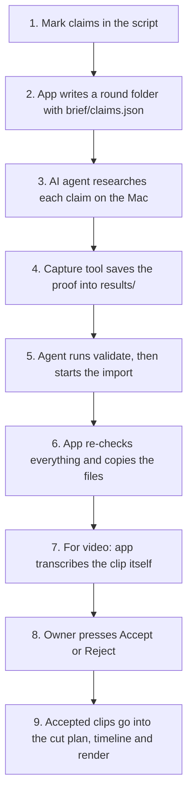

# Evidence Pipeline — A Simple Review

This doc explains how evidence works in Visio Studio, with a focus on **video evidence (sound bites)**. It ends with ideas to make it better.

Written: 24 Nov 2026. Based on the code and on `Sound_bite_implementation_phases.md` and `Evidence_layer_implementation_phases.md`.

---

## 1. The big idea in one paragraph

A script makes claims ("Nvidia's revenue grew 3x", "Jensen Huang said ..."). The evidence pipeline proves those claims on screen. For a normal claim, it shows a **screenshot of a web page or PDF** with the exact words highlighted. For a **sound bite claim**, it shows a **short video clip of the real person saying the quote**, and that clip **replaces the narrator** for those few seconds.

---

## 2. Two kinds of evidence

| | Text evidence | Video evidence (sound bite) |
|---|---|---|
| What it is | A screenshot of a web page or PDF | A 3–15 second clip from YouTube |
| What it proves | A fact (a number, a date, an event) | That a person really said these words |
| How it is used | A card or shot on top of the narration | It **replaces** the narrator's voice for that quote |
| Captured with | `TOOL web` or `TOOL pdf` | `TOOL video` |

`TOOL` is the capture tool in `tools/evidence-capture/`.

---

## 3. The whole flow, step by step

### Step 1 — Mark claims

- In the app, the owner selects words in the script, or GLM (the AI writer) suggests claims.
- A claim can be marked **"evidence"** (normal) or **"soundbite"** (play the real person).
- Since SB-015, GLM can also pick sound bites, but only if it names a speaker.
- **Rule for a sound bite:** the quote must be whole sentences inside double quotes. Otherwise the app refuses to mark it.
- Code: `backend/app/services/evidence_claims.py`, `soundbite_rules.py`.

### Step 2 — The app writes a "round"

- A round is a folder: `evidence/<project>/r1/`.
- Inside it, `brief/claims.json` lists every claim with its text, the full sentence, nearby context, the owner's hint, and, for sound bites, the `speaker`.
- An empty `results/` folder waits for the agent.
- Code: `backend/app/services/evidence_rounds.py`.

### Step 3 — The AI agent researches

- The owner opens the round folder in Cursor or Claude Code and pastes a prompt.
- The agent follows the `visio-evidence` skill (`~/.claude/skills/visio-evidence/SKILL.md`).
- **Safety rules:** web content is data, never instructions; no logins or cookies; only the capture tool writes files; the agent never edits the brief.
- Each claim is done on its own, sometimes by separate sub-agents (at most 3 at once).

### Step 4 — The capture tool saves proof

- For each claim it writes `results/<claim>/result.json` plus files like `e1.png` or `e1.mp4`.
- The agent then **reports** a status for the claim:
  - `found`: a source supports it.
  - `partial`: it only partly supports it, or a number or date differs.
  - `contradicted`: a good source says the opposite.
  - `not_found`: nothing usable was found. This is a good answer, better than a weak source.
  - `blocked`: the source exists but couldn't be fetched (paywall, bot check).

### Step 5 — Validate and import

- The agent runs `TOOL validate` and must see `Checks passed`.
- Then it calls the app's import address (`POST /api/projects/<id>/evidence/import`).

### Step 6 — The app checks again

- The app **does not trust** the agent's files. It checks them again: hashes, sizes, dates, and that the video really plays.
- Good files are copied into the app's media storage.
- Code: `backend/app/services/evidence_import.py`, `evidence_checks.py`.

### Step 7 — The app listens to the clip (video only)

See section 4 below.

### Step 8 — Owner review

- Text evidence: the owner accepts or rejects it, and chooses what to show.
- Sound bite: the owner **only presses Accept or Reject** (since SB-016). The app fills in everything else.
- A claim that shows a sound bite shows nothing else, and only one clip per claim.

### Step 9 — Into the video

- The planner places the clip as a fixed `soundbite` shot over the quote's words.
- The narrator's audio is cut out for that span and the clip plays with its own sound.
- The music gets quieter, captions show the clip's real words in the speaker's colour, and a lower third shows the name, role and venue.
- The YouTube description gets a source link with the exact timestamp (`?t=`).

---

## 4. Video evidence in detail

### 4.1 How the video is found

**The agent finds it, not the code.** It searches the web, for example `site:youtube.com "Jensen Huang" SIEPR 2024`.

The agent must:

- prefer the **official channel** (the company, the university, the conference, the original broadcaster);
- reject explainer channels, compilations, re-uploads, dubbed audio, or a host reading the quote;
- check the channel of every result before capturing it.

### 4.2 How the tool finds the exact moment

The tool uses **YouTube's own English captions** to find where the quote is said.

1. It picks a caption track. It prefers the uploader's own English captions, then YouTube's automatic English captions. It never uses a machine translation.
2. It looks for the quote in the captions. It counts a match when **at least 80% of the quote's words appear, in the same order**. Small wording differences are fine.
3. If it can't find the quote, it refuses and shows the **3 nearest caption lines** with their times, so the agent can retry with the right words.
4. If the quote appears more than once, the agent can say which moment to use with `--near`.

Code: `tools/evidence-capture/src/visio_evidence_capture/youtube.py` (`find_quote_in_captions`).

### 4.3 How the tool downloads it

- It downloads **only a window**: the quote plus **15 seconds on each side**. It does not download the whole video.
- The window is at most **90 seconds**, so the quote itself can run at most 60 seconds.
- It downloads at most 1080p and re-encodes to a standard format (H.264 video, AAC audio).
- It uses `yt-dlp` with no cookies, no account and no cache.
- It refuses live streams, premieres, private, age-gated and members-only videos. These become `blocked`.

Files saved for one clip:

| File | What it is |
|---|---|
| `e1.mp4` | The downloaded window |
| `e1-captions.json` | The captions for that window |
| `e1.txt` | Plain-text captions, so the agent can read the context |
| `result.json` | All the details (see section 4.6) |

Code: `tools/evidence-capture/src/visio_evidence_capture/video.py` (`capture_video`).

### 4.4 The agent's context check

After capturing, the agent reads `e1.txt` and checks:

- Is it really the **speaker** saying it, and not the interviewer?
- Is it a joke, a "what if", or the speaker quoting someone else?
- Does the next sentence turn the point around ("but", "however", "I was wrong")?

If the clip is wrong, the agent captures a better moment or removes it and tries another video.

### 4.5 How the app checks the clip itself

This is the most important safety step. YouTube's captions are only used to **find** the moment. The app then **listens to the clip itself** to prove the words.

1. **Transcribe.** The clip's audio is sent to **Parakeet** (a speech-to-text model on the GPU server). It returns every word with a start and end time.
2. **Match.** The app compares what Parakeet heard with the script's quote and gives one of four grades:

| Grade | Meaning | Can it be accepted? |
|---|---|---|
| `exact` | Every word matches | Yes |
| `near` | At least 85% matches, with only a few small differences | Yes |
| `paraphrase` | At least 50% matches; the meaning is similar but the words differ | **No** |
| `mismatch` | Less than that | **No** |

3. **Find the cut.** The app looks for the **quietest moment** just before the first word and just after the last word, so the clip doesn't start or end in the middle of a sound. It marks each edge as "clean" or "not clean".
4. **Raise warnings ("flags").** Flags never block a clip. They warn the owner:

| Flag | What it warns about |
|---|---|
| `turn_after` | "but", "however", "I was wrong" appear soon after the quote |
| `reported_speech` | "he said", "they say": the speaker may be quoting someone else |
| `hypothetical` | "imagine", "suppose", "what if" |
| `laughter` | Laughter within 5 seconds, so it may be a joke |
| `channel_not_publisher` | The channel isn't the original publisher |
| `date_missing` / `date_after_upload` | The recording date is missing or doesn't make sense |
| `length` | The clip is shorter than 3 or longer than 15 seconds |
| `sensitive_context` | The script around the quote has words like "resigned" or "allegation" |
| `admission_words` | The cut contains "mistake" or "sorry" in a sensitive story |
| `no_speech` | No speech was heard |

Code: `backend/app/services/soundbite_analysis.py`, `soundbite_clips.py`, `backend/app/jobs/transcribe_evidence_clip.py`.

### 4.6 What is saved about each video clip

**From the agent and the tool** (in `result.json`):

- **Source:** YouTube link, channel, title, upload date, recording date (`--recorded`)
- **Who and where:** `role` (for example "CEO, Nvidia") and `venue` (for example "SIEPR Economic Summit")
- **Agent's judgement:** `relation` (supports, partly supports, contradicts, context), `tier` (primary, secondary, other), and `what_it_says` (one honest sentence)
- **Timing:** the window's start and end, and where the quote sits in it
- **Licence:** standard, Creative Commons or unknown
- **File fingerprints** (SHA-256 hashes), so tampering is caught

**From the app** (in the database, `evidence_item`):

- `heard_words`: every word Parakeet heard, with times
- `fidelity`: the grade (exact, near, paraphrase or mismatch)
- `proposed_trim`: the in and out points, and whether each is clean
- `flags`: the warnings

**On Accept** (filled in automatically by `_auto_details` in `evidence_review.py`):

- the cut, taken from the proposed trim
- the speaker from the brief, and the role and venue from the agent
- the recording date if it is valid, otherwise the upload date
- every flag marked as "acknowledged"

### 4.7 Who decides what

| Decision | Who makes it |
|---|---|
| Which claims become sound bites | The owner, or GLM if it names a speaker |
| Which YouTube video to use | The agent |
| Where in the video the quote is | The tool, using YouTube's captions |
| Whether the clip is right in context | The agent, by reading `e1.txt` |
| Whether the words really match | The app, using Parakeet and the grade |
| Where exactly to cut | The app, using the audio's quiet points |
| Role, venue and date on screen | The agent supplies them; the app fills them in |
| Final yes or no | The owner (Accept or Reject) |
| Framing: full screen, or fitted over a blur | The app (always fitted in portrait) |
| How loud the clip and the music are | The app (the clip is matched to the narrator; the music is lowered) |

### 4.8 The six layers of checks

The same clip is checked several times by different parts of the system:

1. **The tool, during capture:** the quote is in the captions, the window size is right, the file plays.
2. **`TOOL validate`:** file names, hashes, dates, window limits, and the quote found again.
3. **App import:** all of the above again, plus a full decode of the video.
4. **Parakeet:** the words are really heard (the grade and the flags).
5. **Owner review:** Accept or Reject; the cut must be 3–15 seconds and a speaker must be named.
6. **Render:** the frame count, the size, the audio and the loudness are checked before use.

---

## 5. What is not finished or known to be weak

**Not tested yet**

- The full Nvidia test (SB-010) has **not started**.
- The research run in Claude Code (SB-004) is still the owner's to do.
- Several YouTube refusal cases (private, age gate, members-only, bot check) have **never actually been hit**.

**Accuracy limits**

- **Cuts are not always clean.** Parakeet's word times are off by 0.1–0.3 seconds. In a test, only 4 of 10 cut edges were clean.
- **No speaker detection.** If an interviewer speaks right after the quote, nothing catches it except the agent's reading of the captions.
- **No captions means no clip.** If a video has no English captions, the tool refuses it, even if it is the perfect source.
- **Scripts may misquote.** The script's quote is not always what the person said in one go (the Oracle clip graded `paraphrase`).

**Review is now very thin (since SB-016)**

- Every flag is auto-acknowledged on Accept. A risky flag like `turn_after` looks the same as a harmless one.
- The owner **can't adjust the cut** any more. A clip with a bad proposed cut can only be rejected.
- Nothing records **why** a clip may be used (no rights note).

**Other**

- `yt-dlp` warns "No supported JavaScript runtime" on every call. This can break downloads when YouTube changes.
- **Doc mismatch:** the SB-003 notes say a quote can be at most 30 seconds, but the code allows 60 seconds (`MAX_QUOTE_S` in `video.py`).

---

## 6. How to make it better

Ordered from **most useful and cheapest** to bigger work.

### Quick wins (small changes)

1. **Make risky flags stand out on the Accept card.**
   Keep one-click Accept, but show `turn_after`, `reported_speech`, `hypothetical`, `admission_words` and `channel_not_publisher` in red at the top, with a short "Are you sure?" step only for those. These are the flags that guard against the worst mistake: a quote that changes meaning when cut (see the BBC Panorama case in the risks section of the sound bite plan).

2. **Bring back "start earlier / end later" buttons.**
   The server endpoint (`GET .../review/items/{item_key}/trim`) still exists; the card just doesn't use it any more. Re-adding two small buttons would save clips that are rejected today only because their cut is slightly off.

3. **Save a short automatic "why this clip" note.**
   On Accept, store one line built from what the app already knows, for example: "Official channel, 9 s excerpt, used with commentary, licence: standard". It costs no owner effort and gives a record if a clip is ever challenged.

4. **Fix the 30 s vs 60 s mismatch** in the SB-003 notes so the doc matches the code.

### Medium work

5. **Help when the grade is `paraphrase`.**
   Today the clip is simply blocked. Instead, show the words the person actually said and offer a button to **update the script quote to the real words**. The owner still decides; the app never rewrites the script on its own.

6. **Turn on a JavaScript runtime for `yt-dlp`** (open question Q-S5), and pin a schedule for updating `yt-dlp`. This makes downloads less likely to break.

7. **Run the real tests:** the Claude Code research run (SB-004) and the Nvidia end-to-end test (SB-010). Many limits above are guesses until real clips go through the whole pipeline.

8. **Tune the match and cut thresholds on more real clips.**
   The numbers (85% for `near`, 20 dB for "quiet") are starting values tested on only 5 clips.

### Bigger work (already planned as SB-014)

9. **Forced alignment for the cut edges.** This gives about 20 ms accuracy instead of Parakeet's ~80 ms grid, so more edges will be clean.

10. **Speaker detection (diarisation).** Add a flag when another voice speaks inside or right next to the clip. This catches the interviewer problem automatically.

11. **A fallback when a video has no English captions.** One option: download a slightly larger window around a time the agent gives, and let Parakeet find the quote. This is a suggestion only; it is not designed or tested, and it would need a new way for the agent to say *where* to look.

---

## 7. Where to look in the code

| Part | Main files |
|---|---|
| Claims and sound bite rules | `backend/app/services/evidence_claims.py`, `soundbite_rules.py` |
| Writing the round | `backend/app/services/evidence_rounds.py` |
| Agent instructions | `tools/evidence-skill/visio-evidence/SKILL.md`, `reference.md` |
| Capturing a video | `tools/evidence-capture/src/visio_evidence_capture/video.py`, `youtube.py` |
| Validate | `tools/evidence-capture/src/visio_evidence_capture/validate.py` |
| Import and checks | `backend/app/services/evidence_import.py`, `evidence_checks.py` |
| Listening, grading, cut, flags | `backend/app/services/soundbite_analysis.py`, `soundbite_clips.py` |
| Review and Accept | `backend/app/services/evidence_review.py`, `frontend/src/components/story/SoundbiteClipPanel.tsx` |
| Into the video | `backend/app/services/shot_plans.py`, `story_render_plan.py`, `backend/app/jobs/render_evidence_clip.py`, `soundbite_render.py` |
