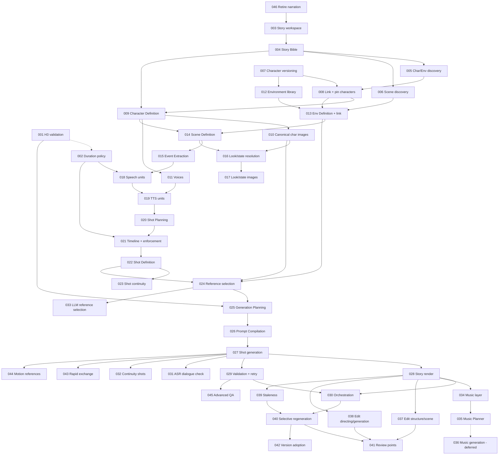

# Vision Studio — Incremental Implementation Phases

The authoritative, step-by-step roadmap from the application as it exists today to the story-to-video system described in `Path_ahead.md`.

- `Path_ahead.md` is the source of truth for **what** we are building and **why**.
- This document is the source of truth for **in what order**, **in what increments**, and **how far we have got**.

Written 2026-10-19 from a review of the repository at commit `c2fa765` (plus the staged Qwen3.8 token-limit change) and `Path_ahead.md`. Updated 2026-10-20 with the owner's decisions (see Appendix D): the narration pipeline is retired, no existing data needs preserving, and all story LLM jobs use GLM-5.3.

---

## How to use this document

### Opus → Sonnet workflow

1. Pick a phase whose status is **Not Started** and whose hard dependencies are all **Completed** (see [Phase Overview](#4-phase-overview)).
2. Give Opus `Path_ahead.md`, this document, and a request such as:

   > Plan **PHASE-0XX — <title>** only. Respect its Scope and Out of scope, the global conventions in §3.4, the default decisions in §3.3, and the Completion notes of the phases it depends on. Resolve every "Planning decides" item explicitly in the plan. Do not pull work from later phases. List the files to change, any migration, the API and UI changes, and how each Verification criterion will be checked.

3. Give the resulting plan to Sonnet for execution.
4. When the phase is done, update it as described in [§6 Progress Tracking Guidance](#6-progress-tracking-guidance). Pay particular attention to its **Completion notes**: later phases rely on them to learn the real names of tables, job types and endpoints.

### Reading a phase

Every phase has the same fields: Objective, Current state (with *starting points* in the code), Scope, Out of scope, Dependencies, Expected outcome, Verification criteria, Observable improvements, Completion checklist and Completion notes. Items marked **Planning decides** are deliberately left open. They need a closer look at the code, and the plan must settle them.

---

## Table of contents

1. [Project Vision and Goal](#1-project-vision-and-goal)
2. [Current State and Gap Analysis](#2-current-state-and-gap-analysis)
3. [Implementation Strategy](#3-implementation-strategy)
4. [Phase Overview](#4-phase-overview)
5. [Detailed Phase Definitions](#5-detailed-phase-definitions)
6. [Progress Tracking Guidance](#6-progress-tracking-guidance)
7. [Open Questions and Risks](#7-open-questions-and-risks)
- [Appendix A — Sample stories for verification](#appendix-a--sample-stories-for-verification)
- [Appendix B — H3 validation log (filled by PHASE-001)](#appendix-b--h3-validation-log-filled-by-phase-001)
- [Appendix C — Progress log](#appendix-c--progress-log)
- [Appendix D — Document change log](#appendix-d--document-change-log)

---

## 1. Project Vision and Goal

Vision Studio should accept a normal written English story (narration, dialogue, actions, several characters and places, sound events, emotional changes) and turn it into a finished video **automatically**, without the user converting it into scenes, shots, prompts or timestamps (`Path_ahead.md` §1).

The core idea is a sequence of small, focused reasoning stages. Each one produces a **structured, stored, inspectable, editable artifact** (§5, §44):

```text
Story ─► Scene ─► Event ─► Speech Unit ─► Shot ─► Generation Request ─► H3 clip ─► Timeline ─► Video
```

The end state, by capability area (§43):

| Area | What the finished system does |
|---|---|
| Story structure | StoryBible, then Character, Environment and Scene **discovery** (minimal lists with stable ids). |
| Entity definitions | One call per character and per environment. Canonical images, angle views and a TTS voice per character, and canonical references per environment, all **shared with the Character Lab** and **pinned by version** in each project. |
| Scene understanding | One Scene Definition call per scene (context, mood, cast, environment state, character looks, continuity). One resolution pass reuses or merges the looks and states the scenes ask for. One Event Extraction call per scene (narration, dialogue, action, sound_event, pause). |
| Speech | Speech units are planned by code, synthesized with TTS in the right voice, and their **measured** durations become the timing source. Transcription leaves the main path. |
| Directing | Shot Planning per scene (event count ≠ shot count; 2–10 s target inside H3's 1–15 s hard limit, both configurable), then Shot Definition per shot with continuity checks. |
| H3 generation | Per shot: minimal reference selection, deterministic generation planning (route, frames, references, dependencies), H3 prompt compilation (no background music), then H3 generation with exact trimming. |
| Automated quality | Technical checks and retries first. Then ASR dialogue checks. Identity, lip-sync, adherence and continuity checks later. |
| Audio production | Narration layer from TTS, shot audio from H3 used as is and normalized, continuous background music planned per story. |
| Project control | Optional review points; staleness with narrow dependencies; selective regeneration; adopting new library versions per project. |

**Key routing rules that every phase must respect** (§4, §33, §34):

- Dialogue is TTS in the character's voice. It is passed to H3 as an audio reference in **partial copy** mode, and H3's returned audio is the shot's final audio.
- Narration is **never** passed to H3. It is a timeline layer that can span several shots.
- Sound effects belong to the shot and are generated by H3. Background music is **never** generated by H3; it is one continuous layer under the whole timeline.
- A shot's duration is never shorter than the dialogue it carries. Clips are requested slightly longer and trimmed from the tail.

---

## 2. Current State and Gap Analysis

### 2.1 What the application is today

A two-container app (FastAPI + SQLite + Alembic backend, React + TypeScript frontend) whose background work is `job` rows driven by one dispatcher loop. GPU work (H3, LTX, Qwen-Image, Breeze TTS, Parakeet, Qwen3.8) goes to a remote GPU gateway. LLM work goes to Bitdeer (GLM-5.3 / GLM-5.3-Flash) or to Qwen3.8 on the GPU server.

**Project pipeline (narration-driven).** Voiceover (uploaded, or Breeze TTS of the whole script) → `transcribe` (Parakeet word timings) → `plan_scenes` (the LLM picks cut words and code times the cuts; a "scene" is one timed stretch of voiceover = **one clip**) → `extract_cast` / `write_character_reference_prompt` / `generate_character_reference` / `assign_cast` (project-only `character` / `location` tables, one reference picture each) → `draft_descriptions` → `write_image_prompt` → `generate_frame` (Qwen-Image, edited from cast references) → optional last frames → `generate_clip` (default `minimax-h3` through `POST /v1/h3/videos/generate` with first/last frames; **narration never goes to H3**) → `render_final` (clips trimmed to exact frames; clip audio gain set relative to the voiceover's loudness; concat; voiceover mixed on top; no music, no subtitles). `auto_pipeline` chains all of this as a step graph (`needs` / `follows`, per-target streaming, `MAX_TRIES = 3`). Its only confirmations come at the start. **This whole pipeline is retired by PHASE-046** (decision 2026-10-20). A narration-only video becomes a story without dialogue.

**Narration code the labs depend on.** `jobs/generate_lab_video.GenerateLabVideoHandler` subclasses `jobs/generate_clip.GenerateClipHandler`; `jobs/generate_lab_image.py` and `jobs/remote_image.py` import from `generate_clip`; `services/video_lab.py` imports `projects`, `frame_counts` and `scene_inputs.ClipMode`; `services/image_lab.py`, `services/character_looks.py` and `jobs/reference_upload.py` use `frame_images`; `jobs/reference_upload.py` and `jobs/write_character_reference_prompt.py` import `cast`. PHASE-046 must keep or move this shared code.

**Labs (project-independent).**

- Image lab: Qwen-Image-2.1 and Seedream.
- Voice lab: Breeze TTS design / clone / direction, saved `voice` rows.
- Video lab: LTX and H3. The H3 reference form takes 1–9 pictures with roles, 0–2 voices and any length from 1 to 20 s, with no first frame needed.
- Character Lab: `library_character` profile; versioned **looks** (prompt → 4 candidates → **manual** master choice → 4 angle edits: front, three_quarter, profile, back, face; backdrop removed with rembg); voice auditions from a description, chosen **manually**; **takes** that make image, audio or video, including H3 reference mode with audio markers `fully_copy` / `partially_copy` / `reference` / `weak_reference`.

**Engineering conventions in force.**

- Every schema change is a numbered Alembic migration (`0001`–`0021`). SQLite needs `batch_alter_table` to change a CHECK, and `job.type` is a CHECK, so every new job type needs a migration.
- Every migration gets an "Update" entry in `DATABASE_STRUCTURE.md`.
- "Out of date" is **computed when read** from input hashes recorded on jobs or provenance. It is never stored.
- Paid LLM jobs never re-run by themselves (`restart_rule = "never_rerun"`), save their answer the moment it arrives (`jobs/llm_call.ask_model`), and are validated by code.
- Author-written text is never overwritten by AI reruns.
- **There is no automated test suite.** Only Ruff, ESLint and `tsc` exist.

### 2.2 Capability gap by vision stage

| Vision stage (`Path_ahead.md`) | Exists today | Gap | Phases |
|---|---|---|---|
| Raw story input (§1) | `project.script_text`; a project needs a voiceover | Retire the narration pipeline; every project becomes a story project that needs no voiceover or transcript | 046, 003 |
| StoryBible (§6) | Manual `style_prefix` / `description_instructions` | Entirely new | 004 |
| Character / Environment Discovery (§7–8) | `extract_cast` does discovery **and** description in one call for narration projects | Separate minimal discovery calls with stable ids | 005 |
| Scene Discovery (§9) | `scene` = timed voiceover cut | Story scenes as continuity containers, anchored to the story text | 006 |
| Character Definition (§11) | Lab profile filled by hand | Structured LLM definition stored in the library | 009 |
| Canonical character images (§11) | Lab looks, but the master choice is manual | Automatic choice; integration with the pipeline | 010 |
| Character TTS voice (§11) | Lab auditions from a description, chosen by hand | Automatic voice from `voice_identity`; narrator voice | 011 |
| Shared characters, versions, pinning (§11, §38) | No link (code comments say the two "never touch"); looks have version numbers only | Character versions, project links and pins, adoption flow | 007, 008, 042 |
| Identity vs look (§12) | A look is a full reference-set *attempt*, with no wardrobe name | Named looks derived from canonical images | 016, 017 |
| Environment Definition and references (§13) | Project `location` with one picture; **no environments in the Character Lab** | Environment library, definition, canonical references | 012, 013 |
| Environment states (§14) | None | States derived from canonical references | 016, 017 |
| Scene Definition (§16) | `draft_descriptions` writes visual prompts, not dramatic context | Entirely new | 014 |
| Look/state resolution (§16) | None | Entirely new | 016 |
| Event Extraction (§17–18) | None | Entirely new | 015 |
| Speech Planning (§19) | `speech_chunks.split_script` (TTS size limits only) | Per-event speech units with estimates | 018 |
| TTS with measured timing (§20–21) | Breeze modes; one voiceover file; durations measured | Per-unit TTS in character and narrator voices; no transcription in the main path | 019 |
| Shot Planning and duration policy (§22–25) | LLM scene cuts on word timings; `min/max_scene_seconds`; **H3 floored at 124 frames (5.17 s)** for scenes | Shots, timeline, configurable 2–10 / 1–15 policy | 002, 020, 021 |
| Shot Definition and continuity (§26–27) | None | Entirely new | 022, 023 |
| Reference Selection (§28) | Cast pictures feed Qwen first-frame edits; the lab maps framing to angles (`references_for`) | Per-shot minimal manifest; code + LLM + validation | 024, 033 |
| Generation Planning (§29) | `endpoint_for`, frame grids, H3 sizes; no dependency graph | Deterministic plan artifact, H3 router, shot dependencies | 025, 032 |
| H3 Prompt Compilation (§30) | Three-field H3 prompt for scenes; six-part reference prompt for lab takes (`character_take_prompt_writer`) | A per-shot compiler driven by the manifest | 026 |
| H3 Generation (§31) | `generate_clip` (frames), `lab_video` (reference mode + audios) | A shot generation job in reference mode | 027 |
| Quality Validation (§32) | Frame count ≥ target only | Technical checks and retries, ASR dialogue checks, advanced checks | 029, 031, 045 |
| Final Timeline (§33) | Voiceover + clip sound | Narration layer, normalized shot audio, ducking | 028 |
| Music (§34) | None | Layer, planner, generation | 034, 035; 036 deferred until after PHASE-045 |
| Orchestration (§35) | `auto_pipeline` step graph (narration only) | A story step graph | 030 |
| Editable artifacts and review points (§40) | Manual edits of narration fields; no pauses | Editing of every artifact; pauses at stage boundaries | 037, 038, 041 |
| Staleness and selective regeneration (§41) | Per-artifact "out of date" (narration) | Cross-artifact versions, narrow dependencies, selective rebuild | 039, 040 |
| Rapid exchange / motion references (§4, §24, §28) | The Video lab takes two characters and two voices by hand; `video_asset_ids` not wired | Reserved routes | 043, 044 |

### 2.3 Structural mismatches that shape the plan

1. **"Scene" means two different things.** In the code, a `scene` is a timed voiceover cut that makes one clip. In the vision, a scene is a dramatic continuity container that holds events and many shots. PHASE-046 removes the narration `scene` table before any story table is created, so the name is free for the vision's meaning (D-2).
2. **Timing source is inverted.** Today the voiceover is the clock and transcription finds the times. In the vision, TTS of each speech unit produces measured durations, and shots are planned around them.
3. **Conditioning is inverted.** Today a project clip is made from a generated first frame. The vision conditions H3 on character and environment **reference images** and adds dialogue audio. The Video lab can already do this by hand, but it has not been tested with white-backdrop character images (`UPSTREAM_API_0.13_INTEGRATION.md` §8.4).
4. **Two character systems.** Project cast tables (narration) and the Character Lab library are separate. The vision needs one shared, versioned library that projects pin. The narration cast tables go with PHASE-046 (D-4).
5. **H3 clip floor.** Project scene clips are forced to at least 124 frames (5.17 s), while the vision relies on 2–10 s shots and reports 1–15 s working. The labs already removed this floor (commit `57e69b0`). The floored narration path is removed by PHASE-046, and the story pipeline uses the policy from PHASE-002.
6. **Staleness model.** The current convention (compute on read from recorded input hashes) fits the vision's staleness design, provided every new artifact records its exact upstream versions **from the start** (D-3).
7. **Every human choice point must become automatable.** The Character Lab waits for a person to choose the master candidate and the voice audition. The vision runs unattended by default (D-5).
8. **No automated tests.** Verification is manual (UI, API docs at `/api/docs`, read-only database inspection) plus lint and typecheck, using the fixed sample stories in Appendix A.

### 2.4 Vocabulary map

| Vision term | Proposed storage concept (final names are decided in planning) | Closest existing concept |
|---|---|---|
| StoryBible | `story_bible` (per story project, versioned) | `project.style_prefix` (manual) |
| Discovered character / environment | Project-scoped discovery rows with slug ids, linked to library entities | `character` / `location` (narration cast, removed by PHASE-046) |
| Library character / environment | `library_character` (+ versions); new `library_environment` (+ versions) | `library_character`, `character_look` |
| Look / environment state | Named variants under a character / environment version | `character_look` (an attempt, not a wardrobe) |
| Story scene | `scene` (a new table, created after PHASE-046 removes the narration one) | the narration `scene` (a voiceover cut; **not** the same thing) |
| Event | `event` | none |
| Speech unit | `speech_unit` (+ audio asset) | `lab_voice_run`, voiceover asset |
| Shot / Shot definition | `shot` (skeleton + definition) | none |
| Reference manifest / Generation request | Per-shot manifest and `generation_request` | `job.input` of `generate_clip` / `lab_video` |
| Final timeline | Frozen in the render job's input, as the narration render did | `render_final` `job.input.timeline` (removed by PHASE-046; readable at the tag) |

---

## 3. Implementation Strategy

### 3.1 Principles

1. **Replace the narration pipeline instead of building beside it.** There are no real users and no data to keep, so PHASE-046 removes the narration pipeline early. Every later phase targets story projects only, with no dual mode and no narration regression checks (D-1). The labs and the Character Lab stay.
2. **Follow the vision's stage order, one stage (or one tightly related pair) per phase.** Each LLM stage phase delivers storage, job, validation, a run button and a read-only view, so its artifact can be inspected right away.
3. **Record provenance from day one.** Every new artifact stores its source, job, version and the exact upstream versions or hashes it was built from (D-3). Staleness (PHASE-039) then only has to read what is already there, with no retrofitting.
4. **Reach a thin end-to-end story video early, then deepen.** The critical path to the first story video (PHASE-028) leaves out work the vision allows to be added later: LLM reference selection (deterministic fallback first), look/state resolution (canonical assets first), shot continuity reconciliation, continuity shots, music, editing, review points and staleness.
5. **Validate risky H3 assumptions before building on them.** PHASE-001 tests them by hand in the existing Video lab, with no code.
6. **Reuse existing machinery:** `llm_call.ask_model`, the job registry and pools, the look and angle pipeline, Breeze modes, the H3 reference-mode handler, and the pure render helpers (`render_commands`, `ffmpeg`). The removed `auto_pipeline` step graph and `render_final` job stay readable as templates at the git tag PHASE-046 creates.
7. **Deterministic rules live in pure functions** (duration policy, speech splitting, timeline, routing, validators), as the codebase already does. LLMs never decide hardware facts or frame counts (§29).
8. **Manual controls first, orchestration second.** Each stage is first runnable by a button. The one-click story run comes in PHASE-030, once every stage exists.

### 3.2 Milestones

| Milestone | Phases | Result |
|---|---|---|
| M0 Foundations and validation | 001, 002, 046, 003 | H3 facts confirmed; configurable duration policy; narration pipeline removed; the story workspace |
| M1 Story structure | 004–006 | StoryBible, discovered characters and environments, anchored story scenes |
| M2 Shared characters and environments | 007–013 | Versioned library characters and environments linked and pinned by projects; definitions, canonical images and voices made automatically |
| M3 Scene understanding | 014–017 | Scene definitions, events, resolved looks and states (with images) |
| M4 Speech | 018–019 | Speech units with measured TTS durations |
| M5 Directing | 020–023 | Shots planned, timed, defined and continuity-checked |
| M6 Generation and first story video | 024–028 | **First end-to-end story video** |
| M7 Automation and quality | 029–033 | Retries, one-click story run, ASR dialogue checks, continuity shots, LLM reference selection |
| M8 Music | 034, 035 | Continuous music layer (supplied track) and music plan |
| M9 Project control | 037–042 | Editing, staleness, selective regeneration, review points, version adoption |
| M10 Extended routes and advanced quality | 043–045 | Rapid exchange, motion references, advanced checks (gated or blocked) |
| Deferred (after M10) | 036 | Music generation, once a provider is added |

### 3.3 Default decisions assumed by the phases

These are the working assumptions behind the phases. Change one by editing it here and updating the phases it lists. Each links to an open question in §7 where relevant.

| ID | Decision | Affects |
|---|---|---|
| D-1 | **The story pipeline replaces the narration pipeline** (decided 2026-10-20, Q-1). PHASE-046 removes narration code, UI and tables; every project is a story project. A narration-only video is a story without dialogue. No existing data needs preserving. | 046, 003 onward |
| D-2 | New story artifacts get their own new tables (for example `scene`, `event`, `speech_unit`, `shot`, `generation_request`). PHASE-046 removes the narration tables first, so plain names are free; no narration table is reused. | 006 onward |
| D-3 | **Artifact provenance convention.** Every stage artifact records `source` (`ai` or `manual`), the job that produced it, a version (or an immutable new row per regeneration), and the exact upstream artifact ids and versions (or an inputs hash) it was built from. Staleness is **computed on read** from these records, consistent with the existing "worked out when read, never stored" rule. | 003 onward, realized in 039 |
| D-4 | Story characters and environments live in the **Character Lab library**. The narration cast tables (`character`, `location`) are removed by PHASE-046 (Q-16). | 046, 008, 012, 013 |
| D-5 | Where the lab currently waits for a person (choosing the master candidate, choosing a voice audition), the pipeline takes the **first successful candidate** (confirmed 2026-10-20, Q-3). The user can override in the lab. | 010, 011, 017 |
| D-6 | Each stage gets manual run controls in the story workspace first. One-click orchestration comes in PHASE-030. | 004–029 |
| D-7 | Stage answers are JSON (`response_format: json_object`) requested through `jobs/llm_call.ask_model` and validated by code before being stored. An unusable answer is retried within the existing attempt limits. | All LLM stages |
| D-8 | One duration policy: H3 hard bounds (default 1–15 s, but never above the frame count the GPU server accepts) and a planning target (default 2–10 s), both configurable and never hard-coded into prompt text. | 002, 018, 020, 021, 025 |
| D-9 | Clips are requested on H3's `17n + 5` frame grid at or above the target and **trimmed at render time**, as today. | 002, 025, 028 |
| D-10 | H3 shot audio is used as is. Narration never enters H3. The compiled prompt always disables background music (`non_diegetic_music: N/A`). | 025–028 |
| D-11 | No automated test suite is added unless explicitly requested (Q-14). Verification is manual plus lint and typecheck, using the sample stories in Appendix A. | All |
| D-12 | **Every story LLM job uses GLM-5.3** (the full Bitdeer model, not Flash) through one model setting; there are no per-stage or per-area settings for now (decided 2026-10-20, Q-13). Qwen3.8 is not used for story planning. Each stage sets `max_tokens` for its own answer. The context size (the owner expects about 256K tokens) is confirmed against Bitdeer in PHASE-004. | 004 onward |
| D-13 | **Story length:** stories of up to about 10 minutes of finished video. Splitting longer stories (for example an hour) into segments is outside this plan (Q-10). | 003, all LLM stages |
| D-14 | **Relations are not stored.** Relations between characters (mother and son, a younger self) are not kept in the database or in any persistent memory. Prompts understand them from the raw story text, which the definition stages receive (Q-12). | 005, 008, 009 |
| D-15 | **Scene discovery is independent** of character and environment discovery: it records no character or environment ids, so all three discovery calls can run in parallel. Later stages work out who and where (PHASE-013, PHASE-014) (Q-11). | 006, 013, 014 |

### 3.4 Conventions every phase must follow

These are existing repository rules. Plans should state how each one applies.

- **Migrations:** a new numbered Alembic revision in `backend/app/db/migrations/versions/` (the next free number, after any new baseline PHASE-046 creates). A CHECK change (for example a new `job.type`) uses `op.batch_alter_table`. **No existing data needs preserving** (no real users): migrations need no backfill, may drop tables, and a downgrade is optional. A fresh database is acceptable. Resetting it is the **owner's action**, never an agent's: the README warns that `docker compose down -v` deletes the database **and all media**.
- **Schema documentation:** add an "Update (…)" entry at the top of `DATABASE_STRUCTURE.md` and update the affected sections (tables, JSON shapes, settings, how the pipeline writes).
- **Jobs:** one handler module per job type in `backend/app/jobs/`, registered in `app/jobs/__init__.py` `register_handlers()`. Declare `provider` (`gpu` / `llm` / `local`) and `restart_rule`. Paid LLM jobs use `never_rerun` and `llm_call.ask_model`. GPU jobs count in the shared pools (`jobs/pools.py`). Do not change the dispatcher loop.
- **LLM prompts:** request builders, profiles and parsers live in `services/` as pure functions (see `character_take_prompt_writer.py`, `character_look_prompt_writer.py`, `lab_prompt_writer.py`; the removed narration examples `cast_extraction.py` and `scene_planner.py` stay readable at the PHASE-046 tag). Code writes anything that depends on ids, counts or frame numbers; the LLM writes creative text.
- **API:** routers under `backend/app/api/`. After any API change, regenerate `frontend/src/api/schema.d.ts` with `npm run gen:api` against the running backend.
- **Out of date:** computed on read from recorded inputs, never stored as a flag (D-3).
- **Never overwrite author text** with AI output without the user's explicit action.
- **The labs (Image, Voice, Video) and the Character Lab must keep working** unless the phase explicitly changes them.

### 3.5 Standard checks (referenced by every checklist)

- `cd backend && uv run ruff check . && uv run ruff format --check .`
- `cd frontend && npm run lint && npm run typecheck`
- If the API changed: `npm run gen:api` was run and `schema.d.ts` is committed.
- If the schema changed: the migration applies on backend start (`docker compose up --build -d`), and `DATABASE_STRUCTURE.md` is updated.
- Regression spot check: the labs and the Character Lab still open, and any of their actions the phase touched still work. Story stages from earlier phases still run.

### 3.6 Parallel work

These can run at the same time, as long as each phase's own dependencies are met:

- **Start immediately:** PHASE-001 (manual), PHASE-002, PHASE-046, PHASE-007. PHASE-046 may touch modules the Character Lab imports (for example `frame_images`, `cast`), so coordinate it with PHASE-007 if they run together.
- **Story-structure track** 046 → 003 → 004 → {005, 006}: character, environment and scene discovery run in parallel (D-15).
- **Character track** 007 → 008 → 009 → {010, 011} and **environment track** 012 → 013 run beside the story-structure track.
- 016 → 017 (looks and states) and 023 (shot continuity) are **off the critical path** and can run beside M4–M6.
- After PHASE-028: 029, 031, 033, 034 and 037–039 are largely independent of each other.

---

## 4. Phase Overview

Status values: **Not Started**, **In Progress**, **Blocked**, **Completed**, **Deferred**. A phase is *ready* when all its hard dependencies are Completed. **This table and each phase's Status line must both be updated** (§6). The table is in roadmap order; IDs are permanent, so the order follows dependencies, not numbers (PHASE-046 comes before PHASE-003).

**Progress snapshot** (update when a phase changes status):

- Completed: PHASE-001 (2026-10-20; owner confirmed the generations)
- In progress: none
- Ready to start: PHASE-002, PHASE-046, PHASE-007
- Deferred: PHASE-036 (music generation, after PHASE-045)
- Current milestone: M0

| ID | Title | Milestone | Hard dependencies | Status |
|---|---|---|---|---|
| PHASE-001 | Validate H3 assumptions in the existing labs (manual) | M0 | — | Completed |
| PHASE-002 | Shot-duration policy | M0 | (001 recommended) | Not Started |
| PHASE-046 | Retire the narration pipeline | M0 | — | Not Started |
| PHASE-003 | Story workspace replaces the project page | M0 | 046 | Not Started |
| PHASE-004 | Story Bible stage | M1 | 003 | Not Started |
| PHASE-005 | Character and environment discovery | M1 | 004 | Not Started |
| PHASE-006 | Scene discovery anchored to the story text | M1 | 004 | Not Started |
| PHASE-007 | Character versioning in the Character Lab | M2 | — | Not Started |
| PHASE-008 | Link story characters to library characters (pinned) | M2 | 005, 007 | Not Started |
| PHASE-009 | Character Definition stage | M2 | 004, 008 | Not Started |
| PHASE-010 | Automatic canonical character images | M2 | 009 | Not Started |
| PHASE-011 | Character voices and narrator voice | M2 | 004, 009 | Not Started |
| PHASE-012 | Environment library in the Character Lab | M2 | 007 | Not Started |
| PHASE-013 | Environment Definition stage and project link | M2 | 006, 008, 012 | Not Started |
| PHASE-014 | Scene Definition stage | M3 | 006, 009, 013 | Not Started |
| PHASE-015 | Event Extraction stage | M3 | 014 | Not Started |
| PHASE-016 | Look and environment-state resolution | M3 | 010, 013, 014, Q-2 decision (owner) | Not Started |
| PHASE-017 | Generate new looks and environment states | M3 | 016 | Not Started |
| PHASE-018 | Speech unit planning | M4 | 002, 015 | Not Started |
| PHASE-019 | Speech synthesis for speech units | M4 | 011, 018 | Not Started |
| PHASE-020 | Shot Planning stage | M5 | 019 | Not Started |
| PHASE-021 | Scene timeline and shot-duration enforcement | M5 | 002, 020 | Not Started |
| PHASE-022 | Shot Definition stage | M5 | 021 | Not Started |
| PHASE-023 | Shot continuity reconciliation | M5 | 022 | Not Started |
| PHASE-024 | Reference catalog and deterministic reference selection | M6 | 010, 013, 022 | Not Started |
| PHASE-025 | Generation Planning (deterministic H3 router) | M6 | 001, 002, 019, 024 | Not Started |
| PHASE-026 | H3 Prompt Compilation stage | M6 | 025 | Not Started |
| PHASE-027 | Shot generation | M6 | 026 | Not Started |
| PHASE-028 | Story timeline render (first end-to-end story video) | M6 | 021, 027 | Not Started |
| PHASE-029 | Technical shot validation and automatic retry | M7 | 027 | Not Started |
| PHASE-030 | Story pipeline orchestration (one click) | M7 | 028, 029 | Not Started |
| PHASE-031 | Dialogue verification with ASR | M7 | 027 | Not Started |
| PHASE-032 | Continuity shots and shot dependencies | M7 | 001, 027 | Not Started |
| PHASE-033 | LLM reference selection | M7 | 024 | Not Started |
| PHASE-034 | Background music layer (supplied track) | M8 | 028 | Not Started |
| PHASE-035 | Music Planner | M8 | 034 | Not Started |
| PHASE-037 | Editing of story-structure and scene artifacts | M9 | 028 | Not Started |
| PHASE-038 | Editing of directing and generation artifacts | M9 | 028 | Not Started |
| PHASE-039 | Staleness across story artifacts | M9 | 028 | Not Started |
| PHASE-040 | Selective regeneration of stale artifacts | M9 | 030, 039 | Not Started |
| PHASE-041 | Review points | M9 | 030, 037, 038, 039 | Not Started |
| PHASE-042 | Adopting new library versions across projects | M9 | 008, 013, 040 | Not Started |
| PHASE-043 | Rapid back-and-forth exchange route (reserved) | M10 | 001 (V6 positive), 027 | Not Started |
| PHASE-044 | Motion reference videos (optional) | M10 | 027, Q-17 decision | Blocked (needs decision) |
| PHASE-045 | Advanced quality checks (investigation) | M10 | 029, Q-18 | Blocked (needs a model) |
| PHASE-036 | Music generation | Deferred | 035, a music provider (Q-8) | Deferred (after PHASE-045) |

### 4.1 Dependency graph (hard dependencies, transitive edges omitted)



---

## 5. Detailed Phase Definitions

### M0 — Foundations and validation

---

### PHASE-001 — Validate H3 assumptions in the existing labs (manual)

**Status:** Completed (2026-10-20) · **Milestone:** M0 · **Vision:** §4, §24, §28, §29

**Objective.** Confirm, with the Video lab's existing MiniMax H3 reference form and no code changes, the H3 behaviours that the generation phases are designed around, and record the results so those phases plan against facts.

**Current state.** `Path_ahead.md` §4 reports that 1–15 s clips work (about 2 s reliably) and that Ref2VA works well for speaking characters. The GPU server's guide documents 124–345 frames (5.17–14.4 s) and audio references of 2–15 s. `UPSTREAM_API_0.13_INTEGRATION.md` §8.4 says that reference-only clips using a white-backdrop library character picture are untested. The Video lab reference form already accepts 1–9 pictures with roles, 0–2 audios, lengths from 1 to 20 s, and `match_audio_duration`. *Starting points:* `services/video_lab.py` (`H3ReferenceForm`, `create_h3_reference_run`), `frontend/src/components/videoLab/ReferenceComposer.tsx`, the Voice lab for TTS lines, and the Character Lab for front and three-quarter pictures.

**Scope.** Run each experiment, record it in Appendix B, and note its design implication:

- **V1 Short frame counts:** reference clips at 22, 39, 56 and 73 frames (about 0.9 / 1.6 / 2.3 / 3.0 s). Are they accepted, and what is the quality?
- **V2 Short dialogue audio:** a Breeze line shorter than 2 s (for example "Exactly.", about 0.7 s) as `<Audio 1>` with `partially_copy` in a 2.3 s clip. Does the server accept it? Is the speech intact, with silent expression after it? If it is refused, repeat with the audio padded to 2 s.
- **V3 References without a first frame:** a character's front and three-quarter pictures (cut out, flattened on white as the app uploads them) plus an environment picture. Does the white backdrop leak into the clip? Is the environment used as the setting?
- **V4 Music suppression:** does `non_diegetic_music: N/A` (or an explicit "no music") reliably produce no score?
- **V5 Narration visual:** a shot with a character and no dialogue, where the prompt says nobody speaks. Do the lips stay closed?
- **V6 Rapid exchange (reserved route):** two characters with two voices exchanging quick lines in one clip.
- **V7 Continuity:** the last frame of a generated clip (extracted manually with ffmpeg and uploaded to the Image lab) used as the next clip's first frame or as a reference. How good is the continuity?
- **V8 Throughput:** wall time and GPUs reported per H3 job at short lengths.

**Out of scope.** Any code change. If a lab limitation blocks an experiment, record that as a finding; do not fix it here.

**Dependencies.** None. V1 informs PHASE-002; V2–V5 inform PHASE-025 and PHASE-026; V7 informs PHASE-032; V6 gates PHASE-043; V8 informs risk R-1.

**Expected outcome.** Appendix B has one row per experiment with the lab run id, the result and the design implication, and the related open questions (Q-5, Q-7) are updated.

**Verification criteria.**
- Every experiment V1–V8 has a recorded lab run id (or "blocked: reason"), a result and an implication.
- Q-5 and Q-7 in §7 state the decided handling, or say why they remain open.

**Observable improvements.** Not applicable (knowledge). This de-risks M6.

**Completion checklist.**
- [x] V1 short frame counts
- [x] V2 short dialogue audio with `partially_copy`
- [x] V3 references without a first frame (white backdrop)
- [x] V4 music suppression
- [x] V5 closed lips for narration shots
- [x] V6 two characters, two audios
- [x] V7 last frame as next clip's anchor
- [x] V8 timings and GPU counts
- [x] Appendix B filled; Q-5 and Q-7 updated

**Completion notes.** Done 2026-10-20 with no code change. Results, run ids and implications are in Appendix B; Q-5 and Q-7 are answered in §7; R-1 and R-3 are updated.

- **How the runs were made.** Every lab run was submitted to the app's own HTTP API (`POST /api/lab/videos/reference-runs` and `/api/lab/videos/runs`), all landscape (1344 x 768, 24 fps) with seed `20261020`. The prompts use the six-part H3 format of `referenceSkeleton` (V7a, on the generate endpoint, uses `integrated_multimodal_description`). Clips, stills and scripts were kept outside the repository; the finished clips stay in the Video lab under the run ids in Appendix B.
- **Inputs used.** Character 1 is Simi (Character Lab look 3: front picture = lab image 52, three-quarter = 57). Character 2 is Hanuman (look 4, front = lab image 69). Pictures are the Character Lab's references as stored (they are on a plain white backdrop; `cutout_url` is empty for both looks). Voices: saved voice 6 (Simi) and 5 (Hanuman). TTS lines made with the Voice lab (`mode: clone`): run 70 "Exactly." (0.88 s), run 71 "There's no upstairs." (1.36 s), run 72 "Whatever you hear at night, don't go upstairs." (3.52 s).
- **Deviations from the plan, and why.**
  1. **An environment picture was made.** The Image library held no empty place (every picture had a character in it), so one Qwen-Image-2.1 run (Image lab run 84, seed 20261020) made an empty bedroom: lab image 88.
  2. **Speech checks with Parakeet.** To judge "is the speech intact" without listening, the finished clips of runs 94, 96, 97 and 98 were transcribed with `POST /v1/parakeet/transcribe` (four small GPU jobs, called directly on the GPU server). This is not part of the app.
  3. **V1 22 frames was called directly on the GPU server**, as planned: the lab's 1.0 s minimum rounds to 39 frames. The same prompt, seed and uploaded picture ids as run 91 were used, and only `num_frames` changed.
  4. **V4 reused run 95** (V3, `non_diegetic_music: N/A`) as the `N/A` leg; run 96 is the same request with an explicit "no music" line. The music verdict also rests on measurements (spectrogram, loudness), not only on listening.
  5. **V3 and V4 used 124 frames** (the documented minimum) so that the clip is long enough to show leakage and music; V7 used the last frame (frame 123) of run 95.
- **Findings about the labs themselves (not fixed here).** (a) The Video lab's reference form refuses two pictures with the role `character_1` ("Only one picture can be Character 1."); the second picture of a character had to be given the role `other`. That role is only a label stored on the run; nothing sent to the server changes. (b) The lab's 1.0 s minimum cannot request fewer than 39 frames. (c) The Settings page showed the GPU API contract as "changed" (it differs from the approved fingerprint); runs were still accepted.
- **Owner confirmation (2026-10-20).** The owner watched and listened to the generations and confirmed that they look good and match their descriptions. This covers V2 voice and lip match (run 94), V4 no music (runs 95 and 96), V6 each voice on the right character (run 98, so the PHASE-043 gate is satisfied) and V7 (runs 99 and 100). The "owner to confirm" remarks in Appendix B are therefore resolved. No preference between runs 99 and 100 was recorded, so Q-7 stands as written.
- **What later phases should take from this.** PHASE-002: short clips do not shorten an H3 job (see V8 and R-1). PHASE-025 and PHASE-026: use short dialogue audio as is, give each line an explicit start time, and write "nobody speaks, lips stay closed" for non-speaking shots. PHASE-032: Q-7.

---

### PHASE-002 — Shot-duration policy

**Status:** Not Started · **Milestone:** M0 · **Vision:** §4 "Shot duration limits", §22 "Shot duration policy", §29 "Exact durations without drift"

**Objective.** Define the one configurable duration policy (H3 hard bounds and the planning target range) and the pure frame-count function the story pipeline will use, with no 5.17 s floor.

**Current state.** `services/frame_counts.py` has `h3_num_frames(target)` (the `17n + 5` grid at 24 fps) and `h3_scene_num_frames`, which floors narration scenes at `H3_MIN_FRAMES = 124` (5.17 s); `H3_MAX_FRAMES = 345` (14.4 s, the server guide's maximum). The labs already send any length (commit `57e69b0`; Video lab 1–20 s). The floored narration callers are removed by PHASE-046, so this phase does not touch them.

**Scope.**
- App settings (shown on the Settings page, read by code) for the **H3 hard minimum and maximum** (default 1 s and 15 s, adjusted to the PHASE-001 V1 findings) and the **planning target range** (default 2–10 s). Prompts receive these values as parameters (D-8). `SettingSpec` holds only strings and integers with per-field `min_value` / `max_value`, so **planning decides** the unit (whole seconds, tenths or frames) and where a minimum above its maximum is refused.
- The hard maximum can never exceed the frame count the server accepts. With the guide's 345 frames that is 14.4 s, since 15 s would need 362 frames, unless V1 shows that more works.
- A pure function: target seconds → the smallest `17n + 5` frame count at or above the target. A target outside the hard bounds is refused with a message naming the limit. Reuse `h3_num_frames`.
- Document the new settings in `DATABASE_STRUCTURE.md` §6.

**Out of scope.** Narration code paths (removed by PHASE-046); shot planning (020, 021); render changes.

**Dependencies.** PHASE-001 V1 recommended. Without it, use the values from `Path_ahead.md`, capped at the server maximum.

**Expected outcome.** The policy is visible and configurable. With the defaults, the function gives 56 frames for 2.0 s and 73 frames (3.04 s) for 3.0 s, and refuses 0.5 s and 16 s.

**Verification criteria.**
- The Settings page shows the four values; changing one saves it, and a value outside its allowed range is refused.
- Calling the function by hand (for example from a Python shell in the backend container) gives the expected frame counts and refusals.
- Standard checks (§3.5).

**Observable improvements.** The duration limits are visible and editable in Settings.

**Completion checklist.**
- [ ] Policy settings defined and validated
- [ ] Frame-count function with bounds, capped at the server maximum
- [ ] Docs updated
- [ ] Standard checks (§3.5)

**Completion notes.** _(fill in when completed: setting keys, function name and module, final default values)_

---

### PHASE-046 — Retire the narration pipeline

**Status:** Not Started · **Milestone:** M0 · **Vision:** §21 (transcription leaves the main path), §44; decision D-1 (2026-10-20)

**Objective.** Remove the voiceover-driven narration pipeline (its UI, API routes, jobs, services, tables and settings) so that every later phase targets story projects only. The labs, the Character Lab and the shared machinery later phases reuse must keep working.

**Current state.** The narration pipeline is described in §2.1. Several lab modules depend on narration code (§2.1, "Narration code the labs depend on"); the most important is `GenerateLabVideoHandler`, which subclasses the narration `GenerateClipHandler`. There are no real users, so no data needs preserving.

**Scope.**
- **Tag** the last commit before the removal (for example `narration-final`). Later plans can then read removed code with `git show narration-final:<path>`; PHASE-006, PHASE-028, PHASE-030, PHASE-031 and PHASE-032 refer to it.
- **Inventory (in the plan):** for every narration module, list what outside the narration pipeline imports it. Shared code is kept or moved, never broken. At least these stay usable:
  - the H3 and LTX submit-and-poll machinery the Video lab uses (today in `jobs/generate_clip.py`);
  - `frame_images`, `providers/*`, `ffmpeg`, `render_commands`, `frame_counts`, `speech_chunks`, `speech_audio`, `llm_call`, `llm_target`, `providers/transcriber.py`, and `jobs/synthesize_speech.SpeechHandler` (the base of the Voice lab's handler).
  
  **Planning decides** whether shared pieces move to neutral modules (for example the clip handler base) or stay where they are.
- **Remove:**
  - the narration sections of the project page (Voiceover, Script, AutoPipeline, Transcript, Cast, Scenes, Render) and their components;
  - the narration API routes;
  - the narration job types and handlers (for example `generate_voiceover`, `transcribe`, `plan_scenes`, `extract_cast`, the cast reference and assignment jobs, `draft_descriptions`, `write_image_prompt`, `generate_frame`, the last-frame jobs, scene clips, `render_final`, `auto_pipeline`);
  - the narration services and tables (for example `scene`, `character`, `location` and their links), plus project columns only narration uses.
- **Settings:** remove settings only narration uses. Check each role setting before removing it: for example, the `description_*` provider and model settings also serve the Video lab and character take prompts.
- **Project:** keeps what the story pipeline needs (name, size or orientation, and the story text if `script_text` is kept for PHASE-003). **Planning decides** the columns.
- **Database:** **planning decides** whether to add a removal migration or replace the migration chain with one new baseline, since a fresh database is acceptable. A reset is the owner's action (§3.4), never an agent's.
- **Docs:** update `DATABASE_STRUCTURE.md` and `README.md` to describe the app without the narration pipeline.

**Out of scope.** Building the story workspace (003); changing lab or Character Lab behaviour.

**Dependencies.** None. It must be completed before PHASE-003.

**Expected outcome.** Projects exist with no narration pipeline. The labs and the Character Lab work as before, and the backend has no narration job types.

**Verification criteria.**
- The backend starts on a fresh database; the registered handlers and the `job.type` CHECK contain no narration job types.
- Each lab completes one action: an Image lab run; a Voice lab run; a Video lab LTX run and an H3 generate and reference run; in the Character Lab, a look with angles, auditions and one take.
- The project list opens, and creating a project works.
- Searching the code (`rg`) for removed module names finds nothing outside docs, old migrations and the tag.
- Standard checks (§3.5).

**Observable improvements.** A smaller codebase; the project page no longer shows the narration flow.

**Completion checklist.**
- [ ] Tag created before removal
- [ ] Inventory of narration modules and their non-narration importers (in the plan)
- [ ] Shared machinery kept or moved; labs re-pointed
- [ ] Narration UI, API, jobs and services removed
- [ ] Narration tables, columns and settings removed (migration or new baseline)
- [ ] `DATABASE_STRUCTURE.md` and `README.md` updated
- [ ] Every lab and the Character Lab verified
- [ ] Standard checks (§3.5)

**Completion notes.** _(fill in: tag name, what was kept or moved and where, migration approach, remaining project columns and settings)_

---

### PHASE-003 — Story workspace replaces the project page

**Status:** Not Started · **Milestone:** M0 · **Vision:** §1, §38, §44

**Objective.** Turn the project page into the story workspace: the user pastes a raw story, sees its estimated length, and sees the pipeline stages (empty for now).

**Current state.** After PHASE-046 the project page has no narration sections. Projects are created in `frontend/src/components/projects/CreateProjectModal.tsx`, `api/projects.py` and `services/projects.py`. Whether `project.script_text` still exists depends on PHASE-046's Completion notes.

**Scope.**
- The story text on the project, with an editor. **Planning decides** whether to keep `script_text` or add a dedicated field.
- A word count and an estimated finished length (words divided by a configurable speech rate). A **non-blocking warning** appears above the story-length limit (default 10 minutes, D-13).
- A list of pipeline stages, shown as placeholders marked "not available yet".
- A reusable read-only **artifact viewer** component (structured JSON or key-value display, with version, source and job) for later stages.
- Write the artifact provenance convention (D-3) as a short new section in `DATABASE_STRUCTURE.md`, so every later stage table follows it.

**Out of scope.** Any LLM stage; splitting long stories into segments (outside this plan); lab changes.

**Dependencies.** PHASE-046.

**Expected outcome.** A project holds a story text and shows its estimated length and the empty stage list.

**Verification criteria.**
- Create a project, paste S2, reload: the text is kept and the word count and estimate are shown.
- A text estimated at over 10 minutes shows the warning and can still be saved.
- Standard checks (§3.5).

**Observable improvements.** The story workspace in the UI.

**Completion checklist.**
- [ ] Story text field and editor
- [ ] Word count, estimated length and length warning
- [ ] Stage placeholders
- [ ] Reusable artifact viewer component
- [ ] Provenance convention documented in `DATABASE_STRUCTURE.md`
- [ ] Standard checks (§3.5)

**Completion notes.** _(fill in: where the story text lives, the speech-rate setting, the viewer component name)_

---

### M1 — Story structure (discovery)

---

### PHASE-004 — Story Bible stage

**Status:** Not Started · **Milestone:** M1 · **Vision:** §6

**Objective.** Deliver the first LLM stage: produce, store and show the StoryBible from the raw story, and establish the stage pattern that later stages copy.

**Current state.** The LLM job pattern exists: `jobs/llm_call.ask_model` (attempts, retries, answer saved immediately), `restart_rule = "never_rerun"`, role settings in `core/settings.py` resolved by `services/llm_target.py` (Bitdeer or Qwen3.8), and request/parse pairs such as `services/character_take_prompt_writer.py` (and the removed `cast_extraction.py`, readable at the PHASE-046 tag). There is no StoryBible.

**Scope.**
- StoryBible storage per story project following D-3 (versioned, with source, job, and a hash of the story text it was made from).
- A new job type (migration for the `job.type` CHECK) that sends the raw story and receives the StoryBible JSON with the §6 fields: `title`, `language` (always `en`), `genre[]`, `tone[]`, `visual_style`, `time_period`, `storytelling_style.narration`, `world_rules[]`. Code validates shapes and size limits.
- The **one story LLM setting**, set to GLM-5.3 (D-12), which every later story stage uses. **Planning decides** whether it reuses an existing role setting (`llm_model`, `description_llm_model`) or adds a new one. Planning also confirms GLM-5.3's context and output limits with Bitdeer and records them (the owner expects about 256K tokens of context).
- Story workspace: a Run / Re-run button, job status, the artifact viewer showing the latest StoryBible and its version, and an "out of date" indicator when the story text has changed since (computed on read).
- A short "how a stage is built" note in the Completion notes (where the profile, parser, handler, API and UI pieces live) so PHASE-005 onward copy the pattern.

**Out of scope.** Editing the bible (PHASE-037); using it downstream; shared abstractions beyond what this one stage needs.

**Dependencies.** PHASE-003 (story project and workspace).

**Expected outcome.** A StoryBible for sample S1 and S2, with version history.

**Verification criteria.**
- Running on S2 stores a valid StoryBible; the job output records attempts and token usage.
- Re-running creates version 2, and version 1 is still readable.
- Editing the story text shows the bible as out of date.
- An answer that fails validation shows a readable failure on the job (observe this through the job record if it occurs; do not engineer one).
- Standard checks (§3.5).

**Observable improvements.** The first structured artifact is visible in the story workspace.

**Completion checklist.**
- [ ] StoryBible storage (D-3) and migration (table and job type)
- [ ] Request builder, parser and validator
- [ ] Job handler registered
- [ ] Story LLM setting (GLM-5.3) and confirmed limits
- [ ] API and workspace UI (run, status, view, out of date)
- [ ] Stage pattern noted in Completion notes
- [ ] Docs updated; standard checks (§3.5)

**Completion notes.** _(fill in: table, job type, setting key, module names, the stage pattern)_

---

### PHASE-005 — Character and environment discovery

**Status:** Not Started · **Milestone:** M1 · **Vision:** §7, §8, §10

**Objective.** Run two focused, independent LLM calls that list the story's meaningful characters and its reusable environments, each with a stable id, a name and a one-line description.

**Current state.** The narration `extract_cast` (removed by PHASE-046) found characters and places with full appearance text in one call, a combination the vision deliberately avoids. Nothing exists for story projects.

**Scope.**
- Project-scoped storage for discovered characters and environments (slug `id`, `name`, `description`), versioned as a set per D-3 and recording the StoryBible version and story hash used.
- Two discovery calls (inputs: raw story + StoryBible) that run concurrently with each other and with scene discovery (PHASE-006, D-15). **Planning decides** whether this is two job types or one with a kind parameter. Prompts ask for minimal output only (no appearance, wardrobe or voice).
- Validation: unique slug ids, slug format, non-empty names, count caps.
- Different-age versions of a character (for example "Young Arjun") are separate characters. **Relations are not stored** (D-14): no relation fields, rows or ids. Later prompts understand relations from the raw story.
- UI: two lists with run buttons and out-of-date indicators.

**Out of scope.** Linking to the Character Lab (008, 013); definitions; scenes.

**Dependencies.** PHASE-004 (StoryBible as input; stage pattern).

**Expected outcome.** S2 yields characters such as `arjun`, `landlord` and Arjun's mother (the story does not name her; the model chooses the id), and environments such as `arjun_apartment` and `arjun_bedroom`.

**Verification criteria.**
- Both calls run, and can be seen overlapping on the Activity page when the pool allows.
- Ids are unique slugs; the stored rows record the bible version used.
- Re-running after a story edit creates a new set version, and the old one stays readable.
- Standard checks (§3.5).

**Observable improvements.** The cast and places of the story appear in the workspace.

**Completion checklist.**
- [ ] Storage and migration
- [ ] Character discovery call and validation
- [ ] Environment discovery call and validation
- [ ] UI lists, run buttons, out of date
- [ ] Docs; standard checks (§3.5)

**Completion notes.** _(fill in)_

---

### PHASE-006 — Scene discovery anchored to the story text

**Status:** Not Started · **Milestone:** M1 · **Vision:** §9, §10

**Objective.** Identify the major story scenes, each tied to an exact, contiguous slice of the story. It needs nothing from character or environment discovery, so it runs in parallel with them (D-15).

**Current state.** The narration `plan_scenes` anchored model output to text: the LLM named cut words with checksum phrases, and code validated and placed them (`services/scene_planner.py` `build_request` / `parse_answer` / `check_cuts`, removed by PHASE-046 and readable at its tag). This is the precedent to follow. The narration `scene` table is gone by then (D-2).

**Scope.**
- Scene storage: `index`, slug `id`, `title`, `description` and the scene's **source text span**. **No character or environment ids** (D-15). PHASE-013 and PHASE-014 work out who and where.
- Inputs: raw story + StoryBible.
- **Addition to the `Path_ahead.md` §9 example (Q-11):** the source span is needed by Event Extraction (§17) and coverage checks. The model gives boundaries (for example the first and last words or a quote) and code locates them in the story.
- Code validation: spans are contiguous, ordered and cover the whole story without overlap. When validation fails, the model is asked again with the problems listed (within the attempt limits).
- UI: a scene list with titles, descriptions and the exact text slice; out-of-date indicators.

**Out of scope.** Scene definition, events, timing; who appears where (014).

**Dependencies.** PHASE-004 (StoryBible as input; stage pattern).

**Expected outcome.** S2 is split into about two scenes (for example "The Warning" and "The First Footsteps"; the model chooses the titles) whose slices join back into the full story.

**Verification criteria.**
- The slices of all scenes, joined in order, reproduce the story text exactly (ignoring whitespace normalization, if planning chooses it).
- Scene discovery and the two PHASE-005 calls can be seen overlapping on the Activity page when the pool allows.
- Standard checks (§3.5).

**Observable improvements.** The story's dramatic structure is visible.

**Completion checklist.**
- [ ] Storage and migration
- [ ] Prompt, parser and span anchoring with coverage validation
- [ ] UI
- [ ] Docs; standard checks (§3.5)

**Completion notes.** _(fill in)_

---

### M2 — Shared characters and environments

---

### PHASE-007 — Character versioning in the Character Lab

**Status:** Not Started · **Milestone:** M2 · **Vision:** §11 "Characters and the Character Lab"

**Objective.** Make every production-relevant edit of a library character create an immutable version, so that projects can later pin one.

**Current state.** `library_character` holds a mutable profile, a `voice_id` pointer and `current_look_id`. `character_look.version` numbers look attempts. Takes freeze `look_id`. Nothing versions the profile or the voice. `DATABASE_STRUCTURE.md` does **not** document the Character Lab tables (migrations `0016`–`0020`). *Starting points:* `services/character_library.py`, `services/character_looks.py`, `api/character_lab.py`, `frontend/src/components/characterLab/*`.

**Scope.**
- First, a documentation catch-up: describe the existing Character Lab tables in `DATABASE_STRUCTURE.md` §4, since this phase changes them.
- A character **version** is an immutable snapshot of what defines the character for production: profile fields, the chosen look (reference set) and the voice. Changing any of these creates a new version. **Planning decides** the storage (snapshot table or copy-on-write).
- No backfill: existing lab data need not be preserved (§3.4). A character starts at version 1 when created.
- The character page shows the current version number and a read-only version history.
- **Planning decides** whether takes also record the version (they already record `look_id`).

**Out of scope.** Project links and pins (008); structured definitions (009); adoption flow (042); environments (012).

**Dependencies.** None.

**Expected outcome.** Lab edits produce versions and old versions stay intact.

**Verification criteria.**
- Editing the profile, choosing another current look, or changing the voice each increments the version. The previous snapshot is unchanged.
- A new character shows version 1; its takes still display after later versions are created.
- Standard checks (§3.5).

**Observable improvements.** Version history in the Character Lab.

**Completion checklist.**
- [ ] `DATABASE_STRUCTURE.md` catch-up for the Character Lab tables
- [ ] Version storage and migration (no backfill)
- [ ] Version created on profile, look and voice changes
- [ ] Version history UI
- [ ] Standard checks (§3.5)

**Completion notes.** _(fill in)_

---

### PHASE-008 — Link story characters to library characters (pinned)

**Status:** Not Started · **Milestone:** M2 · **Vision:** §11, §38 ("A project pins a version of the same shared objects")

**Objective.** Back every discovered story character with a library character, and have the project pin a specific version of it.

**Current state.** There is no link between projects and the library. Narration cast tables remain separate (D-4). After PHASE-005 and PHASE-007, story projects have discovered characters, and library characters have versions.

**Scope.**
- A link from each discovered character to a library character and a **pinned version** (empty until linked).
- Two ways to link: **create** a new library character from the discovery entry (name and description go into the profile; it is marked as created by the pipeline for this project), or **map** to an existing library character (this enables reuse across projects).
- A "Link all" action that creates library characters for all unlinked entries.
- The Character Lab character page shows "Used by projects" (read-only, with the pinned version).
- Pins never move because of a lab edit. The project shows "newer version available" (information only).
- When discovery is re-run, links are kept for ids that persist. **Planning decides** the matching rule.

**Out of scope.** The adoption flow (042); definitions (009); images (010).

**Dependencies.** PHASE-005 (discovered characters), PHASE-007 (versions).

**Expected outcome.** S2's characters exist in the Character Lab, pinned by the project.

**Verification criteria.**
- "Link all" on S2 creates library characters that are visible in the lab and marked as coming from the project.
- Editing one in the lab creates v2; the project still pins v1 and shows "newer version available".
- Mapping a discovered character to an existing library character works and pins its current version.
- Standard checks (§3.5).

**Observable improvements.** Characters shared between the pipeline and the lab.

**Completion checklist.**
- [ ] Link and pin storage and migration
- [ ] Create-from-discovery and map-to-existing actions, plus "Link all"
- [ ] "Used by projects" in the lab; "newer version available" in the project
- [ ] Re-discovery keeps links
- [ ] Docs; standard checks (§3.5)

**Completion notes.** _(fill in)_

---

### PHASE-009 — Character Definition stage

**Status:** Not Started · **Milestone:** M2 · **Vision:** §11

**Objective.** One LLM call per character produces the stable structured definition (visual identity, default wardrobe, voice identity, behaviour). It is stored as a new version of the linked library character, and the project pins that version.

**Current state.** Lab profiles are filled by hand. `character_library.character_card` turns a profile into the text that the existing prompt writers read.

**Scope.**
- A per-character job (characters run in parallel). Inputs: raw story, StoryBible, the current character, the other characters (§11). Output: the §11 JSON (`visual_identity`, `default_wardrobe`, `voice_identity`, `behavior`).
- Relations (mother and son, a younger self) are understood from the raw story and the other characters in the input. They are not stored (D-14); for example, a "Young Arjun" definition can resemble Arjun because the model reads both.
- The structured definition is stored with the new library character version and mapped into the existing profile fields (appearance, outfit, personality, voice description, age, gender, …), so the lab card and the existing prompt writers keep working. **Planning decides** the mapping.
- The project pin moves to the new version. This is the pipeline's own change, unlike a lab edit.
- "Define all" and per-character runs; out-of-date indicators (story, bible or discovery entry changed).
- The lab shows the structured definition (read-only).

**Out of scope.** Images (010), voices (011), editing definitions (037).

**Dependencies.** PHASE-004, PHASE-008.

**Expected outcome.** Each S2 character has a structured definition visible in the project and in the lab.

**Verification criteria.**
- Definitions validate; the profile fields are populated; the version increments and the pin follows.
- Several character jobs run concurrently when the pool allows.
- Standard checks (§3.5).

**Observable improvements.** Fully described characters with no manual typing.

**Completion checklist.**
- [ ] Definition storage on the version and migration (job type)
- [ ] Prompt, parser and validator
- [ ] Mapping to profile fields
- [ ] Pin update; UI in the project and the lab
- [ ] Docs; standard checks (§3.5)

**Completion notes.** _(fill in)_

---

### PHASE-010 — Automatic canonical character images

**Status:** Not Started · **Milestone:** M2 · **Vision:** §11 (definition → image prompt → candidates → canonical → views)

**Objective.** Produce canonical identity images (master plus angle views) for every defined character without manual clicks, by reusing the lab's look pipeline.

**Current state.** `character_looks.start_look` → `write_character_look_prompt` → 4 candidate `lab_image` runs → status `choosing` waits for `choose_master` (manual) → rembg cutout → 4 angle edits → `ready` → `current_look_id`.

**Scope.**
- Start a look for each defined character. The look prompt reads the definition (directly or through the card).
- **Automatic master choice** per D-5 (default: first successful candidate). **Planning decides** whether automatic mode makes fewer candidates. Manual re-choice in the lab stays available, and it creates a new version that does not move project pins.
- When the look is ready, the library character gets a new version with that canonical look, and the project pin moves to it.
- The story workspace shows each character's canonical images and progress.

**Out of scope.** Wardrobe looks (016, 017); voices (011).

**Dependencies.** PHASE-009.

**Expected outcome.** Every S2 character reaches a ready look with five angles and no manual action.

**Verification criteria.**
- With nobody clicking, each character ends with front, three_quarter, profile, back and face images.
- A manual re-choice in the lab produces a new version, and the project stays pinned to its version.
- Standard checks (§3.5).

**Observable improvements.** Canonical character images appear automatically.

**Completion checklist.**
- [ ] Look started from the definition
- [ ] Automatic master choice
- [ ] Version and pin updated when ready
- [ ] Workspace display of images and progress
- [ ] Docs; standard checks (§3.5)

**Completion notes.** _(fill in)_

---

### PHASE-011 — Character voices and narrator voice

**Status:** Not Started · **Milestone:** M2 · **Vision:** §11 (`voice_identity` → TTS voice), §20 (narrator voice)

**Objective.** Give each character a saved TTS voice derived from its `voice_identity`, and give the story project a narrator voice that matches the StoryBible's storytelling style.

**Current state.** Breeze TTS supports design (from a description), clone and direction (clone plus instruction) modes (`services/voice_lab.py`, `providers/speech_synthesizer.py`). In the Character Lab, `character_library.start_auditions` makes 3 design samples, `choose_audition` saves one as a `voice` (manual), and takes speak through direction mode. A design-mode voice changes each time, so a voice must be **saved** before it is reused.

**Scope.**
- `voice_identity` → design instruction (**planning decides**: a deterministic template or an LLM rewrite) → audition sample(s) → **automatic choice** (D-5) → saved voice → attached to the character (new version; the pin moves).
- Narrator: a project-level narrator voice. Choose an existing saved voice, or derive one from `storytelling_style.narration` through the same design-and-save flow.
- UI: play each character's voice sample; a narrator voice picker.

**Out of scope.** Synthesizing story lines (019).

**Dependencies.** PHASE-009 (`voice_identity`), PHASE-004 (storytelling style).

**Expected outcome.** Every S2 character and the narrator have saved voices.

**Verification criteria.**
- The saved voices appear in the Voice lab library and on the characters in the lab. The samples play and match their descriptions in broad terms (age, sex, energy).
- Re-running without changes creates no new voice (out of date is computed).
- Standard checks (§3.5).

**Observable improvements.** Characters that can speak in a consistent voice.

**Completion checklist.**
- [ ] Voice derivation, automatic choice and saving per character
- [ ] Narrator voice (choose or derive)
- [ ] Version and pin update; UI
- [ ] Docs; standard checks (§3.5)

**Completion notes.** _(fill in)_

---

### PHASE-012 — Environment library in the Character Lab

**Status:** Not Started · **Milestone:** M2 · **Vision:** §13 ("Environments live in the Character Lab as well")

**Objective.** Add environments to the Character Lab as versioned, reusable library objects with canonical reference images.

**Current state.** The lab has no environments. Narration `location` rows have one reference made with the `QWEN_IMAGE_21_LOCATION_SHEET` profile (`services/image_prompt_profiles.py`) by `generate_character_reference`.

**Scope.**
- A library environment with versions (the same versioning model as PHASE-007), definition or profile text, and canonical reference image(s).
- Lab UI: an Environments section or tab to list, create and edit (an edit creates a version), write a reference prompt, generate the canonical reference with Qwen-Image text-to-image, and view versions. **Planning decides** the image shape (orientation) and how many canonical images to make.

**Out of scope.** Environment states (016, 017); project linking (013).

**Dependencies.** PHASE-007 (versioning pattern).

**Expected outcome.** Environments can be created and illustrated in the lab.

**Verification criteria.**
- Create "Old apartment" and generate its reference; edit it and see version 2; the image stays attached to the version it was made for.
- Standard checks (§3.5).

**Observable improvements.** A new lab capability.

**Completion checklist.**
- [ ] Storage, versions and migration
- [ ] Prompt and image generation reusing existing jobs
- [ ] Lab UI
- [ ] Docs; standard checks (§3.5)

**Completion notes.** _(fill in)_

---

### PHASE-013 — Environment Definition stage and project link

**Status:** Not Started · **Milestone:** M2 · **Vision:** §13

**Objective.** Link discovered environments to pinned library environments, define each one with one LLM call, and generate its canonical reference automatically.

**Current state.** After PHASE-012 the lab has environments; after PHASE-006 each story scene lists its environments; PHASE-008 established the link-and-pin pattern.

**Scope.**
- Link and pin exactly as in PHASE-008 (create new or map existing; "Link all").
- A per-environment job (in parallel). Inputs: StoryBible, raw story, the environment, and the discovered scene list (titles, descriptions, spans). Scene discovery records no environment ids (D-15), so the model itself picks out the scenes where the environment appears, which stands in for §13's "scenes using the environment". Output: the §13 JSON (`architecture`, `layout`, `visual_identity`, `important_landmarks`, `atmosphere`, `continuity_rules`).
- Stored as a new version. Canonical reference generation is queued with PHASE-012's machinery, and the pin moves to the version that has images.
- The story workspace shows definitions and images.

**Out of scope.** States (016, 017).

**Dependencies.** PHASE-006, PHASE-008, PHASE-012.

**Expected outcome.** S2's environments are defined and illustrated, and are visible in the lab as used by the project.

**Verification criteria.**
- Definitions validate; canonical images exist; pins point at the illustrated version.
- Standard checks (§3.5).

**Observable improvements.** Places are created automatically.

**Completion checklist.**
- [ ] Link and pin for environments
- [ ] Definition job, parser and validator
- [ ] Automatic canonical reference generation
- [ ] UI; docs; standard checks (§3.5)

**Completion notes.** _(fill in)_

---

### M3 — Scene understanding

---

### PHASE-014 — Scene Definition stage

**Status:** Not Started · **Milestone:** M3 · **Vision:** §16

**Objective.** Fully define each discovered scene's dramatic context with one LLM call per scene: story context, environment and requested state, time and lighting, characters and requested looks, mood arc, dramatic goal, and start and end continuity.

**Current state.** After PHASE-006, story scenes have a title, description and source span, but no character or environment ids (D-15). Character and environment definitions exist after PHASE-009 and PHASE-013. Nothing defines a scene.

**Scope.**
- A per-scene job; scenes run in parallel. Inputs (§16): StoryBible, raw story, the current scene (with its span), previous and next scene summaries, and **all** character and environment definitions. Scenes carry no ids (D-15), and a story of at most 10 minutes (D-13) has few of each. The model chooses the scene's `environment_id` and `characters`; code validates them. This replaces §16's "relevant" definitions, because relevance is not known before this stage.
- Output with the §16 fields: `story_context` (`before`, `current`, `after`), `environment_id`, `environment_state`, `time` (`time_of_day`, `lighting_state`), `characters[]`, `character_looks{}`, `mood` (`start`, `middle`, `end`), `dramatic_goal`, `continuity_start{}`, `continuity_end{}`.
- Code validation: `environment_id` and every character id exist in discovery; `character_looks` and continuity keys are among `characters`. `environment_state` and the look names are stored as **requests in the model's own words**. Resolving them is PHASE-016's job, not this phase's.
- Stored per D-3 (records the scene, bible and definition versions used).
- UI: the definition of each scene in the artifact viewer; out-of-date indicators.

**Out of scope.** Look and state resolution and images (016, 017); events (015).

**Dependencies.** PHASE-006, PHASE-009, PHASE-013.

**Expected outcome.** S2's scenes have definitions. The footsteps scene requests, for example, the bedroom at night and Arjun in night clothes.

**Verification criteria.**
- Every scene has a valid definition; all ids resolve; several scene jobs run concurrently.
- Editing a character definition shows as out of date only the scenes whose definition lists that character. The provenance records the definitions of the characters and environment the scene chose, not every definition it was shown.
- Standard checks (§3.5).

**Observable improvements.** Dramatic context per scene.

**Completion checklist.**
- [ ] Storage and migration (table and job type)
- [ ] Prompt, parser and id validation
- [ ] Look and state requests stored unresolved
- [ ] UI; docs; standard checks (§3.5)

**Completion notes.** _(fill in)_

---

### PHASE-015 — Event Extraction stage

**Status:** Not Started · **Milestone:** M3 · **Vision:** §17, §18

**Objective.** For each defined scene, extract in story order exactly what happens, as events of five types (`narration`, `dialogue`, `action`, `sound_event`, `pause`), with a code check that the speech events come from the scene's text.

**Current state.** Nothing equivalent exists. The narration `services/transcript_matching.py` matched text against words, a possible reference for text normalization (readable at the PHASE-046 tag if removed).

**Scope.**
- A per-scene job (in parallel). Inputs: StoryBible, the scene definition, the scene's source text span, and the definitions of the scene definition's characters (plus the discovered character list, so an off-screen speaker can be named).
- Output (§17): ordered events, each with an `id` and `type`. `narration` and `dialogue` have `text`; `dialogue` has `speaker_id` and optional `delivery`; `action` and `sound_event` have `description`; `pause` has no duration. Events contain story truth only, with no camera instructions.
- **Coverage check (code):** the `narration` and `dialogue` texts appear in the scene's source span, in order, verbatim after normalizing whitespace and quotes. Text not covered by any speech event is listed as a warning rather than refused, because story text such as "Thump." legitimately becomes a `sound_event`. **Planning decides** how strict the check is and how a failure is retried.
- `speaker_id` must be a discovered character. An off-screen speaker (Meera's "Arjun?") is allowed; how it is filmed is Q-4 (PHASE-025).
- UI: the event list per scene, with the warnings shown.

**Out of scope.** Speech splitting (018); any timing.

**Dependencies.** PHASE-014.

**Expected outcome.** S1's events match the `Path_ahead.md` §42 example in substance: one narration, three dialogue lines (landlord, Arjun, landlord) and two actions (Arjun laughs; the landlord smiles awkwardly). S2 also produces `sound_event` ("Thump.") and `pause` ("Pause.") events.

**Verification criteria.**
- For S1 and S2, the speech events' texts, joined in order, reproduce the speech in each scene's span. Any uncovered text appears as a warning.
- Each dialogue event has a valid `speaker_id`.
- Standard checks (§3.5).

**Observable improvements.** A readable beat-by-beat breakdown of each scene.

**Completion checklist.**
- [ ] Storage and migration
- [ ] Prompt, parser and validation (types, ids)
- [ ] Coverage check with warnings
- [ ] UI; docs; standard checks (§3.5)

**Completion notes.** _(fill in)_

---

### PHASE-016 — Look and environment-state resolution

**Status:** Not Started · **Milestone:** M3 · **Vision:** §12, §14, §16 (resolution pass)

**Objective.** After all scenes are defined, run one dedicated LLM call that maps every requested look and environment state to an existing one or to a single new one, merging requests that mean the same thing, so that no duplicate images are generated.

**Current state.** A library character has `character_look` rows. Each is an unnamed version of the character's whole look (`character_looks.start_look`), with `current_look_id` pointing at one. There are no named looks (for example "night clothes") and no environment states. PHASE-012 adds library environments with canonical references only.

**Scope.**
- **Named looks and states** in the library: a character look and an environment state carry a short id (slug), a name and a text description. The canonical look or reference is the "default". How a named look relates to `character_look` (a name on the row, or a new record that points at one) is **Q-2, to be decided by the owner** before this phase is planned.
- One project-level job. Input: every request from the scene definitions (per character: look name; per environment: state), plus the catalog of existing looks and states with their descriptions. Output: for each request, either *reuse id X* or *new {id, name, description}*, where equivalent requests share one new entry.
- Code validation: every request is mapped; every reused id exists for that character or environment; new ids are unique. Retry, then fail visibly.
- Per scene, store the **resolved** look id per character and the resolved state id.
- UI: per scene, request → resolved (reuse or new).

**Out of scope.** Generating the images of new looks and states (017).

**Dependencies.** PHASE-010 (default looks exist), PHASE-013 (environments with canonical references), PHASE-014 (requests); the owner's Q-2 decision.

**Expected outcome.** S2 resolves "night" and "nighttime" (if both are requested) to one new bedroom state, and Arjun's "night_clothes" to one new look.

**Verification criteria.**
- Every scene has resolved ids; duplicate-meaning requests are merged; a reused id points at an existing record.
- Re-running with no changes reuses everything and creates nothing new.
- Standard checks (§3.5).

**Observable improvements.** Fewer duplicate assets; consistent looks across scenes.

**Completion checklist.**
- [ ] Named look and state storage, following the owner's Q-2 decision
- [ ] Resolution job, parser and validation
- [ ] Per-scene resolved ids
- [ ] UI; docs; standard checks (§3.5)

**Completion notes.** _(fill in, including the Q-2 decision)_

---

### PHASE-017 — Generate new looks and environment states

**Status:** Not Started · **Milestone:** M3 · **Vision:** §12, §14

**Objective.** Generate each genuinely new look or state once, derived from the canonical images so that identity stays fixed and only the wardrobe or state changes.

**Current state.** `character_looks.start_look(character_id, reference_image_id=…)` can already make candidates as Qwen-Image **edit** runs of a given picture, and then makes the five angles from the chosen master. Environments (PHASE-012) generate canonical references with text-to-image.

**Scope.**
- For each new character look from PHASE-016: start a look whose candidates are edits of the canonical front image, with an edit prompt describing only the wardrobe change. The master is chosen automatically (D-5) and the five angles are produced. The result becomes a new library version, and the project pin moves.
- For each new environment state: one or more edit runs of the canonical reference with a state prompt (for example lighting or damage), producing the state's reference image(s) and a new version.
- **Planning decides** whether the edit prompts are written by an LLM (from the look or state description) or from a template.
- UI: new looks and states with their images; progress.

**Out of scope.** Choosing which image goes to which shot (024).

**Dependencies.** PHASE-016.

**Expected outcome.** S2 gets Arjun in night clothes with the same face, and the bedroom at night with the same layout.

**Verification criteria.**
- New looks show five angles with a recognisably identical face; new states keep the room's layout. Judge this by eye and record the result in the Completion notes.
- Only genuinely new items are generated: re-running generates nothing.
- Standard checks (§3.5).

**Observable improvements.** Wardrobe and lighting variants with continuity.

**Completion checklist.**
- [ ] Look generation from canonical images (automatic master)
- [ ] State generation from canonical references
- [ ] Versions and pins; UI; docs; standard checks (§3.5)

**Completion notes.** _(fill in)_

---

### M4 — Speech

---

### PHASE-018 — Speech unit planning

**Status:** Not Started · **Milestone:** M4 · **Vision:** §19

**Objective.** Turn narration and dialogue events into speech units with deterministic duration estimates, splitting long events at natural points, and splitting dialogue only as far as the shot limits require.

**Current state.** `services/speech_chunks.py` (`cost`, `split_script`) splits long text for TTS by a cost limit at sentence and clause boundaries, a direct precedent. The duration policy comes from PHASE-002.

**Scope.**
- Deterministic code, no LLM by default. **Planning decides** whether an optional LLM split is needed for awkward cases. A speech unit has: `id`, source event id, kind (narration or dialogue), speaker (character id or narrator), text, delivery, order, and estimated duration (from text length, a speech rate and the delivery style; the rate is configurable).
- **Splitting rules:**
  - Narration over a configurable estimate (default: the planning target maximum) is split at sentence, then clause boundaries.
  - Dialogue is split only if its estimate exceeds what fits inside one shot (the hard maximum minus a margin), and then only at sentence boundaries.
- Stored per D-3 (records the event version).
- UI: speech units per scene with their estimates.

**Out of scope.** Synthesis (019).

**Dependencies.** PHASE-002 (duration policy), PHASE-015 (events).

**Expected outcome.** S1's units match §42: one narration unit (about 4.3 s) and three short dialogue units.

**Verification criteria.**
- A long narration test paragraph splits into natural pieces under the limit; short lines are not split.
- Units cover every speech event exactly once, in order.
- Standard checks (§3.5).

**Observable improvements.** Speech prepared for TTS.

**Completion checklist.**
- [ ] Storage and migration
- [ ] Estimation and splitting (pure functions)
- [ ] UI; docs; standard checks (§3.5)

**Completion notes.** _(fill in: rates, limits)_

---

### PHASE-019 — Speech synthesis for speech units

**Status:** Not Started · **Milestone:** M4 · **Vision:** §20, §21

**Objective.** Synthesize every speech unit with the right saved voice and record its **measured** duration, so that timing comes from real audio and transcription is no longer needed on the main path.

**Current state.** `jobs/synthesize_speech.SpeechHandler` is the shared base of `GenerateVoiceoverHandler` and `LabVoiceHandler` (Breeze TTS, `restart_rule = "resume"`). `services/ffmpeg.probe` measures audio. Character Lab takes already speak through the direction mode with a saved voice.

**Scope.**
- A per-unit TTS job (GPU pool): dialogue uses the speaker character's saved voice; narration uses the project's narrator voice (PHASE-011). **Planning decides** the Breeze mode (clone or direction with `delivery` as the instruction).
- Store the audio asset and the measured duration on the unit, with provenance (voice id, text and delivery hash).
- "Synthesize all" and per-unit runs; units whose inputs are unchanged are not re-synthesized.
- UI: play each unit and show its measured duration next to the estimate.

**Out of scope.** Using the audio in H3 or the timeline (025, 028).

**Dependencies.** PHASE-011 (voices), PHASE-018 (units).

**Expected outcome.** Every S1 unit has audio with measured durations (for example "Exactly." about 0.7 s).

**Verification criteria.**
- Every unit plays with the correct voice; measured durations are stored.
- Changing one unit's text marks only that unit out of date, and re-running re-synthesizes only it.
- Standard checks (§3.5).

**Observable improvements.** The story can be heard.

**Completion checklist.**
- [ ] TTS job per unit reusing `SpeechHandler`
- [ ] Measured duration and provenance stored
- [ ] UI playback; docs; standard checks (§3.5)

**Completion notes.** _(fill in)_

---

### M5 — Directing

---

### PHASE-020 — Shot Planning stage

**Status:** Not Started · **Milestone:** M5 · **Vision:** §22, §23, §25, §39

**Objective.** Once real speech durations are known, decide per scene how the audience sees the events: a list of compact shot skeletons, each with its source events, type, target duration and description.

**Current state.** Nothing equivalent exists for story projects. Narration `plan_scenes` cuts a transcript into timed scenes, a different problem.

**Scope.**
- A per-scene job (in parallel). Inputs (§22): scene definition, events, character and environment definitions, the **measured** speech-unit durations, StoryBible, and the planning target range from the duration policy (passed as parameters, D-8).
- Output skeletons (§25): `id`, `scene_id`, `source_event_ids[]`, `type`, `target_duration`, `description`. The planner decides pause lengths and how very short events are combined.
- **Speech placement:** shots must say which speech units they carry, so that narration spanning several shots (§23) and dialogue shots can be timed exactly. **Planning decides (Q-15)** whether skeletons also list speech-unit ids or code derives placement from `source_event_ids`.
- Code validation: every event is covered by at least one shot, in story order; ids exist; durations are numbers. The duration rules belong to PHASE-021.
- **Planning decides** the allowed shot `type` values (a small list or free text).
- UI: the shot list per scene.

**Out of scope.** Timing checks and re-planning (021); shot definition (022).

**Dependencies.** PHASE-019 (measured durations).

**Expected outcome.** S1 is planned roughly as in §42: about five shots and about 11.5 s, with the narration spanning the first two shots.

**Verification criteria.**
- Every event is covered; narration spans several shots where the plan says so.
- Standard checks (§3.5).

**Observable improvements.** A shot list for each scene.

**Completion checklist.**
- [ ] Storage and migration
- [ ] Prompt, parser and coverage validation
- [ ] Speech placement representation (Q-15 decided)
- [ ] UI; docs; standard checks (§3.5)

**Completion notes.** _(fill in)_

---

### PHASE-021 — Scene timeline and shot-duration enforcement

**Status:** Not Started · **Milestone:** M5 · **Vision:** §22 "Shot duration policy", §23, §24, §29

**Objective.** Compute each scene's exact timeline (shot start and end, speech-unit start times) in deterministic code, check it against the duration policy and speech constraints, and re-plan automatically when it fails.

**Current state.** No story timeline exists. The duration policy exists after PHASE-002.

**Scope.**
- A pure function: shots in order → start and end in the scene and in the story. Speech units are placed per the Q-15 rule. Default rule: a speech unit starts at the start of the first shot that carries it, or right after the previous speech unit if that one is still playing.
- **Checks:**
  - **Flagged:** a shot outside the target range triggers an automatic re-plan of that scene (PHASE-020 with the problems listed), up to a fixed number of tries.
  - **Blocking:** a shot outside the hard bounds never reaches generation.
  - **Blocking:** a dialogue shot shorter than its speech unit plus a small margin.
  - **Blocking:** narration units that overlap each other or run past the end of the scene's shots.
- After the tries are used up, the scene shows the remaining problems and generation stays blocked for that scene.
- UI: a per-scene timeline (shots as bars, speech units placed on them) with the problems listed.

**Out of scope.** Rendering (028); generation planning (025).

**Dependencies.** PHASE-002, PHASE-020.

**Expected outcome.** S1 has a valid timeline in which "Exactly." (0.71 s) sits in a shot of at least 2 s.

**Verification criteria.**
- A deliberately bad plan (edit a target duration to 0.5 s or 20 s through the API or the editor, if one exists by then) is flagged or blocked as specified.
- Re-planning stops after the configured number of tries.
- Standard checks (§3.5).

**Observable improvements.** A visible, exact timeline.

**Completion checklist.**
- [ ] Timeline computation (pure)
- [ ] Checks (flagged and blocking)
- [ ] Automatic re-plan with a try limit
- [ ] UI; docs; standard checks (§3.5)

**Completion notes.** _(fill in: the final placement rule; record it in Q-15)_

---

### PHASE-022 — Shot Definition stage

**Status:** Not Started · **Milestone:** M5 · **Vision:** §26, §27

**Objective.** Turn each planned shot into a full cinematic specification with one LLM call per shot: visual story, character expression, pose and gaze, composition, camera, action, continuity and audio intent.

**Current state.** Shot skeletons and timelines exist after PHASE-020 and PHASE-021.

**Scope.**
- A per-shot job (in parallel). Inputs (§26): StoryBible, scene definition, the shot skeleton, its source events, the relevant characters (with their resolved looks), the environment (with its resolved state), and the previous and next skeletons.
- Output with the §26 fields: `visual_story`, `characters[]` (`id`, `expression`, `pose`, `gaze`), `environment_state{}`, `composition` (`shot_size`, `angle`, `focus`), `camera` (`movement`, `intensity`), `action` (`start_state`, `primary_action`, `end_state`), `continuity_start{}`, `continuity_end{}`, `audio_intent` (`dialogue`, `ambient`, `sound_events[]`). **No music field** (§26).
- **Code writes** `shot_id`, `duration` (from the timeline) and `audio_intent.dialogue` (from the shot's dialogue speech unit). The model's values for these are ignored or checked.
- Code validation: character ids among the scene's characters; `shot_size` within an allowed list that PHASE-024 can map to a framing.
- UI: the shot specification in the artifact viewer.

**Out of scope.** Continuity reconciliation (023); references (024).

**Dependencies.** PHASE-021.

**Expected outcome.** Each S1 shot has a specification like the §26 example.

**Verification criteria.**
- All shots are defined; ids and sizes validate; durations equal the timeline's.
- Standard checks (§3.5).

**Observable improvements.** Director-level shot specifications.

**Completion checklist.**
- [ ] Storage and migration
- [ ] Prompt, parser and validation (code-written fields)
- [ ] UI; docs; standard checks (§3.5)

**Completion notes.** _(fill in: the `shot_size` list)_

---

### PHASE-023 — Shot continuity reconciliation

**Status:** Not Started · **Milestone:** M5 · **Vision:** §26 "Shot continuity"

**Objective.** Make neighbouring shots agree: each shot starts where the previous one ended, the first shot starts at the scene's `continuity_start`, and the last ends at its `continuity_end`.

**Current state.** Shot definitions run in parallel (PHASE-022), so neighbours can disagree.

**Scope.**
- A comparison of each shot's `continuity_end` with the next shot's `continuity_start`, plus the two scene boundaries. **Planning decides (Q-6)** the method. Default: one LLM call per scene listing the pairs that do not line up, because the states are free text.
- Mismatching shots are defined again (PHASE-022's job) with the neighbour's state supplied as input. The number of rounds is bounded.
- **Off the critical path:** generation does not wait for this phase. Unreconciled shots show "continuity not checked".

**Out of scope.** Visual continuity (032, 045).

**Dependencies.** PHASE-022.

**Expected outcome.** S1's shots form a continuous chain of states.

**Verification criteria.**
- After reconciliation, the comparison reports no mismatches (or lists those remaining after the round limit).
- Standard checks (§3.5).

**Observable improvements.** Fewer jumps in pose and state between cuts.

**Completion checklist.**
- [ ] Comparison (Q-6 decided)
- [ ] Re-definition with neighbour input; round limit
- [ ] UI status; docs; standard checks (§3.5)

**Completion notes.** _(fill in, including the Q-6 decision)_

---

### M6 — Generation and the first story video

---

### PHASE-024 — Reference catalog and deterministic reference selection

**Status:** Not Started · **Milestone:** M6 · **Vision:** §28 (steps 1 and 3; the LLM step is PHASE-033)

**Objective.** For each defined shot, choose the minimum sufficient set of reference pictures by deterministic rules, and record it as the shot's reference manifest.

**Current state.** `character_library.references_for(framing)` maps a framing to angles (`close_up` → face + three_quarter; `medium` → front + three_quarter; `wide` → front). `character_looks.references_for_take` returns a look's ready references for a framing. `video_generator.H3_MAX_REFERENCE_IMAGES = 9`.

**Scope.**
- **Catalog:** for the shot's characters (with their resolved looks) and its environment (with its resolved state), list the candidate pictures with id, view, look or state, and text description (the prompt each was made from).
- **Deterministic selection** (the fallback rule of §28, used as the main rule for now):
  - Map `shot_size` to a framing.
  - For each character visible in the shot, take the framing's angles from its resolved look, falling back to the default look when an angle is missing.
  - Add the environment state's reference.
  - Order the pictures with the focus character first, and cap them at 9.
- Characters not in the shot's `characters` (for example an off-screen speaker) are not included. Narration audio never appears.
- The manifest is stored per shot with provenance, so later changes show it as out of date.
- UI: the manifest with thumbnails.

**Out of scope.** LLM selection (033); audio references (025); motion videos (044).

**Dependencies.** PHASE-010, PHASE-013, PHASE-022. Uses PHASE-017 outputs when present.

**Expected outcome.** Every S1 shot has a manifest; a close-up of Arjun includes his face and three-quarter pictures and the apartment.

**Verification criteria.**
- Manifests follow the rule for each `shot_size`; no manifest exceeds 9; every id exists.
- Standard checks (§3.5).

**Observable improvements.** Visible references per shot.

**Completion checklist.**
- [ ] Catalog builder
- [ ] Deterministic selection and the `shot_size` → framing map
- [ ] Storage, UI; docs; standard checks (§3.5)

**Completion notes.** _(fill in)_

---

### PHASE-025 — Generation Planning (deterministic H3 router)

**Status:** Not Started · **Milestone:** M6 · **Vision:** §29, §24, §31

**Objective.** In deterministic code, turn each shot's specification, manifest and speech assets into an exact H3 generation request: endpoint, frame count, size, pictures, and audio with its marker.

**Current state.** `providers/video_generator.py` builds H3 requests (`build_request`, `with_frames`, `with_h3_references`, `H3_SIZES` 1344×768 and 768×1344). The labs already send reference-mode requests with 1–9 pictures and up to 2 audios (`video_lab.H3_MAX_AUDIOS`; the server takes 3). `services/speech_audio.pad_to` can pad audio to a minimum length.

**Scope.**
- A pure planning function and a stored **generation request** per shot (D-2), with provenance.
- **Routing:**
  - Pictures and no dialogue → reference endpoint, pictures only.
  - Pictures and dialogue → reference endpoint, pictures plus the dialogue speech unit's audio with `partially_copy` and `match_audio_duration` off.
  - No pictures → plain generate endpoint (text).
  - Narration audio is never sent (D-10).
- **Off-screen dialogue (Q-4, decided):** send the speaker's audio; the compiled prompt says the speaker is unseen (PHASE-026). The unseen speaker's pictures are not in the manifest.
- **Short dialogue audio (Q-5):** handled per the PHASE-001 V2 result, either as is or padded to the documented minimum.
- **Frames:** the smallest `17n + 5` at or above the shot target, within the hard bounds (D-9). Out-of-bounds shots are refused and sent back to re-planning.
- **Size** from the project orientation. No video references (044).
- UI: the request per shot (endpoint, frames, inputs).

**Out of scope.** Prompts (026); sending the request (027); shot dependencies (032).

**Dependencies.** PHASE-001 (V2–V5), PHASE-002, PHASE-019, PHASE-024.

**Expected outcome.** Every S1 shot has a valid request: a 2.0 s shot gets 56 frames; the landlord's dialogue shot carries his audio with `partially_copy`.

**Verification criteria.**
- Requests match the routing rules for each case in S1; frame counts are on the grid and at or above the target.
- Standard checks (§3.5).

**Observable improvements.** Inspectable, exact generation requests.

**Completion checklist.**
- [ ] Router and frame calculation (pure)
- [ ] Off-screen dialogue routed per Q-4; short-audio handling per Q-5 (from V2)
- [ ] Storage, UI; docs; standard checks (§3.5)

**Completion notes.** _(fill in)_

---

### PHASE-026 — H3 Prompt Compilation stage

**Status:** Not Started · **Milestone:** M6 · **Vision:** §30

**Objective.** With one LLM call per shot, compile the structured shot intent into the final H3 prompt, without reinterpreting the story and with background music always disabled.

**Current state.** `services/character_take_prompt_writer.assemble_h3_reference_prompt` already assembles the six-part reference format (`subject_definitions`, `summary`, `retention_analysis`, `detailed_description`, `overall_soundscape`, `non_diegetic_music`), where code writes the headings, label definitions and retention lines and the model writes the pieces. `services/lab_prompt_writer.assemble_h3_prompt` does the same for the three-field generate format.

**Scope.**
- A per-shot job (in parallel). Inputs (§30): StoryBible, shot definition, character definitions, environment definition, reference manifest, and the generation request (which labels exist: `<Image n>`, `<Audio n>`).
- The model writes the creative pieces. **Code writes** headings, label definitions, retention lines, audio markers, and `non_diegetic_music: N/A` (D-10). The soundscape is written from `audio_intent` (ambience and sound events). Reuse the existing assemblers' patterns; **planning decides** whether to reuse or share code with them.
- Code checks: every label used exists, music is disabled, the length cap is respected.
- For a dialogue shot whose speaker is off screen (Q-4), the prompt states that the voice comes from an unseen speaker and nobody visible speaks it.
- Uses the one story LLM setting (GLM-5.3, D-12).
- UI: the compiled prompt per shot (read-only for now; editing is PHASE-038).

**Out of scope.** Generation (027).

**Dependencies.** PHASE-025.

**Expected outcome.** Every S1 shot has a compiled prompt in the right format for its endpoint.

**Verification criteria.**
- Prompts validate; music is disabled in every prompt; the labels match the request.
- Standard checks (§3.5).

**Observable improvements.** Final prompts visible per shot.

**Completion checklist.**
- [ ] Prompt profile, parser and assembly (reference and generate formats)
- [ ] Code checks; off-screen speaker wording
- [ ] UI; docs; standard checks (§3.5)

**Completion notes.** _(fill in)_

---

### PHASE-027 — Shot generation

**Status:** Not Started · **Milestone:** M6 · **Vision:** §31

**Objective.** Send each shot's request and prompt to H3, store the resulting clip as a take of that shot, and run independent shots in parallel.

**Current state.** `jobs/generate_lab_video.GenerateLabVideoHandler` (a `GenerateClipHandler`) already uploads pictures and audio, submits H3 reference and generate requests, polls and stores the result, within the GPU pool.

**Scope.**
- A per-shot generation job that reuses the existing upload, submit, poll and store machinery. **Planning decides** whether to subclass or share code.
- Each run produces a **take** for the shot (a new row). The latest successful take is selected by default; the user can select another.
- "Generate all" (independent shots run in parallel within the pool) and per-shot generate and regenerate.
- UI: per-shot player, takes, status.

**Out of scope.** Validation and automatic retry (029); dependencies (032); the final render (028).

**Dependencies.** PHASE-026.

**Expected outcome.** Every S1 shot has a playable clip.

**Verification criteria.**
- All shots generate; dialogue shots contain their line audibly; clips are at least as long as their targets.
- Regenerating one shot adds a take and leaves the other shots unchanged.
- Standard checks (§3.5).

**Observable improvements.** Generated shots in the story workspace.

**Completion checklist.**
- [ ] Generation job (reusing lab machinery)
- [ ] Takes and selection
- [ ] Generate all and per shot; UI
- [ ] Docs; standard checks (§3.5)

**Completion notes.** _(fill in)_

---

### PHASE-028 — Story timeline render (first end-to-end story video)

**Status:** Not Started · **Milestone:** M6 · **Vision:** §33

**Objective.** Assemble the selected takes into one video, with narration as its own layer and shot audio normalized and lowered under narration. This produces the **first end-to-end story video**.

**Current state.** The narration `jobs/render_final.RenderFinalHandler` (local, `start_again`; removed by PHASE-046 and readable at its tag) trimmed each clip to exact frames, set clip gain relative to the voiceover's loudness, concatenated and mixed with `amix normalize=0`. Its pure helpers are kept: `render_commands.trim_args`, `clip_gain_db`, `join_args` and `ffmpeg.measure_loudness`. There is no music and there are no subtitles.

**Scope.**
- A story render job: shots in timeline order, each trimmed to its exact target.
- **Narration layer:** narration speech units placed at their computed start times (PHASE-021).
- **Shot audio layer:** the H3 audio of each take, loudness-normalized across the timeline so cuts do not jump, and lowered under narration. **Planning decides** the ducking method: a fixed reduction for time ranges with narration, or sidechain compression.
- Dialogue is present only in the shot audio, never doubled. No music, no subtitles.
- The output is stored as a story render, playable and downloadable, with the takes and timeline it was made from.

**Out of scope.** Music (034); subtitles; validation (029).

**Dependencies.** PHASE-021, PHASE-027.

**Expected outcome.** S1 plays as one coherent video with synced narration and dialogue.

**Verification criteria.**
- The duration equals the sum of shot targets (within one frame).
- Narration starts where the timeline says it does; each dialogue line is heard once; nothing jumps loudly at a cut; there is no music.
- Standard checks (§3.5).

**Observable improvements.** **The first complete story video.**

**Completion checklist.**
- [ ] Story render job (trim, concatenate)
- [ ] Narration placement
- [ ] Shot audio normalization and ducking
- [ ] Storage and UI; docs; standard checks (§3.5)
- [ ] Milestone M6 reached: record it in Appendix C

**Completion notes.** _(fill in)_

---

### M7 — Automation and quality

---

### PHASE-029 — Technical shot validation and automatic retry

**Status:** Not Started · **Milestone:** M7 · **Vision:** §32 (initial checks), §41 (failures are regenerated on their own)

**Objective.** Check every generated take technically and regenerate failing shots automatically, one shot at a time, without disturbing the rest of the timeline.

**Current state.** `services/ffmpeg.probe_video` and `probe` read a clip's streams, duration, size and frame rate. The removed narration `render_final` checked its own output (`_check_final`, readable at the PHASE-046 tag). Takes from PHASE-027 are stored but not checked.

**Scope.**
- **Checks per take** (code):
  - It decodes.
  - Its duration is at least the shot target and within the hard bounds.
  - It has an audio stream.
  - Its size and frame count match the request.
- The result is stored on the take; only passing takes are selected automatically and used by the render.
- **Retry:** a failed take triggers a new run with another seed, up to a configurable number of tries, then the shot shows a visible failure. A duration problem that comes from the plan (not the clip) goes back to re-planning (PHASE-021).
- UI: per-take check results; failed shots highlighted.

**Out of scope.** ASR (031); visual checks (045).

**Dependencies.** PHASE-027.

**Expected outcome.** Broken or short clips never reach the render.

**Verification criteria.**
- A take with a problem (for example one whose stored file is unreadable, if one occurs; do not damage real files deliberately) is marked failed and retried.
- Passing takes are unaffected; retries stop at the limit.
- Standard checks (§3.5).

**Observable improvements.** Fewer manual regenerations.

**Completion checklist.**
- [ ] Checks and stored results
- [ ] Automatic retry with a limit
- [ ] Render uses passing takes only
- [ ] UI; docs; standard checks (§3.5)

**Completion notes.** _(fill in)_

---

### PHASE-030 — Story pipeline orchestration (one click)

**Status:** Not Started · **Milestone:** M7 · **Vision:** §40 ("runs from raw story to finished video without anyone stepping in"), §35

**Objective.** Run the whole story pipeline, from raw story to rendered video, with one action, skipping everything that is already up to date.

**Current state.** The narration `services/auto_pipeline.py` and `jobs/auto_pipeline.py` (removed by PHASE-046 and readable at its tag) ran the pipeline as a step graph (`Step` with `needs` and `follows`, `MAX_TRIES = 3`, child jobs via `create_child`, start confirmations, `cancel_queued_children`). That design is the template.

**Scope.**
- A story step graph: StoryBible → discovery → scene discovery → link → definitions → images and voices → scene definition → events → resolution → new looks and states → speech units → TTS → shot planning and timeline → shot definition → references → generation plan → prompts → generation and validation → render. Steps fan out per entity, as the narration pipeline does per scene.
- A step skips targets that are up to date and creates jobs only for missing or out-of-date ones.
- A new story-pipeline module and job type, rebuilt from the removed `auto_pipeline` design. **Planning decides** how much of that design to restore.
- Start, stop and progress UI in the story workspace. Pauses happen only at start (review points are PHASE-041).

**Out of scope.** Review points (041); selective regeneration across the whole project after edits (040), although "skip up to date" already covers much of it.

**Dependencies.** PHASE-028, PHASE-029.

**Expected outcome.** S2, pasted into a new story project, becomes a video with one click.

**Verification criteria.**
- A fresh run on S2 completes without manual steps.
- A second run with no changes creates no jobs.
- Stopping cancels queued children.
- Standard checks (§3.5).

**Observable improvements.** One-click story-to-video.

**Completion checklist.**
- [ ] Step graph for story projects
- [ ] Skip-up-to-date evaluation per step
- [ ] Start, stop, progress UI
- [ ] Docs; standard checks (§3.5)
- [ ] Milestone M7 progress recorded in Appendix C

**Completion notes.** _(fill in)_

---

### PHASE-031 — Dialogue verification with ASR

**Status:** Not Started · **Milestone:** M7 · **Vision:** §21, §32

**Objective.** Confirm with Parakeet that each dialogue shot actually contains its intended line, and regenerate it when it does not.

**Current state.** `providers/transcriber.py` (`submit`, `parse_result` → `SpokenWord`) is kept by PHASE-046. The narration `jobs/transcribe.TranscribeHandler`, which ran it as a GPU job with polling, is removed and readable at the tag.

**Scope.**
- For each dialogue take: transcribe its audio, normalize the words, and compare them with the dialogue text. **Planning decides** the tolerance (exact words or a similarity threshold).
- A failure counts as a failed check under PHASE-029's retry rules.
- UI: the heard words next to the intended line.

**Out of scope.** Lip sync and speaker identity (045).

**Dependencies.** PHASE-027. Uses PHASE-029's retry when present.

**Expected outcome.** S1's dialogue shots pass; a take with garbled speech is regenerated.

**Verification criteria.**
- Each S1 dialogue take shows its transcript and a pass or fail result.
- Standard checks (§3.5).

**Observable improvements.** Dialogue correctness is checked automatically.

**Completion checklist.**
- [ ] ASR job for dialogue takes
- [ ] Comparison and result
- [ ] Retry integration; UI; docs; standard checks (§3.5)

**Completion notes.** _(fill in: tolerance)_

---

### PHASE-032 — Continuity shots and shot dependencies

**Status:** Not Started · **Milestone:** M7 · **Vision:** §29 "Shot dependencies", §41 (continuity shots become stale)

**Objective.** Support shots built from the output of the shot before them, generate them in dependency order, and make them out of date when that earlier shot is regenerated.

**Current state.** The narration pipeline chained *designed* last frames into the next scene's first frame (`services/last_frames.is_chained`, `apply_chains`; removed by PHASE-046 and readable at its tag). Nothing ever used the frame a generated clip actually ends on. `services/derived_frames.frame_to_send` prepares frames for sending; PHASE-046's Completion notes say whether it was kept.

**Scope.**
- **Which shots are continuity shots:** **planning decides** whether this is a Shot Planning field or a deterministic rule, and records it.
- **The anchor** is the frame **at the previous shot's target duration** (the last frame actually shown after trimming), extracted from the selected take. **Q-7 (from V7)** decides whether it is used as a first frame (generate endpoint) or as an extra reference picture.
- A dependency graph in the generation plan: dependent shots wait for their predecessor; independent shots still run in parallel.
- Regenerating or re-selecting a predecessor makes its dependents out of date (computed on read).

**Out of scope.** General staleness (039).

**Dependencies.** PHASE-001 (V7), PHASE-027.

**Expected outcome.** A continuous action across two shots flows without a visible jump.

**Verification criteria.**
- A dependent shot waits for its predecessor and uses its anchor frame.
- Re-selecting the predecessor's take shows the dependent as out of date.
- Standard checks (§3.5).

**Observable improvements.** Smoother continuous action.

**Completion checklist.**
- [ ] Continuity marking
- [ ] Anchor frame extraction at the target time (Q-7 decided)
- [ ] Dependency-ordered generation
- [ ] Out of date for dependents; UI; docs; standard checks (§3.5)

**Completion notes.** _(fill in)_

---

### PHASE-033 — LLM reference selection

**Status:** Not Started · **Milestone:** M7 · **Vision:** §28 (step 2)

**Objective.** Have a model choose the minimum sufficient references per shot from the code-narrowed catalog, with code validation and the deterministic selection as fallback.

**Current state.** PHASE-024 builds the catalog and selects deterministically.

**Scope.**
- A per-shot job (in parallel). Input: the shot definition and the catalog (text descriptions with id, view, look or state). Output: chosen ids with a short reason.
- Code validation: ids exist in the catalog; the count fits H3 (≤ 9); the set respects the minimum-sufficient rule (for example only shot characters, a bounded number of views per character). Retry once, then fall back to PHASE-024's rule.
- A setting to choose deterministic or LLM selection. The manifest records which method made it.

**Out of scope.** Motion references (044).

**Dependencies.** PHASE-024.

**Expected outcome.** Reference choices that suit each shot, with reasons shown.

**Verification criteria.**
- Manifests validate; a forced invalid answer, if observed, falls back to the deterministic rule.
- Standard checks (§3.5).

**Observable improvements.** Better-suited reference views.

**Completion checklist.**
- [ ] Selection job, parser, validation and fallback
- [ ] Setting and recorded method
- [ ] UI reasons; docs; standard checks (§3.5)

**Completion notes.** _(fill in)_

---

### M8 — Music

---

### PHASE-034 — Background music layer (supplied track)

**Status:** Not Started · **Milestone:** M8 · **Vision:** §33, §34

**Objective.** Add the continuous background-music layer to the story render, using a track the user supplies, lowered under narration and dialogue.

**Current state.** No render has music. H3 prompts disable music (D-10).

**Scope.**
- Upload or choose a music file for a story project, with a gain setting.
- The story render mixes it continuously across all shots, ducked under narration and dialogue, faded at the end. **Planning decides** whether it loops or stops when the track is shorter than the video.
- The render records which music it used.

**Out of scope.** Planning or generating music (035, 036).

**Dependencies.** PHASE-028.

**Expected outcome.** S1 with a supplied track sounds finished.

**Verification criteria.**
- Music is continuous across cuts, lower under speech, and does not restart at shot boundaries.
- Standard checks (§3.5).

**Observable improvements.** Music in the final video.

**Completion checklist.**
- [ ] Music input and setting
- [ ] Render mixing with ducking
- [ ] UI; docs; standard checks (§3.5)

**Completion notes.** _(fill in)_

---

### PHASE-035 — Music Planner

**Status:** Not Started · **Milestone:** M8 · **Vision:** §34

**Objective.** Plan the music for the whole story from its emotional arc: cues that span shots and scenes, rather than one per shot.

**Current state.** Scene moods exist (PHASE-014); the story timeline exists (PHASE-021).

**Scope.**
- One story-level LLM job. Inputs: StoryBible, the scene definitions (mood arcs), and the timeline. Output: cues with start and end (aligned to scene or shot boundaries by code), mood, intensity, instrumentation or style, and transitions.
- Code validation: cues lie within the timeline and do not overlap except at transitions.
- UI: the cue plan over the timeline.
- **Planning decides** whether a supplied track can be attached per cue before PHASE-036 exists.

**Out of scope.** Generating audio (036).

**Dependencies.** PHASE-034.

**Expected outcome.** A cue plan for S1 that follows its tension.

**Verification criteria.**
- Cues validate and align to boundaries.
- Standard checks (§3.5).

**Observable improvements.** A visible music plan.

**Completion checklist.**
- [ ] Cue storage, job, parser and validation
- [ ] UI; docs; standard checks (§3.5)

**Completion notes.** _(fill in)_

---

### M9 — Project control

---

### PHASE-037 — Editing of story-structure and scene artifacts

**Status:** Not Started · **Milestone:** M9 · **Vision:** §40 (intermediate structures are inspectable and editable), §43 "Project control"

**Objective.** Let the user edit the StoryBible, the discovery lists, scenes, scene definitions, events and speech-unit texts. Each edit becomes a new manual version, validated like the model's output.

**Current state.** Each stage shows its artifacts read-only (artifact viewer from PHASE-003).

**Scope.**
- An edit form per artifact type. Saving creates a new version with `source = manual`, validated with the same rules as the stage's parser.
- Discovery lists: add, rename and remove entries. Ids are stable; removing an entry that is used elsewhere is refused with an explanation.
- AI regeneration never silently replaces a manual version: it asks first.
- Downstream artifacts show as out of date after an edit (per-artifact indicators already exist; PHASE-039 makes this complete).

**Out of scope.** Directing artifacts (038).

**Dependencies.** PHASE-028.

**Expected outcome.** The user can correct anything in the story structure.

**Verification criteria.**
- Each editable artifact type saves a manual version; invalid edits are refused with readable errors.
- Regenerating over a manual version asks first.
- Standard checks (§3.5).

**Observable improvements.** Editable story structure.

**Completion checklist.**
- [ ] Edit forms and API per artifact type
- [ ] Validation reuse; manual versions
- [ ] Ask-before-replace
- [ ] Docs; standard checks (§3.5)

**Completion notes.** _(fill in)_

---

### PHASE-038 — Editing of directing and generation artifacts

**Status:** Not Started · **Milestone:** M9 · **Vision:** §40, §43

**Objective.** Let the user edit shot skeletons, shot definitions, reference manifests and compiled prompts, with the same versioning and validation as PHASE-037.

**Current state.** These artifacts are read-only after PHASE-020 to PHASE-026.

**Scope.**
- Shot skeletons: edit target durations and descriptions. **Planning decides** whether split and merge are included. Edits re-run the timeline checks (PHASE-021).
- Shot definitions, manifests (choose pictures from the catalog) and compiled prompts (code-written parts stay fixed and labels are checked).
- Manual versions; ask-before-replace.

**Out of scope.** Editing generation requests directly (they are computed by code).

**Dependencies.** PHASE-028.

**Expected outcome.** A user can direct a shot by hand.

**Verification criteria.**
- Each editable type saves a manual version; timeline checks run after skeleton edits; prompt edits keep valid labels.
- Standard checks (§3.5).

**Observable improvements.** Fine control over shots.

**Completion checklist.**
- [ ] Edit forms and API
- [ ] Timeline re-check; label checks
- [ ] Docs; standard checks (§3.5)

**Completion notes.** _(fill in)_

---

### PHASE-039 — Staleness across story artifacts

**Status:** Not Started · **Milestone:** M9 · **Vision:** §41

**Objective.** Compute, on read and down the whole chain, which artifacts were built from inputs that have since changed, with dependencies as narrow as the real inputs, and show the reason for each one.

**Current state.** Each phase recorded provenance (D-3) and shows a local out-of-date indicator. There is no project-wide, transitive view.

**Scope.**
- One computation over the recorded provenance: an artifact is out of date if any recorded input version differs from the current one, or if any of its inputs is itself out of date.
- Narrow dependencies: shots record exactly the characters, looks, states and speech units they used.
- A project overview listing out-of-date artifacts grouped by stage, each with its reason ("Arjun's voice changed").
- An "Accept as is" action that re-records the current inputs without regenerating. This is an explicit user action.
- Verified against the two §41 examples.

**Out of scope.** Regenerating (040).

**Dependencies.** PHASE-028.

**Expected outcome.** The project always answers "what is no longer valid, and why".

**Verification criteria.**
- §41 example 1: changing Arjun's voice marks Arjun's speech units and only the shots where Arjun speaks.
- §41 example 2: replacing a canonical environment image marks its states and the shots that reference them; events, scenes and speech stay valid.
- "Accept as is" clears an item without generating anything.
- Standard checks (§3.5).

**Observable improvements.** Trustworthy staleness.

**Completion checklist.**
- [ ] Transitive computation with narrow dependencies
- [ ] Overview UI with reasons
- [ ] Accept as is
- [ ] Both §41 examples verified; docs; standard checks (§3.5)

**Completion notes.** _(fill in)_

---

### PHASE-040 — Selective regeneration of stale artifacts

**Status:** Not Started · **Milestone:** M9 · **Vision:** §41 ("Regeneration is selective")

**Objective.** Rebuild only out-of-date artifacts, in dependency order, reusing everything that is unaffected.

**Current state.** The orchestration (PHASE-030) skips up-to-date targets; the transitive staleness exists after PHASE-039.

**Scope.**
- A "Regenerate out-of-date" action that runs the orchestration restricted to out-of-date artifacts, including dependent continuity shots, and then re-renders.
- Previous outputs stay available until they are replaced.
- Manual versions are never replaced without asking (PHASE-037 rule).

**Out of scope.** Adoption across projects (042).

**Dependencies.** PHASE-030, PHASE-039.

**Expected outcome.** Small changes cost small regenerations.

**Verification criteria.**
- After changing one character's voice, only the affected units and shots are regenerated (count the jobs) and the render updates.
- Standard checks (§3.5).

**Observable improvements.** Fast, cheap iteration.

**Completion checklist.**
- [ ] Restricted orchestration run
- [ ] Re-render; keep previous outputs
- [ ] Docs; standard checks (§3.5)

**Completion notes.** _(fill in)_

---

### PHASE-041 — Review points

**Status:** Not Started · **Milestone:** M9 · **Vision:** §40

**Objective.** Let the user enable pauses at stage boundaries. The pipeline stops there once that stage's artifacts exist, the user inspects or edits them, and then continues.

**Current state.** The orchestration runs without pauses (PHASE-030).

**Scope.**
- Project settings with five optional review points (§40):
  1. after story structure;
  2. after character and environment images;
  3. after scene definition and events;
  4. after shot planning;
  5. after generated shots.
- None are enabled by default.
- At an enabled point the run pauses with a clear "waiting for review" state; "Continue" resumes. Edits made during the pause go through the normal staleness rules.
- The artifacts are identical whether or not a review point is enabled.

**Out of scope.** New editors (037, 038).

**Dependencies.** PHASE-030, PHASE-037, PHASE-038, PHASE-039.

**Expected outcome.** Optional control without changing the pipeline's output.

**Verification criteria.**
- With "after shot planning" enabled, a run pauses there; edits made during the pause are reflected; "Continue" completes the run.
- With no review points, the run is unchanged.
- Standard checks (§3.5).

**Observable improvements.** Opt-in control.

**Completion checklist.**
- [ ] Settings and pause state
- [ ] Continue action
- [ ] UI; docs; standard checks (§3.5)

**Completion notes.** _(fill in)_

---

### PHASE-042 — Adopting new library versions across projects

**Status:** Not Started · **Milestone:** M9 · **Vision:** §11 "Characters and the Character Lab", §41 (last paragraph)

**Objective.** When a library character or environment gets a new version, let the user choose which projects adopt it. Incomplete projects are selected by default, and only the dependent parts of the chosen projects are rebuilt.

**Current state.** Projects pin versions (PHASE-008, PHASE-013) and show "newer version available".

**Scope.**
- In the lab, after a new version: a list of projects using the character or environment, with incomplete projects pre-selected. A project is **complete once it has a rendered final video** (Q-9, decided 2026-10-20), so projects without a final render are pre-selected. The user can select or deselect any project.
- Adopting moves the pin, which makes the dependent artifacts out of date (PHASE-039). Selective regeneration (PHASE-040) can then be started.
- In a project: choose another version of a character or environment directly.

**Out of scope.** Automatic adoption.

**Dependencies.** PHASE-008, PHASE-013, PHASE-040.

**Expected outcome.** Updating a character in the lab updates exactly the chosen projects, and finished videos are untouched.

**Verification criteria.**
- Two projects use Arjun, one with a final render and one without: only the one without is pre-selected; adopting rebuilds only the shots that use Arjun; the complete project's render is unchanged.
- Standard checks (§3.5).

**Observable improvements.** Safe reuse of characters across projects.

**Completion checklist.**
- [ ] Adoption dialog in the lab, pre-selecting projects without a final render; version choice in the project
- [ ] Pin moves → out of date → optional selective regeneration
- [ ] Docs; standard checks (§3.5)

**Completion notes.** _(fill in)_

---

### M10 — Extended routes and advanced quality

---

### PHASE-043 — Rapid back-and-forth exchange route (reserved)

**Status:** Not Started (gated on PHASE-001 V6 being positive) · **Milestone:** M10 · **Vision:** §24 (last paragraphs)

**Objective.** Support the reserved route where one shot contains a rapid exchange between two characters, using two character references and two dialogue audios.

**Current state.** The labs accept up to 2 audios in reference mode (`video_lab.H3_MAX_AUDIOS = 2`). Whether the exchange works well is what V6 tests. The exact multi-shot prompt format H3 expects is **not documented in this repository** and must be confirmed from the GPU server's guide before planning.

**Scope.**
- Shot Planning may mark a shot as a rapid exchange (rarely, and only where a scene needs it).
- The router sends both speakers' pictures and audio; the prompt compiler writes the multi-shot form; timeline checks treat the shot as carrying two dialogue units.

**Out of scope.** More than two speakers.

**Dependencies.** PHASE-001 (V6 positive), PHASE-027.

**Expected outcome.** A natural quick exchange inside one shot.

**Verification criteria.**
- A planned exchange shot generates with both lines audible in order, each spoken by the right character.
- Standard checks (§3.5).

**Observable improvements.** More cinematic quick exchanges.

**Completion checklist.**
- [ ] H3 multi-shot format confirmed from the server guide
- [ ] Planner marking; router; prompt form; timeline rules
- [ ] Docs; standard checks (§3.5)

**Completion notes.** _(fill in)_

---

### PHASE-044 — Motion reference videos (optional)

**Status:** Blocked (needs the Q-17 decision) · **Milestone:** M10 · **Vision:** §28 ("Complex physical acting shot"), §29 (`video references`)

**Objective.** For complex physical acting shots, add a short motion reference video to the H3 request.

**Current state.** The H3 reference endpoint accepts `video_asset_ids`, but the app does not send them. Where motion clips would come from is undecided (Q-17).

**Scope (once Q-17 is decided).** A motion-clip source, a selection rule in references, and the router passing `video_asset_ids`.

**Out of scope.** Generating motion clips, unless Q-17 decides it.

**Dependencies.** PHASE-027; the Q-17 decision.

**Expected outcome.** Better complex actions.

**Verification criteria.** A shot with a motion reference follows the motion; standard checks (§3.5).

**Observable improvements.** Physical acting quality.

**Completion checklist.**
- [ ] Q-17 decided
- [ ] Source, selection, request wiring
- [ ] Docs; standard checks (§3.5)

**Completion notes.** _(fill in)_

---

### PHASE-045 — Advanced quality checks (investigation)

**Status:** Blocked (needs a suitable visual model, Q-18) · **Milestone:** M10 · **Vision:** §32 ("Later we add …")

**Objective.** Investigate and propose how to check character identity, correct environment, lip sync, prompt adherence, visual artifacts and visual continuity automatically.

**Current state.** No visual-understanding model is wired into the app. Whether one is available (GPU server or API) is unknown (Q-18).

**Scope.** An investigation that ends in a short written proposal (models, cost, accuracy on S1 takes) and new phases added to this document. No production code unless a phase is added for it.

**Out of scope.** Implementing the checks.

**Dependencies.** PHASE-029; Q-18.

**Expected outcome.** A decision on which advanced checks to build.

**Verification criteria.** A proposal exists with measured results on real takes; any new phases are added to §4 and §5.

**Observable improvements.** Not applicable (knowledge).

**Completion checklist.**
- [ ] Q-18 answered
- [ ] Proposal written; new phases added (Appendix D)

**Completion notes.** _(fill in)_

---

### Deferred — after M10

---

### PHASE-036 — Music generation

**Status:** Deferred (after PHASE-045; decided 2026-10-20) · **Milestone:** Deferred · **Vision:** §34

**Objective.** Generate the planned music cues as audio and use them in the story render.

**Current state.** No music generation exists in the app. The owner will add a music provider later (Q-8). Until then, PHASE-034 uses a supplied track.

**Scope (once a provider is added).**
- A per-cue generation job with the chosen provider.
- Stored cue audio, with crossfades between cues in the render.

**Out of scope.** Choosing the provider (the owner's decision, Q-8).

**Dependencies.** PHASE-035; a music provider (Q-8).

**Expected outcome.** Fully generated, continuous music.

**Verification criteria.**
- Each cue has audio of the planned length; the render plays them in place with transitions.
- Standard checks (§3.5).

**Observable improvements.** No manual music needed.

**Completion checklist.**
- [ ] Provider added and recorded in Q-8
- [ ] Generation job; render integration
- [ ] Docs; standard checks (§3.5)

**Completion notes.** _(fill in)_

---

## 6. Progress Tracking Guidance

### 6.1 Status values

| Status | Meaning |
|---|---|
| **Not Started** | No work has begun. The phase may or may not be ready (ready = every hard dependency Completed). |
| **In Progress** | A plan exists and implementation has started. |
| **Blocked** | It cannot proceed. The Status line must say why (a decision, a failed validation, an external dependency) and which question or risk it waits on. |
| **Completed** | Every checklist item is ticked, every Verification criterion has been checked, and the Completion notes are filled in. |
| **Deferred** | Intentionally postponed by the owner until after the last phase. It is not picked up until the owner moves it back to Not Started. |

### 6.2 When a phase changes status

1. Update the phase's **Status** line in §5.
2. Update its row in the **§4 Phase Overview** table.
3. Update the **Progress snapshot** at the top of §4: completed, in progress, blocked, and ready next.
4. Add a row to **Appendix C** (date, phase, event, notes).

### 6.3 While working on a phase

- Tick checklist items (`- [x]`) as they are done, not all at the end.
- Write the **Completion notes** before marking the phase Completed: the real names of new tables, columns, job types, settings, endpoints, modules and UI components; every "Planning decides" item and how it was decided; any deviation from Scope, and why. Later phases read these notes to learn what actually exists.
- If a phase answers an open question, update that question in §7 (answer, date, phase).
- If verification fails and the fix is outside the phase's scope, mark the phase **Blocked** and record the reason. Do not quietly widen the scope.

### 6.4 Rules for changing the plan

- **Never renumber.** A phase id is permanent, even if the phase is dropped. A dropped phase gets the status line "Dropped: reason" and keeps its section.
- **New phases** take the next free id (PHASE-047, PHASE-048, …) and are added to §4 and §5 under the right milestone. **Order follows dependencies, not numbers** (for example PHASE-046 comes before PHASE-003).
- **Splitting a phase:** keep the original id for the first part and give the rest new ids. Note the split in both phases.
- Every change to scope, dependencies or order gets a row in **Appendix D**.

### 6.5 Completed versus remaining at a glance

- The §4 table and snapshot show the state of every phase.
- Appendix C shows the history.
- A phase is *ready* only when all its hard dependencies are Completed. Soft dependencies ("recommended", "uses … when present") do not block it.

---

## 7. Open Questions and Risks

### 7.1 Open questions

Each question names the phases it affects and its answer, or the default assumed until it is answered. Record the answer, date and phase in place.

| ID | Question | Affects | Answer, or default until answered | Status |
|---|---|---|---|---|
| Q-1 | Does the story pipeline **coexist** with narration mode permanently, or eventually **replace** it? What happens to narration projects then? | 046, 003 onward | **Replace.** The narration pipeline is removed (PHASE-046); a narration-only video is a story without dialogue; no data needs preserving (D-1). | Answered 2026-10-20 |
| Q-2 | How do **named looks** ("night clothes") relate to the existing `character_look`, which today is an unnamed version of a character's whole look? A name on `character_look`, or a new record that points at one? | 016, 017, 024 | **To be decided by the owner** before PHASE-016 is planned. | Open (owner) |
| Q-3 | Policy for **automatic choices** where the lab waits for a person (master candidate, voice audition): first successful, a scoring model, or ask the user? | 010, 011, 017 | **First successful candidate** (D-5); the user can override in the lab. | Answered 2026-10-20 |
| Q-4 | How is **off-screen dialogue** filmed (a speaker heard but not seen, such as the mother's "Arjun?")? Send the audio to H3 with a prompt saying the speaker is unseen, or place the line on the timeline as its own layer? | 015, 025, 026 | **Send the audio; the prompt says the speaker is unseen** (PHASE-025, PHASE-026). | Answered 2026-10-20 |
| Q-5 | **Dialogue audio shorter than 2 s** (the documented reference-audio minimum): does H3 accept it, and is the speech intact? Pad it, or use it as is? | 025 | **Use the audio as is; do not pad.** PHASE-001 V2 (run 94): H3 accepted a 0.88 s audio and the speech came out intact ("Exactly."). It began 0.88 s into the clip when the prompt gave no start time, so give short lines an explicit time. Padding with `services/speech_audio.pad_to` stays a fallback. The owner still confirms voice and lip match by ear and eye. | Answered 2026-10-20 (PHASE-001) |
| Q-6 | How are **continuity states compared** between neighbouring shots (free text): an LLM judge, or a simple rule? | 023 | One LLM call per scene listing mismatches. | Open |
| Q-7 | **Continuity anchor:** is the previous shot's last shown frame used as the **first frame** (generate endpoint, no other references) or as an extra **reference picture** (reference endpoint)? | 032 | **Both, by shot type.** PHASE-001 V7: as the **first frame** (run 99) continuity is exact (SSIM 0.951 against the anchor), but the generate endpoint takes **no audio**, so it serves shots without dialogue audio. A dialogue shot uses the reference endpoint, where the anchor is an **extra reference picture** (run 100: same place and person, SSIM 0.578, framing may shift). One scene tested; the owner confirms which looks better. | Answered 2026-10-20 (PHASE-001) |
| Q-8 | **Music provider.** The GPU server offers `POST /v1/ltx/audio/generate` (not integrated; documented for sound effects and ambience). Whether it can make usable music is unknown, and no other provider has been chosen. | 036 | **Deferred:** the owner adds a provider later; PHASE-036 moves after PHASE-045. PHASE-034 uses a supplied track until then. | Deferred 2026-10-20 |
| Q-9 | What makes a project **"complete"** for version adoption (PHASE-042)? A user flag, an up-to-date final render, or something else? | 042 | **A rendered final video means the project is complete.** | Answered 2026-10-20 |
| Q-10 | **Story length versus LLM context.** Many stages send the whole raw story. How long can a story be, and which model handles it? | 003, 004–015, 020, 022, 026 | **GLM-5.3 for every story LLM job** (not Qwen3.8; the owner expects about 256K tokens of context, confirmed in PHASE-004). **Stories up to about 10 minutes** of finished video; PHASE-003 warns above that. Segmenting hour-long stories is outside this plan (D-12, D-13). | Answered 2026-10-20 |
| Q-11 | **Scene discovery** stores a source text span (and, originally, involved character and environment ids). This is an addition to the `Path_ahead.md` §9 example. | 006, 013, 014, 015 | **No ids:** scene discovery is independent and runs in parallel with character and environment discovery (D-15). The span stays, as Event Extraction needs it. `Path_ahead.md` is not changed by this document. | Answered 2026-10-20 |
| Q-12 | **Character relationships** (Young Arjun as a younger version of Arjun, §12): separate characters only, or a stored relation? | 005, 008, 009 | **Separate characters; no relations stored** in the database or any persistent memory. Prompts understand relations from the raw story (D-14). | Answered 2026-10-20 |
| Q-13 | **LLM role granularity:** one model setting per stage, per capability area, or one for all story stages? | 004, 026, 033, 035 | **One setting: GLM-5.3 for all story LLM jobs** for now (D-12). | Answered 2026-10-20 |
| Q-14 | Should an **automated test suite** be introduced (none exists today)? | All | No (user rule). Verification is manual plus lint and typecheck (D-11). | Open |
| Q-15 | **Narration placement across shots:** how is a speech unit's start time decided when narration spans several shots, or several units share a shot? Do skeletons list speech-unit ids? | 020, 021, 028 | A unit starts at the start of the first shot that carries it, or right after the previous unit (PHASE-021). | Open |
| Q-16 | **Narration cast tables** (`character`, `location` and the scene cast links): are they ever retired or moved to the library? | 046 | **Removed** with the narration pipeline in PHASE-046 (D-4). | Answered 2026-10-20 |
| Q-17 | **Motion reference clips:** where do they come from (a curated library, earlier takes, generated clips)? | 044 | PHASE-044 Blocked. | Open |
| Q-18 | Is a **visual-understanding model** available (GPU server or API) for identity, environment, lip-sync and continuity checks? | 045 | PHASE-045 Blocked. | Open |

### 7.2 Risks

| ID | Risk | Likelihood / impact | Mitigation | Watch in |
|---|---|---|---|---|
| R-1 | **H3 throughput.** Each H3 job occupies 4 or 8 GPUs (as the server reports), so a story with many shots queues for a long time. | High / High | **Measured (PHASE-001 V8, 2026-10-20):** every H3 job got 4 GPUs (never 8) at 22 to 124 frames, and a job ran 9 to 21 minutes almost whatever its length (22 f: 1183 s; 124 f: 1033–1244 s; the server's estimates were 1.2 to 1.8 times too low). **Short clips therefore do not cut the cost per shot.** What helps: running shots in parallel (the app's GPU pool allows 32 slots = 8 jobs; the server had 743 free GPUs; nine jobs started with under 5 s of queue); the minimum-sufficient reference rule; regenerate only what changed (PHASE-040). | 001, 027, 030 |
| R-2 | **LLM cost and latency** from many per-entity calls (per character, environment, scene and shot, several stages each), all on the full GLM-5.3 (D-12), often with the whole story in the prompt. | High / Medium | The 10-minute story limit bounds the number of calls (D-13); skip up-to-date artifacts; parallel jobs within the paid-call pool. Revisit per-stage models later if cost hurts. | 004 onward |
| R-3 | **White-backdrop leakage:** library pictures are cut out and flattened on white; in reference-only mode H3 may copy the white background. | Low / High | **Tested (PHASE-001 V3, 2026-10-20):** no leakage in run 95 (near-white pixels 0.2–0.4 % of the frame); the supplied environment was used. One character and one place were tried, so keep watching in PHASE-024. If it leaks, consider references on a neutral or scene-like backdrop. | 024 |
| R-4 | **H3 dialogue audio is not bit-exact** under `partially_copy`: the line may be altered, clipped or mispronounced. Shot audio is used as is. | Medium / High | ASR check and regeneration (PHASE-031). Whether to fall back to placing the original TTS line is a later decision (it would depart from §33). | 027, 031 |
| R-5 | **SQLite CHECK migrations:** each new job type rebuilds the `job` table with `batch_alter_table`; a mistake breaks the development database. | Medium / Low (no data needs preserving) | Review each migration; if one breaks the database, the owner resets it (§3.4). Agents never run `docker compose down -v`, which also deletes all media. | Every phase with a migration |
| R-6 | **Documentation drift:** `DATABASE_STRUCTURE.md` lacks the Character Lab tables; code refers to `ANALYSIS.md` and `ITERATION_1_PHASES.md`, which are missing. | Already present / Medium | PHASE-007 catches up the Character Lab tables; every phase updates the docs (§3.4). | 007, all |
| R-7 | **Licences:** the MiniMax H3 Community License restricts use and hosting in the US, EU, UK and South Korea without written authorization; Breeze TTS 2 and Qwen-Image are research and non-commercial only. | Certain / High for any public release | Not a code problem. Decide before publishing any output (`UPSTREAM_API_0.13_INTEGRATION.md` §4.8). | Before release |
| R-8 | **Retrofitting versioning is expensive:** if a stage skips the provenance convention (D-3), staleness (PHASE-039) cannot be complete. | Medium / Medium | Every stage phase records provenance from the start; PHASE-039 lists any gaps. | 004–028 |
| R-9 | ~~Regression from PHASE-002 in narration projects.~~ **Retired 2026-10-20:** the narration pipeline is removed (PHASE-046), and PHASE-002 no longer touches narration code. | — | — | — |
| R-10 | ~~Qwen3.8 latency (about 12 minutes per call).~~ **Retired 2026-10-20:** story LLM jobs use GLM-5.3, not Qwen3.8 (D-12). | — | — | — |
| R-11 | **Removing the narration pipeline breaks the labs.** The labs import narration modules (`GenerateClipHandler`, `frame_images`, `scene_inputs`, `projects`, `cast`; see §2.1). | Medium / High | The PHASE-046 inventory keeps or moves shared code; every lab and the Character Lab is verified; the pre-removal tag allows recovery. | 046 |

---

## Appendix A — Sample stories for verification

**S1 — "The Warning"** (`Path_ahead.md` §42; one scene, three short dialogue lines):

```text
When Arjun moved into his new apartment, the landlord gave him only one strange warning.

“Whatever you hear at night, don’t go upstairs.”

Arjun laughed.

“There’s no upstairs.”

The landlord smiled awkwardly.

“Exactly.”
```

**S2 — the `Path_ahead.md` §1 excerpt** (the "…" lines removed; two scenes, sound events, a pause, an off-screen voice):

```text
When Arjun moved into his new apartment, the landlord gave him only one strange warning.

“Whatever you hear at night, don’t go upstairs.”

Arjun laughed.

“There’s no upstairs.”

The landlord smiled awkwardly.

“Exactly.”

Then, at exactly 2:17 AM, Arjun heard footsteps above his bedroom.

Thump.

Pause.

Thump.

“Arjun?”

His blood went cold.

The voice sounded exactly like his mother.
```

**S3 — "The Seventh Floor" (full story, under 10 minutes).** _To be supplied by the user._ Used for multi-scene, multi-environment, length (D-13) and look-and-state (PHASE-016, PHASE-017) checks.

**Narration-only check.** Any story without dialogue, for example the first paragraph of S2 on its own. It confirms that the story pipeline also covers what the retired narration pipeline did (D-1).

**Optional S4 — `test.json` ("Last Robot on Earth").** Characters without visible mouths: a useful edge case for dialogue shots (PHASE-025, PHASE-031). It is a structured spec, not a raw story, so its prose must be extracted first.

---

## Appendix B — H3 validation log (filled by PHASE-001)

| ID | Experiment | Lab run id | Result | Implication |
|---|---|---|---|---|
| V1 | Short frame counts (22 / 39 / 56 / 73) | Lab runs **91** (39 f), **92** (56 f), **93** (73 f). 22 f: GPU-server job `04e918572bcf4b62b629abdf4a064a08` (called directly; the lab cannot ask for it). | All four were accepted and rendered at exactly the frame count asked (22 / 39 / 56 / 73 f = 0.917 / 1.625 / 2.333 / 3.042 s, 1344 x 768, 24 fps, with an AAC track). Same prompt, seed and pictures (Simi front and three-quarter, empty bedroom). Stills of each: Simi recognisable, the supplied bedroom is the setting, no artefacts seen. The server's own guide says there is no minimum length and `17n + 5` frames (22 = n 1) and marks under 5 s "experimental". | A 1 s hard minimum (39 frames) is safe for PHASE-002; 22 frames (0.92 s) also works and may be allowed, but the gain is nil (V8: the job takes as long). Lengths above 345 frames were not tried, so the 14.4 s maximum stands. Quality was judged from stills only; the owner may watch runs 91–93. |
| V2 | Dialogue audio under 2 s with `partially_copy` | Lab run **94** (audio: Voice lab run 70, "Exactly.", 0.88 s; 56 f). No retry was needed. | The server **accepted** the 0.88 s audio. Parakeet transcribes the clip as "Exactly." (one word, 0.88–1.84 s of the 2.33 s clip) and nothing else: speech intact, then silence while she holds the expression (stills). The word did **not** start at 0 s: with no time cue in the prompt it began 0.88 s in. Voice likeness and lip match: **owner to confirm by ear and eye.** | **Q-5: use the short audio as is; no padding.** For short lines give an explicit start time in the shot (the 0.88 s delay here, against run 98 where the cues were met, suggests it matters; not tested head to head). Padding with `speech_audio.pad_to` stays a fallback. |
| V3 | References without a first frame (white backdrop) | Lab run **95** (124 f; pictures: Simi front 52 and three-quarter 57, empty bedroom 88). Also runs 91–94, 96–98. | **No white backdrop leaks.** Near-white pixels are 0.2–0.4 % of the frame in six sampled frames, against 2.8 % in the bedroom picture itself; the stills show only the bedroom. The bedroom is used as the setting and Simi walks to the window and glances back, as prompted. The references were the Character Lab pictures as stored (on white, `cutout_url` empty). | **R-3 is lowered** (no leakage in this test, one character and one place). Keep sending library pictures on white in reference mode. Lab limit: one picture per `character_1` role, so a second picture of the same character takes the role `other`. |
| V4 | Music suppression (`non_diegetic_music: N/A`) | Lab runs **95** (`N/A`) and **96** (same request with "None. No music and no score of any kind."). | **No score in either clip.** The spectrograms show only low, impulsive hits about once a second (footsteps) over a quiet floor, with no sustained tones; loudness is -41.7 LUFS (run 95) and -36.8 LUFS (run 96) in short bursts, falling to near silence between them. Scene: quiet bedroom, no emotional cue. **Owner to confirm by ear.** | Keep `non_diegetic_music: N/A`; an explicit "no music" line was not needed here. A scene that invites a score (tension, a reveal) was not tested. |
| V5 | Closed lips in a narration shot | Lab run **97** (73 f; "Nobody speaks and her lips stay closed and still"). | **Lips closed** in all six frames sampled over 3.04 s (blink, eyes drifting). The Parakeet transcript is empty: no speech. In this close-up the face looked fuller than the slim reference face. | Narration shots work with explicit "nobody speaks, lips closed" wording (PHASE-025, PHASE-026). Identity is less certain in close-ups: add the character's `face` reference picture there (PHASE-024) and check it (PHASE-045). |
| V6 | Two characters, two audios (rapid exchange) | Lab run **98** (124 f; Simi front 52, Hanuman front 69, bedroom 88; Voice lab runs 71 and 72 as `<Audio 1>` and `<Audio 2>`, `partially_copy`). | **Accepted.** Parakeet: "Whatever you hear at night, don't go upstairs." at 0.00–3.36 s, then "There's no upstairs." at 3.68–4.80 s: both lines intact, in order, the second at the 00:03.800 cue (3.68 s). Both characters recognisable in a two-shot. **Owner to confirm by eye that each voice is on the right character.** | Positive on content and timing, so PHASE-043 may proceed once the owner has checked who speaks. Labelled times in the shot (`At 00:03.800`) are followed closely (0.12 s early). |
| V7 | Last shown frame as the next clip's anchor | Anchor: frame 123 (last) of run 95, uploaded as lab image **89**. (a) first frame, `/videos/runs`: lab run **99**. (b) extra reference picture with Simi front and three-quarter, `reference-runs`: lab run **100**. Both 124 f, same seed and action. | (a) starts on the anchor: SSIM of its first frame against the anchor **0.951**, same pose, same framing. (b) keeps room, character and action, but the framing moves: SSIM **0.578**. Both then play the prompted action (she walks to the bed and sits). The generate endpoint takes **no audio** (its live OpenAPI has no audio field). Which looks better: **owner to confirm.** | **Q-7:** the anchor is the first frame for shots without dialogue audio (exact continuity); a dialogue shot must use the reference endpoint, so the anchor is an extra reference picture there (same place and person, framing may shift). One scene, one test. |
| V8 | Wall time and GPUs per job at short lengths | All H3 jobs above; table below. | **Every job got 4 GPUs** (never 8), from 22 to 124 frames. The run itself took 547–1244 s (9–21 min) and **hardly depends on length**: 22 f took 1183 s, 124 f took 1033–1244 s. The server's estimates (627–834 s) were low by 1.2 to 1.8 times, except the first-frame run (547 s against 627 s). Queue wait was under 5 s with up to nine jobs at once. | **R-1:** short clips do not make an H3 job cheaper; the cost per shot is about 10–20 min on 4 GPUs whatever the length. Throughput comes from parallelism (the app's GPU pool allows 32 slots, 8 jobs). Plan PHASE-027 and PHASE-030 for this, and PHASE-002 for story quality, not speed. |

**V8 timings** (queue = job `created_at` to `started_at`; run = `started_at` to `finished_at`; eight to nine jobs overlapped, so run times include that load; the run 99 time may reflect fewer concurrent jobs rather than the endpoint):

| Run | Case | Frames | GPUs | Server estimate (s) | Queue (s) | Run (s) |
|---|---|---|---|---|---|---|
| direct | V1, 22 f | 22 | 4 | 664.9 | 4.9 | 1183 |
| 91 | V1 | 39 | 4 | 689.7 | 1.7 | 917 |
| 92 | V1 | 56 | 4 | 715.6 | 1.5 | 1178 |
| 94 | V2 (audio 0.88 s) | 56 | 4 | 653.3 | 1.6 | 1072 |
| 93 | V1 | 73 | 4 | 742.8 | 2.9 | 1164 |
| 97 | V5 | 73 | 4 | 742.9 | 2.9 | 1155 |
| 95 | V3 | 124 | 4 | 831.0 | 2.9 | 1244 |
| 96 | V4 (explicit no music) | 124 | 4 | 831.1 | 2.9 | 1033 |
| 98 | V6 (two audios) | 124 | 4 | 834.0 | 2.9 | 1057 |
| 100 | V7b (reference) | 124 | 4 | 828.8 | 2.1 | 1041 |
| 99 | V7a (first frame) | 124 | 4 | 626.7 | 1.5 | 547 |

The GPU server's own typical run time for this pipeline was 1361 s (median of 7 recent runs, partition `background`, which is preemptible).

---

## Appendix C — Progress log

| Date | Phase | Event | Notes |
|---|---|---|---|
| 2026-10-19 | — | Document created | 45 phases defined; none started. |
| 2026-10-20 | — | Owner decisions recorded | Q-1, Q-3, Q-4, Q-9 to Q-13 and Q-16 answered; Q-8 deferred; Q-2 left to the owner. PHASE-046 added; PHASE-036 deferred. |
| 2026-10-20 | PHASE-001 | Completed | V1–V8 run (lab runs 91–100 and one direct 22-frame GPU-server job); Appendix B filled; Q-5 and Q-7 answered; R-1 (short clips do not shorten an H3 job) and R-3 (no white leakage) updated. The owner confirmed by ear and eye that all generations look good and match their descriptions (see the Completion notes). |

---

## Appendix D — Document change log

| Date | Change | Reason |
|---|---|---|
| 2026-10-19 | Initial version | Derived from `Path_ahead.md` and a review of the repository at commit `c2fa765`. |
| 2026-10-20 | **Narration pipeline retired:** new PHASE-046 (M0, no dependencies), which PHASE-003 now depends on. PHASE-003 becomes "Story workspace replaces the project page" (no project type). PHASE-002 becomes the duration policy only. D-1, D-2, D-4 rewritten; narration regression checks dropped from §3.4 and §3.5; R-9 retired; R-11 added. | Owner: the story pipeline does not need to coexist; it can also make narration-only videos. |
| 2026-10-20 | **No data preservation:** migrations need no backfill, downgrades are optional, and a fresh database is acceptable (reset by the owner). PHASE-007 backfill removed; R-5 lowered. | Owner: no real users. |
| 2026-10-20 | **Scene discovery without ids:** PHASE-006 now depends on PHASE-004 only and runs in parallel with PHASE-005 (D-15). PHASE-013 reads the scene list; PHASE-014 receives all definitions and chooses the environment and characters. | Owner decision. |
| 2026-10-20 | **Relations not stored** (D-14): the optional `related_to` id dropped from PHASE-005; PHASE-009 notes that relations come from the raw story. | Owner decision. |
| 2026-10-20 | **GLM-5.3 for every story LLM job; stories up to about 10 minutes** (D-12, D-13): one setting, Qwen3.8 not used, R-10 retired; PHASE-003 warns above 10 minutes; segmentation outside this plan. | Owner decision. |
| 2026-10-20 | **Other answers:** first successful candidate (Q-3); off-screen dialogue sends the audio with an "unseen speaker" prompt (Q-4, PHASE-025 and PHASE-026); a final render means complete (Q-9, PHASE-042); music generation deferred after PHASE-045 (Q-8, PHASE-036 moved to "Deferred"); the new status "Deferred" added. | Owner decisions. |
