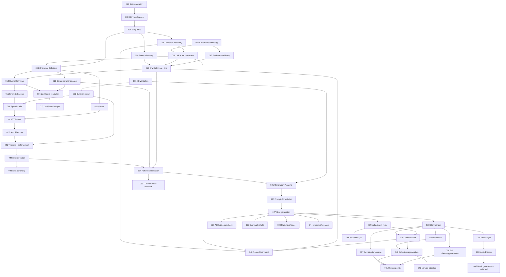

# Vision Studio — Incremental Implementation Phases

The authoritative, step-by-step roadmap from the application as it exists today to the story-to-video system described in `Path_ahead.md`.

- `Path_ahead.md` is the source of truth for **what** we are building and **why**.
- This document is the source of truth for **in what order**, **in what increments**, and **how far we have got**.

Written 2026-10-19 from a review of the repository at commit `c2fa765` (plus the staged Qwen3.8 token-limit change) and `Path_ahead.md`. Updated 2026-10-20 with the owner's decisions (see Appendix D): the narration pipeline is retired, no existing data needs preserving, and all story LLM jobs use GLM-5.3.

---

## How to use this document

### Opus → Sonnet workflow

1. Pick a phase whose status is **Not Started** and whose hard dependencies are all **Completed** (see [Phase Overview](#4-phase-overview)).
2. Give Opus `Path_ahead.md`, this document, and a request such as:

   > Plan **PHASE-0XX — <title>** only. Respect its Scope and Out of scope, the global conventions in §3.4, the default decisions in §3.3, and the Completion notes of the phases it depends on. Resolve every "Planning decides" item explicitly in the plan. Do not pull work from later phases. List the files to change, any migration, the API and UI changes, and how each Verification criterion will be checked.

3. Give the resulting plan to Sonnet for execution.
4. When the phase is done, update it as described in [§6 Progress Tracking Guidance](#6-progress-tracking-guidance). Pay particular attention to its **Completion notes**: later phases rely on them to learn the real names of tables, job types and endpoints.

### Reading a phase

Every phase has the same fields: Objective, Current state (with *starting points* in the code), Scope, Out of scope, Dependencies, Expected outcome, Verification criteria, Observable improvements, Completion checklist and Completion notes. Items marked **Planning decides** are deliberately left open. They need a closer look at the code, and the plan must settle them.

---

## Table of contents

1. [Project Vision and Goal](#1-project-vision-and-goal)
2. [Current State and Gap Analysis](#2-current-state-and-gap-analysis)
3. [Implementation Strategy](#3-implementation-strategy)
4. [Phase Overview](#4-phase-overview)
5. [Detailed Phase Definitions](#5-detailed-phase-definitions)
6. [Progress Tracking Guidance](#6-progress-tracking-guidance)
7. [Open Questions and Risks](#7-open-questions-and-risks)
- [Appendix A — Sample stories for verification](#appendix-a--sample-stories-for-verification)
- [Appendix B — H3 validation log (filled by PHASE-001)](#appendix-b--h3-validation-log-filled-by-phase-001)
- [Appendix C — Progress log](#appendix-c--progress-log)
- [Appendix D — Document change log](#appendix-d--document-change-log)

---

## 1. Project Vision and Goal

Vision Studio should accept a normal written English story (narration, dialogue, actions, several characters and places, sound events, emotional changes) and turn it into a finished video **automatically**, without the user converting it into scenes, shots, prompts or timestamps (`Path_ahead.md` §1).

The core idea is a sequence of small, focused reasoning stages. Each one produces a **structured, stored, inspectable, editable artifact** (§5, §44):

```text
Story ─► Scene ─► Event ─► Speech Unit ─► Shot ─► Generation Request ─► H3 clip ─► Timeline ─► Video
```

The end state, by capability area (§43):

| Area | What the finished system does |
|---|---|
| Story structure | StoryBible, then Character, Environment and Scene **discovery** (minimal lists with stable ids). |
| Entity definitions | One call per character and per environment. Canonical images, angle views and a TTS voice per character, and canonical references per environment, all **shared with the Character Lab** and **pinned by version** in each project. |
| Scene understanding | One Scene Definition call per scene (context, mood, cast, environment state, character looks, continuity). One resolution pass reuses or merges the looks and states the scenes ask for. One Event Extraction call per scene (narration, dialogue, action, sound_event, pause). |
| Speech | Speech units are planned by code, synthesized with TTS in the right voice, and their **measured** durations become the timing source. Transcription leaves the main path. |
| Directing | Shot Planning per scene (event count ≠ shot count; 2–10 s target inside H3's 1–15 s hard limit, both configurable), then Shot Definition per shot with continuity checks. |
| H3 generation | Per shot: minimal reference selection, deterministic generation planning (route, frames, references, dependencies), H3 prompt compilation (no background music), then H3 generation with exact trimming. |
| Automated quality | Technical checks and retries first. Then ASR dialogue checks. Identity, lip-sync, adherence and continuity checks later. |
| Audio production | Narration layer from TTS, shot audio from H3 used as is and normalized, continuous background music planned per story. |
| Project control | Optional review points; staleness with narrow dependencies; selective regeneration; adopting new library versions per project. |

**Key routing rules that every phase must respect** (§4, §33, §34):

- Dialogue is TTS in the character's voice. It is passed to H3 as an audio reference in **partial copy** mode, and H3's returned audio is the shot's final audio.
- Narration is **never** passed to H3. It is a timeline layer that can span several shots.
- Sound effects belong to the shot and are generated by H3. Background music is **never** generated by H3; it is one continuous layer under the whole timeline.
- A shot's duration is never shorter than the dialogue it carries. Clips are requested slightly longer and trimmed from the tail.

---

## 2. Current State and Gap Analysis

### 2.1 What the application is today

A two-container app (FastAPI + SQLite + Alembic backend, React + TypeScript frontend) whose background work is `job` rows driven by one dispatcher loop. GPU work (H3, LTX, Qwen-Image, Breeze TTS, Parakeet, Qwen3.8) goes to a remote GPU gateway. LLM work goes to Bitdeer (GLM-5.3 / GLM-5.3-Flash) or to Qwen3.8 on the GPU server.

**Project pipeline (narration-driven).** Voiceover (uploaded, or Breeze TTS of the whole script) → `transcribe` (Parakeet word timings) → `plan_scenes` (the LLM picks cut words and code times the cuts; a "scene" is one timed stretch of voiceover = **one clip**) → `extract_cast` / `write_character_reference_prompt` / `generate_character_reference` / `assign_cast` (project-only `character` / `location` tables, one reference picture each) → `draft_descriptions` → `write_image_prompt` → `generate_frame` (Qwen-Image, edited from cast references) → optional last frames → `generate_clip` (default `minimax-h3` through `POST /v1/h3/videos/generate` with first/last frames; **narration never goes to H3**) → `render_final` (clips trimmed to exact frames; clip audio gain set relative to the voiceover's loudness; concat; voiceover mixed on top; no music, no subtitles). `auto_pipeline` chains all of this as a step graph (`needs` / `follows`, per-target streaming, `MAX_TRIES = 3`). Its only confirmations come at the start. **This whole pipeline is retired by PHASE-046** (decision 2026-10-20). A narration-only video becomes a story without dialogue.

**Narration code the labs depend on.** `jobs/generate_lab_video.GenerateLabVideoHandler` subclasses `jobs/generate_clip.GenerateClipHandler`; `jobs/generate_lab_image.py` and `jobs/remote_image.py` import from `generate_clip`; `services/video_lab.py` imports `projects`, `frame_counts` and `scene_inputs.ClipMode`; `services/image_lab.py`, `services/character_looks.py` and `jobs/reference_upload.py` use `frame_images`; `jobs/reference_upload.py` and `jobs/write_character_reference_prompt.py` import `cast`. PHASE-046 must keep or move this shared code.

**Labs (project-independent).**

- Image lab: Qwen-Image-2.1 and Seedream.
- Voice lab: Breeze TTS design / clone / direction, saved `voice` rows.
- Video lab: LTX and H3. The H3 reference form takes 1–9 pictures with roles, 0–2 voices and any length from 1 to 20 s, with no first frame needed.
- Character Lab: `library_character` profile; versioned **looks** (prompt → 4 candidates → **manual** master choice → 4 angle edits: front, three_quarter, profile, back, face; backdrop removed with rembg); voice auditions from a description, chosen **manually**; **takes** that make image, audio or video, including H3 reference mode with audio markers `fully_copy` / `partially_copy` / `reference` / `weak_reference`.

**Engineering conventions in force.**

- Every schema change is a numbered Alembic migration (`0001`–`0021`). SQLite needs `batch_alter_table` to change a CHECK, and `job.type` is a CHECK, so every new job type needs a migration.
- Every migration gets an "Update" entry in `DATABASE_STRUCTURE.md`.
- "Out of date" is **computed when read** from input hashes recorded on jobs or provenance. It is never stored.
- Paid LLM jobs never re-run by themselves (`restart_rule = "never_rerun"`), save their answer the moment it arrives (`jobs/llm_call.ask_model`), and are validated by code.
- Author-written text is never overwritten by AI reruns.
- **There is no automated test suite.** Only Ruff, ESLint and `tsc` exist.

### 2.2 Capability gap by vision stage

| Vision stage (`Path_ahead.md`) | Exists today | Gap | Phases |
|---|---|---|---|
| Raw story input (§1) | `project.script_text`; a project needs a voiceover | Retire the narration pipeline; every project becomes a story project that needs no voiceover or transcript | 046, 003 |
| StoryBible (§6) | Manual `style_prefix` / `description_instructions` | Entirely new | 004 |
| Character / Environment Discovery (§7–8) | `extract_cast` does discovery **and** description in one call for narration projects | Separate minimal discovery calls with stable ids | 005 |
| Scene Discovery (§9) | `scene` = timed voiceover cut | Story scenes as continuity containers, anchored to the story text | 006 |
| Character Definition (§11) | A model writes a structured definition per linked character, saved as a library version the project pins and mapped into the lab profile (PHASE-009); the lab still has no way to edit it | Editing definitions | 037 |
| Canonical character images (§11) | The story workspace makes a look for each defined character with one candidate taken as the master, then the four angles, and the project pin moves to the new version (PHASE-010); lab looks still make four candidates with a manual choice | Wardrobe looks | 016, 017 |
| Character relations (§12) | A younger or older self, a twin, a parent or a sibling is found by a model, can be edited, and shapes the definitions and the images: the same person at another age is an edit of its base's front picture, family only shares traits as words (PHASE-047) | Voice of a same-face variant (011) | 047 |
| Character TTS voice (§11) | Lab auditions from a description, chosen by hand | Automatic voice from `voice_identity`; narrator voice | 011 |
| Shared characters, versions, pinning (§11, §38) | Versions exist (PHASE-007), a project can link a discovered character to a library character and pin a version (PHASE-008), and adoption of another version is built (PHASE-042, waiting for the owner's run) | Owner's run of adoption | 042 |
| Identity vs look (§12) | A look is a full reference-set *attempt*, with no wardrobe name | Named looks derived from canonical images | 016, 017 |
| Environment Definition and references (§13) | Project `location` with one picture; **no environments in the Character Lab** | Environment library, definition, canonical references | 012, 013 |
| Environment states (§14) | None | States derived from canonical references | 016, 017 |
| Scene Definition (§16) | `draft_descriptions` writes visual prompts, not dramatic context | Entirely new | 014 |
| Look/state resolution (§16) | None | Entirely new | 016 |
| Event Extraction (§17–18) | None | Entirely new | 015 |
| Speech Planning (§19) | `speech_chunks.split_script` (TTS size limits only) | Per-event speech units with estimates | 018 |
| TTS with measured timing (§20–21) | Breeze modes; one voiceover file; durations measured | Per-unit TTS in character and narrator voices; no transcription in the main path | 019 |
| Shot Planning and duration policy (§22–25) | LLM scene cuts on word timings; `min/max_scene_seconds`; **H3 floored at 124 frames (5.17 s)** for scenes | Shots, timeline, configurable 2–10 / 1–15 policy | 002, 020, 021 |
| Shot Definition and continuity (§26–27) | None | Entirely new | 022, 023 |
| Reference Selection (§28) | Cast pictures feed Qwen first-frame edits; the lab maps framing to angles (`references_for`) | Per-shot minimal manifest; code + LLM + validation (the model chooses, code checks, the rule is the fallback) | 024, 033 |
| Generation Planning (§29) | `endpoint_for`, frame grids, H3 sizes; no dependency graph | Deterministic plan artifact, H3 router, shot dependencies | 025, 032 |
| H3 Prompt Compilation (§30) | Three-field H3 prompt for scenes; six-part reference prompt for lab takes (`character_take_prompt_writer`) | A per-shot compiler driven by the manifest | 026 |
| H3 Generation (§31) | `generate_clip` (frames), `lab_video` (reference mode + audios) | A shot generation job in reference mode | 027 |
| Quality Validation (§32) | Frame count ≥ target only | Technical checks and retries, ASR dialogue checks, advanced checks | 029, 031, 045 |
| Final Timeline (§33) | Voiceover + clip sound | Narration layer, normalized shot audio, ducking | 028 |
| Music (§34) | None | Layer, planner, generation | 034, 035; 036 deferred until after PHASE-045 |
| Orchestration (§35) | `auto_pipeline` step graph (narration only) | A story step graph | 030 |
| Editable artifacts and review points (§40) | Manual edits of narration fields, and (PHASE-037) of the Story Bible, the lists, the scenes, scene definitions, events and speech-unit cuts; no pauses | Editing of every artifact; pauses at stage boundaries | 037, 038, 041 |
| Staleness and selective regeneration (§41) | Per-artifact "out of date" (narration) | Cross-artifact versions, narrow dependencies, selective rebuild | 039, 040 |
| Rapid exchange / motion references (§4, §24, §28) | The Video lab takes two characters and two voices by hand; `video_asset_ids` not wired | Reserved routes | 043, 044 |

### 2.3 Structural mismatches that shape the plan

1. **"Scene" means two different things.** In the code, a `scene` is a timed voiceover cut that makes one clip. In the vision, a scene is a dramatic continuity container that holds events and many shots. PHASE-046 removes the narration `scene` table before any story table is created, so the name is free for the vision's meaning (D-2).
2. **Timing source is inverted.** Today the voiceover is the clock and transcription finds the times. In the vision, TTS of each speech unit produces measured durations, and shots are planned around them.
3. **Conditioning is inverted.** Today a project clip is made from a generated first frame. The vision conditions H3 on character and environment **reference images** and adds dialogue audio. The Video lab can already do this by hand, but it has not been tested with white-backdrop character images (`UPSTREAM_API_0.13_INTEGRATION.md` §8.4).
4. **Two character systems.** Project cast tables (narration) and the Character Lab library are separate. The vision needs one shared, versioned library that projects pin. The narration cast tables go with PHASE-046 (D-4).
5. **H3 clip floor.** Project scene clips are forced to at least 124 frames (5.17 s), while the vision relies on 2–10 s shots and reports 1–15 s working. The labs already removed this floor (commit `57e69b0`). The floored narration path is removed by PHASE-046, and the story pipeline uses the policy from PHASE-002.
6. **Staleness model.** The current convention (compute on read from recorded input hashes) fits the vision's staleness design, provided every new artifact records its exact upstream versions **from the start** (D-3).
7. **Every human choice point must become automatable.** The Character Lab waits for a person to choose the master candidate and the voice audition. The vision runs unattended by default (D-5).
8. **No automated tests.** Verification is manual (UI, API docs at `/api/docs`, read-only database inspection) plus lint and typecheck, using the fixed sample stories in Appendix A.

### 2.4 Vocabulary map

| Vision term | Proposed storage concept (final names are decided in planning) | Closest existing concept |
|---|---|---|
| StoryBible | `story_bible` (per story project, versioned) | `project.style_prefix` (manual) |
| Discovered character / environment | Project-scoped discovery rows with slug ids, linked to library entities | `character` / `location` (narration cast, removed by PHASE-046) |
| Library character / environment | `library_character` (+ versions); new `library_environment` (+ versions) | `library_character`, `character_look` |
| Look / environment state | Named variants under a character / environment version | `character_look` (an attempt, not a wardrobe) |
| Story scene | `scene` (a new table, created after PHASE-046 removes the narration one) | the narration `scene` (a voiceover cut; **not** the same thing) |
| Event | `event` | none |
| Speech unit | `speech_unit` (+ audio asset) | `lab_voice_run`, voiceover asset |
| Shot / Shot definition | `shot` (skeleton + definition) | none |
| Reference manifest / Generation request | Per-shot manifest and `generation_request` | `job.input` of `generate_clip` / `lab_video` |
| Final timeline | Frozen in the render job's input, as the narration render did | `render_final` `job.input.timeline` (removed by PHASE-046; readable at the tag) |

---

## 3. Implementation Strategy

### 3.1 Principles

1. **Replace the narration pipeline instead of building beside it.** There are no real users and no data to keep, so PHASE-046 removes the narration pipeline early. Every later phase targets story projects only, with no dual mode and no narration regression checks (D-1). The labs and the Character Lab stay.
2. **Follow the vision's stage order, one stage (or one tightly related pair) per phase.** Each LLM stage phase delivers storage, job, validation, a run button and a read-only view, so its artifact can be inspected right away.
3. **Record provenance from day one.** Every new artifact stores its source, job, version and the exact upstream versions or hashes it was built from (D-3). Staleness (PHASE-039) then only has to read what is already there, with no retrofitting.
4. **Reach a thin end-to-end story video early, then deepen.** The critical path to the first story video (PHASE-028) leaves out work the vision allows to be added later: LLM reference selection (deterministic fallback first), look/state resolution (canonical assets first), shot continuity reconciliation, continuity shots, music, editing, review points and staleness.
5. **Validate risky H3 assumptions before building on them.** PHASE-001 tests them by hand in the existing Video lab, with no code.
6. **Reuse existing machinery:** `llm_call.ask_model`, the job registry and pools, the look and angle pipeline, Breeze modes, the H3 reference-mode handler, and the pure render helpers (`render_commands`, `ffmpeg`). The removed `auto_pipeline` step graph and `render_final` job stay readable as templates at the git tag PHASE-046 creates.
7. **Deterministic rules live in pure functions** (duration policy, speech splitting, timeline, routing, validators), as the codebase already does. LLMs never decide hardware facts or frame counts (§29).
8. **Manual controls first, orchestration second.** Each stage is first runnable by a button. The one-click story run comes in PHASE-030, once every stage exists.

### 3.2 Milestones

| Milestone | Phases | Result |
|---|---|---|
| M0 Foundations and validation | 001, 002, 046, 003 | H3 facts confirmed; configurable duration policy; narration pipeline removed; the story workspace |
| M1 Story structure | 004–006 | StoryBible, discovered characters and environments, anchored story scenes |
| M2 Shared characters and environments | 007–013 | Versioned library characters and environments linked and pinned by projects; definitions, canonical images and voices made automatically |
| M3 Scene understanding | 014–017 | Scene definitions, events, resolved looks and states (with images) |
| M4 Speech | 018–019 | Speech units with measured TTS durations |
| M5 Directing | 020–023 | Shots planned, timed, defined and continuity-checked |
| M6 Generation and first story video | 024–028 | **First end-to-end story video** |
| M7 Automation and quality | 029–033 | Retries, one-click story run, ASR dialogue checks, continuity shots, LLM reference selection |
| M8 Music | 034, 035 | Continuous music layer (supplied track) and music plan |
| M9 Project control | 037–042 | Editing, staleness, selective regeneration, review points, version adoption |
| M10 Extended routes and advanced quality | 043–045 | Rapid exchange, motion references, advanced checks (gated or blocked) |
| Deferred (after M10) | 036 | Music generation, once a provider is added |

### 3.3 Default decisions assumed by the phases

These are the working assumptions behind the phases. Change one by editing it here and updating the phases it lists. Each links to an open question in §7 where relevant.

| ID | Decision | Affects |
|---|---|---|
| D-1 | **The story pipeline replaces the narration pipeline** (decided 2026-10-20, Q-1). PHASE-046 removes narration code, UI and tables; every project is a story project. A narration-only video is a story without dialogue. No existing data needs preserving. | 046, 003 onward |
| D-2 | New story artifacts get their own new tables (for example `scene`, `event`, `speech_unit`, `shot`, `generation_request`). PHASE-046 removes the narration tables first, so plain names are free; no narration table is reused. | 006 onward |
| D-3 | **Artifact provenance convention.** Every stage artifact records `source` (`ai` or `manual`), the job that produced it, a version (or an immutable new row per regeneration), and the exact upstream artifact ids and versions (or an inputs hash) it was built from. Staleness is **computed on read** from these records, consistent with the existing "worked out when read, never stored" rule. | 003 onward, realized in 039 |
| D-4 | Story characters and environments live in the **Character Lab library**. The narration cast tables (`character`, `location`) are removed by PHASE-046 (Q-16). | 046, 008, 012, 013 |
| D-5 | Where the lab currently waits for a person (choosing the master candidate, choosing a voice audition), the pipeline takes the **first successful candidate** (confirmed 2026-10-20, Q-3). The user can override in the lab. | 010, 011, 017 |
| D-6 | Each stage gets manual run controls in the story workspace first. One-click orchestration comes in PHASE-030. | 004–029 |
| D-7 | Stage answers are JSON (`response_format: json_object`) requested through `jobs/llm_call.ask_model` and validated by code before being stored. An unusable answer is retried within the existing attempt limits. | All LLM stages |
| D-8 | One duration policy: H3 hard bounds (default 1–15 s, but never above the frame count the GPU server accepts) and a planning target (default 2–10 s), both configurable and never hard-coded into prompt text. | 002, 018, 020, 021, 025 |
| D-9 | **Shot lengths are stored on H3's own lengths** (`(17n + 5) / 24` s, rounded down to a millisecond), so a clip has the length of its shot and the render normally trims nothing (changed 2026-10-22; before, clips were requested at or above the target and trimmed at render time, which could cut off the end of spoken lines). When a shot plan is saved, from the model or from the user's edit, `services/h3_lengths.fit_shots` moves each `target_duration` to the nearest H3 length (inside the planning target range if it was inside), and to the next length up for the whole scene if the nearest creates a timeline problem. A shot outside the hard bounds is left as it is. Plans made earlier keep their lengths until planned or edited again; for them the clip is still requested at or above the target and trimmed at render time. At a project frame rate other than 24 the render repeats the last frame of a clip that is one frame short. | 002, 025, 028 |
| D-10 | H3 shot audio is used as is. Narration never enters H3. The compiled prompt always disables background music (`non_diegetic_music: N/A`). | 025–028 |
| D-11 | No automated test suite is added unless explicitly requested (Q-14). Verification is manual plus lint and typecheck, using the sample stories in Appendix A. | All |
| D-12 | **Every story LLM job uses GLM-5.3** (the full Bitdeer model, not Flash) through one model setting; there are no per-stage or per-area settings for now (decided 2026-10-20, Q-13). Qwen3.8 is not used for story planning. Each stage sets `max_tokens` for its own answer. The context size (the owner expects about 256K tokens) is confirmed against Bitdeer in PHASE-004. **Temporary (2026-10-20):** while the Bitdeer API is unavailable, the owner sets the story provider to Qwen3.8 on the Settings page to test the stages (a setting, not a code change; Qwen3.8 refuses more than 32,000 characters of messages, so a story above about 30,000 characters needs Bitdeer). The confirmation of GLM-5.3's limits is still open (PHASE-004). | 004 onward |
| D-13 | **Story length:** stories of up to about 10 minutes of finished video. Splitting longer stories (for example an hour) into segments is outside this plan (Q-10). | 003, all LLM stages |
| D-14 | **Relations are stored per project, not on the library character** (amended by PHASE-047, 2026-10-20; it first said relations are not stored). The relations between a story's characters (a younger self, a twin, a parent, a sibling) are a versioned artifact of the project (`character_relations`, D-3), keyed by the discovery ids, found by their own job and editable by the user. A library character never carries a relation: reusing it in another project brings no relations along. Only a younger self, an older self or a twin makes the picture from another character's picture; family kinds only add the relative's traits to the prompt as words. | 005, 008, 009, 047 |
| D-15 | **Scene discovery is independent** of character and environment discovery: it records no character or environment ids, so all three discovery calls can run in parallel. Later stages work out who and where (PHASE-013, PHASE-014) (Q-11). | 006, 013, 014 |

### 3.4 Conventions every phase must follow

These are existing repository rules. Plans should state how each one applies.

- **Migrations:** a new numbered Alembic revision in `backend/app/db/migrations/versions/` (the next free number, after any new baseline PHASE-046 creates). A CHECK change (for example a new `job.type`) uses `op.batch_alter_table`. **No existing data needs preserving** (no real users): migrations need no backfill, may drop tables, and a downgrade is optional. A fresh database is acceptable. Resetting it is the **owner's action**, never an agent's: the README warns that `docker compose down -v` deletes the database **and all media**.
- **Schema documentation:** add an "Update (…)" entry at the top of `DATABASE_STRUCTURE.md` and update the affected sections (tables, JSON shapes, settings, how the pipeline writes).
- **Jobs:** one handler module per job type in `backend/app/jobs/`, registered in `app/jobs/__init__.py` `register_handlers()`. Declare `provider` (`gpu` / `llm` / `local`) and `restart_rule`. Paid LLM jobs use `never_rerun` and `llm_call.ask_model`. GPU jobs count in the shared pools (`jobs/pools.py`). Do not change the dispatcher loop.
- **LLM prompts:** request builders, profiles and parsers live in `services/` as pure functions (see `character_take_prompt_writer.py`, `character_look_prompt_writer.py`, `lab_prompt_writer.py`; the removed narration examples `cast_extraction.py` and `scene_planner.py` stay readable at the PHASE-046 tag). Code writes anything that depends on ids, counts or frame numbers; the LLM writes creative text.
- **API:** routers under `backend/app/api/`. After any API change, regenerate `frontend/src/api/schema.d.ts` with `npm run gen:api` against the running backend.
- **Out of date:** computed on read from recorded inputs, never stored as a flag (D-3).
- **Never overwrite author text** with AI output without the user's explicit action.
- **The labs (Image, Voice, Video) and the Character Lab must keep working** unless the phase explicitly changes them.

### 3.5 Standard checks (referenced by every checklist)

- `cd backend && uv run ruff check . && uv run ruff format --check .`
- `cd frontend && npm run lint && npm run typecheck`
- If the API changed: `npm run gen:api` was run and `schema.d.ts` is committed.
- If the schema changed: the migration applies on backend start (`docker compose up --build -d`), and `DATABASE_STRUCTURE.md` is updated.
- Regression spot check: the labs and the Character Lab still open, and any of their actions the phase touched still work. Story stages from earlier phases still run.

### 3.6 Parallel work

These can run at the same time, as long as each phase's own dependencies are met:

- **Start immediately:** PHASE-001 (manual), PHASE-002, PHASE-046, PHASE-007. PHASE-046 may touch modules the Character Lab imports (for example `frame_images`, `cast`), so coordinate it with PHASE-007 if they run together.
- **Story-structure track** 046 → 003 → 004 → {005, 006}: character, environment and scene discovery run in parallel (D-15).
- **Character track** 007 → 008 → 009 → {010, 011} and **environment track** 012 → 013 run beside the story-structure track.
- 016 → 017 (looks and states) and 023 (shot continuity) are **off the critical path** and can run beside M4–M6.
- After PHASE-028: 029, 031, 033, 034 and 037–039 are largely independent of each other.

---

## 4. Phase Overview

Status values: **Not Started**, **In Progress**, **Blocked**, **Completed**, **Deferred**. A phase is *ready* when all its hard dependencies are Completed. **This table and each phase's Status line must both be updated** (§6). The table is in roadmap order; IDs are permanent, so the order follows dependencies, not numbers (PHASE-046 comes before PHASE-003).

**Progress snapshot** (update when a phase changes status):

- Completed: PHASE-001 (2026-10-20; owner confirmed the generations), PHASE-002 (2026-10-20), PHASE-046 (2026-10-20; owner verified every lab and the Character lab), PHASE-003 (2026-10-20), PHASE-011 (2026-10-20; owner ran the voices and verified them)
- In progress: PHASE-004 (code complete 2026-10-20; the owner's S2 run on the rebuilt app and the GLM-5.3 limits from Bitdeer are still open), PHASE-005 (code complete 2026-10-20; the owner's S2 run is still open), PHASE-006 (code complete 2026-10-20; the owner's S2 run is still open), PHASE-007 (code complete 2026-10-20; the owner's run on the rebuilt app is still open), PHASE-008 (code complete 2026-10-20; the owner's run on the rebuilt app is still open), PHASE-009 (code complete 2026-10-20; the owner's S2 run with a real model is still open), PHASE-010 (code complete 2026-10-20; the owner's S2 run with the real image model is still open), PHASE-047 (code complete 2026-10-20; the owner's S2 run with the real image model is still open), PHASE-012 (code complete 2026-10-20; the owner's run with the real models on the rebuilt app is still open), PHASE-013 (code complete 2026-10-21; the owner's S2 run with the real language and image models is still open), PHASE-014 (code complete 2026-10-21; the owner's S2 run with a real model is still open), PHASE-015 (code complete 2026-10-21; the owner's S1 and S2 run with a real model is still open), PHASE-016 (code complete 2026-10-21; the owner's S2 run with a real model is still open), PHASE-017 (code complete 2026-10-21; the owner's S2 run with the real image model is still open), PHASE-018 (code complete 2026-10-21; the owner's S1 and S2 planning on the rebuilt app is still open), PHASE-019 (code complete 2026-10-21; the owner's S1 speech run with the real GPU is still open), PHASE-020 (code complete 2026-10-21; the owner's S1 and S2 shot planning with a real model is still open), PHASE-021 (code complete 2026-10-21; the owner's S1 timeline and a re-plan with a real model are still open), PHASE-022 (code complete 2026-10-21; the owner's S1 shot definitions with a real model are still open), PHASE-023 (code complete 2026-10-21; the owner's S1 continuity check with a real model is still open), PHASE-024 (code complete 2026-10-21; the owner's S1 reference manifests on the rebuilt app are still open), PHASE-025 (code complete 2026-10-21; the owner's S1 generation requests on the rebuilt app are still open), PHASE-026 (code complete 2026-10-22; the owner's S1 prompts with the real language model on the rebuilt app are still open), PHASE-027 (code complete 2026-10-22; the owner's S1 shot generation with the real GPU server on the rebuilt app is still open), PHASE-028 (code complete 2026-10-22; the owner's S1 render on the rebuilt app, and so milestone M6, is still open), PHASE-029 (code complete 2026-10-22; the owner's S1 run with the real GPU server on the rebuilt app is still open), PHASE-030 (code complete 2026-10-22; the owner's S2 run with the real models and GPU server on the rebuilt app is still open), PHASE-031 (code complete 2026-10-22; the owner's S1 run with the real GPU server on the rebuilt app is still open), PHASE-032 (code complete 2026-10-22; the owner's S1 run of a continuous scene with the real GPU server on the rebuilt app is still open), PHASE-033 (code complete 2026-10-22; the owner's S1 run with the real story model on the rebuilt app is still open), PHASE-037 (code complete 2026-10-22; the owner's run of the editors on the rebuilt app is still open), PHASE-039 (code complete 2026-10-22; the owner's run of the staleness overview, Accept as is and Replace picture on the rebuilt app is still open), PHASE-048 (code complete 2026-10-22; the owner's run with the real story model on the rebuilt app is still open), PHASE-049 (code complete 2026-10-22; the owner's run of one story in each mode with the real story model on the rebuilt app is still open), PHASE-043 (code complete 2026-10-23; the owner's lab check V6b and one real exchange shot on the rebuilt app are still open)
- Deferred: PHASE-036 (music generation, after PHASE-045)
- Current milestone: M1 (M0 is complete)

| ID | Title | Milestone | Hard dependencies | Status |
|---|---|---|---|---|
| PHASE-001 | Validate H3 assumptions in the existing labs (manual) | M0 | — | Completed |
| PHASE-002 | Shot-duration policy | M0 | (001 recommended) | Completed |
| PHASE-046 | Retire the narration pipeline | M0 | — | Completed |
| PHASE-003 | Story workspace replaces the project page | M0 | 046 | Completed |
| PHASE-004 | Story Bible stage | M1 | 003 | In Progress |
| PHASE-005 | Character and environment discovery | M1 | 004 | In Progress |
| PHASE-006 | Scene discovery anchored to the story text | M1 | 004 | In Progress |
| PHASE-007 | Character versioning in the Character Lab | M2 | — | In Progress |
| PHASE-008 | Link story characters to library characters (pinned) | M2 | 005, 007 | In Progress |
| PHASE-009 | Character Definition stage | M2 | 004, 008 | In Progress |
| PHASE-010 | Automatic canonical character images | M2 | 009 | In Progress |
| PHASE-047 | Character relations | M2 | 005, 009, 010 | In Progress |
| PHASE-011 | Character voices and narrator voice | M2 | 004, 009 | Completed |
| PHASE-012 | Environment library in the Character Lab | M2 | 007 | In Progress |
| PHASE-013 | Environment Definition stage and project link | M2 | 006, 008, 012 | In Progress |
| PHASE-014 | Scene Definition stage | M3 | 006, 009, 013 | In Progress |
| PHASE-015 | Event Extraction stage | M3 | 014 | In Progress |
| PHASE-016 | Look and environment-state resolution | M3 | 010, 013, 014, Q-2 decision (owner) | In Progress |
| PHASE-017 | Generate new looks and environment states | M3 | 016 | In Progress |
| PHASE-018 | Speech unit planning | M4 | 002, 015 | In Progress |
| PHASE-019 | Speech synthesis for speech units | M4 | 011, 018 | In Progress |
| PHASE-020 | Shot Planning stage | M5 | 019 | In Progress |
| PHASE-021 | Scene timeline and shot-duration enforcement | M5 | 002, 020 | In Progress |
| PHASE-022 | Shot Definition stage | M5 | 021 | In Progress |
| PHASE-023 | Shot continuity reconciliation | M5 | 022 | In Progress |
| PHASE-024 | Reference catalog and deterministic reference selection | M6 | 010, 013, 022 | In Progress |
| PHASE-025 | Generation Planning (deterministic H3 router) | M6 | 001, 002, 019, 024 | In Progress |
| PHASE-026 | H3 Prompt Compilation stage | M6 | 025 | In Progress |
| PHASE-027 | Shot generation | M6 | 026 | In Progress |
| PHASE-028 | Story timeline render (first end-to-end story video) | M6 | 021, 027 | In Progress |
| PHASE-029 | Technical shot validation and automatic retry | M7 | 027 | In Progress |
| PHASE-030 | Story pipeline orchestration (one click) | M7 | 028, 029 | In Progress |
| PHASE-031 | Dialogue verification with ASR | M7 | 027 | In Progress |
| PHASE-032 | Continuity shots and shot dependencies | M7 | 001, 027 | In Progress |
| PHASE-033 | LLM reference selection | M7 | 024 | In Progress |
| PHASE-048 | Reuse library characters and environments in the story pipeline | M7 | 005, 008, 013, 030 | In Progress |
| PHASE-049 | Speech mode: narration and dialogue, no dialogue, or no narration | M7 | 011, 015, 020, 030 | In Progress |
| PHASE-050 | Spatial plan in the environment definition | M7 | 013, 012 | In Progress |
| PHASE-051 | Scene Staging stage | M7 | 014, 015, 050 | In Progress |
| PHASE-052 | Environment views: plan, prompts and pictures | M7 | 017, 050, 051 | In Progress |
| PHASE-053 | Views in each environment state | M7 | 017, 052 | In Progress |
| PHASE-054 | Shots use the staging and the views | M7 | 022, 024, 051, 052, 053 | In Progress |
| PHASE-034 | Background music layer (supplied track) | M8 | 028 | Not Started |
| PHASE-035 | Music Planner | M8 | 034 | Not Started |
| PHASE-037 | Editing of story-structure and scene artifacts | M9 | 028 | In Progress |
| PHASE-038 | Editing of directing and generation artifacts | M9 | 028 | In Progress |
| PHASE-039 | Staleness across story artifacts | M9 | 028 | In Progress |
| PHASE-040 | Selective regeneration of stale artifacts | M9 | 030, 039 | In Progress |
| PHASE-041 | Review points | M9 | 030, 037, 038, 039 | In Progress |
| PHASE-042 | Adopting new library versions across projects | M9 | 008, 013, 040 | In Progress |
| PHASE-043 | Rapid back-and-forth exchange route (reserved) | M10 | 001 (V6 positive), 027 | In Progress |
| PHASE-044 | Motion reference videos (optional) | M10 | 027, Q-17 decision | Blocked (needs decision) |
| PHASE-045 | Advanced quality checks (investigation) | M10 | 029, Q-18 | Blocked (needs a model) |
| PHASE-036 | Music generation | Deferred | 035, a music provider (Q-8) | Deferred (after PHASE-045) |

### 4.1 Dependency graph (hard dependencies, transitive edges omitted)



---

## 5. Detailed Phase Definitions

### M0 — Foundations and validation

---

### PHASE-001 — Validate H3 assumptions in the existing labs (manual)

**Status:** Completed (2026-10-20) · **Milestone:** M0 · **Vision:** §4, §24, §28, §29

**Objective.** Confirm, with the Video lab's existing MiniMax H3 reference form and no code changes, the H3 behaviours that the generation phases are designed around, and record the results so those phases plan against facts.

**Current state.** `Path_ahead.md` §4 reports that 1–15 s clips work (about 2 s reliably) and that Ref2VA works well for speaking characters. The GPU server's guide documents 124–345 frames (5.17–14.4 s) and audio references of 2–15 s. `UPSTREAM_API_0.13_INTEGRATION.md` §8.4 says that reference-only clips using a white-backdrop library character picture are untested. The Video lab reference form already accepts 1–9 pictures with roles, 0–2 audios, lengths from 1 to 20 s, and `match_audio_duration`. *Starting points:* `services/video_lab.py` (`H3ReferenceForm`, `create_h3_reference_run`), `frontend/src/components/videoLab/ReferenceComposer.tsx`, the Voice lab for TTS lines, and the Character Lab for front and three-quarter pictures.

**Scope.** Run each experiment, record it in Appendix B, and note its design implication:

- **V1 Short frame counts:** reference clips at 22, 39, 56 and 73 frames (about 0.9 / 1.6 / 2.3 / 3.0 s). Are they accepted, and what is the quality?
- **V2 Short dialogue audio:** a Breeze line shorter than 2 s (for example "Exactly.", about 0.7 s) as `<Audio 1>` with `partially_copy` in a 2.3 s clip. Does the server accept it? Is the speech intact, with silent expression after it? If it is refused, repeat with the audio padded to 2 s.
- **V3 References without a first frame:** a character's front and three-quarter pictures (cut out, flattened on white as the app uploads them) plus an environment picture. Does the white backdrop leak into the clip? Is the environment used as the setting?
- **V4 Music suppression:** does `non_diegetic_music: N/A` (or an explicit "no music") reliably produce no score?
- **V5 Narration visual:** a shot with a character and no dialogue, where the prompt says nobody speaks. Do the lips stay closed?
- **V6 Rapid exchange (reserved route):** two characters with two voices exchanging quick lines in one clip.
- **V7 Continuity:** the last frame of a generated clip (extracted manually with ffmpeg and uploaded to the Image lab) used as the next clip's first frame or as a reference. How good is the continuity?
- **V8 Throughput:** wall time and GPUs reported per H3 job at short lengths.

**Out of scope.** Any code change. If a lab limitation blocks an experiment, record that as a finding; do not fix it here.

**Dependencies.** None. V1 informs PHASE-002; V2–V5 inform PHASE-025 and PHASE-026; V7 informs PHASE-032; V6 gates PHASE-043; V8 informs risk R-1.

**Expected outcome.** Appendix B has one row per experiment with the lab run id, the result and the design implication, and the related open questions (Q-5, Q-7) are updated.

**Verification criteria.**
- Every experiment V1–V8 has a recorded lab run id (or "blocked: reason"), a result and an implication.
- Q-5 and Q-7 in §7 state the decided handling, or say why they remain open.

**Observable improvements.** Not applicable (knowledge). This de-risks M6.

**Completion checklist.**
- [x] V1 short frame counts
- [x] V2 short dialogue audio with `partially_copy`
- [x] V3 references without a first frame (white backdrop)
- [x] V4 music suppression
- [x] V5 closed lips for narration shots
- [x] V6 two characters, two audios
- [x] V7 last frame as next clip's anchor
- [x] V8 timings and GPU counts
- [x] Appendix B filled; Q-5 and Q-7 updated

**Completion notes.** Done 2026-10-20 with no code change. Results, run ids and implications are in Appendix B; Q-5 and Q-7 are answered in §7; R-1 and R-3 are updated.

- **How the runs were made.** Every lab run was submitted to the app's own HTTP API (`POST /api/lab/videos/reference-runs` and `/api/lab/videos/runs`), all landscape (1344 x 768, 24 fps) with seed `20261020`. The prompts use the six-part H3 format of `referenceSkeleton` (V7a, on the generate endpoint, uses `integrated_multimodal_description`). Clips, stills and scripts were kept outside the repository; the finished clips stay in the Video lab under the run ids in Appendix B.
- **Inputs used.** Character 1 is Simi (Character Lab look 3: front picture = lab image 52, three-quarter = 57). Character 2 is Hanuman (look 4, front = lab image 69). Pictures are the Character Lab's references as stored (they are on a plain white backdrop; `cutout_url` is empty for both looks). Voices: saved voice 6 (Simi) and 5 (Hanuman). TTS lines made with the Voice lab (`mode: clone`): run 70 "Exactly." (0.88 s), run 71 "There's no upstairs." (1.36 s), run 72 "Whatever you hear at night, don't go upstairs." (3.52 s).
- **Deviations from the plan, and why.**
  1. **An environment picture was made.** The Image library held no empty place (every picture had a character in it), so one Qwen-Image-2.1 run (Image lab run 84, seed 20261020) made an empty bedroom: lab image 88.
  2. **Speech checks with Parakeet.** To judge "is the speech intact" without listening, the finished clips of runs 94, 96, 97 and 98 were transcribed with `POST /v1/parakeet/transcribe` (four small GPU jobs, called directly on the GPU server). This is not part of the app.
  3. **V1 22 frames was called directly on the GPU server**, as planned: the lab's 1.0 s minimum rounds to 39 frames. The same prompt, seed and uploaded picture ids as run 91 were used, and only `num_frames` changed.
  4. **V4 reused run 95** (V3, `non_diegetic_music: N/A`) as the `N/A` leg; run 96 is the same request with an explicit "no music" line. The music verdict also rests on measurements (spectrogram, loudness), not only on listening.
  5. **V3 and V4 used 124 frames** (the documented minimum) so that the clip is long enough to show leakage and music; V7 used the last frame (frame 123) of run 95.
- **Findings about the labs themselves (not fixed here).** (a) The Video lab's reference form refuses two pictures with the role `character_1` ("Only one picture can be Character 1."); the second picture of a character had to be given the role `other`. That role is only a label stored on the run; nothing sent to the server changes. (b) The lab's 1.0 s minimum cannot request fewer than 39 frames. (c) The Settings page showed the GPU API contract as "changed" (it differs from the approved fingerprint); runs were still accepted.
- **Owner confirmation (2026-10-20).** The owner watched and listened to the generations and confirmed that they look good and match their descriptions. This covers V2 voice and lip match (run 94), V4 no music (runs 95 and 96), V6 each voice on the right character (run 98, so the PHASE-043 gate is satisfied) and V7 (runs 99 and 100). The "owner to confirm" remarks in Appendix B are therefore resolved. No preference between runs 99 and 100 was recorded, so Q-7 stands as written.
- **What later phases should take from this.** PHASE-002: short clips do not shorten an H3 job (see V8 and R-1). PHASE-025 and PHASE-026: use short dialogue audio as is, give each line an explicit start time, and write "nobody speaks, lips stay closed" for non-speaking shots. PHASE-032: Q-7.

---

### PHASE-002 — Shot-duration policy

**Status:** Completed (2026-10-20) · **Milestone:** M0 · **Vision:** §4 "Shot duration limits", §22 "Shot duration policy", §29 "Exact durations without drift"

**Objective.** Define the one configurable duration policy (H3 hard bounds and the planning target range) and the pure frame-count function the story pipeline will use, with no 5.17 s floor.

**Current state.** `services/frame_counts.py` has `h3_num_frames(target)` (the `17n + 5` grid at 24 fps) and `h3_scene_num_frames`, which floors narration scenes at `H3_MIN_FRAMES = 124` (5.17 s); `H3_MAX_FRAMES = 345` (14.4 s, the server guide's maximum). The labs already send any length (commit `57e69b0`; Video lab 1–20 s). The floored narration callers are removed by PHASE-046, so this phase does not touch them.

**Scope.**
- App settings (shown on the Settings page, read by code) for the **H3 hard minimum and maximum** (default 1 s and 15 s, adjusted to the PHASE-001 V1 findings) and the **planning target range** (default 2–10 s). Prompts receive these values as parameters (D-8). `SettingSpec` holds only strings and integers with per-field `min_value` / `max_value`, so **planning decides** the unit (whole seconds, tenths or frames) and where a minimum above its maximum is refused.
- The hard maximum can never exceed the frame count the server accepts. With the guide's 345 frames that is 14.4 s, since 15 s would need 362 frames, unless V1 shows that more works.
- A pure function: target seconds → the smallest `17n + 5` frame count at or above the target. A target outside the hard bounds is refused with a message naming the limit. Reuse `h3_num_frames`.
- Document the new settings in `DATABASE_STRUCTURE.md` §6.

**Out of scope.** Narration code paths (removed by PHASE-046); shot planning (020, 021); render changes.

**Dependencies.** PHASE-001 V1 recommended. Without it, use the values from `Path_ahead.md`, capped at the server maximum.

**Expected outcome.** The policy is visible and configurable. With the defaults, the function gives 56 frames for 2.0 s and 73 frames (3.04 s) for 3.0 s, and refuses 0.5 s and 16 s.

**Verification criteria.**
- The Settings page shows the four values; changing one saves it, and a value outside its allowed range is refused.
- Calling the function by hand (for example from a Python shell in the backend container) gives the expected frame counts and refusals.
- Standard checks (§3.5).

**Observable improvements.** The duration limits are visible and editable in Settings.

**Completion checklist.**
- [x] Policy settings defined and validated
- [x] Frame-count function with bounds, capped at the server maximum
- [x] Docs updated
- [x] Standard checks (§3.5)

**Completion notes.** Done 2026-10-20.

- **Setting keys** (group "Shot duration" on the Settings page, all integers in **whole seconds**, each from 1 to 14): `h3_min_shot_seconds` (default 1), `shot_target_min_seconds` (2), `shot_target_max_seconds` (10), `h3_max_shot_seconds` (14). Defined in `backend/app/core/settings.py`, with the key constants `H3_MIN_SHOT_KEY`, `SHOT_TARGET_MIN_KEY`, `SHOT_TARGET_MAX_KEY`, `H3_MAX_SHOT_KEY`.
- **Why the maximum is 14 s, not 15 s.** The cap is `H3_MAX_WHOLE_SECONDS = H3_MAX_FRAMES // H3_FPS` = 14 (345 frames is 14.375 s; 15 s needs 362 frames, which V1 did not try). The 1 s minimum (39 frames) was shown safe by PHASE-001 V1.
- **Ordering rule.** `h3_min <= target_min <= target_max <= h3_max`. `save_setting` refuses a value that breaks it (422 with a message naming the pair; `duration_order_problem`). A reset can still break the order, so the policy checks it again when it is read.
- **Policy and frame-count function.** `backend/app/services/duration_policy.py`: `read_duration_policy(session)` returns a `DurationPolicy(hard_min_s, hard_max_s, target_min_s, target_max_s)` or raises `DurationPolicyError`; `shot_num_frames(target_s, policy)` refuses a length outside the hard bounds and otherwise returns `h3_num_frames` of the target at 24 fps. Defaults give 39 frames for 1.0 s, 56 for 2.0 s, 73 for 3.0 s and 345 for 14.0 s; 0.5 s and 16 s are refused.
- **Not touched.** `h3_scene_num_frames`, `H3_MIN_FRAMES` and the narration callers stay until PHASE-046. No migration, API or frontend change.

---

### PHASE-046 — Retire the narration pipeline

**Status:** Completed (2026-10-20; code and migration `0022` done earlier the same day, and the owner then verified every lab and the Character lab) · **Milestone:** M0 · **Vision:** §21 (transcription leaves the main path), §44; decision D-1 (2026-10-20)

**Objective.** Remove the voiceover-driven narration pipeline (its UI, API routes, jobs, services, tables and settings) so that every later phase targets story projects only. The labs, the Character Lab and the shared machinery later phases reuse must keep working.

**Current state.** The narration pipeline is described in §2.1. Several lab modules depend on narration code (§2.1, "Narration code the labs depend on"); the most important is `GenerateLabVideoHandler`, which subclasses the narration `GenerateClipHandler`. There are no real users, so no data needs preserving.

**Scope.**
- **Tag** the last commit before the removal (for example `narration-final`). Later plans can then read removed code with `git show narration-final:<path>`; PHASE-006, PHASE-028, PHASE-030, PHASE-031 and PHASE-032 refer to it.
- **Inventory (in the plan):** for every narration module, list what outside the narration pipeline imports it. Shared code is kept or moved, never broken. At least these stay usable:
  - the H3 and LTX submit-and-poll machinery the Video lab uses (today in `jobs/generate_clip.py`);
  - `frame_images`, `providers/*`, `ffmpeg`, `render_commands`, `frame_counts`, `speech_chunks`, `speech_audio`, `llm_call`, `llm_target`, `providers/transcriber.py`, and `jobs/synthesize_speech.SpeechHandler` (the base of the Voice lab's handler).
  
  **Planning decides** whether shared pieces move to neutral modules (for example the clip handler base) or stay where they are.
- **Remove:**
  - the narration sections of the project page (Voiceover, Script, AutoPipeline, Transcript, Cast, Scenes, Render) and their components;
  - the narration API routes;
  - the narration job types and handlers (for example `generate_voiceover`, `transcribe`, `plan_scenes`, `extract_cast`, the cast reference and assignment jobs, `draft_descriptions`, `write_image_prompt`, `generate_frame`, the last-frame jobs, scene clips, `render_final`, `auto_pipeline`);
  - the narration services and tables (for example `scene`, `character`, `location` and their links), plus project columns only narration uses.
- **Settings:** remove settings only narration uses. Check each role setting before removing it: for example, the `description_*` provider and model settings also serve the Video lab and character take prompts.
- **Project:** keeps what the story pipeline needs (name, size or orientation, and the story text if `script_text` is kept for PHASE-003). **Planning decides** the columns.
- **Database:** **planning decides** whether to add a removal migration or replace the migration chain with one new baseline, since a fresh database is acceptable. A reset is the owner's action (§3.4), never an agent's.
- **Docs:** update `DATABASE_STRUCTURE.md` and `README.md` to describe the app without the narration pipeline.

**Out of scope.** Building the story workspace (003); changing lab or Character Lab behaviour.

**Dependencies.** None. It must be completed before PHASE-003.

**Expected outcome.** Projects exist with no narration pipeline. The labs and the Character Lab work as before, and the backend has no narration job types.

**Verification criteria.**
- The backend starts on a fresh database; the registered handlers and the `job.type` CHECK contain no narration job types.
- Each lab completes one action: an Image lab run; a Voice lab run; a Video lab LTX run and an H3 generate and reference run; in the Character Lab, a look with angles, auditions and one take.
- The project list opens, and creating a project works.
- Searching the code (`rg`) for removed module names finds nothing outside docs, old migrations and the tag.
- Standard checks (§3.5).

**Observable improvements.** A smaller codebase; the project page no longer shows the narration flow.

**Completion checklist.**
- [x] Tag created before removal
- [x] Inventory of narration modules and their non-narration importers (in the plan)
- [x] Shared machinery kept or moved; labs re-pointed
- [x] Narration UI, API, jobs and services removed
- [x] Narration tables, columns and settings removed (migration or new baseline)
- [x] `DATABASE_STRUCTURE.md` and `README.md` updated
- [x] Every lab and the Character Lab verified (Image, Video, Voice and Character labs verified by the owner 2026-10-20; the API lists were checked on the real data)
- [x] Standard checks (§3.5): ruff, ESLint, `tsc`, `gen:api` and the production build pass, and the migration applied on backend start (`docker compose up --build -d`); the regression spot check is the item above

**Completion notes.** Code done and migration `0022` applied to the Docker volume on 2026-10-20. The owner then verified every lab and the Character lab the same day, so the phase is Completed.

- **Tag.** `narration-final` at commit `ae4940a` (the owner committed PHASE-002 first, then the tag was made). Read removed code with `git show narration-final:<path>`, for example `git show narration-final:backend/app/services/scenes.py`. The old `DATABASE_STRUCTURE.md` is there too.
- **Database approach.** One removal migration, `backend/app/db/migrations/versions/0022_retire_narration.py` (revision `0022`, after `0021`). No new baseline and no reset. `upgrade()`: deletes `job` rows whose type is not one of the six lab types; rebuilds `job` in batch mode (drops `scene_id`, `idx_job_scene`, the old `ck_job_type_valid` and `fk_job_scene_id_scene`, adds the new CHECK); drops `scene_character`, `scene`, `character`, `location`, `transcript`; rebuilds `project` without twelve columns; deletes the setting rows `default_video_model`, `default_negative_prompt`, `max_parallel_ffmpeg`. **`downgrade()` raises `NotImplementedError`** (the data cannot be rebuilt). `asset` is untouched: rows and files stay, and its CHECK keeps `voiceover`, `clip`, `final` and `reference`.
- **`job.type` now.** `lab_image`, `lab_video`, `write_lab_video_prompt`, `lab_voice`, `write_character_look_prompt`, `write_character_take_prompt`. The `job.provider` CHECK is unchanged (`gpu`, `llm`, `image`, `local`; no job uses `image` or `local`). `register_handlers()` registers exactly those six. `GET /api/jobs` summaries no longer have `scene_id` or `scene_index`.
- **Remaining project columns.** `id`, `name`, `created_at`, `orientation`, `gen_width`, `gen_height`, `out_width`, `out_height`, `fps`, `script_text` (kept for PHASE-003). API: `ProjectCreate` (`name`, `orientation`), `ProjectUpdate` (`name`, the four sizes, `fps`, `script_text`), `ProjectSummary` (`id`, `name`, `orientation`, `created_at`, `has_script`), `ProjectDetail`. `PATCH` refuses removed fields such as `voice_id` (422). Routes: list, create, get, patch.
- **Settings.** Removed: `default_video_model`, `default_negative_prompt`, `max_parallel_ffmpeg` (and the "Video" group). Kept: `gpu_api_base_url`, `transcription_url`, `gpu_partition`, `llm_base_url`, `llm_provider`, `llm_model`, `description_llm_provider`, `description_llm_model`, `image_prompt_llm_provider`, `image_prompt_llm_model`, `image_mode`, the four `Shot duration` keys, `max_parallel_gpu_jobs`, `max_parallel_paid_api_calls`, `poll_interval_seconds`. **Decision:** `llm_provider` and `llm_model` stay (the owner chose to keep them; PHASE-004 decides their fate), relabelled "Planning provider" and "LLM model (Bitdeer)", with help text that says nothing uses the role yet. The help text of the other kept settings no longer mentions scenes.
- **Moved or created (neutral names).** `jobs/gpu_job.py` (`GPU_URL_KEY`, `SERVER_RETRY_DELAY_S`, `MAX_RESULT_RETRIES`, `is_preemption`, `phase_for_poll_error`, `after_gone_result`); `jobs/remote_video.py` (`RemoteVideoHandler`, the submit, poll and download base for video jobs; `GenerateLabVideoHandler` now subclasses it instead of `GenerateClipHandler`); `services/text_rules.py` (`TextRule`); `IMAGE_MODE_KEY` is in `services/image_models.py`; `DESCRIPTION_MODEL_KEY` and `IMAGE_PROMPT_MODEL_KEY` in `services/llm_target.py`; `instructions_sha256` in `jobs/llm_call.py`; `ClipMode` in `services/video_models.py`; `classify_audio` and `VoiceInputError` in `services/voices.py`.
- **Kept untouched for later phases** (nothing outside the labs calls some of them now): `services/frame_images`, `providers/*` (including `transcriber.py`), `services/ffmpeg`, `services/render_commands`, `services/frame_counts` (`h3_num_frames`, `H3_FPS`, `MIN_NUM_FRAMES`, `H3_MAX_FRAMES`), `services/speech_chunks`, `services/speech_audio`, `jobs/llm_call`, `services/llm_target`, `jobs/synthesize_speech`, `services/assets.add_asset` and `jobs/store.latest_job`. **PHASE-002's** `h3_scene_num_frames` and `H3_MIN_FRAMES` (the 5.17 s floor) are gone, as PHASE-002 planned; `video_generator.endpoint_for` and `video_models.resolve` went too.
- **What was removed.** 56 backend modules (12 routers in `api/`, 17 modules in `jobs/` and 27 in `services/`) and 44 frontend files (34 components of `components/projects/` and 10 `api/*.ts` modules). `components/projects/` keeps `CreateProjectModal.tsx`, `ProjectSettingsForm.tsx` (name and video size only) and `settingsDraft.ts`. The project page is the header, those settings and the line "The story workspace comes in a later phase." (PHASE-003 replaces it). The Activity page lost its Scene column and the job drawer its Scene field.
- **Image lab.** The "project frames" picker stays (owner decision): `GET /api/lab/images/project-frames?project_id=` returns a project's `frame` assets, newest first, through `services/image_lab.project_frames` (returns `list[Asset]`). `ProjectFrameOut` no longer has `scene_number` or `slot`, and the label is `frame <id>`.
- **`schema.d.ts`.** Regenerated with `openapi-typescript` from the app's OpenAPI document (`app.openapi()`, the same content as `/api/openapi.json`) instead of from a running server. The Character lab type is now `components["schemas"]["TakeOut"]` (the old `app__api__character_lab__TakeOut` name existed only because two models were called `TakeOut`).
- **Deviations from the plan.** `PARTITION_KEY` was not copied into `gpu_job.py` (nothing kept uses it). `RemoteVideoHandler._check_and_store` is an `@abstractmethod` rather than a method that raises `NotImplementedError`. `classify_audio` raises `VoiceInputError` instead of a renamed `AudioRejected`. `project_frames` returns `list[Asset]`, with no `ProjectFrame` dataclass. `ProjectsPage` keeps its "Script" column. Five unused Character-lab phase labels in `jobs/phases.py` were left alone (older than this phase).
- **Checked.** `uv run ruff check .` and `ruff format --check .`; `npm run lint`, `npm run typecheck` and `npm run build`; `alembic upgrade head` on a fresh database (revision `0022`, `PRAGMA foreign_key_check` empty, integrity ok, no narration tables, `job` CHECK holds the six types, `project` has the ten columns); the same migration on a seeded copy of the old schema; an AST scan finds no import of a removed module; an `rg` sweep finds the removed names only in old migrations, docs and the tag (`services/render_commands.py` is kept on purpose); the backend started on a fresh database and answered `GET /api/health` (revision `0022`), project create, list, get and patch, `GET /api/jobs` and `/api/jobs/capacity`, `GET /api/settings`, the Image, Video and Voice lab lists, saved voices, the Character lab list, an Image lab upload and the project-frames picker. The removed routes (`/api/projects/{id}/scenes`, `/transcript`) answer 404.
- **Applied to the Docker volume (2026-10-20, with the owner's go-ahead).** Order: `docker compose build` first (so a failed build could not take the app down), `docker compose stop backend`, a copy of `/data/app.db` to **`~/visio-studio-backup/app.db`** (outside Docker and the repo; 37,171,200 bytes, `integrity_check` ok, revision `0021`), then `docker compose up --build -d`, whose backend start ran `0022`. Before: 29 projects, 420 scenes, 28 transcripts, 5 characters, 6 locations, 1,780 assets and 1,848 jobs (1,529 narration, 319 lab). After: revision `0022`, `integrity_check` ok, `foreign_key_check` empty, 29 projects, 1,780 assets (untouched), 319 jobs (lab types only: 58 `lab_image`, 100 `lab_video`, 72 `lab_voice`, 5 `write_character_look_prompt`, 82 `write_character_take_prompt`, 2 `write_lab_video_prompt`), and every lab table with the same row count as before (`lab_run` 84, `lab_video_run` 100, `lab_voice_run` 72, `voice` 6, `library_character` 2, `character_take` 79); the narration tables and the three removed setting rows are gone. `GET /` and the project, job, settings, Image, Video and Voice lab, saved voice and Character lab endpoints answered 200 on the real data through `127.0.0.1:5480`, and `/api/projects/1/scenes` answers 404. To undo it: stop the backend and put `~/visio-studio-backup/app.db` back as `/data/app.db` (the volume's media files were never touched). Never `docker compose down -v`.
- **Verified by the owner (2026-10-20):** the Image lab, the Video lab and the Voice lab work as expected after the migration.
- **Verified by the owner (2026-10-20, later the same day):** every lab and the Character lab, including the checks that need the GPU server (a look with angles, auditions and one take). No agent started those long or paid runs.
- **Found, not caused by this phase.** `alembic check` reports `character_take.duration_s` as FLOAT in the models and REAL in the database (migration `0016`); harmless in SQLite. `backend/.venv/bin/alembic` and `uvicorn` have a stale shebang to an old path, so run them as `uv run python -m alembic ...` and `uv run python -m uvicorn ...`. `DATABASE_STRUCTURE.md` §4.13 and §4.14 still describe `lab_character` and `lab_talk_run`, which migration `0016` replaced (noted at the top of that file).

---

### PHASE-003 — Story workspace replaces the project page

**Status:** Completed (2026-10-20) · **Milestone:** M0 · **Vision:** §1, §38, §44

**Objective.** Turn the project page into the story workspace: the user pastes a raw story, sees its estimated length, and sees the pipeline stages (empty for now).

**Current state.** After PHASE-046 the project page has no narration sections. Projects are created in `frontend/src/components/projects/CreateProjectModal.tsx`, `api/projects.py` and `services/projects.py`. Whether `project.script_text` still exists depends on PHASE-046's Completion notes.

**Scope.**
- The story text on the project, with an editor. **Planning decides** whether to keep `script_text` or add a dedicated field.
- A word count and an estimated finished length (words divided by a configurable speech rate). A **non-blocking warning** appears above the story-length limit (default 10 minutes, D-13).
- A list of pipeline stages, shown as placeholders marked "not available yet".
- A reusable read-only **artifact viewer** component (structured JSON or key-value display, with version, source and job) for later stages.
- Write the artifact provenance convention (D-3) as a short new section in `DATABASE_STRUCTURE.md`, so every later stage table follows it.

**Out of scope.** Any LLM stage; splitting long stories into segments (outside this plan); lab changes.

**Dependencies.** PHASE-046.

**Expected outcome.** A project holds a story text and shows its estimated length and the empty stage list.

**Verification criteria.**
- Create a project, paste S2, reload: the text is kept and the word count and estimate are shown.
- A text estimated at over 10 minutes shows the warning and can still be saved.
- Standard checks (§3.5).

**Observable improvements.** The story workspace in the UI.

**Completion checklist.**
- [x] Story text field and editor
- [x] Word count, estimated length and length warning
- [x] Stage placeholders
- [x] Reusable artifact viewer component
- [x] Provenance convention documented in `DATABASE_STRUCTURE.md`
- [x] Standard checks (§3.5)

**Completion notes.** Done 2026-10-20. **No migration** (the revision stays `0022`), so the owner can pick this up with `docker compose up --build -d`; the running containers still serve the old code until then.

- **Where the story text lives (Planning decided: keep the column).** In the existing `project.script_text` column, which PHASE-046 kept for this phase. The column, the API field (`script_text`) and `has_script` on the project list keep their names; only the labels changed ("Story" in the UI, "The story must be at most 100,000 characters." in the 422 message). It is stored exactly as pasted; text of only whitespace is stored as NULL; the hard cap is `SCRIPT_MAX_CHARS` = 100,000 characters. **Later phases read the story from `project.script_text`** (for example PHASE-004's `story_sha256`).
- **Settings (Planning decided: two global integers in a new `Story` group).** `story_words_per_minute` (default **150**, from 60 to 300) and `story_max_minutes` (default **10**, from 1 to 120; this is D-13). Constants `STORY_WPM_KEY`, `STORY_MAX_MINUTES_KEY` and `GROUP_STORY` are in `backend/app/core/settings.py`. 150 words per minute is a typical narration pace, a starting value and not a measurement. Both appear on the Settings page between "Shot duration" and "Limits".
- **Length estimate.** `backend/app/services/story_length.py`: `count_words(text)` (`len(text.split())`), `StoryLengthPolicy`, `read_story_length_policy(session)`, `StoryLength` and `story_length(text, policy)`. The estimate is the word count over the pace, in whole seconds, **rounded half up** with integer arithmetic so it matches the browser's `Math.round` (Python's `round()` would differ on exact halves). Later LLM stages can call `story_length` to apply D-13.
- **API.** `ProjectDetail` (get, create and patch answers) gains `story_length: StoryLengthOut` = `word_count`, `estimated_seconds`, `words_per_minute`, `limit_seconds`, `over_limit`. It is worked out on every read and never stored. `ProjectSummary` is unchanged. `schema.d.ts` was regenerated offline from `app.openapi()` with `openapi-typescript` (the method PHASE-046 recorded), because the running Docker backend still had the old code.
- **UI** (`frontend/src/components/story/`). `StoryEditor` (story textarea with a Save button, live word count and "about M min S s at W words per minute", and a yellow warning above the limit that never disables Save), `StageList` (the 18 placeholder stages, each marked "Not available yet", from `storyStages.ts`), `ArtifactViewer` (below), and `storyLength.ts` (`countWords`, `estimateSeconds`, `formatDuration`, the same rules as the backend). `ProjectPage` shows the header, `StoryEditor` and `StageList`; the Projects list column "Script" is now "Story".
- **Viewer component name:** **`ArtifactViewer`** (`frontend/src/components/story/ArtifactViewer.tsx`). Props: `title`, `version`, `source` (`"ai"` or `"manual"`), `jobId` (`number | null`), optional `createdAt`, and `data`. It shows a version badge, a source badge and a "Job N" button that opens the existing `JobDetailDrawer`; a flat object is shown as a key-value table, anything else as formatted JSON. **It is not rendered anywhere yet**, because no artifact exists until PHASE-004; the first stage that stores one should use it.
- **Provenance convention (D-3)** is written in `DATABASE_STRUCTURE.md` **section 2.1**: `source`, `job_id`, `version` (a new row per regeneration), `inputs` (`story_sha256` plus `[{kind, id, version}]`) and `created_at`; staleness computed on read; AI output never overwrites a manual artifact. The document's update entry, §4.1, §6, §7 and the README were updated too.
- **Checked.** `ruff check` and `ruff format --check`; `npm run lint`, `typecheck` and `build`. A temporary backend on a fresh database (not the Docker volume) answered 29 API checks, all passed: S2 saved and reloaded unchanged (**59 words, about 24 s** at 150 wpm; the "about 80 words / 32 s" in the plan was an estimate); exactly 1,500 words is 600 s and not over the limit; 1,700 words is 680 s, over the limit, and still saves; 100,001 characters is refused; a whitespace-only story becomes NULL; both settings refuse out-of-range and non-integer values; changing the pace or the limit changes `story_length` and a reset restores the defaults; a half second rounds up to 1. The browser counting code was compared with Python on the same inputs (blank, whitespace, non-breaking space, curly quotes) and agreed. Headless Chrome rendered the S2 project (word count and estimate), a 2,720-word project (18 min 8 s, with the warning), the Projects list ("Story" column), the Settings page ("Story" group) and, as the regression spot check, the Characters tab, the Video tab and the Activity page. Lab endpoints answered 200.
- **Not exercised in a browser.** Typing into the editor (the live recount while typing, and Save staying enabled above the limit) was not driven by hand; it follows from the code (Save is disabled only when the draft equals the saved text) and from the API checks above. The owner may want to type in a story once.
- **Deviations.** None from Scope. The estimate in the plan's verification text (80 words) was wrong; the real figure is above.

---

### M1 — Story structure (discovery)

---

### PHASE-004 — Story Bible stage

**Status:** In Progress (code complete 2026-10-20; waiting for the owner to run sample S2 on the rebuilt app and to confirm GLM-5.3's limits with Bitdeer) · **Milestone:** M1 · **Vision:** §6

**Objective.** Deliver the first LLM stage: produce, store and show the StoryBible from the raw story, and establish the stage pattern that later stages copy.

**Current state.** The LLM job pattern exists: `jobs/llm_call.ask_model` (attempts, retries, answer saved immediately), `restart_rule = "never_rerun"`, role settings in `core/settings.py` resolved by `services/llm_target.py` (Bitdeer or Qwen3.8), and request/parse pairs such as `services/character_take_prompt_writer.py` (and the removed `cast_extraction.py`, readable at the PHASE-046 tag). There is no StoryBible.

**Scope.**
- StoryBible storage per story project following D-3 (versioned, with source, job, and a hash of the story text it was made from).
- A new job type (migration for the `job.type` CHECK) that sends the raw story and receives the StoryBible JSON with the §6 fields: `title`, `language` (always `en`), `genre[]`, `tone[]`, `visual_style`, `time_period`, `storytelling_style.narration`, `world_rules[]`. Code validates shapes and size limits.
- The **one story LLM setting**, set to GLM-5.3 (D-12), which every later story stage uses. **Planning decides** whether it reuses an existing role setting (`llm_model`, `description_llm_model`) or adds a new one. Planning also confirms GLM-5.3's context and output limits with Bitdeer and records them (the owner expects about 256K tokens of context).
- Story workspace: a Run / Re-run button, job status, the artifact viewer showing the latest StoryBible and its version, and an "out of date" indicator when the story text has changed since (computed on read).
- A short "how a stage is built" note in the Completion notes (where the profile, parser, handler, API and UI pieces live) so PHASE-005 onward copy the pattern.

**Out of scope.** Editing the bible (PHASE-037); using it downstream; shared abstractions beyond what this one stage needs.

**Dependencies.** PHASE-003 (story project and workspace).

**Expected outcome.** A StoryBible for sample S1 and S2, with version history.

**Verification criteria.**
- Running on S2 stores a valid StoryBible; the job output records attempts and token usage.
- Re-running creates version 2, and version 1 is still readable.
- Editing the story text shows the bible as out of date.
- An answer that fails validation shows a readable failure on the job (observe this through the job record if it occurs; do not engineer one).
- Standard checks (§3.5).

**Observable improvements.** The first structured artifact is visible in the story workspace.

**Completion checklist.**
- [x] StoryBible storage (D-3) and migration (table and job type)
- [x] Request builder, parser and validator
- [x] Job handler registered
- [x] Story LLM setting (one setting, default GLM-5.3)
- [ ] GLM-5.3 context and output limits confirmed with Bitdeer (not possible yet: the Bitdeer API is not available; see the notes)
- [x] API and workspace UI (run, status, view, out of date)
- [x] Stage pattern noted in Completion notes
- [x] Docs updated; standard checks (§3.5)
- [ ] Owner runs sample S2 on the rebuilt app (the Verification criteria above)

**Completion notes.**

- **Table:** `story_bible` (migration `0023_story_bible`, `backend/app/db/migrations/versions/0023_story_bible.py`), one immutable row per version: `id`, `project_id` (FK, cascade), `version` (unique with `project_id`), `source` (`ai` or `manual`), `job_id` (FK, set null), `inputs` (JSON: `{"story_sha256": ..., "artifacts": []}`, D-3), `content` (JSON), `created_at`. Model `StoryBible` in `db/models.py`. Documented in `DATABASE_STRUCTURE.md` §4.18. The same migration adds `write_story_bible` to the `job.type` CHECK (now seven types). The downgrade deletes `write_story_bible` jobs before restoring the six-type CHECK.
- **Job type:** `write_story_bible` (provider `llm`, `restart_rule = "never_rerun"`; it counts in the GPU pool when the story provider is Qwen3.8 and in the paid-API pool when it is Bitdeer). Job input: `story_text`, `story_sha256`, then (when the handler starts) `instructions_sha256`, `server_url`, `endpoint` and `request`. Job output: the `ask_model` record (attempts, usage), `story_bible_id`, `version`, `seconds`; the content itself lives only in `story_bible`. New phase label `saving the Story Bible`.
- **Setting (Planning decided: reuse `llm_provider` and `llm_model`).** They are now **the one story LLM setting** (D-12) that every later story stage reads. Relabelled "Story provider" and "Story model (Bitdeer)"; `llm_model` defaults to `zai-org/GLM-5.3`. The key is `STORY_MODEL_KEY` (`"llm_model"`) in `services/llm_target.py`. `description_llm_*` and `image_prompt_llm_*` are untouched (PHASE-046 kept them for the labs). Later story stages must read the target with `llm_target.resolve(session, STORY_MODEL_KEY)` and set `model_key=STORY_MODEL_KEY` on their handler; do not add per-stage model settings (D-12).
- **Temporary Qwen3.8 testing (owner, 2026-10-20).** The Bitdeer API is not available yet, so the owner switches the story provider to "GPU server: Qwen3.8-27B (reasoning on)" on the Settings page. This is a setting, not a code change; switch it back to Bitdeer when the API is available. Limits of Qwen3.8 that matter here (from `providers/qwen38.py`): it refuses messages longer than 32,000 characters in total, so with this stage's instructions (about 1,800 characters) a story of more than about 30,000 characters (about 5,000 words, far above the 10-minute limit of D-13) is refused with a readable failure on the job; it ignores `response_format` and `max_tokens`; its first call after idle can take 3 to 10 minutes, and the handler waits up to 600 s per attempt, so a very slow cold start can fail (press Re-run; the second call finds the model warm). The quality of the bible may be lower than GLM-5.3's.
- **Not confirmed: GLM-5.3 context and output limits.** The scope asks Planning to confirm them with Bitdeer, which is not possible while the API is unavailable. The values assumed in code are the owner's expectation of about 256K tokens of context and `MAX_TOKENS = 12000` for this stage's answer (`services/story_bible_writer.py`). **Open:** confirm both when Bitdeer is reachable, then tick the checklist item and update D-12 and Q-10.
- **Modules.** Backend: `services/story_bible_writer.py` (instructions, `build_request`, `parse_answer`, `check_bible`), `services/story_bible.py` (`start_run`, `latest`, `list_versions`, `get_version`, `save_version`, `is_out_of_date`, `story_sha256`), `jobs/write_story_bible.py` (`WriteStoryBibleHandler`), `api/story_bible.py` (router). Frontend: `api/storyBible.ts` (`useStoryBible`, `useStoryBibleVersion`, `useRunStoryBible`), `components/story/StoryBiblePanel.tsx`. `ArtifactViewer` (PHASE-003) is now used for the result.
- **Endpoints.** `POST /api/projects/{id}/story-bible/run` (202 `{job_id}`; 404 unknown project; 422 when the project has no story; a second press while a run is queued or running returns the same job); `GET /api/projects/{id}/story-bible` (`{latest, versions, job, out_of_date}`); `GET /api/projects/{id}/story-bible/versions/{version}` (404 if missing).
- **StoryBible content (code-validated, D-7).** `title` (max 120), `language` (always `en`, set by code, not by the model), `genre` (1 to 4, each max 60), `tone` (1 to 5, each max 60), `visual_style` (max 300), `time_period` (max 120), `storytelling_style.narration` (max 400), `world_rules` (0 to 10, each max 300; a missing list is stored as empty). Lists are de-duplicated ignoring case and extra whitespace is collapsed. An answer cut off at the token limit (`finish_reason = "length"`) or failing these checks is retried once by `ask_model`; if it fails again the job fails with "The Story Bible could not be written: ..." and the reason.
- **Out of date** is computed on read: the newest version's `inputs.story_sha256` is compared with the hash of the current `project.script_text` (never stored, D-3). A run always uses the story as saved in the project, not the unsaved text in the editor.
- **Deviations from the plan.** (1) The router is registered in `api/__init__.py` (where all routers are included), not in `main.py`. (2) `idx_story_bible_project` was kept as planned even though the unique constraint on (`project_id`, `version`) already covers lookups by project. (3) `schema.d.ts` was regenerated offline from the app's OpenAPI document (same as PHASE-003 and PHASE-046), not from a running container.
- **How a stage is built (the pattern PHASE-005 onward copy).**
  1. **Writer** `services/<stage>_writer.py`: the fixed instructions, limit constants, `MAX_TOKENS`, `build_request(input, *, model)`, `parse_answer(content)` (uses `llm.parse_json_object`, which tolerates code fences) and `check_<artifact>(answer)`, which raises `ValueError` with a readable message. Code sets fixed fields (such as `language`) and normalises text; it never trusts the model's shape.
  2. **Database service** `services/<stage>.py`: `JOB_TYPE`, `start_run` (reads the inputs, refuses with a readable 422-type error when they are missing, then `store.create_job(..., provider="llm", input={..., "<input>_sha256": ...})`; `dedupe=True` returns the active job on a double press), `latest`, `list_versions`, `get_version`, `save_version` (adds a new row with the next `version`; flushes only, the handler commits) and `is_out_of_date`.
  3. **Handler** `jobs/<job_type>.py`: a `JobHandler` with `provider = "llm"`, `restart_rule = "never_rerun"` and `model_key = STORY_MODEL_KEY`. `start(job_id)` reads the job input, resolves the target, sets phases, stores the request in `job.input`, calls `ask_model(..., read=...)` where `read` parses and checks the answer, then in **one transaction** calls `save_version` and `store.finish_job` (rolling back if the job is no longer running), or calls `store.fail_job` with a readable message.
  4. **Registration:** `jobs/__init__.py` (the handler), `jobs/phases.py` (phase label), `JobType` in `api/jobs.py`, `components/jobs/jobFormat.ts` (job type label), `db/models.py` plus a migration (the table and the `job.type` CHECK).
  5. **API** `api/<stage>.py` with `POST .../run` (create the job, `dispatcher.nudge()`, 202), `GET` (latest, versions, the newest job, out of date) and `GET .../versions/{n}`; include the router in `api/__init__.py`.
  6. **Frontend:** `api/<stage>.ts` (TanStack Query hooks; poll while the job is active; the run mutation invalidates the stage and job caches), a `components/story/<Stage>Panel.tsx` (Run / Re-run, job status, failure text, "out of date", version picker, `ArtifactViewer`), rendered in `pages/ProjectPage.tsx`, and `available: true` for the stage in `storyStages.ts`.
  7. **Docs and schema:** `DATABASE_STRUCTURE.md` (table, job input/output, settings), regenerate `schema.d.ts`, this file.
- **Verification done (2026-10-20, by the agent, without a real model).** The migration applied to a fresh database and the downgrade and upgrade round trip worked; the full flow (no story gives 422; run stores v1; a retried answer; v2 with v1 still readable; editing the story shows out of date; a bad answer fails readably; a refusal is not retried; a double press returns one job) was run end to end with a faked LLM call; ruff check and format, `npm run lint`, `npm run typecheck` and `npm run build` pass; the panel was rendered in headless Chrome against a temporary database (version picker, Re-run, "Out of date" notice, result viewer, the stage marked "Available"). **Not done:** no real Qwen3.8 or Bitdeer call was made, so the owner's S2 run is still needed.
- **Owner actions.** Rebuild with `docker compose up --build -d` (migration `0023` applies on start; no data is touched). On the Settings page set "Story provider" to "GPU server: Qwen3.8-27B (reasoning on)" while Bitdeer is unavailable. Then open a project, paste S2 (or S1), save it, press Run on the Story Bible, and check: v1 is stored; Re-run makes v2 and v1 is still readable in the version picker; editing and saving the story shows "Out of date". Tick the last checklist item and mark the phase Completed when done.

---

### PHASE-005 — Character and environment discovery

**Status:** In Progress (code complete 2026-10-20; waiting for the owner to run sample S2 on the rebuilt app) · **Milestone:** M1 · **Vision:** §7, §8, §10

**Objective.** Run two focused, independent LLM calls that list the story's meaningful characters and its reusable environments, each with a stable id, a name and a one-line description.

**Current state.** The narration `extract_cast` (removed by PHASE-046) found characters and places with full appearance text in one call, a combination the vision deliberately avoids. Nothing exists for story projects.

**Scope.**
- Project-scoped storage for discovered characters and environments (slug `id`, `name`, `description`), versioned as a set per D-3 and recording the StoryBible version and story hash used.
- Two discovery calls (inputs: raw story + StoryBible) that run concurrently with each other and with scene discovery (PHASE-006, D-15). **Planning decides** whether this is two job types or one with a kind parameter. Prompts ask for minimal output only (no appearance, wardrobe or voice).
- Validation: unique slug ids, slug format, non-empty names, count caps.
- Different-age versions of a character (for example "Young Arjun") are separate characters. **Discovery stores no relations** (an item is only `{id, name, description}`). Since PHASE-047 the project keeps its relations in their own versioned artifact (D-14, amended), found by their own job.
- UI: two lists with run buttons and out-of-date indicators.

**Out of scope.** Linking to the Character Lab (008, 013); definitions; scenes.

**Dependencies.** PHASE-004 (StoryBible as input; stage pattern).

**Expected outcome.** S2 yields characters such as `arjun`, `landlord` and Arjun's mother (the story does not name her; the model chooses the id), and environments such as `arjun_apartment` and `arjun_bedroom`.

**Verification criteria.**
- Both calls run, and can be seen overlapping on the Activity page when the pool allows.
- Ids are unique slugs; the stored rows record the bible version used.
- Re-running after a story edit creates a new set version, and the old one stays readable.
- Standard checks (§3.5).

**Observable improvements.** The cast and places of the story appear in the workspace.

**Completion checklist.**
- [x] Storage and migration
- [x] Character discovery call and validation
- [x] Environment discovery call and validation
- [x] UI lists, run buttons, out of date
- [x] Docs; standard checks (§3.5)
- [ ] Owner runs sample S2 on the rebuilt app (the Verification criteria above)

**Completion notes.**

- **Planning decisions.** (1) **Two job types**, `discover_characters` and `discover_environments`, not one with a kind parameter: `store.create_job` merges a second click into any waiting or running job of the same type for the project, so one type would make a character run block an environment run. With two, both can run at once, and beside scene discovery (PHASE-006) when the pool allows. (2) **Two tables**, `character_discovery` and `environment_discovery`, one immutable row per run holding the whole list as JSON (`content = {"characters": [...]}` or `{"environments": [...]}`); the set carries the version, so there is no row per character. (3) **A StoryBible is required and must be up to date**: Run answers 422 when the project has no story, no StoryBible, or a StoryBible older than the saved story ("Re-run the Story Bible first"), so a list is never made from a bible that is already out of date.
- **Tables:** `character_discovery` and `environment_discovery` (migration `0024_discovery`, `backend/app/db/migrations/versions/0024_discovery.py`), each with `id`, `project_id` (FK, cascade), `version` (unique with `project_id`), `source` (`ai` or `manual`), `job_id` (FK, set null), `inputs` (JSON: `{"story_sha256": ..., "artifacts": [{"kind": "story_bible", "id": N, "version": V}]}`, D-3), `content` (JSON), `created_at`. Models `CharacterDiscovery` and `EnvironmentDiscovery` in `db/models.py`. Documented in `DATABASE_STRUCTURE.md` §4.19 and §4.20. The same migration rebuilds the `job.type` CHECK with the two new types (now nine). The downgrade drops both tables and deletes the two job types first. Discovery stores no relations: an item is only `{id, name, description}` (relations are their own artifact since PHASE-047, D-14).
- **Job types:** `discover_characters` and `discover_environments` (provider `llm`, `restart_rule = "never_rerun"`, `model_key = STORY_MODEL_KEY`, so they use the same Story provider and model settings as the Story Bible, D-12; they count in the paid-API pool for Bitdeer and in the GPU pool for Qwen3.8). Job input: `story_text`, `story_sha256`, `story_bible_id`, `story_bible_version`, then (when the handler starts) `instructions_sha256`, `server_url`, `endpoint` and `request`. Job output: the `ask_model` record, `discovery_id`, `version`, `count`, `story_bible_version`, `seconds`. New phase labels `saving the characters` and `saving the environments`. A failed run reads "The characters could not be found: ..." (or "environments") with the reason.
- **Content rules (code-validated, D-7).** 1 to 30 items per list. `id`: trimmed and lower-cased, then a slug (`^[a-z][a-z0-9_]*$`, at most 48 characters), unique within the list (a repeat is an error, never merged silently). `name`: 1 to 80 characters. `description`: 1 to 300 characters. Texts are kept on one line. An answer cut off at the token limit or failing a rule is retried once by `ask_model`; if it fails again the job fails readably. A bare list is accepted in place of the object, and an object inside a code fence is accepted. The prompts ask for minimal output only (no appearance, wardrobe, voice or relations), tell the model that a different-age version of a character ("Young Arjun") is a separate item, that a character who is only a voice counts, and that a room inside a larger place is its own environment when the story spends time in it.
- **Out of date** is computed on read (never stored, D-3): the newest version's `inputs.story_sha256` differs from the hash of the current `project.script_text`, or the project's newest StoryBible version is higher than the one in `inputs.artifacts`. A run always uses the story as saved in the project, and the StoryBible that was newest when the button was pressed.
- **Modules.** Backend: `services/discovery_writer.py` (the two sets of instructions, `build_request`, `parse_answer`, `check_items`; pure), `services/discovery.py` (`start_run`, `latest`, `list_versions`, `get_version`, `save_version`, `is_out_of_date`, `get_bible`, all taking the `kind`), `jobs/discovery_job.py` (`DiscoveryHandler`, the steps both jobs share), `jobs/discover_characters.py` and `jobs/discover_environments.py` (a few lines each: `job_type`, `kind`, saving phase), `api/discovery.py` (router). Frontend: `api/discovery.ts` (`useDiscovery`, `useDiscoveryVersion`, `useRunDiscovery`), `components/story/DiscoveryPanel.tsx` (one component, used once per kind). `ArtifactViewer` gained an optional `children` that is shown instead of the JSON, so the list can be shown as rows; `storyBibleKey` in `api/storyBible.ts` is now exported.
- **Endpoints.** `POST /api/projects/{id}/discovery/{kind}/run` (202 `{job_id}`; 404 unknown project; 422 when there is no story or no up-to-date StoryBible; a second press while a run of that kind is queued or running returns the same job), `GET /api/projects/{id}/discovery/{kind}` (`{latest, versions, job, out_of_date}`; `latest.items` is the list), `GET /api/projects/{id}/discovery/{kind}/versions/{version}` (404 if missing). `kind` is `characters` or `environments`; anything else is 422.
- **UI.** Two panels after the Story Bible on the project page, **Characters** and **Environments**, each laid out like the Story Bible panel: Run / Re-run, job status, the failure text, an "Out of date" notice, a version picker, and the list (id badge, name, description) inside `ArtifactViewer`. The Run button is disabled, with the reason shown, until the story is saved and the Story Bible exists and is up to date. Both stages are marked "Available" in the pipeline list, and the Activity page labels the jobs "Character discovery" and "Environment discovery".
- **Deviations from the plan.** (1) `save_version` takes the StoryBible's id and version as numbers, not the row, so the job does not carry a detached row across sessions. (2) `schema.d.ts` was regenerated offline from the app's OpenAPI document (as in PHASE-003, 004 and 046), not from a running container. (3) The Run button reads the Story Bible state (the existing `useStoryBible` query) to show why it is disabled; the plan only said the run mutation invalidates the StoryBible query, which it also does.
- **Verification done (2026-10-20, by the agent, without a real model).** A fresh database (not the Docker volume) with the migration applied, downgraded one step and applied again; ruff check and format, `npm run lint`, `npm run typecheck` and `npm run build` pass. The jobs were driven end to end through the API with a faked language-model call (no real Qwen3.8 or Bitdeer call was made), and all 47 checks of the run (the four migration checks included) passed: no story, no StoryBible and a stale StoryBible each give 422 with a readable reason; unknown project is 404, unknown kind and version 0 are 422, a missing version is 404; both runs are accepted as two different jobs, a double press returns the same job, and the two calls were seen to overlap in time; v1 of each list is stored with the story hash and StoryBible version recorded, the job output records attempts, usage and version, and the request carries the bible and the story; editing the story, or re-running the StoryBible, makes both lists out of date, and restoring the story text makes them current again; a re-run makes v2 with v1 still readable, and the other kind stays at v1; a duplicate id, a bad slug, an empty list, an empty name, 31 items, non-JSON and a cut-off answer each fail readably after two attempts (a refusal after one) and save no version; a bad first answer followed by a good one is stored as the next version after two attempts; an object in a code fence and a bare list are accepted; the Activity listing shows the two new job types. **Not done:** no real model call, so the quality of the lists (and of the prompts) is unchecked, and the panels were not rendered in a browser.
- **Owner actions.** Rebuild with `docker compose up --build -d` (migration `0024` applies on start; no data is touched). Open a project with S2 (or S1) saved and a current Story Bible (run or Re-run it first if the story changed), then press Run on **Characters** and on **Environments** at once, and check: both lists appear (S2 should give `arjun`, `landlord` and Arjun's mother, and the apartment and bedroom), the Activity page shows the two jobs running together when the pool allows, Re-run makes version 2 with version 1 still in the picker, and editing and saving the story shows "Out of date" (and the Run button waits for a Story Bible re-run). Tick the last checklist item and mark the phase Completed when done.

---

### PHASE-006 — Scene discovery anchored to the story text

**Status:** In Progress (code complete 2026-10-20; waiting for the owner to run sample S2 on the rebuilt app) · **Milestone:** M1 · **Vision:** §9, §10

**Objective.** Identify the major story scenes, each tied to an exact, contiguous slice of the story. It needs nothing from character or environment discovery, so it runs in parallel with them (D-15).

**Current state.** The narration `plan_scenes` anchored model output to text: the LLM named cut words with checksum phrases, and code validated and placed them (`services/scene_planner.py` `build_request` / `parse_answer` / `check_cuts`, removed by PHASE-046 and readable at its tag). This is the precedent to follow. The narration `scene` table is gone by then (D-2).

**Scope.**
- Scene storage: `index`, slug `id`, `title`, `description` and the scene's **source text span**. **No character or environment ids** (D-15). PHASE-013 and PHASE-014 work out who and where.
- Inputs: raw story + StoryBible.
- **Addition to the `Path_ahead.md` §9 example (Q-11):** the source span is needed by Event Extraction (§17) and coverage checks. The model gives boundaries (for example the first and last words or a quote) and code locates them in the story.
- Code validation: spans are contiguous, ordered and cover the whole story without overlap. When validation fails, the model is asked again with the problems listed (within the attempt limits).
- UI: a scene list with titles, descriptions and the exact text slice; out-of-date indicators.

**Out of scope.** Scene definition, events, timing; who appears where (014).

**Dependencies.** PHASE-004 (StoryBible as input; stage pattern).

**Expected outcome.** S2 is split into about two scenes (for example "The Warning" and "The First Footsteps"; the model chooses the titles) whose slices join back into the full story.

**Verification criteria.**
- The slices of all scenes, joined in order, reproduce the story text exactly (ignoring whitespace normalization, if planning chooses it).
- Scene discovery and the two PHASE-005 calls can be seen overlapping on the Activity page when the pool allows.
- Standard checks (§3.5).

**Observable improvements.** The story's dramatic structure is visible.

**Completion checklist.**
- [x] Storage and migration
- [x] Prompt, parser and span anchoring with coverage validation
- [x] UI
- [x] Docs; standard checks (§3.5)
- [ ] Owner runs sample S2 on the rebuilt app (the Verification criteria above)

**Completion notes.**

- **Planning decisions (owner, 2026-10-20).** (1) **The story is told faithfully:** every narration and dialogue line must be owned by exactly one scene, so a scene is tied to the text it covers. (2) **The model never writes story text.** It gives each scene an `id`, a `title`, a `description` and `starts_with` (the scene's opening words, copied from the story). **Code** places each opening in the story and cuts the author's text into slices. A model that copies long text drifts (curly quotes, `…`, a dropped "Pause."), and the author's own text has to be stored anyway, so a copy would add cost and risk and no information. (3) **No numbering of the story** in the prompt (the old `plan_scenes` numbered every word): a short opening quote locates a boundary, and the prompt stays the plain story. (4) **Inputs:** the raw story and the StoryBible only, no character or environment ids, so the job runs beside the two PHASE-005 jobs (D-15). (5) **Storage:** one immutable row per run holding the whole scene list as JSON, like PHASE-005, not a row per scene.
- **What a scene is (owner, 2026-10-20, after the first build).** The prompt gives a definition of a scene and **no expected number of scenes**: the first build told the model "a story of a few minutes usually has between 2 and 10 scenes", which would push a longer story into overly long scenes. The definition is the screenplay's (a new scene heading whenever the place or the time changes), not the purely dramatic one: Robert McKee's "action through conflict in more or less continuous time and space that turns a value" lets one scene travel through several places (a quarrel from bedroom to kitchen to car is one story event), but each of our scenes gets **one** environment, time of day and light in Scene Definition (PHASE-014, `Path_ahead.md` §3 and §16), so it must not span places or times. A new scene starts when (1) the place changes, including another room or area that the story spends time in (a place only passed through belongs to the scene it leads to; places only heard, remembered, mentioned or seen through a window do not move the scene); (2) the time jumps, forward or back, even in the same place (a flashback shown as its own moment is a scene, a passing thought is not); or (3) the story cuts elsewhere at the same moment ("Meanwhile"). A new scene does **not** start for a character arriving or leaving (the theatre's "French scene" is too fine for this), a new subject, a change of mood or a revelation; and length never splits or joins scenes. Summary narration ("Weeks passed.") belongs to the scene it leads into (at the end of the story, to the last scene), and text before any place and time is shown belongs to the first scene. When the story does not make a change clear, the scene goes on.
- **Table:** `scene_discovery` (migration `0025`, `backend/app/db/migrations/versions/0025_scene_discovery.py`), the same columns as `character_discovery`: `id`, `project_id` (FK, cascade), `version` (unique with `project_id`), `source` (`ai` or `manual`), `job_id` (FK, set null), `inputs` (JSON: `{"story_sha256": ..., "artifacts": [{"kind": "story_bible", "id": N, "version": V}]}`, D-3), `content` (JSON), `created_at`. Model `SceneDiscovery` in `db/models.py`. Documented in `DATABASE_STRUCTURE.md` §4.21. The same migration rebuilds the `job.type` CHECK with `discover_scenes` (now ten types). The downgrade drops the table and deletes the `discover_scenes` jobs first.
- **Stored content.** `{"scenes": [{"index", "id", "title", "description", "starts_with", "start", "end", "text"}, ...]}`. The model's: `id`, `title`, `description`, `starts_with`. Code's: `index`, `start`, `end`, `text` (`text` is exactly `story[start:end]` of the story whose hash is in `inputs`). `text` is stored as well as the offsets because `project.script_text` is edited in place: an older version has to stay readable after the story changes, and later stages (PHASE-015's coverage check) read the slice as the scene's part of the story.
- **How the slices are made (`services/scene_discovery_writer.check_scenes`).** Scene 1 starts at character 0 and its `starts_with` must match the story's first words. Every later scene starts at the first character of the word where its opening words are found, looking forward from the start of the scene before it. Each scene ends where the next starts, and the last ends at the end of the story. So the slices **cannot overlap, leave a gap or skip a word**, and joined in order they are the story, **byte for byte** (whitespace between scenes stays at the end of the earlier scene, and the UI trims it for display). A final check refuses the answer if the slices did not add up. Matching compares words ignoring case, punctuation and the style of quotes and apostrophes (NFKC, case-folded, letters and digits only); words are runs of non-whitespace, so an opening quotation mark stays with the scene it opens, and a boundary can fall in the middle of a paragraph.
- **Rules (code-validated, D-7).** 1 to 60 scenes (`MAX_SCENES`; it is not told to the model and is not a target, it only refuses a broken answer such as a scene per sentence, which would multiply the paid per-scene calls of later stages; a 10-minute story of about 1,500 words would need an average scene of 25 words to reach it). `id`: the same slug rule as PHASE-005 (reusing its code: `clean_slug`), unique. `title` 1 to 80 characters, `description` 1 to 300, `starts_with` 1 to 200 characters and at least 5 words (fewer only when fewer words are left in the story, because a shorter quote could match a repeated phrase such as "Thump." in the wrong place). An answer is refused, readably, for: an empty or over-long list; a bad or repeated `id`; a missing, empty or over-long field; too few words in an opening; scene 1 not beginning at the story's first words (the message quotes how the story begins); an opening not found; an opening that is not after the start of the scene before it (out of order). A cut-off answer (`finish_reason = "length"`) and non-JSON are unusable as in PHASE-005; a bare list is accepted in place of the object.
- **Job type:** `discover_scenes` (provider `llm`, `restart_rule = "never_rerun"`, `model_key = STORY_MODEL_KEY`, so it uses the same Story provider and model settings, D-12; it counts in the paid-API pool for Bitdeer and in the GPU pool for Qwen3.8). Job input and output as for the PHASE-005 jobs (`DATABASE_STRUCTURE.md` §5). The failure reads "The scenes could not be found: ...". New phase label `saving the scenes`. It is its own job type, so it runs at the same time as the character and environment jobs.
- **Out of date** is computed on read (never stored, D-3), by the same `services/discovery.is_out_of_date` as PHASE-005: the story text hashes differently from `inputs.story_sha256`, or the project's newest StoryBible version is higher than the one recorded. Run answers 422 with no saved story, no StoryBible, or a StoryBible that is out of date with the story.
- **Modules.** Backend: `services/scene_discovery_writer.py` (the instructions, `build_request`, `parse_answer`, `check_scenes`; pure), `jobs/discover_scenes.py` (`DiscoverScenesHandler`, a few lines), `api/scenes.py` (router). Reused and changed a little: `services/discovery.py` gained `StageKind` (`characters`, `environments`, `scenes`) and a `scenes` entry in `SPECS`, so `start_run`, `latest`, `list_versions`, `get_version`, `save_version` and `is_out_of_date` serve scenes unchanged; `jobs/discovery_job.py` gained two overridable steps, `build_body` and `check` (the defaults are PHASE-005's behaviour, unchanged; scene discovery overrides both because its check needs the story); `services/discovery_writer.py` gained `build_body` and made `clean_slug` and `clean_text` public (they were private). Frontend: `api/scenes.ts` (`useScenes`, `useSceneVersion`, `useRunScenes`), `components/story/ScenesPanel.tsx`.
- **Endpoints.** `POST /api/projects/{id}/scenes/run` (202 `{job_id}`; 404 unknown project; 422 when there is no story or no up-to-date StoryBible; a second press while a run is queued or running returns the same job), `GET /api/projects/{id}/scenes` (`{latest, versions, job, out_of_date}`; `latest.scenes` is the list), `GET /api/projects/{id}/scenes/versions/{version}` (404 if missing, 422 for a version below 1). A separate path from `/discovery/{kind}`, which still accepts only `characters` and `environments`.
- **UI.** A **Scenes** panel after Environments, laid out like the discovery panels: Run / Re-run, job status, the failure text, an "Out of date" notice, a version picker, and the list inside `ArtifactViewer`. Each scene shows its number, title, id and description, and a "Show the text" button that opens the exact slice of the story it owns (with the opening words the model gave above it). The Run button is disabled, with the reason shown, until the story is saved and the Story Bible exists and is up to date. The stage is marked "Available" in the pipeline list, and the Activity page labels the job "Scene discovery".
- **Deviations from the plan.** (1) The Scope says the model gives boundaries "for example the first and last words or a quote" and that, when validation fails, **the model is asked again with the problems listed**. The model gives only the **opening** words of each scene (the end is the next scene's start, so coverage cannot fail), and a failed answer is retried the way every story stage is, by `ask_model` sending the same request once more (the shared `llm_call` is unchanged). The reason a try was unusable is kept on the job (`output.attempts[].message`) and shown to the user. Listing the problems back to the model was not built because the only failures left are an opening quote the model did not copy exactly, which a repeat of the same request usually fixes; revisit it if a real run shows otherwise. (2) The Verification criterion "joined in order, reproduce the story text exactly (ignoring whitespace normalization, if planning chooses it)": planning chose **no normalisation**, and the slices reproduce the story exactly. (3) The router is registered in `api/__init__.py`. (4) `schema.d.ts` was regenerated offline from the app's OpenAPI document, as in PHASE-003 to PHASE-005, not from a running container.
- **Known limit.** Openings are looked for forward from the start of the previous scene, so if a scene's first five or more words also appear earlier inside the previous scene, the boundary is placed at that earlier place. Coverage is never affected, only where a boundary falls. It is rare in a story of 10 minutes or less (D-13), and the model is asked for 5 to 10 words, which makes a clash unlikely; it was not tried with a real model. Qwen3.8's 32,000-character message limit leaves room for a story of about 27,100 characters here (the instructions are about 3,800 characters, since they define a scene), a little less than for PHASE-005 and still far above the 10-minute limit of D-13.
- **Verification done (2026-10-20, by the agent, without a real model).** A fresh database (not the Docker volume) with migration `0025` applied, downgraded one step and applied again (`alembic check` showed no difference for `scene_discovery` or the `job` CHECK; it does report a `FLOAT`/`REAL` difference on `character_take.duration_s`, which came before this phase). The real app (API, dispatcher, handlers) was driven end to end with a faked language-model call (no real Qwen3.8 or Bitdeer call was made), and all 67 checks passed: no story, no StoryBible and a stale StoryBible each give 422; unknown project is 404, version 0 and an out-of-range version are 422, a missing version is 404; the characters, environments and scenes jobs were created together and their three model calls overlapped in time; for S2 (with its curly quotes) v1 has two scenes whose texts joined equal the story exactly, with `start = 0`, each `end` equal to the next `start`, the last `end` equal to the story's length, and `text == story[start:end]`; the job output records the attempt, the token usage and the StoryBible version, and the request carries the story as written; a double press returns one job; a re-run makes v2 with v1 still readable and unchanged; editing the story, and re-running the StoryBible, each make the scenes "out of date", and restoring the story makes them current; thirteen kinds of unusable answer (an opening not found, out of order, a first scene that does not begin the story, an opening of 3 words, a repeated id, 31 scenes, an empty list, non-JSON, an empty answer, a bad slug, a title of 81 characters, a missing field, no `scenes` key) each fail readably after two attempts and save no version; a cut-off answer fails; a refusal is not retried; a bad first answer followed by a good one is stored as the next version after two attempts; openings written in lower case and with straight quotes still match, and a scene may begin at an opening quotation mark; a bare list and a one-scene answer are accepted; the Activity listing shows the new job type; and the PHASE-005 routes behave as before (`/discovery/scenes` is refused). ruff check and format, `npm run lint`, `npm run typecheck` and `npm run build` pass. **Not done:** no real model call, so the quality of the scene boundaries (and of the prompt) is unchecked, and the panel was not rendered in a browser. **After the scene-definition change** (the 31-scene case above was against the first build's limit of 30): ruff passes, the prompt renders with no scene count, 60 scenes are accepted and 61 refused, and a scene of two words ("Thump. Pause.") whose opening quote runs on into the next scene is cut correctly.
- **Owner actions.** Rebuild with `docker compose up --build -d` (migration `0025` applies on start; no data is touched). Open a project with S2 (or S1) saved and a current Story Bible (run or Re-run it first if the story changed), then press Run on **Characters**, **Environments** and **Scenes** at once, and check: S2 gives about two scenes (the model chooses the titles; "The Warning" and "The First Footsteps" are the expected shape), "Show the text" on each shows its slice and the slices read in order are the whole story, the Activity page shows the three jobs running together when the pool allows, Re-run makes version 2 with version 1 still in the picker, and editing and saving the story shows "Out of date" (and the Run button waits for a Story Bible re-run). Tick the last checklist item and mark the phase Completed when done.

---

### M2 — Shared characters and environments

---

### PHASE-007 — Character versioning in the Character Lab

**Status:** In Progress (code complete 2026-10-20; waiting for the owner to try the versions on the rebuilt app) · **Milestone:** M2 · **Vision:** §11 "Characters and the Character Lab"

**Objective.** Make every production-relevant edit of a library character create an immutable version, so that projects can later pin one.

**Current state.** `library_character` holds a mutable profile, a `voice_id` pointer and `current_look_id`. `character_look.version` numbers look attempts. Takes freeze `look_id`. Nothing versions the profile or the voice. `DATABASE_STRUCTURE.md` does **not** document the Character Lab tables (migrations `0016`–`0020`). *Starting points:* `services/character_library.py`, `services/character_looks.py`, `api/character_lab.py`, `frontend/src/components/characterLab/*`.

**Scope.**
- First, a documentation catch-up: describe the existing Character Lab tables in `DATABASE_STRUCTURE.md` §4, since this phase changes them.
- A character **version** is an immutable snapshot of what defines the character for production: profile fields, the chosen look (reference set) and the voice. Changing any of these creates a new version. **Planning decides** the storage (snapshot table or copy-on-write).
- No backfill: existing lab data need not be preserved (§3.4). A character starts at version 1 when created.
- The character page shows the current version number and a read-only version history.
- **Planning decides** whether takes also record the version (they already record `look_id`).

**Out of scope.** Project links and pins (008); structured definitions (009); adoption flow (042); environments (012).

**Dependencies.** None.

**Expected outcome.** Lab edits produce versions and old versions stay intact.

**Verification criteria.**
- Editing the profile, choosing another current look, or changing the voice each increments the version. The previous snapshot is unchanged.
- A new character shows version 1; its takes still display after later versions are created.
- Standard checks (§3.5).

**Observable improvements.** Version history in the Character Lab.

**Completion checklist.**
- [x] `DATABASE_STRUCTURE.md` catch-up for the Character Lab tables
- [x] Version storage and migration (no backfill)
- [x] Version created on profile, look and voice changes
- [x] Version history UI
- [x] Standard checks (§3.5)
- [ ] Owner tries the versions on the rebuilt app (the Verification criteria above, with a real look)

**Completion notes.**

- **Planning decisions (owner, 2026-10-20).** (1) **Storage: a snapshot table.** `library_character` stays the editable head, and each production-relevant change inserts one immutable row in the new `library_character_version`. Copy-on-write was not chosen: it would have made every reader of `library_character` (the lab, the takes, later the project pins) deal with rows that may or may not be the current one. (2) **A version stores the exact picture of every angle** (`lab_image_id` and `cutout_path`), not a pointer to the look, because redoing one angle updates `character_reference` in place; a finished redo on the current look therefore creates a new version, and the older version still shows the old picture. (3) **"Use this look" was added** (the Scope did not ask for it): without it an earlier ready look could never become current again, so "choosing another current look" could not be done from the lab. (4) **Takes record the version** (the Scope's open question): `character_take.character_version`, next to the `look_id` they already freeze.
- **Table:** `library_character_version` (migration `0026`, `backend/app/db/migrations/versions/0026_character_versions.py`): `id`, `character_id` (FK, cascade), `version` (unique with `character_id`), `source` (`ai` or `manual`; always `manual` here), `created_at`, `profile` (JSON, the twelve profile fields), `voice_id` (FK, set null), `voice_description`, `look_id` (FK, set null), `look_references` (JSON, `[{"angle", "lab_image_id", "cutout_path"}]` sorted by angle name). The same migration adds the nullable `character_take.character_version` (a plain number, not a foreign key). Models `LibraryCharacterVersion` and `CharacterTake.character_version` in `db/models.py`. Documented in `DATABASE_STRUCTURE.md` §4.27, with the catch-up of the other Character Lab tables (§4.22 to §4.26, the ER diagram, the foreign-key table and the index list), and the "What adds a version" table. Provenance (D-3): `source`, `version` and `created_at` are used; there is no `job_id` or `inputs`, because the lab's changes are made by hand and nothing is upstream.
- **What makes a version (`services/character_versions.py`).** `record_version_if_changed(session, character)` builds a snapshot (profile, `voice_id`, `voice_description`, `current_look_id` and its references) and inserts the next number **only if it differs from the newest version**, so a save with nothing changed, or archiving, adds nothing. It flushes but never commits: each caller commits its change and the version in one transaction. Called from `create_character` (version 1), `update_character`, `set_voice_description`, `set_voice` (which also covers choosing an audition), `character_looks._maybe_mark_ready` (a look turning ready becomes current) and the new `character_looks.use_look`. **Only a ready look is frozen:** while the current look is being redone (`making_angles`), a version made meanwhile (for example a profile edit) carries the newest version's look forward, and the redo's own version is written when it finishes. The `changes` of a version (`created`, `profile`, `look`, `voice`) are **worked out on read** by comparing it with the one before (`changes_between`), never stored (D-3).
- **Modules.** Backend: `services/character_versions.py` (new), `services/character_library.py`, `services/character_looks.py` (`_maybe_mark_ready`, `use_look`), `services/character_takes.py` (`create_take`), `api/character_lab.py`. Frontend: `api/characterLab.ts` (`useCharacterVersions`, `useSetCurrentLook`), `components/characterLab/VersionHistory.tsx` (new), `CharacterPage.tsx`, `LookPicker.tsx`, `TakeCard.tsx`, `characterLabView.ts`.
- **Endpoints.** `GET /api/lab/characters/{id}/versions` (newest first; each has `version`, `created_at`, `source`, `changes`, the profile, the voice, `look_id`, `look_version` and `references`; 404 for an unknown character). `PUT /api/lab/characters/{id}/current-look` with `{look_id}` (returns the character; 404 for an unknown character; 422 for a look that is missing, belongs to another character, or is not `ready`). `CharacterOut` gained `version` and `TakeOut` gained `character_version`; `schema.d.ts` was regenerated.
- **UI.** The character page shows a `v{n}` badge beside the name and a read-only **Version history** accordion under the details: each row is "Version N" with badges for what changed and the date, and opens to the profile, the voice and the five angle pictures **as they were**. The Look step of the editor has an **Earlier looks** section with a **Use this look** button for every ready look that is not current. A take shows "character v{n}" after its date.
- **Deviations from the plan.** (1) The references are stored **sorted by angle name**, not in `ANGLES` order, to avoid a circular import between `character_library` and `character_versions`; the API puts them in display order. (2) `schema.d.ts` was regenerated with `openapi-typescript` against a temporary backend on a throwaway data directory, not from the running container (the `gen:api` script is fixed to port 5480, which is the owner's stack).
- **Known limits.** (1) **No backfill (§3.4):** a character made before this phase has no version, so the API answers `version: null` and the page shows no badge and an empty history until its next change; its next change becomes version 1. (2) The next number is the newest plus one; two changes committed at the same instant could pick the same number, and the second would fail on the unique key (nothing wrong is stored). It is a single-user app, and a retry fixes it. (3) **Unchanged behaviour, noticed here:** any look that turns ready becomes the current look, including an older look whose angle was redone; with versions that now also writes a version, but it is not changed. (4) A version keeps its look through `look_id` and the picture ids, so it stays readable when later looks are made; the pictures themselves are never deleted by this phase.
- **Verification done (2026-10-20, by the agent, without a GPU).** A throwaway data directory (not the Docker volume): migration `0026` applied, downgraded one step and applied again (`alembic check` shows nothing for the new table or column; it does report the `FLOAT`/`REAL` difference on `character_take.duration_s` that came before this phase). Twenty service checks on seeded rows, and the real API driven with curl: a new character is version 1; a profile edit, a voice choice, a voice description and a look change each add the next number; saving unchanged data and archiving add none; the list is newest first with the right `changes` (`created`, `profile`, `voice`, `look`); the first version's profile and look are unchanged after later edits; after a redo of one angle, an older version still shows the old picture id and the newest shows the new one (read again from a fresh process); a profile edit while the current look is being redone keeps the look part; `PUT current-look` with a ready look adds a version, a look still being chosen and another character's look give 422, an unknown character 404; a take made at version 7 still reads "character v7" after the character reached version 10. The built frontend, served with `/api` pointed at that backend, was driven in headless Chrome (with placeholder pictures): the `V11` badge and the history appear, an old version opens to its own pictures (a different colour than the newest), **Earlier looks** lists the ready looks with **Use this look**, and pressing it moved the badge to `V12`, added a "Look 2" row and moved the look to the earlier-looks list. ruff check and format, `npm run lint`, `npm run typecheck` and `npm run build` pass. **Not done:** no real look was made (the looks in the checks were seeded rows, so the GPU flow of a new look and of redoing an angle was not run); the owner's Docker stack and database were not touched.
- **Pattern for later phases.** PHASE-008 pins a version by `(character_id, version)`: read the row with `character_versions` (the profile, the voice and `look_references` are all in it, so nothing needs the head). PHASE-012 can use the same shape for environments: a head table plus an immutable snapshot table, a function that records a snapshot only when it differs, and changes worked out on read.
- **Owner actions.** Rebuild with `docker compose up --build -d` (migration `0026` applies on start; it only adds a table and a column, no data is touched). Open the Character Lab and check: an existing character has no badge until its next change; edit its profile and save, and it becomes `v1`; edit again, and the history shows Version 2 with "Profile"; choose a voice and see a "Voice" row; make a second look, pick it, and when it is ready the badge goes up with a "Look" row; in the editor's Look step press **Use this look** on the earlier look and see the version go up; open an older version and see its own five pictures; redo one angle of the current look and, when the picture is ready, see a new version whose pictures differ from the one before; make a take and see "character v{n}" on it, still the same after a later change. Tick the last checklist item and mark the phase Completed when done.

---

### PHASE-008 — Link story characters to library characters (pinned)

**Status:** In Progress (code complete 2026-10-20; waiting for the owner to try the links on the rebuilt app) · **Milestone:** M2 · **Vision:** §11, §38 ("A project pins a version of the same shared objects")

**Objective.** Back every discovered story character with a library character, and have the project pin a specific version of it.

**Current state.** There is no link between projects and the library. Narration cast tables remain separate (D-4). After PHASE-005 and PHASE-007, story projects have discovered characters, and library characters have versions.

**Scope.**
- A link from each discovered character to a library character and a **pinned version** (empty until linked).
- Two ways to link: **create** a new library character from the discovery entry (name and description go into the profile; it is marked as created by the pipeline for this project), or **map** to an existing library character (this enables reuse across projects).
- A "Link all" action that creates library characters for all unlinked entries.
- The Character Lab character page shows "Used by projects" (read-only, with the pinned version).
- Pins never move because of a lab edit. The project shows "newer version available" (information only).
- When discovery is re-run, links are kept for ids that persist. **Planning decides** the matching rule.

**Out of scope.** The adoption flow (042); definitions (009); images (010).

**Dependencies.** PHASE-005 (discovered characters), PHASE-007 (versions).

**Expected outcome.** S2's characters exist in the Character Lab, pinned by the project.

**Verification criteria.**
- "Link all" on S2 creates library characters that are visible in the lab and marked as coming from the project.
- Editing one in the lab creates v2; the project still pins v1 and shows "newer version available".
- Mapping a discovered character to an existing library character works and pins its current version.
- Standard checks (§3.5).

**Observable improvements.** Characters shared between the pipeline and the lab.

**Completion checklist.**
- [x] Link and pin storage and migration
- [x] Create-from-discovery and map-to-existing actions, plus "Link all"
- [x] "Used by projects" in the lab; "newer version available" in the project
- [x] Re-discovery keeps links
- [x] Docs; standard checks (§3.5)
- [ ] Owner tries the links on the rebuilt app (the Verification criteria above, on S2)

**Completion notes.**

- **Planning decisions (owner, 2026-10-20).** (1) **A character made from a discovery entry gets `name` = the discovery name and `notes` = the description.** `species` and `appearance` stay empty until PHASE-009 fills them. Creating from discovery skips the lab form's required-field check (the form needs a species and an appearance); a later lab edit still requires them. (2) **Re-discovery matches by the same slug id only.** There is no fuzzy match by name. An id that is missing from the newest list stays as an **orphaned** link (shown in its own section) and is live again if the id comes back in a later list.
- **Other decisions made while planning.** One library character per project (`UNIQUE(project_id, character_id)`), so two entries cannot share a character. Mapping to a different character pins **its newest version**; mapping to the character already linked does nothing (the pin does not move). A character with no version (one made before PHASE-007) gets version 1 written when it is mapped. An archived character cannot be mapped. Version 1 of a pipeline-made character has `source = "ai"` (the PHASE-007 `source` column, which was always `manual` until now). The actions always use the **newest** `character_discovery` version. There is **no job and no new `job.type`**: every action is a synchronous database write. "Newer version available" is **computed on read** (D-3), never stored.
- **Tables (migration `0027`, `backend/app/db/migrations/versions/0027_character_links.py`).** New `project_character_link`: `id`, `project_id` (FK, cascade), `discovery_id` (the slug), `character_id` (FK to `library_character`, cascade), `pinned_version` (a plain number, not a foreign key, as for `character_take.character_version`), `how` (`created` or `mapped`, CHECK), `discovery_version` (the list version the link was last made or changed against), `created_at`, `updated_at`; `UNIQUE(project_id, discovery_id)` and `UNIQUE(project_id, character_id)` (both named explicitly, because the naming convention would give them the same name), and an index on `character_id`. `library_character` gained `origin_project_id` (FK to `project`, set null) and `origin_discovery_id`, which mark a character as made by the pipeline for a project. Models `ProjectCharacterLink` and the two new `LibraryCharacter` columns are in `db/models.py`. Documented in `DATABASE_STRUCTURE.md` (§4.22, §4.27, the new §4.28, the ER diagram, the foreign-key table, the index list and §7).
- **Endpoints.** `GET /api/projects/{id}/character-links` (the newest list's entries, each with its `link` or `null`, plus the `orphaned` links; each link has the character, `how`, `pinned_version`, `newest_version`, `newer_version_available` and `archived`). `POST .../character-links/link-all` (creates a library character for every unlinked entry). `POST .../character-links/{discovery_id}/create`. `PUT .../character-links/{discovery_id}` with `{character_id}` (map). `DELETE .../character-links/{discovery_id}` (204; it removes the link only and never deletes the library character). The first four return the new state. Refusals are 422 with a readable message (no list yet, an id that is not in the newest list, a character already used for another entry, an unknown or archived character, an id already linked, a bad body such as a string or extra field); an unknown project or an unlinked id on delete is 404. In the lab, `GET /api/lab/characters/{id}/projects` returns "Used by projects" (project, `discovery_id`, `pinned_version`, `newest_version`; 404 for an unknown character), and `CharacterOut` gained `origin` (`{project_id, project_name, discovery_id}` or `null`). `schema.d.ts` was regenerated.
- **Modules.** Backend: `services/character_links.py` (new: `state`, `create`, `link_all`, `map_to_existing`, `unlink`, `used_by`), `api/character_links.py` (new router, registered in `api/__init__.py`), `services/character_library.py` (`create_from_discovery`; `character_card` skips an empty Species or Appearance line), `services/character_versions.py` (`record_version_if_changed` takes `source`), `api/character_lab.py`, `db/models.py`. Frontend: `api/characterLinks.ts` (new hooks), `components/story/CharacterLinksPanel.tsx` (new, on the project page under the Characters list), `components/characterLab/UsedByProjects.tsx` (new), `CharacterPage.tsx` and `CharacterLibrary.tsx` (a "from project" badge), `characterLabView.ts` (no empty species in the subtitle), `pages/ProjectPage.tsx`.
- **UI.** The project page has a **Library links** panel: a **Link all** button, and for each entry in the newest list either **Create in lab** and a searchable "Use an existing character" select (archived characters and characters already used here are left out), or the linked character (a link to its lab page, "made for this project" or "chosen from the library", "pins v{n}", a yellow "newer version available (v{m})", an "archived" badge, and **Unlink**). Orphaned links are listed under "Linked earlier, not in the newest list". The character page in the lab shows a "from project: {name}" badge and a read-only **Used by projects** list (project, "as {id}", "pins v{n}", "v{m} is newer").
- **Deviations from the plan.** (1) `character_card` (the text of a character sent to the model for a look) now **leaves out an empty Species or Appearance line**. Without it a pipeline-made character's "New look" prompt would read "Species: ." until PHASE-009; characters with those fields are unchanged. (2) `record_version_if_changed` gained a `source` parameter (default `manual`), because the first version of a pipeline-made character is `ai`. (3) The two unique constraints have explicit names (see Tables). (4) `schema.d.ts` was generated with `openapi-typescript` against a temporary backend on a throwaway data directory, not from the owner's stack (the `gen:api` script is fixed to port 5480).
- **Known limits.** (1) **Unlinking does not delete the library character**, so creating again after an unlink makes a second character (the first stays in the lab and can be mapped or archived by hand). (2) A pipeline-made character has no species or appearance until PHASE-009; its lab **Edit** form asks for both before it saves. (3) A project that was linked, then lost its entry from the newest list, keeps the link as "orphaned"; nothing is removed automatically. (4) If two requests link the same entry at the same moment, the second answers 422 ("linked by another request") and nothing wrong is stored. (5) The "from project" mark keeps only the project id and the entry id; if the project is deleted the id becomes empty (set null) and the badge goes.
- **Verification done (2026-10-20, by the agent, without a real model or GPU).** A throwaway data directory (not the Docker volume): migration `0027` applied, downgraded one step and applied again, and the real schema read back. The real API was driven end to end and **65 checks passed**: no list gives an empty state, and a missing list, a bad slug, an id not in the list, a string or extra `character_id`, and an unknown character each give the right 404 or 422; **Link all** on S2 created three characters that appear in the lab with `origin` set, `notes` = the description, empty species and appearance, version 1 with `source = "ai"`, and a second Link all added nothing; a lab edit made version 2 while the project still pinned version 1 with the version-1 snapshot unchanged and "newer version available" shown; mapping to a hand-made character at version 3 pinned version 3, mapping the same character again after version 4 did not move the pin, a character already used for another entry was refused, a legacy character with no version got version 1 written, and an archived character was refused; unlink gave 204 then 404; a newer discovery list kept the links for ids that persisted, listed a dropped id as orphaned, and restored it when a still newer list brought it back; a second project could map the same library character; an archived linked character was flagged; no job was created by any action; `PRAGMA foreign_key_check` and `integrity_check` were clean. The card text for a pipeline-made character and for an ordinary one was printed and read. The built frontend, served with `/api` pointed at that backend, was rendered in headless Chrome: the Library links panel (Link all, created and mapped lines, "pins v1", "newer version available (v2)", the archived badge, **Create in lab** with the select for an unlinked entry, and the orphaned section) and the lab character page (the "from project" badge and **Used by projects** with a second project at v2 and S2 at v1 "v2 is newer"). ruff check and format, `npm run lint`, `npm run typecheck` and `npm run build` pass, and a regenerated `schema.d.ts` equals the committed one. **Not done:** the buttons were not clicked in the browser (the actions were driven through the API), and no real look was made from a pipeline-made character; the owner's Docker stack and database were not touched.
- **Pattern for later phases.** PHASE-013 (environment links) can copy the shape: a link table keyed by `(project_id, discovery_id)` with a plain-number pin and an `origin_*` mark on the library row; links computed against the newest discovery list on read, so a re-run needs no re-matching code; "newer version available" worked out on read. PHASE-009 should fill `species` and `appearance` of a pipeline-made character. **Corrected in PHASE-009 (owner decision, 2026-10-20):** this note first said that a definition is a new version and the pin stays at version 1 until the owner moves it in PHASE-042. That is not how it was built: a definition is the pipeline's own change, so the job moves the project's pin to the new version (the link does not change). Only a lab edit leaves the pin where it was, and PHASE-042 is about adopting such a version.
- **Owner actions.** Rebuild with `docker compose up --build -d` (migration `0027` applies on start; it adds a table and two columns, and no data is touched). Open S2's project page and find **Library links** under the Characters list (it needs a character list, so press Run on **Characters** first if there is none). Press **Link all** and check that each character shows "made for this project" and "pins v1". Open one in the Character Lab (use its name link): it shows "from project: S2" and S2 under **Used by projects** at version 1. Edit it there (the form asks for a species and an appearance first) and save: it becomes `v2`; back on the project it still pins v1 and says "newer version available (v2)". On another character, **Unlink**, then pick an existing character in "Use an existing character" and check that it pins that character's newest version. Re-run the character list, and check that the links for unchanged ids stay (a dropped id appears under "Linked earlier"). Tick the last checklist item and mark the phase Completed when done.

---

### PHASE-009 — Character Definition stage

**Status:** In Progress (code complete 2026-10-20; waiting for the owner to define S2's characters with a real model on the rebuilt app) · **Milestone:** M2 · **Vision:** §11

**Objective.** One LLM call per character produces the stable structured definition (visual identity, default wardrobe, voice identity, behaviour). It is stored as a new version of the linked library character, and the project pins that version.

**Current state.** Lab profiles are filled by hand. `character_library.character_card` turns a profile into the text that the existing prompt writers read.

**Scope.**
- A per-character job (characters run in parallel). Inputs: raw story, StoryBible, the current character, the other characters (§11). Output: the §11 JSON (`visual_identity`, `default_wardrobe`, `voice_identity`, `behavior`).
- Relations (mother and son, a younger self) were first understood only from the raw story and the other characters in the input. Since PHASE-047 the stored relations are also passed in (`relation_to_this` on each other character), and a definition is out of date when its character's relations change (D-14, amended).
- The structured definition is stored with the new library character version and mapped into the existing profile fields (appearance, outfit, personality, voice description, age, gender, …), so the lab card and the existing prompt writers keep working. **Planning decides** the mapping.
- The project pin moves to the new version. This is the pipeline's own change, unlike a lab edit.
- "Define all" and per-character runs; out-of-date indicators (story, bible or discovery entry changed).
- The lab shows the structured definition (read-only).

**Out of scope.** Images (010), voices (011), editing definitions (037).

**Dependencies.** PHASE-004, PHASE-008.

**Expected outcome.** Each S2 character has a structured definition visible in the project and in the lab.

**Verification criteria.**
- Definitions validate; the profile fields are populated; the version increments and the pin follows.
- Several character jobs run concurrently when the pool allows.
- Standard checks (§3.5).

**Observable improvements.** Fully described characters with no manual typing.

**Completion checklist.**
- [x] Definition storage on the version and migration (job type)
- [x] Prompt, parser and validator
- [x] Mapping to profile fields
- [x] Pin update; UI in the project and the lab
- [x] Docs; standard checks (§3.5)
- [ ] Owner defines S2's characters with a real model on the rebuilt app (the Verification criteria above)

**Completion notes.**

- **Planning decisions (owner, 2026-10-20).** (1) **The definition is stored on the library character itself:** a JSON `definition` on `library_character` and on every `library_character_version`, so the lab and the project read one place. A version a definition job writes also records the job (`job_id`) and the D-3 `inputs`. (2) **A run overwrites the profile fields it fills.** **Define all** covers the characters the pipeline made for the project and **skips a character chosen from the library** (`how = 'mapped'`); defining such a character on its own needs `confirm_overwrite: true`, and the page asks first. The model is also given the character's current profile card, so the definition keeps to what a person wrote. (3) **Three additions to the §11 shape:** `visual_identity.species`, `visual_identity.has_visible_mouth` and a top-level `era {kind, years, setting}`, because the lab profile needs them. (4) **The project's pin moves to the new version.** This corrects the PHASE-008 note, which said the pin stays at version 1.
- **Other decisions made while planning.** One job per character, so characters run side by side. The story model setting is used (D-12). `name` and `notes` are never touched. A character with no appearance yet sends no current profile to the model. "Out of date" is **computed on read** (D-3) and never stored. A definition counts as this project's only if the **pinned** version has a `definition` whose `inputs` name this project and this entry; a pinned version made by hand, or defined for another project, shows as "Not defined". A lab edit after a definition **carries the definition forward** and does not move the pin, so a hand edit never marks the definition out of date. The era is read relative to today's year (the job sends it).
- **Tables (migration `0028`, `backend/app/db/migrations/versions/0028_character_definitions.py`).** `job.type` CHECK rebuilt in batch mode with 11 types (adds `define_character`). `library_character.definition` (JSON, nullable). `library_character_version` gains `definition` (JSON, nullable), `job_id` (FK to `job`, `SET NULL`, named `fk_library_character_version_job_id_job`) and `inputs` (JSON, nullable). The downgrade drops them and deletes `define_character` jobs. Models are in `db/models.py`. Documented in `DATABASE_STRUCTURE.md` (the update entry, §4.5, §4.22, §4.27, §5 "`define_character`" and "The character definition", the foreign-key table and §7).
- **Endpoints.** `GET /api/projects/{id}/character-definitions` (`discovery_version`, a project-level `blocked_reason`, and per entry: `id`, `name`, `description`, the linked `character_id`, `character_name`, `pinned_version`, `status` = `unlinked` \| `not_defined` \| `defined` \| `out_of_date`, `reasons`, the pinned `version` (`version`, `source`, `job_id`, `created_at`) and `definition`, the newest `job`, `can_run`, `blocked_reason` and `needs_confirmation`). `POST .../character-definitions/run` (Define all, 202 with `{job_ids, skipped[{discovery_id, name, reason}]}`). `POST .../character-definitions/{discovery_id}/run` (202 with `{job_id}`; optional body `{confirm_overwrite}`, extra fields refused). Refusals are 422 with a readable message (no story, no StoryBible or one out of date with the story, no list of characters, an id not in the newest list, an entry that is not linked, an archived character, a mapped character without `confirm_overwrite`); an unknown project is 404. In the lab, `CharacterOut` gained `definition` and `CharacterVersionOut` gained `definition` and `job_id`. `schema.d.ts` was regenerated.
- **Modules.** Backend: `services/character_definition_writer.py` (new, pure: instructions, `build_request`, `parse_answer`, `check_definition`, `to_profile`), `services/character_definitions.py` (new: `start_run`, `start_all`, `state`, `save_definition`), `jobs/define_character.py` (new handler, registered in `jobs/__init__.py`), `api/character_definitions.py` (new router, registered in `api/__init__.py`), `services/character_versions.py` (`definition` in the snapshot and the comparison; `record_version_if_changed` takes `job_id` and `inputs`; a `definition` change kind), `jobs/store.py` (`create_job(..., dedupe_key=...)`), `jobs/phases.py`, `api/jobs.py` (`JobType`), `api/character_lab.py`, `db/models.py`. Frontend: `api/characterDefinitions.ts` (new hooks; polls while a job is active, and refreshes the character links and the lab when the last one ends), `components/story/CharacterDefinitionsPanel.tsx` (new, on the project page under **Library links**), `components/characterLab/CharacterDefinitionView.tsx` (new, read only, shared by the project and the lab), `CharacterPage.tsx` (a Definition section), `VersionHistory.tsx` (the definition inside a version), `characterLabView.ts` (a "Definition" change label), `jobFormat.ts`, `storyStages.ts` (the stage is available) and `pages/ProjectPage.tsx`.
- **UI.** The project page has a **Character definitions** panel: a **Define all** button, and for each character of the newest list its id, name, a status badge (Not linked, Not defined, Defined, Out of date), a link to its lab character, "from the library" for a mapped one, "pins v{n}", the job's status while it runs or after it failed (a red alert with the reason), the one-line reasons a definition is out of date, **Define** or **Re-define**, and **Show the definition** (the structured definition inside the standard artifact viewer with its version, source, job and time). **Define** on a mapped character opens a dialog ("Overwrite this character?") whose **Define and overwrite** sends `confirm_overwrite`. Define all lists the characters it did not start, with the reason. The lab's character page has a read-only **Definition** section (hidden until opened; a line says none exists yet when it has none), and the version history shows a "Definition" badge and the definition of each version that has one.
- **Deviations from the plan.** (1) `record_version_if_changed` compares `inputs` as well as the definition when it is given `inputs`; without that, defining again from a changed story would give identical text and no new version, and the pin would keep pointing at a version whose `inputs` say it is out of date. (2) The job input carries the `entry`, the `others` and the `inputs` as they were when the button was pressed, so what the model reads and what is recorded cannot differ from the list at that moment. (3) `store.create_job` had one active job per type per project, which would have merged all characters into one job; the optional `dedupe_key` makes it one per character (the plan said characters run in parallel). (4) `schema.d.ts` was generated with `openapi-typescript` against a temporary backend on a throwaway data directory (the `gen:api` script is fixed to port 5480).
- **Known limits.** (1) **Only a character chosen from the library asks before it is overwritten.** A character the pipeline made (`created`) that someone then edited by hand in the lab is overwritten by Define or Define all with no prompt; its earlier text stays readable in its version history. (2) A hand edit made in the lab after a definition does not make the definition "out of date", and the lab's **Definition** section still shows the definition as it was written while the profile above it shows the edit. (3) For Qwen3.8 the whole message is limited to 32,000 characters: the instructions take 4,200, the StoryBible about 1,000, and the other characters and the current profile count too, so a story above about 25,000 characters is likely to be refused (an estimate; the failure is readable on the job). (4) The version number is the newest plus 1, as in PHASE-007, so two commits at the same instant could collide; with one backend process that is very unlikely. (5) A definition cannot be edited (PHASE-037). (6) A character that is archived or unlinked cannot be defined, and a mapped character asks every time it is re-defined. (7) **The prompt has not been tried on a real model.** The instructions and the field limits were written to the §11 shape and checked only against a faked answer; whether GLM-5.3 or Qwen3.8 answers within the limits, and whether the text is good, is the owner's S2 run.
- **Verification done (2026-10-20, by the agent, without a real model or GPU).** A throwaway data directory (not the Docker volume): migration `0028` applied, downgraded one step and applied again, and the schema read back (the CHECK and the foreign key present). The real API and dispatcher were driven end to end with the model call faked, and **57 checks passed**: three linked characters (two created, one mapped to a hand-made character with a profile); **Define all** started 2 jobs and skipped the mapped one, a second press made no new job, a second press for one character returned the job already running, and the two jobs **overlapped** (2 model calls in flight at once); both definitions were stored with the profile fields written (`species`, `gender`, `age`, `appearance` with its labels, `voice_description`, the era), `name` untouched, the version went from 1 to 2 with a `definition` change, `source = "ai"`, `job_id` and `inputs` set, and the **pin moved to 2**; the mapped character was refused without `confirm_overwrite` (absent and false), accepted with it, its profile overwritten, its name kept, **its old profile still readable in version 1**, and the model's request held `CURRENT PROFILE` with its old text; a story edit made the definitions **out of date** and blocked running until the StoryBible was re-run, a new StoryBible unblocked and showed the "written again" reason, a re-define gave status Defined with no reasons and the pin at 3, and a changed name or description in a newer list marked that entry only; a lab edit after a definition made version 4 with the change `profile` only, the definition carried forward and the pin left at 3; a model that never returned JSON made the job fail after two attempts with the readable message, stored nothing, and defining again worked; an unknown id and a bad body gave 422, an unknown project 404. The built frontend, served beside that backend, was rendered in headless Chrome and driven over CDP: the **Character definitions** panel (Defined, Not defined with a failed job and its reason, a mapped character, Out of date with its reason, and Not linked with Define disabled), **Show the definition** opening the structured definition with its version, source and job, the **overwrite dialog** (Cancel started no job; **Define and overwrite** ran the job and the character became Defined at v2), and the lab character page (the profile filled, the **Definition** section, "Used by projects" at v2 and the version history with the "Definition" badge); the page raised **no console errors**. ruff check and format, `npm run lint`, `npm run typecheck` and `npm run build` pass. **Not done:** no real model was called; **Define all** and a character's own **Define** (not mapped) were driven through the API, not clicked in the browser; the in-progress look of a running job was not captured; the owner's Docker stack and database were not touched. No test files were added.
- **Pattern for later phases.** PHASE-010 and PHASE-011 read the definition from the pinned version of the link (`character_versions` by `(character_id, pinned_version)`, then `.definition`); `visual_identity` and `voice_identity` are the inputs for the canonical image and the voice. PHASE-013's environment definition can copy the shape: a JSON `definition` on the head and on each version, the job and its `inputs` on the version, a computed "out of date", and a pure `to_profile`-style mapping. A per-item LLM job uses `store.create_job(dedupe_key=...)`. A job that saves onto a library character should call `record_version_if_changed(session, character, source="ai", job_id=..., inputs=...)` and move the pin itself, in the transaction that finishes the job.
- **Owner actions.** Rebuild with `docker compose up --build -d` (migration `0028` applies on start: it adds columns and rebuilds the `job` type check, and no data is touched). On S2's project page: make sure the Story Bible is current and the characters are found, press **Link all** under **Library links**, then under **Character definitions** press **Define all** and wait. Check that each character shows **Defined** and "pins v2" (the first definition makes v2, because linking made v1), open **Show the definition** on one and read it, and open the same character in the Character Lab (its name link): the profile fields are filled (appearance, outfit, personality, voice description, age, gender, species), the **Definition** section matches, and the version history shows version 2 with a "Definition" badge and version 1 as it was. Edit the story a little and re-run the Story Bible: the definitions show **Out of date** with the reason. Re-define one, and check it becomes Defined at the next version. Map one character to an existing library character (under **Library links**): it shows "from the library", Define all skips it, and **Define** asks first. Tick the last checklist item and mark the phase Completed when done.

---

### PHASE-010 — Automatic canonical character images

**Status:** In Progress (code complete 2026-10-20; waiting for the owner to make S2's character images with the real image model on the rebuilt app) · **Milestone:** M2 · **Vision:** §11 (definition → image prompt → candidates → canonical → views)

**Objective.** Produce canonical identity images (master plus angle views) for every defined character without manual clicks, by reusing the lab's look pipeline.

**Current state.** `character_looks.start_look` → `write_character_look_prompt` → 4 candidate `lab_image` runs → status `choosing` waits for `choose_master` (manual) → rembg cutout → 4 angle edits → `ready` → `current_look_id`.

**Scope.**
- Start a look for each defined character. The look prompt reads the definition (directly or through the card).
- **Automatic master choice** per D-5 (default: first successful candidate). **Planning decides** whether automatic mode makes fewer candidates. Manual re-choice in the lab stays available, and it creates a new version that does not move project pins.
- When the look is ready, the library character gets a new version with that canonical look, and the project pin moves to it.
- The story workspace shows each character's canonical images and progress.

**Out of scope.** Wardrobe looks (016, 017); voices (011).

**Dependencies.** PHASE-009.

**Expected outcome.** Every S2 character reaches a ready look with five angles and no manual action.

**Verification criteria.**
- With nobody clicking, each character ends with front, three_quarter, profile, back and face images.
- A manual re-choice in the lab produces a new version, and the project stays pinned to its version.
- Standard checks (§3.5).

**Observable improvements.** Canonical character images appear automatically.

**Completion checklist.**
- [x] Look started from the definition
- [x] Automatic master choice
- [x] Version and pin updated when ready
- [x] Workspace display of images and progress
- [x] Docs; standard checks (§3.5)
- [ ] Owner makes S2's character images with the real image model on the rebuilt app (the Verification criteria above)

**Completion notes.**

- **Planning decisions (owner, 2026-10-20).** (1) **Automatic mode makes one candidate** and takes it as the master (D-5). A look made in the lab still makes four and waits for a person to choose; that existing flow is the "manual re-choice", and it writes a `manual` version and never moves a pin (it already did). (2) **Starting is by buttons in the story workspace** (D-6): **Make images for all** and one per character. Chaining it after the definition stage is PHASE-030. (3) **No extra retries beyond each job's own attempts.** A failed candidate, prompt or angle is shown, with **Retry** (a fresh look) and **Redo** on an angle (the lab's own endpoint).
- **Other decisions made while planning.** The look prompt reads the definition **through the card** (`to_profile` already writes `appearance` and `outfit`), so `write_character_look_prompt` is unchanged. A character can only start when its definition status is `defined` (not linked, not defined and out of date are refused with a reason). **Make images for all** skips a character chosen from the library, one whose images are `ready` and one already being made; a mapped character needs `confirm_overwrite: true` on its own button, because a look changes its current look. Every look the pipeline makes **writes an `ai` version and moves the pin when it turns ready, including after a Redo of one angle**. The version records the same `inputs` as the version the project pinned, so the Character Definition stage still reads the definition as current. The status of the images is **computed on read** (D-3), never stored.
- **Tables (migration `0029`, `backend/app/db/migrations/versions/0029_canonical_looks.py`).** `character_look` gains `project_id` (FK to `project`, `SET NULL`, index `idx_character_look_project`), `discovery_id` and `inputs` (JSON: `project_id`, `discovery_id`, `character_version`, `definition_sha256`). A non-null `project_id` is what makes a look a pipeline look. No job type and no table. Documented in `DATABASE_STRUCTURE.md` (the update entry, §4.23, the foreign-key table, the index list and §7).
- **Endpoints.** `GET /api/projects/{id}/character-images` (`discovery_version`, and per entry: `id`, `name`, `description`, the linked `character_id`, `character_name`, `pinned_version`, `definition_status`, `status` = `unavailable` \| `none` \| `in_progress` \| `failed` \| `ready` \| `out_of_date`, `stage` = `writing_prompt` \| `making_master` \| `making_angles`, `angles_ready`, `failed_angles[{angle, error}]`, `error`, `reasons`, the newest `look` in the Character Lab's `LookOut` shape, `can_run`, `blocked_reason`, `needs_confirmation`). `POST .../character-images/run` (202 with `{look_ids, skipped[{discovery_id, name, reason}]}`). `POST .../character-images/{discovery_id}/run` (202 with `{look_id}`; optional body `{confirm_overwrite}`, extra fields refused). Refusals are 422 with a readable message; an unknown project is 404. `schema.d.ts` was regenerated (and the lab's `_look_out` became `look_out` so the router can reuse it).
- **Modules.** Backend: `services/character_looks.py` (`AutomaticLook`, `start_look(automatic=...)`, one candidate for a pipeline look, `on_candidate_image_stored` takes it as the master, `choose_master` claims the look with one conditional `UPDATE`, `_pin_pipeline_look` writes the `ai` version and moves the pin), `services/character_images.py` (new: `state`, `start_run`, `start_all`), `api/character_images.py` (new router, registered in `api/__init__.py`), `jobs/generate_lab_image.py` (calls the candidate hook after a picture is stored and nudges the dispatcher), `api/character_lab.py`, `db/models.py`. Frontend: `api/characterImages.ts` (new hooks; polls while a look is being made, and refreshes the character links, the definitions and the lab when the last one ends), `components/story/CharacterImagesPanel.tsx` (new, on the project page under **Character definitions**), `components/characterLab/LookPicker.tsx` (`ReferenceStrip` is exported, and its Redo is optional), `pages/ProjectPage.tsx`.
- **UI.** The project page has a **Character images** panel: a **Make images for all** button, and for each character its id, name, a status badge (No images, Making, Failed, Ready, Out of date, Not available), a link to its lab character, "from the library" for a mapped one, "pins v{n}", the progress ("Writing the image prompt", "Drawing the master picture", "Making the other angles: 3 of 5 ready"), why it cannot start, the reasons the images are out of date, a red alert with the reason when the look failed, the five-angle strip with a **Redo** on each angle, and **Make images** / **Retry** / **Make again**. **Make images** on a mapped character opens a dialog ("Change this character's look?").
- **Deviations from the plan.** (1) `choose_master` also gained an early `rollback` when the claim fails. (2) The three request and answer models are named `ImageRun*` and `ImageSkippedOut`, because the Character Definition stage already uses `RunAllOut`, `RunOut`, `SkippedOut` and `RunIn` and OpenAPI would otherwise have produced `app__api__...` names. (3) `schema.d.ts` was generated with `openapi-typescript` against a temporary backend on a throwaway data directory, from a saved copy of its `openapi.json` (the `gen:api` script is fixed to port 5480).
- **Known limits.** (1) If a lab edit was made after the definition, the version written when a pipeline look turns ready snapshots the head, so it includes that edit (PHASE-009 behaves the same). (2) If a pipeline look and a lab look finish at about the same time, whichever finishes last is the character's `current_look_id`; the pin follows only the pipeline look. (3) A failed look stays in the lab's list of looks (a look whose candidate failed stays "choosing" there); Retry makes a new one and nothing is deleted. (4) Two presses at the very same instant for one character could start two looks (one backend process and a check before the start make that very unlikely). (5) If the project is deleted, a look in progress loses its `project_id` (set null) and finishes as a lab look. (6) **The prompt and the pictures have not been tried on the real image model**: whether a definition-filled card gives a good master, and whether the one candidate is good enough without a choice, is the owner's S2 run. The lab's **New look** (four candidates) stays available for a better master.
- **Verification done (2026-10-20, by the agent, without a real model or GPU).** A throwaway data directory (not the Docker volume): migration `0029` applied, downgraded one step and applied again, the schema read back and `PRAGMA foreign_key_check` and `integrity_check` clean. The real API was driven end to end with the jobs played by a script (the prompt answer, the stored pictures and a failed job were faked, and the backdrop model and the GPU endpoint check were stubbed), and **57 checks passed**: unlinked, not-defined and unknown-project refusals; **Make images for all** started 2 looks and skipped the unlinked entry, a second press started nothing and one press returned the running look; the prompt job's end made **exactly one candidate**; the stored candidate chose the master by itself and started the other four angles (five reference rows, "1 of 5"), and calling the hook again did nothing; the pin did not move until the fifth angle, then the look was `ready`, the new version was `ai` and held the look and the prompt job, the pin moved by one, and the definition still read as `defined`; a ready entry was skipped by **Make images for all**; a lab look made **four candidates**, did not choose by itself, and after a manual choice and its angles wrote a `manual` version and left the pin, and "newer version available" showed; a failed candidate showed its error and **Retry** made a fresh look; a failed angle was listed (`failed_angles`, "4 of 5") and the lab's Redo made it in progress again, and its finishing wrote an `ai` version and moved the pin; re-defining a character made its images **out of date** with a reason; a character chosen from the library needed confirmation (refused without it, with `false`, and with an extra field; accepted with `true`) and **Make images for all** skipped it. ruff check and format, `npm run lint`, `npm run typecheck` and `npm run build` pass. **Not done:** no real model or GPU was used, so no real picture was made and the backdrop cut-out was not run; the buttons were not clicked in the browser (the actions were driven through the API) and the page was not rendered; the owner's Docker stack and database were not touched. No test files were added.
- **Pattern for later phases.** PHASE-017 and PHASE-016 (wardrobe looks) can start a look the same way: `character_looks.start_look(session, character_id, automatic=AutomaticLook(...))` with their own candidate source (an edit of the canonical front image), and the same ready hook moves the pin. PHASE-011 reads `voice_identity` from the pinned version in the same way and should write its own `ai` version and move the pin. A pipeline look is any `character_look` with a `project_id`; `character_images.state` shows how to work out progress and failure from the jobs of its candidate and angles.
- **Owner actions.** Rebuild with `docker compose up --build -d` (migration `0029` applies on start: it adds three columns and an index to `character_look`, and no data is touched). On S2's project page: make sure the characters are linked and defined (**Library links** and **Character definitions** above), then under **Character images** press **Make images for all** and wait. Check that each character goes through "Writing the image prompt", "Drawing the master picture" and "Making the other angles", ends **Ready**, and shows front, three-quarter, profile, back and face pictures with no click in between. Check "pins v{n}" went up by one (the first images make v3, because linking made v1 and the definition v2). Open the same character in the Character Lab (its name link): its current look is the new one, and the version history shows a version with a "Look" badge. In the lab press **New look** on one character, choose a master from the four and wait: it adds a version, and back on the project the pin is still where it was and "newer version available" shows. On a project character press **Redo** on one angle: it becomes Ready again with the pin moved on. Re-define one character: its images show **Out of date**; press **Make again**. Tick the last checklist item and mark the phase Completed when done.

---

### PHASE-047 — Character relations

**Status:** In Progress (code complete 2026-10-20; waiting for the owner to run S2's character images with the real image model) · **Milestone:** M2 · **Vision:** §11–12 (characters, versions of one person)

**Objective.** Let the project say that a character is the same person at another age, a twin, or family of another character, and use that to draw the same face for the first group and a likeness for the second, without cloning a relative.

**Scope.**
- A per-project, versioned `character_relations` artifact (D-3), keyed by discovery ids, found by a `discover_relations` job on the story model (D-12) in one call, and editable by the user (an edit saves a `manual` version; running the model over a `manual` newest version asks first).
- Kinds: `younger_self`, `older_self`, `twin` (same face: the picture is an edit of the base's front picture) and `parent`, `sibling`, `grandparent` (family: the relative's traits are added to the prompt as words). `child` and `grandchild` are swapped into `parent` and `grandparent`. `{character, kind, of}` reads "character is the kind of of"; the base is `of`.
- Code checks the answer: ids exist; nobody is related to themselves; one relation per pair; at most one same-face base per character; a base is never itself a variant (no chains, no loops).
- The definition stage receives each other character's relation to the one being defined (`relation_to_this`), and a definition is out of date when its character's relations change.
- Images: **Make images for all** starts bases first. A variant whose base is being made gets a `waiting` look that starts by itself when the base's images are ready and its pin has moved. A variant whose base has no images and none in progress is refused ("Make images for X first").

**Out of scope.** Voices of variants (PHASE-011); wardrobe looks (016, 017); relations on library characters (D-14); a relation graph.

**Dependencies.** PHASE-005, PHASE-009, PHASE-010.

**Verification criteria.**
- Young Arjun keeps Arjun's face at another age (the owner's S2 run with the real image model).
- A mother shares traits with her child but is not a clone of it.
- One press of **Make images for all** covers the variants, bases first.
- Standard checks (§3.5).

**Completion checklist.**
- [x] Table and job: `character_relations`, `discover_relations`
- [x] Checks in code and the manual edit
- [x] Definitions receive relations and go out of date with them
- [x] Waiting looks and the same-person prompt for a variant
- [x] Family likeness as words
- [x] Story workspace panel; docs; standard checks (§3.5)
- [ ] Owner runs S2's character images with the real image model on the rebuilt app (the Verification criteria above)

**Completion notes.**

- **Planning decisions (owner, 2026-10-20).** (1) Relations are stored on the project, not on the library character (D-14 and Q-12 amended). (2) A separate `discover_relations` job finds them (not part of discovery or definition), with the story model. (3) Ordering is **auto chain**: a variant waits for its base instead of failing. (4) An edit by the user is a `manual` version.
- **Tables (migration `0030`, `backend/app/db/migrations/versions/0030_character_relations.py`).** New `character_relations` (`id`, `project_id` FK cascade, `version`, `source` `ai`/`manual`, `job_id` FK set null, `inputs` JSON, `content` JSON, `created_at`; unique `(project_id, version)`; index `idx_character_relations_project`). The `job.type` CHECK gains `discover_relations`, and `character_look.status` gains `waiting`. The downgrade drops the table, deletes `discover_relations` jobs and `waiting` looks, and restores both CHECKs. Documented in `DATABASE_STRUCTURE.md`.
- **Endpoints.** `GET /api/projects/{id}/character-relations` (`discovery_version`, `characters`, `latest`, `relations`, `dropped` (relations whose character is no longer in the list), `reasons`, `job`, `can_run`, `blocked_reason`, `needs_confirmation`). `POST .../character-relations/run` (202 `{job_id}`; body `{confirm_replace_manual}`). `PUT .../character-relations` (body `{relations: [{character, kind, of}]}`, saves a `manual` version and returns the state). `GET .../character-images` entries gain `made_from {discovery_id, name, kind}` and the stage `waiting_for_base`. `schema.d.ts` was regenerated.
- **Modules.** Backend: `services/character_relation_writer.py` (prompt, `check_relations`), `jobs/discover_relations.py`, `services/character_relations.py` (`start_run`, `save_version`, `save_manual`, `state`, `same_face_base`, `relation_to`, `entry_relations_sha256`), `api/character_relations.py`, `services/character_definitions.py` and `character_definition_writer.py` (relations in the input and the out-of-date reason), `services/character_looks.py` (`wait`, `release_look`, `_replace_waiting_looks`), `services/character_images.py` (plans, `release_waiting`, `on_angle_image_stored`, bases first), `jobs/generate_lab_image.py` (the release hook), `services/image_prompt_profiles.py` and `services/character_look_prompt_writer.py` (the same-person profile and the family-likeness rule, both only used when a relation applies, so other prompts are unchanged), `jobs/write_character_look_prompt.py`. Frontend: `api/characterRelations.ts`, `components/story/CharacterRelationsPanel.tsx` (on the project page between **Library links** and **Character definitions**), `CharacterImagesPanel.tsx` (the "drawn from" badge and the waiting text), `LookPicker.tsx`, `storyStages.ts`, `jobFormat.ts`.
- **How a same-face variant is made.** Image 1 is the base's front picture from its pinned version; the prompt writer gets a code-written line ("Image 1 shows this same person at 41 years old. The picture to make shows them at 9 years old.") and a same-person profile. A family member gets no picture, only the relatives' `skin_tone`, `eyes`, `face_shape` and `hair` from their pinned definitions as words, with no names.
- **Out of date, computed on read (D-3).** A definition is out of date when its character's relations changed. A ready look is out of date when the relation or base changed, when the base's front picture changed, or when a relative's traits changed. A look or definition made before relations existed reads as having none, so it is not flagged.
- **Known limits.** (1) **The age edit has not been tried on the real image model** (Qwen-Image-2.1 edit changing the age and keeping the identity): this is the owner's S2 run; the Image lab can try it first on Arjun's front picture. (2) A waiting look is not stored as failed when its base fails; it is shown as failed and a new press makes a fresh look (a base made again before that resumes the waiting look). (3) A variant's look is only released from the lab-image hook, so a restart between a base's last picture and the hook leaves it waiting; pressing the variant again recovers it. (4) A same-face variant gets no family likeness. (5) Voices of variants are not built (PHASE-011).
- **Verification done (2026-10-20, by the agent, without a real model or GPU).** A throwaway data directory: migration `0030` applied, downgraded one step and applied again, `PRAGMA foreign_key_check` clean. The real API was driven with the jobs played by a script (model answers, stored pictures and failures faked), and **112 checks passed**: the writer refuses a self relation, an unknown id or kind, a chain and two bases, swaps `child` and `grandchild`, and keeps a fact written both ways once; the job's reader refuses a cut-off answer and non-JSON; the relations API (empty state, one job for two clicks, an `ai` version, a manual edit refused for a self relation, a chain, an unknown id and kind and an extra field, a manual version, confirmation needed over a manual version, out of date after a story change); definitions see `relation_to_this` for each kind and none for an unrelated character, record the relations artifact, and go out of date with the right reason after an edit (only the characters whose relations changed); images: `made_from` shown, a variant refused when its base has no images, **Make images for all** started 5 looks with the base's look first and the variant `waiting` with no job, family likeness was in the mother's and Arjun's prompt jobs (no names) and absent for an unrelated character and a variant, the variant stayed waiting until the base's pin moved and then started from the base's front picture with the relation `{younger_self, 41, 9}`, made one candidate as an `edit` run showing that picture, and became ready with its pin moved; a remade base made the variant out of date with the base's name in the reason; a variant started at once when its base was ready; a waiting look resumed when its base was made again, was shown failed when the base failed, and was replaced by a newer start. The prompt builder's plain request is unchanged and the new lines appear only with a relation. ruff check and format, `npm run lint`, `tsc -b` and `npm run build` pass. One bug was found and fixed by the run: a waiting look shown as failed still blocked its own **Make again**. **Not done:** no real model or GPU; the panel was not clicked in a browser; the owner's Docker stack and database were not touched. No test files were added.
- **Owner actions.** Rebuild with `docker compose up --build -d` (migration `0030` applies on start: it adds one table and relaxes two checks, and no data is touched). On S2's project page, under **Character relations** press **Find relations** and read the list; fix any wrong one with **Edit** and **Save**. Then re-define the characters whose definition shows **Out of date** (the reason is "The character's relations have changed"), and press **Make images for all**. Check that the base character's images are made first, that a younger or older self shows "drawn from" its base and waits ("Waiting for X's images") and then starts by itself, and that its face matches its base at the other age. Check that a family member shares skin tone, eyes, face shape or hair but is not a copy. If the age edit does not keep the face, try it first in the Image lab on a base's front picture. Tick the last checklist item and mark the phase Completed when done.

---

### PHASE-011 — Character voices and narrator voice

**Note from PHASE-047.** A same-face variant (a younger self, an older self, a twin) could reuse its base character's saved voice, or derive its own from the base's description with an age change. PHASE-047 does not build this; `character_relations.same_face_base(relations, discovery_id)` finds the base.

**Status:** Completed (2026-10-20; the owner ran the voices on the rebuilt app and verified them) · **Milestone:** M2 · **Vision:** §11 (`voice_identity` → TTS voice), §20 (narrator voice)

**Objective.** Give each character a saved TTS voice derived from its `voice_identity`, and give the story project a narrator voice that matches the StoryBible's storytelling style.

**Current state.** Breeze TTS supports design (from a description), clone and direction (clone plus instruction) modes (`services/voice_lab.py`, `providers/speech_synthesizer.py`). In the Character Lab, `character_library.start_auditions` makes 3 design samples, `choose_audition` saves one as a `voice` (manual), and takes speak through direction mode. A design-mode voice changes each time, so a voice must be **saved** before it is reused.

**Scope.**
- `voice_identity` → design instruction (**planning decides**: a deterministic template or an LLM rewrite) → audition sample(s) → **automatic choice** (D-5) → saved voice → attached to the character (new version; the pin moves).
- Narrator: a project-level narrator voice. Choose an existing saved voice, or derive one from `storytelling_style.narration` through the same design-and-save flow.
- UI: play each character's voice sample; a narrator voice picker.

**Out of scope.** Synthesizing story lines (019).

**Dependencies.** PHASE-009 (`voice_identity`), PHASE-004 (storytelling style).

**Expected outcome.** Every S2 character and the narrator have saved voices.

**Verification criteria.**
- The saved voices appear in the Voice lab library and on the characters in the lab. The samples play and match their descriptions in broad terms (age, sex, energy).
- Re-running without changes creates no new voice (out of date is computed).
- Standard checks (§3.5).

**Observable improvements.** Characters that can speak in a consistent voice.

**Completion checklist.**
- [x] Voice derivation, automatic choice and saving per character
- [x] Narrator voice (choose or derive)
- [x] Version and pin update; UI
- [x] Docs; standard checks (§3.5)
- [x] Owner makes S2's voices with the real story and speech models on the rebuilt app (the Verification criteria above)

**Completion notes.**

- **Planning decisions (owner, 2026-10-20).** (1) **The design instruction is an LLM rewrite**: a new `design_voice` job asks the story model (D-12) once for a one-line voice description from the character's facts (the narrator's from the StoryBible's narration style, tone and genres). (2) **The sample line is fixed in code**: a character reads one neutral sentence (`voice_design_writer.CHARACTER_LINE`), and the narrator reads the start of the story (whole sentences, at most 300 characters). The line is the saved voice's transcript, which cloning needs. (3) **One sample per voice**, taken automatically (D-5); the three-sample audition stays in the Character Lab for choosing by hand. (4) **A same-face variant gets its own voice**, like any character; nothing special is done for it (the PHASE-047 note stays unbuilt).
- **Other decisions made while planning.** Starting is by buttons (D-6): **Make voices for all** and one per character, and a narrator panel. A character can start only when its definition status is `defined`. **Make voices for all** skips a character chosen from the library (it needs `confirm_overwrite: true` on its own button, because a voice replaces its voice), one that is ready or in progress, and a narrator voice chosen by hand. A voice is written as an `ai` version of the library character, and the project's pin moves; the version copies the pinned version's `inputs`, so the definition still reads "Defined" (as PHASE-010). Status is **computed on read** (D-3).
- **Tables (migration `0031`, `backend/app/db/migrations/versions/0031_story_voices.py`).** `job.type` gains `design_voice`. `lab_voice_run` gains nullable `project_id` (FK, `SET NULL`, index `idx_lab_voice_run_project`), `subject` (`character` \| `narrator`, CHECK), `discovery_id`, `design_job_id` (FK to `job`, `SET NULL`) and `inputs` (JSON). New table `narrator_voice` (`project_id`, `version`, `source` `ai` \| `manual`, `voice_id`, `job_id`, `inputs`, `created_at`; `UNIQUE (project_id, version)`), the shape of `story_bible`. A character has no new column: the voice is the library character's `voice_id`. Documented in `DATABASE_STRUCTURE.md` (the update entry, §4.2, §4.12, §4.30, the foreign-key table, the index list, §5 and §7).
- **Endpoints.** `GET /api/projects/{id}/character-voices` (`discovery_version` and, per entry: `id`, `name`, `description`, `character_id`, `character_name`, `pinned_version`, `definition_status`, `status` = `unavailable` \| `none` \| `in_progress` \| `failed` \| `ready` \| `out_of_date`, `stage` = `writing_description` \| `making_sample`, `instruction`, `voice`, `error`, `reasons`, `can_run`, `blocked_reason`, `needs_confirmation`, `job`). `POST .../character-voices/run` (202, `{job_ids, skipped[{discovery_id, name, reason}]}`; the narrator is listed as `narrator`). `POST .../character-voices/{discovery_id}/run` (202, `{job_id}`; optional body `{confirm_overwrite}`). `GET .../narrator-voice`, `POST .../narrator-voice/run` (202, `{job_id}`; optional body `{confirm_replace_manual}`) and `PUT .../narrator-voice` (body `{voice_id}`, adds a `manual` version). Extra body fields are refused; refusals are 422 with a readable message; an unknown project is 404. `schema.d.ts` was regenerated.
- **Modules.** Backend: `services/voice_design_writer.py` (new, pure: the facts, the model request, the check of the answer, the sample lines), `jobs/design_voice.py` (new handler, registered in `jobs/__init__.py`; `jobs/phases.py`, `api/jobs.py`), `services/story_voices.py` (new: `state`, `narrator_state`, `start_run`, `start_all`, `start_narrator`, `choose_narrator`, `queue_sample`, `on_voice_finished`), `api/story_voices.py` (new router), `services/character_looks.py` (the pin step became the public `pin_new_version`, shared with PHASE-010), `services/voices.py` (`create_from_run(commit=...)`), `jobs/lab_voice.py` (calls `on_voice_finished` after the speech is stored, best effort), `api/voice_lab.py` (`voice_out` is public), `db/models.py`. Frontend: `api/storyVoices.ts` (new hooks; polls while any voice is in progress and refreshes the links, definitions, images, the lab and the voice library when it ends), `components/story/CharacterVoicesPanel.tsx` and `NarratorVoicePanel.tsx` (new, on the project page under **Character images**), `components/jobs/jobFormat.ts` ("Voice design"), `pages/ProjectPage.tsx`.
- **UI.** A **Character voices** panel: **Make voices for all**, and for each character its name, a status badge, "from the library" for a mapped one, "pins v{n}", the progress ("Writing the voice description", "Making the sample"), the description the voice was designed from, an audio player, why it cannot start, the reasons it is out of date, a red alert on failure, and **Make voice** / **Retry** / **Make again** (a dialog first for a mapped character). A **Narrator voice** panel: the same status, a **Derive from the Story Bible** button (with a dialog before it replaces a voice chosen by hand), and a list of saved voices with **Use this voice**.
- **Deviations from the plan.** (1) The sample is queued **in the same transaction that marks the `design_voice` job succeeded** (`story_voices.queue_sample`, called by the handler), instead of a separate `on_instruction_written` step, so a job can never be succeeded without its sample. (2) The voice is saved by a best-effort hook in `lab_voice`, after its own commit, not inside its transaction: SQLite savepoints are not used anywhere in the code base and were not worth the risk. A speech that succeeded but whose voice was not saved (a restart in between) reads as `in_progress` for 30 seconds and then as `failed` ("could not be saved"), and **Retry** makes a new one. (3) The request and answer models are named `StoryVoice*` and `Narrator*`, to keep the OpenAPI names apart from the other stages.
- **Known limits.** (1) **Nothing was tried on the real models**: whether the story model writes a good description, and whether Breeze TTS design mode gives a voice that matches it in age, sex and energy, is the owner's S2 run. (2) A design-mode voice varies from run to run, so **Make again** gives a different voice; the old one stays in the library. (3) A voice that only became out of date because the definition changed keeps its old voice until **Make again**. (4) The narrator's line is the story's opening, cut at 300 characters: a story that starts with a long first sentence is cut at a space. (5) A sample whose character was re-linked to another library character while it was made saves no voice. (6) Two presses at the very same instant could start two voices (one backend process and the job's dedupe key make that very unlikely). (7) `alembic check` still reports the old `character_take.duration_s` FLOAT/REAL difference; it is not caused by this phase.
- **Verification done (2026-10-20, by the agent, without a real model or GPU).** A throwaway data directory (not the Docker volume): migration `0031` applied, downgraded one step and applied again, the schema read back and the foreign keys checked. The real API was driven in process with the story model and the speech faked, and **91 checks passed**: unlinked, not-defined, unknown-project, bad-slug and extra-field refusals; one press and two presses made **one job** and **one design-mode run** (marked with the project, subject, character and job, with its inputs); the stored speech became **a saved voice** (listed in the voice library), the character got the voice, an `ai` version holding the design job and its definition, and **the pin moved by one**, and the definition still read "Defined"; the Character Lab showed the voice and a "Voice" change in its history; **Make voices for all** started the other characters and the narrator and skipped the finished one, and a second press started nothing; the narrator read the start of the story and used the narration style; running it again with no change started nothing; re-defining a character made its voice **out of date** with a reason and started only that one; a bad model answer failed readably and **Retry** worked; a failed sample showed its error; a stored speech with no saved voice read as in progress and then, after the grace time, as failed, and Make again recovered; a narrator voice chosen by hand (new version, same choice again adds none, unknown or string voice ids and extra fields refused) was left alone by Make voices for all and needed confirmation to be replaced; an out-of-date StoryBible blocked the narrator, and a changed narration style made the derived voice out of date; a character chosen from the library needed confirmation; a sample whose link was removed meanwhile saved no voice; a plain Voice lab run saved no project voice and could still be saved by hand. ruff check and format, `npm run lint`, `npm run typecheck` and `npm run build` pass. **Not done:** no real model or GPU was used, so no real voice was made; the buttons were not clicked in the browser and the page was not rendered; the owner's Docker stack and database were not touched. No test files were added.
- **Pattern for later phases.** A pipeline-made artifact of a library character is written with `source="ai"` and the pin is moved by `character_looks.pin_new_version(session, project_id=..., discovery_id=..., character=..., job_id=...)` in the same transaction; the version copies the pinned version's `inputs`. A paid step that must be followed by a GPU step queues the GPU job in the same transaction that finishes its own job (`story_voices.queue_sample`), and a hook in the GPU job's handler finishes the work (`on_voice_finished`). PHASE-019 can read a character's voice from the pinned version's `voice_id` and the narrator's from the newest `narrator_voice` row (`story_voices.narrator_versions`).
- **Owner actions.** Rebuild with `docker compose up --build -d` (migration `0031` applies on start: it adds five columns and an index to `lab_voice_run`, a table and a job type, and no data is touched). On S2's project page, with the characters linked and defined, press **Make voices for all** under **Character voices** and wait. Check that each character goes through "Writing the voice description" and "Making the sample", ends **Ready** with a player, and that the voices sound like their descriptions in broad terms (age, sex, energy). Check "pins v{n}" went up by one, that the **Character definitions** panel still says Defined, and that the voices are in the Voice lab's library and on the characters in the Character Lab. Press **Make voices for all** again: nothing new starts. Re-define one character and check its voice reads **Out of date**; press **Make again**. In **Narrator voice** check the derived voice, then choose another saved voice with **Use this voice** and check **Derive from the Story Bible** asks before replacing it. Tick the last checklist item and mark the phase Completed when done.

---

### PHASE-012 — Environment library in the Character Lab

**Status:** In Progress (code complete 2026-10-20; the owner's run with the real language and image models on the rebuilt app is still open) · **Milestone:** M2 · **Vision:** §13 ("Environments live in the Character Lab as well")

**Objective.** Add environments to the Character Lab as versioned, reusable library objects with canonical reference images.

**Current state.** The lab has no environments. Narration `location` rows have one reference made with the `QWEN_IMAGE_21_LOCATION_SHEET` profile (`services/image_prompt_profiles.py`) by `generate_character_reference`.

**Scope.**
- A library environment with versions (the same versioning model as PHASE-007), definition or profile text, and canonical reference image(s).
- Lab UI: an Environments section or tab to list, create and edit (an edit creates a version), write a reference prompt, generate the canonical reference with Qwen-Image text-to-image, and view versions. **Planning decides** the image shape (orientation) and how many canonical images to make.

**Out of scope.** Environment states (016, 017); project linking (013).

**Dependencies.** PHASE-007 (versioning pattern).

**Expected outcome.** Environments can be created and illustrated in the lab.

**Verification criteria.**
- Create "Old apartment" and generate its reference; edit it and see version 2; the image stays attached to the version it was made for.
- Standard checks (§3.5).

**Observable improvements.** A new lab capability.

**Completion checklist.**
- [x] Storage, versions and migration
- [x] Prompt and image generation reusing existing jobs
- [x] Lab UI
- [x] Docs; standard checks (§3.5)
- [ ] Owner makes "Old apartment" with the real language and image models on the rebuilt app (the Verification criteria above)

**Completion notes.**

- **Planning decisions (owner, 2026-10-20).** (1) **A model writes the prompt** (a new `write_environment_prompt` job on the image-prompt model, like the Character lab's prompt writers), and the four pictures start at once; the author does not edit the prompt. (2) **One canonical shape: 16:9 (2752x1536)**, an empty, wide establishing view with no people, whatever the orientation of a project that uses it later. (3) **Four candidates** are made and the author chooses one. (4) **A version is an immutable snapshot of the profile, and its picture belongs to it**: an edit adds version 2 with **no** picture, and version 1 keeps its own. (5) **Only the newest version's picture can be chosen or replaced**; an older version is frozen. PHASE-013 will tighten "newest" to "not pinned by a project". **Corrected in PHASE-013 (owner decision, 2026-10-21):** the rule is now "a version is frozen when it is not the newest, **or** a project pins it and it already has a picture". The newest version stays open while no picture is chosen for it, so the picture made for a pinned version by the pipeline is not replaced from the lab, and a newest version that is pinned but has no picture can still be made.
- **Tables (migration `0032`, `backend/app/db/migrations/versions/0032_environment_library.py`).** `job.type` gains `write_environment_prompt` (CHECK rebuilt in batch mode). New global tables `library_environment` (the head: `name`, `description`, `era_kind`, `era_years`, `era_setting`, `atmosphere`, `notes`, `archived`), `library_environment_version` (`environment_id`, `version`, `source`, `profile` JSON, `reference_image_id` → `lab_image`, `UNIQUE (environment_id, version)`), `environment_reference` (one attempt: `environment_id`, `version_id`, `status` `writing_prompt` \| `ready` \| `failed`, `prompt`, `prompt_job_id`, `error`) and `environment_reference_candidate` (`reference_id`, `lab_run_id`). There is no `reference_id` on the version: the chosen candidate is the one whose picture is the version's `reference_image_id`, which avoids a circular foreign key. Documented in `DATABASE_STRUCTURE.md` (the update entry, §4.31 to §4.34, the ER diagram, the foreign-key table, the index list, §5 and §7).
- **Endpoints** (`api/environment_lab.py`, all under `/api/lab`). `GET /environments` (newest first, `before_id` paging, `include_archived`), `POST /environments` (201), `GET /environments/{id}`, `PATCH /environments/{id}` (any profile field and/or `archived`; a profile change adds a version), `GET /environments/{id}/versions` (newest first, each with its profile, its picture and `changes` worked out on read), `POST /environments/{id}/references` (202, starts an attempt), `GET /environments/{id}/references` (attempts newest first, each with its prompt job, `frozen`, and its candidates with their job, `url` and `chosen`) and `POST /environments/references/{reference_id}/choose` (body `{candidate_id}`). Extra body fields are refused; refusals are 422 with a readable message; an unknown id is 404. `schema.d.ts` was regenerated.
- **Modules.** Backend: `services/environment_versions.py` (new: `record_version_if_changed`, `list_versions`, the same shape as `character_versions`), `services/environment_library.py` (new: the form check, create, edit, list, the card), `services/environment_prompt_writer.py` (new, pure: the model request), `services/environment_references.py` (new: `start_reference`, `on_prompt_written`, `on_prompt_failed`, `choose`, reads), `jobs/write_environment_prompt.py` (new handler, registered in `jobs/__init__.py`; `jobs/phases.py`, `api/jobs.py`), `services/image_prompt_profiles.py` (a new `QWEN_IMAGE_21_ENVIRONMENT_SHEET` profile, `qwen-image-2.1-environment-sheet` v1), `api/environment_lab.py` (new router) and `db/models.py`. The four pictures reuse `image_lab.create_qwen_run` (text-to-image, 16:9, a random seed each), so the GPU job, its restart rule and its storage are the Image lab's own. Frontend: `api/environmentLab.ts` (hooks; polls while a prompt is written or a picture is being made), `components/environmentLab/` (`EnvironmentLabPanel`, `EnvironmentLibrary`, `EnvironmentPage`, `EnvironmentDrawer`, `EnvironmentForm`, `ReferencePicker`, `EnvironmentVersionHistory`, `environmentLabView.ts`, `useOpenEnvironment.ts`), `pages/LabPage.tsx` (the **Environments** tab) and `components/jobs/jobFormat.ts` ("Environment reference prompt").
- **UI.** Lab → **Environments**: the library as cards (16:9 picture or "No picture yet", name, era, `v{n}`, archived), **Show archived**, **New environment** (a drawer: name, description, present/past/future with years, setting, atmosphere, notes). The environment opens at `?environment={id}`: its profile and **Version history** (each version with what it changed and its own picture) beside its **Canonical picture** and the **Reference picture** panel: **Make the picture** / **Make a new picture**, "Writing the prompt...", then four candidates with their state and **Use this one**, the chosen one marked **Canonical**. Earlier attempts are listed below and are read-only when their version is no longer the newest. Edit and Archive/Unarchive are on the page.
- **Known limits.** (1) **Nothing was tried on the real models**: whether the story model writes a good empty-place prompt and whether Qwen-Image-2.1 draws it well at 16:9 is the owner's run. (2) The environment prompt profile is new and untuned. (3) The prompt cannot be edited by the author (planning decision). (4) The pictures are not cut out and there are no angles: a place is a background. (5) Two changes committed at the very same instant could collide on the version number and one would fail (single-user app; as for characters). (6) The version's picture is frozen by "a newer version exists", not yet by a project's pin (PHASE-013; done there, see its notes). (7) The Lab's Image tab shows the four candidate runs in its history as any run is.
- **Verification done (2026-10-20, by the agent, without a real model or GPU).** A throwaway data directory (not the Docker volume): migration `0032` applied, downgraded one step and applied again, the schema read back, and foreign keys and integrity checked. The real API was driven in process with the language model and the GPU faked, and **45 checks passed**: create (and every refusal: empty or long fields, a bad era, years in the present, extra fields), a first version, a second save with no change adding none, an edit adding version 2 with **no** picture while version 1 kept its own, archive adding no version, the versions list with what each changed, one press making one prompt job, the prompt written then four 16:9 candidates started, a failed prompt marking the attempt failed with the reason, a second press refused while a prompt is written, choosing a candidate setting the version's picture, choosing again replacing it, a candidate that is not ready or not of the attempt refused, and a choice on an older version's attempt refused as frozen. `ruff check` and format, `npm run lint`, `npm run typecheck` and `npm run build` pass. **Not done:** no real model or GPU was used, so no real picture was made; the buttons were not clicked in a browser and the page was not rendered; the owner's Docker stack and database were not touched. No test files were added.
- **Pattern for later phases.** PHASE-013 can pin an environment version by `(environment_id, version)`: `environment_versions.list_versions` and the `profile` JSON hold everything the definition needs, and `reference_image_id` of that version is the picture to use. PHASES 016 and 017 can start environment states the same way `start_reference` starts an attempt (a prompt job, then `image_lab.create_qwen_run` candidates), with an image-edit candidate source instead of text-to-image.
- **Owner actions.** Rebuild with `docker compose up --build -d` (migration `0032` applies on start: it adds four tables, their indexes and a job type, and no data is touched). Open Lab → **Environments**, press **New environment**, make "Old apartment" with a description, and save: its page opens. Press **Make the picture**, wait for "Writing the prompt..." and then the four pictures, check they show an empty, wide view of the place with no people, and press **Use this one** on one: it becomes the canonical picture and the library card shows it. Press **Edit**, change the description, save: **Version history** shows version 2 with no picture and version 1 with its picture, and the canonical picture is empty again. Make a picture for version 2. Open version 1's attempt under **Earlier attempts** and check it cannot be chosen from. Archive the environment and check it leaves the library until **Show archived** is on. Tick the last checklist item and mark the phase Completed when done.

---

### PHASE-013 — Environment Definition stage and project link

**Status:** In Progress (code complete 2026-10-21; the owner's S2 run with the real language and image models on the rebuilt app is still open) · **Milestone:** M2 · **Vision:** §13

**Objective.** Link discovered environments to pinned library environments, define each one with one LLM call, and generate its canonical reference automatically.

**Current state.** After PHASE-012 the lab has environments; after PHASE-006 each story scene lists its environments; PHASE-008 established the link-and-pin pattern.

**Scope.**
- Link and pin exactly as in PHASE-008 (create new or map existing; "Link all").
- A per-environment job (in parallel). Inputs: StoryBible, raw story, the environment, and the discovered scene list (titles, descriptions, spans). Scene discovery records no environment ids (D-15), so the model itself picks out the scenes where the environment appears, which stands in for §13's "scenes using the environment". Output: the §13 JSON (`architecture`, `layout`, `visual_identity`, `important_landmarks`, `atmosphere`, `continuity_rules`).
- Stored as a new version. Canonical reference generation is queued with PHASE-012's machinery, and the pin moves to the version that has images.
- The story workspace shows definitions and images.

**Out of scope.** States (016, 017).

**Dependencies.** PHASE-006, PHASE-008, PHASE-012.

**Expected outcome.** S2's environments are defined and illustrated, and are visible in the lab as used by the project.

**Verification criteria.**
- Definitions validate; canonical images exist; pins point at the illustrated version.
- Standard checks (§3.5).

**Observable improvements.** Places are created automatically.

**Completion checklist.**
- [x] Link and pin for environments
- [x] Definition job, parser and validator
- [x] Automatic canonical reference generation
- [x] UI; docs; standard checks (§3.5)
- [ ] Owner defines S2's environments with the real language and image models on the rebuilt app (the Verification criteria above)

**Completion notes.**

- **Planning decisions (owner, 2026-10-21).** (1) **One candidate, taken automatically**: the pipeline makes **one** picture for the pinned version and takes it as the canonical one (D-5, like PHASE-010's master); the lab keeps its four-candidate flow with a manual choice. (2) **The definition is stored on the library environment and on each version, and a run overwrites the profile fields it fills** (`description`, `atmosphere` and the era; never `name` or `notes`). **Define all** skips an environment chosen from the library; defining one of those alone needs `confirm_overwrite: true`. (3) **The pin moves to the new version when the definition is saved** (the pipeline's own change, as in PHASE-009), and the automatic picture attaches to that pinned version. In the lab, a version a project pins **and** that already has a picture is frozen, as well as every version that is not the newest. (4) **A definition needs an up-to-date list of scenes**, and a newer list marks definitions out of date. My own additions, stated in the plan: Define all also skips an environment that is already defined and current; the definition gains a top-level `era {kind, years, setting}` (as in PHASE-009), which `Path_ahead.md` §13 does not list; the model outputs no scene ids (D-15), it reads the scene list as context; the link rules are PHASE-008's.
- **Tables (migration `0033`, `backend/app/db/migrations/versions/0033_environment_definitions.py`).** `job.type` gains `define_environment` (CHECK rebuilt in batch mode). New `project_environment_link` (`project_id`, `discovery_id`, `environment_id`, `pinned_version`, `how`, `discovery_version`; `UNIQUE (project_id, discovery_id)` and `UNIQUE (project_id, environment_id)`, named). `library_environment` gains `origin_project_id`, `origin_discovery_id` and `definition`; `library_environment_version` gains `definition`, `job_id` and `inputs`; `environment_reference` gains `project_id` and `discovery_id` (a non-null `project_id` marks a pipeline attempt). Documented in `DATABASE_STRUCTURE.md` (the update entry, §4.31 to §4.35, the ER diagram, the foreign-key table, the index list, §5 and §7).
- **Endpoints.** `GET /projects/{id}/environment-links`, `POST .../link-all`, `POST .../{discovery_id}/create`, `PUT .../{discovery_id}` (map to a library environment), `DELETE .../{discovery_id}` (204); `GET /projects/{id}/environment-definitions`, `POST .../run` (Define all, 202), `POST .../{discovery_id}/run` (202, body `{confirm_overwrite}`), `POST .../{discovery_id}/picture` (202, makes the picture again when the pinned version has none); `GET /lab/environments/{id}/projects` (which projects use it). The lab's environment, version and attempt answers gained `definition`, `origin`, `picture_locked`, `job_id`, `pinned_by` and `from_project`. Extra body fields are refused; refusals are 422 with a readable message; an unknown id is 404. `schema.d.ts` was regenerated.
- **Modules.** Backend: `services/environment_links.py` and `api/environment_links.py` (the link pattern of PHASE-008), `services/environment_definition_writer.py` (new, pure: the request, the parser and the validator, limits in `environment_definition_writer`'s constants), `services/environment_definitions.py` (the state on read, `start_run`, `start_all`, `start_picture`, `save_definition`), `jobs/define_environment.py` (registered in `jobs/__init__.py`; `jobs/phases.py`, `api/jobs.py`), `api/environment_definitions.py`, `services/environment_references.py` (`AUTOMATIC_CANDIDATE_COUNT`, `PipelineAttempt`, `is_frozen`, `on_candidate_image_stored`), `jobs/generate_lab_image.py` (the hook that attaches the pipeline's picture), `jobs/write_environment_prompt.py` (now writes from the attempt's own version) and `services/environment_versions.py` / `environment_library.py` (`card_from_profile`, `create_from_discovery`). Frontend: `api/environmentLinks.ts`, `api/environmentDefinitions.ts`, `components/story/EnvironmentLinksPanel.tsx`, `components/story/EnvironmentDefinitionsPanel.tsx`, `components/environmentLab/EnvironmentDefinitionView.tsx` and `EnvironmentUsedByProjects.tsx`, and edits to `ProjectPage.tsx`, `storyStages.ts`, `jobFormat.ts` and the lab's environment page, library, version history and picture panel.
- **How it runs.** Define (one environment or all) queues one `define_environment` job per environment (`dedupe_key = discovery_id`, story model, `never_rerun`). The job sends the Story Bible, the story, the entry, the scene list and, only when the environment already has a definition or its newest version was written by hand, its current profile (so a fresh pipeline environment is not biased). One transaction saves the definition, adds the `ai` version, moves the pin and starts the picture attempt. The prompt job and the single candidate are the lab's own; when the picture is stored it becomes the version's canonical picture.
- **UI.** Story workspace: an **Environment library links** panel (**Link all**, per entry **Create in lab** or a list to use an existing environment, **Unlink**, "made for this project" or "chosen from the library", the pinned version, "newer version available", orphaned links) after the environment discovery, and an **Environment definitions** panel after the scenes (**Define all**, per entry a status badge, progress, why it cannot start, the reasons it is out of date, the definition, the picture, **Define** or **Re-define**, **Make the picture** or **Retry the picture**, and a confirmation dialog for one chosen from the library). Lab: an environment shows its definition, the project it came from, **Used by** projects, "pinned by" on each version and a locked-picture note.
- **Deviations from the plan.** None of substance. The OpenAPI model names carry an `Environment` prefix to keep them apart from the character stages.
- **Known limits.** (1) **Nothing was tried on the real models**: whether the story model writes a good place definition, and whether Qwen-Image-2.1 draws it well from the written prompt at 16:9, is the owner's run. (2) The call's output budget (`MAX_TOKENS` 12000, and the per-field text limits) are estimates; Qwen3.8 ignores the token figure and uses its own limit. (3) The environment prompt profile from PHASE-012 is still untuned. (4) A definition whose scenes changed is out of date but keeps its pin and picture until it is defined again. (5) Two presses at the very same instant could start two jobs (one backend process and the dedupe key make that very unlikely). (6) `alembic check` still reports the old `character_take.duration_s` FLOAT/REAL difference; it is not caused by this phase.
- **Verification done (2026-10-21, by the agent, without a real model or GPU).** A throwaway data directory (not the Docker volume): migration `0033` applied, downgraded one step and applied again, the schema read back and the foreign keys checked. The real API, job store and dispatcher were driven with the story model and the GPU faked, and **75 checks passed**: an unlinked entry refused; **Link all** made the library environments with their origin and version 1; **Define all** started three jobs and each environment got version 2 (`ai`, with its job and definition), **the pin moved to 2**, the era and description were written from the definition and the name stayed, one prompt call and **one candidate** per environment, and the picture attached by itself; the lab showed the definition, the origin, "pinned by", `picture_locked` and a frozen pipeline attempt; a new lab picture and a choice on a frozen attempt were refused; a second Define all started nothing and listed all three as skipped; a lab edit added version 3 without a picture and kept the definition, the link then read "newer version available", and the lab picture was allowed for it, made four candidates and waited for a choice; re-defining sent the current profile; an environment made by hand and mapped from the library needed confirmation, was skipped by Define all, and was overwritten (never its name) after confirming; a changed story blocked defining and marked a definition out of date with its reasons; a failed job showed its reason and added no version; unlinking kept the library environment. `ruff check` and format, `npm run lint`, `npm run typecheck` and `npm run build` pass. **Not done:** no real model or GPU was used, so no real definition or picture was made; the buttons were not clicked in a browser and the page was not rendered; the owner's Docker stack and database were not touched. No test files were added (D-11).
- **Pattern for later phases.** PHASE-014 reads each environment's definition from the pinned version of the link: `environment_versions.get_version(session, link.environment_id, link.pinned_version)` then `.definition` (its `era`, `visual_identity` and `important_landmarks` describe the place), and its picture from the version's `reference_image_id`. PHASES 016 and 017 can start states with `environment_references.start_reference`, whose `pipeline=` argument makes the attempt automatic (one candidate, attached by `on_candidate_image_stored`). A per-item story LLM job that saves onto a library object follows `jobs/define_environment.py`: `store.create_job(dedupe_key=...)`, one transaction that saves the definition, adds the `ai` version with `job_id` and `inputs`, moves the pin and queues the follow-up work.
- **Owner actions.** Rebuild with `docker compose up --build -d` (migration `0033` applies on start: it adds a table, columns and a job type, and no data is touched). On S2's project page, with the Story Bible, the environments and the scenes up to date, press **Link all** under **Environment library links**, then **Define all** under **Environment definitions** and wait. Check that each environment goes through the definition and then the picture, ends **Defined** with a picture of an empty, wide view of the place, and that the pinned version went up by one. In Lab → **Environments** check each one shows its definition, the project it came from and "Used by", that its picture cannot be replaced while the project pins it, and that its description, atmosphere and era were written from the definition. Press **Define all** again: nothing new starts. Edit one environment in the lab and check the project says a newer version is available and its pin did not move. Map one entry to an environment made by hand and check **Define all** skips it and that defining it alone asks first. Tick the last checklist item and mark the phase Completed when done.

---

### M3 — Scene understanding

---

### PHASE-014 — Scene Definition stage

**Status:** In Progress (code complete 2026-10-21; waiting for the owner to define S2's scenes with a real model on the rebuilt app) · **Milestone:** M3 · **Vision:** §16

**Objective.** Fully define each discovered scene's dramatic context with one LLM call per scene: story context, environment and requested state, time and lighting, characters and requested looks, mood arc, dramatic goal, and start and end continuity.

**Current state.** After PHASE-006, story scenes have a title, description and source span, but no character or environment ids (D-15). Character and environment definitions exist after PHASE-009 and PHASE-013. Nothing defines a scene.

**Scope.**
- A per-scene job; scenes run in parallel. Inputs (§16): StoryBible, raw story, the current scene (with its span), previous and next scene summaries, and **all** character and environment definitions. Scenes carry no ids (D-15), and a story of at most 10 minutes (D-13) has few of each. The model chooses the scene's `environment_id` and `characters`; code validates them. This replaces §16's "relevant" definitions, because relevance is not known before this stage.
- Output with the §16 fields: `story_context` (`before`, `current`, `after`), `environment_id`, `environment_state`, `time` (`time_of_day`, `lighting_state`), `characters[]`, `character_looks{}`, `mood` (`start`, `middle`, `end`), `dramatic_goal`, `continuity_start{}`, `continuity_end{}`.
- Code validation: `environment_id` and every character id exist in discovery; `character_looks` and continuity keys are among `characters`. `environment_state` and the look names are stored as **requests in the model's own words**. Resolving them is PHASE-016's job, not this phase's.
- Stored per D-3 (records the scene, bible and definition versions used).
- UI: the definition of each scene in the artifact viewer; out-of-date indicators.

**Out of scope.** Look and state resolution and images (016, 017); events (015).

**Dependencies.** PHASE-006, PHASE-009, PHASE-013.

**Expected outcome.** S2's scenes have definitions. The footsteps scene requests, for example, the bedroom at night and Arjun in night clothes.

**Verification criteria.**
- Every scene has a valid definition; all ids resolve; several scene jobs run concurrently.
- Editing a character definition shows as out of date only the scenes whose definition lists that character. The provenance records the definitions of the characters and environment the scene chose, not every definition it was shown.
- Standard checks (§3.5).

**Observable improvements.** Dramatic context per scene.

**Completion checklist.**
- [x] Storage and migration (table and job type)
- [x] Prompt, parser and id validation
- [x] Look and state requests stored unresolved
- [x] UI; docs; standard checks (§3.5)
- [ ] Owner defines S2's scenes with a real model on the rebuilt app (the Verification criteria above)

**Completion notes.**

- **Planning decisions (owner, 2026-10-21).** (1) **Strict gating:** a scene can only be defined when every discovered character and every discovered environment is linked and `defined` (current); otherwise Define is blocked and the reason names what is not ready (for example "Not ready: Meera (not defined)"). (2) **A new discovery run marks a scene out of date only when something the scene chose has gone** from the newest list. A character or place found again that the scene did not choose changes nothing. My own decisions, stated in the plan: (3) a scene definition is a **project artifact**, not a library object: one immutable row per run, numbered per scene, with no pin and no overwrite confirmation; (4) a scene is out of date when a chosen character's or environment's definition **hashes differently** (`definition_sha256`), **not** when the pin's version number moves, because PHASE-010 images and PHASE-011 voices move a pin without changing the definition; (5) one environment per scene, as in the §16 shape; `characters` may be empty; `character_looks`, `continuity_start` and `continuity_end` may leave a character out (a character left out of `character_looks` looks as defined); (6) only what the scene **chose** is recorded in `inputs.artifacts`: the job carries a record of every definition the model was shown, and `save_definition` keeps those of the chosen environment and characters.
- **Tables (migration `0034`, `backend/app/db/migrations/versions/0034_scene_definitions.py`).** `job.type` gains `define_scene` (CHECK rebuilt in batch mode, sixteen types). New table `scene_definition`: `id`, `project_id` (FK, cascade), `scene_id` (the scene's slug, not a foreign key), `version` (`UNIQUE (project_id, scene_id, version)`), `source` (`ai` or `manual`), `job_id` (FK, set null), `inputs` (JSON), `content` (JSON), `created_at`; index `idx_scene_definition_project_scene`. The downgrade drops the table and deletes `define_scene` jobs. Model `SceneDefinition` in `db/models.py`. Documented in `DATABASE_STRUCTURE.md` (the update entry, §3, §4.36, the foreign-key table, the index list, §5 "The scene definition" and "`job.input` and `job.output` for a `define_scene` job", and §7).
- **Endpoints.** `GET /api/projects/{id}/scene-definitions` (`scenes_version`, a project-level `blocked_reason`, and per scene: `id`, `index`, `title`, `description`, `status` = `not_defined` \| `defined` \| `out_of_date`, `reasons`, the newest `definition` (the §16 shape) and its `version` (`version`, `source`, `job_id`, `created_at`), the newest `job`, `can_run`, `blocked_reason`). `POST .../scene-definitions/run` (Define all, 202 with `{job_ids, skipped[{scene_id, title, reason}]}`). `POST .../scene-definitions/{scene_id}/run` (202 with `{job_id}`). Refusals are 422 with a readable message (no story, no StoryBible or one out of date, scenes, characters or environments missing or out of date, a character or environment not linked and defined, a scene id not in the newest list, a malformed id); an unknown project is 404. `schema.d.ts` was regenerated.
- **Modules.** Backend: `services/scene_definition_writer.py` (new, pure: instructions, `build_request`, `parse_answer`, `check_definition`, `definition_sha256`, `scene_sha256`), `services/scene_definitions.py` (new: the gate, `start_run`, `start_all`, `state`, `save_definition`), `jobs/define_scene.py` (new handler, registered in `jobs/__init__.py`; `SAVING_SCENE_DEFINITION` in `jobs/phases.py`; `JobType` in `api/jobs.py`), `api/scene_definitions.py` (new router, registered in `api/__init__.py`), `db/models.py`. Frontend: `api/sceneDefinitions.ts` (new hooks; polls while a job is active), `components/story/SceneDefinitionsPanel.tsx` and `SceneDefinitionView.tsx` (new, on the project page after **Environment definitions**), `components/jobs/jobFormat.ts` ("Scene definition"), `storyStages.ts` (the stage is available) and `pages/ProjectPage.tsx`.
- **How it runs.** Define (one scene or all) queues one `define_scene` job per scene (`dedupe_key = scene_id`, story model, `never_rerun`). The job sends the StoryBible, the scene (with its slice of the story), the previous and next scenes' id, title and description, **all** character and environment definitions (read from each link's pinned version) and the story. The model chooses `environment_id` and `characters`; `check_definition` refuses an unknown environment, an unknown or repeated character, a `character_looks` or continuity key that is not one of the scene's characters, and any text that is empty, on more than one line or over its limit. An unusable answer is retried within the two attempts; a failure is shown on the job and stores nothing. One transaction adds the row and finishes the job.
- **UI.** The project page has a **Scene definitions** panel: **Define all**, and for each scene its number, title, a status badge (Not defined, Defined, Out of date), `v{n}`, the job's status while it runs or after it failed (a red alert with the reason), the one-line reasons it is out of date, why it cannot start, **Define** or **Re-define**, and **Show the definition** (the structured definition inside the standard artifact viewer with its version, source, job and time). The view shows the story context, the environment and the state requested, the time and lighting, the characters with the look requested and where each starts and ends, the mood arc and the goal.
- **Deviations from the plan.** `SAVING_SCENE_DEFINITION` was **not** added to `FINISHING_PHASES`: that set is for the phases in which a remote job's result is fetched and stored, and the other stories' saving phases are not in it either.
- **Known limits.** (1) **Nothing was tried on a real model**: whether GLM-5.3 or Qwen3.8 answers within the field limits, picks sensible characters and writes useful text is the owner's S2 run. The limits (`scene_definition_writer` constants) and `MAX_TOKENS` are estimates. (2) For Qwen3.8 the whole message is limited to 32,000 characters and every definition and the story are sent, so a story above about 15,000 characters or a story with many characters is likely to be refused (an estimate; the failure is readable on the job). (3) **Strict gating** means one newly found character that is not yet linked and defined blocks every scene from being defined, although existing definitions keep their status. (4) The scene's neighbours count: changing a neighbour's title or description marks a scene out of date. (5) A scene whose id is gone from the newest list is not shown, and its definitions stay in the table. (6) The stage allows one environment per scene; a scene that moves is split by scene discovery (PHASE-006). (7) A definition cannot be edited (PHASE-037). (8) Two presses at the very same instant could start two jobs (one backend process and the dedupe key make that very unlikely).
- **Verification done (2026-10-21, by the agent, without a real model or GPU).** A throwaway data directory (not the Docker volume): migration `0034` applied, downgraded one step and applied again, the table and the CHECK read back, and `PRAGMA foreign_key_check` clean. The real API was driven in process and the real job handler was run with the model call faked, and **64 checks passed**: no StoryBible, unlinked and not-defined characters and environments each blocked with a readable reason (422 on run, 404 for an unknown project, 422 for an unknown scene and a malformed id); **Define all** started two jobs and **they overlapped** (2 model calls in flight at once), a second press started nothing and listed both as "Already being defined", one press returned the running job; the jobs' input held the story, the scene's own slice and the four shown definitions; each stored row had `source = "ai"`, the job, the code-set `id`, the look request kept in the model's words, the **artifacts of only the chosen** environment and characters (the first scene lists the bedroom, Arjun and Meera; the second lists the hallway and Arjun only) plus the StoryBible and the three lists; a second Define all started nothing ("Already defined and up to date"); an unknown environment, a look key that is not one of the characters, a character listed twice, a text over its limit and a non-JSON answer each failed the job with a readable reason, stored nothing and left the earlier definition Defined; changing Meera's definition marked **only the scene that chose her** out of date, and restoring it made it Defined again; **moving a pin with an unchanged definition** (a new version copied from the old, as images and voices do) left both scenes Defined; finding the characters again without Meera and with a new, unlinked one marked **only the scene that chose Meera** ("Meera is no longer in the list of characters") and left the other Defined, blocked defining with a reason naming the new character until it was linked and defined, and then unblocked it; re-defining that scene refused a model that still named Meera and, for one that dropped her, added **version 2** with version 1 kept and only Arjun and the bedroom recorded; editing the story made both scenes out of date with the reason and blocked defining until the StoryBible is run again. `ruff check` and format, `npm run lint`, `npm run typecheck` and `npm run build` pass. **Not done:** no real model was called; the buttons were not clicked in a browser and the page was not rendered; the owner's Docker stack and database were not touched. No test files were added.
- **Pattern for later phases.** PHASE-015 reads a scene's definition from the newest `scene_definition` row of the scene (`scene_definitions.state(...)` gives each scene's `definition` and status, or select the row by `(project_id, scene_id)` with the highest `version`), its `characters` ids to find the character definitions, and the scene's text from the newest `scene_discovery`; it should record the scene definition's version as an artifact in its own `inputs`. PHASE-016 reads `environment_state` and `character_looks` (requests in the model's own words) from every scene's definition and stores the resolved ids per scene. A per-item story LLM job that stores a project artifact follows `jobs/define_scene.py`: `store.create_job(dedupe_key=...)`, a pure writer in `services/`, and `save_definition` in the transaction that finishes the job.
- **Owner actions.** Rebuild with `docker compose up --build -d` (migration `0034` applies on start: it adds one table and a job type, and no data is touched). On S2's project page, with the Story Bible current, the characters, environments and scenes found, the characters and environments linked and **defined** (Character definitions and Environment definitions show Defined), press **Define all** under **Scene definitions** and wait. Check that each scene goes through the job and ends **Defined**, open **Show the definition** on each and read it: the environment is one of the story's places and the footsteps scene asks for the bedroom at night and Arjun in night clothes (the look is a request, not yet resolved), the characters are the ones who appear or are heard, and the mood and goal read sensibly. Press **Define all** again: nothing new starts. Re-define one character and check that **only the scenes that chose that character** show **Out of date**. Make a character's images or voice again and check that no scene changes. Edit the story a little: every scene shows Out of date, and defining is blocked until the Story Bible, the lists and the definitions are made again. Tick the last checklist item and mark the phase Completed when done.

---

### PHASE-015 — Event Extraction stage

**Status:** In Progress (code complete 2026-10-21; waiting for the owner to extract the events of S1 and S2 with a real model on the rebuilt app) · **Milestone:** M3 · **Vision:** §17, §18

**Objective.** For each defined scene, extract in story order exactly what happens, as events of five types (`narration`, `dialogue`, `action`, `sound_event`, `pause`), with a code check that the speech events come from the scene's text.

**Current state.** Nothing equivalent exists. The narration `services/transcript_matching.py` matched text against words, a possible reference for text normalization (readable at the PHASE-046 tag if removed).

**Scope.**
- A per-scene job (in parallel). Inputs: StoryBible, the scene definition, the scene's source text span (the scene's stored `text` from PHASE-006: the exact slice of the story the scene owns, and the slices of all the scenes together are the whole story), and the definitions of the scene definition's characters (plus the discovered character list, so an off-screen speaker can be named).
- Output (§17): ordered events, each with an `id` and `type`. `narration` and `dialogue` have `text`; `dialogue` has `speaker_id` and optional `delivery`; `action` and `sound_event` have `description`; `pause` has no duration. Events contain story truth only, with no camera instructions.
- **Coverage check (code):** the `narration` and `dialogue` texts appear in the scene's source span, in order, verbatim after normalizing whitespace and quotes. Text not covered by any speech event is listed as a warning rather than refused, because story text such as "Thump." legitimately becomes a `sound_event`. **Planning decides** how strict the check is and how a failure is retried.
- `speaker_id` must be a discovered character. An off-screen speaker (Meera's "Arjun?") is allowed; how it is filmed is Q-4 (PHASE-025).
- UI: the event list per scene, with the warnings shown.

**Out of scope.** Speech splitting (018); any timing.

**Dependencies.** PHASE-014.

**Expected outcome.** S1's events match the `Path_ahead.md` §42 example in substance: one narration, three dialogue lines (landlord, Arjun, landlord) and two actions (Arjun laughs; the landlord smiles awkwardly). S2 also produces `sound_event` ("Thump.") and `pause` ("Pause.") events.

**Verification criteria.**
- For S1 and S2, the speech events' texts, joined in order, reproduce the speech in each scene's span. Any uncovered text appears as a warning.
- Each dialogue event has a valid `speaker_id`.
- Standard checks (§3.5).

**Observable improvements.** A readable beat-by-beat breakdown of each scene.

**Completion checklist.**
- [x] Storage and migration
- [x] Prompt, parser and validation (types, ids)
- [x] Coverage check with warnings
- [x] UI; docs; standard checks (§3.5)
- [ ] Owner extracts the events of S1 and S2 with a real model on the rebuilt app (the Verification criteria above)

**Completion notes.**

- **Planning decisions (owner, 2026-10-21).** (1) **Coverage strictness: word-level.** Each `narration` and `dialogue` text must be found in the scene's text as the same words in the same order, ignoring case, punctuation and quote style (`scene_discovery_writer.normalise`, the matching scene discovery already uses). (2) **Retry: the existing pattern.** A failed check refuses the answer, `llm_call.ask_model` asks once more (two attempts), then the job fails with the reason and stores nothing. My own decisions, stated in the plan: (3) a list of events is a **project artifact**, not a library object: one immutable row per run, numbered per scene, with no pin; (4) **code sets the event ids** (`evt_1`, `evt_2`, ... in order); (5) `delivery` carries `emotion` only; (6) `speaker_id` may be **any discovered character**, so an off-screen speaker is allowed; (7) a scene can only be extracted when the project's story, StoryBible, scene list and character list are current **and the scene's own definition exists and is current**; (8) the model is given the StoryBible, the scene and its text, the scene's definition, the definitions of the characters the scene chose and the list of all characters, but **not the whole story**.
- **Tables (migration `0035`, `backend/app/db/migrations/versions/0035_scene_events.py`).** `job.type` gains `extract_events` (CHECK rebuilt in batch mode, seventeen types). New table `scene_events`: `id`, `project_id` (FK, cascade), `scene_id` (the scene's slug), `version` (`UNIQUE (project_id, scene_id, version)`), `source`, `job_id` (FK, set null), `inputs`, `content`, `created_at`; index `idx_scene_events_project_scene`. Model `SceneEvents` in `db/models.py`. Documented in `DATABASE_STRUCTURE.md` (the update entry, §3, §4.37, the foreign-key table, the index list, §5 "The scene events" and "`job.input` and `job.output` for an `extract_events` job", and §7).
- **Content.** `{scene_id, events[], uncovered[]}`. Events are `narration {text}`, `dialogue {speaker_id, text, delivery?}`, `action {description}`, `sound_event {description}` and `pause {}` (no duration). `uncovered` lists the stretches of the scene's text no speech event covers, each as `{text, after_event_id}`.
- **Endpoints.** `GET /api/projects/{id}/scene-events` (`scenes_version`, a project-level `blocked_reason`, the discovered `characters` as `{id, name}`, and per scene: `id`, `index`, `title`, `description`, `status` = `not_extracted` \| `extracted` \| `out_of_date`, `reasons`, the newest `events` and its `version` provenance, the newest `job`, `can_run`, `blocked_reason`). `POST .../scene-events/run` (Extract all, 202 with `{job_ids, skipped[{scene_id, title, reason}]}`). `POST .../scene-events/{scene_id}/run` (202 with `{job_id}`). Refusals are 422 with a readable message; an unknown project is 404. `schema.d.ts` was regenerated.
- **Modules.** Backend: `services/event_extraction_writer.py` (new, pure: instructions, `build_request`, `check_events`, `check_coverage`, `check_answer`, `scene_text_sha256`), `services/scene_events.py` (new: the gate, `start_run`, `start_all`, `state`, `save_events`), `jobs/extract_events.py` (new handler, registered in `jobs/__init__.py`; `SAVING_SCENE_EVENTS` in `jobs/phases.py`; `JobType` in `api/jobs.py`), `api/scene_events.py` (new router, registered in `api/__init__.py`), `db/models.py`. `services/scene_discovery_writer.py` only had `_StoryWord`, `_story_words` and `_find` made public (`StoryWord`, `story_words`, `find_words`) so the coverage check shares its word scanner. Frontend: `api/sceneEvents.ts` (new hooks; polls while a job is active), `components/story/SceneEventsPanel.tsx` and `SceneEventsView.tsx` (new, on the project page after **Scene definitions**), `components/jobs/jobFormat.ts` ("Event extraction"), `storyStages.ts` (the stage is available) and `pages/ProjectPage.tsx`.
- **How it runs.** Extract (one scene or all) queues one `extract_events` job per scene (`dedupe_key = scene_id`, story model, `never_rerun`). The job sends the request, then `check_answer` runs two steps: `check_events` (types, the fields of each type, sizes, every speaker a discovered character; ids set by code) and `check_coverage` (each speech event's words are found in the scene's words after the previous one; the uncovered stretches become warnings). One transaction adds the row and finishes the job.
- **UI.** The project page has a **Scene events** panel: **Extract all**, and for each scene its number, title, a status badge (Not extracted, Extracted, Out of date), `v{n}`, the number of events, a yellow "n not covered" badge, the job's status or failure, the reasons it is out of date, why it cannot start, **Extract** or **Re-extract**, and **Show the events** (the ordered list inside the standard artifact viewer: id, type badge, speaker by name with the delivery, the text or description, and the uncovered text in yellow after the event it follows).
- **Deviations from the plan.** The plan said to make `scene_definitions._pinned_character_definition` public; it was not needed, because a `defined` entry of `character_definitions.state` already carries the pinned version and its definition.
- **Known limits.** (1) **Nothing was tried on a real model**: whether the story model copies the speech exactly, separates sounds and pauses well and names speakers correctly is the owner's run. The limits (`event_extraction_writer` constants) and `MAX_TOKENS` are estimates; Qwen3.8 ignores the token figure. (2) A repeated short phrase (for example "Thump." twice) is matched at its first occurrence after the previous event, so a warning may point at the wrong copy. (3) Words are matched after `normalise`, so "up-stairs" and "up stairs", or a dash with and without spaces, do not match; the model is told to copy exactly. (4) A dialogue tag such as "he said" that is not narrated shows up as a warning; that is expected. (5) A speaker the scene did not choose (an off-screen voice) is checked against the newest list but not recorded as an artifact, so a change to that character's definition does not mark the scene. (6) An answer that fails the coverage check is asked for again without telling the model what was wrong (decision 2). (7) Events cannot be edited (PHASE-037). (8) Two presses at the very same instant could start two jobs (one backend process and the dedupe key make that very unlikely).
- **Verification done (2026-10-21, by the agent, without a real model or GPU).** A throwaway data directory (not the Docker volume): migration `0035` applied, downgraded one step and applied again, the table, the index and the CHECK read back. The real service and job handler were run with the model call faked and the character and scene-definition states stubbed, and **26 checks passed**: no story blocked with a readable reason; **Extract all** started the defined scene and skipped the undefined one with "Define this scene first", a single run of the undefined scene was refused, and a second press made no second job; a good answer for S1's first scene was stored as version 1 with ids set by code, the artifacts of the StoryBible, the lists, the scene definition and the chosen character, and "Arjun laughed." as the one uncovered warning; an invented line failed the job with "not found in the scene's text" and stored nothing, and an unknown speaker failed it with a readable reason; an **off-screen speaker** (Meera in a scene whose definition does not list her) was accepted, with "Thump." and "whispered Meera." as warnings; changing a character's definition, defining the scene again, removing a speaker from the list of characters and editing the story each marked the scene out of date with the reason, and the edited story blocked extracting. The API (`GET`, both `POST`s, 404 and 422) was driven in process and the answer validated against the response models. `ruff check` and format, `npm run lint`, `npm run typecheck` and `npm run build` pass. **Not done:** no real model was called; the buttons were not clicked in a browser and the page was not rendered; the owner's Docker stack and database were not touched. No test files were added (D-11).
- **Pattern for later phases.** PHASE-018 reads a scene's events from the newest `scene_events` row of the scene (`scene_events.state(...)` gives each scene's `events` and status, or select the row by `(project_id, scene_id)` with the highest `version`): `content["events"]` is the ordered list, and it should record the `scene_events` row id and version as an artifact in its own `inputs`. Speech units come from the `narration` and `dialogue` events; the text of those events is already checked against the scene. A per-scene story LLM job that stores a project artifact and is gated on another stage's artifact follows `jobs/extract_events.py`: `store.create_job(dedupe_key=...)`, a pure writer in `services/`, and `save_events` in the transaction that finishes the job.
- **Owner actions.** Rebuild with `docker compose up --build -d` (migration `0035` applies on start: it adds one table and a job type, and no data is touched). On S1's and S2's project page, with the Story Bible current, the scenes and characters found, and every scene **Defined**, press **Extract all** under **Scene events** and wait. Open **Show the events** on each scene and read it: S1 should read as one narration, the landlord's, Arjun's and the landlord's lines as dialogue with the right speakers, and Arjun's laugh and the landlord's awkward smile as actions, with "Arjun laughed." and "The landlord smiled awkwardly." shown as not covered; S2 should also give a `sound_event` for "Thump." and a `pause` for "Pause.", with Meera's "Arjun?" as dialogue. Check that the dialogue texts, joined in order, match the speech in each scene. Press **Extract all** again: nothing new starts. Re-define a scene and check that **only that scene** shows **Out of date**. Edit one character's definition and check that the scenes that chose that character show **Out of date**. Tick the last checklist item and mark the phase Completed when done.

---

### PHASE-016 — Look and environment-state resolution

**Status:** In Progress (code complete 2026-10-21; waiting for the owner to resolve the looks and states of S2 with a real model on the rebuilt app) · **Milestone:** M3 · **Vision:** §12, §14, §16 (resolution pass)

**Objective.** After all scenes are defined, run one dedicated LLM call that maps every requested look and environment state to an existing one or to a single new one, merging requests that mean the same thing, so that no duplicate images are generated.

**Current state.** A library character has `character_look` rows. Each is an unnamed version of the character's whole look (`character_looks.start_look`), with `current_look_id` pointing at one. There are no named looks (for example "night clothes") and no environment states. PHASE-012 adds library environments with canonical references only.

**Scope.**
- **Named looks and states** in the library: a character look and an environment state carry a short id (slug), a name and a text description. The canonical look or reference is the "default". How a named look relates to `character_look` (a name on the row, or a new record that points at one) is **Q-2, to be decided by the owner** before this phase is planned.
- One project-level job. Input: every request from the scene definitions (per character: look name; per environment: state), plus the catalog of existing looks and states with their descriptions. Output: for each request, either *reuse id X* or *new {id, name, description}*, where equivalent requests share one new entry.
- Code validation: every request is mapped; every reused id exists for that character or environment; new ids are unique. Retry, then fail visibly.
- Per scene, store the **resolved** look id per character and the resolved state id.
- UI: per scene, request → resolved (reuse or new).

**Out of scope.** Generating the images of new looks and states (017).

**Dependencies.** PHASE-010 (default looks exist), PHASE-013 (environments with canonical references), PHASE-014 (requests); the owner's Q-2 decision.

**Expected outcome.** S2 resolves "night" and "nighttime" (if both are requested) to one new bedroom state, and Arjun's "night_clothes" to one new look.

**Verification criteria.**
- Every scene has resolved ids; duplicate-meaning requests are merged; a reused id points at an existing record.
- Re-running with no changes reuses everything and creates nothing new.
- Standard checks (§3.5).

**Observable improvements.** Fewer duplicate assets; consistent looks across scenes.

**Completion checklist.**
- [x] Named look and state storage, following the owner's Q-2 decision
- [x] Resolution job, parser and validation
- [x] Per-scene resolved ids
- [x] UI; docs; standard checks (§3.5)
- [ ] Owner resolves the looks and states of S2 with a real model on the rebuilt app (the Verification criteria above)

**Completion notes.**

- **Q-2 decision (owner, 2026-10-21): a named look is a new record that points at a look.** `character_named_look` and `environment_state` are new tables; `character_look` is unchanged and stays one image-making attempt. The canonical look or reference is the implicit **`default`** and has no row. **Library-wide (owner, 2026-10-21):** named records belong to the library character or environment, **not to a version**, so every project that uses it sees the same ones; creating one adds no version and moves no pin (PHASE-017 does that when the pictures exist). `look_id` and `reference_image_id` stay NULL until PHASE-017.
- **Planning decisions (my own, stated in the plan).** (1) **Strict gate:** the story and StoryBible are current, the scene list is current, and **every scene is defined** (and current). (2) **"default" is handled by code and never sent to the model:** a request that is empty or "default", and a character absent from `character_looks`, resolve to `default`. (3) **Code groups identical requests** (ignoring case and spacing) before the call and sets the request ids (`look_N`, `state_N`), so the model only merges requests worded differently. (4) The resolution is an **immutable per-project versioned artifact** (D-3), `look_state_resolution`. (5) **Running again is always allowed**; the catalog holds the records earlier runs created, so a re-run reuses them and creates nothing new. (6) With no non-default request the **model is not called**. (7) **Out of date is computed on read** from the artifact ids and versions in `inputs`. (8) Showing the named looks and states in the Character and Environment labs is deferred to PHASE-017.
- **Tables (migration `0036`, `backend/app/db/migrations/versions/0036_look_state_resolution.py`).** `job.type` gains `resolve_looks_states` (CHECK rebuilt in batch mode, eighteen types). New tables: `character_named_look` (`character_id` FK cascade, `slug`, `name`, `description`, `source`, `origin_project_id`, `job_id`, `look_id`, `created_at`; `UNIQUE (character_id, slug)`; `CHECK slug <> 'default'`), `environment_state` (the same with `environment_id` and `reference_image_id`) and `look_state_resolution` (`project_id` cascade, `version`, `source`, `job_id`, `inputs`, `content`, `created_at`; `UNIQUE (project_id, version)`; index `idx_look_state_resolution_project`). Models `LookStateResolution`, `CharacterNamedLook` and `EnvironmentState` in `db/models.py`. The downgrade drops the three tables, deletes the `resolve_looks_states` jobs and restores the CHECK. Documented in `DATABASE_STRUCTURE.md` (the update entry, §3, §4.38 to §4.40, the foreign-key table, the index list, §5 and §7).
- **Content.** `{"scenes": [{scene_id, environment: {discovery_id, request, state, state_id, how}, looks: [{character_id, request, look, look_id, how}]}]}`. `how` is `default` (the id is null), `reuse` (an existing record) or `new` (created by this run). The model answers `{new_looks, new_states, looks[{request_id, look}], states[{request_id, state}]}`; code checks that every request is answered once, every target belongs to its own subject, new ids match `^[a-z][a-z0-9_]{0,39}$` and are neither `default`, taken nor repeated, names and descriptions are within their limits, and every new entry is used.
- **Endpoints.** `GET /api/projects/{id}/looks-and-states` (`scenes_version`, the newest `version` with its provenance, per scene its `environment` and `looks` as request → resolved (`how`, id, name, description) with `resolved` and `current`, the `reasons` it is out of date, the newest `job`, `can_run` and `blocked_reason`) and `POST .../looks-and-states/run` (202 with `{job_id}`). Refusals are 422 with a readable message; an unknown project is 404. `schema.d.ts` was regenerated (the diff only adds the new endpoints, models and the job-type literal).
- **Modules.** Backend: `services/look_state_resolution_writer.py` (new, pure: instructions, `collect_requests`, `build_request`, `parse_answer`, `check_answer`, `build_content`), `services/look_state_resolution.py` (new: the gate, the catalog, `start_run`, `save_resolution`, `state`, `resolved_for_scene`), `jobs/resolve_looks_states.py` (new handler, registered in `jobs/__init__.py`; `SAVING_RESOLUTION` in `jobs/phases.py`; `JobType` in `api/jobs.py`), `api/look_state_resolution.py` (new router, registered in `api/__init__.py`), `db/models.py`. Frontend: `api/lookStateResolution.ts` (new hooks; polls while the job is active), `components/story/LooksAndStatesPanel.tsx` (new, on the project page after **Scene events**), `components/jobs/jobFormat.ts` ("Look and state resolution"), `storyStages.ts` (the stage is available) and `pages/ProjectPage.tsx`.
- **How it runs.** **Resolve looks and states** queues one `resolve_looks_states` job for the project (story model, `never_rerun`; a second press while one is active returns it). The job asks once for the whole project so the answers agree with each other, `check_answer` checks the reply (retried once, then the job fails with the reason and stores nothing), and one transaction inserts the new records, adds the version and finishes the job. If a slug was taken while the job ran, the job fails readably and nothing is kept.
- **UI.** The project page has a **Looks and states** panel: the **Resolve looks and states** or **Resolve again** button, the job's status or failure, why it cannot start, the reasons it is out of date, and for each scene its environment state and each character's look as request → resolved, with a **Default**, **Reused** or **New** badge.
- **Deviations from the plan.** None.
- **Known limits.** (1) **Nothing was tried on a real model**: whether the story model merges "night" and "nighttime" and keeps genuinely different looks apart is the owner's run; the limits (writer constants) and `MAX_TOKENS` are estimates, and Qwen3.8 ignores the token figure. (2) A very large story (many scenes and many named looks) may exceed the context of the model; the failure is readable (not measured). (3) A named look or state is **not yet shown** in the Character and Environment labs and has no picture (PHASE-017). (4) Records cannot be renamed, merged or deleted in this phase. (5) A re-run after a scene is defined again creates a new version; a record an earlier version created stays (library-wide), so a record may be unused by the newest version. (6) Two presses at the very same instant could start two jobs (one backend process and the dedupe make that very unlikely).
- **Verification done (2026-10-21, by the agent, without a real model or GPU).** A throwaway data directory (not the Docker volume): migration `0036` applied, downgraded one step and applied again; the three tables, the unique constraints, the CHECKs and the index were read back; `PRAGMA foreign_key_check` and `integrity_check` were clean. The real service and handler were run with the model call faked and the scene, character and environment states stubbed, and **66 checks passed**: a project with an undefined scene was refused (422) and an unknown project gave 404; two presses made one job; identical requests ("night clothes" and "Night  Clothes") became one request covering both scenes while "night" and "Nighttime" stayed two requests that the model merged into one new state; default and absent requests were never sent (the hallway with only defaults is not in the catalog); no `record_id` or `library_id` was sent to the model; the first run created 2 looks, 1 state and one version, and a re-run reused everything and created nothing (version 2); 15 kinds of unusable answer and a cut-off answer each failed the job readably with nothing stored; a slug taken while the job ran failed it readably; with only defaults the model was not called; a redefined scene, a relinked character, an added scene and a changed story each marked the resolution out of date; `resolved_for_scene` returned the stored ids. `ruff check` and format, `npm run lint`, `npm run typecheck` and `npm run build` pass. **Not done:** no real model was called; the buttons were not clicked in a browser and the page was not rendered; the owner's Docker stack and database were not touched. No test files were added (D-11).
- **Pattern for later phases.** PHASE-017 reads the newest `look_state_resolution` row of the project (`look_state_resolution.state(...)` gives the content, its status and any reasons it is out of date, and `resolved_for_scene(...)` the resolved look and state of one scene): every entry with `how = "new"` is a record whose `look_id` or `reference_image_id` is still NULL, and `look_state_resolution` should be recorded as an artifact in its own `inputs`. It starts the picture with `character_looks.start_look` (as PHASE-010's pipeline look does) and, when it turns ready, sets `character_named_look.look_id` or `environment_state.reference_image_id` and adds the library version that moves the pin. A project-level story LLM job that stores a project artifact and creates library records in the same transaction follows `jobs/resolve_looks_states.py` and `look_state_resolution.save_resolution`.
- **Owner actions.** Rebuild with `docker compose up --build -d` (migration `0036` applies on start: it adds three tables and a job type, and no data is touched). On S2's project page, with the Story Bible current, the characters and environments linked and defined, and every scene **Defined**, press **Resolve looks and states** under **Looks and states** and wait. Read the list: Arjun's "night clothes" should become one new look, "night" and "nighttime" (if both are requested) one new bedroom state, and anything described as the usual look should read **Default**. Press **Resolve again**: nothing new is created and every entry reads **Reused** or **Default**. Re-define a scene and check that the panel shows **Out of date**. Tick the last checklist item and mark the phase Completed when done.

---

### PHASE-017 — Generate new looks and environment states

**Status:** In Progress (code complete 2026-10-21; waiting for the owner to make the pictures of S2's new looks and states with the real image model and judge them by eye) · **Milestone:** M3 · **Vision:** §12, §14

**Objective.** Generate each genuinely new look or state once, derived from the canonical images so that identity stays fixed and only the wardrobe or state changes.

**Current state.** `character_looks.start_look(character_id, reference_image_id=…)` can already make candidates as Qwen-Image **edit** runs of a given picture, and then makes the five angles from the chosen master. Environments (PHASE-012) generate canonical references with text-to-image.

**Scope.**
- For each new character look from PHASE-016: start a look whose candidates are edits of the canonical front image, with an edit prompt describing only the wardrobe change. The master is chosen automatically (D-5) and the five angles are produced. The result becomes a new library version, and the project pin moves.
- For each new environment state: one or more edit runs of the canonical reference with a state prompt (for example lighting or damage), producing the state's reference image(s) and a new version.
- **Planning decides** whether the edit prompts are written by an LLM (from the look or state description) or from a template.
- UI: new looks and states with their images; progress.

**Out of scope.** Choosing which image goes to which shot (024).

**Dependencies.** PHASE-016.

**Expected outcome.** S2 gets Arjun in night clothes with the same face, and the bedroom at night with the same layout.

**Verification criteria.**
- New looks show five angles with a recognisably identical face; new states keep the room's layout. Judge this by eye and record the result in the Completion notes.
- Only genuinely new items are generated: re-running generates nothing.
- Standard checks (§3.5).

**Observable improvements.** Wardrobe and lighting variants with continuity.

**Completion checklist.**
- [x] Look generation from canonical images (automatic master)
- [x] State generation from canonical references
- [x] Versions and pins; UI; docs; standard checks (§3.5)
- [ ] Owner makes the pictures of S2's new looks and states with the real image model and judges them by eye (the Verification criteria above)

**Completion notes.**

- **Planning decisions (owner).** The edit prompts are **templates in code**, not written by a language model (owner, 2026-10-21): so no new job type and no model call are involved, only the Character lab's own picture jobs. **Planning decisions (my own, stated in the plan).** (1) A look is `character_looks.start_look` with a finished template prompt and **one candidate** that is an edit of the front picture of the character's pinned version (D-5: nobody chooses), then the four other angles. (2) A state is **one edit run** of the pinned environment version's canonical picture at 16:9. (3) The pictures belong to the **library record** (`character_named_look.look_id`, `environment_state.reference_image_id`); the library character or environment gets a new `ai` version that **freezes** them and the project's pin moves to it. (4) A named look's attempt **never becomes the character's current look** and is hidden from every canonical-look reading (`character_images`, `list_looks`, `use_look`). (5) Everything is **computed on every read** from the resolution, the records, the looks and the jobs (D-3); nothing is stored as a flag. (6) A look needs the character's canonical images to be `ready`; a state needs the environment to be defined, its pinned version to be the **newest** and to hold a picture. (7) A failed item is made again by pressing the button, which starts a fresh attempt; an item that is being made or has its pictures is never made again.
- **Tables (migration `0037`, `backend/app/db/migrations/versions/0037_look_state_images.py`).** `character_look.named_look_id` (FK to `character_named_look`, `SET NULL`, index `idx_character_look_named_look`), `library_character_version.named_looks` (JSON NOT NULL, default `'[]'`), `environment_state.lab_run_id` (FK to `lab_run`, `SET NULL`) and `environment_state.inputs` (JSON), `library_environment_version.states` (JSON NOT NULL, default `'[]'`). No data is touched; the downgrade drops them. Documented in `DATABASE_STRUCTURE.md` (the update entry, the changed tables, the foreign-key and index lists, §7).
- **Versions.** A character version freezes `named_looks`: `[{slug, named_look_id, look_id, references: [{angle, lab_image_id, cutout_path}]}]` sorted by slug, only for **ready** looks (a look being redone keeps the newest entry); the change label is `named_looks`. An environment version freezes `states`: `[{slug, state_id, reference_image_id}]` for states that have a picture; the change label is `states`. The environment version written for a state **carries the canonical picture forward** (`record_version_if_changed(..., carry_picture=True)`, only when the profile and the definition equal the newest version's), so PHASE-013 behaviour is unchanged for every other writer.
- **Endpoints.** `GET /api/projects/{id}/look-state-images` (the resolution version, per new look or state: `status` `unavailable | none | in_progress | failed | ready`, `stage`, `angles_ready`, `failed_angles`, `error`, the look or picture, `can_run`, `blocked_reason`, the scenes that use it), `POST .../look-state-images/run` (202 with `look_ids`, `state_ids` and what was `skipped` and why), `POST .../looks/{record_id}/run` (202 `{look_id}`) and `POST .../states/{record_id}/run` (202 `{state_id}`). Read-only lab endpoints: `GET /api/lab/characters/{id}/named-looks` and `GET /api/lab/environments/{id}/states`; the version lists gain `named_looks` and `states`. Refusals are 422 with a readable message; an unknown project, character or environment is 404. `schema.d.ts` was regenerated.
- **Modules.** Backend: `services/look_state_edit_prompts.py` (new, pure: `look_edit_prompt`, `state_edit_prompt`), `services/look_state_images.py` (new: `state`, `start_look_record`, `start_state_record`, `start_all`, `on_state_image_stored`), `services/character_looks.py` (`named_look_id` and `prompt` on `start_look`, `_finish_named_look`), `services/character_versions.py`, `services/environment_versions.py`, `services/character_images.py` (helpers made public, named looks excluded), `jobs/generate_lab_image.py` (the state hook), `api/look_state_images.py` (new router, registered in `api/__init__.py`), `api/character_lab.py`, `api/environment_lab.py`, `db/models.py`. Frontend: `api/lookStateImages.ts` (new hooks; polls while anything is being made), `components/story/LookStateImagesPanel.tsx` (new, after **Looks and states**), `components/characterLab/NamedLooks.tsx` and `components/environmentLab/EnvironmentStates.tsx` (new, read-only sections on the lab pages), the version histories, `storyStages.ts`, `pages/ProjectPage.tsx`.
- **UI.** Under the **Looks and states** panel the project page has a **Look and state pictures** panel: **Make pictures for all**, and per new look or state its scenes, a status (not made, being made with its stage, failed with the reason, ready), a button, why it cannot be made, the five angles of a look and the picture of a state. The Character Lab page shows a **Named looks** section and the Environment Lab page a **States** section (read-only), and each version's detail shows the pictures it froze.
- **Deviations from the plan.** None.
- **Known limits.** (1) **The template prompts were not tried on the real Qwen edit model**: whether the face and the room's layout stay the same is the owner's run (Verification criteria). (2) A named look or state that **another project already made** is `ready` here too and is not made again, but this project's pin holds its picture only once this project makes or remakes one itself. (3) Pictures are never replaced and never marked stale; that is PHASE-039. (4) Between the moment an image is stored and the hook that attaches it, a state can read as `failed` for a very short time (the same small window PHASE-013 has). (5) If a lab edit adds an environment version while a state's picture is being drawn, the picture stays on the state and **the pin is left where it is**. (6) A name or description cannot be edited here; a new description would need a new record.
- **Verification done (2026-10-21, by the agent, without a GPU).** A throwaway data directory (not the Docker volume): migration `0037` applied, downgraded one step and applied again. The real service, API, jobs, dispatcher and database were run with the GPU image server faked and the three upstream states (resolution, canonical images, environment definitions) read from the database by small fakes, and **53 checks passed**: the state loads with a look and a state that can be made; out-of-date inputs, an unlinked character and a newer environment version each blocked with a readable reason (422 on the buttons); an unknown project and an unknown record were refused; **Make pictures for all** started one look and one state, the look reached five angles with the auto-chosen master, the state's picture attached; the prompts carried the descriptions and the shapes were 2:3 and 16:9; the named look pointed at its look, the character's current look did not change, the lab's looks list showed only the canonical one, and a named look's attempt could not be made current (422); the character got one new `ai` version that froze the five pictures and the pin moved to it; the environment got one new `ai` version that froze the state picture, carried the canonical picture forward and kept the `inputs`, and the pin moved; running again started nothing and skipped both with "Already has its pictures."; a failing GPU server failed a look and a state with a reason, and pressing again made fresh attempts that succeeded and added one version freezing both looks (sorted by slug); a lab edit while a state's picture was being drawn left the pin and the version count untouched. `ruff check` and format, `npm run lint`, `npm run typecheck` and `npm run build` pass. **Not done:** the real image model was not called (no judgement of faces or layouts); the buttons were not clicked in a browser and the pages were not rendered; the owner's Docker stack and database were not touched. No test files were added (D-11).
- **Pattern for later phases.** PHASE-024 and PHASE-039 read a scene's look and state from `look_state_resolution.resolved_for_scene(...)` and the pictures from the **pinned version**: `library_character_version.named_looks` (by `slug`, five `references`) and `library_environment_version.states` (by `slug`, one `reference_image_id`), or from `character_named_look.look_id` and `environment_state.reference_image_id` for the newest. Any later stage that makes a library picture for a project can follow `look_state_images._start_state` (an edit run recorded on the record, a hook in `jobs/generate_lab_image.py`, and a pin through `environment_versions.record_version_if_changed`) or `character_looks.start_look(named_look_id=..., prompt=...)`.
- **Owner actions.** Rebuild with `docker compose up --build -d` (migration `0037` applies on start: it adds columns only, and no data is touched). On S2's project page, with the looks and states resolved, Arjun's canonical images made and the bedroom defined with its canonical picture, press **Make pictures for all** under **Look and state pictures** and wait. Judge by eye: Arjun in night clothes should have the same face in all five angles, and the bedroom at night the same layout as the day picture. Open the Character Lab and Environment Lab pages and check the **Named looks** and **States** sections and the new version. Press **Make pictures for all** again: nothing new starts. Tick the last checklist item and mark the phase Completed when done.

---

### M4 — Speech

---

### PHASE-018 — Speech unit planning

**Status:** In Progress (code complete 2026-10-21; waiting for the owner to plan the speech units of S1 and S2 on the rebuilt app) · **Milestone:** M4 · **Vision:** §19

**Objective.** Turn narration and dialogue events into speech units with deterministic duration estimates, splitting long events at natural points, and splitting dialogue only as far as the shot limits require.

**Current state.** `services/speech_chunks.py` (`cost`, `split_script`) splits long text for TTS by a cost limit at sentence and clause boundaries, a direct precedent. The duration policy comes from PHASE-002.

**Scope.**
- Deterministic code, no LLM by default. **Planning decides** whether an optional LLM split is needed for awkward cases. A speech unit has: `id`, source event id, kind (narration or dialogue), speaker (character id or narrator), text, delivery, order, and estimated duration (from text length, a speech rate and the delivery style; the rate is configurable).
- **Splitting rules:**
  - Narration over a configurable estimate (default: the planning target maximum) is split at sentence, then clause boundaries.
  - Dialogue is split only if its estimate exceeds what fits inside one shot (the hard maximum minus a margin), and then only at sentence boundaries.
- Stored per D-3 (records the event version).
- UI: speech units per scene with their estimates.

**Out of scope.** Synthesis (019).

**Dependencies.** PHASE-002 (duration policy), PHASE-015 (events).

**Expected outcome.** S1's units match §42: one narration unit (about 4.3 s) and three short dialogue units.

**Verification criteria.**
- A long narration test paragraph splits into natural pieces under the limit; short lines are not split.
- Units cover every speech event exactly once, in order.
- Standard checks (§3.5).

**Observable improvements.** Speech prepared for TTS.

**Completion checklist.**
- [x] Storage and migration
- [x] Estimation and splitting (pure functions)
- [x] UI; docs; standard checks (§3.5)
- [ ] Owner plans the speech units of S1 and S2 on the rebuilt app and reads them (the Verification criteria above)

**Completion notes.**

- **Planning decisions (owner, 2026-10-21).** (1) **Storage:** one immutable `speech_units` row per scene per run, holding the ordered units as JSON, like `scene_events`; PHASE-019 will keep audio in its own table, keyed by a hash of the unit's text, speaker and delivery, so a re-plan that leaves a unit unchanged can keep its audio. (2) **No model at all**: no optional LLM split; a piece that cannot be cut under its limit is kept whole and shown as a warning. (3) **A new setting for the pace**, separate from `story_words_per_minute`. My own decisions, stated in the plan: (4) **No job**: planning is plain code that runs in milliseconds, so the `POST` endpoints plan inside the request. No new `job.type`, no CHECK rebuild; `job_id` stays NULL and `source` is `ai` (the one place D-3's "the job that produced it" has no job). (5) A scene can be planned only when its events exist and are current; **Plan all** skips a scene whose plan is current. Pressing **Plan** on one scene always adds a new version. (6) **Out of date is computed on read** from the recorded `scene_events` version and the three rules used. (7) A narration unit has `speaker_id` null (not the string "narrator", which a character could be called). (8) Code sets the unit ids (`su_1`, `su_2`, ... per scene) and each unit says which `part` of how many `parts` of its event it is.
- **Rates and limits.** Settings group **Speech** (between Shot duration and Story): `speech_words_per_minute` (default **150**, 60 to 300), `narration_unit_max_seconds` (default **0** = use the planning target maximum, so 10 s; 0 to 60) and `dialogue_shot_margin_seconds` (default **2**, 0 to 13; the dialogue limit is `h3_max_shot_seconds` minus the margin, so **12 s** by default). The estimate is the words divided by the pace, times a delivery factor (1.15 for whisper, sad, hesitant, tired, fearful, solemn or slow in the emotion; 0.9 for excited, angry, urgent, panicked, hurried or fast; otherwise 1), at least 0.5 s, to a tenth of a second. **S1 with the defaults:** the narration (15 words) is **6.0 s**, the landlord's warning 3.2 s, Arjun's line 1.2 s and "Exactly." 0.5 s (the floor): four units, none cut. The "about 4.3 s", "2.8 s", "1.2 s" and "0.7 s" of `Path_ahead.md` §42 are illustrative (a faster, performed delivery); at 150 words per minute the narration does not reproduce 4.3 s. PHASE-019 measures the real lengths, and the pace can be raised in Settings if the voices turn out faster.
- **Table (migration `0038`, `backend/app/db/migrations/versions/0038_speech_units.py`).** New table `speech_units`: `id`, `project_id` (FK, cascade), `scene_id` (the scene's slug), `version` (`UNIQUE (project_id, scene_id, version)`), `source` (CHECK `ai` / `manual`), `job_id` (FK, set null; always NULL), `inputs`, `content`, `created_at`; index `idx_speech_units_project_scene`. Model `SpeechUnits` in `db/models.py`. The downgrade drops the table. Documented in `DATABASE_STRUCTURE.md` (the update entry, the foreign-key table, the index list, §4.41, §5 "The speech units", §6 and §7).
- **Content.** `{scene_id, units[], warnings[]}`. A unit is `{id, event_id, kind (narration | dialogue), speaker_id (null for narration), text, delivery ({emotion} or null), order, part, parts, estimated_seconds}`; a warning is `{event_id, message}`. `inputs` is `{project_id, scene_id, artifacts: [{kind: "scene_events", id, version}], rules: {words_per_minute, narration_max_seconds, dialogue_max_seconds}}`: the **effective** rules, so a change to the pace, the narration limit, the margin, the planning target maximum or the H3 maximum marks the plans out of date.
- **Cutting.** Narration above its limit is cut at sentence ends, and a sentence still above the limit at commas, semicolons and colons; whole pieces are packed into units as full as the limit allows. Dialogue above its limit is cut at sentence ends only. A sentence of dialogue, or a clause of narration, above its limit is kept whole and listed in `warnings`. The pieces keep the whitespace between them, so the units joined hold exactly the event's words; code checks this (`check_coverage`: every narration and dialogue event covered once, in order, ignoring whitespace) before anything is stored.
- **Endpoints.** `GET /api/projects/{id}/speech-units` (`scenes_version`, a project-level `blocked_reason`, the discovered `characters` as `{id, name}`, and per scene: `id`, `index`, `title`, `description`, `status` = `not_planned` \| `planned` \| `out_of_date`, `reasons`, the newest `units` and its `version` provenance, `can_run`, `blocked_reason`), `POST .../speech-units/run` (Plan all, 200 with `{planned[], skipped[{scene_id, title, reason}]}`) and `POST .../speech-units/{scene_id}/run` (200 with that scene's entry). Refusals are 422 with a readable message; an unknown project is 404. `schema.d.ts` was regenerated.
- **Modules.** Backend: `services/speech_unit_planner.py` (new, pure: `delivery_factor`, `estimate_seconds`, `split_narration`, `split_dialogue`, `plan_units`, `check_coverage`), `services/speech_units.py` (new: the rules, the gate, `state`, `plan_scene`, `plan_all`), `services/speech_chunks.py` (`sentences` and `clauses` added; `split_script` unchanged, so the labs' TTS splitting is unaffected), `api/speech_units.py` (new router, registered in `api/__init__.py`), `core/settings.py` (the three settings and `GROUP_SPEECH`), `db/models.py`. Frontend: `api/speechUnits.ts` (new hooks; nothing is polled, because nothing runs in the background), `components/story/SpeechUnitsPanel.tsx` and `SpeechUnitsView.tsx` (new, on the project page after **Look and state pictures**), `storyStages.ts` (the stage is available) and `pages/ProjectPage.tsx`. The Settings page groups settings by their `group`, so the Speech group appears with no frontend change.
- **UI.** The project page has a **Speech units** panel: **Plan all**, and for each scene its number, title, a status badge (Not planned, Planned, Out of date), `v{n}`, the number of units with the total estimate, a yellow "n over the limit" badge, the reasons it is out of date, why it cannot be planned, **Plan** or **Plan again**, and **Show the units** (the ordered list inside the standard artifact viewer: id, kind badge, speaker by name or "Narrator", delivery, "part n of m", the text and the estimate).
- **Deviations from the plan.** None. (One difference of detail: the clause and sentence splitters return pieces that keep their trailing whitespace, instead of stripped pieces, so that joining them cannot add or lose a space or change a number such as "1,000".)
- **Known limits.** (1) The estimate is a planning figure: words on whitespace, so Chinese, Japanese and Korean text (no spaces) is badly underestimated, and the delivery factors are a keyword heuristic; PHASE-019's measured lengths replace both. (2) Greedy packing can leave a short last piece (for example 3 s then 0.9 s). (3) A comma inside a number ("1,000") is a clause boundary only when a narration sentence is already over the limit and cannot otherwise be cut. (4) Units cannot be edited (PHASE-037). (5) A re-plan with nothing changed still adds an identical new version when **Plan** is pressed on one scene. (6) Two presses at the very same instant could clash on the version number; the second is refused with a readable message.
- **Verification done (2026-10-21, by the agent, without a real model or GPU).** A throwaway data directory (not the Docker volume): migration `0038` applied, downgraded one step and applied again. The pure planner: S1's five events gave four units with estimates 6.0, 3.2, 1.2 and 0.5 s and the action event produced none; a narration paragraph of eight 14-word sentences at a 10 s limit gave eight units of 5.6 s, each ending at a sentence end; a comma-only narration was cut at commas under 10 s; twelve 8-word dialogue sentences gave four units under 12 s; one 100-word sentence of dialogue was kept whole with a warning. The real service and API were driven in process with the events state faked (httpx against the app), and **31 checks passed**: an unknown project gave 404, a scene without events or with out-of-date events was refused (422) with a readable reason, an unknown scene was refused; **Plan all** planned the two current scenes and skipped the other two with their reasons; the units' ids, estimates, speakers and provenance (`source='ai'`, `job_id` NULL) were right; a second **Plan all** planned nothing ("Already planned and up to date."); **Plan** on one scene gave version 2; extracting one scene's events again marked only that scene's plan out of date; events turning out of date did the same; saving a new speech pace marked both plans out of date and **Plan all** re-planned them with the new estimate (4.5 s for the narration at 200 words per minute); a changed narration limit marked a plan out of date and cut the narration; a dialogue limit of 1 s kept an over-long sentence whole with a warning. `ruff check` and format, `npm run lint`, `npm run typecheck` and `npm run build` pass. **Not done:** the buttons were not clicked in a browser and the page was not rendered; the owner's Docker stack and database were not touched; the events were faked, not extracted by a model. No test files were added (D-11).
- **Pattern for later phases.** PHASE-019 reads a scene's units from the newest `speech_units` row of the scene (`speech_units.state(...)` gives each scene's `content`, its status and reasons; or select the row by `(project_id, scene_id)` with the highest `version`): `content["units"]` is the ordered list. A unit's `kind` and `speaker_id` choose the voice (the speaker's saved voice for dialogue, the project's narrator voice for narration, `speaker_id` null), and `delivery.emotion` is the instruction. PHASE-019 should record the `speech_units` row id and version as an artifact in its own `inputs`, and key each audio asset by a hash of the unit's text, speaker and delivery (not by the unit id, which is renumbered by a re-plan), so that an unchanged unit keeps its audio. PHASE-020 and PHASE-021 read the units' `estimated_seconds` only until PHASE-019 has measured them. A stage with no model and no job that stores a project artifact follows `services/speech_units.py`: pure planner, `state` computed on read, and `plan_*` committing the row inside the request.
- **Owner actions.** Rebuild with `docker compose up --build -d` (migration `0038` applies on start: it adds one table, and no data is touched). On the project page of S1 and S2, with every scene's events **Extracted** and current, open **Speech units** and press **Plan all**. Open **Show the units** on each scene and read it: S1 should show one narration unit and three dialogue units (the landlord, Arjun, the landlord), none cut, with estimates of about 6.0, 3.2, 1.2 and 0.5 s at 150 words per minute (the §42 figures are lower, see the rates note: change **Speech pace** in Settings if you want the estimates closer to your voices). Press **Plan all** again: nothing new is planned. Change **Speech pace** in Settings and check that the plans read **Out of date**; extract one scene's events again and check that only that scene's plan reads **Out of date**. To see a cut, set **Longest narration unit** to 3 and plan again: a longer narration should split at a sentence end. Tick the last checklist item and mark the phase Completed when done.

---

### PHASE-019 — Speech synthesis for speech units

**Status:** In Progress (code complete 2026-10-21; waiting for the owner to make the speech of S1 with the real GPU on the rebuilt app) · **Milestone:** M4 · **Vision:** §20, §21

**Objective.** Synthesize every speech unit with the right saved voice and record its **measured** duration, so that timing comes from real audio and transcription is no longer needed on the main path.

**Current state.** `jobs/synthesize_speech.SpeechHandler` is the shared base of `GenerateVoiceoverHandler` and `LabVoiceHandler` (Breeze TTS, `restart_rule = "resume"`). `services/ffmpeg.probe` measures audio. Character Lab takes already speak through the direction mode with a saved voice.

**Scope.**
- A per-unit TTS job (GPU pool): dialogue uses the speaker character's saved voice; narration uses the project's narrator voice (PHASE-011). **Planning decides** the Breeze mode (clone or direction with `delivery` as the instruction).
- Store the audio asset and the measured duration on the unit, with provenance (voice id, text and delivery hash).
- "Synthesize all" and per-unit runs; units whose inputs are unchanged are not re-synthesized.
- UI: play each unit and show its measured duration next to the estimate.

**Out of scope.** Using the audio in H3 or the timeline (025, 028).

**Dependencies.** PHASE-011 (voices), PHASE-018 (units).

**Expected outcome.** Every S1 unit has audio with measured durations (for example "Exactly." about 0.7 s).

**Verification criteria.**
- Every unit plays with the correct voice; measured durations are stored.
- Changing one unit's text marks only that unit out of date, and re-running re-synthesizes only it.
- Standard checks (§3.5).

**Observable improvements.** The story can be heard.

**Completion checklist.**
- [x] TTS job per unit reusing `SpeechHandler`
- [x] Measured duration and provenance stored
- [x] UI playback; docs; standard checks (§3.5)
- [ ] Owner presses **Make all speech** on S1 with the real GPU on the rebuilt app and listens (the Verification criteria above)

**Completion notes.**

- **Planning decisions (owner, 2026-10-21).** (1) **Mode:** a unit with a delivery emotion is **directed** (Breeze `direction`: the saved voice reads the text, steered by an instruction); a unit with none is **cloned**. Direction does not edit existing audio: the saved voice's recording and its transcript are the reference, and the new text is spoken in that voice with the instruction steering tone, emotion and pace. (2) **A new job type**, `synthesize_speech_unit`, a subclass of `SpeechHandler`, rather than reusing `lab_voice` runs. My own decisions: (3) the instruction is code-written, `Speak with this emotion: {emotion}.` (at most 500 characters), with the guidance the server recommends (4 with an instruction, 1 without); no LLM is used. (4) Audio is keyed by `audio_key`, a SHA-256 of `{text, voice_id, mode, instruction}`, not by the unit's id (PHASE-018's note), so a re-plan that leaves a unit unchanged keeps its audio. (5) The seed is random and recorded on the job; it is not part of the key. (6) The phase text's mention of `GenerateVoiceoverHandler` is stale (PHASE-046 removed it): only `LabVoiceHandler` extended `SpeechHandler` before this.
- **Voices.** Dialogue uses the saved voice of the speaker's library character **at the version the project pins** (`LibraryCharacterVersion.voice_id`), narration the newest `narrator_voice` row (PHASE-011). A unit with no voice cannot be made, and the reason says what to make first ("Arjun has no saved voice. Make it under Character voices first."). A unit can be made only while its scene's plan is current.
- **Table (migration `0039`, `backend/app/db/migrations/versions/0039_speech_unit_audio.py`).** `job.type` gains `synthesize_speech_unit` (`job` is rebuilt, as in `0036`). New table `speech_unit_audio`: `project_id`, `scene_id`, `unit_id`, `kind`, `speaker_id`, `text`, `mode` (`clone` \| `direction`), `instruction`, `voice_id` (FK, set null), `audio_key`, `job_id` (FK, set null), `path`, `size_bytes`, `sha256`, `duration_s` (the **measured** length), `sample_rate` (all NULL until stored), `inputs` (the `speech_units` row id and version, and where the voice came from), `created_at`; indexes `idx_speech_unit_audio_project_key` and `idx_speech_unit_audio_project_scene`. Model `SpeechUnitAudio` in `db/models.py`. The downgrade drops the table and the jobs of the new type. Documented in `DATABASE_STRUCTURE.md` (the update entry, the foreign-key table, the index list, §4.5, §4.42, §5 "The speech unit audio" and §7).
- **How it runs.** A press creates the job and the `speech_unit_audio` row in one transaction (the job is deduped by `audio_key`: two presses, or two identical lines in one voice, make one job). `SpeechHandler` does the upload of the voice, the request, the polling, the pre-emption retries and the resume after a restart. `store_result` (`jobs/synthesize_speech_unit.py`) moves the WAV into `media/{project_id}/` and fills in the row, with the length measured by `ffprobe`, in the same transaction that finishes the job.
- **Out of date, computed on read (D-3).** A unit whose current key has a stored speech is `ready`; one whose key has only a queued or running job is `in_progress`; one whose newest job failed is `failed`; one with no row for its key but a stored speech made earlier for the same scene and unit id is `out_of_date`, with reasons ("The text of this unit has changed...", "The voice has changed...", "The delivery has changed...") found by comparing the two rows; otherwise `none`. A unit with no voice is `unavailable`. While a new speech is being made, the old one still plays.
- **Endpoints.** `GET /api/projects/{id}/speech-audio` (`scenes_version`, `blocked_reason`, and per scene `scene_id` and per unit `unit_id`, `status`, `reasons`, `voice_id`, `voice_name`, `mode`, `instruction`, `audio {url, measured_seconds, sample_rate}`, `error`, `can_run`, `blocked_reason`, `job`; the units' text and estimates come from `GET .../speech-units`). `POST .../speech-audio/run` (**Make all**, 202 with `{job_ids, skipped[{scene_id, unit_id, reason}]}`) and `POST .../speech-audio/{scene_id}/{unit_id}/run` (202 with `{job_id}`; the unit id must match `su_<number>`). Refusals are 422 with a readable message; an unknown project is 404. `schema.d.ts` was regenerated.
- **Modules.** Backend: `services/speech_synthesis.py` (new: the mode, the instruction, the key, the voices, `state`, `start_unit`, `start_all`), `jobs/synthesize_speech_unit.py` (new handler, registered in `jobs/__init__.py`), `api/speech_audio.py` (new router, registered in `api/__init__.py`), `api/jobs.py` (the job type), `db/models.py`, `jobs/synthesize_speech.py` (docstring only). Frontend: `api/speechAudio.ts` (new hooks; polls while any unit is being made), `api/speechUnits.ts` (planning also refreshes the audio), `components/story/SpeechUnitsPanel.tsx` (**Make all speech**, and per scene "n of m spoken" with the measured total), `SpeechUnitsView.tsx` (per unit: a status badge, the voice and mode, a player, the **measured** length beside the estimate, the reasons, and **Make** / **Retry** / **Make again**), `components/jobs/jobFormat.ts` ("Speech unit audio").
- **Deviations from the plan.** None of substance. (One difference of detail: the service's `state` carries the narrator's and the characters' voices, so starting a unit does not read them twice.)
- **Known limits.** (1) **Nothing was tried on the real GPU or the real voices**: whether a directed unit sounds right with "Speak with this emotion: hushed." is the owner's run, and the instruction wording can be changed in `services/speech_synthesis.instruction_for`. (2) The estimates of PHASE-018 are not replaced anywhere yet: the measured length is shown next to them, and PHASE-020 and PHASE-021 will read the measured one. (3) A speech made again (**Make again**) adds a row and a new random seed, so it can sound a little different. (4) A voice re-made in PHASE-011 gets a new id, so the speech of its units becomes out of date and must be made again; the old files stay on disk. (5) Two lines with the same text in the same voice share one speech, so they are made once. (6) A cancelled job reads as failed. (7) A text over 1000 characters is split by the shared splitter and joined by the job; the plan's own limits make this rare. (8) The dialogue audio is **not** yet checked against the H3 limits (PHASE-025).
- **Verification done (2026-10-21, by the agent, without a real GPU).** A throwaway data directory (not the Docker volume): migration `0039` applied, downgraded one step and applied again, the schema read back, `PRAGMA foreign_key_check` clean. The real service, the handler's `store_result` and the API were driven in process, with the plan and the character links faked and the GPU never called, and **61 checks passed**: narration is cloned and a unit with an emotion is directed, with the right instruction and guidance (1 and 4); each unit gets its own voice (narrator, landlord, Arjun); a scene whose plan is out of date, an unknown unit and a speaker that is not linked are refused or unavailable; one press makes one job and one row, with the voice and plan recorded, and a second press is refused as already being made; **Make all** started the other three and skipped the one in progress; the job input is read by the shared `read_plan`; after `store_result` every unit is ready with its **measured length**, path, checksum and sample rate stored; a second **Make all** started nothing; changing one unit's text made only that unit out of date (with the text reason) and **Make all** made only it; the same lines renumbered kept their audio; changing one character's voice made only that character's units out of date (with the voice reason); a failed job showed its error and could be retried; **Make again** on a made unit made a new job; the API gave 404 for an unknown project, 422 for a bad unit id and for an unknown unit, 202 for one and for all, and the audio URL and measured length in the state. `ruff check` and format, `npm run lint`, `npm run typecheck`, `gen:api` (against a throwaway backend on another port, because the owner's Docker stack uses the default one) and `npm run build` pass. **Not done:** no real GPU or voice was used, so no real speech was made; the buttons and players were not clicked in a browser and the page was not rendered; the owner's Docker stack and database were not touched. No test files were added (D-11).
- **Pattern for later phases.** PHASE-020 and PHASE-021 read a unit's **measured** length from `speech_synthesis.state(...)`: each `UnitEntry` has `status` and `audio` (the newest stored `SpeechUnitAudio`, with `duration_s`, `path` and `voice_id`); use it only when `status` is `ready`, and the plan's `estimated_seconds` otherwise. PHASE-025 passes the dialogue file (`audio.path`) to H3. Narration audio goes straight to the timeline (PHASE-028). A speech unit's job is the pattern for a per-item GPU job of a project: create the job with `commit=False` and a `dedupe_key`, add the row with the job's id, commit once, and let a `SpeechHandler` subclass fill the row in the same transaction that finishes the job.
- **Owner actions.** Rebuild with `docker compose up --build -d` (migration `0039` applies on start: it adds one table and a job type, and no data is touched). On S1's project page, with the story's characters linked and their voices made (**Character voices**), the narrator voice made, and the scene's speech units planned, open **Speech units** and press **Make all speech**. Check that the jobs run on the GPU, that each unit ends **Made** with a player and a measured length beside its estimate (for example "Exactly." about 0.7 s), and that the narration is in the narrator's voice and each line in its speaker's. Press **Make all speech** again: nothing new starts. Change a character's voice or a unit's source text and check that only the affected units read **Out of date** and are the only ones made again. Tick the last checklist item and mark the phase Completed when done.

---

### M5 — Directing

---

### PHASE-020 — Shot Planning stage

**Status:** In Progress (code complete 2026-10-21; waiting for the owner to plan the shots of S1 and S2 with a real model on the rebuilt app) · **Milestone:** M5 · **Vision:** §22, §23, §25, §39

**Objective.** Once real speech durations are known, decide per scene how the audience sees the events: a list of compact shot skeletons, each with its source events, type, target duration and description.

**Current state.** Nothing equivalent exists for story projects. Narration `plan_scenes` cuts a transcript into timed scenes, a different problem.

**Scope.**
- A per-scene job (in parallel). Inputs (§22): scene definition, events, character and environment definitions, the **measured** speech-unit durations, StoryBible, and the planning target range from the duration policy (passed as parameters, D-8).
- Output skeletons (§25): `id`, `scene_id`, `source_event_ids[]`, `type`, `target_duration`, `description`. The planner decides pause lengths and how very short events are combined.
- **Speech placement:** shots must say which speech units they carry, so that narration spanning several shots (§23) and dialogue shots can be timed exactly. **Planning decides (Q-15)** whether skeletons also list speech-unit ids or code derives placement from `source_event_ids`.
- Code validation: every event is covered by at least one shot, in story order; ids exist; durations are numbers. The duration rules belong to PHASE-021.
- **Planning decides** the allowed shot `type` values (a small list or free text).
- UI: the shot list per scene.

**Out of scope.** Timing checks and re-planning (021); shot definition (022).

**Dependencies.** PHASE-019 (measured durations).

**Expected outcome.** S1 is planned roughly as in §42: about five shots and about 11.5 s, with the narration spanning the first two shots.

**Verification criteria.**
- Every event is covered; narration spans several shots where the plan says so.
- Standard checks (§3.5).

**Observable improvements.** A shot list for each scene.

**Completion checklist.**
- [x] Storage and migration
- [x] Prompt, parser and coverage validation
- [x] Speech placement representation (Q-15 decided)
- [x] UI; docs; standard checks (§3.5)
- [ ] Owner plans the shots of S1 and S2 with a real model on the rebuilt app and reads them (the Verification criteria above)

**Completion notes.**

- **Planning decisions (owner, 2026-10-21).** (1) **Q-15:** a shot skeleton lists `speech_unit_ids` explicitly. A narration unit may span consecutive shots; a dialogue unit sits in exactly one shot. (2) **Strict gate:** a scene can be planned only when its speech plan is current and **every unit's speech is `ready` with a measured length**; estimates are never used. (3) **Shot `type`** comes from a fixed list: `establishing`, `action`, `reaction`, `dialogue`, `insert`, `transition`. My own decisions, stated in the plan: (4) a shot plan is a **project artifact**: one immutable row per run per scene, with no pin (as `scene_events`). (5) **Code sets the ids** (`shot_1`, ...) and `scene_id`. (6) `target_duration` is a finite number above 0, rounded to 0.1 s. (7) **The duration range and the hard bounds are not enforced here** (PHASE-021). (8) **A pause's length is the `target_duration` of the shot that shows it.** (9) The duration policy reaches the model as a `DURATION POLICY` JSON block, never as text in the instructions (D-8).
- **Table (migration `0040`, `backend/app/db/migrations/versions/0040_shot_plans.py`).** `job.type` gains `plan_shots` (`job` is rebuilt, as in `0039`). New table `shot_plan`: `id`, `project_id` (FK, cascade), `scene_id`, `version` (`UNIQUE (project_id, scene_id, version)`), `source` (CHECK `ai` / `manual`), `job_id` (FK, set null), `inputs`, `content`, `created_at`; index `idx_shot_plan_project_scene`. Model `ShotPlan` in `db/models.py`. The downgrade drops the table and the jobs of the new type. Documented in `DATABASE_STRUCTURE.md` (the update entry, the foreign-key table, §4.5, §4.43, §5 "The shot plan" and "`job.input` and `job.output` for a `plan_shots` job", and §7).
- **Content and checks.** `{scene_id, shots[]}`; a shot is `{id, scene_id, source_event_ids[], speech_unit_ids[], type, target_duration, description}`. Code checks before anything is stored: every event is covered, in story order (the first shot starts at the first event, the last ends at the last, shots overlap the events they show and never skip or go back); each shot's events are consecutive; every unit is carried by at least one shot, in plan order, with its own event among the shot's events; a dialogue unit is in exactly one shot; a repeated unit is narration in consecutive shots; a shot that shows a spoken event carries at least one of its units; at most 60 shots; the description is one line of at most 300 characters. An unusable answer gets the two attempts of every stage, then the job fails with the reason and nothing is stored.
- **`inputs`.** The story hash, the scene text hash, the artifacts (StoryBible, `scene_discovery`, `scene_definition`, `scene_events`, `speech_units`, **one `speech_unit_audio` per unit with its id, `audio_key` and measured `duration_s`**, and the chosen characters' and environment's definitions with `definition_sha256`) and `rules` `{target_min_s, target_max_s}`.
- **Out of date, computed on read (D-3).** The story, the StoryBible, the scene's text, definition, events or speech plan changed (or is itself out of date); a unit's speech was made again or is no longer ready; a chosen character's or environment's definition changed; or the target range (`shot_target_min_seconds` / `shot_target_max_seconds`) differs from the recorded one. Only the scenes that used the changed thing are marked.
- **Endpoints.** `GET /api/projects/{id}/shot-plans` (the target range, and per scene: `id`, `index`, `title`, `status` = `not_planned` \| `planned` \| `out_of_date`, `reasons`, the newest `shots` with `total_seconds` and its `version` provenance, `job`, `can_run`, `blocked_reason`), `POST .../shot-plans/run` (**Plan all**, 202 with `{job_ids, skipped[{scene_id, title, reason}]}`) and `POST .../shot-plans/{scene_id}/run` (202 with `{job_id}`). Refusals are 422 with a readable message (naming the units whose speech is not ready); an unknown project is 404. `schema.d.ts` was regenerated.
- **Modules.** Backend: `services/shot_planning_writer.py` (new, pure: the prompt, `build_request`, `check_shots`, `check_answer`, `total_seconds`), `services/shot_plans.py` (new: the gate, the inputs, `state`, `start_run`, `start_all`, `save_shot_plan`), `jobs/plan_shots.py` (new handler, registered in `jobs/__init__.py`), `jobs/phases.py` (`SAVING_SHOT_PLAN`), `api/shot_plans.py` (new router, registered in `api/__init__.py`), `api/jobs.py` (the job type), `db/models.py`, `services/scene_definitions.py` (see the deviations). Frontend: `api/shotPlans.ts` (new hooks; polls while a job is active), `components/story/ShotPlansPanel.tsx` and `ShotPlanView.tsx` (new, on the project page after **Speech units**), `storyStages.ts` (the stage is available), `pages/ProjectPage.tsx` and `components/jobs/jobFormat.ts` ("Shot planning").
- **How it runs.** One `plan_shots` job per scene (`provider='llm'`, restart rule `never_rerun`, the story model, D-12), created with `dedupe_key="scene_id"`, so two presses on a scene make one job and different scenes run side by side. The job sends the StoryBible, the scene, its definition, the chosen characters and environment, the events, the units with their **measured** seconds and the `DURATION POLICY`. The shot plan is saved in the same transaction that finishes the job.
- **UI.** The project page has a **Shot planning** panel: **Plan all**, and for each scene its number, title, a status badge (Not planned, Planned, Out of date), `v{n}`, "n shots, total s", the job's status or error, the reasons it is out of date, why it cannot be planned (for example "Make the speech of every unit first. Not ready: su_2 (not made)."), **Plan** or **Plan again**, and **Show the shots** (per shot: id, type badge, target duration, description, the source events with their type and a short text, and the speech units with their measured length and a mark where narration continues from the shot before).
- **Deviations from the plan.** One of detail: `services/scene_definitions.py`'s private `_Current` was renamed `CurrentDefinition` (public), and `current_definitions(session, project)` was added, so that this stage can read the current character and environment definitions without repeating their rules. No behaviour changed.
- **Known limits.** (1) **No real model was called**: whether the model groups the events as in §42 (about five shots, about 11.5 s, narration over the first two) is the owner's run; the prompt can be tuned in `services/shot_planning_writer.py`. (2) Durations are not checked against the target range or the hard bounds (PHASE-021), so a plan may be outside the range. (3) The "narration unit repeated in non-consecutive shots" check is a backstop; the event-overlap and unit-order rules catch the realistic cases first. (4) Shots cannot be edited (PHASE-038). (5) A scene whose units were not all made cannot be planned at all (the strict gate), even if the owner would accept estimates. (6) A cancelled job reads as failed. (7) The paid call is not re-run after a restart (`never_rerun`); the owner presses **Plan** again.
- **Verification done (2026-10-21, by the agent, without a real model).** A throwaway data directory (not the Docker volume): migration `0040` applied, downgraded one step and applied again; the foreign-key and integrity checks were clean. The pure writer: a valid S1-shaped answer of five shots totals 11.5 s with the narration over the first two; refusals were confirmed for a missing last event, a skipped event, an unknown event or unit, a dialogue unit in two shots, a unit whose event is not in its shot, a unit out of order, a unit no shot carries, a spoken event without units, a bad type, a duration that is not a number, is a boolean, zero or NaN, an empty description, non-JSON, an empty list and a non-object; a quiet scene with no units is accepted; the request carries the policy as data. The real service, the handler and the API were driven in process with the model call and the upstream stage states faked (httpx against the app), and **88 checks passed**: a scene with units not ready is refused with the units named, **Plan all** starts the scenes that can be planned, two presses make one job; the job input carries the measured lengths, only the chosen characters and the environment; both jobs succeeded and stored v1 with code-set ids and the full `inputs`; a second **Plan all** started nothing; a bad answer twice failed the job with a readable reason, after exactly two attempts, and stored nothing; a failed first attempt followed by a good one stored v2 and kept v1; **out of date** was raised, only for the right scenes, by a unit's speech made again, a unit no longer ready, the scene's events or speech plan made again, the scene defined again, one character's definition changed (only the scenes that chose that character), a shared character's definition changed (both), a new StoryBible (both), a changed target range (both) and a story edit; the API gave 404 for an unknown project, 422 for an unknown scene and for a scene with units not ready, 202 for one scene and for **Plan all**, and showed the active job. `ruff check` and format, `npm run lint`, `npm run typecheck`, `gen:api` (against a throwaway backend on another port, because the owner's Docker stack uses the default one) and `npm run build` pass. **Not done:** no real model was used; the buttons were not clicked in a browser and the page was not rendered; the owner's Docker stack and database were not touched. No test files were added (D-11).
- **Pattern for later phases.** PHASE-021 reads a scene's shots from the newest `shot_plan` row (`shot_plans.state(...)` gives each scene's `content`, its status and reasons; or select the row by `(project_id, scene_id)` with the highest `version`): `content["shots"]` is the ordered list. A unit's measured length is in `inputs.artifacts` (`speech_unit_audio`, `duration_s`) and in `speech_synthesis.state(...)`. **Timeline rule for narration and dialogue (Q-15):** a unit starts at the start of the first shot that lists it in `speech_unit_ids`; a unit that spans several shots runs through them; a pause has no length of its own, so the shots that show it carry its time in their `target_duration`. The duration range and the hard bounds are PHASE-021's to enforce, and a re-plan of a scene is `shot_plans.start_run(...)` (the problems found can be passed to the model as another data block, as the policy is, never as text in the instructions). A per-scene LLM stage that stores a project artifact follows `services/shot_plans.py` with `jobs/plan_shots.py`.
- **Owner actions.** Rebuild with `docker compose up --build -d` (migration `0040` applies on start: it adds one table and a job type, and no data is touched). On the project page of S1, with the events **Extracted**, the speech units planned and **every unit's speech made**, open **Shot planning** and press **Plan all**. Open **Show the shots** and read it: S1 should have about five shots and about 11.5 s, with the narration over the first two shots, "Exactly." in its own dialogue shot, and each dialogue line in one shot. Press **Plan all** again: nothing new starts. On S2, which has scenes with no speech, check that a scene with no units is planned too. Make one unit's speech again and check that only its scene reads **Out of date**; change the planning target maximum (`shot_target_max_seconds`) in Settings and check that every plan reads **Out of date**. Tick the last checklist item and mark the phase Completed when done.

---

### PHASE-021 — Scene timeline and shot-duration enforcement

**Status:** In Progress (code complete 2026-10-21; waiting for the owner's S1 timeline and a re-plan with a real model on the rebuilt app) · **Milestone:** M5 · **Vision:** §22 "Shot duration policy", §23, §24, §29

**Objective.** Compute each scene's exact timeline (shot start and end, speech-unit start times) in deterministic code, check it against the duration policy and speech constraints, and re-plan automatically when it fails.

**Current state.** No story timeline exists. The duration policy exists after PHASE-002.

**Scope.**
- A pure function: shots in order → start and end in the scene and in the story. Speech units are placed per the Q-15 rule. Default rule: a speech unit starts at the start of the first shot that carries it, or right after the previous speech unit if that one is still playing.
- **Checks:**
  - **Flagged:** a shot outside the target range triggers an automatic re-plan of that scene (PHASE-020 with the problems listed), up to a fixed number of tries.
  - **Blocking:** a shot outside the hard bounds never reaches generation.
  - **Blocking:** a dialogue shot shorter than its speech unit plus a small margin.
  - **Blocking:** narration units that overlap each other or run past the end of the scene's shots.
- After the tries are used up, the scene shows the remaining problems and generation stays blocked for that scene.
- UI: a per-scene timeline (shots as bars, speech units placed on them) with the problems listed.

**Out of scope.** Rendering (028); generation planning (025).

**Dependencies.** PHASE-002, PHASE-020.

**Expected outcome.** S1 has a valid timeline in which "Exactly." (0.71 s) sits in a shot of at least 2 s.

**Verification criteria.**
- A deliberately bad plan (edit a target duration to 0.5 s or 20 s through the API or the editor, if one exists by then) is flagged or blocked as specified.
- Re-planning stops after the configured number of tries.
- Standard checks (§3.5).

**Observable improvements.** A visible, exact timeline.

**Completion checklist.**
- [x] Timeline computation (pure)
- [x] Checks (flagged and blocking)
- [x] Automatic re-plan with a try limit
- [x] UI; docs; standard checks (§3.5)
- [ ] Owner looks at S1's timeline and sees a re-plan with a real model on the rebuilt app (the Verification criteria above)

**Completion notes.**

- **Planning decisions (owner, 2026-10-21).** (1) **Both kinds of problem start an automatic re-plan.** Once the tries are used up, only **blocking** problems keep a scene from generation; a scene whose only problems are target-range ones passes, with a warning. (2) **The tries** are a new setting, `shot_replan_max_tries` (group "Shot duration", default 2, from 0 to 5; 0 turns it off). (3) **The dialogue margin** is a constant, `DIALOGUE_SETTLE_S = 0.5` in `services/scene_timeline.py`. My own decisions, stated in the plan: (4) **the timeline is computed on read and never stored** (D-3), so there is **no table and no migration**; (5) a manual **Plan** or **Plan all** starts the count of tries again; (6) no shot editor was added (PHASE-038), so a bad plan is made by hand in a throwaway database.
- **The final placement rule (Q-15, now Answered).** Shots are laid one after another from 0 s, each as long as its `target_duration`. Units are taken in the order of the speech plan. A unit starts at the start of the first shot that lists it, or right after the previous unit when that one is still playing then, and lasts its **measured** length. A narration unit that spans shots plays through them. A pause has no unit: its shot carries its time. A scene's start in the story is the sum of the scenes before it (unknown once one of them has no plan). Times are kept to a thousandth of a second.
- **Checks (pure, `services/scene_timeline.build_timeline`).** *Flagged* `outside_target`: a shot below `shot_target_min_seconds` or above `shot_target_max_seconds` but inside the hard bounds. *Blocking*: `outside_hard_bounds` (below `h3_min_shot_seconds` or above `h3_max_shot_seconds`; reported instead of, not as well as, `outside_target`); `dialogue_too_short` (a line's end plus 0.5 s is after the end of its shot, which also catches a line held back by the unit before it); `narration_overlap` (a narration unit would start while the unit before it is still playing, so it is not heard with its shot); `speech_past_scene_end` (a narration unit ends after the last shot). A dialogue line that is held back but still fits is allowed.
- **Re-plan loop.** `jobs/plan_shots.py` checks the plan it has just saved (`shot_plans.timeline_of`) and writes the problems to its output (`timeline_problems`). After it has finished and committed, `shot_plans.queue_replan` queues a new `plan_shots` job when the plan has problems, its attempt is below `shot_replan_max_tries`, it is still the scene's newest plan and the scene can still be planned. That job's input carries `replan = {attempt, problems, previous_shots}` and the model gets them as the data blocks `PREVIOUS SHOTS` and `TIMELINE PROBLEMS`, with one paragraph in the instructions that says what they are and no numbers (D-8). The plan it saves records `inputs.replan = {attempt, problems}`. Each re-plan is one paid call (the usual two attempts for an unusable answer still apply inside it).
- **State and API.** `GET /api/projects/{id}/shot-plans` now gives each scene a `timeline` (shots and speech units with start and end seconds, the shots that carry each unit, whether a unit is `delayed`, the problems and their severity), `story_start_seconds`, `replan_attempt`, `generation_ready` and `generation_blocked_reason`, and the response gives `replan_max_tries`. **Ready for generation** means: the newest plan is current, no planning job is active, and the timeline has no blocking problem. Nothing reads `generation_ready` yet (PHASE-025 will). `schema.d.ts` was regenerated.
- **Modules.** Backend: `services/scene_timeline.py` (new, pure), `services/shot_plans.py` (`start_replan`, `queue_replan`, `timeline_of`, the timeline and readiness in `state`), `services/shot_planning_writer.py` (`build_request(..., replan=None)`), `jobs/plan_shots.py`, `api/shot_plans.py`, `core/settings.py` (`SHOT_REPLAN_MAX_TRIES_KEY`). Frontend: `components/story/SceneTimelineView.tsx` (new: shot bars, speech bars placed in time, a scale and the problems), `ShotPlansPanel.tsx` (a timeline badge: "Timeline OK", "n warnings" or "Timeline blocked"; "Re-planning (try n of m)"; **Show the timeline**; a note when the tries are used), `api/shotPlans.ts` (the new types, and polling while a re-plan is due).
- **Deviations from the plan.** (1) The job's output records `timeline_problems` but not the id of the re-plan job: the re-plan is queued after the job has finished, so the output could not hold it. The new job's `input.replan.attempt` links them. (2) The kind of each unit (narration or dialogue) is read from the `speech_units` row that the plan recorded, as planned; the measured lengths come from the plan's `inputs`, not from the current audio, so a plan that is out of date still shows the timeline it was made with.
- **Known limits.** (1) **No real model was called**: whether a re-plan fixes what the checks found is the owner's run; the instructions are in `services/shot_planning_writer.py`. (2) A plan with a blocking problem after its tries cannot be edited (PHASE-038); the owner presses **Plan** again, which starts the count again. (3) The check is on the plan's lengths only: whether the generated video of a shot is long enough is PHASE-029's. (4) A re-plan is not queued when the scene became out of date meanwhile, or a newer plan exists, or the dispatcher is stopped before it is queued; **Plan again** is always available. (5) The page keeps polling while a plan has problems and tries left, which ends when the re-plan job is queued. (6) The "narration over a dialogue shot" case (a line starts in a shot while the narration is still playing) is allowed when the line fits its shot.
- **Verification done (2026-10-21, by the agent, without a real model).** The pure function by hand: S1's shape (five shots; narration over two) gives a valid timeline with "Exactly." (0.71 s) in a 2.0 s shot; a shot of 0.5 s or 20 s is blocked by the hard bounds and 1.5 s is flagged only; a dialogue shot shorter than its line plus 0.5 s is blocked (a 3.2 s line in a 2.5 s shot too); a narration unit pushed by the one before it is caught (`narration_overlap`), and one that runs past the end is blocked; a held-back line that fits is allowed; story offsets stop at a scene with no plan. A throwaway database (not the Docker volume), the real handler, `queue_replan` and the timeline with the model call faked and `start_replan` replaced by a stand-in that makes the same job input (the real one needs every upstream stage): **25 checks passed**: a bad answer re-plans and stops after the 2 tries (versions 1, 2, 3 with attempts none, 1, 2); the re-plan request carries the two data blocks and the first does not; a setting of 1 stops after one; a setting of 0 never re-plans; a manual plan is attempt 0; a good plan has no problems and no re-plan; no re-plan is made from a plan that is not the newest; a flagged-only scene is ready for generation and a scene with a blocking problem, an out-of-date plan or an active job is not. The real `state` was run with the upstream stages faked: statuses, readiness and the story start (unknown after a scene with no plan) were as expected, and the API gives the new fields and the setting appears. `ruff check` and format, `npm run lint`, `npm run typecheck`, `gen:api` (against a throwaway backend on another port) and `npm run build` pass. **Not done:** no real model; the buttons were not clicked in a browser and the page was not rendered; the real `start_replan` was not run end to end (it shares `_queue` with the PHASE-020 path, which was); the owner's Docker stack and database were not touched. No test files were added (D-11).
- **Pattern for later phases.** PHASE-022 and later read a scene's timeline from `shot_plans.state(...)`: each entry has `timeline` (`scene_timeline.SceneTimeline`) and `generation_ready`. Only a scene with `generation_ready` may go to generation (PHASE-025), and durations must come from the timeline, never from the model. PHASE-028 places narration at `UnitSpan.start_s` plus the scene's `story_start_s`. A checker that must run on a new kind of plan edit (PHASE-038) calls `scene_timeline.build_timeline` again with the same unit lengths. To re-plan a scene by itself with more problems to fix, use `shot_plans.start_replan`.
- **Owner actions.** Rebuild with `docker compose up --build -d` (no migration; one new setting appears on the Settings page under "Shot duration"). On S1's project page, with the shots planned, open **Shot plans**, press **Show the timeline** and check: the shots as bars, the narration over the first two, "Exactly." inside a shot of at least 2 s, and "Timeline OK" or the problems listed. To see a re-plan, set the planning target minimum high (for example 8 s) in Settings and press **Plan again**: the plan should read "Re-planning (try 1 of 2)", end after at most two tries, and show the remaining problems. Set **Automatic re-plans** to 0 and press **Plan again** to check that none starts. Tick the last checklist item and mark the phase Completed when done.

---

### PHASE-022 — Shot Definition stage

**Status:** In Progress (code complete 2026-10-21; waiting for the owner to define the shots of S1 with a real model on the rebuilt app) · **Milestone:** M5 · **Vision:** §26, §27

**Objective.** Turn each planned shot into a full cinematic specification with one LLM call per shot: visual story, character expression, pose and gaze, composition, camera, action, continuity and audio intent.

**Current state.** Shot skeletons and timelines exist after PHASE-020 and PHASE-021.

**Scope.**
- A per-shot job (in parallel). Inputs (§26): StoryBible, scene definition, the shot skeleton, its source events, the relevant characters (with their resolved looks), the environment (with its resolved state), and the previous and next skeletons.
- Output with the §26 fields: `visual_story`, `characters[]` (`id`, `expression`, `pose`, `gaze`), `environment_state{}`, `composition` (`shot_size`, `angle`, `focus`), `camera` (`movement`, `intensity`), `action` (`start_state`, `primary_action`, `end_state`), `continuity_start{}`, `continuity_end{}`, `audio_intent` (`dialogue`, `ambient`, `sound_events[]`). **No music field** (§26).
- **Code writes** `shot_id`, `duration` (from the timeline) and `audio_intent.dialogue` (from the shot's dialogue speech unit). The model's values for these are ignored or checked.
- Code validation: character ids among the scene's characters; `shot_size` within an allowed list that PHASE-024 can map to a framing.
- UI: the shot specification in the artifact viewer.

**Out of scope.** Continuity reconciliation (023); references (024).

**Dependencies.** PHASE-021.

**Expected outcome.** Each S1 shot has a specification like the §26 example.

**Verification criteria.**
- All shots are defined; ids and sizes validate; durations equal the timeline's.
- Standard checks (§3.5).

**Observable improvements.** Director-level shot specifications.

**Completion checklist.**
- [x] Storage and migration
- [x] Prompt, parser and validation (code-written fields)
- [x] UI; docs; standard checks (§3.5)
- [ ] Owner defines the shots of S1 with a real model on the rebuilt app and reads them against the §26 example (the Verification criteria above)

**Completion notes.**

- **Planning decisions (owner, 2026-10-21).** (1) **Strict look and state gate:** a scene's shots can be defined only when the project's newest `look_state_resolution` exists, is current (no out-of-date reasons) and covers the scene (resolved from its newest definition). (2) **Timeline gate:** only a scene whose shot plan is **ready for generation** (PHASE-021: the plan is current, no planning job is active, no blocking timeline problem) can have its shots defined, so no paid call is made on a shot that could never be generated. (3) **The `shot_size` list has seven values:** `extreme_close_up`, `close_up`, `medium_close_up`, `medium`, `medium_wide`, `wide`, `extreme_wide`. The map PHASE-024 is meant to use to the Character Lab framings is written beside the list (`shot_definition_writer.FRAMING_OF_SIZE`): the first three go to `close_up`, `medium` and `medium_wide` to `medium`, and `wide` and `extreme_wide` to `wide`. Nothing reads the map yet. My own decisions, stated in the plan: (4) a shot definition is a **project artifact**: one immutable row per run per shot, with no pin (as `shot_plan`), recording the id of the plan row it was read from. (5) **Code writes** `shot_id`, `scene_id`, `duration` (the shot's `end - start` on the scene's timeline) and `audio_intent.dialogue`; the answer form does not ask for them and any value the model gives is dropped. (6) `audio_intent.dialogue` is `null` when the shot has no dialogue line, otherwise the list `{unit_id, speaker_id, text}` of the dialogue units the shot carries, in plan order (a shot may carry more than one line, as PHASE-020 only prefers one). Narration is never in it (D-10). (7) Every other field is one line of free text with a size limit; `characters[]` may be empty (an insert); `environment_state` is at most 12 `lower_case_with_underscores` keys with short text, number or boolean values; any other key, a music field included, is dropped. (8) **Out of date is computed on read** (D-3).
- **Table (migration `0041`, `backend/app/db/migrations/versions/0041_shot_definitions.py`).** `job.type` gains `define_shot` (`job` is rebuilt, as in `0040`). New table `shot_definition`: `id`, `project_id` (FK, cascade), `scene_id`, `shot_id`, `shot_plan_id` (FK, set null), `version` (`UNIQUE (project_id, scene_id, shot_id, version)`), `source` (CHECK `ai` / `manual`), `job_id` (FK, set null), `inputs`, `content`, `created_at`; index `idx_shot_definition_project_scene`. Model `ShotDefinition` in `db/models.py`. The downgrade drops the table and the jobs of the new type. Documented in `DATABASE_STRUCTURE.md` (the update entry, the foreign-key table, §4.5, §4.44, §5 "The shot definition" and "`job.input` and `job.output` for a `define_shot` job", and §7).
- **Content and checks.** The §26 specification: `shot_id`, `scene_id`, `duration`, `visual_story`, `characters[{id, expression, pose, gaze}]`, `environment_state{}`, `composition{shot_size, angle, focus}`, `camera{movement, intensity}`, `action{start_state, primary_action, end_state}`, `continuity_start{}`, `continuity_end{}` and `audio_intent{dialogue, ambient, sound_events[]}`; no music field. Code checks before anything is stored: every character id and every continuity key is one of the scene definition's characters (none repeated), `shot_size` is in the list (case, spaces and hyphens are read leniently), the text fields are present, on one line and within their limits, `sound_events` has at most 8 entries. An unusable answer gets the two attempts of every stage, then the job fails with the reason and nothing is stored.
- **`inputs`.** The story hash, the artifacts (StoryBible, the scene definition, the `shot_plan` row, the `look_state_resolution` row, and the chosen characters' and environment's definitions with `definition_sha256`) and the shot's length. The model is shown the shot's skeleton with its length from the timeline, its place in the scene, the shots before and after, its events, the speech heard during it (with where each unit plays inside the shot and whether it continues from or into the next shot), each character with the look resolved for the scene and the environment with the resolved state (`default` when none was needed).
- **Out of date, computed on read (D-3).** The scene's newest shot plan is not the recorded row; that plan is itself out of date (which already covers the story, the StoryBible, the scene's text, definition, events and speech, and the character and environment definitions); the newest resolution is not the recorded row; or the resolution is out of date or not made from the scene's newest definition. Only the shots of the changed scene are marked, except that a new resolution marks every shot.
- **Endpoints.** `GET /api/projects/{id}/shot-definitions` (per scene: `plan_status`, `plan_version`, `blocked_reason`, `can_run`; per shot: the skeleton with `duration_seconds` and `start_seconds`, `status` = `not_defined` \| `defined` \| `out_of_date`, `reasons`, the newest `definition`, its `version` provenance, `job`, `can_run`, `blocked_reason`), `POST .../shot-definitions/run` (**Define all**, 202 with `{job_ids, skipped[{scene_id, shot_id, title, reason}]}`), `POST .../shot-definitions/{scene_id}/run` (every shot of one scene, the same answer) and `POST .../shot-definitions/{scene_id}/{shot_id}/run` (202 with `{job_id}`). Refusals are 422 with a readable message; an unknown project is 404. `schema.d.ts` was regenerated.
- **Modules.** Backend: `services/shot_definition_writer.py` (new, pure: the prompt, `build_request`, `check_answer`, `SHOT_SIZES`, `FRAMING_OF_SIZE`), `services/shot_definitions.py` (new: the gates, the job input, `state`, `start_shot`, `start_scene`, `start_all`, `save_shot_definition`), `jobs/define_shot.py` (new handler, registered in `jobs/__init__.py`), `jobs/phases.py` (`SAVING_SHOT_DEFINITION`), `api/shot_definitions.py` (new router, registered in `api/__init__.py`), `api/jobs.py` (the job type), `db/models.py`. Frontend: `api/shotDefinitions.ts` (new hooks; polls while a job is active), `components/story/ShotDefinitionsPanel.tsx` and `ShotDefinitionView.tsx` (new, on the project page after **Shot plans**, the view inside the artifact viewer), `storyStages.ts` (the stage is available), `pages/ProjectPage.tsx` and `components/jobs/jobFormat.ts` ("Shot definition").
- **How it runs.** One `define_shot` job per shot (`provider='llm'`, restart rule `never_rerun`, the story model, D-12), created with `dedupe_key="shot_key"` (`scene_id/shot_id`), so two presses on a shot make one job and different shots run side by side. The specification is saved in the same transaction that finishes the job.
- **UI.** The project page has a **Shot definitions** panel: **Define all**, and for each scene its number, title, "n of m defined", an out-of-date count, why its shots cannot be defined (for example "The shots of this scene are being planned. Plan the shots again first."), **Define shots**, and its shots: id, a status badge (Not defined, Defined, Out of date), `v{n}`, length, the description, the reasons, the job's status or error, **Define** or **Define again** and **Show the specification** (the visual story, the characters on screen, composition and camera, action, environment state, continuity and audio intent).
- **Deviations from the plan.** None of substance. Four response models were given stage-specific names (`ShotDefinitionSkippedOut`, `ShotCameraOut` and the like) because `SkippedOut` already exists in the character definitions router and would have renamed it in the generated schema.
- **Known limits.** (1) **No real model was called**: whether the model's specifications match the §26 example, and whether neighbouring shots agree, is the owner's run; the prompt can be tuned in `services/shot_definition_writer.py`. (2) Neighbouring shots are defined in parallel, so their `continuity_start` and `continuity_end` can disagree: PHASE-023 reconciles them. (3) Shots cannot be edited (PHASE-038). (4) A scene whose timeline has a blocking problem, whose plan is out of date, or that is being planned cannot have its shots defined at all (the timeline gate). (5) A new resolution of looks and states marks **every** shot out of date, even those whose look did not change. (6) `focus` is free text; the prompt asks for the character's id when the focus is a character, but it is not enforced. (7) A speaker of a dialogue line need not be among `characters[]` (an unseen speaker is allowed). (8) A cancelled job reads as failed. (9) The paid call is not re-run after a restart (`never_rerun`); the owner presses **Define** again.
- **Verification done (2026-10-21, by the agent, without a real model).** A throwaway data directory (not the Docker volume): migration `0041` applied, downgraded one step and applied again; the foreign-key and integrity checks were clean. The pure writer by hand: a valid answer is stored with the code-written `shot_id`, `scene_id`, `duration` and `dialogue`, a music field and a model-supplied dialogue or id are dropped, `Medium Close-Up` reads as `medium_close_up`, and refusals were confirmed for an unknown or repeated character, a bad or missing `shot_size`, a bad `environment_state` key or value, a continuity key that is not a scene character, a missing or over-long text, a bad `sound_events`, a missing section and a non-object; a shot with nobody visible is accepted. The real service, handler and API were driven in process with the model call and the upstream stage states faked (httpx against the app), and **96 checks passed**: a scene whose plan is not ready, a missing, out-of-date or not-current resolution, an unresolved scene, an unknown shot or scene and a blocked project were each refused with a readable reason (and 422 over HTTP); two presses made one job; the job input carried the length from the timeline, the neighbours, only the shot's events, the speech with its place inside the shot (narration continuing from the shot before, a dialogue line held back by the narration), the resolved look and state (`default` for a character with no new look) and the full `inputs`; the handler stored v1 with code-set fields and the provenance, **Define all** and the scene button started only the missing shots and skipped the defined ones, a scene that cannot be defined was skipped with its reason; a bad answer twice failed the job after exactly two attempts and stored nothing, a failed first attempt followed by a good one stored v2 and kept v1, an unknown character failed the job readably; **out of date** was raised by a plan out of date, a new plan row, a new resolution, a resolution out of date and a scene resolution that is not current. `ruff check` and format, `npm run lint`, `npm run typecheck` and `gen:api` (generated from the app's own OpenAPI document, since a server started by an agent shell does not outlive the command) pass. **Not done:** no real model was used; the buttons were not clicked in a browser and the page was not rendered; the owner's Docker stack and database were not touched. No test files were added (D-11).
- **Pattern for later phases.** PHASE-023 and PHASE-024 read a shot's specification from the newest `shot_definition` row of the shot (`shot_definitions.state(...)` gives, for each scene, its shots with `content`, `status` and `reasons`; or select by `(project_id, scene_id, shot_id)` with the highest `version`): `content["composition"]["shot_size"]` is one of `SHOT_SIZES` and `shot_definition_writer.FRAMING_OF_SIZE` is the intended map to a Character Lab framing, `content["characters"]` lists who is visible (the focus character's id is in `composition.focus` when the focus is a character), `content["continuity_start"]` and `["continuity_end"]` are keyed by character id, and `content["audio_intent"]["dialogue"]` is the list of lines whose audio PHASE-025 sends. The scene's look and state for each character come from `look_state_resolution.resolved_for_scene(...)`. PHASE-023 re-defines a shot with `shot_definitions.start_shot(...)` (the neighbour's state can be passed as another data block in `build_request`, never as text in the instructions). A per-item LLM stage that stores a project artifact and is gated on several upstream states follows `services/shot_definitions.py` with `jobs/define_shot.py`.
- **Owner actions.** Rebuild with `docker compose up --build -d` (migration `0041` applies on start: it adds one table and a job type, and no data is touched). On the project page of S1, with the shots **Planned** and **Timeline OK** and the looks and states **resolved**, open **Shot definitions** and press **Define all**. Open **Show the specification** on a few shots and read them against the §26 example: the visual story fits the shot's description, only the characters visible in it are listed, the `shot_size` is one of the seven, the length equals the timeline's, the dialogue shot lists the landlord's line and the others list none, and the first shot starts from the scene's `continuity_start`. Press **Define all** again: nothing new starts. Re-plan the scene (or resolve the looks and states again) and check that its shots read **Out of date**. Tick the last checklist item and mark the phase Completed when done.

---

### PHASE-023 — Shot continuity reconciliation

**Status:** In Progress (code complete 2026-10-21; waiting for the owner's S1 continuity check with a real model on the rebuilt app) · **Milestone:** M5 · **Vision:** §26 "Shot continuity"

**Objective.** Make neighbouring shots agree: each shot starts where the previous one ended, the first shot starts at the scene's `continuity_start`, and the last ends at its `continuity_end`.

**Current state.** Shot definitions run in parallel (PHASE-022), so neighbours can disagree.

**Scope.**
- A comparison of each shot's `continuity_end` with the next shot's `continuity_start`, plus the two scene boundaries. **Planning decides (Q-6)** the method. Default: one LLM call per scene listing the pairs that do not line up, because the states are free text.
- Mismatching shots are defined again (PHASE-022's job) with the neighbour's state supplied as input. The number of rounds is bounded.
- **Off the critical path:** generation does not wait for this phase. Unreconciled shots show "continuity not checked".

**Out of scope.** Visual continuity (032, 045).

**Dependencies.** PHASE-022.

**Expected outcome.** S1's shots form a continuous chain of states.

**Verification criteria.**
- After reconciliation, the comparison reports no mismatches (or lists those remaining after the round limit).
- Standard checks (§3.5).

**Observable improvements.** Fewer jumps in pose and state between cuts.

**Completion checklist.**
- [x] Comparison (Q-6 decided)
- [x] Re-definition with neighbour input; round limit
- [x] UI status; docs; standard checks (§3.5)
- [ ] Owner checks the continuity of S1's shots with a real model on the rebuilt app (the Verification criteria above)

**Completion notes.**

- **Planning decisions (owner, 2026-10-21).** (1) **Q-6 decided: one LLM call per scene.** Code lists the boundaries and writes their ids; the model only says whether each matches and what is wrong. (2) **Trigger:** the check runs **automatically** once every shot of a scene is defined and current, and by hand with a **Check continuity** button for one scene and **Check all continuity** for every scene. My own decisions, stated in the plan: (3) **the later shot is defined again.** The earlier side of a cut is the anchor: a failing cut defines the later shot again, a failing scene start defines the first shot again, a failing scene end defines the last shot again; a shot named by several failing boundaries is defined again once. (4) **The rounds** are a new setting, `shot_continuity_max_rounds` (group "Shot duration", default 2, from 0 to 5; 0 still checks but defines nothing again). Defining a shot or pressing Check continuity starts the count again, as in PHASE-021. (5) **A check is a project artifact:** one immutable row per check, no pin (D-3); its status is **worked out on every read** and never stored. (6) **No gate:** generation does not wait for this phase and nothing reads its status yet.
- **Table (migration `0042`, `backend/app/db/migrations/versions/0042_shot_continuity.py`).** `job.type` gains `check_shot_continuity` (`job` is rebuilt, as in `0041`). New table `shot_continuity_check`: `id`, `project_id` (FK, cascade), `scene_id`, `shot_plan_id` (FK, set null), `version` (`UNIQUE (project_id, scene_id, version)`), `round`, `source` (CHECK `ai` / `manual`), `job_id` (FK, set null), `inputs`, `content`, `created_at`; index `idx_shot_continuity_check_project_scene`. Model `ShotContinuityCheck` in `db/models.py`. The downgrade drops the table and the jobs of the new type. Documented in `DATABASE_STRUCTURE.md` (the update entry, the foreign-key table, §4.5, §4.45, §5 "The shot continuity check" and "`job.input` and `job.output` for a `check_shot_continuity` job", the setting in §6 and §7).
- **Boundaries and verdict.** A scene of n shots has n + 1 boundaries: `b0` (the scene's `continuity_start` and shot 1's `continuity_start`), `b1` to `b(n-1)` (shot k's `continuity_end` and shot k+1's `continuity_start`) and `bn` (the last shot's `continuity_end` and the scene's `continuity_end`). `content` is `{boundaries: [{id, before, after, before_state, after_state, matches, problem}], mismatch_count}`; `before` and `after` are a shot id, `scene_start` or `scene_end`. Code checks the answer before anything is stored: every boundary answered exactly once, no unknown id, `matches` a real boolean, and `problem` present, on one line and within its limit when `matches` is false (it is stored as null when true). An unusable answer gets the two attempts of every stage, then the job fails with the reason and nothing is stored.
- **`inputs`.** The story hash and the artifacts: StoryBible, the scene definition, the shot plan, and **one `shot_definition` row per shot** (`{id, version, shot_id}`).
- **How it runs.** One `check_shot_continuity` job per scene (`provider='llm'`, restart rule `never_rerun`, the story model, D-12), created with `dedupe_key="scene_id"`, so two presses (or a press and the automatic check) make one job. **Automatic:** `define_shot` calls `shot_continuity.queue_check_if_ready` after its own commit; it queues the check only when every shot of the scene is defined and current, nothing is running for the scene and no check covers these exact definitions, so only the last shot to be defined starts it. **Reconciling:** after a check commits, `shot_continuity.queue_redefinitions` (when mismatches exist, the check's `round` is below the setting, it is still the scene's newest check and still covers the shots) calls `shot_definitions.start_shot(..., continuity=...)` for each shot from `shot_continuity_writer.shots_to_redefine`. The new optional `continuity` input (`{check_id, round, must_start_from, must_end_at, problems}`) is sent to the model only as the data block `CONTINUITY TO MATCH`, with one fixed paragraph in the instructions that says what it means (no per-shot text, no numbers in the instructions); `{check_id, round}` is recorded on the `shot_definition.inputs` it makes. A check's `round` is 0 after a definition the user made, else the round carried by the newest definition when it was made for the scene's newest check. Both follow-up steps run after the job's commit and never fail a job that has succeeded.
- **State and API.** `GET /api/projects/{id}/shot-continuity` gives, per scene, `status` (`not_checked`, `checking`, `reconciling`, `consistent`, `mismatches`), the newest check's version and `round`, `max_rounds`, the `mismatches` (`{id, before, after, problem}`), `round_limit_reached`, a flag per shot (`not_checked`, `ok`, `mismatch`, its problems and `redefined_round`), the newest job, `can_run` and `blocked_reason`. `POST .../shot-continuity/{scene_id}/run` (202 with `{job_id}`; 422 with the reason when a shot is not defined and current) and `POST .../shot-continuity/run` (202 with `{job_ids, skipped}`; skips a consistent scene, a scene being checked and one that cannot be checked). An unknown project is 404. `schema.d.ts` was regenerated.
- **Modules.** Backend: `services/shot_continuity_writer.py` (new, pure: `boundaries`, `shot_summary`, `build_request`, `check_answer`, `shots_to_redefine`), `services/shot_continuity.py` (new: `state`, `start_scene`, `start_all`, `queue_check_if_ready`, `queue_redefinitions`, `save_check`), `jobs/check_shot_continuity.py` (new handler, registered in `jobs/__init__.py`), `api/shot_continuity.py` (new router, registered in `api/__init__.py`), `jobs/phases.py` (`SAVING_CONTINUITY_CHECK`), `api/jobs.py` (the job type), `core/settings.py` (`SHOT_CONTINUITY_MAX_ROUNDS_KEY`), `db/models.py`; and in PHASE-022's code: `services/shot_definitions.py` (`start_shot` and `_queue` take `continuity`), `services/shot_definition_writer.py` (`build_request(..., continuity=None)` and one paragraph of instructions) and `jobs/define_shot.py` (reads `continuity`; queues the check after its commit). Frontend: `api/shotContinuity.ts` (new hooks), `components/story/ShotDefinitionsPanel.tsx` (a continuity line per scene with its status, **Check continuity** and the mismatches; **Check all continuity**; a flag and "Re-defined for continuity (round n)" on a shot), `components/jobs/jobFormat.ts` ("Shot continuity check").
- **UI.** The **Shot definitions** panel shows under each scene: "Continuity not checked", "Checking continuity", "Reconciling (round n of m)", "Continuity OK" or "n mismatches" (with "The m automatic rounds are used." when none are left), the boundaries that do not line up ("shot shot_1 to shot shot_2: ..."), the failure of the last check, and **Check continuity**. A shot shows "Does not line up" (its problems as the tooltip) and "Re-defined for continuity (round n)". The continuity query is a child of the shot-definitions query key, so pressing Define refreshes both; it is asked again every 3 s while a check or a re-definition runs, while any shot is being defined, and for 15 s after (the check is queued a moment after the last shot finishes).
- **Deviations from the plan.** (1) The verdict's boundaries also store `before_state` and `after_state` (the two states the model judged), so the re-definitions are built from exactly what was judged and the page can show it. (2) `must_end_at` is only ever the scene's end: because the later shot of a failing cut is the one defined again, the next shot's start is never a target (the plan listed it as a possibility). (3) The artifacts of `inputs` use the same `artifacts` list as every stage instead of a separate list of definitions.
- **Known limits.** (1) **No real model was called**: whether the model's verdicts on free-text states are useful, and whether a re-definition fixes what was found, is the owner's run; the instructions are in `services/shot_continuity_writer.py`. (2) The judge is an LLM, so its verdicts can be inconsistent; the rounds are bounded, so the cost is bounded: a check and one definition per failing shot per round. (3) Consecutive failing cuts define consecutive shots in the same round, each told to start from its neighbour's **old** end; the next round's check catches what that breaks, up to the limit. (4) A re-definition goes through PHASE-022's gates (the plan ready for generation, the looks and states current); if one is refused, that shot is skipped and its mismatch stays listed. (5) Defining a shot yourself, or pressing Check continuity, starts the count again, so a user can run more rounds; each is paid. (6) Shots cannot be edited (PHASE-038). (7) The paid calls are not re-run after a restart (`never_rerun`): the automatic chain stops and the owner presses **Check continuity**. (8) A cancelled job reads as failed. (9) A new resolution of looks and states marks every shot out of date, so every check reads **not checked** until the shots are defined again.
- **Verification done (2026-10-21, by the agent, without a real model).** A throwaway data directory (not the Docker volume): migration `0042` applied, downgraded one step and applied again; the foreign-key and integrity checks were clean. The pure writer by hand: the boundaries for one shot and for three; `check_answer` accepted a good answer (problem put on one line, a problem on a matching boundary dropped, code-written ids kept) and refused a non-object, a missing list, a missing, repeated, unknown or absent id, a non-boolean `matches`, a missing, empty or over-long problem and a non-object entry; `shots_to_redefine` for the scene-start, mid-scene, scene-end, double-boundary and chain cases; the shot definition request carries `CONTINUITY TO MATCH` only when given, as data (no ids), with the same instructions either way. The real service, handler and API were driven in process with the model call and the upstream stage states faked (httpx against the app), and **110 checks passed**: no check is queued while a shot is not defined and the reason names it; the check is queued once the last shot is defined, with four boundaries, the characters' names and the full `inputs`, and a second call or press returns the same job; the handler stored version 1 (round 0, two mismatches) and the job's output, and queued exactly the later shot of the failing cut (`must_start_from` the earlier shot's end) and the last shot (`must_end_at` the scene's end); the scene read **reconciling** (round 1 of 2) while they ran and no check was queued meanwhile; once they were defined the old check no longer covered them, each shot showed its re-definition round, and the next check was round 1; a clean answer read **consistent** with flags ok, defined nothing again, and **Check all** skipped it; a definition made by the user started the count again (round 0); a check at the round limit defined nothing again and listed the remaining mismatch with only its shot flagged; a setting of 0 defined nothing again; a manual check with rounds left defined the first shot again from the scene's start; an unusable answer failed the job with the reason and stored nothing; `define_shot` reads the optional `continuity` and refuses a malformed one; the API gave 200 with the new fields, 404 for an unknown project, 422 for an unknown scene and 202 for the runs. `ruff check` and format, `npm run lint`, `npm run typecheck`, `gen:api` (generated from the app's own OpenAPI document) and `npm run build` pass. **Not done:** no real model was used; the buttons were not clicked in a browser and the page was not rendered; `shot_definitions.start_shot` and its gates were replaced by a stand-in that makes the same job input (the real one needs every upstream stage); the owner's Docker stack and database were not touched. No test files were added (D-11).
- **Pattern for later phases.** PHASE-024, PHASE-025 and later read a scene's continuity from `shot_continuity.state(...)` (each scene has `status`, the newest check `row` and a flag per shot), or select the newest `shot_continuity_check` of `(project_id, scene_id)` with the highest `version`; **generation does not have to wait for it**, and a scene whose status is `not_checked` or `mismatches` simply shows "continuity not checked" or the remaining mismatches. A shot's `continuity_start` and `continuity_end` (keyed by character id) in the newest `shot_definition` are what PHASE-032's continuity shots should start from. Anything that defines a shot (a manual edit in PHASE-038, for instance) should call `shot_continuity.queue_check_if_ready` after it commits, as `jobs/define_shot.py` does. To define a shot again with a neighbour's state, call `shot_definitions.start_shot(..., continuity={check_id, round, must_start_from, must_end_at, problems})`. A per-scene LLM check that stores a project artifact and chains a bounded number of re-definitions follows `services/shot_continuity.py` with `jobs/check_shot_continuity.py`.
- **Owner actions.** Rebuild with `docker compose up --build -d` (migration `0042` applies on start: it adds one table and a job type, and no data is touched; one new setting appears on the Settings page under "Shot duration"). On the project page of S1, with the shots **Defined**, open **Shot definitions**: the scene's continuity is checked by itself when its last shot finishes (or press **Check continuity**). Read the result: "Continuity OK", or the boundaries that do not line up, each naming the two shots and the problem; check that the problems are real (for example a character sitting at the end of one shot and lying at the start of the next). When there are mismatches, the later shots should read "Reconciling (round 1 of 2)", show "Re-defined for continuity (round 1)" when done, and the scene should be checked again; check that it ends after at most two rounds. Set **Automatic continuity rounds for a scene's shots** to 0 in Settings and press **Check continuity** to check that nothing is defined again. Press **Define again** on one shot and check that the scene reads "Continuity not checked", then is checked again by itself. Tick the last checklist item and mark the phase Completed when done.
- **Revision: two-shot cut repair (owner, 2026-10-22).** The first version defined only the later shot of a failing cut again. The owner pointed out that a mismatch is a property of the **cut**, not of a shot, and that redefining one side rarely fixes it. This **replaces** the "later shot is defined again" rule above (planning decision 3) and the `continuity` input of `define_shot`. Decisions: (1) **The mismatch is shown on the cut**, between the two shots (before the first shot or after the last one for the scene's start and end), with its problem and a **Fix this cut** button; the "Does not line up" badge on each shot is gone. A shot made by a repair shows "Repaired for continuity" (with "(round n)" when n is above 0). (2) **One model call per failing cut** (new job `repair_shot_cut`, `provider='llm'`, `never_rerun`, the story model, deduped by `cut_key`). It sees both shots' full specifications, the two states and the problem, and answers for each editable shot either `unchanged` or a complete new specification (checked by `shot_definition_writer.check_answer`); at least one must change. (3) **The outer edges are frozen by instruction only**: the earlier shot's start and the later shot's end (the scene's start and end cuts have one editable shot). Code does not compare the text. (4) **Code cannot check the result**, so after each wave of repairs the existing continuity check runs again on the whole scene; what still fails is repaired in the next wave, up to `shot_continuity_max_rounds`. (5) **Waves** (`shot_continuity_writer.wave`): cuts that share a shot go one after the other, cuts that share none go side by side (b1, b2, b3 failing: b1 and b3 first, then b2). (6) **Fix this cut** (`POST .../shot-continuity/{scene_id}/cuts/{boundary_id}/repair`) runs the same job with round 0 (the count starts again) and the automatic waves follow. While a repair is queued or running, Define is refused on the shots of that cut, and a repair that finds a shot defined again in the meantime saves nothing and fails with the reason. (7) **The old path is removed**: no `continuity` input to `define_shot`, no `CONTINUITY TO MATCH` block, no `shots_to_redefine`, no `queue_redefinitions`. Migration `0045` (`job.type` gains `repair_shot_cut`; the downgrade deletes those jobs); no table. `shot_definition.inputs.continuity` is now `{check_id, round, boundary_id}`. Modules: backend `services/shot_cut_repair_writer.py` and `jobs/repair_shot_cut.py` (new), `services/shot_continuity_writer.py` (`editable_and_frozen`, `wave`), `services/shot_continuity.py` (`queue_repairs`, `start_cut_repair`, `CutMismatch`), `services/shot_definitions.py` (`cut_context`, repair locks), `api/shot_continuity.py`, `jobs/phases.py`, `jobs/__init__.py`, `api/jobs.py`, `db/models.py`; frontend `api/shotContinuity.ts` (`useRepairCut`), `components/story/ShotDefinitionsPanel.tsx` (a cut row), `components/jobs/jobFormat.ts` ("Cut repair"). `DATABASE_STRUCTURE.md` (update entry, §4.45, §5, job type) and `schema.d.ts` were updated. **Known limits:** the model may drift a frozen edge (the next check catches it, and the rounds are bounded); a short shot whose two edges are both pinned may be impossible to repair, and the remaining mismatch is then shown; **no real model was called**, so the repair prompt (`services/shot_cut_repair_writer.py`) is untuned. Verified by the agent on a throwaway database with a faked model: migration `0045` up, down and up again (foreign keys and integrity clean); the wave `b1` and `b3`; state `reconciling` with the cuts listed; a manual repair refused while one runs; the repair saved the changed shot with `inputs.continuity`, then references, generation request and the next check followed; the stale case saved nothing and failed with the reason. Ruff, ESLint, `tsc` and the build pass. The owner's check with a real model (above) stays open, now for the repair as well. **Owner actions:** rebuild with `docker compose up --build -d` (migration `0045` only rebuilds the job type list).

---

### M6 — Generation and the first story video

---

### PHASE-024 — Reference catalog and deterministic reference selection

**Status:** In Progress (code complete 2026-10-21; waiting for the owner's S1 reference manifests on the rebuilt app) · **Milestone:** M6 · **Vision:** §28 (steps 1 and 3; the LLM step is PHASE-033)

**Objective.** For each defined shot, choose the minimum sufficient set of reference pictures by deterministic rules, and record it as the shot's reference manifest.

**Current state.** `character_library.references_for(framing)` maps a framing to angles (`close_up` → face + three_quarter; `medium` → front + three_quarter; `wide` → front). `character_looks.references_for_take` returns a look's ready references for a framing. `video_generator.H3_MAX_REFERENCE_IMAGES = 9`.

**Scope.**
- **Catalog:** for the shot's characters (with their resolved looks) and its environment (with its resolved state), list the candidate pictures with id, view, look or state, and text description (the prompt each was made from).
- **Deterministic selection** (the fallback rule of §28; the main rule until PHASE-033, which makes the model choose and keeps this rule as its fallback and as a setting):
  - Map `shot_size` to a framing.
  - For each character visible in the shot, take the framing's angles from its resolved look, falling back to the default look when an angle is missing.
  - Add the environment state's reference.
  - Order the pictures with the focus character first, and cap them at 9.
- Characters not in the shot's `characters` (for example an off-screen speaker) are not included. Narration audio never appears.
- The manifest is stored per shot with provenance, so later changes show it as out of date.
- UI: the manifest with thumbnails.

**Out of scope.** LLM selection (033); audio references (025); motion videos (044).

**Dependencies.** PHASE-010, PHASE-013, PHASE-022. Uses PHASE-017 outputs when present.

**Expected outcome.** Every S1 shot has a manifest; a close-up of Arjun includes his face and three-quarter pictures and the apartment.

**Verification criteria.**
- Manifests follow the rule for each `shot_size`; no manifest exceeds 9; every id exists.
- Standard checks (§3.5).

**Observable improvements.** Visible references per shot.

**Completion checklist.**
- [x] Catalog builder
- [x] Deterministic selection and the `shot_size` → framing map
- [x] Storage, UI; docs; standard checks (§3.5)
- [ ] Owner looks at the manifests of S1's shots on the rebuilt app (the Verification criteria above)

**Completion notes.**

- **Planning decisions (owner, 2026-10-21).** (1) **No job:** the manifest is chosen by code inside the request (like speech units), so there is **no new job type**. It is made **automatically** right after each `define_shot` job commits, and by hand with **Select references** (one shot, one scene) and **Select all**; these answer 200 with what was chosen and what was skipped. (2) **A missing picture refuses the shot** with a readable reason (naming the missing picture), and nothing is stored: no partial manifest. My own decisions, stated in the plan: (3) **the pictures come from the pinned versions** (as PHASE-017's notes direct), for the look and state that the newest resolution gives the scene, with the default look as the fallback for an angle the resolved look lacks; (4) a manifest is a **project artifact**: one immutable row per selection per shot, no pin, recording the shot definition and resolution rows it was chosen from and the pinned character and environment versions it used (D-3); (5) **out of date is computed on read** (D-3); (6) a shot can be chosen only when its newest definition exists, is current and is not being defined again; the continuity check is not waited for; (7) the **focus character** is `composition.focus` when it is one of the visible characters (it is free text), else the shot's own order; (8) the cap is 9: the environment always stays, and the last characters' pictures are left out with a note; (9) `content.method` is `deterministic` so that PHASE-033 can record its own.
- **Table (migration `0043`, `backend/app/db/migrations/versions/0043_shot_reference_manifest.py`).** New table `shot_reference_manifest`: `id`, `project_id` (FK, cascade), `scene_id`, `shot_id`, `shot_definition_id` (FK, set null), `version` (`UNIQUE (project_id, scene_id, shot_id, version)`), `source` (CHECK `ai` / `manual`), `job_id` (FK, set null, always NULL), `inputs`, `content`, `created_at`; index `idx_shot_reference_manifest_project_scene`. The `job.type` CHECK is **not** changed. Model `ShotReferenceManifest` in `db/models.py`. The downgrade drops the table. Documented in `DATABASE_STRUCTURE.md` (the update entry, the ownership sentence, the foreign-key table, §4.46, §5 "The shot reference manifest" and §7).
- **The rule (`services/reference_selection.py`, pure).** `shot_size` → framing (`shot_definition_writer.FRAMING_OF_SIZE`) → angles (`character_library.references_for`): `close_up` is `face` and `three_quarter`, `medium` is `front` and `three_quarter`, `wide` is `front`. For each character **visible in the shot** (`shot_definition.content.characters`), the focus character first, each angle is taken from the resolved look, else the default look (marked `fallback`), else the shot is refused. The environment's picture (the resolved state's, else the canonical one) is added last. Characters not in the shot's `characters` (an unseen speaker) are not included, and narration never appears. At most `H3_MAX_REFERENCE_IMAGES` (9).
- **The catalog (`services/shot_references.py`).** Every candidate picture of the shot's characters and environment from the pinned `library_character_version` (`look_references`, `named_looks`) and `library_environment_version` (`reference_image_id`, `states`), with the prompt each was made from (`lab_image.run_id` → `lab_run.prompt`; a text from the look or state when the picture has none). A picture whose lab image no longer exists is left out. The catalog is stored with the manifest, so PHASE-033 can choose from the same one.
- **State and API.** `GET /api/projects/{id}/shot-references` gives, per scene and shot, `status` (`not_selected`, `selected`, `out_of_date`), `reasons`, the newest manifest (the ordered `references` with their `url`, the `catalog`, `framing`, `focus_character_id`, `method`, `notes`), its provenance `version`, `definition_status`, `can_run` and `blocked_reason`. `POST .../shot-references/run`, `.../{scene_id}/run` and `.../{scene_id}/{shot_id}/run` answer 200 `{selected, skipped}`; a single shot that cannot be done is 422 with the reason; an unknown project is 404. `schema.d.ts` was regenerated.
- **Modules.** Backend: `services/reference_selection.py` (new, pure), `services/shot_references.py` (new: the catalog, `state`, `select_shot`, `select_scene`, `select_all`, `select_if_ready`), `api/shot_references.py` (new router, registered in `api/__init__.py`), `jobs/define_shot.py` (calls `select_if_ready` after its commit, before the continuity step; a failure is logged and never fails the job), `db/models.py`. Frontend: `api/shotReferences.ts` (new hooks; a child of the shot definitions' query key; polls while a definition job runs and 15 s after), `components/story/ShotReferencesPanel.tsx` (new, after **Shot definitions**), `storyStages.ts`, `pages/ProjectPage.tsx`.
- **UI.** The project page has a **Shot references** panel: **Select all**, and for each scene its number, title, "n of m chosen", an out-of-date count and **Select references**; for each shot its id, a status badge (Not chosen, Chosen, Out of date), `v{n}`, the framing and the number of pictures, why it cannot be chosen, the out-of-date reasons, and **Show the references**: the pictures in order (characters at 2:3, the place at 16:9) each labelled with its subject, angle and look or state, "default look (fallback)" where it applies, and its prompt as the tooltip. The shots a press could not do are listed with the reason.
- **Deviations from the plan.** (1) `select_if_ready` returns whether a manifest was made (a boolean), not the row. (2) A shot that already has a current manifest is **not** made again by any button (the answer says "Already chosen and up to date."); a shot whose manifest is out of date shows **Select again**.
- **Known limits.** (1) **Not tried on a real S1:** the checks used a faked upstream; whether the pictures the pins hold are the right ones for S1 is the owner's run. (2) A refusal by the **automatic** path is only logged; the reason appears when the user presses **Select references** (the page does not work out in advance what is missing). (3) The pinned version holds a named look or state only once this project made or remade one itself (PHASE-017 limit 2); until then the shot uses the default look's pictures (marked as fallback) or the canonical picture of the place. (4) The environment's picture is always last and never dropped, so a shot with more than eight character pictures loses the last characters' pictures (a note says so). With the three framings this needs five or more characters in one shot. (5) A new resolution of looks and states marks every manifest out of date, because every shot definition is. (6) No audio reference is chosen (PHASE-025) and there are no motion videos (PHASE-044). (7) The risk R-3 (white-backdrop leakage of cut-out pictures) is still to be watched on real generations in PHASE-025 to PHASE-027: the manifest holds the pictures as the library stores them (`lab_image`), not the cut-outs.
- **Verification done (2026-10-21, by the agent, without a real model or GPU).** A throwaway data directory (not the Docker volume): migration `0043` applied, downgraded one step and applied again; the foreign-key and integrity checks were clean. The pure rule by hand: a close-up of Arjun gives `face`, `three_quarter` and the place; `medium_wide` gives `front`, `three_quarter`; `extreme_wide` gives `front` and the place; a shot with nobody gives the place only; the focus character comes first (read case-insensitively) and a free-text focus is ignored; an angle missing from the resolved look comes from the default look and is marked; a missing default angle, a missing environment picture and an unknown shot size are refused with the missing pictures named; six characters in one shot are cut to nine with the place last and a note. The real service and API were driven in process with the upstream states (shot definitions, resolution, current definitions) faked and real library versions, lab images and runs in the database, and **41 checks passed**: the first selection stored v1 with the resolved look's `three_quarter`, the default look's `face` as a fallback and the state's picture, in that order; every id exists; the front picture's prompt was the description; `inputs` named the shot definition, the resolution and the pinned character and environment; a second press, **Select all** and `select_if_ready` made nothing new; the API gave 200 with the picture addresses, 404 for an unknown project and 422 for an unknown scene and shot; **out of date** was raised by a moved pin, a new resolution and a shot defined again, and `select_if_ready` then made v2; a definition that is out of date blocked the shot; with the default look and no state the references are default and not fallbacks; a character that is not linked refused the shot, stored nothing, and **Select all** skipped it with the reason. `ruff check` and format, `npm run lint`, `npm run typecheck`, `gen:api` (generated from the app's own OpenAPI document) and `npm run build` pass. **Not done:** no real model or image was involved; the buttons were not clicked in a browser and the page was not rendered; the `define_shot` hook was not run through a real job; the owner's Docker stack and database were not touched. No test files were added (D-11).
- **Pattern for later phases.** PHASE-025 reads a shot's manifest from the newest `shot_reference_manifest` row of `(project_id, scene_id, shot_id)` (the highest `version`), or from `shot_references.state(...)`, which gives each shot's `status`, `reasons` and `row`: `content["references"]` is the ordered list (`order` is the order the pictures are sent in, so `<Picture n>` in a prompt is `order` n), each with `lab_image_id` (send as `Ref(source="lab", id=lab_image_id)`), `kind`, `subject_id`, `view` and `variant`; only a shot whose manifest is `selected` should be generated. The dialogue audio is not in the manifest: PHASE-025 adds it from `shot_definition.content["audio_intent"]["dialogue"]`. PHASE-033 can read `content["catalog"]` (the same candidates, with their descriptions), and writes a new version with `content["method"]` set to its own value, using `shot_references` as the pattern for storage and out-of-date reasons. A per-shot artifact made by code and chained after a job's commit follows `services/shot_references.py` with the hook in `jobs/define_shot.py`.
- **Owner actions.** Rebuild with `docker compose up --build -d` (migration `0043` applies on start: it adds one table, and no data is touched). On the project page of S1, with the shots **Defined** (the manifests are made by themselves as each shot finishes; for shots defined earlier press **Select all** under **Shot references**), open **Show the references** on a few shots: a close-up of Arjun should list his face and three-quarter pictures and then the apartment; a medium shot his front and three-quarter pictures and the apartment; a wide shot his front picture and the apartment; the landlord should appear only in shots where he is visible. Check that no shot lists more than nine pictures and that the pictures are the ones of the look and state the scene uses (on S2, Arjun at night). Define a shot again and check that its references read **Out of date** until they are chosen again. Tick the last checklist item and mark the phase Completed when done.

---

### PHASE-025 — Generation Planning (deterministic H3 router)

**Status:** In Progress (code complete 2026-10-21; waiting for the owner's S1 generation requests on the rebuilt app) · **Milestone:** M6 · **Vision:** §29, §24, §31

**Objective.** In deterministic code, turn each shot's specification, manifest and speech assets into an exact H3 generation request: endpoint, frame count, size, pictures, and audio with its marker.

**Current state.** `providers/video_generator.py` builds H3 requests (`build_request`, `with_frames`, `with_h3_references`, `H3_SIZES` 1344×768 and 768×1344). The labs already send reference-mode requests with 1–9 pictures and up to 2 audios (`video_lab.H3_MAX_AUDIOS`; the server takes 3). `services/speech_audio.pad_to` can pad audio to a minimum length.

**Scope.**
- A pure planning function and a stored **generation request** per shot (D-2), with provenance.
- **Routing:**
  - Pictures and no dialogue → reference endpoint, pictures only.
  - Pictures and dialogue → reference endpoint, pictures plus the dialogue speech unit's audio with `partially_copy` and `match_audio_duration` off.
  - No pictures → plain generate endpoint (text).
  - Narration audio is never sent (D-10).
- **Off-screen dialogue (Q-4, decided):** send the speaker's audio; the compiled prompt says the speaker is unseen (PHASE-026). The unseen speaker's pictures are not in the manifest.
- **Short dialogue audio (Q-5):** handled per the PHASE-001 V2 result, either as is or padded to the documented minimum.
- **Frames:** the smallest `17n + 5` at or above the shot target, within the hard bounds (D-9). Out-of-bounds shots are refused and sent back to re-planning.
- **Size** from the project orientation. No video references (044).
- UI: the request per shot (endpoint, frames, inputs).

**Out of scope.** Prompts (026); sending the request (027); shot dependencies (032).

**Dependencies.** PHASE-001 (V2–V5), PHASE-002, PHASE-019, PHASE-024.

**Expected outcome.** Every S1 shot has a valid request: a 2.0 s shot gets 56 frames; the landlord's dialogue shot carries his audio with `partially_copy`.

**Verification criteria.**
- Requests match the routing rules for each case in S1; frame counts are on the grid and at or above the target.
- Standard checks (§3.5).

**Observable improvements.** Inspectable, exact generation requests.

**Completion checklist.**
- [x] Router and frame calculation (pure)
- [x] Off-screen dialogue routed per Q-4; short-audio handling per Q-5 (from V2)
- [x] Storage, UI; docs; standard checks (§3.5)
- [ ] Owner looks at the generation requests of S1's shots on the rebuilt app (the Verification criteria above)

**Completion notes.**

- **Planning decisions (owner, 2026-10-21).** (1) **Several dialogue lines in one shot:** every line's audio is sent, in plan order, as `<Audio 1>`, `<Audio 2>`, ... up to the video model's three (`H3_MAX_REFERENCE_AUDIOS`); a shot with more is refused. (2) **Trigger:** a request is planned **automatically** right after a shot's manifest is chosen, and by hand with **Plan** (one shot), **Plan scene** and **Plan all**. My own decisions, stated in the plan: (3) **No job and no new `job.type`**: the request is plain code that runs in the request (like PHASE-018 and PHASE-024), so `job_id` stays NULL and `source` is `ai`. (4) **What is planned here:** the route, the endpoint, the size, `num_frames`, `match_audio_duration: false`, the ordered pictures and the ordered audios. **The seed and the partition are chosen when the request is sent** (PHASE-027), and the GPU API contract is checked there too. (5) **A shot outside the hard bounds is refused** with "Plan the shots of this scene again"; PHASE-021 already blocks such shots, so this is a backstop. (6) **A shot with no pictures and no dialogue** goes to the text endpoint; **dialogue with no pictures is refused** (the generate endpoint takes no audio, V7). (7) A request is a **project artifact**: one immutable row per planning per shot, no pin, and **out of date is computed on read** (D-3).
- **Table (migration `0044`, `backend/app/db/migrations/versions/0044_generation_requests.py`).** New table `generation_request`: `id`, `project_id` (FK, cascade), `scene_id`, `shot_id`, `shot_reference_manifest_id` (FK, set null), `version` (`UNIQUE (project_id, scene_id, shot_id, version)`), `source` (CHECK `ai` / `manual`), `job_id` (FK, set null, always NULL), `inputs`, `content`, `created_at`; index `idx_generation_request_project_scene`. The `job.type` CHECK is **not** changed. Model `GenerationRequest` in `db/models.py`. The downgrade drops the table. Documented in `DATABASE_STRUCTURE.md` (the update entry, the ownership sentence, the foreign-key table, §4.47, §5 "The generation request" and §7).
- **The rule (`services/generation_planner.py`, pure).** Pictures are the manifest's `references` in order (`<Picture n>`). Audios are the audio of each dialogue line the shot's definition carries (`audio_intent.dialogue`), in plan order (`<Audio n>`), each `partially_copy`, with `starts_in_shot_seconds` (the line's start on the scene's timeline minus the shot's start) and `speaker_visible` (whether the speaker is among the shot's `characters`). An unseen speaker's audio is **still sent** (Q-4) and a note says so; a short line is **used as is** (Q-5). Narration is never sent (D-10). Pictures go to `/v1/h3/videos/audio-to-video` (with the audios when there are any); no pictures and no dialogue go to `/v1/h3/videos/generate`. `num_frames` is `duration_policy.shot_num_frames` of the shot's length on the timeline (the smallest `17n + 5` at or above it, within the hard bounds), the size is `video_generator.H3_SIZES[orientation]`. Refused, with a readable sentence: a length outside the hard bounds, more than three lines, an audio with no length or over 15 s, a line that would end after its shot, more than nine pictures, dialogue with no pictures.
- **`inputs`.** The artifacts (`shot_reference_manifest`, `shot_definition`, `shot_plan`, and one `speech_unit_audio` per line with its id, `unit_id`, `audio_key` and `duration_s`), the `rules` (`hard_min_s`, `hard_max_s`) and the `orientation`.
- **Out of date, computed on read (D-3).** The shot's manifest was chosen again or is itself out of date; a recorded line's audio was made again or is no longer ready; the shot's length on the timeline is not the recorded `target_seconds`; the hard bounds changed; or the project's orientation changed. A shot can be planned only when its manifest exists and is current, its scene's shot plan is **ready for generation** (PHASE-021) and the audio of every dialogue line is ready.
- **Endpoints.** `GET /api/projects/{id}/generation-requests` (per scene and shot: `status` = `not_planned` \| `planned` \| `out_of_date`, `reasons`, `manifest_status`, the newest `request` with the picture and audio addresses, its `version` provenance, `can_run`, `blocked_reason`), `POST .../run` (**Plan all**), `POST .../{scene_id}/run` and `POST .../{scene_id}/{shot_id}/run`; each answers 200 with `{planned, skipped}`, a single shot that cannot be planned is 422 with the reason, and an unknown project is 404. `schema.d.ts` was regenerated.
- **Modules.** Backend: `services/generation_planner.py` (new, pure), `services/generation_requests.py` (new: the gates, `state`, `plan_shot`, `plan_scene`, `plan_all`, `plan_if_ready`), `api/generation_requests.py` (new router, registered in `api/__init__.py`), `jobs/define_shot.py` (calls `plan_if_ready` after `select_if_ready`; a failure is logged and never fails the job), `api/shot_references.py` (plans the request of each shot its buttons chose), `db/models.py`. Frontend: `api/generationRequests.ts` (new hooks; a child of the shot references' query key; polls while a definition job runs and 15 s after), `components/story/GenerationRequestsPanel.tsx` (new, after **Shot references**), `storyStages.ts`, `pages/ProjectPage.tsx`.
- **UI.** The project page has a **Generation planning** panel: **Plan all**, and for each scene its number, title, "n of m planned", an out-of-date count and **Plan scene**; for each shot its id, a status badge (Not planned, Planned, Out of date), `v{n}`, "2 s target, 56 frames (2.33 s), 1344x768", the route and endpoint with the number of pictures and audios, why it cannot be planned, the out-of-date reasons and notes, **Show the request** (the pictures as `<Picture n>` thumbnails; each audio as `<Audio n>` with its speaker, an "unseen speaker" tag, `partially_copy`, its start and length in the shot, and a player) and **Plan** or **Plan again**. The shots a press could not do are listed with the reason.
- **Deviations from the plan.** None of substance.
- **Known limits.** (1) **Not tried on a real S1:** the checks used a faked upstream. (2) The audio is sent as the stored file; whether the video model starts a line at the time the prompt gives is PHASE-026's wording and PHASE-027's run (V2 and V6 suggest explicit times are followed). (3) The audio limits (15 s) and the three-audio cap are the server guide's documented ones; the live API contract is not read here (PHASE-027 does). (4) A shot with two or more lines sends them all, which V6 tested only once (two characters, two audios); PHASE-043 still owns deliberate rapid exchange. (5) A refusal by the **automatic** path is only logged; the reason appears when the user presses **Plan** (the page also shows each shot's blocked reason). (6) A new resolution of looks and states marks every request out of date, because every definition and manifest is. (7) No video references (PHASE-044) and no seed or partition (PHASE-027). (8) The H3 clip length is not shortened for a short line: a 0.7 s line sits in a shot of at least the target minimum.
- **Verification done (2026-10-21, by the agent, without a real model or GPU).** A throwaway data directory (not the Docker volume): migration `0044` applied, downgraded one step and applied again. The pure router by hand: a 2.0 s shot gives **56 frames** (3.0 s gives 73) on the reference endpoint at 1344 x 768 (768 x 1344 in portrait); a dialogue shot gives `<Audio 1>` with `partially_copy`; an off-screen speaker is sent and flagged with a note; two lines give two audios with their own start times; four lines, 0.5 s, 16 s, a line that ends after its shot, an audio with no length and dialogue with no pictures are refused with the reason; no pictures and no dialogue use the generate endpoint. The real service and API were driven in process with the upstream states (manifests, shot plans and timeline, speech audio) faked and real database rows, and **41 checks passed**: the first planning stored v1 with the right endpoint, frames, labels and the full `inputs` (no job); a second press and **Plan all** planned nothing for a current shot; a silent shot had no audio; **out of date** was raised, only for the right shot, by a line's audio made again, its audio no longer ready (which also blocks planning, naming the speech), a changed shot length (a new plan then gave 73 frames), a manifest out of date and a changed orientation; a scene whose shot plan is not ready for generation was refused with its reason; an unknown scene or shot was refused; a shot outside the hard bounds stored nothing and was skipped with the reason; the API gave 200 with the pictures and audios, 404 for an unknown project and 422 for an unknown shot. `ruff check` and format, `npm run lint`, `npm run typecheck`, `gen:api` (generated from the app's own OpenAPI document) and `npm run build` pass. **Not done:** no real model or GPU was used; the buttons were not clicked in a browser and the page was not rendered; the `define_shot` hook was not run through a real job; the owner's Docker stack and database were not touched. No test files were added (D-11).
- **Pattern for later phases.** PHASE-026 and PHASE-027 read a shot's request from the newest `generation_request` row of `(project_id, scene_id, shot_id)` (the highest `version`), or from `generation_requests.state(...)`, which gives each shot's `status`, `reasons` and `row`; only a shot whose request is `planned` should be compiled and generated. `content["pictures"]` and `content["audios"]` carry the labels a prompt uses (`<Picture n>` and `<Audio n>`, `label` and `order`); `speaker_visible` false means the prompt must say the voice comes from an unseen speaker, and `starts_in_shot_seconds` is the time to give the line in the prompt (Q-5). To send the request, PHASE-027 uploads each picture (`Ref(source="lab", id=lab_image_id)`) and each audio (the file of `speech_unit_audio_id`) in the order given, builds the body with `video_generator.build_request(endpoint=..., num_frames=..., ...)` and `with_h3_references`, chooses the seed and the partition, and checks the endpoint against the live contract. The clip is trimmed to `target_seconds` at render time (D-9). A per-shot artifact made by code and chained after another step follows `services/generation_requests.py` with the hooks in `jobs/define_shot.py` and `api/shot_references.py`.
- **Owner actions.** Rebuild with `docker compose up --build -d` (migration `0044` applies on start: it adds one table, and no data is touched). On the project page of S1, with the shots **Defined**, their references **Chosen** and every dialogue line's speech **Made** (the requests are planned by themselves as each shot's references are chosen; for shots done earlier press **Plan all** under **Generation planning**), open **Show the request** on a few shots: a 2.0 s shot should read 56 frames (2.33 s); the landlord's dialogue shot should list his audio as `<Audio 1>` with `partially_copy`, starting inside the shot, and its pictures; "Exactly." should sit in a shot of at least 2 s; a shot with no dialogue should list no audio; the narration should appear in no request. Press **Plan all** again: nothing new starts. Make a unit's speech again and check that only its shot reads **Out of date**. Tick the last checklist item and mark the phase Completed when done.

---

### PHASE-026 — H3 Prompt Compilation stage

**Status:** In Progress (code complete 2026-10-22; waiting for the owner's S1 prompts with the real language model on the rebuilt app) · **Milestone:** M6 · **Vision:** §30

**Objective.** With one LLM call per shot, compile the structured shot intent into the final H3 prompt, without reinterpreting the story and with background music always disabled.

**Current state.** `services/character_take_prompt_writer.assemble_h3_reference_prompt` already assembles the six-part reference format (`subject_definitions`, `summary`, `retention_analysis`, `detailed_description`, `overall_soundscape`, `non_diegetic_music`), where code writes the headings, label definitions and retention lines and the model writes the pieces. `services/lab_prompt_writer.assemble_h3_prompt` does the same for the three-field generate format.

**Scope.**
- A per-shot job (in parallel). Inputs (§30): StoryBible, shot definition, character definitions, environment definition, reference manifest, and the generation request (which labels exist: `<Picture n>`, `<Audio n>`).
- The model writes the creative pieces. **Code writes** headings, label definitions, retention lines, audio markers, and `non_diegetic_music: N/A` (D-10). The soundscape is written from `audio_intent` (ambience and sound events). Reuse the existing assemblers' patterns; **planning decides** whether to reuse or share code with them.
- Code checks: every label used exists, music is disabled, the length cap is respected.
- For a dialogue shot whose speaker is off screen (Q-4), the prompt states that the voice comes from an unseen speaker and nobody visible speaks it.
- Uses the one story LLM setting (GLM-5.3, D-12).
- UI: the compiled prompt per shot (read-only for now; editing is PHASE-038).

**Out of scope.** Generation (027).

**Dependencies.** PHASE-025.

**Expected outcome.** Every S1 shot has a compiled prompt in the right format for its endpoint.

**Verification criteria.**
- Prompts validate; music is disabled in every prompt; the labels match the request.
- Standard checks (§3.5).

**Observable improvements.** Final prompts visible per shot.

**Completion checklist.**
- [x] Prompt profile, parser and assembly (reference and generate formats)
- [x] Code checks; off-screen speaker wording
- [x] UI; docs; standard checks (§3.5)
- [ ] Owner looks at the compiled prompts of S1's shots on the rebuilt app (the Verification criteria above)

**Completion notes.**

- **Planning decisions (owner, 2026-10-22).** (1) **Trigger:** a shot's prompt is compiled **automatically** right after its generation request is planned, and by hand with **Compile** (one shot), **Compile scene** and **Compile all**. (2) **Strict checks:** a line's exact words missing from `<d>...</d>`, a missing start-time cue or a missing `<Audio n>` **fail the answer**; the model gets its second attempt, then the job fails and nothing is stored. My own decisions, stated in the plan: (3) **A new job type, `compile_shot_prompt`** (one paid call per shot, the story model, D-12, restart rule `never_rerun`, deduped by `scene_id/shot_id` so shots run side by side), and a **new table, `shot_prompt`**: one immutable row per compilation per shot, no pin, **out of date computed on read** (D-3). (4) **A new writer instead of reusing `assemble_h3_reference_prompt`**: a story shot has several subjects, several pictures per subject and up to three audios, which the lab assembler (one character, one take) cannot express; the three-field `generate` format reuses `lab_prompt_writer.assemble_h3_prompt`, and the answer is read by `discovery_writer.parse_answer`. (5) **The format follows the request's route:** `reference` gets the six-part format, `text` (no pictures, no dialogue) gets the three-field one. (6) **The place is also a subject** (`<Subject k>`), numbered with the characters in the order their pictures first appear; speakers are `S1`, `S2` ... by distinct `speaker_id`; the cue is written `At 00:SS.mmm`. (7) **The labels are the request's own:** `<Picture n>` (the plan's text said `<Image n>`; corrected here and in the Scope above) and `<Audio n>`.
- **Table (migration `0046`, `backend/app/db/migrations/versions/0046_shot_prompts.py`).** `job.type` CHECK gains `compile_shot_prompt` (the table `job` is rebuilt, as in `0042` and `0045`; no row changes). New table `shot_prompt`: `id`, `project_id` (FK, cascade), `scene_id`, `shot_id`, `generation_request_id` (FK, set null), `version` (`UNIQUE (project_id, scene_id, shot_id, version)`), `source` (CHECK `ai` / `manual`), `job_id` (FK, set null), `inputs`, `content`, `created_at`; index `idx_shot_prompt_project_scene`. Model `ShotPrompt` in `db/models.py`. The downgrade drops the index and the table, deletes `compile_shot_prompt` jobs and restores the CHECK. Documented in `DATABASE_STRUCTURE.md` (the update entry, the ownership sentence, the foreign-key table, the job type, §4.48, §5 "The shot prompt" and the job's shapes, and §7).
- **What the model writes and what code writes (`services/shot_prompt_writer.py`, pure).** The model is given the StoryBible, the scene, the shot's specification, the characters it shows or hears, the environment and a `LABELS` block, and answers a JSON object of **pieces**: `style`, one `subject_n` for each subject, `summary`, `shot` and `soundscape` (`reference`), or `integrated_multimodal_description` and `overall_soundscape` (`generate`). **Code writes** the headings, the label definitions, the retention lines, one audio line for each `<Audio n>` with its start-time cue, `Nobody speaks, and every mouth stays closed.` for a shot without dialogue, the unseen-speaker sentence (Q-4: the voice is from an unseen speaker and nobody visible speaks it; the audio is still sent) and `non_diegetic_music: N/A` (D-10). The instructions are fixed for each format; the labels are data, so the instruction hash is stable. Request: `json_object`, `reasoning_effort` high, 14000 tokens.
- **Checks (`check_answer`).** Refused: a missing piece; a label the request does not have; a `[Shot n]` other than 1; a `<d>` outside the shot piece, in a shot with no dialogue, or not one per line; the exact words of a line missing from its `<d>`; a missing `<Audio n>` or `At <cue>`; a prompt over `H3_PROMPT_MAX_CHARS` (8000); music not `N/A`. Warnings only (kept on the version): the description outside 350 to 500 words (`reference`) or 80 to 400 (`generate`), music words in the soundscape, a character's name in the prompt.
- **Out of date, computed on read (D-3).** The shot's generation request was planned again since the prompt was made, or the request is itself out of date (which already covers its references, its definition, the shot plan and the looks and states), or it is gone. A shot can be compiled only when its newest request exists and is current (and no compile job of the shot is waiting or running).
- **Chain.** `shot_prompts.queue_after_planning` runs after a request is planned: in `jobs/define_shot.py` and `jobs/repair_shot_cut.py` after their commit, in `api/shot_references.py` after the buttons that choose references, and in `api/generation_requests.py` after **Plan**, **Plan scene** and **Plan all**. It opens its own session, never raises, and wakes the dispatcher.
- **Endpoints.** `GET /api/projects/{id}/shot-prompts` (per scene and shot: `status` = `not_compiled` \| `compiled` \| `out_of_date`, `reasons`, `request_status`, the newest `prompt` (`format`, `endpoint`, `prompt`, `subjects`, `speakers`, `warnings`, `word_count`, `char_count`), its `version`, the newest `job`, `can_run`, `blocked_reason`), `POST .../run` (**Compile all**) and `POST .../{scene_id}/run` (each 202 with `{job_ids, skipped}`), and `POST .../{scene_id}/{shot_id}/run` (202 with `{job_id}`; a shot that cannot be compiled is 422 with the reason; an unknown project is 404). `schema.d.ts` was regenerated.
- **Modules.** Backend: `services/shot_prompt_writer.py` (new, pure), `services/shot_prompts.py` (new: the gates, `state`, `start_shot`, `start_scene`, `start_all`, `queue_if_ready`, `queue_after_planning`, `save_shot_prompt`), `jobs/compile_shot_prompt.py` (new handler), `api/shot_prompts.py` (new router, registered in `api/__init__.py`), `services/shot_definitions.shot_contexts` (new: the material a shot was defined from, loaded once for many shots), `jobs/phases.py`, `jobs/__init__.py`, `api/jobs.py`, the hooks above, `db/models.py`. Frontend: `api/shotPrompts.ts` (new hooks; a child of the generation requests' query key; polls while a compile or a definition job runs and 15 s after), `components/story/ShotPromptsPanel.tsx` (new, after **Generation planning**), `storyStages.ts`, `pages/ProjectPage.tsx`, `components/jobs/jobFormat.ts`.
- **UI.** The project page has an **H3 prompts** panel: **Compile all**, and for each scene its number, title, "n of m compiled", an out-of-date count and **Compile scene**; for each shot its id, a status badge (Not compiled, Compiled, Out of date), `v{n}`, the word count, the job's status while it runs or after it fails (with its error), the format and endpoint, why it cannot be compiled, the out-of-date reasons, **Show the prompt** (the warnings, a legend that maps each `<Subject k>`, `<Picture n>` and `<Audio n>` to its name and view and marks an unseen speaker, and the prompt itself in a read-only monospace block) and **Compile** or **Compile again** (allowed on a current prompt: it adds the next version). The shots a press could not do are listed with the reason. There is no editing (PHASE-038).
- **Deviations from the plan.** None of substance.
- **Known limits.** (1) **No real model was used:** the checks faked the answer; whether GLM-5.3 follows the pieces and the strict checks on S1 (and how often the second attempt is needed) is the owner's run. (2) **Every new planning of a request compiles again** (a paid call), including the re-planning that follows a continuity repair or a new resolution of looks and states (every request is out of date then). (3) If the request changes while a compile job is running, the saved prompt reads **Out of date** and the user presses **Compile** again. (4) A refusal by the **automatic** path is only logged; the reason appears when the user presses **Compile** (the page also shows each shot's blocked reason). (5) Whether H3 starts a line at the cue the prompt gives, and whether `Nobody speaks` keeps the mouths closed, is PHASE-027's run (V2, V5 and V6 suggest they do). (6) A prompt is checked for its labels, words and cues, not for whether the story is told well. (7) The prompt is read-only (PHASE-038 edits it).
- **Verification done (2026-10-22, by the agent, without a real model or GPU).** A throwaway data directory (not the Docker volume): migration `0046` applied, downgraded one step and applied again, and the table and CHECK read back. The pure writer by hand: a two-line shot with two visible speakers (two audios, each with its own cue); an off-screen "Arjun?" (unseen speaker, cue `At 00:00.500`, `<d>[English] Arjun?</d>`); a silent shot (`Nobody speaks`); the text route; and refusals for a changed cue, changed words, a label not in the request and a `[Shot 2]`. The real service, job handler and API were driven in process with the upstream states (generation requests, the shot's material) faked, real database rows and the model call faked, and **55 checks passed**: one job per shot with a deduped second press; the job input; the stored row with its provenance; the unseen-speaker, cue and `N/A` music lines in the prompt; **Compile again** adding v2; **Compile scene** and **Compile all** skipping a compiled shot and a shot already being compiled; the text route and the silent shot; **out of date** after a request planned again, only for the right shot; a request out of date blocking the shot with a reason; `queue_after_planning` queuing one job, queuing no second and never raising for an unknown shot or project; **two attempts then the job fails** with the reason and stores nothing, while the earlier prompt stays current; a second attempt saving the prompt; a cut-off answer refused; and the API giving 200 with the prompt, labels and unseen speaker, 202 for the buttons, 422 for an unknown scene or an out-of-date request and 404 for an unknown project. `ruff check` and format, `npm run lint`, `npm run typecheck`, `gen:api` (generated from the app's own OpenAPI document) and `npm run build` pass. **Not done:** no real model or GPU was used; the buttons were not clicked in a browser and the page was not rendered; the hooks in `define_shot`, `repair_shot_cut`, `shot_references` and `generation_requests` were not run through real jobs or requests (only the function they call was); the owner's Docker stack and database were not touched. No test files were added (D-11).
- **Pattern for later phases.** PHASE-027 reads a shot's prompt from the newest `shot_prompt` row of `(project_id, scene_id, shot_id)` (the highest `version`), or from `shot_prompts.state(...)`, which gives each shot's `status`, `reasons` and `row`; only a shot whose prompt is `compiled` should be generated. `content["prompt"]` is the exact text to send as the request's `prompt` and `content["endpoint"]` the endpoint it was written for (it equals the request's); `generation_request_id` names the request whose pictures and audios go with it. PHASE-038 adds an edit as a new row with `source='manual'` (extend `save_shot_prompt`, which writes `ai` now) and should run the same label checks with `shot_prompt_writer.layout` and `check_answer`'s helpers on the edited text. A per-shot paid artifact chained after a free one follows `services/shot_prompts.py` with `queue_after_planning` hooked where its upstream is written.
- **Owner actions.** Rebuild with `docker compose up --build -d` (migration `0046` applies on start: it adds one table and rebuilds the `job` table's CHECK, and no data is touched). On the project page of S1, with the requests planned, the prompts are compiled by themselves as each request is planned (one paid GLM-5.3 call per shot); for shots planned earlier press **Compile all** under **H3 prompts**. Open **Show the prompt** on a few shots: the landlord's dialogue shot should have an `<Audio 1>` line with an `At 00:SS.mmm` cue and his exact words inside `<d>`; Meera's "Arjun?" shot should say the voice is from an unseen speaker with nobody visible speaking it; a narration-only shot should say `Nobody speaks`; `non_diegetic_music` should read `N/A` in every prompt; the legend's `<Picture n>` and `<Audio n>` should match the request under **Generation planning**; read the warnings. Press **Compile all** again: nothing new starts. Plan a request again and check that only its shot reads **Out of date**. Tick the last checklist item and mark the phase Completed when done.

---

### PHASE-027 — Shot generation

**Status:** In Progress (code complete 2026-10-22; waiting for the owner's S1 clips with the real GPU server on the rebuilt app) · **Milestone:** M6 · **Vision:** §31

**Objective.** Send each shot's request and prompt to H3, store the resulting clip as a take of that shot, and run independent shots in parallel.

**Current state.** `jobs/generate_lab_video.GenerateLabVideoHandler` (a `GenerateClipHandler`) already uploads pictures and audio, submits H3 reference and generate requests, polls and stores the result, within the GPU pool.

**Scope.**
- A per-shot generation job that reuses the existing upload, submit, poll and store machinery. **Planning decides** whether to subclass or share code.
- Each run produces a **take** for the shot (a new row). The latest successful take is selected by default; the user can select another.
- "Generate all" (independent shots run in parallel within the pool) and per-shot generate and regenerate.
- UI: per-shot player, takes, status.

**Out of scope.** Validation and automatic retry (029); dependencies (032); the final render (028).

**Dependencies.** PHASE-026.

**Expected outcome.** Every S1 shot has a playable clip.

**Verification criteria.**
- All shots generate; dialogue shots contain their line audibly; clips are at least as long as their targets.
- Regenerating one shot adds a take and leaves the other shots unchanged.
- Standard checks (§3.5).

**Observable improvements.** Generated shots in the story workspace.

**Completion checklist.**
- [x] Generation job (reusing lab machinery)
- [x] Takes and selection
- [x] Generate all and per shot; UI
- [x] Docs; standard checks (§3.5)
- [ ] Owner generates S1's shots on the rebuilt app and looks at the clips (the Verification criteria above)

**Completion notes.**

- **Planning decisions (owner, 2026-10-22).** (1) **Trigger: manual only.** **Generate all**, **Generate scene** and **Generate** or **Regenerate** per shot; nothing is queued after a compile (each clip holds 4 to 8 GPUs for 10 to 20 minutes, R-1, and the prompts of PHASE-026 are not yet checked on a real S1; one click is PHASE-030). (2) **Selection: the latest event wins.** A take that has just finished becomes the selected one, and so does a take the user selects. My own decisions, stated in the plan: (3) **Subclass the lab handler**, not copy it: `GenerateShotHandler(GenerateLabVideoHandler)` inherits `start` and the upload, submit and retry steps, and overrides only `_check_and_store`; polling, download, purge, cancel and the GPU slots (`pools.slot_cost` reads `input.endpoint`) are `RemoteVideoHandler`'s. (4) **The request is built when the job is queued**, as `video_lab.create_h3_reference_run` does: the body from the shot's request and compiled prompt, a **new random seed for every take**, the `gpu_partition` setting, and the endpoint checked against the newest recorded GPU API. (5) **Audio is sent as stored** (Q-5), pictures and audios in the order of `<Picture n>` and `<Audio n>`. (6) The clip is stored under the **project's** media folder and is **not trimmed** here (D-9; PHASE-028 trims). (7) **Out of date is computed on read** (D-3).
- **Table (migration `0047`, `backend/app/db/migrations/versions/0047_shot_takes.py`).** `job.type` CHECK gains `generate_shot` (`job` is rebuilt, as in `0042`, `0045` and `0046`; no row changes). New table `shot_take`: `id`, `project_id` (FK, cascade), `scene_id`, `shot_id`, `take_number` (`UNIQUE (project_id, scene_id, shot_id, take_number)`), `shot_prompt_id` and `generation_request_id` (FK, set null), `job_id` (FK, set null), `seed`, `inputs`, the clip's `path`, `size_bytes`, `sha256`, `width`, `height`, `frame_count`, `duration_s` and `audio` (NULL until ready), `selected_at`, `created_at`; index `idx_shot_take_project_scene`. Model `ShotTake` in `db/models.py`. The row is made when the job is queued and filled in, with `selected_at`, in the transaction that finishes the job. The downgrade drops the table, deletes `generate_shot` jobs and restores the CHECK. Documented in `DATABASE_STRUCTURE.md` (the update entry, the ownership sentence, the foreign-key table, the job type, §4.49, §5 "The shot take" and the job's shape, and §7).
- **Selection rule.** A shot's selected take is its **ready** take (it has a `path`) with the newest `selected_at`, then the highest `id`. The finished job and `POST .../takes/{take_id}/select` both stamp `selected_at` with the current time, or one microsecond after the shot's newest selection if that is later (`shot_takes.selection_time`), so the take chosen last is always the newest. A take's state is read from its row and job: `ready`, `generating` or `failed`.
- **Gates (`services/shot_takes.py`).** A shot can be generated only when its newest prompt exists and is `compiled` (current) for the newest planned request, every picture (`lab_image`) and speech file (`speech_unit_audio`) of the request still exists on disk, the recorded GPU API has the request's endpoint, and no `generate_shot` job of that shot is queued or running (`dedupe_key` `shot_key`). A press on a shot that is already generating returns that job and adds no take. **Generate scene** and **Generate all** skip a shot with a current take ("Already generated and up to date."), a shot being generated and a blocked shot, each with its reason; a shot whose take is out of date is generated again.
- **The job (`jobs/generate_shot.py`).** `_check_and_store` probes the clip with ffprobe (an unreadable clip fails the job and purges it on the server), stores it under `media/{project_id}/`, fills in the take and finishes the job in one transaction (a cancelled job keeps the file and not the take's data), then purges the server job. The one change to the lab handler is that `generate_lab_video._audio_input` also accepts the source `speech_unit`. `store.REMOTE_CANCEL_TYPES` gains `generate_shot`, so a running clip is cancelled on the server too.
- **Endpoints.** `GET /api/projects/{id}/shot-takes` (per scene and shot: `status` = `not_generated` \| `generated` \| `out_of_date`, `reasons`, `prompt_status`, every take newest first with `state`, `selected`, `seed`, `url`, `duration_s`, `frame_count`, `width`, `height`, `has_audio`, `reasons` and its job, `selected_take_id`, the newest `job`, `can_run`, `blocked_reason`), `POST .../run` (**Generate all**) and `POST .../{scene_id}/run` (each 202 with `{job_ids, skipped}`), `POST .../{scene_id}/{shot_id}/run` (202 with `{job_id}`; a shot that cannot be generated is 422 with the reason; an unknown project is 404) and `POST .../{scene_id}/{shot_id}/takes/{take_id}/select` (200 `{take_id, selected_at}`; 422 for a take that is not ready, not that shot's or unknown). `schema.d.ts` was regenerated. The response class is `ShotTakeOut`, not `TakeOut`, which the Character Lab already uses.
- **Modules.** Backend: `services/shot_takes.py` (new: `state`, the gates, `start_shot`, `start_scene`, `start_all`, `select_take`, `selection_time`), `jobs/generate_shot.py` (new handler), `api/shot_takes.py` (new router, registered in `api/__init__.py`), `jobs/generate_lab_video.py` (the `speech_unit` source), `jobs/store.py`, `jobs/__init__.py`, `api/jobs.py`, `db/models.py`. Frontend: `api/shotTakes.ts` (new hooks; a child of the shot prompts' query key; polls only while a generation job is active), `components/story/ShotTakesPanel.tsx` (new, after **H3 prompts**), `storyStages.ts`, `pages/ProjectPage.tsx`, `components/jobs/jobFormat.ts`.
- **UI.** The project page has a **Shot generation** panel: **Generate all**, and for each scene its number, title, "n of m generated", an out-of-date count and **Generate scene**; for each shot its id, a status badge (Not generated, Generated, Out of date), the target length, the number of takes, the job's status while it runs or after it fails (with its error), why it cannot be generated, the out-of-date reasons, a video player for the selected take (with its measured length, frames, size and sound, next to the shot's target), **Show the takes** (each take: number, state, "Selected", seed, measured length, a job status and **Select** on a ready take that is not selected) and **Generate** or **Regenerate**. The shots a press could not do are listed with the reason.
- **Deviations from the plan.** (1) The job learns its take from `shot_take.job_id` (as a speech unit's job finds its `speech_unit_audio` row), so no `take_id` is written on the job's input. (2) The response class is `ShotTakeOut` (a name clash, above).
- **Known limits.** (1) **Not tried with a real GPU server:** the checks faked the GPU API contract and the clip; whether H3 accepts the stored request, starts each line at its cue, keeps a clip at least as long as its target and sounds right is the owner's run. (2) **No validation and no retry:** a bad clip is a take like any other and the newest finished take is selected (PHASE-029 checks takes and retries). (3) **Every take costs a GPU run** of 4 or 8 GPUs, 10 to 20 minutes whatever the length (R-1); **Generate all** on a long story starts every shot the pool has room for. (4) The files uploaded to the server keep the lab's `lab-reference-...` names (cosmetic). (5) A refusal because a picture or speech file is missing is shown on the press, not in advance. (6) No shot dependencies (PHASE-032), no render (PHASE-028). (7) A new resolution of looks and states marks every prompt, and so every take, out of date, because every definition is. (8) The take that finished is selected even if the user has just picked another take while it ran (the latest event wins).
- **Verification done (2026-10-22, by the agent, without a real GPU server).** A throwaway data directory (not the Docker volume): migration `0047` applied, downgraded one step and applied again; the foreign-key and integrity checks were clean; the app imports and registers the handler. The real service, API and handler were driven in process with the shot prompts' state and the GPU API contract faked, real database rows and files, and a real ffmpeg-made clip with sound, and **44 checks passed**: **Generate all** queued one job for the compiled shot and skipped the other with its reason; the job's input is read by the lab handler's `_plan` (two pictures, one `speech_unit` audio, the endpoint, a body with the prompt, 56 frames and a seed and no `frame_rate`); take 1 was queued with its seed and provenance; a second press returned the same job and added no take; the shot read `generating` and blocked; the real `_check_and_store` stored the clip under the project's folder, filled in the take (frames, size, sound), selected it and finished the job; the shot read `generated`; **Generate all** again started nothing; **Regenerate** added take 2 with another seed and selected it, the other shot unchanged; **Select** on take 1 made it the selected one; an unknown take and another shot's take were refused; a prompt compiled again made the shot `out_of_date`, **Generate all** generated it again from the new prompt, and an out-of-date prompt blocked generation; a missing picture file refused the shot with the reason; a failed job read as a `failed` take; an unknown project was 404. `ruff check` and format, `npm run lint`, `npm run typecheck`, `gen:api` (generated from the app's own OpenAPI document) and `npm run build` pass. **Not done:** no real GPU server was used; the buttons were not clicked in a browser and the page was not rendered; the owner's Docker stack and database were not touched. No test files were added (D-11).
- **Pattern for later phases.** PHASE-028 reads each shot's selected take from `shot_takes.state(...)`, whose `ShotEntry.selected` is the `TakeEntry` whose `row.path` is the clip (a relative path under `media/`), `row.duration_s` and `row.frame_count` what it measured, `row.audio` its audio stream (NULL when it has none), and `status` says whether it is current; the shot's length on the timeline is the plan's, and the clip is trimmed to it at render time (D-9). PHASE-029 can store its check on a take (a new column or a table keyed by `shot_take.id`), choose which take is selected by writing `selected_at` through `shot_takes.selection_time`, and retry with `shot_takes.start_shot`, which always adds a new take with a new seed. PHASE-032 can queue a dependent shot after its predecessor's selected take exists. A per-take artifact made by a GPU job that reuses a lab handler follows `jobs/generate_shot.py` (subclass, override `_check_and_store`) and `services/shot_takes._queue` (build and check the request when queuing).
- **Owner actions.** Rebuild with `docker compose up --build -d` (migration `0047` applies on start: it adds one table and rebuilds the `job` table's CHECK, and no data is touched). On the project page of S1, with the prompts **Compiled**, press **Generate** on one shot first (a clip takes 10 to 20 minutes on 4 GPUs) and play it: a dialogue shot should contain its line audibly, and the clip should be at least as long as the shot's target. Then press **Generate all** (the shots run side by side as the GPU pool allows; the Activity page shows each job). Check that every shot has a playable clip, **Regenerate** one shot and check that it adds a take and leaves the other shots unchanged, **Select** the older take and check that it becomes the selected one, and compile a prompt again to check that its shot reads **Out of date**. Tick the last checklist item and mark the phase Completed when done.

---

### PHASE-028 — Story timeline render (first end-to-end story video)

**Status:** In Progress (code complete 2026-10-22; waiting for the owner's S1 render with real clips on the rebuilt app) · **Milestone:** M6 · **Vision:** §33

**Objective.** Assemble the selected takes into one video, with narration as its own layer and shot audio normalized and lowered under narration. This produces the **first end-to-end story video**.

**Current state.** The narration `jobs/render_final.RenderFinalHandler` (local, `start_again`; removed by PHASE-046 and readable at its tag) trimmed each clip to exact frames, set clip gain relative to the voiceover's loudness, concatenated and mixed with `amix normalize=0`. Its pure helpers are kept: `render_commands.trim_args`, `clip_gain_db`, `join_args` and `ffmpeg.measure_loudness`. There is no music and there are no subtitles.

**Scope.**
- A story render job: shots in timeline order, each trimmed to its exact target.
- **Narration layer:** narration speech units placed at their computed start times (PHASE-021).
- **Shot audio layer:** the H3 audio of each take, loudness-normalized across the timeline so cuts do not jump, and lowered under narration. **Planning decides** the ducking method: a fixed reduction for time ranges with narration, or sidechain compression.
- Dialogue is present only in the shot audio, never doubled. No music, no subtitles.
- The output is stored as a story render, playable and downloadable, with the takes and timeline it was made from.

**Out of scope.** Music (034); subtitles; validation (029).

**Dependencies.** PHASE-021, PHASE-027.

**Expected outcome.** S1 plays as one coherent video with synced narration and dialogue.

**Verification criteria.**
- The duration equals the sum of shot targets (within one frame).
- Narration starts where the timeline says it does; each dialogue line is heard once; nothing jumps loudly at a cut; there is no music.
- Standard checks (§3.5).

**Observable improvements.** **The first complete story video.**

**Completion checklist.**
- [x] Story render job (trim, concatenate)
- [x] Narration placement
- [x] Shot audio normalization and ducking
- [x] Storage and UI; docs; standard checks (§3.5)
- [ ] Owner renders S1 on the rebuilt app and watches the video (the Verification criteria above)
- [ ] Milestone M6 reached: record it in Appendix C (after the owner's S1 render; not recorded yet)

**Completion notes.**

- **Planning decisions (owner, 2026-10-22).** (1) **Ducking is a fixed reduction** over the spans where narration plays (no sidechain compression): the shot audio drops by 12 dB with 0.25 s ramps. (2) **Out-of-date selected takes are allowed** when the clip has enough frames: they are listed as warnings before the render and recorded on it, not refused. My own decisions, stated in the plan: (3) **A new local job `render_story`** (restart `start_again`, one at a time; its own pool, the job type), FFmpeg only. (4) **Manual trigger only:** the **Render** button (one click is PHASE-030). (5) **The timeline is frozen on `job.input.timeline`** (`TIMELINE_VERSION = 1`) when Render is pressed; the job reads only that, and the same JSON is stored as `story_render.inputs`. (6) **A new table `story_render`**, written only on success in the transaction that finishes the job; out of date is computed on read. (7) **Output = the project's `fps`, `out_width` and `out_height`**, H.264 and AAC MP4 with the same encoder settings as the old `join_args`; no `asset` row (the result is `story_render.path`).
- **Frame rule (`services/story_render_plan.py`, pure).** Each boundary in milliseconds becomes the frame `(ms * fps + 500) // 1000`, and a shot's frames are the difference of its two boundaries (a running cursor), so the shots add up to the last boundary and the video has no drift; 9.5 s at 24 fps is 228 frames. A clip must have `ceil(frames * 24 / fps)` frames (H3 clips are 24 fps). The plan refuses, with the reason, a story with no scene, a scene that is not ready, shots with no clip (all listed), a missing clip file, a clip shorter than its shot and a missing narration audio.
- **Audio.** Each shot's clip is measured and moved toward -16 LUFS (`gain_toward`; a boost is at most 6 dB) so cuts do not jump; the narration layer is built from the narration units only (dialogue stays in its clip, so it is heard once) as one track of silence and speech segments joined by FFmpeg's `concat` (sample exact, 48 samples per ms), and is moved toward -16 LUFS the same way. The clip's own sound is lowered by `volume='1-drop*max(trapezoids)':eval=frame` over the narration spans (`render_commands.duck_volume_filter`), merged when closer than 1.0 s unless a dialogue line lies in the gap. The mix is `amix normalize=0` and `alimiter=limit=0.97`. A clip with no sound is silence and a warning. The constants are recorded in the timeline, and the job uses the recorded values.
- **Table (migration `0048`, `backend/app/db/migrations/versions/0048_story_renders.py`).** `job.type` CHECK gains `render_story` (`job` is rebuilt, as in `0047`; no row changes). New table `story_render`: `id`, `project_id` (FK, cascade), `render_number` (`UNIQUE (project_id, render_number)`), `job_id` (FK, set null), `inputs`, `levels`, `path`, `size_bytes`, `sha256`, `width`, `height`, `frame_count`, `duration_s`, `audio`, `created_at`; index `idx_story_render_project`. Model `StoryRender`. The downgrade drops the table, deletes `render_story` jobs and restores the CHECK. Documented in `DATABASE_STRUCTURE.md` (update entry, §3 ownership and keys, §4.5, new §4.50, §5 "The story render" and the job shapes, §7).
- **The job (`jobs/render_story.py`).** Phases: checking the clips, measuring levels, placing the narration, trimming shot *i* of *n*, joining and mixing, checking the video, saving. The check before saving compares the frame count, size, fps, audio and the lengths (within one frame) with the timeline. The file is stored under `media/{project_id}/`, and the `story_render` row and the finished job are written in one transaction; a failed or cancelled render leaves no row and its temporary files are removed. Phase names are in `jobs/phases.py`.
- **Endpoints.** `GET /api/projects/{id}/story-renders` (`can_render`, `blocked_reason`, `warnings`, `planned_frames`, `fps`, `planned_seconds`, the newest `job`, and the `renders` newest first with `status` = `current` \| `out_of_date`, `reasons`, `url`, `duration_s`, `frame_count`, `width`, `height`, `size_bytes`, `has_audio`, `warnings`, `takes` (the take, frames, sound, loudness and gain per shot), `narration` and `created_at`) and `POST .../story-renders/run` (202 `{job_id}`; 422 with the reason; 404 for an unknown project; a second press while a render is active returns the same job and `can_render` is false). `schema.d.ts` was regenerated.
- **Modules.** Backend: `services/story_render_plan.py` (new, pure), `services/story_renders.py` (new: `state`, `start_render`, `save_story_render`), `jobs/render_story.py` (new handler), `services/render_commands.py` (the duck filter, `narration_track_args`, `story_mix_args`; the old helpers are unchanged), `api/story_renders.py` (new router), `jobs/phases.py`, `jobs/__init__.py`, `api/jobs.py`, `api/__init__.py`, `db/models.py`. Frontend: `api/storyRenders.ts` (new hooks; a child of the shot takes' query key; polls only while the render job is active), `components/story/StoryRenderPanel.tsx` (new, after **Shot generation**), `storyStages.ts` (the Final render stage is available), `pages/ProjectPage.tsx`, `components/jobs/jobFormat.ts`.
- **UI.** The project page has a **Final render** panel: **Render** (or **Render again**), why it cannot be rendered, the planned length and frames, the warnings, the job's status and phase while it runs (and its error if it failed), a player for the newest render with its length, frames, size, sound and status, **Download**, and **Show the renders** (each render: number, status, why it is out of date, warnings, and per shot the take, frames, loudness and gain, and the narration's level).
- **Deviations from the plan.** (1) The duck filter is inserted after `asetpts=PTS-STARTPTS` in `trim_args` (not literally after `volume=`), because it needs the clip-local time. (2) The gain function is generalized to `gain_toward(loudness, target, max_boost)` (shots and narration use it), with the constants recorded in the timeline.
- **Known limits.** (1) **Not tried with real clips or by ear:** the checks used synthetic clips and narration; the levels and the 12 dB duck are untested constants (they may need a change after the owner listens). (2) `eval=frame` changes the gain in steps of about 21 ms, and the release ramp can overlap the first 0.25 s of a line that follows the narration closely. (3) A clip that is only ambience is also moved toward -16 LUFS (a boost is capped at 6 dB), so quiet ambience can come out louder than the dialogue shots around it. (4) **No music, no subtitles, no validation** (PHASE-034, PHASE-029). (5) The trimmed clips are temporary PCM files, so a long story needs a lot of free temporary disk space. (6) The frontend was type-checked and linted but not opened in a browser.
- **Verification done (2026-10-22, by the agent, without a real GPU server).** A throwaway data directory (not the Docker volume): migration `0048` applied on a fresh database. The real service, API and handler were driven in process with synthetic clips made by FFmpeg and **61 checks passed**: a 9.5 s story with four shots (72, 60, 48 and 48 frames) planned 228 frames and rendered 228 frames at the output size, with sound, and the stored timeline and levels; narration was heard only at 0 s and 7.5 s (dialogue not doubled); the shot audio was 12.0 dB lower under narration, and already lowered when narration starts at 0 s; two shots of very different source levels were within 0.1 dB after the render; the render was current, a new selected take, a scene planned again and a scene plan that was out of date each made it out of date, and it was current again when restored; the refusals (a shot with no clip, a scene not ready, a clip that is too short, a clip file that is gone) read the same from the state and from the press; an out-of-date take and a silent clip only warned, and rendered (the silent clip was silent); a render whose clip could not be read failed the job with its message, stored no row and left no temporary file; the API gave 200 with the state, 202 for the press, the same job for a second press, 422 with the reason and 404 for an unknown project. `npm run lint`, `npm run typecheck`, `ruff check` and `ruff format --check` are clean. The checks found one bug, now fixed: `str.capitalize()` lowered the capitals of scene titles in messages.
- **Pattern for later phases.** PHASE-029 can check the finished video from `story_render.path` and the stored `inputs`/`levels`. PHASE-034 (music) and PHASE-035 can add layers in `render_commands.story_mix_args` (the mix takes the video's concatenated audio and the narration track) and add their own inputs to the frozen timeline under a new `TIMELINE_VERSION`. PHASE-030 (one click) can call `story_renders.start_render`, which returns the active job if there is one and raises `StoryRendersError` with the reason when it cannot render. A later phase that reads the timeline should read `story_render.inputs`, not the shot plans, so what it reads is what was rendered; `story_renders.state(...)` gives each render's `status` and `reasons`.
- **Owner actions.** Rebuild with `docker compose up --build -d` (migration `0048` applies on start: it adds one table and rebuilds the `job` table's CHECK, and no data is touched). On the project page of S1, with every shot having a clip, press **Render** and watch the Activity page (a render takes seconds to a few minutes). Play the video: the length should be the sum of the shot targets, the narration should start where the timeline says, each dialogue line should be heard once, nothing should jump loudly at a cut, the shot sound should dip under the narration, and there should be no music. Press **Download** once. Select another take of one shot and check that the render reads **Out of date**; press **Render again** and check that it adds render 2 and keeps render 1. If the dip, the levels or the ducking sound wrong, tell me: they are constants in `services/story_render_plan.py`. Then tick the last two checklist items and record M6 in Appendix C.

---

### M7 — Automation and quality

---

### PHASE-029 — Technical shot validation and automatic retry

**Status:** In Progress (code complete 2026-10-22; waiting for the owner's S1 run with the real GPU server on the rebuilt app) · **Milestone:** M7 · **Vision:** §32 (initial checks), §41 (failures are regenerated on their own)

**Objective.** Check every generated take technically and regenerate failing shots automatically, one shot at a time, without disturbing the rest of the timeline.

**Current state.** `services/ffmpeg.probe_video` and `probe` read a clip's streams, duration, size and frame rate. The removed narration `render_final` checked its own output (`_check_final`, readable at the PHASE-046 tag). Takes from PHASE-027 are stored but not checked.

**Scope.**
- **Checks per take** (code):
  - It decodes.
  - Its duration is at least the shot target and within the hard bounds.
  - It has an audio stream.
  - Its size and frame count match the request.
- The result is stored on the take; only passing takes are selected automatically and used by the render.
- **Retry:** a failed take triggers a new run with another seed, up to a configurable number of tries, then the shot shows a visible failure. A duration problem that comes from the plan (not the clip) goes back to re-planning (PHASE-021).
- UI: per-take check results; failed shots highlighted.

**Out of scope.** ASR (031); visual checks (045).

**Dependencies.** PHASE-027.

**Expected outcome.** Broken or short clips never reach the render.

**Verification criteria.**
- A take with a problem (for example one whose stored file is unreadable, if one occurs; do not damage real files deliberately) is marked failed and retried.
- Passing takes are unaffected; retries stop at the limit.
- Standard checks (§3.5).

**Observable improvements.** Fewer manual regenerations.

**Completion checklist.**
- [x] Checks and stored results
- [x] Automatic retry with a limit
- [x] Render uses passing takes only
- [x] UI; docs; standard checks (§3.5)
- [ ] Owner presses **Check takes** on S1's existing takes and generates one shot on the rebuilt app to see the check result (the Verification criteria above)

**Completion notes.**

- **Planning decisions (owner, 2026-10-22).** (1) **Automatic retry only for check failures:** a clip that downloaded but fails a check (an unreadable one included) gets a new take with a new seed; GPU-server errors keep today's behaviour (pre-emption is resubmitted by the job, any other server error stops). (2) **Takes made before this phase** read as **not checked** and are not selected or rendered until the new **Check takes** action (a local job) checks them; it starts no GPU run. (3) **A problem that comes from the plan** (the shot's target outside the H3 hard bounds now) is **not retried with a seed** and starts no paid re-plan: the take fails with "Plan this scene's shots again". My own decisions, stated in the plan: (4) the checks run **inside `generate_shot._check_and_store`**, where the clip already sits in a temporary file, so no extra job per take; (5) the limit is a new setting, `shot_take_max_retries` (group "Shot duration", default 2, 0 to 5); (6) the retry count lives in `shot_take.inputs.retry`, so no column holds it, and a press on Generate starts the count again (as PHASE-021's re-plans do).
- **Migration `0049`** (`backend/app/db/migrations/versions/0049_take_validation.py`). `job.type` CHECK gains `check_shot_takes` (`job` is rebuilt, as in `0047` and `0048`; no row changes) and `shot_take` gains one nullable JSON column, `validation` (NULL means not checked). No backfill. The downgrade drops the column, deletes `check_shot_takes` jobs and restores the CHECK. Documented in `DATABASE_STRUCTURE.md` (update entry, §4.49, §5 "The shot take" with the shape of `validation` and the retry rule, the `check_shot_takes` job, §6 and §7).
- **The checks (`services/take_validation.py`, pure).** `kind: "clip"` (another seed may fix it): `unreadable`, `decode_error` (a full decode, `ffmpeg -v error -xerror -i clip -f null -`, new `ffmpeg.decode_problem`), `no_audio`, `wrong_size`, `wrong_frame_count` (exact: H3 renders the frames it is asked for, PHASE-001 V1) and `too_short` (fewer frames than the shot's target needs). `kind: "plan"` (no retry): `outside_hard_bounds` (the target is outside the H3 bounds read from the settings now, or the request has more frames than the server makes) and `request_missing`. What was asked for is read from the body stored on the job, else from the take's generation request. If the saved duration settings are out of order, only the server's own limit is enforced.
- **The job and the retry.** `jobs/generate_shot.py` measures the clip (`shot_takes.measure_clip`: ffprobe, then the decode), stores it, and in the transaction that finishes the job writes `validation` and sets `selected_at` **only if the clip passed**. After that commit a `clip` failure calls `shot_takes.queue_retry`, which queues one more take with a new seed (`inputs.retry = {attempt, of_take_id, problems}`) when the attempt is below `shot_take_max_retries`, the failed take is the shot's newest, its prompt is still the shot's newest compiled one and the shot can be generated; then `dispatcher.nudge()`. An unreadable clip writes the failed check on its take, fails the job and purges it on the server as before, then retries the same way. A failure in the retry never changes the clip's own outcome.
- **Selection and the render.** `shot_takes._selected_id` considers only ready takes with `validation.passed`, so `ShotEntry.selected` (which the story render already reads) is a passing take: **no render change was needed**. `select_take` refuses a take that failed or was never checked (422 with the reason). New shot statuses: `failed` (no passing take, nothing generating, no unchecked clip) and `unchecked` (no passing take and a clip with no check). **Generate all** and **Generate scene** treat `failed` like not generated and skip `unchecked` with "press Check takes first" (a new take costs a GPU run, a check costs seconds); a press on the shot itself still adds a take.
- **Check takes (`jobs/check_shot_takes.py`, `shot_takes.start_check`).** A local job (`start_again`), deduped per project: for each ready take with `validation` NULL it reads the stored file, judges it with the same rules and writes `validation`. A missing or unreadable file is a failed check. It never changes `selected_at` and queues no retry. 422 when nothing is unchecked.
- **Endpoints.** `GET .../shot-takes` gains, per take, `validation` (`passed`, `kind`, `problems`, `checked_at`) and `retry_attempt`, per shot the statuses `failed` and `unchecked`, and `unchecked_count`, `check_job` and `max_retries` on the response. New `POST /api/projects/{id}/shot-takes/check` (202 `{job_id}`, 422, 404). `schema.d.ts` was regenerated from the app's own OpenAPI document.
- **Modules.** Backend: `services/take_validation.py` (new, pure), `services/ffmpeg.py` (`decode_problem`), `services/shot_takes.py` (`measure_clip`, `judge_take`, `queue_retry`, `start_check`, the passing-only selection), `jobs/generate_shot.py`, `jobs/check_shot_takes.py` (new), `jobs/__init__.py`, `jobs/phases.py`, `api/shot_takes.py`, `api/jobs.py`, `core/settings.py`, `db/models.py`. Frontend: `api/shotTakes.ts` (`useCheckShotTakes`; also polls while the check job is active), `components/story/ShotTakesPanel.tsx`, `components/jobs/jobFormat.ts`.
- **UI.** The **Shot generation** panel has **Check takes (n not checked)** when any clip has no check, with its job's status; a failed shot has a red edge, a **Failed checks** badge, the problems of its newest take, and "Retries used up (n of m)" or "Plan this scene's shots again"; while a retry runs it says "Generating it again automatically (retry n of m)"; each take has a check badge (Check passed, Check failed with its problems, Not checked) and **Select** only on a take that passed. The button of a shot with takes reads **Regenerate**.
- **Deviations from the plan.** (1) Two shot statuses were added, `failed` as planned and `unchecked` (needed so **Generate all** does not start paid GPU runs for old clips that only need a check). (2) The shared steps (`measure_clip`, `judge_take`) live in `services/shot_takes.py` so the generation job and the check job use the same code.
- **Known limits.** (1) **Not tried with a real GPU server:** the checks use clips made with FFmpeg; whether real H3 clips ever fail them, and how often, is the owner's run. (2) A **decode error** is any FFmpeg exit with `-xerror`, so a clip with a harmless error would fail and be retried (a paid GPU run); if that shows up, relax `decode_problem`. (3) Only technical checks: identity, dialogue (PHASE-031) and visual quality (PHASE-045) are not judged. (4) A retry is not queued when the shot's prompt was compiled again meanwhile, another take exists, or the dispatcher is stopped before it is queued; the owner presses **Regenerate**. (5) A failed clip stays stored (it is never deleted) and counts in the shot's takes. (6) A shot whose newest take failed but has an older passing take still reads `generated`, with that older take selected. (7) The page polls while a take's job is active; the short gap between a failed take and its retry is covered by the next poll.
- **Verification done (2026-10-22, by the agent, without a real GPU server).** A throwaway data directory (not the Docker volume): migration `0049` applied, downgraded one step and applied again; the foreign-key and integrity checks were clean. The real handler, service and check job were driven in process with FFmpeg-made clips, the shot-prompt state faked and the retry's queueing replaced by a stand-in that makes the same rows, and **49 checks passed**: the pure rules (good, 55 frames, no sound, wrong size, decode error, unreadable, a plan-bound target above and below the bounds); a good clip passed and was selected; a clip with no sound, one of the wrong size and one with too few frames each failed, were stored, were **not selected**, and queued one retry with `attempt` 1, while the earlier passing take stayed selected and the shot stayed `generated`; **Select** on a failed take was refused; a clip with damaged picture data was caught as `decode_error`; bytes that are not a video failed the job, wrote `unreadable` on the take and queued a retry; a chain of bad clips stopped after retries 1 and 2; a plan-bound target (20 s) failed as `plan`, was not selected and queued no retry; legacy takes read as unchecked (the count was 2) and could not be selected; **Check takes** made one local job (a second press returned it), passed the good legacy clip, failed the missing one, left `selected_at` alone, started no GPU job, and was refused when nothing was left to check. The API was called with the real routes (`GET` gave the new fields, `select` of a failed take 422, `check` 422 when nothing was unchecked, 404 for an unknown project). `ruff check` and format, `npm run lint` and `npm run typecheck` are clean, and `schema.d.ts` was regenerated. **Not done:** no real GPU server; the buttons were not clicked in a browser and the page was not rendered; the real `_queue` of a retry (the GPU API contract, pictures and audio) was not run, because it is unchanged from PHASE-027 apart from the new `retry` argument; the owner's Docker stack and database were not touched. No test files were added (D-11).
- **Pattern for later phases.** PHASE-030 (one click) can read `shot_takes.state(...)`: a shot is done when `status` is `generated` (or `out_of_date` if accepted), is still working while a take is `generating`, and needs a person when it is `failed` after `max_retries` or its newest check has `kind: "plan"` (which needs `shot_plans.start_replan`). PHASE-031 (ASR) and PHASE-045 (visual checks) can add their own results to `shot_take.validation` (a new code and `kind`) or beside it, and `take_validation.passed(...)` is the one test the selection uses. PHASE-032 (continuity shots) should read a predecessor's `ShotEntry.selected`, which is now always a passing take.
- **Owner actions.** Rebuild with `docker compose up --build -d` (migration `0049` applies on start: it adds one column and rebuilds the `job` table's CHECK, and no data is touched; one new setting, **Automatic retries of a shot's clip**, appears under "Shot duration"). On S1's project page, press **Check takes** (the clips made before this phase read "Not checked" until then) and confirm the shots read **Generated** with their takes marked **Check passed**. Then press **Regenerate** on one shot (10 to 20 minutes on 4 GPUs) and confirm its new take shows a check result and becomes the selected one. To see a retry you would need a clip that fails; do not damage real files. Tick the last checklist item and mark the phase Completed when done.

---

### PHASE-030 — Story pipeline orchestration (one click)

**Status:** In Progress (code complete 2026-10-22; waiting for the owner's S2 run with the real models and GPU server on the rebuilt app) · **Milestone:** M7 · **Vision:** §40 ("runs from raw story to finished video without anyone stepping in"), §35

**Objective.** Run the whole story pipeline, from raw story to rendered video, with one action, skipping everything that is already up to date.

**Current state.** The narration `services/auto_pipeline.py` and `jobs/auto_pipeline.py` (removed by PHASE-046 and readable at its tag) ran the pipeline as a step graph (`Step` with `needs` and `follows`, `MAX_TRIES = 3`, child jobs via `create_child`, start confirmations, `cancel_queued_children`). That design is the template.

**Scope.**
- A story step graph: StoryBible → discovery → scene discovery → link → definitions → images and voices → scene definition → events → resolution → new looks and states → speech units → TTS → shot planning and timeline → shot definition → references → generation plan → prompts → generation and validation → render. Steps fan out per entity, as the narration pipeline does per scene.
- A step skips targets that are up to date and creates jobs only for missing or out-of-date ones.
- A new story-pipeline module and job type, rebuilt from the removed `auto_pipeline` design. **Planning decides** how much of that design to restore.
- Start, stop and progress UI in the story workspace.
- **Pauses (scope decided with the owner, 2026-10-22; this was PHASE-041's).** At Start the user ticks the steps to pause after, none by default. A run pauses once a ticked step is complete for every target (and only if the run made something in it), makes no new job while paused, and **Continue** resumes the same run. The richer review work (editing at a pause, approve or reject, per-target review) stays in PHASE-041.
- **Retries and overwrites (decided with the owner, 2026-10-22).** A failed target gets up to 3 jobs per step in one run, paid language model calls included, and the page says so before Start. What the user chose or wrote (library characters and environments, hand-written relations, a hand-chosen narrator voice) is replaced only after one "Allow overwrite" confirmation at Start (409 until it is given).

**Out of scope.** Review points with editing, approval or rejection (041); selective regeneration across the whole project after edits (040), although "skip up to date" already covers much of it.

**Dependencies.** PHASE-028, PHASE-029.

**Expected outcome.** S2, pasted into a new story project, becomes a video with one click.

**Verification criteria.**
- A fresh run on S2 completes without manual steps.
- A second run with no changes creates no jobs.
- Stopping cancels queued children.
- Standard checks (§3.5).

**Observable improvements.** One-click story-to-video.

**Completion checklist.**
- [x] Step graph for story projects
- [x] Skip-up-to-date evaluation per step
- [x] Start, stop, progress UI (with the pauses and Continue)
- [x] Docs; standard checks (§3.5)
- [x] Milestone M7 progress recorded in Appendix C
- [ ] Owner pastes S2 into a new project on the rebuilt app, presses **Run whole pipeline**, presses it again to see that it makes no job, and tries a pause and Stop (the Verification criteria above)

**Completion notes.**

- **Planning decisions (owner, 2026-10-22).** (1) **One click does everything and pauses nowhere by default:** the run goes from the Story Bible to the final render; at Start the user can tick the steps to pause after. (2) **Retries: up to 3 jobs per target per step in one run** (`MAX_TRIES`), paid language model calls included; the panel says so before Start. (3) **Overwrites are confirmed once at Start** (409 until `confirm_overwrite` is true). (4) **The pauses are in this phase** (they were PHASE-041's), after the whole stage is complete for every target. My own decisions, stated in the plan: (5) **stage-level steps** with `needs` only (no `follows`); (6) **one local job, `story_pipeline`**, whose whole state is `job.output` (no table), restart rule `resume` with a marker in `provider_job_id` so the dispatcher polls it every tick without a change to its loop, at most 5 at once; (7) **each target is started with its stage's own per-target start function**, not a "make all" press (several of those re-queue current targets or skip mapped ones, and per-target calls let the run count tries exactly); (8) **four steps run inline with no job**: linking, speech planning, reference selection and generation requests; (9) **shot continuity:** the run waits until every scene has settled, and a scene that still has mismatches after the round limit is a warning, not a stop, because another round would restart the paid repairs; (10) **clips:** a take that was never checked is first checked (free), a `not_generated` or `out_of_date` shot is generated, and a `failed` shot (PHASE-029's own retries used up) or a `kind: "plan"` failure is a problem: the run adds no GPU retry and starts no paid re-plan; (11) **a step that was already complete when the run reached it does not pause**; (12) **Start is refused while any job of the project is waiting or running**, and a second press while a run is going returns that run.
- **Migration `0050`** (`backend/app/db/migrations/versions/0050_story_pipeline.py`). `job.type` CHECK gains `story_pipeline` (`job` is rebuilt, as in `0047` to `0049`; no row changes). No new table or column. The downgrade deletes `story_pipeline` jobs and restores the CHECK. Documented in `DATABASE_STRUCTURE.md` (update entry, the `type` row, §5 "`job.input` and `job.output` for a `story_pipeline` job", §7).
- **The steps (`services/story_pipeline.py`).** 24 steps in a valid order, each with `needs`; an import-time check fails if one comes before a step it needs or is listed twice: `story_bible`, `character_discovery`, `environment_discovery`, `scene_discovery`, `links` (inline), `relations`, `character_definitions`, `environment_definitions` (with its picture), `character_images`, `voices` (characters and narrator), `scene_definitions`, `events`, `resolution`, `look_state_images`, `speech_units` (inline), `speech_synthesis`, `shot_plans`, `shot_definitions`, `shot_continuity`, `references` (inline), `generation_requests` (inline), `prompts`, `shot_generation`, `render`. A step starts when the steps it needs are complete. The planner `plan_step` is pure: for each target that is not done it waits (work in progress, a target it waits for, the stage's own follow-on work settling), reports a problem (nothing can be made, consent not given, 3 tries used) or creates the next job.
- **What "up to date" means (`services/story_pipeline_targets.py`).** One adapter per step (`evaluate` and `start`), over the stage's own `state()` (read on every poll, so what the stage says is what the run believes) and its per-target start function; an import-time check requires the adapters to match the steps. A target is done when its stage says so (a version that is not out of date; `defined`, `ready`, `extracted`, `planned`, `selected`, `compiled`, `generated`; for the render, a `current` render). Relations are done also when the project has fewer than two characters. A stage's own refusal (a `ValueError` or its `*Error`) becomes the target's reason, and an unexpected error is logged and reported on that target only.
- **The run (`jobs/story_pipeline.py`).** `start` saves the marker and does the first poll at once. `poll` makes up to 6 passes (a pass that did inline work lets the steps after it be looked at in the same poll), each with a session of its own; it starts targets for at most 5 s per poll (the rest on the next tick, which `dispatcher.nudge()` brings at once), counts a try for each target started, and saves the progress. It stops when no target is in progress or about to start: the run fails with the steps' problems, or, which should not happen, an "idle" message, so it never hangs. A poll that raises is tried again at the next tick, and the run fails after 5 in a row. A paused run reads nothing and makes nothing until Continue. `save_progress` returning False (the run was cancelled meanwhile) cancels the jobs the poll has just made. The stages commit on their own, so a crash between a stage's commit and the run's save can leave one try uncounted; the stage's own dedupe stops a double job.
- **Endpoints.** New `GET /api/projects/{id}/story-pipeline` (`steps`, the newest `run` with each step's status and `done` of `total`, `problems`, `warnings`, `paused_at`, `pause_after`, `confirm_overwrite`; `can_start`, `start_block`, `confirmations`, `max_tries`; `confirmations` is read only when a run can start, because it reads five stages), `POST .../story-pipeline/run` (202 `{job_id}`; 409 unconfirmed overwrites; 422 unknown step, no story or another job going; 404) and `POST .../story-pipeline/continue` (200; 422 when not paused). **Stop** is the existing `POST /api/jobs/{id}/cancel`, which for a run also calls `story_pipeline.cancel_queued_children`. `schema.d.ts` was regenerated from the app's own OpenAPI document (`npm run gen:api` points at the owner's stack on port 5480, which was left alone).
- **Modules.** Backend: `services/story_pipeline.py`, `services/story_pipeline_targets.py`, `jobs/story_pipeline.py` (all new), `api/story_pipeline.py` (new), `api/jobs.py` (the type and the cancel hook), `api/__init__.py`, `jobs/store.py` (`save_progress`, `can_cancel` for a running run), `jobs/phases.py` (`pipeline_progress`, `pipeline_paused`), `jobs/__init__.py`, `db/models.py`. Frontend: `api/storyPipeline.ts` (new), `components/story/StoryPipelinePanel.tsx` (new), `pages/ProjectPage.tsx`, `components/jobs/jobFormat.ts`, `api/schema.d.ts`.
- **UI.** The **Run the whole story** panel follows the story editor on the project page: **Run whole pipeline**, a note that a failed step is tried up to 3 times (paid calls included), a collapsible **Pause after…** with one checkbox per step (none ticked), and, when the run would replace something the user chose or wrote, the list of those targets with one **Allow overwrite** box (the button waits for it). While a run goes it shows its phase, every step with a status badge (Waiting, Running, Done, Up to date, Problem) and `n of m`, the problems and warnings, and **Stop**; while paused it shows **Continue**. The page polls every 3 s while a run is going, and when its progress changes every other panel of the project is refreshed at once.
- **Deviations from the plan.** (1) A **target-level `waits_for`** exists inside the `character_images` step (a character drawn from another one waits for it); the plan removed `waits_for` at step level and that is still true. (2) **More than the plan's list asks for consent:** besides hand-written relations, a library character's or environment's definition and the narrator's voice, `character_images` asks for a library character ("new images make a new look its current look") and `voices` for a library character's voice (five steps in all). (3) The phase text while paused is "Paused after …: press Continue to go on", without the `paused:` prefix that the GPU-API banner counts (`phases.PAUSED_PREFIX`; it is for queued GPU jobs, which a run is not).
- **Known limits.** (1) **Not tried with real models or a real GPU server:** whether a whole S2 run reaches a video, how often a stage needs its 3 tries and what a run costs are the owner's run. A run makes paid language model calls and GPU clips (each 10 to 20 minutes on 4 GPUs whatever the length, R-1) and starts every shot the pool has room for. (2) A run retries a failed paid call, which no button does; the page says so before Start. (3) A scene waits for every other scene of the stage it is in (the steps are stages). (4) **No paid re-plan and no GPU retry of the run's own:** a `failed` shot after PHASE-029's retries, or a plan-caused failure, is a problem and the run stops there once the rest is done. (5) **Stop does not cancel jobs chained without a project** (look pictures: `write_*_prompt`, `lab_image`; voice samples: `lab_voice`): they finish on their own. Stop also cancels any queued job of the project made after the run began, including one the user pressed by hand, and a job that is already running finishes. (6) Mismatches still left after the continuity rounds are warnings, not repaired by the run. (7) A run starts only when no other job of the project is going, but a button pressed during a run can replace what the run made, as two buttons can. (8) The page was type-checked, linted and built but not opened in a browser.
- **Verification done (2026-10-22, by the agent, without a real model or GPU server).** A throwaway data directory (not the Docker volume): migration `0050` applied, downgraded one step (a `story_pipeline` job was deleted, another job kept, a new `story_pipeline` row refused by the restored CHECK) and applied again; the foreign-key and integrity checks were clean. The real handler, planner, store, API routes and the dispatcher's restart rule were driven in process, with the stage adapters replaced by a small fake world that makes real queued job rows, and **126 checks passed**: the handler is registered, `local` with `resume`, and has its own pool of 5; a fresh run starts only the Story Bible first, never starts a step before the steps it needs, starts the three discoveries in one poll and does not lose a tick across the inline steps, tries each target once and ends `succeeded` with every step done; a second run with nothing changed makes no job (all 24 steps "skipped", no tries) and ends at once; a target that fails every time gets exactly 3 jobs, the other targets and the steps that could go on finish first, and the run fails with "Tried 3 times without success. The last try: boom." and the step marked failed; a target that needs consent makes `GET` list it, `POST` answer 409 with no run made, and a run started without consent (by the service) leave it untouched and stop with the "Allow overwrite" message, while a start with `confirm_overwrite` is 202 and makes it; a step already complete does not pause, a ticked step pauses after it is complete with the right phase, a paused run makes no job even while other steps are ready, the API shows `paused_at`, a second press returns the run, Continue is 200 and then 422, the run goes on and succeeds, and a ticked last step waits for Continue before it ends; Stop through the real cancel route cancels the run, its queued job and a queued job of the project made after it, leaves another project's job alone, and a cancelled run starts nothing; a run cancelled while a poll was starting jobs has those jobs cancelled; a second process (a new handler) carries on with the stored tries and stops at the third; recovery leaves a run that has its marker and queues one that has none; no story, another job going, an unknown step and an unknown project are refused as planned (422, 422, 422, 404); `pause_after` is stored in step order without repeats. On a fresh real project, all 24 real adapters read their stage without an error, the real first poll queued one `write_story_bible` job (no second one on the next poll), and Stop cancelled it. `ruff check` and `ruff format --check`, `npm run lint`, `npm run typecheck`, `npm run build` are clean and `schema.d.ts` equals the app's OpenAPI document. A one-off `pyright` run (not part of the repo's checks) found no attribute, signature or impossible-comparison error in the four new modules. **Not done:** no real language model, image model or GPU server; the real adapters of steps 2 to 24 were not run on a populated project (only read on a fresh one; the run logic was checked against the fake world); the page was not opened in a browser; the owner's Docker stack and database were not touched. No test files were added (D-11).
- **Pattern for later phases.** A new step (PHASE-031's dialogue check, PHASE-032's continuity shots) is one `Step` in `STEPS` and one `Adapter` in `ADAPTERS`; the import-time checks fail if they disagree or the order is wrong, and the panel and the API list steps from `STEPS`. An adapter's `evaluate` builds `Target`s from the stage's `state()` (`done`, `active`, `block`, `consent`, `settling`, `last_error`, `waits_for`) and `start` calls the stage's per-target start function through `_start_each`. PHASE-040 (selective regeneration) can call the same adapters: a target that is not done is what to regenerate. PHASE-041 reads and writes `job.output["paused_at"]` and `["continued"]` and `job.input["pause_after"]`; saving a default set of pauses per project is its settings work, not a change to the run.
- **Owner actions.** Rebuild with `docker compose up --build -d` (migration `0050` applies on start: it rebuilds the `job` table's CHECK, and no data is touched). Paste S2 into a new project, save it, and on the project page press **Run whole pipeline** (the whole story makes paid language model calls and one GPU clip per shot, 10 to 20 minutes each, so it takes hours and costs money; read the note on retries first). Watch the step list and the Activity page; when it ends, the **Final render** panel should hold the video. Press **Run whole pipeline** again and confirm every step reads **Up to date** and no job is made. Then, on a project that is not started yet, open **Pause after…**, tick **Find the characters**, press **Run whole pipeline**, check that it stops there with **Continue**, press **Continue**, and press **Stop** during a later step to check that the queued jobs are cancelled and the running ones finish. If a step keeps failing, the panel names it, its target and the last reason; run it again after fixing that. Tick the last checklist item and mark the phase Completed when done.

---

### PHASE-031 — Dialogue verification with ASR

**Status:** In Progress (code complete 2026-10-22; waiting for the owner's S1 run with the real GPU server on the rebuilt app) · **Milestone:** M7 · **Vision:** §21, §32

**Objective.** Confirm with Parakeet that each dialogue shot actually contains its intended line, and regenerate it when it does not.

**Current state.** `providers/transcriber.py` (`submit`, `parse_result` → `SpokenWord`) is kept by PHASE-046. The narration `jobs/transcribe.TranscribeHandler`, which ran it as a GPU job with polling, is removed and readable at the tag.

**Scope.**
- For each dialogue take: transcribe its audio, normalize the words, and compare them with the dialogue text. **Planning decides** the tolerance (exact words or a similarity threshold).
- A failure counts as a failed check under PHASE-029's retry rules.
- UI: the heard words next to the intended line.

**Out of scope.** Lip sync and speaker identity (045).

**Dependencies.** PHASE-027. Uses PHASE-029's retry when present.

**Expected outcome.** S1's dialogue shots pass; a take with garbled speech is regenerated.

**Verification criteria.**
- Each S1 dialogue take shows its transcript and a pass or fail result.
- Standard checks (§3.5).

**Observable improvements.** Dialogue correctness is checked automatically.

**Completion checklist.**
- [x] ASR job for dialogue takes
- [x] Comparison and result
- [x] Retry integration; UI; docs; standard checks (§3.5)
- [ ] Owner rebuilds the app, presses **Check takes** on S1 (or generates a dialogue shot), and sees each dialogue take with the heard words, its percent and a pass or fail (the Verification criteria above); a take with garbled speech is generated again

**Completion notes.**

- **Tolerance (owner, 2026-10-22): a similarity threshold, not exact words.** The words heard and the words of the shot's dialogue lines are normalized (Unicode NFKC, lower case, apostrophes dropped, other punctuation turned into spaces) and compared with `difflib.SequenceMatcher` over the whole shot (all lines in order against all the heard words). A take passes at **80%** or more; the new setting `dialogue_match_threshold` (group `Shot duration`, 0 to 100) changes it. A clip where nothing was heard (`no_speech`) always fails, even at 0.
- **Planning decisions (owner, 2026-10-22).** (1) **Tolerance:** a word-similarity threshold, set by a setting, default 80%. (2) **A shot with no dialogue is skipped:** only a take whose request carries `audios` is transcribed, and its `dialogue_check` stays NULL. My own decisions, stated in the plan: (3) **A take with dialogue is not selectable until both checks pass** (technical, then dialogue); `jobs/generate_shot.py` queues the dialogue job in the transaction that stores a passing clip and leaves `selected_at` empty, and the dialogue job sets it. (4) **A failure goes through PHASE-029's retry unchanged** (`shot_takes.queue_retry`, `shot_take_max_retries`): a dialogue failure is a `kind: "clip"` failure, and the take it replaces is the newest one. (5) **The clip is sent as it is** (its `.mp4`, to the `transcription_url` server, or the GPU server when blank) and the job is deduped by `take_id`.
- **Migration `0051`** (`backend/app/db/migrations/versions/0051_dialogue_check.py`). `job.type` CHECK gains `check_take_dialogue` (`job` is rebuilt, as in `0047` to `0050`; no row changes). `shot_take` gains the nullable JSON `dialogue_check`. The downgrade drops the column, deletes `check_take_dialogue` jobs and restores the CHECK. No backfill.
- **The check (`services/dialogue_check.py`, pure).** `lines_of(audios)`, `normalize_words`, `compare(lines, spoken, threshold)` and `passed(dialogue_check)`; the result JSON (version 1) holds `passed`, `kind`, `similarity`, `threshold`, `problems` (`no_speech`, `dialogue_mismatch`), the `lines`, `expected_text`, `heard_text` and `heard_words` with their times. A line with no words in it (only punctuation) passes.
- **The job (`jobs/check_take_dialogue.py`).** `CheckTakeDialogueHandler` (`provider='gpu'`, restart rule `resume`, in the shared GPU pool through `pools.slot_cost`): `start` uploads the clip and submits Parakeet (one retry on a server error and one on a lost upload, a requeue when the server is busy or unreachable), `poll` waits, `finish` downloads and parses the transcript, compares, writes `dialogue_check` and finishes the job in one transaction, then purges the server's copy best-effort. A failed check queues the retry after the commit. Phases: `UPLOADING_CLIP_FOR_TRANSCRIPT`, `DOWNLOADING_TRANSCRIPT`, `COMPARING_DIALOGUE`.
- **`services/shot_takes.py`.** `TakeState` gains `checking_dialogue`; `TakeEntry` gains `dialogue`, `dialogue_result`, `dialogue_job` and `unchecked`; a shot reads `unchecked` while a take with dialogue has no check; `_selected_id` and `select_take` need `dialogue_check.passed` for a take with lines (`select_take` refuses with the reason); `queue_dialogue_check`, `takes_needing_a_check` and `dialogue_lines` are new. `_queue` records the lines in `inputs.dialogue`; a take made before this phase reads them from its generation request.
- **Check takes.** `start_check` and `CheckShotTakesHandler` now also queue the missing dialogue checks (for takes that passed the technical check), so the button covers takes made before this phase.
- **Story pipeline (PHASE-030).** The run needed **no new step**: the dialogue check is part of the shot generation step. `story_pipeline_targets` counts `checking_dialogue` as still generating, and a shot whose newest take failed the dialogue check reports "No take passed its dialogue check: ..." with the reasons.
- **Endpoints and UI.** `GET .../shot-takes` returns, per take, `dialogue` (the intended lines), `dialogue_check` (`passed`, `similarity`, `threshold`, `problems`, `expected_text`, `heard_text`, `checked_at`) and `dialogue_job`, and the new take state `checking_dialogue`; `JobType` gains `check_take_dialogue`. The take card shows each intended line, then "Heard: ..." with the percent and the percent needed, and a badge (checking, passed, failed, not checked); the page polls while a dialogue job is active. `schema.d.ts` is regenerated.
- **Deviations from the plan.** (1) **Not in `store.REMOTE_CANCEL_TYPES`:** the job runs for seconds and a Stop lets it finish; the reason is in the module's docstring. (2) The take carries a **`dialogue` list** (`inputs.dialogue`) and not a `has_dialogue` flag, so the page can show the lines without reading the request. (3) **The selection stamp is kept for a take made before this phase** (one that already has `selected_at`): the dialogue job never moves it.
- **Known limits.** (1) **Not tried with a real GPU server:** whether real H3 dialogue passes at 80%, and how often Parakeet mishears a correct line, is the owner's run; the threshold is a setting for that. (2) **Digits and spelled-out numbers differ** ("20" against "twenty") and count as a mismatch; a line with numbers may need a lower threshold. (3) **One extra small GPU job per dialogue take**, which waits in the GPU pool behind the long H3 runs. (4) **Only the words are judged:** when a line is said and who says it are not (speaker identity and lip sync are PHASE-045). (5) **A dialogue job that fails** (server error, unusable transcript) leaves the take `unchecked` (never selected, never rendered) until **Check takes** is pressed. (6) A short gap between a failed dialogue check and its retry being queued is covered by the next poll. (7) A shot with several lines is compared as one text, so a missing line can be hidden by the others only as far as the percent allows.
- **Verification done (2026-10-22, by the agent, without a real GPU server).** A throwaway data directory (not the Docker volume): migration `0051` applied from an empty database, downgraded one step and applied again (the `dialogue_check` column is present after the last step). A script with Parakeet faked (72 checks): the pure comparison (normalization, an exact match, one dropped word at 80 and at 100, garbled speech, no speech even at 0, extra speech, a line with no words); the handler's `start`, `poll` and `finish` for a match, garbled speech, no speech and a server failure; a shot with no dialogue (never transcribed, selected at once); a take made before this phase; `start_check` with `CheckShotTakesHandler`; `select_take` refusals; and the API's take output. A second script (13 checks): `generate_shot` queues the dialogue job in the same transaction and leaves a dialogue take unselected, and selects a take with no dialogue as before; the real `queue_retry` rule for a dialogue failure. `ruff check`, `ruff format --check`, `npm run lint` and `npm run typecheck` pass. No test files were added (D-11).
- **Pattern for later phases.** `dialogue_check.passed(take.dialogue_check)` and `take_validation.passed(take.validation)` are the two tests that the selection uses; a later check (PHASE-045's visual one) adds its own column or key and one more term in `shot_takes._usable`. `shot_takes.queue_dialogue_check(session, take, commit=False)` is how a take is queued for the check inside a caller's transaction. A phase that needs the words of a take (subtitles, PHASE-043) can read `dialogue_check.heard_words` (word, start, end).
- **Owner actions.** Rebuild with `docker compose up --build -d` (migration `0051` applies on start: it rebuilds the `job` table's CHECK and adds one nullable column; no data is touched). Make sure the `transcription_url` setting points at the Parakeet server, or is blank to use the GPU server. On S1, press **Check takes** (it also checks the takes made before this phase) or generate a dialogue shot, and look at the heard words and percent on each take. If real, correct takes fail, lower **Dialogue match needed (percent)** in the settings; if garbled ones pass, raise it.

---

### PHASE-032 — Continuity shots and shot dependencies

**Status:** In Progress (code complete 2026-10-22; waiting for the owner's S1 run with the real GPU server on the rebuilt app) · **Milestone:** M7 · **Vision:** §29 "Shot dependencies", §41 (continuity shots become stale)

**Objective.** Support shots built from the output of the shot before them, generate them in dependency order, and make them out of date when that earlier shot is regenerated.

**Current state.** The narration pipeline chained *designed* last frames into the next scene's first frame (`services/last_frames.is_chained`, `apply_chains`; removed by PHASE-046 and readable at its tag). Nothing ever used the frame a generated clip actually ends on. `services/derived_frames.frame_to_send` prepares frames for sending; PHASE-046's Completion notes say whether it was kept.

**Scope.**
- **Which shots are continuity shots:** **planning decides** whether this is a Shot Planning field or a deterministic rule, and records it.
- **The anchor** is the frame **at the previous shot's target duration** (the last frame actually shown after trimming), extracted from the selected take. **Q-7 (from V7)** decides whether it is used as a first frame (generate endpoint) or as an extra reference picture.
- A dependency graph in the generation plan: dependent shots wait for their predecessor; independent shots still run in parallel.
- Regenerating or re-selecting a predecessor makes its dependents out of date (computed on read).

**Out of scope.** General staleness (039).

**Dependencies.** PHASE-001 (V7), PHASE-027.

**Expected outcome.** A continuous action across two shots flows without a visible jump.

**Verification criteria.**
- A dependent shot waits for its predecessor and uses its anchor frame.
- Re-selecting the predecessor's take shows the dependent as out of date.
- Standard checks (§3.5).

**Observable improvements.** Smoother continuous action.

**Completion checklist.**
- [x] Continuity marking
- [x] Anchor frame extraction at the target time (Q-7 decided)
- [x] Dependency-ordered generation
- [x] Out of date for dependents; UI; docs; standard checks (§3.5)
- [ ] Owner rebuilds the app and, on S1 with a real GPU server, plans the shots of a scene with a continuous action, presses **Generate scene**, and sees the dependent shot wait, start by itself once the first shot's take is selected, and read "out of date" after the first shot is regenerated or another of its takes is selected (the Verification criteria above); whether the clip really flows without a visible jump is judged by eye

**Completion notes.**

- **Marking (owner, 2026-10-22): a new Shot Planning field.** The model answers `continues_previous` (boolean) for each shot; `shot_planning_writer.check_shots` stores `true` only when the answer is `true`, and **never on the first shot of a scene**. A plan with no such key reads as `false`. The shot definition stage is told to make a continuity shot's `continuity_start` match the previous shot's end. `shot_plans` and `shot_definitions` carry the flag to the API and the skeleton.
- **Trigger (owner, 2026-10-22): Generate all and Generate scene chain the dependents.** When a take made by those buttons becomes its shot's selected take, the shot that continues it is queued by itself (`shot_takes.start_dependents`, called by `jobs/generate_shot.py` and `jobs/check_take_dialogue.py` after the commit that selects the take). A single **Generate** or **Regenerate** on a shot never starts another shot; the shots after it read "out of date". My own decisions, stated in the plan: (3) **Q-7 (from V7): a continuity shot with no dialogue** goes to the generate endpoint with the previous last frame as its first frame and **no other picture** (new route `first_frame`; its prompt gets the `h3_prompt_prefix` first-frame line); **a continuity shot with dialogue** stays on the reference route with the frame as **one more reference picture** (kind `anchor`), because the generate endpoint takes no audio. (4) **The frame is cut only when the take is queued**, so the request and the prompt are planned before it exists and the story run's step order did not change. (5) **No new table, column, job type or migration.** The frame is a derived `asset` row; the take records its source in `inputs.anchor`; out of date is computed on read (D-3).
- **The anchor (`services/continuity_anchor.py`, `ffmpeg.extract_frame`).** The frame is number `boundary_frame(target_seconds, 24) - 1` of the previous shot's selected take (kept inside the clip), the last frame shown after the trim at render time (D-9), cut with `trim=start_frame=N:end_frame=N+1` to a PNG and stored through `Storage` as `kind='frame'`, `source='derived'`, `provenance.kind = "continuity_anchor"` with the take id and frame number. A frame already cut from the same take at the same number is reused.
- **Generation planning and prompts.** `generation_planner.plan(..., continues_from=...)` adds the `anchor` to the request and picks the route; `generation_requests` reads the flag from the shot plan. `shot_prompt_writer` accepts the `first_frame` route and the `anchor` picture (the app defines it and keeps it, as it does for any reference), adds a **CONTINUITY** block (taken from the shot's own definition, see Deviations) and, for a first-frame clip, describes every character of the shot in words because no reference picture is sent.
- **Dependencies (`services/shot_takes.py`).** `ShotEntry` gains `continues_from` and `waiting_on`; a shot whose predecessor is not `generated` is blocked with "Waits for shot 'X': ...", so a press on its own button is refused with that reason. `_queue` cuts the anchor, sets the job's `first_frame` or adds the reference, and records `inputs.anchor` and `inputs.chain`. A take is out of date when the previous shot's selected take is not the one in `inputs.anchor.take_id`, is gone, or is itself out of date, so the chain of staleness runs down the scene. A retry of a chained take stays chained.
- **Story pipeline (PHASE-030).** No new step. In the shot generation step a continuity shot has `waits_for` the shot before it while that shot is not done, so a run does not report it as stuck and starts it once the predecessor is selected.
- **Endpoints and UI.** `GET .../shot-takes` returns `continues_from` on each shot and `anchor` (`from_shot_id`, `take_id`, `take_number`, `frame_index`, `use`, `url`) on each take; `GET .../shot-plan` returns `continues_previous`; a generation request returns `anchor`, the route `first_frame` and picture kind `anchor` (its `lab_image_id` can be null). The shot plan view shows **Continues previous shot**; the shot takes panel shows **Continues shot_N** and, on a take, which take and frame it started from; the generation planning panel names the new route and explains the anchor picture. `schema.d.ts` is regenerated.
- **Deviations from the plan.** (1) The CONTINUITY block is built from the shot's **own** definition (`action.start_state`, `composition`, `continuity_start`), which the definition stage already made match the previous shot, and not from the previous shot's end. (2) `generate all` marks a dependent that another dependent waits for as "starts by itself" too, so a scene of three linked shots reports one reason per shot. (3) The take's `anchor` carries the asset id and its address is looked up when the page is read.
- **Known limits.** (1) **Not tried with a real GPU server:** whether H3 continues smoothly from a first frame, and whether the anchor picture as a reference keeps the look with dialogue, is the owner's run (V7 tried a first frame on a short clip). (2) **The chain is sequential:** shots of one scene that continue each other are made one after another (about 10 to 20 minutes each, R-1); shots that do not continue anything still run in parallel. (3) **A dependent whose predecessor's take fails or is never selected** waits until the owner generates the predecessor again; the dependent is not queued by itself after a single press. (4) **Regenerating a predecessor** leaves every dependent out of date and does not remake them; press **Generate scene** to chain them. (5) The anchor is a **still frame**: motion at the cut is not carried over. (6) A scene re-planned with other `continues_previous` flags makes the takes made under the old plan out of date through the usual rules (the shot plan version), and the first shot can never continue. (7) An anchor picture counts toward the nine-picture limit of the reference endpoint; a shot that would pass it is refused at planning.
- **Verification done (2026-10-22, by the agent, without a real GPU server).** A throwaway data directory under `/tmp` (not the Docker volume), the GPU API faked and clips made with FFmpeg, with the prompt state stubbed to three shots (a plain shot, a continuity shot with no dialogue, a continuity shot with dialogue): both dependents are blocked with the wait reason and a press on one is refused; **Generate all** queues only the first shot, with `chain`, and reports the others as "Starts by itself"; once the first take is selected `start_dependents` queues the second with a stored PNG frame (frame 95 of a 4.0 s shot, 320x240) as `first_frame` and no references; once that is selected the third is queued with the frame as a reference and its audio, and a second call does nothing; a **single Regenerate** of the first shot queues one job, sets no `chain` and starts nothing; selecting the first shot's new take makes the second **out of date** ("another selected take since this take was made") and the third out of date ("which this take continues, is out of date"). Pure checks of `generation_planner.plan` (the three cases), `shot_prompt_writer.layout` and `check_answer` (first-frame prefix, anchor reference) and `shot_planning_writer.check_answer` (the first shot's flag forced to `false`). The check found one bug (a log line read a row after a rollback), fixed. `ruff check`, `ruff format --check`, `npm run lint` and `npm run typecheck` pass. No test files were added (D-11).
- **Pattern for later phases.** A shot that depends on another reads `shot_takes.state(...)`: `ShotEntry.continues_from`, `waiting_on` and each `TakeEntry.anchor`. A new kind of dependency (a flashback, a cutaway that reuses a frame) adds an `anchor` use in `generation_planner`, a way to make the frame in `continuity_anchor`, and a reason in `shot_takes._anchor_reasons`. PHASE-040 (selective regeneration) can call `shot_takes.start_dependents` after it selects a take made with `inputs.chain`; PHASE-039 (staleness) can read the dependents' reasons from `TakeEntry.reasons`.
- **Owner actions.** Rebuild with `docker compose up --build -d` (no migration). Plan the shots of a scene again so the model sets `continues_previous` (plans stored before this phase have none). On S1, run the scene's definition, references, requests and prompts, press **Generate scene** and watch the second shot wait and then start by itself; compare the join between the clips by eye, and tell me if the model marks too many or too few shots as continuing (the instruction is in `shot_planning_writer._INSTRUCTIONS`).

---

### PHASE-033 — LLM reference selection

**Status:** In Progress (code complete 2026-10-22; waiting for the owner's S1 run with the real story model on the rebuilt app) · **Milestone:** M7 · **Vision:** §28 (step 2)

**Objective.** Have a model choose the minimum sufficient references per shot from the code-narrowed catalog, with code validation and the deterministic selection as fallback.

**Current state.** PHASE-024 builds the catalog and selects deterministically.

**Scope.**
- A per-shot job (in parallel). Input: the shot definition and the catalog (text descriptions with id, view, look or state). Output: chosen ids with a short reason.
- Code validation: ids exist in the catalog; the count fits H3 (≤ 9); the set respects the minimum-sufficient rule (for example only shot characters, a bounded number of views per character). Retry once, then fall back to PHASE-024's rule.
- A setting to choose deterministic or LLM selection. The manifest records which method made it.

**Out of scope.** Motion references (044).

**Dependencies.** PHASE-024.

**Expected outcome.** Reference choices that suit each shot, with reasons shown.

**Verification criteria.**
- Manifests validate; a forced invalid answer, if observed, falls back to the deterministic rule.
- Standard checks (§3.5).

**Observable improvements.** Better-suited reference views.

**Completion checklist.**
- [x] Selection job, parser, validation and fallback
- [x] Setting and recorded method
- [x] UI reasons; docs; standard checks (§3.5)
- [ ] Owner looks at the manifests of S1's shots on the rebuilt app with the real story model (the Verification criteria above)

**Completion notes.**

- **Planning decisions (owner, 2026-10-22).** (1) **The default method is the model** (setting `reference_selection_method`: `llm` or `deterministic`). (2) **Always fall back:** when the answer is unusable after the second attempt, or the call itself fails (timeout, refusal, network), the fixed rule of PHASE-024 chooses from the same catalog and the manifest says so; the job fails only when the fixed rule refuses too. (3) **The minimum-sufficient rule code enforces:** every id is in the catalog and none repeats; each visible character has 1 to 3 pictures, at most one of each view; the environment exactly 1; at most 9 in all; the picture of the look or state the scene uses is chosen wherever it exists (a default picture only stands in for a view the scene's look lacks, and is marked `fallback`). **Code sets the order** (the focus character first, the others in the shot's order, the environment last), so `<Picture n>` in a later prompt means the same whichever method chose. My own decisions, stated in the plan: the request holds the shot definition and the catalog only (no Story Bible); the model is the story role (D-12); each description is cut to 600 characters and each reason to 300; changing the setting does not mark manifests out of date.
- **Table and migration (`0052`, `backend/app/db/migrations/versions/0052_reference_selection_job.py`).** Only the `job.type` CHECK gains `select_shot_references` (`job` rebuilt, as `0047` to `0051` did; no row changes). The downgrade deletes those job rows and restores the CHECK. **No new table or column:** `shot_reference_manifest.job_id` (always NULL in PHASE-024) now holds the model job; `method`, each picture's `reason` and `fallback_reason` live in the JSON `content`, and an older manifest reads as before. Documented in `DATABASE_STRUCTURE.md` (the update entry, the job-type list, the foreign-key table, §4.46, §5 "The shot reference manifest", the job input and output, §6 and §7).
- **Pure code (`services/reference_selection_writer.py`, new).** `build_request` (the instructions, the shot definition, hints with the shot size's usual views, the catalog as text with `is_scene_look`, the answer form), `parse_answer` and `check_answer` (the rule above, returning a `Selection` with the model's `reasons`). `services/reference_selection.py` gains `METHOD_LLM`, `Selection.reasons`, `CatalogPicture.from_dict` and the public `visible_characters` and `ordered`; the fixed rule is unchanged.
- **Service (`services/shot_references.py`).** The storage is `save_manifest` (used by the fixed rule and by the job). With the model, `select_shot`, `select_scene` and `select_all` queue one `select_shot_references` job per shot (`_queue`, deduped by `shot_key`; each commits) and answer `queued`; `_queue` first runs the fixed rule on the catalog, so a shot with a missing picture is refused at once and **no paid call is made** (the same refusal as PHASE-024). `ShotEntry` gains `job` (the newest selection job), and a shot whose job is active reads "The references of this shot are being chosen." `select_if_ready` queues the job and returns False in model mode.
- **Job (`jobs/select_shot_references.py`).** Modelled on `compile_shot_prompt`: `llm_call.ask_model` (2 attempts, refusals never retried, answers saved on the job), then, if there is no usable answer, `reference_selection.select` from the catalog on the job, then `save_manifest` and `finish_job` in one transaction (a cancelled job stores nothing). Afterwards, each in its own try block: the shot's generation request is planned and its prompt queued (PHASE-025, PHASE-026), and `select_if_ready` runs once more, so a shot defined again while the model was choosing gets a new job. `define_shot` and `repair_shot_cut` are unchanged apart from their comments: in model mode their `select_if_ready` queues the job and the job does the following steps itself.
- **API.** `POST .../shot-references/run`, `.../{scene_id}/run` and `.../{scene_id}/{shot_id}/run` answer 200 `{selected, queued, skipped}` (`selected` by the fixed rule now, `queued` for the model's jobs, which also wake the dispatcher). `GET .../shot-references` adds, per shot, `job` (`id`, `status`, `phase`, `error`); the manifest gains `method` (`deterministic` or `llm`) and `fallback_reason`, and each picture a `reason`. `schema.d.ts` was regenerated; the job type is also in `jobFormat.ts` ("Shot references").
- **Story pipeline (PHASE-030).** The `references` step is no longer `inline`: its targets read `active` and `last_error` from the shot's job, and `_start_references` calls `select_all` once and puts each queued job id on its target, so cancelling a run cancels the jobs. A failed job is tried again like any other, up to `MAX_TRIES`.
- **UI.** The **Shot references** panel shows, per shot, **Chosen by the model**, **Chosen by rule** or **Chosen by rule (model not used)** with the reason the model was not used, a **Choosing...** badge while the job runs, the failed job's error, and under each picture the model's reason; a note says how many shots are being chosen. The list is polled while any selection job runs. The setting is **How shot references are chosen** in the Settings group Story.
- **Deviations from the plan.** (1) The shot entry carries `job` (`DiscoveryJobOut`, the pattern of the shot prompts) instead of the separate `job_status` and `last_error`. (2) `_queue` runs the fixed rule before queuing, which the plan did not say (it keeps the old refusal for a missing picture and avoids a paid call that could not be used).
- **Known limits.** (1) **Not tried with the real story model:** how well GLM-5.3 or Qwen3.8 follows the rule, and whether its choices are better than the fixed rule's, is the owner's run; a model that fails the rule falls back, and the manifest says why. (2) The model reads text descriptions only (the prompts the pictures were made from), as the vision says; it cannot see a flaw in a picture. (3) A shot with more than eight visible characters cannot meet the 1-to-3 rule inside nine pictures, so the model's answer is refused and the fixed rule (which drops the last characters' pictures, with a note) chooses. (4) A job's failure message is shown while the shot has no current manifest, even after a later press made one by the fixed rule and it went out of date again. (5) A model job costs one paid call per shot, so **Select all** on a long story is as many calls as it has shots; the fixed-rule setting avoids them. (6) No motion videos (PHASE-044) and no audio reference (PHASE-025).
- **Verification done (2026-10-22, by the agent, without a real model or GPU).** A throwaway data directory under `/tmp` (not the Docker volume): migration `0052` applied, downgraded one step and applied again; the foreign-key and integrity checks were clean. The language model was faked at `llm_target.complete`, and `_queue` and the job were driven for real against that database; **62 checks passed**: the pure rule (a valid set is reordered with the focus character first and the environment last and keeps the reasons; an unknown id, a repeated id, a default picture chosen over the scene's own, no environment, two pictures of the environment, a missing character, four pictures of one character, ten pictures, an empty list, a character who is not in the shot, two pictures of one view, a non-numeric id and a missing reason are each refused; a default picture for a view the scene's look lacks is accepted and marked `fallback`; a long reason is cut; the request is valid JSON with the catalog and the cut descriptions); the setting (default `llm`, `deterministic` accepted, another value refused, reset gives `llm`); the job (two presses make one job; a valid answer stores v1 with `method` `llm`, the reasons, `job_id`, the catalog and the `inputs`; two unusable answers store v2 by the fixed rule with the reason and both attempts recorded; a refused call (HTTP 403) falls back with no second attempt; a cut-off answer falls back; `_queue` refuses a shot with no environment picture and makes no job; a job whose fixed rule refuses too fails with both reasons and stores nothing; a job with a broken input fails with a plain reason). `ruff check` and format, `npm run lint`, `npm run typecheck`, `schema.d.ts` (generated from the app's own OpenAPI document) and `npm run build` pass. **Not done:** no real model was involved; the page was not rendered and the buttons were not clicked in a browser; `select_shot`, `select_scene` and `select_all` in model mode, the pipeline step and the hook in `define_shot` were not run through real jobs; the owner's Docker stack and database were not touched. No test files were added (D-11).
- **Pattern for later phases.** A later stage reads a shot's manifest exactly as before (the newest `shot_reference_manifest` row, `content["references"]` in `order`); only a manifest whose status is `selected` should be generated. To know who chose, read `content["method"]`. Another stage that asks a model for a per-shot artifact and has a rule to fall back on follows `jobs/select_shot_references.py` (the catalog on the job input, the fallback inside the job, the artifact and `finish_job` in one transaction, the follow-on steps after the commit).
- **Owner actions.** Rebuild with `docker compose up --build -d` (migration `0052` applies on start: it only changes the job type CHECK, and no data is touched). Settings > Story > **How shot references are chosen** is `Language model chooses` by default. On the project page of S1, press **Select all** under **Shot references** (or define a shot again: its references are chosen by themselves) and open **Show the references** on a few shots: each picture should show the model's reason; a close-up of Arjun should list his face picture and the apartment; the landlord should appear only where he is visible; no shot lists more than nine pictures. A shot that reads **Chosen by rule (model not used)** shows why; check that the reason is sensible. Switch the setting to **Fixed rule only** and press **Select again** on a shot to compare. Tick the last checklist item and mark the phase Completed when done.

---

### PHASE-048 — Reuse library characters and environments in the story pipeline

**Status:** In Progress (code complete 2026-10-22; waiting for the owner's run with the real story model on the rebuilt app) · **Milestone:** M7 · **Vision:** §11–12 (characters), §13 (environments), D-4 (one shared library)

**Objective.** Let the owner choose, before the pipeline starts, the library characters and environments a story should reuse. The model sees them at identification and says which ones the story's entries are. The pipeline links those entries to the library items instead of making new ones, and the later steps do not rebuild what is reused.

**Current state.** Discovery finds characters and environments from the story alone (PHASE-005), and **Link all** makes a new library item for every entry (PHASE-008, PHASE-013). An existing library item can be chosen by hand, entry by entry, afterwards; the pipeline never does it by itself.

**Scope.**
- A per-project **cast**: library characters and environments, each with a mode: `as_is` (keep the definition, look and voice, or the environment's picture) or `rewrite_text` (keep the look and voice, or the picture, and write the text definition again for this story). Stored on the project (tables `project_cast_character`, `project_cast_environment`).
- Discovery shows the model the cast (id, name and a short summary) and accepts an optional `library_id` on an entry. Code accepts the id only when it is in the cast and used once; an unknown or repeated id is a problem and the answer is asked again.
- **Link all** maps an entry whose `library_id` is in the cast to that library item and creates a new one for every other entry. The user reviews the result through the existing "pause after" option of the pipeline.
- A reused entry (`how == "mapped"` and in the cast) counts as built: `as_is` definitions are not rewritten, a `rewrite_text` definition keeps the look or picture (the writer is told to keep them), and the images and the voice are not made again. No overwrite confirmation is asked for them.
- A panel on the project page to add and remove cast members and set each one's mode, and a "From cast" badge on the entries it linked.

**Out of scope.** Reusing scenes or shots; reusing a library character's relations (D-14: a library character carries none); changing a library item from the pipeline other than the text definition of a `rewrite_text` member; any change to the lab.

**Dependencies.** PHASE-005, PHASE-008, PHASE-013, PHASE-030.

**Expected outcome.** A story that names a character or a place the owner already has is linked to it, with its face, voice and picture, and costs no new images or voice.

**Verification criteria.**
- With a character in the cast as `as_is`, a story that names them is linked to that library character, and the definition, images and voice read as ready without new jobs.
- With the cast empty, every stage behaves as before.
- Standard checks (§3.5).

**Observable improvements.** The same character or place can appear in many stories without being made again.

**Completion checklist.**
- [x] Migration and models for the cast
- [x] Cast service and API
- [x] Discovery shows the cast and accepts `library_id`; the discovery is out of date when the cast changes
- [x] **Link all** maps cast entries
- [x] Definitions, images and voices treat a reused entry as built
- [x] Project page panel and "From cast" badge; `schema.d.ts` regenerated
- [x] Standard checks (§3.5) for the parts that need no model
- [ ] Owner runs a story that names a cast character and place with the real story model on the rebuilt app (the Verification criteria above)

**Completion notes.**

- **Planning decisions (owner, 2026-10-22).** (1) The mode is chosen **per cast member** (`as_is` or `rewrite_text`). (2) Linking is **automatic**, and the owner reviews it by ticking **pause after** at Start. (3) The cast is **saved on the project**. (4) Characters and environments are handled **together**.
- **Tables (migration `0053`, `backend/app/db/migrations/versions/0053_project_cast.py`).** `project_cast_character` and `project_cast_environment` (`id`, `project_id` FK cascade, the library id FK cascade, `mode` with a CHECK of `as_is` or `rewrite_text`, `created_at`; unique per project and library item; an index on the library id). The downgrade drops both.
- **Reuse rule (`services/project_cast.py`).** `reuse_mode(modes, library_id, how)` gives a mode only when `how == "mapped"` and the library id is in the project's usable (not archived) cast. A cast is at most 30 members. Adding an archived or missing item is refused.
- **Out of date.** The discovery stores `cast_sha256` (a hash of the sorted usable cast ids) in its `inputs`; a discovery made before this phase reads as having an empty cast, so older projects are not flagged. A manual list edit keeps each kept entry's `library_id`.
- **Endpoints.** `GET /api/projects/{id}/cast`, `PUT /api/projects/{id}/cast/{kind}/{library_id}` (body `{mode}`; adds the member or changes its mode) and `DELETE` (204), with `kind` `character` or `environment`. `schema.d.ts` was regenerated from the app's OpenAPI document.
- **Modules.** Backend: `services/project_cast.py`, `api/project_cast.py`, `services/discovery.py`, `services/discovery_writer.py`, `jobs/discovery_job.py`, `services/discovery_edits.py`, `services/character_links.py` and `environment_links.py` (`_map_one`), `services/character_definition_writer.py` (`keep_look`) and `environment_definition_writer.py` (`keep_picture`), `services/character_definitions.py`, `environment_definitions.py` and `environment_versions.py`, `jobs/define_character.py` and `define_environment.py`, `services/character_versions.py` (`get_version`), `services/character_images.py`, `services/story_voices.py`. Frontend: `api/projectCast.ts`, `components/story/CastPanel.tsx` (on the project page between the story and the pipeline panel), and the "From cast" badge in `CharacterLinksPanel.tsx` and `EnvironmentLinksPanel.tsx`. The pipeline's own target code (`story_pipeline_targets.py`) needed no change, because it follows the status and confirmation values the services report.
- **Known limits.** (1) **Not tried with the real story model:** how well it recognises a cast character from a name or a description is the owner's run; a wrong match can be fixed by unlinking the entry. (2) An `as_is` entry's definition is trusted as it is, so a story that contradicts the library character is not noticed. (3) Removing a member from the cast does not unlink an entry already linked to it; the entry then counts as an ordinary chosen-from-the-library link and asks before it is overwritten.
- **Verification done (2026-10-22, by the agent, without a real model or GPU).** A throwaway data directory under `/tmp`: migration `0053` applied and downgraded; `ruff check` and `ruff format`; the cast API driven for real (add, set the mode, remove, a missing and an archived item refused, a full cast refused); the discovery writer's checks (a valid `library_id` kept, an unknown or repeated one refused, the cast section and rules in the request); a service-level run of **Link all** and of the definition, image and voice states for a reused entry. On the frontend `tsc -b` and `eslint` pass. **Not done:** no real model or GPU; the discovery and definition **jobs** were not run end to end; the environment `keep_picture` path was not run; the panel was not clicked in a browser; the owner's Docker stack and database were not touched. No test files were added (D-11).
- **Owner actions.** Rebuild with `docker compose up --build -d` (migration `0053` applies on start: it adds two tables, and no data is touched). On a project page, under **Cast**, add the characters and places the story should reuse and set each one's mode. At Start, tick **pause after** for the link step if you want to review it. Run the pipeline and check that the entries that match show the "From cast" badge and the library item's name, that an `as_is` character keeps its look and voice with no new jobs, and that a `rewrite_text` one keeps its look but has a new text definition. Tick the last checklist item and mark the phase Completed when done.

---

### PHASE-049 — Speech mode: narration and dialogue, no dialogue, or no narration

**Status:** In Progress (code complete 2026-10-22; waiting for the owner's run of one story in each mode with the real story model on the rebuilt app) · **Milestone:** M7 · **Vision:** D-1 (a narration-only video is a story without dialogue)

**Objective.** Let the owner choose, when a project is created, how its story is spoken: with narration and dialogue (as before), with no dialogue (only a narrator speaks), or with no narration (nobody narrates, and the story is told by what is seen and said).

**Current state.** Event extraction (PHASE-015) sorts every scene into `narration`, `dialogue`, `action`, `sound_event` and `pause` events, and everything after it follows the events: speech units, the voices, shot planning, generation and the render. A story with only narration or only dialogue already works end to end, but the owner cannot ask for it.

**Scope.**
- A project field `speech_mode`: `both` (default), `no_dialogue` or `no_narration`. It is chosen in the New project dialog and **cannot be changed afterwards** (the same rule as the orientation).
- **Event extraction** follows the mode. `no_dialogue`: the `dialogue` type is not allowed, and every line a character speaks is a `narration` event copied from the story as written (quotation marks and "he said" included), so the word-for-word check is unchanged. `no_narration`: the `narration` type is not allowed, and what the text only tells (thoughts, feelings, memories, time passing) is given as `action` and `sound_event` events that show it. Visual interpretation is allowed in this mode only; new plot, characters and places are not. Code refuses a forbidden type, for the model's answer and for the user's manual edit.
- **Shot planning**: in `no_narration` the instructions add that the shots alone must carry the story, and that a silent action shot needs time to be read.
- **Voices**: `no_narration` leaves the narrator's voice out of the pipeline's voice step and of **Make voices for all**; `no_dialogue` leaves the characters' voices out. The panels for the unused voices are hidden.
- The settings page shows the mode, read only.

**Out of scope.** Changing the mode after creation; a mode for a single scene; on-screen text cards for time jumps; rewriting narration as reported speech.

**Dependencies.** PHASE-015, PHASE-020, PHASE-011, PHASE-030.

**Expected outcome.** The same story can be made as an audiobook-style film with no spoken character lines, or as a film with no narrator, and the pipeline does not make or wait for voices it does not use.

**Verification criteria.**
- A project made in each mode reports it; a `PATCH` that sends `speech_mode` is refused; a project made before this phase reads `both`.
- With `both`, the extraction and shot planning instructions are exactly what they were before this phase.
- With `no_dialogue` no event is `dialogue` and a character's line appears in a `narration` event; with `no_narration` no event is `narration`.
- The voice step lists only the voices the mode needs.
- Standard checks (§3.5).

**Observable improvements.** A choice of three ways to tell a story, made once at the start.

**Completion checklist.**
- [x] Migration `0054` and `Project.speech_mode`
- [x] Create API takes the mode, the detail returns it, a patch refuses it
- [x] Event extraction: instructions and check per mode, job input, manual edit check
- [x] Shot planning instruction for `no_narration`
- [x] Voice step and **Make voices for all** skip the unused voices
- [x] New project dialog, settings badge, event editor type list, voice panels hidden; `schema.d.ts` regenerated
- [x] Standard checks (§3.5) for the parts that need no model
- [ ] Owner runs one story in each mode with the real story model on the rebuilt app (the Verification criteria above)

**Completion notes.**

- **Planning decisions (owner, 2026-10-22).** (1) **No dialogue is audiobook style:** the narrator reads a character's lines word for word, "he said" included. (2) **No narration may show what the text only tells,** through visible behaviour. (3) **One setting for the whole project, chosen at creation and never changed.** Existing projects are `both`.
- **Column (migration `0054`, `backend/app/db/migrations/versions/0054_project_speech_mode.py`).** `project.speech_mode` TEXT NOT NULL, default `'both'`, CHECK `ck_project_speech_mode_valid`. The downgrade drops the CHECK and the column.
- **Modules.** Backend: `services/projects.py` (`SPEECH_MODES` and the three names), `api/projects.py`, `services/event_extraction_writer.py` (`allowed_types`, `instructions`, a mode on `build_request`, `check_events` and `check_answer`), `services/scene_events.py` and `jobs/extract_events.py` (the mode on the job input, and on the manual edit check), `services/shot_planning_writer.py` (`instructions`), `services/shot_plans.py` and `jobs/plan_shots.py`, `services/story_pipeline_targets.py` (`_evaluate_voices`) and `services/story_voices.py` (`start_all`). Frontend: `components/projects/speechModes.ts`, `CreateProjectModal.tsx` (step "3. Speech"), `ProjectSettingsForm.tsx`, `SceneEventsEditor.tsx` and `SceneEventsPanel.tsx`, `pages/ProjectPage.tsx`. Speech units, the scene timeline, the generation planner, the prompt compiler, the dialogue check and the render are unchanged.
- **Known limits.** (1) **Not tried with the real story model:** how well it turns told-only text into visible actions (`no_narration`) is the owner's run, and a story made of thoughts and memories may come out thin or loosely interpreted. (2) With `no_narration` a scene's length is no longer set by narration, so scenes may come out shorter. (3) With `no_dialogue` the narrator reads "he said" over a shot of the speaker; that is the accepted cost of the audiobook style. (4) A scene's events extracted before a mode was chosen cannot exist, because the mode is fixed at creation. (5) A voice step that is skipped for a mode is not reported as a skipped target by the pipeline; it simply has no targets.
- **Verification done (2026-10-22, by the agent, without a real model or GPU).** A throwaway data directory: migration `0054` applied on a database with an existing project (it reads `both`), the CHECK refused another value, and the downgrade and upgrade ran again. The extraction instructions for `both` are byte-for-byte the old ones, and so are the shot planning instructions for `both` and `no_dialogue`. The checks by hand: a quoted line with "he said" passes as `narration` in `no_dialogue`; `dialogue` is refused there and `narration` is refused in `no_narration`, each with a readable message. The project API driven in process: create with and without a mode, a wrong mode refused (422), a patch of the mode refused (422), a rename keeps the mode. On empty projects the voice step lists no narrator for `no_narration`. **The skip reasons of Make voices for all were not run with real characters** (they are two constants and two conditions in `story_voices.start_all`). `ruff check`, `ruff format --check`; on the frontend `eslint`, `tsc -b` and `npm run build`. **Not done:** no real model or GPU; the extraction and planning jobs were not run end to end; the dialog was not clicked in a browser; the owner's Docker stack and database were not touched. No test files were added (D-11).
- **Owner actions.** Rebuild with `docker compose up --build -d` (migration `0054` applies on start: it adds one column, and no data is touched). Create a project in each mode with the same short story that has dialogue and some thoughts. Check that **No dialogue** gives a list of events with no `dialogue` and the spoken lines inside `narration`, and its voice step has only the narrator; that **No narration** gives events with no `narration` and the thoughts shown as actions, and its voice step has only the characters. Read the settings page of each. Tick the last checklist item and mark the phase Completed when done.

---

### PHASE-050 — Spatial plan in the environment definition

**Status:** In Progress (code written 2026-10-24; waiting for the owner's run with the real models) · **Milestone:** M7 · **Vision:** §13, §46

**Objective.** Give every environment a written map of the place (what is ahead of, to the left of, to the right of and behind the master picture's camera, and the zones people can stand in), so every later picture and shot is written from one description of the space.

**Current state.** The definition (PHASE-013) has a one-line `layout`, the look of its surfaces and landmarks, but no statement of what is on each side of the master picture. The master picture (PHASE-012) is one empty wide view.

**Scope.**
- `spatial_plan` in the definition: `master_view`, `sides` (`ahead`, `left`, `right`, `behind`) and 2 to 8 `zones` (`id`, `name`, `side`, `description`). Code checks the shape and sets the zone ids to a slug pattern.
- A reused place that keeps its picture (`keep_picture`) is shown that picture's prompt, and its `master_view`, `ahead`, `left` and `right` must match it.
- The master picture prompt is written from the plan (environment sheet profile version 2).
- The plan is shown with the definition.

**Out of scope.** Pictures of the other sides (PHASE-052); where characters stand (PHASE-051).

**Dependencies.** PHASE-012, PHASE-013.

**Expected outcome.** An environment definition that says what is on every side of the place, and a master picture drawn from it.

**Verification criteria.**
- A definition without a valid `spatial_plan` is refused with a readable reason; a stored definition without one still reads.
- The master prompt of a place with a plan names the `master_view` and what is ahead.
- Standard checks (§3.5).

**Observable improvements.** The definition shows a map of the place.

**Completion checklist.**
- [x] Writer, check and instructions
- [x] Master prompt profile version 2
- [x] Definition API and view
- [x] Standard checks (§3.5)
- [ ] Owner's run with the real models

**Completion notes.** _(fill in after the owner's run)_

---

### PHASE-051 — Scene Staging stage

**Status:** In Progress (code written 2026-10-24; waiting for the owner's run with the real models) · **Milestone:** M7 · **Vision:** §16, §46

**Objective.** Decide once per scene where each visible character stands, which way each faces, on which side of the screen each appears and what is behind each of them, so two speakers in one room stop appearing in front of the same wall.

**Current state.** A scene definition has a free-text `continuity_start` and `continuity_end` per character and a shot has free `pose` and `gaze`. Nothing records a position, a screen side or a background.

**Scope.**
- New project artifact `scene_staging` (one immutable row per run per scene) and job type `stage_scene` (story model, `never_rerun`).
- Content: `placements` per visible character (`zone`, `posture`, `faces`, `screen_side`, `background_side`), an `axis` (the two characters of the main conversation, and the camera half), a `group_side`, and `moves` keyed to event ids.
- Code checks that every visible character has one placement, zones and sides exist in the environment's plan, moves follow the events in order, the axis characters are on opposite screen sides, and a character's background is not the side they face.
- Run, run all, state, manual edit, staleness, a pipeline step and a panel.

**Out of scope.** The pictures (PHASE-052); using the staging in a shot (PHASE-054).

**Dependencies.** PHASE-014, PHASE-015, PHASE-050.

**Expected outcome.** A stored, checked, editable staging for every scene.

**Verification criteria.**
- A staging with an unknown zone, a missing character or axis characters on the same screen side is refused.
- A scene definition, events or environment change marks the staging out of date.
- Standard checks (§3.5).

**Observable improvements.** A page that says who stands where in each scene.

**Completion checklist.**
- [x] Migration `0058`, table, job type
- [x] Writer, service, job, API
- [x] Panel
- [x] Pipeline step and staleness
- [x] Standard checks (§3.5)
- [ ] Owner's run with the real models

**Completion notes.** _(fill in after the owner's run)_

---

### PHASE-052 — Environment views: plan, prompts and pictures

**Status:** In Progress (code written 2026-10-24; waiting for the owner's run with the real models) · **Milestone:** M7 · **Vision:** §14, §46

**Objective.** Give an environment several camera-direction pictures (views), each an edit of its master picture, chosen from what the stagings of the scenes that use the place need.

**Current state.** An environment version has one canonical picture and one picture per state (PHASE-017).

**Scope.**
- Library table `environment_view` (a view belongs to the library environment, like a state) and project table `environment_view_plan`; `library_environment_version.views` freezes the pictures.
- Job `plan_environment_views` (story model) plans the views and maps each staged background to a view; job `write_environment_view_prompt` (image prompt model) writes each view's edit prompt; each view is a Qwen edit of the master picture (a `behind` view also gets the finished `left` and `right` views).
- A pipeline step, a lab section and a project panel.

**Out of scope.** Views in states (PHASE-053); using views in shots (PHASE-054).

**Dependencies.** PHASE-017, PHASE-050, PHASE-051.

**Expected outcome.** Each environment has the views its scenes need, each stored with its picture.

**Verification criteria.**
- A plan that leaves a staged side with no view, or has more than 12 views, is refused.
- A replaced master picture marks the view pictures out of date.
- Standard checks (§3.5).

**Observable improvements.** The environment shows several views.

**Completion checklist.**
- [x] Migration `0059`, tables, job types
- [x] Planner, prompt writer, service, jobs, API
- [x] Lab section and project panel
- [x] Pipeline step and staleness
- [x] Standard checks (§3.5)
- [ ] Owner's run with the real models

**Completion notes.** _(fill in after the owner's run)_

---

### PHASE-053 — Views in each environment state

**Status:** In Progress (code written 2026-10-24; waiting for the owner's run with the real models) · **Milestone:** M7 · **Vision:** §14, §46

**Objective.** Make the picture of each view in each state a scene needs (for example "night, toward the window").

**Scope.**
- Table `environment_view_state` (migration `0060`); the look and state step also makes one record for each (view, state) pair that a scene needs, as a Qwen edit of the view picture and the state's master picture, from a fixed template.
- The records are shown in the look and state pictures panel.

**Out of scope.** Using the pictures in shots (PHASE-054).

**Dependencies.** PHASE-017, PHASE-052.

**Expected outcome.** Every view a scene uses exists in the scene's state.

**Verification criteria.** A (view, state) pair that a scene needs appears as a record and gets a picture; a new view picture marks it out of date. Standard checks (§3.5).

**Observable improvements.** Night scenes get night views.

**Completion checklist.**
- [x] Migration `0060`, table
- [x] Start, store and staleness
- [x] Panel
- [x] Standard checks (§3.5)
- [ ] Owner's run with the real models

**Completion notes.** _(fill in after the owner's run)_

---

### PHASE-054 — Shots use the staging and the views

**Status:** In Progress (code written 2026-10-24; waiting for the owner's run with the real models) · **Milestone:** M7 · **Vision:** §26, §28, §46

**Objective.** Make every shot use the view behind its subject and keep each character on the same screen side, with shot and reverse shot.

**Scope.**
- The shot definition reads the staging at the shot and the allowed views; `composition.view` must be one of the allowed ones, and code copies `zone` and `screen_side` into each character.
- The repair and planning requests read the staging.
- The reference catalog holds the view pictures and view-state pictures, and selection takes the shot's view picture in the resolved state (fallback to the view's default picture, then the master). The model-made selection refuses an environment picture that is not the shot's view.
- The H3 prompt restates the view and the screen sides. The panels show them.
- Shot definitions go out of date when the staging or the view plan changes.

**Out of scope.** Editing the camera path inside a shot.

**Dependencies.** PHASE-022, PHASE-024, PHASE-051, PHASE-052, PHASE-053.

**Expected outcome.** In a conversation, each speaker stands before their own background and keeps their screen side.

**Verification criteria.** A shot definition with a view that is not allowed is refused; the manifest of a shot holds its view's picture; a scene without staging reads as before. Standard checks (§3.5).

**Observable improvements.** Speakers stop swapping places.

**Completion checklist.**
- [x] Shot definition inputs, answer and checks
- [x] Repair and planning inputs
- [x] Catalog, selection, model-made selection
- [x] H3 prompt
- [x] Panels and staleness
- [x] Standard checks (§3.5)
- [ ] Owner's run with the real models

**Completion notes.** _(fill in after the owner's run)_

---

### M8 — Music

---

### PHASE-034 — Background music layer (supplied track)

**Status:** Not Started · **Milestone:** M8 · **Vision:** §33, §34

**Objective.** Add the continuous background-music layer to the story render, using a track the user supplies, lowered under narration and dialogue.

**Current state.** No render has music. H3 prompts disable music (D-10).

**Scope.**
- Upload or choose a music file for a story project, with a gain setting.
- The story render mixes it continuously across all shots, ducked under narration and dialogue, faded at the end. **Planning decides** whether it loops or stops when the track is shorter than the video.
- The render records which music it used.

**Out of scope.** Planning or generating music (035, 036).

**Dependencies.** PHASE-028.

**Expected outcome.** S1 with a supplied track sounds finished.

**Verification criteria.**
- Music is continuous across cuts, lower under speech, and does not restart at shot boundaries.
- Standard checks (§3.5).

**Observable improvements.** Music in the final video.

**Completion checklist.**
- [ ] Music input and setting
- [ ] Render mixing with ducking
- [ ] UI; docs; standard checks (§3.5)

**Completion notes.** _(fill in)_

---

### PHASE-035 — Music Planner

**Status:** Not Started · **Milestone:** M8 · **Vision:** §34

**Objective.** Plan the music for the whole story from its emotional arc: cues that span shots and scenes, rather than one per shot.

**Current state.** Scene moods exist (PHASE-014); the story timeline exists (PHASE-021).

**Scope.**
- One story-level LLM job. Inputs: StoryBible, the scene definitions (mood arcs), and the timeline. Output: cues with start and end (aligned to scene or shot boundaries by code), mood, intensity, instrumentation or style, and transitions.
- Code validation: cues lie within the timeline and do not overlap except at transitions.
- UI: the cue plan over the timeline.
- **Planning decides** whether a supplied track can be attached per cue before PHASE-036 exists.

**Out of scope.** Generating audio (036).

**Dependencies.** PHASE-034.

**Expected outcome.** A cue plan for S1 that follows its tension.

**Verification criteria.**
- Cues validate and align to boundaries.
- Standard checks (§3.5).

**Observable improvements.** A visible music plan.

**Completion checklist.**
- [ ] Cue storage, job, parser and validation
- [ ] UI; docs; standard checks (§3.5)

**Completion notes.** _(fill in)_

---

### M9 — Project control

---

### PHASE-037 — Editing of story-structure and scene artifacts

**Status:** In Progress (code complete 2026-10-22; waiting for the owner's run of the editors on the rebuilt app) · **Milestone:** M9 · **Vision:** §40 (intermediate structures are inspectable and editable), §43 "Project control"

**Objective.** Let the user edit the StoryBible, the discovery lists, scenes, scene definitions, events and speech-unit texts. Each edit becomes a new manual version, validated like the model's output.

**Current state.** Each stage shows its artifacts read-only (artifact viewer from PHASE-003). Only the character relations (PHASE-047) can be edited.

**Scope.**
- An edit form per artifact type. Saving creates a new version with `source = manual`, validated with the same rules as the stage's parser.
- Discovery lists: add, rename and remove entries. Ids are stable; removing an entry that is used elsewhere is refused with an explanation.
- AI regeneration never silently replaces a manual version: it asks first.
- Downstream artifacts show as out of date after an edit (per-artifact indicators already exist; PHASE-039 makes this complete).

**Out of scope.** Directing artifacts (038).

**Dependencies.** PHASE-028.

**Expected outcome.** The user can correct anything in the story structure.

**Verification criteria.**
- Each editable artifact type saves a manual version; invalid edits are refused with readable errors.
- Regenerating over a manual version asks first.
- Standard checks (§3.5).

**Observable improvements.** Editable story structure.

**Completion checklist.**
- [x] Edit forms and API per artifact type
- [x] Validation reuse; manual versions
- [x] Ask-before-replace
- [x] Docs; standard checks (§3.5)
- [ ] Owner tries the editors on the rebuilt app (the Verification criteria above)

**Completion notes.**

- **Planning decisions (owner, 2026-10-22).** (1) **Character and environment definitions are not editable here** (the lab already edits the profile; the definition stays model-written). (2) **Scenes are fully editable**: title, description, opening words, add and remove. (3) **Speech units are a re-split only**: the cuts can move, the words cannot. (4) **Every type has a structured form**, including the scene definitions and the events. Plan decisions: ids are stable (an existing id is read-only in a form; a new row gets an id made from its name that can be changed until it is saved); removing a character or environment that a scene's newest definition (`characters`, `environment_id`) or newest events (`speaker_id`) uses is refused, naming the scenes; a scene can be removed freely; a save is refused while a job for the same target is queued or running; staleness downstream uses the rules that already exist, and no new logic was added.
- **No migration and no new table.** Every artifact table already allows `source = 'manual'` and a NULL `job_id` (D-3). The `inputs` of a manual row are exactly what a job would have recorded at the time of the save (the story's SHA-256 and the upstream artifacts that were newest), so out-of-date is worked out on read by the same code. Documented in `DATABASE_STRUCTURE.md` (the update entry, Section 2.1 and Section 7).
- **Endpoints.** `PUT /api/projects/{id}/story-bible` (body: `title`, `genre`, `tone`, `visual_style`, `time_period`, `storytelling_style.narration`, `world_rules`; the language is set by code), `PUT .../discovery/{kind}` (body `{items: [{id, name, description}]}`, the whole list), `PUT .../scenes` (body `{scenes: [{id, title, description, starts_with}]}`), `PUT .../scene-definitions/{scene_id}` (the definition without its id), `PUT .../scene-events/{scene_id}` (body `{events: [...]}`; the ids `evt_N` are set from the order) and `PUT .../speech-units/{scene_id}` (body `{units: [{event_id, text}]}`; returns the scene's entry). A refused edit is a 422 with the writer's message and writes nothing. The six states gain `needs_confirmation` (the newest version is `manual`), and the run endpoints (Story Bible, discovery, scenes, one scene's definition, events and speech units) take an optional body `{confirm_replace_manual}`; without it a newest `manual` version is refused with 422. **Define all, Extract all and Plan all skip a scene whose newest version is manual** with the reason "Written by you: use this scene's own button to replace it." `schema.d.ts` was regenerated.
- **Pipeline.** The adapters for `story_bible`, `character_discovery`, `environment_discovery`, `scene_discovery`, `scene_definitions`, `events` and `speech_units` set `Target.consent` when the newest version is manual and the target is not done, pass `options.confirm_overwrite` to the start functions, and the seven steps join `_CONSENT_STEPS`, so the pipeline's **Allow overwrite** covers them and `confirmations` lists them. A manual version that is current is done and is never touched.
- **Modules.** Backend: `services/discovery_edits.py` (new: `save_manual_list`, `save_manual_scenes`, the usage check), `services/story_bible.py` and `discovery.py` (`save_manual`, `add_version`, `start_run(..., confirm_replace_manual)`), `services/scene_definitions.py`, `scene_events.py` and `speech_units.py` (`save_manual`, `_prepare` extracted from `_queue` so a manual row records what a job would, `confirm_replace_manual`), `services/speech_unit_planner.py` (`plan_units(..., parts_by_event=...)`), the writers (the validator messages no longer say "the model"; the wording only), `services/story_pipeline_targets.py`, and the six routers. Frontend: `ReplaceManualModal.tsx` (shared; `CharacterRelationsPanel` uses it too), `editorParts.tsx`, `slugFromName.ts`, `StoryBibleEditor`, `DiscoveryListEditor`, `ScenesEditor`, `SceneDefinitionEditor`, `SceneEventsEditor` and `SpeechUnitsEditor` in `components/story/`, the six panels (an **Edit** button and the confirm dialog), and `useSave*` hooks and run hooks that take `confirmReplaceManual` in `api/`. A save refreshes everything stored for the project, so the stages after it show their new out-of-date state at once.
- **Deviations from the plan.** (1) `plan_units` gets a keyword argument `parts_by_event` instead of a new function, so one planner builds both the model-free plan and the user's cuts. (2) The speech-unit editor edits parts as text, with **Split here** (at the cursor) and **Merge with next**; the server is what checks that the joined parts equal the event's words.
- **Known limits.** (1) **Character and environment definitions cannot be edited** (owner's decision); a library profile is edited in the lab. (2) A new character that a user adds to the list is not yet defined, so every scene waits until it is linked and defined (strict gating, PHASE-014). (3) After the Story Bible is edited, the three lists show **Out of date** and must be saved or re-run before a scene can be defined; this is the existing rule. (4) The events form does not show the scene's text: the user copies the words from the Scenes list. (5) A saved list edit that adds a character does not mark existing scene definitions out of date (checked; the existing rule: a definition records the artifacts it used, not the whole list). (6) The forms were not clicked in a browser by the agent. (7) Two saves at the very same instant could clash on the version number; the second is refused.
- **Verification done (2026-10-22, by the agent, without a real model or GPU).** A throwaway data directory: migration head applied, the real API driven in-process with the earlier stages' state faked where a model or GPU would be needed, and **59 checks passed**: each of the seven types saves a manual version (version +1, `source` manual, `job_id` NULL, `needs_confirmation` true) and one invalid edit per type is a 422 with a readable message (empty title, an unknown field, a duplicate id, a bad slug, opening words not in the story, an unknown character, a continuity note for someone not in the scene, spoken words not in the scene, an unknown speaker, an empty event list, units that do not hold the event's words, an event without units); running the model over a manual version without confirmation is a 422 for the Story Bible, the scenes, a scene's definition, events and speech units; Define all and Plan all skip the manual scenes with the reason; confirmed plan makes an `ai` version again; removing a character used by a scene's definition is refused naming the character and the scene; a Story Bible edit makes the lists and the scenes out of date and a list re-save records the current inputs; a scene edit makes the scene's definition out of date; `confirmations` lists the manual lists, definition and events. **One bug found and fixed by the run:** the log line of a saved definition and of saved events formatted a NULL `job_id` with `%d`. ruff check and format, `npm run lint`, `tsc -b` and `npm run build` pass. **Not done:** no real model or GPU; the forms were not clicked in a browser; the owner's Docker stack and database were not touched. No test files were added.
- **Owner actions.** Rebuild with `docker compose up --build -d` (no migration). On S2's project page press **Edit** on the Story Bible, on a list, on the Scenes and on a scene's definition, events or speech units; change something small, **Save**, and check that a new version marked "manual" appears and that the stages after it show **Out of date**. Try an invalid edit (opening words that are not in the story, a speaker that is not a character) and read the message. Press **Re-run** over a version you wrote and check that it asks first; press **Define all** and check that your scene is listed as left alone. Tick the last checklist item and mark the phase Completed when done.

---

### PHASE-038 — Editing of directing and generation artifacts

**Status:** In Progress (code complete 2026-10-22; waiting for the owner's run of the editors, the hover and the feedback on the rebuilt app) · **Milestone:** M9 · **Vision:** §40, §43

**Objective.** Let the user edit shot skeletons, shot definitions, reference manifests and compiled prompts, with the same versioning and validation as PHASE-037. Also let the user see the prompt behind every artifact and rewrite a model-written artifact by giving the model feedback.

**Current state.** These artifacts are read-only after PHASE-020 to PHASE-026.

**Scope.**
- Shot skeletons: edit target durations and descriptions. **Planning decides** whether split and merge are included. Edits re-run the timeline checks (PHASE-021).
- Shot definitions, manifests (choose pictures from the catalog) and compiled prompts (code-written parts stay fixed and labels are checked).
- Manual versions; ask-before-replace.
- **Added by the owner (2026-10-22), planned with the phase:** (1) **hover any story artifact to read the prompt that made it**; (2) **regenerate an artifact and change what it is made from**, by editing it by hand or by writing feedback for the model; (3) **for a shot**, choose between a new clip with the same prompt, editing the prompt and generating, or giving feedback to the prompt writer, reading the new prompt and then generating.

**Out of scope.** Editing generation requests directly (they are computed by code).

**Dependencies.** PHASE-028.

**Expected outcome.** A user can direct a shot by hand.

**Verification criteria.**
- Each editable type saves a manual version; timeline checks run after skeleton edits; prompt edits keep valid labels.
- Standard checks (§3.5).

**Observable improvements.** Fine control over shots.

**Completion checklist.**
- [x] Edit forms and API
- [x] Timeline re-check; label checks
- [x] Prompt on hover for every story artifact; feedback to the model at three stages
- [x] Docs; standard checks (§3.5)
- [ ] Owner tries the editors, the hover and the feedback on the rebuilt app (the Verification criteria above)

**Completion notes.**

- **Planning decisions (owner, 2026-10-22).** (1) **The hover covers every story artifact** (Story Bible, the lists, scenes, definitions, events, speech, looks and states, pictures, shots, requests, prompts and takes). (2) **"Update the prompt" means a note, not a new prompt**: the note goes into the request as its own data block, `USER FEEDBACK`, next to the earlier result; the fixed instructions and every code check are unchanged, and the raw request cannot be edited. (3) **Feedback is accepted at three stages**: shot plan, shot definition and H3 prompt compilation. (4) **Shot skeletons are edit-only**: type, target length, description, the events and speech units a shot carries, and continues-previous; no split, merge, add or remove. My own decisions, stated in the plan: a note applies **once** (it is recorded on the version it made, as `inputs.feedback = {text, base_version}`, and is offered again as the starting text of the next note; an automatic re-plan made from a note carries it); the prompt editor shows only the pieces the model writes, and code builds the prompt again with the unchanged `shot_prompt_writer.check_answer`; saving a skeleton runs `scene_timeline.build_timeline` (a blocking problem is a 422 and nothing is written; a problem in the target range only warns, as after a model plan) and starts no automatic re-plan; the automatic paths never replace a version the user wrote; no migration.
- **No migration, no new table, no new column, no new job type.** `source = 'manual'` and a NULL `job_id` were already allowed (D-3). A manual row records the `inputs` a job would have recorded, so out-of-date is worked out on read by the same code. Documented in `DATABASE_STRUCTURE.md` (the update entry, Sections 2.1, 4.43, 4.44, 4.46, 4.48, 5 and 7).
- **A. The prompt behind an artifact.** `services/prompt_view.py` (pure) reads what a job stored: `job.input.request` (the system and user messages and the call settings) and `job.output` for a language-model job, the body sent to the video or image model for a media job, and `job.input.feedback.text`. It returns only the parts fit to show and never the server address, uploaded files or paths. `GET /api/jobs/{job_id}/prompt` (404 for an unknown job) and `GET /api/lab/images/{image_id}/prompt` (the run's prompt and seed; an upload has none). Frontend: `PromptHoverCard` (a short excerpt on hover; "Made by code, no model was asked" for what code made, and for a manual version) opens `PromptDrawer` (every message, the answer, the settings, **Copy**), on the version badge of every panel above and on each take. A prompt is kept for the visit (a finished job never changes).
- **B. Editing.** `PUT /api/projects/{id}/shot-plans/{scene_id}` (body `{shots: [{source_event_ids, speech_unit_ids, type, target_duration, continues_previous, description}]}`, the number of shots kept; ids `shot_1`, ... set by position), `PUT .../shot-definitions/{scene_id}/{shot_id}` (the model-written fields; the id, scene, duration and dialogue are set by code), `PUT .../shot-references/{scene_id}/{shot_id}` (body `{lab_image_ids}` in order, from 1 to 9, each from the shot's catalog, no repeat; `method = "manual"`) and `PUT .../shot-prompts/{scene_id}/{shot_id}` (body `{pieces}`). A refused edit is a 422 with the checker's sentence and writes nothing; a save is refused while a job for the same target is running; each save needs what a run needs. The four states gain `needs_confirmation`, the run endpoints take `{confirm_replace_manual}` (without it a newest manual version is a 422), **Plan all, Define all, Select all and Compile all skip a shot whose newest version is manual**, and the pipeline's adapters set `Target.consent` for the four steps so **Allow overwrite** covers them. `services/shot_chain.py` runs what follows a saved definition or references (references, request, prompt, continuity), the same steps as after a job, and **never replaces a manual version**. **A shot whose definition the user wrote is frozen in a continuity repair** (both edges): the other shot of the cut is repaired to match, and when every shot of the cut is the user's the repair needs `confirm_replace_manual`.
- **C. Feedback.** `services/user_feedback.py` (pure: `clean`, `read`, `blocks`, one fixed `INSTRUCTION` paragraph that is part of the instructions of the three writers whether or not there is a note). `POST .../shot-plans/{scene_id}/run`, `.../shot-definitions/{scene_id}/{shot_id}/run` and `.../shot-prompts/{scene_id}/{shot_id}/run` take `{feedback}` (at most 2,000 characters, plain text). The job gets `input.feedback = {text, base_version, previous}`; the request gets two blocks in the user message, `PREVIOUS ... (JSON)` (the earlier plan's shots, the earlier specification without the fields code writes, or the earlier prompt pieces) and `USER FEEDBACK (plain text from the user)`; the new version records `inputs.feedback = {text, base_version}`; the version outputs show `feedback`. **A note is refused, not dropped,** when the target already has a job, and when there is no earlier version to talk about. Nothing is sent to the GPU by a note: the new prompt waits for the user's own press. Frontend: `FeedbackModal` (pre-filled with the last note, a warning when the newest version is the user's), **Regenerate with feedback** on the three kinds of row, a **Made with your feedback** badge (the note on hover, as plain text), and on each shot with clips a **Regenerate** menu: *Same prompt, new seed*, *Edit the prompt, then generate* (the piece editor with **Save** and **Save and generate**) and *Give feedback to the prompt writer*; when the newest prompt is newer than every prompt a clip was made from, a **review box** shows it with **Show the previous prompt**, **Generate with this prompt**, **More feedback** and **Edit by hand**.
- **Modules.** Backend (new): `services/prompt_view.py`, `services/user_feedback.py`, `services/shot_chain.py`. Changed: the four shot services and writers (`save_manual`, `_feedback_on`, `feedback` in `build_request` and in `_queue`, `confirm_replace_manual`), `jobs/plan_shots.py`, `define_shot.py` and `compile_shot_prompt.py` (read `input.feedback`), `services/reference_selection.py` (`manual`), `shot_continuity.py` and `shot_continuity_writer.py` (frozen manual shots), `shot_takes.py` (`prompt_version_of`), `story_pipeline_targets.py`, and the routers (`api/jobs.py`, `api/image_lab.py`, `shot_plans.py`, `shot_definitions.py`, `shot_references.py`, `shot_prompts.py`, `shot_takes.py`). Frontend (new): `api/prompts.ts`, `PromptHoverCard`, `PromptDrawer`, `promptFormat.ts`, `PromptLegend`, `FeedbackModal`, `FeedbackBadge`, `ShotPlanEditor`, `shotPlanFormat.ts`, `ShotDefinitionEditor`, `ShotReferencesEditor`, `referencePictureFormat.ts`, `ShotPromptEditor`, `ShotPromptReview`; changed: the shot panels, `ArtifactViewer`, the run and `useSave*` hooks in `api/` (the run hooks take `confirmReplaceManual` and `feedback`) and `schema.d.ts`.
- **Deviations from the plan.** (1) `job.input.feedback` also carries `previous` (the earlier result as the model is shown it), so the prompt view and a later reader see exactly what the note was about even after newer versions exist. (2) `ShotTakeOut` gained `prompt_version`, read from the take's own `inputs.artifacts`, so the review box can tell which prompt a clip was made from; the plan did not list it. (3) A piece name that a prompt does not use is ignored when a prompt is saved, as it is in a model's answer (the checker is the unchanged `check_answer`); the form only shows the real pieces.
- **Known limits.** (1) **A new shot plan row (manual or from a note) marks every shot definition of the scene out of date**, even the shots whose skeleton did not change; **Resolved by PHASE-039:** a shot definition is out of date only when its own skeleton changed. (2) **There is no "restore an older version" action**: to go back, edit by hand or give feedback again. (3) **No real model was called**: whether the model follows a note well, and keeps the rest as it was, is the owner's run; the instructions are in the three writers and `services/user_feedback.py`. (4) A prompt compiled before its pieces were kept has none to edit: it can be given feedback (the note goes in alone) or compiled again. (5) Feedback is not offered for the reference pictures (the fixed rule or the model's choice is replaced by editing the list), the generation request (computed by code) or a take. (6) A note applies once; to keep it, write it again (it is pre-filled). (7) The forms and the hover were not clicked in a browser by the agent.
- **Verification done (2026-10-22, by the agent, without a real model or GPU).** Throwaway data directories under `/tmp/vs38_*`: migration head applied, the real API driven in-process with the earlier stages' state faked where a model or GPU would be needed (the real writers, services, handlers and routers are what ran), and **233 checks passed**. H3 prompts (70): a plain compile has no feedback and a note-free request; a note is trimmed, carried on the job with the earlier pieces, sent as two data blocks and never inside the instructions; the new version records `{text, base_version}`; an empty, too long or control-character note and a note on a shot with no prompt are refused; a note on a busy shot is refused; the prompt view of the job shows the note, the messages and the answer; a hand edit is v+1 `manual` with no job, the same `inputs` keys and artifacts as a job, `needs_confirmation`; a lost spoken line, changed words, an empty piece, a missing piece and a huge piece are 422 and write nothing; a plain run, a feedback run and Compile scene over a manual version are refused or skipped; a confirmed note works from the user's pieces; an automatic compile after a re-plan leaves a stale manual prompt alone. Shot definitions (54) and shot plans (62): the same rules, plus that the code-written fields are not shown to the model as the "previous" and are set again by code, a blocking timeline problem and a bad event order are refused, a target-range problem saves with a warning and no automatic re-plan starts, the number of shots is kept, Plan all leaves a manual plan alone, and a plan made from a note whose timeline has a blocking problem is re-planned by itself **with the same note**. References (19, the rule and the stored manifest) and the prompt view (16, 5), the frozen manual shots of a cut (7) and `prompt_version_of`. `ruff check`, `ruff format --check`, `npm run lint`, `npm run typecheck` and `npm run build` pass, and `schema.d.ts` matches the backend. **One bug found and fixed:** the hover read the request's block names with a pattern that missed `USER FEEDBACK (plain text from the user):`. **Not done:** no real model or GPU; the forms, the hover and the review box were not clicked in a browser; the owner's Docker stack and database were not touched. No test files were added.
- **Owner actions.** Rebuild with `docker compose up --build -d` (no migration). Hover a `v1` badge on any stage and read the prompt; open the drawer and copy it. On a scene's **Shot plans** press **Edit**, change a target length or a description, **Save**, and check that a new version marked manual appears and that the timeline badge updates; try a target length far over the longest clip the generator can make (a refusal) and one a little over the planning range (saved with a warning). Press **Regenerate with feedback** on a plan, a definition and a prompt, write a short note, and check the new version says **Made with your feedback** (hover it). On **Shot generation** press **Regenerate** on a shot with a clip, choose **Give feedback to the prompt writer**, wait for the new prompt, read it in the review box and press **Generate with this prompt**; try **Edit the prompt, then generate** too. Press **Plan all** or **Compile all** and check that a shot you wrote is left alone. Tick the last checklist item and mark the phase Completed when done.

---

### PHASE-039 — Staleness across story artifacts

**Status:** In Progress (code complete 2026-10-22; waiting for the owner's run of the overview, Accept as is and Replace picture on the rebuilt app) · **Milestone:** M9 · **Vision:** §41

**Objective.** Compute, on read and down the whole chain, which artifacts were built from inputs that have since changed, with dependencies as narrow as the real inputs, and show the reason for each one.

**Current state.** Each phase recorded provenance (D-3) and shows a local out-of-date indicator. There is no project-wide, transitive view.

**Scope.**
- One computation over the recorded provenance: an artifact is out of date if any recorded input version differs from the current one, or if any of its inputs is itself out of date.
- Narrow dependencies: shots record exactly the characters, looks, states and speech units they used.
- A project overview listing out-of-date artifacts grouped by stage, each with its reason ("Arjun's voice changed").
- An "Accept as is" action that re-records the current inputs without regenerating. This is an explicit user action.
- Verified against the two §41 examples.

**Out of scope.** Regenerating (040).

**Dependencies.** PHASE-028.

**Expected outcome.** The project always answers "what is no longer valid, and why".

**Verification criteria.**
- §41 example 1: changing Arjun's voice marks Arjun's speech units and only the shots where Arjun speaks.
- §41 example 2: replacing a canonical environment image marks its states and the shots that reference them; events, scenes and speech stay valid.
- "Accept as is" clears an item without generating anything.
- Standard checks (§3.5).

**Observable improvements.** Trustworthy staleness.

**Completion checklist.**
- [x] Transitive computation with narrow dependencies
- [x] Overview UI with reasons
- [x] Accept as is
- [x] Both §41 examples verified (at the level of the reasons, not end to end; see the notes); docs; standard checks (§3.5)

**Completion notes.**

- **What was built.** (1) **One rule, kept in each stage.** Each stage's `_out_of_date_reasons` stays the single place that says why a row is out of date; transitivity is each stage reading the upstream's `status`. New `services/provenance.py` holds the shared comparison (`same_row`, `same_id`, `stands_for`, `accepted_inputs`). (2) **Narrow dependencies.** A shot plan goes out of date for a remade line of speech only when the new length creates a **new blocking timeline problem** (`shot_plans._audio_reasons`); a shot definition records `inputs.shot.skeleton_sha256` (its own shot and the lines it carries) and `inputs.uses` (the characters it shows or lets speak, each with the look, and the place with its state), so planning the scene again or a look change for someone not in the shot does not touch it; a reference manifest records each subject's `variant` and `pictures_sha256`, so a moved pin with the same pictures does not touch it. The story render reads the current audio and names the narration or take that is out of date. Reasons name the subject ("Arjun's voice has changed since the speech was made."). (3) **Overview.** `services/staleness.py` collects the out-of-date rows of every stage in the order of `story_pipeline.STEPS`; `GET /api/projects/{id}/staleness` returns them grouped by stage, each with its reasons and whether it can be accepted; the **Out of date** panel on the project page shows them. (4) **Accept as is.** `POST /api/projects/{id}/staleness/accept` (`{stage, scene_id?, shot_id?}`); the stage's own `accept_as_is` writes a **new version with the same content**, `source='manual'`, no job, `inputs` rebuilt from what is current and `inputs.accepted = {from_id, from_version, stands_for}`. Rows built from the accepted row or from one it `stands_for` still count as built from it. It is refused unless the item is listed as out of date, and for the stages that check their content against the upstream (speech units, shot plans, shot prompts, shot references) it is refused with the checker's message when the content no longer fits. Nothing is generated. (5) **Replace picture** (owner's decision): `POST /api/projects/{id}/environment-definitions/{discovery_id}/replace-picture` writes a new version of the library environment with no picture (`environment_versions.record_version_if_changed(..., new_picture=True)`), moves the project's pin and starts the picture, so §41 example 2 can be made from the app. **No table and no migration** (D-3: staleness is computed on read).
- **Modules.** Backend (new): `services/provenance.py`, `services/staleness.py`, `api/staleness.py`. Changed: `story_bible`, `discovery_edits`, `character_relations`, `scene_definitions`, `scene_events`, `speech_units`, `shot_plans`, `shot_definitions`, `shot_references`, `shot_prompts` (`accept_as_is`), `generation_requests`, `shot_takes`, `shot_continuity`, `speech_synthesis`, `story_renders`, `look_state_images` (reasons), `environment_versions`, `environment_definitions`, `api/environment_definitions.py`. Frontend: `api/staleness.ts`, `components/story/StalenessPanel.tsx`, `ProjectPage.tsx`, `EnvironmentDefinitionsPanel.tsx` (Replace picture), `LookStateImagesPanel.tsx` (reasons), `api/environmentDefinitions.ts`, `schema.d.ts`.
- **Deviations from the plan.** (1) `shot_continuity` has no `out_of_date` status (`not_checked` is its state), so it is not listed in the overview. (2) Accepting the Story Bible does not by itself keep the lists current: the lists compare the Story Bible **version**, so they stay listed and are accepted next, from the top down (the panel says so).
- **Verification done (2026-10-22, by the agent, without a real model or GPU).** A throwaway data directory under `/tmp/vs39_data` (migration head applied; deleted afterwards), the real app driven in-process. **52 checks passed.** Overview and Accept (32): an empty project lists nothing and an unknown project is 404; a stale Story Bible and a stale list of characters are listed with their reasons; Accept as is writes `manual` v+1 with the same content, no job and `inputs.accepted`, and clears that item; a stage that is not out of date, an unknown stage and an extra field are refused; the provenance helpers. Narrow dependencies (15): a spoken line made again with a similar length leaves the plan current, an out-of-date line keeps its recorded length, a line that no longer fits makes it stale; a shot definition records only the characters it uses (a speaker not on screen counts), a change to an unused character's look leaves it current, a change to the look of one it uses or to the state of the place makes it stale; the speech reasons name Arjun or the narrator. §41 example 2 at the reasons level (3): a reference manifest stays current when the pin moves with the same pictures and reads "The pictures of 'Hall' changed since the references were chosen." when the picture is new, while the shot definitions, which record the state's slug and not the picture, and the events, scenes and speech units do not change. Replace picture refused with a clear message for an unknown environment (422) and project (404) (2). `ruff check`, `ruff format`, `npm run lint` and `npm run typecheck` pass. **Not done:** (1) **no end-to-end run of the two §41 examples**: Arjun's voice change and the replaced picture were checked on the rule that reads them, with hand-built rows, not by running the voice and image models; (2) `replace_picture` was not run through its success path (it needs the image model); (3) the panel, the Accept buttons and the Replace picture dialog were not clicked in a browser; (4) the owner's Docker stack and database were not touched. No test files were added.
- **Known limits.** (1) **Accepting is top-down**: after a story change every stage that recorded the story hash is out of date, and each is accepted in turn (or generated again). (2) Accepting a stage whose content no longer fits its upstream is refused; the way forward is to generate again. (3) Accept for shot references is refused when a recorded picture is no longer in the catalog (after Replace picture, choose the references again). (4) The overview is computed on every read (it reads the state of each stage), so it is as slow as the slowest stage's state; no cache was added. (5) Nothing is regenerated: selective regeneration is PHASE-040. (6) `shot_continuity` is not in the overview (limit of deviation 1).
- **Pattern for later phases.** PHASE-040 reads what to regenerate from `staleness.overview(session, project)` (groups of `Item` with `stage`, `scene_id`, `shot_id`, `reasons`). A stage that records new inputs follows the D-3 convention and compares with `provenance.same_row`, so an accepted row counts. A new stage that can be accepted gets an `accepting=` keyword on its save and an `accept_as_is`, and an entry in `staleness._accept`. A narrower dependency is recorded on `inputs` (as `uses` and `skeleton_sha256` are) and compared in the stage's `_out_of_date_reasons`.
- **Owner actions.** Rebuild with `docker compose up --build -d` (no migration). Open a project that has speech and shots: change Arjun's voice (in the Character Lab or the project's voice choice) and check that the **Out of date** panel lists Arjun's speech units (named "Arjun's voice has changed") and only the shots where he speaks, not the other shots. On **Environment definitions** press **Replace picture** for an environment with a picture, wait for the new picture, and check that the panel lists its states and the shots that use it as out of date, with events, scenes and speech still current. On any listed item press **Accept as is** and check that it leaves the list and that nothing is generated. Tick the last checklist item and mark the phase Completed when done.

---

### PHASE-040 — Selective regeneration of stale artifacts

**Status:** In Progress (code complete 2026-10-22; waiting for the owner's run of "Only what is out of date" on the rebuilt app) · **Milestone:** M9 · **Vision:** §41 ("Regeneration is selective")

**Objective.** Rebuild only out-of-date artifacts, in dependency order, reusing everything that is unaffected.

**Current state.** The orchestration (PHASE-030) skips up-to-date targets; the transitive staleness exists after PHASE-039.

**Scope.**
- A "Regenerate out-of-date" action that runs the orchestration restricted to out-of-date artifacts, including dependent continuity shots, and then re-renders.
- Previous outputs stay available until they are replaced.
- Manual versions are never replaced without asking (PHASE-037 rule).

**Out of scope.** Adoption across projects (042).

**Dependencies.** PHASE-030, PHASE-039.

**Expected outcome.** Small changes cost small regenerations.

**Verification criteria.**
- After changing one character's voice, only the affected units and shots are regenerated (count the jobs) and the render updates.
- Standard checks (§3.5).

**Observable improvements.** Fast, cheap iteration.

**Completion checklist.**
- [x] Restricted orchestration run
- [x] Re-render; keep previous outputs
- [x] Docs; standard checks (§3.5)
- [ ] Owner changes one character's voice on the rebuilt app, presses **Regenerate out-of-date**, and checks the job count and the new render (the Verification criteria above)

**Completion notes.**

- **What was built.** No migration, no new table, no new job type: the PHASE-030 run gets a **scope**. `scope = "out_of_date"` is stored in `job.input` (default `"all"`, which behaves as before). In that scope `plan_step` (`services/story_pipeline.py`, pure) looks only at a target that is not done when (1) it is **stale** (an output exists and its stage says out of date), (2) it is being worked on, or (3) it **never existed but this run's own work upstream makes it necessary**: a step it `needs` made work in this run (`output["tries"]`) and its group (the scene of a shot, line or scene target; the whole step for the others) already has an output. Everything else is **left alone**: counted in `left_alone`, not in `done` or `total`, never a problem, and a step whose targets are all left alone is complete. The rule is read again on every poll, so what turns stale mid-run (a prompt after its request is planned again) is picked up. `Target` gains `stale`, `group` and `existing` (a shot that has clips that all failed or were never checked is not a missing shot); each of the 24 adapters sets `stale` from its stage's own status, which is the one source of truth (the same one the PHASE-039 overview reads).
- **Inline steps stay inside the scope.** In the new scope speech planning, reference selection and generation requests use the per-scene or per-shot call (`speech_units.plan_scene`, `shot_references.select_shot`, `generation_requests.plan_shot`) instead of the "all" call, so they write only for the targets the run chose. Linking keeps `link_all`.
- **Selective by construction.** Continuity shots follow the existing rule (a take that continues another goes out of date when the shot before it has a new selected take, and the clips step waits for it). The render is in scope only when a render exists and is out of date. A stale target that holds a manual version needs the single **Allow overwrite**.
- **Previous outputs stay available.** Nothing was changed for this, it was checked in the code: takes, speech audio rows and renders are append-only, and a shot keeps its earlier selected take until a new take passes its checks (`shot_takes._selected_id`).
- **API.** `POST .../story-pipeline/run` takes `scope`; for `out_of_date` it is 422 "Nothing is out of date, so there is nothing to regenerate." when the PHASE-039 overview is empty, and the 409 consent check counts only the out-of-date targets. `GET .../story-pipeline` adds `regenerate_confirmations`, `run.scope`, `run.jobs_made` and each step's `left_alone`. `schema.d.ts` was regenerated from the app's own OpenAPI document (17 lines added).
- **UI.** The **Run the whole story** panel has a choice **Everything** or **Only what is out of date** (with the count from the overview), the button reads **Regenerate out-of-date**, the allow-overwrite list follows the choice, a finished or running run shows its scope, **N jobs made** and **N left alone** per step. The **What is out of date** panel points to it.
- **Modules.** Backend: `services/story_pipeline.py`, `services/story_pipeline_targets.py`, `jobs/story_pipeline.py`, `api/story_pipeline.py`. Frontend: `api/storyPipeline.ts`, `components/story/StoryPipelinePanel.tsx`, `StalenessPanel.tsx`, `api/schema.d.ts`.
- **Deviations from the plan.** (1) `confirmations()` keeps its signature and each `Confirmation` carries `stale`; the API filters, so the heavy read of the stages happens once and not twice. (2) A new `Target.existing` field (not in the plan) keeps a shot with only failed or unchecked clips from being reported as a missing shot. (3) **Stale look and state pictures are not redrawn.** The plan listed them as stale by their reasons, but their stage keeps the status `ready` and refuses to start a ready item ("Already has its pictures"), and redrawing a state while keeping the earlier picture needs a change to that stage that is not part of this phase. The shots that use them are still made again.
- **Known limits.** (1) **The upstream test is per step, not per scene:** when one scene's shot plan is made again, a shot that was never defined in another scene that already has shots can be defined too (a scene with no output at all is left alone). (2) **A scene or character that a discovery added is left alone** (it never existed); use **Everything** for it. (3) **Stale look and state pictures are not redrawn** (deviation 3), so after **Replace picture** the states are listed out of date and stay so until their pictures are made again by hand. (4) **Linking** may link entries outside the scope (it is free). (5) A shot continuity check is not in the PHASE-039 overview: a project where only a continuity check is out of date is refused with "Nothing is out of date". (6) A shot with no passing clip (`failed`) is not retried by the run: it was not before either. (7) The page was type-checked, linted and built but not opened in a browser.
- **Verification done (2026-10-22, by the agent, without a real model or GPU server).** A throwaway data directory under `/tmp` (migration head applied), the real planner, handler, store, cancel hook and API driven in process with the stage adapters replaced by a small fake world, **34 checks passed**: the scope rule in the pure planner (all targets in scope `all`; only the stale one without upstream work; stale and missing-in-a-group-with-output with upstream work; other groups and `existing` targets left alone; `total` and `done` leave them out; a step with everything left alone is complete; a target waiting on a left-alone one reports its own reason; unknown scope reads as `all`); **Arjun's voice example**: only his voice, his one stale line, the one shot where he speaks (request, prompt, clip) and the render were made, in that order, **6 tries counted for 6 targets made**, scene 3 (never planned) left alone in the three steps that had it, no problem, and the phase text names the scope; a second run makes nothing and succeeds; scope `all` on the same world also makes the never-made scene; a planned-again scene gets its new shot defined and a continuing shot waits for the shot before it; a stale manual version stops the run with the "Allow overwrite" message while the other scene is made, and with consent it is made; **Stop** cancels the real queued jobs a regeneration run made; the API answers 422 on an empty project and on an unknown scope, lists both confirmation sets, answers 409 without consent and 202 with it, and shows `scope`, `jobs_made` and `left_alone`. The real 24 adapters were read on a fresh project in both scopes without an error: scope `out_of_date` made no job and ended `succeeded` (everything left alone), scope `all` queued the Story Bible as before. `ruff check`, `ruff format --check`, `npm run lint`, `npm run typecheck` and `npm run build` pass, and `schema.d.ts` equals the app's OpenAPI document. **Not done:** (1) no real language model, voice model, image model or GPU server, so the real stage start functions in the new per-target inline path (`plan_scene`, `select_shot`, `plan_shot`) and the real downstream staleness after a real voice change were not run end to end (the rule that reads them is PHASE-039's); (2) the page was not opened in a browser; (3) the owner's Docker stack and database were not touched. No test files were added (D-11).
- **Owner actions.** Rebuild with `docker compose up --build -d` (no migration). On a project that has speech, shots and a render: change one character's voice (Character Lab or the project's voice choice), open the project page and check that **What is out of date** lists that character's lines and only the shots where he speaks. In **Run the whole story** choose **Only what is out of date** and press **Regenerate out-of-date**; count the jobs on the Activity page and in "N jobs made", check that the steps nobody touched read "Up to date" or "left alone", and that the **Final render** panel gets a new render while the earlier one is still listed. Press it again and check that the page says nothing is out of date. Tick the last checklist item and mark the phase Completed when done.

---

### PHASE-041 — Review points

**Status:** In Progress (code complete 2026-10-22; waiting for the owner's run of the review points on the rebuilt app) · **Milestone:** M9 · **Vision:** §40

**Objective.** Let the user enable pauses at stage boundaries. The pipeline stops there once that stage's artifacts exist, the user inspects or edits them, and then continues.

**Narrowed on 2026-10-22 (owner's decision during PHASE-030).** The pauses themselves moved to PHASE-030: at Start the user ticks the steps to pause after, the run pauses once that step is complete for every target, makes nothing while paused, and **Continue** resumes it. This phase keeps the review work around them: the saved review points, the review view, approve or reject, and editing at a pause.

**Current state.** The orchestration (PHASE-030) pauses after the steps ticked at Start (none by default) and Continue resumes the run. Nothing is reviewed, approved or rejected at a pause beyond the normal editors, and the choice of pauses is made again at every Start and is not saved with the project.

**Scope.**
- Project settings with five optional review points (§40), each a set of PHASE-030's step pauses that the Start panel ticks for the project:
  1. after story structure;
  2. after character and environment images;
  3. after scene definition and events;
  4. after shot planning;
  5. after generated shots.
- None are enabled by default.
- At a pause (PHASE-030's "Paused after …" state with **Continue**), a review view of what the stage made, with per-target approve or reject (a rejected target is made again before the run goes on). Edits made during the pause go through the normal staleness rules, and the run reads their result when it continues.
- The artifacts are identical whether or not a review point is enabled.

**Out of scope.** New editors (037, 038).

**Dependencies.** PHASE-030, PHASE-037, PHASE-038, PHASE-039.

**Expected outcome.** Optional control without changing the pipeline's output.

**Verification criteria.**
- With "after shot planning" enabled, a run pauses there; edits made during the pause are reflected; "Continue" completes the run.
- With no review points, the run is unchanged.
- Standard checks (§3.5).

**Observable improvements.** Opt-in control.

**Completion checklist.**
- [x] Settings (saved review points; they work with, and do not replace, PHASE-030's per-run pauses: see the notes)
- [x] Review at a pause (view, approve or reject, edit)
- [x] UI; docs; standard checks (§3.5)
- [ ] Owner enables a review point on the rebuilt app, runs the pipeline, looks, edits and rejects at the pause, presses **Continue**, and checks that the run goes on (the Verification criteria above)

**Completion notes.**

- **Planning decisions (owner, 2026-10-22).** (1) **One pause per review point**: the run stops once, after every step of the point is complete and it made something in at least one of them; a step that needs a step of a review point not yet passed waits for the review, a step of the same point does not wait for its own point. (2) **Reject:** the rejected targets are made again, and the run **waits at the same review point once more**; targets not rejected count as approved. (3) **The review view is a list**, grouped by step: each target's name, **Approve** or **Reject**, and **Show**, which scrolls to the stage panel that already shows and edits it. No inline previews. My own decisions, stated in the plan: PHASE-030's per-step **Pause after…** stays as a per-run option beside the saved points (when both fall on one step, the review point wins and there is one pause); rejecting something the user wrote or chose from the library allows it to be replaced, for that one target; a rejected target gets its 3 tries again; a point whose steps were all up to date passes without a pause (rule 11 of PHASE-030).
- **The five review points** (`services/review_points.py`, pure): `story_structure` (character, environment and scene discovery), `images` (`character_images`, `environment_definitions`, which holds the environment pictures), `scenes` (`scene_definitions`, `events`), `shot_plans` and `shots` (`shot_generation`). An import-time check in `services/story_pipeline.py` fails if a point names an unknown step or a step is in two points.
- **Migration `0055`** (`backend/app/db/migrations/versions/0055_project_review_points.py`). `project.review_points`, JSON, NOT NULL, default `'[]'`: no review point for any existing project. The downgrade drops the column. `PATCH /api/projects/{id}` takes the whole list (an unknown key is a 422, the list is stored in the order of the pipeline without repeats) and `ProjectDetail` returns it. Documented in `DATABASE_STRUCTURE.md` (update entry, Section 4.1 and the SQL, Section 5 for the job's input and output).
- **The run (`services/story_pipeline.py`, `jobs/story_pipeline.py`).** `start_run` copies the project's points into `job.input.review_points`, so changing the settings does not change a run that is going. `job.output` gains `review_at`, `reviewed`, `rejected` and `recheck`. `_evaluate` holds back the steps that need an unreviewed point (`_needs_are_ready`), stops after the last step of an enabled point (`_review_stop`: it waits, or, when nothing was made in the point, marks it passed) and, after a **Continue**, **reads the steps that were complete again** (`recheck`): one that is no longer complete is going on again and the steps that need it go back to waiting, so what the user edited during the pause is made right before the run goes on. While `review_at` is set the run reads nothing and makes nothing. New phase text `phases.pipeline_review`: "Waiting for your review (after shot planning): press Continue to go on".
- **Reject (`plan_step`, `continue_run`, adapters).** `continue_run(session, project, rejected)` takes `{step: [target keys]}` for a run at a review point only, clears those targets' tries and errors, reopens their steps and leaves the point unreviewed. `plan_step` treats a rejected target as not done until it has been made again: while nothing was started for it, while work is in progress for it and while its newest job failed (so a remake that fails is tried again, up to 3 times, and then reported), and a rejected target is always in scope for a run of scope `out_of_date`. The stage's own per-target start function does the remaking (`_options_for` gives it consent for that one target), so the rows are the ones its own button makes: a discovery, a character's images, a scene's definition, events or plan are made again as a new version; a shot gets one more clip; **an environment gets a new picture from the same definition** (`replace_picture`, PHASE-039), not a new definition.
- **API.** `GET .../story-pipeline` adds `review_points` (the five, for the checkboxes), `run.review_points`, `run.review_at` and `review` (the point's steps with their done targets; read only while a run waits at one). `POST .../continue` takes the optional body `{rejected: [{step, target}]}` (at most 500); a step outside the paused point or a target that is not in the list is a 422 naming it, and a rejection when the run is not at a review point is a 422. `schema.d.ts` was regenerated from the app's own OpenAPI document.
- **UI.** The **Run the whole story** panel has a **Review points** group of five checkboxes, saved at once with the project (a note says none is on by default and that a run keeps the points it started with). While a run waits at a point, `ReviewPointPanel` takes the place of the plain pause: a note, each step with its targets, **Approve** or **Reject** and **Show** for each, and a button that reads **Continue**, or **Remake N rejected and review again**. `ProjectPage` gives the nine stage panels an anchor (`pipeline-step-<step key>`) for **Show**.
- **Modules.** Backend: `services/review_points.py` (new), `db/migrations/versions/0055_project_review_points.py` (new), `db/models.py`, `services/projects.py`, `api/projects.py`, `services/story_pipeline.py`, `services/story_pipeline_targets.py` (`_options_for`, `review_targets`, the environment `replace` step), `jobs/story_pipeline.py`, `jobs/phases.py`, `api/story_pipeline.py`. Frontend: `components/story/ReviewPointPanel.tsx` (new), `StoryPipelinePanel.tsx`, `api/storyPipeline.ts`, `pages/ProjectPage.tsx`, `api/schema.d.ts`.
- **Deviations from the plan.** (1) A rejected target is cleared from `output.rejected` when its step is complete, not when its job starts, because a discovery is still "done" while its new job runs; `plan_step` keeps it not done until it has been made again. (2) The choice of points is in the pipeline panel, next to the pauses, not on the Project settings page. (3) After **any** Continue (also after a PHASE-030 pause) the run reads the complete steps again; the plan said so for every Continue.
- **Known limits.** (1) **A step waits for the review of the steps it needs, even where it could have run in parallel** (for example, `resolution` and the look pictures wait for the "scenes" and "images" reviews). (2) **Rejecting is per target of the review point's own steps:** to remake something upstream, reject it at its own point or use its stage's button. (3) **A rejected shot makes one more clip** (a paid GPU run, 10 to 20 minutes); a rejected discovery or definition is a paid language model call and makes what comes after it out of date, which the run then makes again. (4) **A rejected environment gets a new picture only**; the look and state pictures are not in any review point. (5) A review that is answered while the stage's own state changed (an edit that made the target not done) is read again at Continue, as every other edit. (6) The selection of Approve and Reject lives in the page: it is lost on a reload, and then everything counts as approved. (7) The panel was type-checked, linted and built but not opened in a browser.
- **Verification done (2026-10-22, by the agent, without a real model or GPU server).** A throwaway data directory under `/tmp/vs41` (not the Docker volume): migration `0055` applied, downgraded one step (the column gone, integrity and foreign-key checks clean) and applied again (`JSON`, NOT NULL, `'[]'`). The real planner, handler, store, API routes and settings rules were driven in process with the 24 stage adapters replaced by a small fake world, and **80 checks passed**: with no review point the run is unchanged (no pause, every target started once, `review_points` empty in the input); "after shot planning" pauses once with the right phase, makes nothing while waiting, holds `shot_definitions` and everything after it, runs on after Continue with no second pause, and a change of the project's settings during the run does not change it; a target edited to be out of date during the pause is made again after Continue; a rejected target is the only one made again (as `redo`), the run waits at the same point again, the tries are reset and then 1, the later steps are still held, and Continue then finishes; a rejection for a step outside the point is refused; with everything up to date no point pauses and both are marked passed; a step pause and a review point on one step make one pause (the review); a two-step point (`images`) does not pause while one step is complete, holds the step that needs it, lets an independent step go on, and pauses when both are done; the API lists the five points, the review block and its targets, refuses a foreign step, an unknown target and an over-long step with 422 and changes nothing, takes a valid rejection, accepts Continue with no body, refuses a rejection with no run, after the run ended and at a plain step pause, and `PATCH` stores the points normalized, refuses an unknown key and null, and a new project has none; `_options_for`, the output sanitising, `RunOptions` and the `plan_step` rules (redo once, wait while active, retry a failed remake, report after 3 tries, in scope for `out_of_date`, no change without a rejection). The 24 real adapters were also read on a fresh project (all five points list their steps with no target; the real first poll queued the Story Bible and the input carried the points). `ruff check`, `ruff format --check`, `npm run lint`, `npm run typecheck` and `npm run build` pass and `schema.d.ts` equals the app's OpenAPI document. **Not done:** no real language model, image model or GPU server, so a real remake of a rejected target (the stage start functions with `confirm_overwrite`, and `replace_picture` for an environment) was not run; the page was not opened in a browser; the owner's Docker stack and database were not touched. No test files were added (D-11).
- **Owner actions.** Rebuild with `docker compose up --build -d` (migration `0055` applies on start: it adds one column with a default; no data is touched). On a project that is not started, open **Run the whole story**, tick **After shot planning** under **Review points**, and press **Run whole pipeline**. When the phase reads "Waiting for your review (after shot planning)", open **Shot plans**, press **Edit** on a scene, change a target length, and **Save**; in the review box press **Show** on a scene, **Reject** another scene, and press **Remake 1 rejected and review again**. Check that only that scene is planned again and the run waits at the same point, then press **Continue** and check that the later steps run (and that the edited scene's shots were defined from your edit). Try **After story structure** on a new project, and with no point ticked check that the run does not stop. Tick the last checklist item and mark the phase Completed when done.

---

### PHASE-042 — Adopting new library versions across projects

**Status:** In Progress (code complete 2026-10-23; waiting for the owner's run of Adopt in the lab and the version picker in a project on the rebuilt app) · **Milestone:** M9 · **Vision:** §11 "Characters and the Character Lab", §41 (last paragraph)

**Objective.** When a library character or environment gets a new version, let the user choose which projects adopt it. Incomplete projects are selected by default, and only the dependent parts of the chosen projects are rebuilt.

**Current state.** Projects pin versions (PHASE-008, PHASE-013) and show "newer version available".

**Scope.**
- In the lab, after a new version: a list of projects using the character or environment, with incomplete projects pre-selected. A project is **complete once it has a rendered final video** (Q-9, decided 2026-10-20), so projects without a final render are pre-selected. The user can select or deselect any project.
- Adopting moves the pin, which makes the dependent artifacts out of date (PHASE-039). Selective regeneration (PHASE-040) can then be started.
- In a project: choose another version of a character or environment directly.

**Out of scope.** Automatic adoption.

**Dependencies.** PHASE-008, PHASE-013, PHASE-040.

**Expected outcome.** Updating a character in the lab updates exactly the chosen projects, and finished videos are untouched.

**Verification criteria.**
- Two projects use Arjun, one with a final render and one without: only the one without is pre-selected; adopting rebuilds only the shots that use Arjun; the complete project's render is unchanged.
- Standard checks (§3.5).

**Observable improvements.** Safe reuse of characters across projects.

**Completion checklist.**
- [x] Adoption dialog in the lab, pre-selecting projects without a final render; version choice in the project
- [x] Pin moves → out of date → optional selective regeneration (the user presses Regenerate out-of-date in each project)
- [x] Docs; standard checks (§3.5)
- [ ] Owner adopts a new version of a character in the lab for the projects that use it, and changes a version from a project, on the rebuilt app (the Verification criteria above)

**Completion notes.**

- **Planning decisions (owner, 2026-10-23).** (1) **An adopted lab version counts as "defined" and keeps the project's own provenance.** A version made by hand in the lab has no `inputs`, and both definition stages only counted a pinned version as defined when its `inputs` named the project and the entry, so a moved pin would have turned the entry into "not defined" (scenes, events and shot plans blocked, and Regenerate out-of-date skipping it). Now the link remembers which version stands for the project's own definition, and a changed story still marks the definition out of date. (2) **Adopting only moves the pins.** The dialog lists the adopted projects with links and says to press **Regenerate out-of-date** in each; nothing is started from the lab. My own decisions, stated in the plan: the project's picker allows **any** version (older or newer); a project with a `queued` or `running` job cannot adopt (so a pin does not move under a running stage); an environment version with **no picture** cannot be adopted; a lab adoption is **all or none** (one refused project means nothing is written, and the message names it); a blocked project is never pre-selected.
- **Migration `0056`** (`backend/app/db/migrations/versions/0056_link_provenance_version.py`). A nullable INTEGER `provenance_version` on `project_character_link` and on `project_environment_link` (a plain number, like `pinned_version`). NULL for every existing link, so no behaviour changes until something is adopted. The downgrade drops both columns. Models in `db/models.py`. Documented in `DATABASE_STRUCTURE.md` (update entry, §4.28, §4.35 and their SQL).
- **How "defined" is decided.** `library_adoption.effective_inputs(session, kind, link, pinned)` returns the pinned version's own `inputs` when they name the project and the entry, otherwise those of `link.provenance_version`, otherwise None. `character_definitions.state` and `environment_definitions.state` read it instead of the pinned version's `inputs`; the content (definition, pictures, voice) still comes from the pinned version. The "reuse as is" branch (PHASE-048) is unchanged.
- **How `provenance_version` is kept right.** Adopting sets it: NULL when the chosen version's own `inputs` name the project (a version the project made itself), otherwise the previous pin's version when its `inputs` name the project, otherwise what it was. It is cleared when a stage writes a new version that carries the project's `inputs`: both `save_definition` functions, and `character_looks.pin_new_version`, the environment state pin move in `look_state_images` and `replace_picture`, which now copy `effective_inputs` (not the pinned version's own, which was None for an adopted version) onto the version they write. Mapping an entry to another library item clears it.
- **Endpoints.** `GET /api/lab/characters/{id}/projects` and `GET /api/lab/environments/{id}/projects` gain `complete` (the project has a `story_render` row, Q-9), `preselected` (not complete, behind the newest version, and not blocked) and `blocked_reason`. `POST /api/lab/characters/{id}/adopt` and `POST /api/lab/environments/{id}/adopt` take `{version, project_ids}` (strict integers, 1 to 200 unique ids, extra fields refused) and answer with the updated list. `PUT /api/projects/{id}/character-links/{discovery_id}/version` and `PUT /api/projects/{id}/environment-links/{discovery_id}/version` take `{version}` and answer with the links state. An unknown item, project or an unlinked entry is 404; every other refusal is 422 with a readable message (unknown version, a project that does not use the item, running work, an environment version with no picture). A project that already pins the version is left alone. `schema.d.ts` was regenerated from the app's own OpenAPI document.
- **Modules.** Backend: `services/library_adoption.py` (new), `api/library_adoption.py` (new: `AdoptIn`, `VersionIn`, the refusal mapping), `api/character_lab.py`, `api/environment_lab.py`, `api/character_links.py`, `api/environment_links.py`, `services/character_definitions.py`, `services/environment_definitions.py`, `services/character_looks.py`, `services/look_state_images.py`, `services/character_links.py`, `services/environment_links.py`, `db/models.py`. Frontend: `components/characterLab/AdoptVersionDialog.tsx` (new, shared), `UsedByProjects.tsx`, `environmentLab/EnvironmentUsedByProjects.tsx`, `CharacterPage.tsx`, `EnvironmentPage.tsx`, `components/story/CharacterLinksPanel.tsx`, `EnvironmentLinksPanel.tsx`, `api/characterLinks.ts`, `api/environmentLinks.ts`, `api/schema.d.ts`.
- **UI.** In the lab, **Used by projects** gets **Adopt v{n}...** when any project is behind. The dialog has one checkbox per project that is behind: projects with a final render carry a "has a final render" badge and are not ticked, a blocked project is disabled with its reason, and the others are ticked. After adopting it lists the projects with links and says to press **Regenerate out-of-date** in each. In a project, each linked character or environment has a version select beside "pins v{n}" (the versions load when it is opened, each with who made it and what changed; an environment version with no picture cannot be chosen). Any change refreshes the project's links, definitions and out-of-date overview.
- **Deviations from the plan.** None of substance. `adopt_many` and `adopt_one` share one move function; the dialog takes the project list as a plain structural type so one component serves both characters and environments.
- **Known limits.** (1) **By my reading of the stages (not run end to end):** a lab edit that changes only profile text leaves the definition, the pictures and the voice the same, so little or nothing goes out of date; the stages that read the definition, the pictures or the voice are the ones that react (speech synthesis for a voice change, the reference manifests for new pictures). (2) The **Character images** stage keeps its status "ready" after an adoption: it compares the definition, not the pinned version's pictures. The shots follow the pinned version's pictures through their reference manifests. (3) Adopting an environment version freezes its picture, by the existing rule that a version a project pins and that has a picture is frozen. (4) Adopting is refused while the project has any queued or running job, including a paused run of the whole story (stop it first). (5) The choice of projects in the dialog is lost when it is closed. (6) A project that is complete is only a default tick: the user can tick it.
- **Verification done (2026-10-23, by the agent, without a real model or GPU).** A throwaway data directory under `/tmp` (deleted afterwards): migration `0056` applied, downgraded one step and applied again (the column present, integrity and foreign-key checks clean). The real API and services were driven in process, with the pipeline's own saves made by calling `character_definitions.save_definition` and the version writers, and **58 checks passed**: three projects each defined Arjun themselves and each read him as defined; a lab edit made a `manual` version with no `inputs`; the lab list showed A (with a `story_render` row) complete and not pre-selected, B pre-selected, and C (with a running job) blocked; adopting B and C together was a 422 naming C and wrote nothing; adopting B moved only B (pin and `provenance_version`), left A's pin and its render row unchanged, and B still read Arjun as **defined**; **with the provenance cleared it read "not defined"** (the problem this phase fixes); a changed story still made the adopted definition **out of date** with its reason; the project picker went back to the project's own earlier version (provenance cleared) and forward again, a repeat was a no-op, and an unknown version, version 0, a string, an extra field, an unlinked entry (404), an unknown project (404) and a project with running work were refused; the lab endpoint refused an empty list, duplicates, an extra field, 201 ids, a string id, a project that does not use the character and an unknown character (404); `pin_new_version` wrote an `ai` version carrying the project's `inputs` and cleared the provenance, and a new Define cleared it too; for an environment, a lab edit made a `manual` version with no picture, the list was blocked with "no picture" for every project, both the lab and the project refused it, and after a picture was given B adopted it, read the place as **defined** with a ready picture, A did not move, and without the provenance it read "not defined". `ruff check`, `ruff format --check`, `npm run lint`, `npm run typecheck` and `npm run build` pass, and `schema.d.ts` equals the app's OpenAPI document. **Not done:** (1) the **Verification criteria's end-to-end example** (adopting rebuilds only the shots that use Arjun; the complete project's render is unchanged) was not run: it needs speech, shots and a render made with the real models. The two halves were checked separately: the complete project's pin and render row are untouched by an adoption, and the staleness rules that decide which shots go out of date are PHASE-039's (verified there at the level of the reasons); (2) no real look, voice or picture was made after an adoption; (3) the dialog and the version select were type-checked, linted and built but not opened in a browser; (4) the owner's Docker stack and database were not touched. No test files were added (D-11).
- **Owner actions.** Rebuild with `docker compose up --build -d` (migration `0056` applies on start: it adds one nullable column to each of two tables; no data is touched). Take a character used by two projects, one with a final render and one without. In Lab → Characters edit its voice, or its look, and save (a new version). Open the character page: under **Used by projects** both show "v{n} is newer"; press **Adopt v{n}...** and check that only the project without a final render is ticked. Adopt, then open that project: **Library links** shows the new pin and the **Out of date** panel lists only what depends on the change (for a voice, that character's lines and the shots where he speaks); the character still reads as **Defined** in the definitions panel. Press **Regenerate out-of-date** and count the jobs. Open the other project and check that its pin, its pictures and its final render did not change. In a project, use the version select beside "pins v{n}" to go back to an earlier version and forward again. Do the same for an environment (give the new version a picture in the lab first; the dialog explains why it is blocked until then). Tick the last checklist item and mark the phase Completed when done.

---

### M10 — Extended routes and advanced quality

---

### PHASE-043 — Rapid back-and-forth exchange route (reserved)

**Status:** In Progress (code complete 2026-10-23; waiting for the owner's lab check V6b and one real exchange shot on the rebuilt app) · **Milestone:** M10 · **Vision:** §24 (last paragraphs)

**Objective.** Support the reserved route where one shot contains a rapid exchange between two characters, using two character references and two dialogue audios.

**Current state.** The labs accept up to 2 audios in reference mode (`video_lab.H3_MAX_AUDIOS = 2`). Whether the exchange works well is what V6 tests. The multi-shot form H3 expects in reference mode was confirmed from the GPU server's guide (API 0.18.0) on 2026-10-23; see the completion notes.

**Scope.**
- Shot Planning may mark a shot as a rapid exchange (rarely, and only where a scene needs it).
- The router sends both speakers' pictures and audio; the prompt compiler writes the multi-shot form; timeline checks treat the shot as carrying two dialogue units.

**Out of scope.** More than two speakers.

**Dependencies.** PHASE-001 (V6 positive), PHASE-027.

**Expected outcome.** A natural quick exchange inside one shot.

**Verification criteria.**
- A planned exchange shot generates with both lines audible in order, each spoken by the right character.
- Standard checks (§3.5).

**Observable improvements.** More cinematic quick exchanges.

**Completion checklist.**
- [x] H3 multi-shot format confirmed from the server guide
- [x] Planner marking; router; prompt form; timeline rules (no new timeline check was needed, see the notes)
- [x] Docs; standard checks (§3.5)
- [ ] Owner runs the Video lab check V6b and one real exchange shot on the rebuilt app (the Verification criteria above)

**Completion notes.**

- **The format (Step 0, confirmed from the guide).** The guide recorded in the app (`api_snapshot`, API 0.18.0, section "MiniMax H3", "Writing the prompt", and the endpoint's "several characters from images alone" example) gives the reference-mode form: in `detailed_description`, `[Shot 1]` has no time and every later shot starts `[Shot N] At MM:SS.mmm, ...` with strictly increasing times; `retention_analysis` names a subject that is in several shots as `<Subject 1> (appears in [Shot 1], [Shot 2])`; each speaker has its own `(S1)`, `(S2)` and its words in `<d>[English] ...</d>`; `<Audio N>` is used per speaker as in single-shot prompts. The guide gives **no minimum length for an internal shot**, so none is enforced. It documents audios of 2 to 15 s each and 15 s in all (not enforced by the server); every line of an exchange sits inside its shot, which is at most 14 s, so the total always fits. **The owner's live check V6b is still open:** one Video lab reference run with two pictures, two audios, `[Shot 1]` for speaker A and `[Shot 2] At <cue of B>` for speaker B, to be recorded in Appendix B (the V6b row says so). If it is negative, mark this phase Blocked.
- **My decisions, stated in the plan.** (1) An exchange has **2 or 3 lines from exactly two speakers who take turns** (A, B or A, B, A); three is the video model's audio cap, and more than two speakers is out of scope. (2) **One internal shot for each line**, cut at that line's start (shot 1 starts the clip). (3) **Both speakers and the place are on screen in every shot** (the speaker in the main frame, the other as a listener), so the retention lines can say `appears in [Shot 1], [Shot 2]` truthfully. (4) The planner may set the flag and the user can toggle it in the plan editor; there is **no extra app setting**. (5) An exchange shot **cannot also be a continuity shot**. (6) **No migration, no new table, no new job type**: shot plans, requests and prompts are JSON content.
- **Planning (`shot_planning_writer.py`, `api/shot_plans.py`).** Each shot has `rapid_exchange` (boolean; a missing key means false). `check_shots` refuses an exchange that also continues the shot before, carries narration, has fewer than 2 or more than 3 lines, has other than two speakers, or has the same speaker twice in a row. The instruction tells the model to use it rarely. A manual edit goes through the same check (`shot_plans.save_manual` calls `check_answer`), and the plan editor has a **Rapid exchange (cut at each line)** checkbox (enabled with 2 or 3 speech units chosen, and mutually exclusive with "Continues the shot before").
- **Definition (`shot_definitions._skeleton`, `shot_definition_writer.py`, `jobs/define_shot.py`).** The skeleton the definition model reads gets `rapid_exchange: true` **only for an exchange shot**, so the skeleton hash (and so the "out of date" state) of every other shot is unchanged. A rule tells the model that both speakers are visible and the composition is an opening two-shot; `check_answer(..., exchange=True)` refuses a definition whose `characters` lacks a speaker. The reference manifest already picks pictures for every visible character, so `reference_selection.py` is unchanged.
- **Request (`generation_planner.py`, `generation_requests.exchange_of`, `api/generation_requests.py`).** `content.exchange = {cuts: [{shot, audio, speaker_id, at_s}]}` (null for other shots). The router refuses an exchange that is not on the reference route, has an anchor, has other than 2 or 3 audios from two alternating speakers, has a speaker who is not visible or has no character picture, or whose cuts do not strictly increase.
- **Prompt (`shot_prompt_writer.py`, `api/shot_prompts.py`).** An exchange has its own instructions (`EXCHANGE_INSTRUCTIONS`; the shared rules became `_common_rules(shot_rule)`, and the single-shot instructions are **byte-identical** to before). The model writes `shot_1 ... shot_N`; **code writes every `[Shot n]` tag and every later cut time** (`At 00:03.680,`), strips any the model writes, and writes the retention lines. `check_answer` checks each shot on its own: exactly its line's words in `<d>`, its `<Audio n>`, its start time, and no other line's words or audio label; a `[Shot n]` tag inside a piece is refused. `content.cuts` lists the shots. The prompt editor shows `shot_n` pieces as "Shot n". The single-shot path is untouched.
- **UI.** The shot plan view shows a **Rapid exchange** badge; the request panel lists "Shot 2 at 3.0 s (Audio 2, speaker)"; the prompt panel lists the cuts with their cues. `schema.d.ts` gains the new fields (additions only).
- **Deviations from the plan.** (1) **No new timeline check in `scene_timeline.py`:** the existing blocking check (`dialogue_too_short`) already makes each line fit inside its shot, a later line is placed right after the one before, and the guide gives no minimum internal-shot length to enforce; the exchange rules are in the shot plan check and the router. (2) `schema.d.ts` was generated from the app's own OpenAPI document (`app.openapi()`), not from the running stack, which still has the old code.
- **Known limits.** (1) **Not tried on a real GPU server:** whether H3 follows `[Shot 2] At <cue>` in reference mode with two pictures and two audios, and puts each voice on the right character, is the owner's run (V6 showed two audios on two characters in one clip). (2) Who speaks each line cannot be checked by the app (no visual model, PHASE-045); the dialogue check (PHASE-031) scores the words of all lines together. (3) The cut is at the line's start, and a very short line gives a very short internal shot; there is no minimum. (4) An exchange has no continuity anchor and no unseen speaker. (5) A refusal by the automatic path is only logged; the reason appears when the user presses **Plan** or **Compile**. (6) Changing the flag makes a new plan version, so every artifact of that scene's shots reads out of date by the existing rules.
- **Verification done (2026-10-23, by the agent, without a real model or GPU).** In-process checks with real code and made-up inputs (no test files were added, D-11), all as expected: the router gave cuts at 0.0 and 3.0 s for two lines and refused one line, the same speaker twice, an unseen speaker, an anchor and a text-only shot; the layout, instructions and answer form read the cuts and drop the one-shot rule; a good answer assembled `[Shot 1]`, `[Shot 2] At 00:03.000, ...`, `(appears in [Shot 1], [Shot 2])` for every subject and the music line; the compiler refused a line in the wrong shot, a missing `<Audio n>` or start time, changed words and a `<d>` in the soundscape, and stripped a `[Shot 2] At 00:03.000` the model wrote; the single-shot prompt, instructions and request were identical to the code at `HEAD`; the planner accepted A, B and A, B, A and refused one line, three speakers, the same speaker twice, narration and a continuity combination; the definition check refused a missing speaker only for an exchange. `ruff check` and format, `npm run lint`, `npm run typecheck` and `npm run build` pass. **Not done:** no real model or GPU was used; the buttons were not clicked in a browser; `gen:api` was not run against the live stack; the owner's Docker stack and database were not touched.
- **Owner actions.** (1) **V6b:** in the Video lab's MiniMax H3 reference form, send two character pictures, the place, and two speech recordings; write the prompt with `[Shot 1]` (speaker A, their line) and `[Shot 2] At <the second line's start>,` (speaker B, their line), and record the run in Appendix B as V6b: are both lines intact and in order, and is each voice on the right character? (2) Rebuild with `docker compose up --build -d` (no migration). On a scene with a quick two-person exchange, press **Plan the shots** again, or tick **Rapid exchange (cut at each line)** in **Edit** on the shot plan; define, choose references, plan the request and compile the prompt for that shot; **Show the request** should list the cuts and **Show the prompt** should read `[Shot 1]`, `[Shot 2] At 00:0x.xxx, ...`. Generate it, play the clip and run the dialogue check: both lines are audible in order, each on the right character. Tick the last checklist item and mark the phase Completed when done.

---

### PHASE-044 — Motion reference videos (optional)

**Status:** Blocked (needs the Q-17 decision) · **Milestone:** M10 · **Vision:** §28 ("Complex physical acting shot"), §29 (`video references`)

**Objective.** For complex physical acting shots, add a short motion reference video to the H3 request.

**Current state.** The H3 reference endpoint accepts `video_asset_ids`, but the app does not send them. Where motion clips would come from is undecided (Q-17).

**Scope (once Q-17 is decided).** A motion-clip source, a selection rule in references, and the router passing `video_asset_ids`.

**Out of scope.** Generating motion clips, unless Q-17 decides it.

**Dependencies.** PHASE-027; the Q-17 decision.

**Expected outcome.** Better complex actions.

**Verification criteria.** A shot with a motion reference follows the motion; standard checks (§3.5).

**Observable improvements.** Physical acting quality.

**Completion checklist.**
- [ ] Q-17 decided
- [ ] Source, selection, request wiring
- [ ] Docs; standard checks (§3.5)

**Completion notes.** _(fill in)_

---

### PHASE-045 — Advanced quality checks (investigation)

**Status:** Blocked (needs a suitable visual model, Q-18) · **Milestone:** M10 · **Vision:** §32 ("Later we add …")

**Objective.** Investigate and propose how to check character identity, correct environment, lip sync, prompt adherence, visual artifacts and visual continuity automatically.

**Current state.** No visual-understanding model is wired into the app. Whether one is available (GPU server or API) is unknown (Q-18).

**Scope.** An investigation that ends in a short written proposal (models, cost, accuracy on S1 takes) and new phases added to this document. No production code unless a phase is added for it.

**Out of scope.** Implementing the checks.

**Dependencies.** PHASE-029; Q-18.

**Expected outcome.** A decision on which advanced checks to build.

**Verification criteria.** A proposal exists with measured results on real takes; any new phases are added to §4 and §5.

**Observable improvements.** Not applicable (knowledge).

**Completion checklist.**
- [ ] Q-18 answered
- [ ] Proposal written; new phases added (Appendix D)

**Completion notes.** _(fill in)_

---

### Deferred — after M10

---

### PHASE-036 — Music generation

**Status:** Deferred (after PHASE-045; decided 2026-10-20) · **Milestone:** Deferred · **Vision:** §34

**Objective.** Generate the planned music cues as audio and use them in the story render.

**Current state.** No music generation exists in the app. The owner will add a music provider later (Q-8). Until then, PHASE-034 uses a supplied track.

**Scope (once a provider is added).**
- A per-cue generation job with the chosen provider.
- Stored cue audio, with crossfades between cues in the render.

**Out of scope.** Choosing the provider (the owner's decision, Q-8).

**Dependencies.** PHASE-035; a music provider (Q-8).

**Expected outcome.** Fully generated, continuous music.

**Verification criteria.**
- Each cue has audio of the planned length; the render plays them in place with transitions.
- Standard checks (§3.5).

**Observable improvements.** No manual music needed.

**Completion checklist.**
- [ ] Provider added and recorded in Q-8
- [ ] Generation job; render integration
- [ ] Docs; standard checks (§3.5)

**Completion notes.** _(fill in)_

---

## 6. Progress Tracking Guidance

### 6.1 Status values

| Status | Meaning |
|---|---|
| **Not Started** | No work has begun. The phase may or may not be ready (ready = every hard dependency Completed). |
| **In Progress** | A plan exists and implementation has started. |
| **Blocked** | It cannot proceed. The Status line must say why (a decision, a failed validation, an external dependency) and which question or risk it waits on. |
| **Completed** | Every checklist item is ticked, every Verification criterion has been checked, and the Completion notes are filled in. |
| **Deferred** | Intentionally postponed by the owner until after the last phase. It is not picked up until the owner moves it back to Not Started. |

### 6.2 When a phase changes status

1. Update the phase's **Status** line in §5.
2. Update its row in the **§4 Phase Overview** table.
3. Update the **Progress snapshot** at the top of §4: completed, in progress, blocked, and ready next.
4. Add a row to **Appendix C** (date, phase, event, notes).

### 6.3 While working on a phase

- Tick checklist items (`- [x]`) as they are done, not all at the end.
- Write the **Completion notes** before marking the phase Completed: the real names of new tables, columns, job types, settings, endpoints, modules and UI components; every "Planning decides" item and how it was decided; any deviation from Scope, and why. Later phases read these notes to learn what actually exists.
- If a phase answers an open question, update that question in §7 (answer, date, phase).
- If verification fails and the fix is outside the phase's scope, mark the phase **Blocked** and record the reason. Do not quietly widen the scope.

### 6.4 Rules for changing the plan

- **Never renumber.** A phase id is permanent, even if the phase is dropped. A dropped phase gets the status line "Dropped: reason" and keeps its section.
- **New phases** take the next free id (PHASE-047, PHASE-048, …) and are added to §4 and §5 under the right milestone. **Order follows dependencies, not numbers** (for example PHASE-046 comes before PHASE-003).
- **Splitting a phase:** keep the original id for the first part and give the rest new ids. Note the split in both phases.
- Every change to scope, dependencies or order gets a row in **Appendix D**.

### 6.5 Completed versus remaining at a glance

- The §4 table and snapshot show the state of every phase.
- Appendix C shows the history.
- A phase is *ready* only when all its hard dependencies are Completed. Soft dependencies ("recommended", "uses … when present") do not block it.

---

## 7. Open Questions and Risks

### 7.1 Open questions

Each question names the phases it affects and its answer, or the default assumed until it is answered. Record the answer, date and phase in place.

| ID | Question | Affects | Answer, or default until answered | Status |
|---|---|---|---|---|
| Q-1 | Does the story pipeline **coexist** with narration mode permanently, or eventually **replace** it? What happens to narration projects then? | 046, 003 onward | **Replace.** The narration pipeline is removed (PHASE-046); a narration-only video is a story without dialogue; no data needs preserving (D-1). | Answered 2026-10-20 |
| Q-2 | How do **named looks** ("night clothes") relate to the existing `character_look`, which today is an unnamed version of a character's whole look? A name on `character_look`, or a new record that points at one? | 016, 017, 024 | **Answered (owner, 2026-10-21): a new record that points at a look.** `character_named_look` and `environment_state` are new tables; `character_look` is unchanged (one image-making attempt). They belong to the library character or environment (not to a version). See PHASE-016. | Answered |
| Q-3 | Policy for **automatic choices** where the lab waits for a person (master candidate, voice audition): first successful, a scoring model, or ask the user? | 010, 011, 017 | **First successful candidate** (D-5); the user can override in the lab. | Answered 2026-10-20 |
| Q-4 | How is **off-screen dialogue** filmed (a speaker heard but not seen, such as the mother's "Arjun?")? Send the audio to H3 with a prompt saying the speaker is unseen, or place the line on the timeline as its own layer? | 015, 025, 026 | **Send the audio; the prompt says the speaker is unseen** (PHASE-025, PHASE-026). | Answered 2026-10-20 |
| Q-5 | **Dialogue audio shorter than 2 s** (the documented reference-audio minimum): does H3 accept it, and is the speech intact? Pad it, or use it as is? | 025 | **Use the audio as is; do not pad.** PHASE-001 V2 (run 94): H3 accepted a 0.88 s audio and the speech came out intact ("Exactly."). It began 0.88 s into the clip when the prompt gave no start time, so give short lines an explicit time. Padding with `services/speech_audio.pad_to` stays a fallback. The owner still confirms voice and lip match by ear and eye. | Answered 2026-10-20 (PHASE-001) |
| Q-6 | How are **continuity states compared** between neighbouring shots (free text): an LLM judge, or a simple rule? | 023 | **One LLM call per scene** (owner, 2026-10-21). Code lists the boundaries of the scene (its start, each cut, its end) and writes their ids; the model says for each whether the two states can follow each other and what is wrong. The later shot of a failing cut is defined again. See PHASE-023. | Answered 2026-10-21 (PHASE-023) |
| Q-7 | **Continuity anchor:** is the previous shot's last shown frame used as the **first frame** (generate endpoint, no other references) or as an extra **reference picture** (reference endpoint)? | 032 | **Both, by shot type.** PHASE-001 V7: as the **first frame** (run 99) continuity is exact (SSIM 0.951 against the anchor), but the generate endpoint takes **no audio**, so it serves shots without dialogue audio. A dialogue shot uses the reference endpoint, where the anchor is an **extra reference picture** (run 100: same place and person, SSIM 0.578, framing may shift). One scene tested; the owner confirms which looks better. | Answered 2026-10-20 (PHASE-001) |
| Q-8 | **Music provider.** The GPU server offers `POST /v1/ltx/audio/generate` (not integrated; documented for sound effects and ambience). Whether it can make usable music is unknown, and no other provider has been chosen. | 036 | **Deferred:** the owner adds a provider later; PHASE-036 moves after PHASE-045. PHASE-034 uses a supplied track until then. | Deferred 2026-10-20 |
| Q-9 | What makes a project **"complete"** for version adoption (PHASE-042)? A user flag, an up-to-date final render, or something else? | 042 | **A rendered final video means the project is complete.** | Answered 2026-10-20 |
| Q-10 | **Story length versus LLM context.** Many stages send the whole raw story. How long can a story be, and which model handles it? | 003, 004–015, 020, 022, 026 | **GLM-5.3 for every story LLM job** (not Qwen3.8; the owner expects about 256K tokens of context, confirmed in PHASE-004). **Stories up to about 10 minutes** of finished video; PHASE-003 warns above that. Segmenting hour-long stories is outside this plan (D-12, D-13). | Answered 2026-10-20 |
| Q-11 | **Scene discovery** stores a source text span (and, originally, involved character and environment ids). This is an addition to the `Path_ahead.md` §9 example. | 006, 013, 014, 015 | **No ids:** scene discovery is independent and runs in parallel with character and environment discovery (D-15). The span stays, as Event Extraction needs it. `Path_ahead.md` is not changed by this document. **As built (PHASE-006):** the span is stored as `start`, `end` and `text` on each scene, **cut from the author's story by code**; the model gives only each scene's opening words, so the slices always join into the whole story (the story is told faithfully). | Answered 2026-10-20 |
| Q-12 | **Character relationships** (Young Arjun as a younger version of Arjun, §12): separate characters only, or a stored relation? | 005, 008, 009, 047 | **Separate characters, plus a stored relation per project** (re-answered 2026-10-20 by PHASE-047; first answered "no relations stored"). Each version of a character stays its own character and library entry; the relation is kept on the project, not on the library character (D-14). | Answered 2026-10-20 |
| Q-13 | **LLM role granularity:** one model setting per stage, per capability area, or one for all story stages? | 004, 026, 033, 035 | **One setting: GLM-5.3 for all story LLM jobs** for now (D-12). | Answered 2026-10-20 |
| Q-14 | Should an **automated test suite** be introduced (none exists today)? | All | No (user rule). Verification is manual plus lint and typecheck (D-11). | Open |
| Q-15 | **Narration placement across shots:** how is a speech unit's start time decided when narration spans several shots, or several units share a shot? Do skeletons list speech-unit ids? | 020, 021, 028 | **Partly answered (owner, 2026-10-21): skeletons list `speech_unit_ids` explicitly.** A narration unit may span consecutive shots; a dialogue unit sits in exactly one shot. **Answered by PHASE-021 (2026-10-21), in code:** a unit starts at the start of the first shot that carries it, or right after the previous unit when that one is still playing then; it lasts its measured length. A narration unit that cannot start with its shot (the unit before it is still playing) is a blocking problem, and a dialogue line must end at least 0.5 s before the end of its shot. See PHASE-020 and PHASE-021. | Answered 2026-10-21 |
| Q-16 | **Narration cast tables** (`character`, `location` and the scene cast links): are they ever retired or moved to the library? | 046 | **Removed** with the narration pipeline in PHASE-046 (D-4). | Answered 2026-10-20 |
| Q-17 | **Motion reference clips:** where do they come from (a curated library, earlier takes, generated clips)? | 044 | PHASE-044 Blocked. | Open |
| Q-18 | Is a **visual-understanding model** available (GPU server or API) for identity, environment, lip-sync and continuity checks? | 045 | PHASE-045 Blocked. | Open |

### 7.2 Risks

| ID | Risk | Likelihood / impact | Mitigation | Watch in |
|---|---|---|---|---|
| R-1 | **H3 throughput.** Each H3 job occupies 4 or 8 GPUs (as the server reports), so a story with many shots queues for a long time. | High / High | **Measured (PHASE-001 V8, 2026-10-20):** every H3 job got 4 GPUs (never 8) at 22 to 124 frames, and a job ran 9 to 21 minutes almost whatever its length (22 f: 1183 s; 124 f: 1033–1244 s; the server's estimates were 1.2 to 1.8 times too low). **Short clips therefore do not cut the cost per shot.** What helps: running shots in parallel (the app's GPU pool allows 32 slots = 8 jobs; the server had 743 free GPUs; nine jobs started with under 5 s of queue); the minimum-sufficient reference rule; regenerate only what changed (PHASE-040). | 001, 027, 030 |
| R-2 | **LLM cost and latency** from many per-entity calls (per character, environment, scene and shot, several stages each), all on the full GLM-5.3 (D-12), often with the whole story in the prompt. | High / Medium | The 10-minute story limit bounds the number of calls (D-13); skip up-to-date artifacts; parallel jobs within the paid-call pool. Revisit per-stage models later if cost hurts. | 004 onward |
| R-3 | **White-backdrop leakage:** library pictures are cut out and flattened on white; in reference-only mode H3 may copy the white background. | Low / High | **Tested (PHASE-001 V3, 2026-10-20):** no leakage in run 95 (near-white pixels 0.2–0.4 % of the frame); the supplied environment was used. One character and one place were tried, so keep watching in PHASE-024. If it leaks, consider references on a neutral or scene-like backdrop. | 024 |
| R-4 | **H3 dialogue audio is not bit-exact** under `partially_copy`: the line may be altered, clipped or mispronounced. Shot audio is used as is. | Medium / High | ASR check and regeneration (PHASE-031). Whether to fall back to placing the original TTS line is a later decision (it would depart from §33). | 027, 031 |
| R-5 | **SQLite CHECK migrations:** each new job type rebuilds the `job` table with `batch_alter_table`; a mistake breaks the development database. | Medium / Low (no data needs preserving) | Review each migration; if one breaks the database, the owner resets it (§3.4). Agents never run `docker compose down -v`, which also deletes all media. | Every phase with a migration |
| R-6 | **Documentation drift:** `DATABASE_STRUCTURE.md` lacks the Character Lab tables; code refers to `ANALYSIS.md` and `ITERATION_1_PHASES.md`, which are missing. | Already present / Medium | PHASE-007 caught up the Character Lab tables (`DATABASE_STRUCTURE.md` §4.22 to §4.27, done); every phase updates the docs (§3.4). | 007, all |
| R-7 | **Licences:** the MiniMax H3 Community License restricts use and hosting in the US, EU, UK and South Korea without written authorization; Breeze TTS 2 and Qwen-Image are research and non-commercial only. | Certain / High for any public release | Not a code problem. Decide before publishing any output (`UPSTREAM_API_0.13_INTEGRATION.md` §4.8). | Before release |
| R-8 | **Retrofitting versioning is expensive:** if a stage skips the provenance convention (D-3), staleness (PHASE-039) cannot be complete. | Medium / Medium | Every stage phase records provenance from the start; PHASE-039 lists any gaps. | 004–028 |
| R-9 | ~~Regression from PHASE-002 in narration projects.~~ **Retired 2026-10-20:** the narration pipeline is removed (PHASE-046), and PHASE-002 no longer touches narration code. | — | — | — |
| R-10 | ~~Qwen3.8 latency (about 12 minutes per call).~~ **Retired 2026-10-20:** story LLM jobs use GLM-5.3, not Qwen3.8 (D-12). | — | — | — |
| R-11 | **Removing the narration pipeline breaks the labs.** The labs import narration modules (`GenerateClipHandler`, `frame_images`, `scene_inputs`, `projects`, `cast`; see §2.1). | Medium / High | The PHASE-046 inventory keeps or moves shared code; every lab and the Character Lab is verified; the pre-removal tag allows recovery. | 046 |

---

## Appendix A — Sample stories for verification

**S1 — "The Warning"** (`Path_ahead.md` §42; one scene, three short dialogue lines):

```text
When Arjun moved into his new apartment, the landlord gave him only one strange warning.

“Whatever you hear at night, don’t go upstairs.”

Arjun laughed.

“There’s no upstairs.”

The landlord smiled awkwardly.

“Exactly.”
```

**S2 — the `Path_ahead.md` §1 excerpt** (the "…" lines removed; two scenes, sound events, a pause, an off-screen voice):

```text
When Arjun moved into his new apartment, the landlord gave him only one strange warning.

“Whatever you hear at night, don’t go upstairs.”

Arjun laughed.

“There’s no upstairs.”

The landlord smiled awkwardly.

“Exactly.”

Then, at exactly 2:17 AM, Arjun heard footsteps above his bedroom.

Thump.

Pause.

Thump.

“Arjun?”

His blood went cold.

The voice sounded exactly like his mother.
```

**S3 — "The Seventh Floor" (full story, under 10 minutes).** _To be supplied by the user._ Used for multi-scene, multi-environment, length (D-13) and look-and-state (PHASE-016, PHASE-017) checks.

**Narration-only check.** Any story without dialogue, for example the first paragraph of S2 on its own. It confirms that the story pipeline also covers what the retired narration pipeline did (D-1).

**Optional S4 — `test.json` ("Last Robot on Earth").** Characters without visible mouths: a useful edge case for dialogue shots (PHASE-025, PHASE-031). It is a structured spec, not a raw story, so its prose must be extracted first.

---

## Appendix B — H3 validation log (filled by PHASE-001)

| ID | Experiment | Lab run id | Result | Implication |
|---|---|---|---|---|
| V1 | Short frame counts (22 / 39 / 56 / 73) | Lab runs **91** (39 f), **92** (56 f), **93** (73 f). 22 f: GPU-server job `04e918572bcf4b62b629abdf4a064a08` (called directly; the lab cannot ask for it). | All four were accepted and rendered at exactly the frame count asked (22 / 39 / 56 / 73 f = 0.917 / 1.625 / 2.333 / 3.042 s, 1344 x 768, 24 fps, with an AAC track). Same prompt, seed and pictures (Simi front and three-quarter, empty bedroom). Stills of each: Simi recognisable, the supplied bedroom is the setting, no artefacts seen. The server's own guide says there is no minimum length and `17n + 5` frames (22 = n 1) and marks under 5 s "experimental". | A 1 s hard minimum (39 frames) is safe for PHASE-002; 22 frames (0.92 s) also works and may be allowed, but the gain is nil (V8: the job takes as long). Lengths above 345 frames were not tried, so the 14.4 s maximum stands. Quality was judged from stills only; the owner may watch runs 91–93. |
| V2 | Dialogue audio under 2 s with `partially_copy` | Lab run **94** (audio: Voice lab run 70, "Exactly.", 0.88 s; 56 f). No retry was needed. | The server **accepted** the 0.88 s audio. Parakeet transcribes the clip as "Exactly." (one word, 0.88–1.84 s of the 2.33 s clip) and nothing else: speech intact, then silence while she holds the expression (stills). The word did **not** start at 0 s: with no time cue in the prompt it began 0.88 s in. Voice likeness and lip match: **owner to confirm by ear and eye.** | **Q-5: use the short audio as is; no padding.** For short lines give an explicit start time in the shot (the 0.88 s delay here, against run 98 where the cues were met, suggests it matters; not tested head to head). Padding with `speech_audio.pad_to` stays a fallback. |
| V3 | References without a first frame (white backdrop) | Lab run **95** (124 f; pictures: Simi front 52 and three-quarter 57, empty bedroom 88). Also runs 91–94, 96–98. | **No white backdrop leaks.** Near-white pixels are 0.2–0.4 % of the frame in six sampled frames, against 2.8 % in the bedroom picture itself; the stills show only the bedroom. The bedroom is used as the setting and Simi walks to the window and glances back, as prompted. The references were the Character Lab pictures as stored (on white, `cutout_url` empty). | **R-3 is lowered** (no leakage in this test, one character and one place). Keep sending library pictures on white in reference mode. Lab limit: one picture per `character_1` role, so a second picture of the same character takes the role `other`. |
| V4 | Music suppression (`non_diegetic_music: N/A`) | Lab runs **95** (`N/A`) and **96** (same request with "None. No music and no score of any kind."). | **No score in either clip.** The spectrograms show only low, impulsive hits about once a second (footsteps) over a quiet floor, with no sustained tones; loudness is -41.7 LUFS (run 95) and -36.8 LUFS (run 96) in short bursts, falling to near silence between them. Scene: quiet bedroom, no emotional cue. **Owner to confirm by ear.** | Keep `non_diegetic_music: N/A`; an explicit "no music" line was not needed here. A scene that invites a score (tension, a reveal) was not tested. |
| V5 | Closed lips in a narration shot | Lab run **97** (73 f; "Nobody speaks and her lips stay closed and still"). | **Lips closed** in all six frames sampled over 3.04 s (blink, eyes drifting). The Parakeet transcript is empty: no speech. In this close-up the face looked fuller than the slim reference face. | Narration shots work with explicit "nobody speaks, lips closed" wording (PHASE-025, PHASE-026). Identity is less certain in close-ups: add the character's `face` reference picture there (PHASE-024) and check it (PHASE-045). |
| V6 | Two characters, two audios (rapid exchange) | Lab run **98** (124 f; Simi front 52, Hanuman front 69, bedroom 88; Voice lab runs 71 and 72 as `<Audio 1>` and `<Audio 2>`, `partially_copy`). | **Accepted.** Parakeet: "Whatever you hear at night, don't go upstairs." at 0.00–3.36 s, then "There's no upstairs." at 3.68–4.80 s: both lines intact, in order, the second at the 00:03.800 cue (3.68 s). Both characters recognisable in a two-shot. **Owner to confirm by eye that each voice is on the right character.** | Positive on content and timing, so PHASE-043 may proceed once the owner has checked who speaks. Labelled times in the shot (`At 00:03.800`) are followed closely (0.12 s early). |
| V6b | Two characters, two audios, cut into `[Shot 1]` and `[Shot 2] At <cue>` (PHASE-043) | **Not run yet (owner).** | The guide (API 0.18.0) documents the form for reference mode: `[Shot N] At MM:SS.mmm, ...` with increasing times, and `<Subject 1> (appears in [Shot 1], [Shot 2])` in `retention_analysis`. Whether H3 follows it with two pictures and two audios is untested on this cluster. | PHASE-043 is coded to this form; a negative V6b blocks the phase. |
| V7 | Last shown frame as the next clip's anchor | Anchor: frame 123 (last) of run 95, uploaded as lab image **89**. (a) first frame, `/videos/runs`: lab run **99**. (b) extra reference picture with Simi front and three-quarter, `reference-runs`: lab run **100**. Both 124 f, same seed and action. | (a) starts on the anchor: SSIM of its first frame against the anchor **0.951**, same pose, same framing. (b) keeps room, character and action, but the framing moves: SSIM **0.578**. Both then play the prompted action (she walks to the bed and sits). The generate endpoint takes **no audio** (its live OpenAPI has no audio field). Which looks better: **owner to confirm.** | **Q-7:** the anchor is the first frame for shots without dialogue audio (exact continuity); a dialogue shot must use the reference endpoint, so the anchor is an extra reference picture there (same place and person, framing may shift). One scene, one test. |
| V8 | Wall time and GPUs per job at short lengths | All H3 jobs above; table below. | **Every job got 4 GPUs** (never 8), from 22 to 124 frames. The run itself took 547–1244 s (9–21 min) and **hardly depends on length**: 22 f took 1183 s, 124 f took 1033–1244 s. The server's estimates (627–834 s) were low by 1.2 to 1.8 times, except the first-frame run (547 s against 627 s). Queue wait was under 5 s with up to nine jobs at once. | **R-1:** short clips do not make an H3 job cheaper; the cost per shot is about 10–20 min on 4 GPUs whatever the length. Throughput comes from parallelism (the app's GPU pool allows 32 slots, 8 jobs). Plan PHASE-027 and PHASE-030 for this, and PHASE-002 for story quality, not speed. |

**V8 timings** (queue = job `created_at` to `started_at`; run = `started_at` to `finished_at`; eight to nine jobs overlapped, so run times include that load; the run 99 time may reflect fewer concurrent jobs rather than the endpoint):

| Run | Case | Frames | GPUs | Server estimate (s) | Queue (s) | Run (s) |
|---|---|---|---|---|---|---|
| direct | V1, 22 f | 22 | 4 | 664.9 | 4.9 | 1183 |
| 91 | V1 | 39 | 4 | 689.7 | 1.7 | 917 |
| 92 | V1 | 56 | 4 | 715.6 | 1.5 | 1178 |
| 94 | V2 (audio 0.88 s) | 56 | 4 | 653.3 | 1.6 | 1072 |
| 93 | V1 | 73 | 4 | 742.8 | 2.9 | 1164 |
| 97 | V5 | 73 | 4 | 742.9 | 2.9 | 1155 |
| 95 | V3 | 124 | 4 | 831.0 | 2.9 | 1244 |
| 96 | V4 (explicit no music) | 124 | 4 | 831.1 | 2.9 | 1033 |
| 98 | V6 (two audios) | 124 | 4 | 834.0 | 2.9 | 1057 |
| 100 | V7b (reference) | 124 | 4 | 828.8 | 2.1 | 1041 |
| 99 | V7a (first frame) | 124 | 4 | 626.7 | 1.5 | 547 |

The GPU server's own typical run time for this pipeline was 1361 s (median of 7 recent runs, partition `background`, which is preemptible).

---

## Appendix C — Progress log

| Date | Phase | Event | Notes |
|---|---|---|---|
| 2026-10-19 | — | Document created | 45 phases defined; none started. |
| 2026-10-20 | — | Owner decisions recorded | Q-1, Q-3, Q-4, Q-9 to Q-13 and Q-16 answered; Q-8 deferred; Q-2 left to the owner. PHASE-046 added; PHASE-036 deferred. |
| 2026-10-20 | PHASE-001 | Completed | V1–V8 run (lab runs 91–100 and one direct 22-frame GPU-server job); Appendix B filled; Q-5 and Q-7 answered; R-1 (short clips do not shorten an H3 job) and R-3 (no white leakage) updated. The owner confirmed by ear and eye that all generations look good and match their descriptions (see the Completion notes). |
| 2026-10-20 | PHASE-002 | Completed | Four whole-second duration settings (1 / 2 / 10 / 14 s) with an ordering rule, and `services/duration_policy.py` (`read_duration_policy`, `shot_num_frames`). The hard maximum is 14 s, not 15 s, because the server accepts at most 345 frames. |
| 2026-10-20 | PHASE-046 | In Progress | Code complete: tag `narration-final` (`ae4940a`), migration `0022_retire_narration` (no downgrade), 56 backend modules and 44 frontend files removed, six lab job types left, `RemoteVideoHandler` and `gpu_job.py` split out of the clip handler. `0022` applied to the Docker volume after a backup (`~/visio-studio-backup/app.db`); lab data intact. Left for the owner: the lab and Character lab runs that need the GPU server; then mark Completed. |
| 2026-10-20 | PHASE-046 | Completed | The owner verified every lab and the Character lab, so the last checklist item is ticked. |
| 2026-10-20 | PHASE-003 | In Progress | Planned: the story stays in `project.script_text` (no migration); two new Story settings for the speech rate and the length limit. |
| 2026-10-20 | PHASE-003 | Completed | The project page is the story workspace: `StoryEditor` (live word count and estimate, non-blocking warning above `story_max_minutes`), `StageList` (18 placeholders), `ArtifactViewer` (not used yet). New settings `story_words_per_minute` (150) and `story_max_minutes` (10); `services/story_length.py`; `story_length` on the project answer. Provenance convention (D-3) written as `DATABASE_STRUCTURE.md` §2.1. No migration. |
| 2026-10-20 | PHASE-004 | In Progress | Planned: reuse `llm_provider` and `llm_model` as the one story LLM setting; Qwen3.8 is switched on in Settings for testing while Bitdeer is unavailable. |
| 2026-10-20 | PHASE-004 | In Progress | Code complete: table `story_bible` (migration `0023`), job type `write_story_bible`, `services/story_bible_writer.py`, `services/story_bible.py`, `jobs/write_story_bible.py`, `api/story_bible.py`, `StoryBiblePanel`; settings relabelled "Story provider" and "Story model (Bitdeer)". Checked offline with a faked model call and in headless Chrome. Left open: the owner's S2 run (Qwen3.8 for now) and GLM-5.3's confirmed limits (Bitdeer unavailable). The stage pattern is in the Completion notes. |
| 2026-10-20 | PHASE-006 | In Progress | Planned with the owner: the model gives only each scene's opening words, and code cuts the author's text into one slice per scene (so the scenes always cover the whole story); scenes get their own table and job type and run beside the two PHASE-005 jobs. |
| 2026-10-20 | PHASE-006 | In Progress | Code complete: table `scene_discovery` (migration `0025`), job type `discover_scenes`, `services/scene_discovery_writer.py`, `jobs/discover_scenes.py`, `api/scenes.py`, `ScenesPanel`. Checked offline with a faked model call (67 checks, S2's slices reproduce the story exactly); no real model call, and the panel was not rendered in a browser. Left open: the owner's S2 run. |
| 2026-10-20 | PHASE-007 | In Progress | Planned with the owner: a snapshot table (`library_character_version`) that stores the exact picture of every angle, a finished redo on the current look makes a version, and a small "Use this look" action is added so an earlier ready look can become current again. |
| 2026-10-20 | PHASE-007 | In Progress | Code complete: table `library_character_version` and column `character_take.character_version` (migration `0026`), `services/character_versions.py`, endpoints `GET /lab/characters/{id}/versions` and `PUT /lab/characters/{id}/current-look`, `VersionHistory`, "Earlier looks" in the Look step, `DATABASE_STRUCTURE.md` catch-up (§4.22 to §4.27). Checked on a throwaway database with seeded looks (no GPU) and in headless Chrome. Left open: the owner's run on the rebuilt app, with a real look. |
| 2026-10-20 | PHASE-008 | In Progress | Planned with the owner: a character made from a discovery entry takes its name and description (species and appearance stay empty until PHASE-009, and creating skips the lab form's required-field check); links match on the same slug id only, and a dropped id stays as an orphaned link. |
| 2026-10-20 | PHASE-008 | In Progress | Code complete: table `project_character_link` and columns `library_character.origin_project_id` and `origin_discovery_id` (migration `0027`), `services/character_links.py`, endpoints under `/projects/{id}/character-links` and `GET /lab/characters/{id}/projects`, `CharacterLinksPanel`, `UsedByProjects`, `DATABASE_STRUCTURE.md` §4.28. Checked on a throwaway database (65 checks, no real model or GPU) and in headless Chrome. Left open: the owner's run on the rebuilt app. |
| 2026-10-20 | PHASE-009 | In Progress | Planned with the owner: the definition is stored on the library character and on each of its versions; a run overwrites the profile fields it fills (Define all skips characters chosen from the library, which ask first); the model also writes `species`, `has_visible_mouth` and an `era`, and sees the character's current profile; the project's pin moves to the new version. |
| 2026-10-20 | PHASE-009 | In Progress | Code complete: columns `library_character.definition` and `library_character_version.definition`, `job_id` and `inputs` (migration `0028`), job type `define_character`, `services/character_definition_writer.py`, `services/character_definitions.py`, `jobs/define_character.py`, `api/character_definitions.py`, `store.create_job(dedupe_key=...)`, `CharacterDefinitionsPanel`, `CharacterDefinitionView`, `DATABASE_STRUCTURE.md` §4.5, §4.22, §4.27, §5 and §7. Checked on a throwaway database with a faked model (57 checks) and in headless Chrome. Left open: the owner's S2 run with a real model. |
| 2026-10-20 | PHASE-047 | In Progress | Code complete: table `character_relations` and job `discover_relations` (migration `0030`), `character_looks.waiting`, the same-person prompt profile, relations in the definition stage, bases-first images with `waiting` variants, `CharacterRelationsPanel`, `DATABASE_STRUCTURE.md` §4.29, §4.23, §4.27, §7 and the update entry. Checked on a throwaway database with faked jobs (112 checks). Left open: the owner's S2 run with the real image model (the age edit is untried). |

---

## Appendix D — Document change log

| Date | Change | Reason |
|---|---|---|
| 2026-10-19 | Initial version | Derived from `Path_ahead.md` and a review of the repository at commit `c2fa765`. |
| 2026-10-20 | **Narration pipeline retired:** new PHASE-046 (M0, no dependencies), which PHASE-003 now depends on. PHASE-003 becomes "Story workspace replaces the project page" (no project type). PHASE-002 becomes the duration policy only. D-1, D-2, D-4 rewritten; narration regression checks dropped from §3.4 and §3.5; R-9 retired; R-11 added. | Owner: the story pipeline does not need to coexist; it can also make narration-only videos. |
| 2026-10-20 | **No data preservation:** migrations need no backfill, downgrades are optional, and a fresh database is acceptable (reset by the owner). PHASE-007 backfill removed; R-5 lowered. | Owner: no real users. |
| 2026-10-20 | **Scene discovery without ids:** PHASE-006 now depends on PHASE-004 only and runs in parallel with PHASE-005 (D-15). PHASE-013 reads the scene list; PHASE-014 receives all definitions and chooses the environment and characters. | Owner decision. |
| 2026-10-20 | **Relations not stored** (D-14): the optional `related_to` id dropped from PHASE-005; PHASE-009 notes that relations come from the raw story. | Owner decision. |
| 2026-10-20 | **GLM-5.3 for every story LLM job; stories up to about 10 minutes** (D-12, D-13): one setting, Qwen3.8 not used, R-10 retired; PHASE-003 warns above 10 minutes; segmentation outside this plan. | Owner decision. |
| 2026-10-20 | **Other answers:** first successful candidate (Q-3); off-screen dialogue sends the audio with an "unseen speaker" prompt (Q-4, PHASE-025 and PHASE-026); a final render means complete (Q-9, PHASE-042); music generation deferred after PHASE-045 (Q-8, PHASE-036 moved to "Deferred"); the new status "Deferred" added. | Owner decisions. |
| 2026-10-20 | **Temporary Qwen3.8 testing for the story stages (D-12):** a note only; D-12 itself is unchanged (GLM-5.3, one setting). PHASE-004's confirmation of GLM-5.3's limits stays open until the Bitdeer API is available. | Owner: Bitdeer is not available for now. |
| 2026-10-20 | **PHASE-006 planned as "opening words in, exact slices out":** the model names each scene and quotes its opening words; code finds them and cuts the author's text, so scenes always cover the whole story and the model never copies it. The scope's "boundaries (first and last words)" became opening words only, and "asked again with the problems listed" became the standard retry of every story stage. Q-11 and PHASE-015 note that the span is the scene's stored `text`. | Owner: the story is told faithfully, so every scene maps back to the story, and the stored text should be the author's, not a model copy. |
| 2026-10-20 | **PHASE-006 scene prompt defines a scene instead of suggesting a count:** "usually 2 to 10 scenes" and "at most 30" are gone from the prompt; a scene is one place during one unbroken stretch of time, with rules for when a new scene starts (place change, time jump, cut elsewhere) and when it does not (arrivals and exits, mood, subject, length). The code limit is raised from 30 to 60 as a guard against broken answers only. | Owner: a count would push a longer story into overly long scenes; let the definition decide. |
| 2026-10-20 | **PHASE-007 planned as a snapshot table with exact picture ids, plus "Use this look":** each change of a character's profile, voice or current look inserts an immutable `library_character_version` row holding the exact picture of every angle (so redoing an angle cannot change an old version, and a finished redo on the current look makes a new version); takes record `character_version`; a "Use this look" action (`PUT .../current-look`) was added to the Scope so an earlier ready look can become current again. | Owner: versions must stay exactly as they were, and choosing another current look needs a way to do it. |
| 2026-10-20 | **PHASE-002 completed:** the duration settings are whole seconds and the H3 hard maximum default is 14 s, not 15 s (D-8's "default 1–15 s" is now 1–14 s in practice). | The server accepts at most 345 frames (14.375 s); 15 s would need 362. |
| 2026-10-20 | **PHASE-009 planned: the definition lives on the library character, a run overwrites the profile, and the pin follows:** `definition` is a JSON column on `library_character` and on `library_character_version` (the version also gets `job_id` and `inputs`, D-3); the definition is mapped into `age`, `gender`, `species`, `has_visible_mouth`, `appearance`, `outfit`, `personality`, `voice_description` and the era (never `name` or `notes`); "Define all" skips characters chosen from the library, and one of them is defined only after the user confirms; the model also writes `visual_identity.species`, `visual_identity.has_visible_mouth` and a top-level `era`, which `Path_ahead.md` §11 does not list. | Owner: the lab needs those fields, and one place for the definition keeps the lab and the project in step. |
| 2026-10-20 | **PHASE-008's note about the pin corrected:** it said a definition is a new version and "the pin stays at version 1 until the owner moves it in PHASE-042". PHASE-009 moves the pin to the version the definition makes, because a definition is the pipeline's own change; only a lab edit leaves the pin where it was. PHASE-042 (adoption) is about moving a project's pin to a newer version that a lab edit made. | Owner decision while planning PHASE-009. |
| 2026-10-20 | **PHASE-047 added: relations are stored per project (D-14 and Q-12 amended):** a versioned `character_relations` artifact keyed by discovery ids, found by a `discover_relations` job and editable by the user; a younger self, older self or twin draws the picture from its base's front picture (the base is made first, and the variant waits for it), and a parent, sibling or grandparent only shares traits as words. A library character never carries a relation. | Owner: separate characters for different ages lose the face; a relation lets them share it without storing anything on the library character. |
| 2026-10-21 | PHASE-013 | In Progress | Planned with the owner: the pipeline makes **one** picture and takes it automatically (the lab keeps four candidates and a manual choice); the definition is stored on the library environment and on each version, and a run overwrites the profile fields it fills (never `name` or `notes`); Define all skips an environment chosen from the library (one defined alone needs `confirm_overwrite`); the pin moves when the definition is saved; defining needs an up-to-date list of scenes. |
| 2026-10-21 | PHASE-013 | In Progress | Code complete: table `project_environment_link`, definition columns on `library_environment` and its versions, `project_id` and `discovery_id` on `environment_reference` (migration `0033`), job type `define_environment`, `services/environment_links.py`, `services/environment_definition_writer.py`, `services/environment_definitions.py`, `jobs/define_environment.py`, `api/environment_links.py`, `api/environment_definitions.py`, `EnvironmentLinksPanel`, `EnvironmentDefinitionsPanel`, `DATABASE_STRUCTURE.md` §4.31 to §4.35, §5 and §7. Checked on a throwaway database with a faked model and GPU (75 checks). Left open: the owner's S2 run with the real language and image models. |
| 2026-10-21 | **PHASE-012's picture freeze rule tightened in PHASE-013:** a version's picture is frozen when the version is not the newest **or** a project pins it and it already has a picture (it was "not the newest" only). The picture prompt is written from the attempt's own version. | Owner decision while planning PHASE-013. |
| 2026-10-21 | PHASE-014 | In Progress | Planned with the owner: **strict gating** (every character and environment must be linked and defined before a scene can be defined) and a new discovery run marks a scene out of date only when something it chose has gone. A scene definition is a project artifact (one immutable row per run per scene, no pin); out of date compares the definition's hash, not the pin's version number. |
| 2026-10-21 | PHASE-014 | In Progress | Code complete: table `scene_definition` (migration `0034`), job type `define_scene`, `services/scene_definition_writer.py`, `services/scene_definitions.py`, `jobs/define_scene.py`, `api/scene_definitions.py`, `SceneDefinitionsPanel`, `SceneDefinitionView`, `DATABASE_STRUCTURE.md` §4.36, §5 and §7. Checked on a throwaway database with a faked model (64 checks). Left open: the owner's S2 run with a real model. |
| 2026-10-21 | PHASE-016 | In Progress | Planned with the owner: **Q-2 answered: a named look is a new record that points at a look**, and named records are **library-wide** (they belong to the library character or environment, not a version; no version is added and no pin moves). Code complete: tables `character_named_look`, `environment_state` and `look_state_resolution` (migration `0036`), job type `resolve_looks_states`, `services/look_state_resolution_writer.py`, `services/look_state_resolution.py`, `jobs/resolve_looks_states.py`, `api/look_state_resolution.py`, the **Looks and states** panel; verified on a throwaway database with a faked model (66 checks). The owner's S2 run with a real model is still open. |
| 2026-10-21 | PHASE-017 | In Progress | Planned with the owner: the edit prompts are **templates in code**, not written by a model. Code complete: migration `0037` (`character_look.named_look_id`, the frozen `named_looks` and `states` on the library versions, `environment_state.lab_run_id` and `inputs`), `services/look_state_edit_prompts.py`, `services/look_state_images.py`, named-look support in `services/character_looks.py`, `api/look_state_images.py`, read-only lab endpoints, the **Look and state pictures** panel and the **Named looks** and **States** sections of the labs; verified on a throwaway database with a faked GPU server (53 checks). The owner's S2 run with the real image model, judged by eye, is still open. |
| 2026-10-21 | PHASE-018 | In Progress | Planned with the owner: one immutable `speech_units` row per scene per run, **no model** (a piece that cannot be cut is kept whole with a warning), and a new **Speech** settings group for the pace (150 words per minute). Planning is plain code inside the request, so there is no job. Code complete: migration `0038`, `services/speech_unit_planner.py`, `services/speech_units.py`, `sentences` and `clauses` in `services/speech_chunks.py`, `api/speech_units.py`, three Speech settings, the **Speech units** panel; verified on a throwaway database (31 API checks plus the pure planner by hand). At 150 words per minute S1's narration estimates 6.0 s, not the illustrative 4.3 s of `Path_ahead.md` §42. The owner's S1 and S2 planning on the rebuilt app is still open. |
| 2026-10-21 | PHASE-020 | In Progress | Planned with the owner: **Q-15 partly answered: skeletons list `speech_unit_ids`**, a strict gate (every unit's speech must be made and measured, never estimated), and a fixed list of shot types. Code complete: migration `0040` (job type `plan_shots` and table `shot_plan`), `services/shot_planning_writer.py`, `services/shot_plans.py`, `jobs/plan_shots.py`, `api/shot_plans.py`, the **Shot planning** panel, `DATABASE_STRUCTURE.md` §4.43, §5 and §7; verified on a throwaway database with a faked model (88 checks plus the pure writer by hand). The owner's S1 and S2 shot planning with a real model is still open. |
| 2026-10-21 | PHASE-021 | In Progress | Planned with the owner: both flagged and blocking problems start an automatic re-plan, and after the tries only **blocking** problems block generation; the tries are a new setting (`shot_replan_max_tries`, default 2); the dialogue margin is a constant 0.5 s. **Q-15 answered** (the placement rule). Code complete, with **no migration**: `services/scene_timeline.py` (pure), the re-plan path in `services/shot_plans.py`, `services/shot_planning_writer.py` and `jobs/plan_shots.py`, the timeline in `api/shot_plans.py`, `SceneTimelineView` and the panel's badges; verified by hand on the pure function and on a throwaway database with a faked model (25 checks). The owner's S1 timeline and a re-plan with a real model are still open. |
| 2026-10-21 | PHASE-022 | In Progress | Planned with the owner: a **strict gate** on the looks and states (the resolution must exist, be current and cover the scene), only scenes **ready for generation** can have their shots defined, and **seven shot sizes** (`extreme_close_up`, `close_up`, `medium_close_up`, `medium`, `medium_wide`, `wide`, `extreme_wide`, intended to map to the three Character Lab framings). Code complete: migration `0041` (job type `define_shot` and table `shot_definition`), `services/shot_definition_writer.py`, `services/shot_definitions.py`, `jobs/define_shot.py`, `api/shot_definitions.py`, the **Shot definitions** panel, `DATABASE_STRUCTURE.md` §4.44, §5 and §7; verified on a throwaway database with a faked model (96 checks plus the pure writer by hand). The owner's S1 shot definitions with a real model are still open. |
| 2026-10-21 | PHASE-023 | In Progress | Planned with the owner: **Q-6 answered: one LLM call per scene** (code lists the boundaries, the model judges each), run **automatically** after the last shot of a scene is defined and by hand (**Check continuity** per scene and **Check all continuity**). The later shot of a failing cut is defined again, bounded by a new setting (`shot_continuity_max_rounds`, default 2). Code complete: migration `0042` (job type `check_shot_continuity` and table `shot_continuity_check`), `services/shot_continuity_writer.py`, `services/shot_continuity.py`, `jobs/check_shot_continuity.py`, `api/shot_continuity.py`, an optional `continuity` input to `define_shot`, the continuity line in the **Shot definitions** panel, `DATABASE_STRUCTURE.md` §4.45, §5 and §7; verified on a throwaway database with a faked model (110 checks plus the pure writer by hand). Generation is not gated. The owner's S1 continuity check with a real model is still open. |
| 2026-10-21 | PHASE-024 | In Progress | Planned with the owner: **no job**, the manifest is chosen by code in the request, **automatically** after each shot is defined and by hand (**Select references** per shot and per scene, **Select all**); a **missing picture refuses the shot**, nothing is stored. Code complete: migration `0043` (table `shot_reference_manifest`; no job type), `services/reference_selection.py` (pure), `services/shot_references.py`, `api/shot_references.py`, the hook in `jobs/define_shot.py`, the **Shot references** panel, `DATABASE_STRUCTURE.md` §4.46, §5 and §7; verified on a throwaway database with the upstream states faked (41 checks plus the pure rule by hand). The owner's S1 manifests on the rebuilt app are still open. |
| 2026-10-22 | PHASE-023 | In Progress | **Revision with the owner: two-shot cut repair.** A mismatch belongs to the cut: it is shown between the shots with **Fix this cut**, and one `repair_shot_cut` call sees both shots and decides which side changes (outer edges frozen by instruction). After each wave the scene is checked again, up to `shot_continuity_max_rounds`; cuts that share a shot go in turn, the others side by side. The one-sided `define_shot` continuity path is removed. Migration `0045`. Code complete; the owner's check with a real model is still open. |
| 2026-10-22 | PHASE-026 | In Progress | Planned with the owner: the prompt is compiled **automatically** right after a shot's request is planned and by hand (**Compile**, **Compile scene**, **Compile all**); **strict checks** (a line's exact words, its start-time cue and its `<Audio n>` must be in the prompt, or the answer is refused and the model gets one more attempt). A new job type `compile_shot_prompt` and table `shot_prompt` (migration `0046`); `<Image n>` in the plan's text corrected to `<Picture n>`. Code complete: `services/shot_prompt_writer.py` (pure), `services/shot_prompts.py`, `jobs/compile_shot_prompt.py`, `api/shot_prompts.py`, the chain hooks, the **H3 prompts** panel, `DATABASE_STRUCTURE.md` §4.48, §5 and §7; verified on a throwaway database with the model faked (55 checks plus the pure writer by hand). The owner's S1 prompts with the real model on the rebuilt app are still open. |
| 2026-10-22 | PHASE-027 | In Progress | Planned with the owner: generation is **manual only** (**Generate all**, **Generate scene**, **Generate** or **Regenerate** per shot) and the **latest event wins** the selection (a finished take or the user's pick). A new job type `generate_shot` (a subclass of the lab video job) and table `shot_take` (migration `0047`); a new random seed for every take. Code complete: `services/shot_takes.py`, `jobs/generate_shot.py`, `api/shot_takes.py`, the `speech_unit` audio source in the lab handler, the **Shot generation** panel, `DATABASE_STRUCTURE.md` §4.49, §5 and §7; verified on a throwaway database with the GPU API faked and a real clip (44 checks). The owner's S1 generation with the real GPU server on the rebuilt app is still open. |
| 2026-10-22 | PHASE-028 | In Progress | Planned with the owner: ducking is a **fixed reduction** (-12 dB, 0.25 s ramps) over the narration spans, and **out-of-date selected takes are allowed** with a warning. A new local job `render_story` and table `story_render` (migration `0048`); manual **Render** only. Code complete: `services/story_render_plan.py`, `services/story_renders.py`, `jobs/render_story.py`, `render_commands` (duck filter, narration track, mix), `api/story_renders.py`, the **Final render** panel, `DATABASE_STRUCTURE.md` §4.50, §5 and §7; verified on a throwaway database with synthetic clips (61 checks). The owner's S1 render on the rebuilt app (and so M6) is still open. |
| 2026-10-22 | PHASE-029 | In Progress | Planned with the owner: **only a failed technical check retries** (a new take with a new seed, up to `shot_take_max_retries`; server errors are unchanged), **takes made earlier are "not checked"** until a new **Check takes** local job checks them, and a **plan-caused** length problem is **not retried** (no seed retry, no paid re-plan; the scene is planned again by hand). Migration `0049` (`job.type` gains `check_shot_takes`; `shot_take.validation`). Code complete: `services/take_validation.py` (pure), `ffmpeg.decode_problem`, `shot_takes` (`measure_clip`, `judge_take`, `queue_retry`, `start_check`, passing-only selection), `jobs/generate_shot.py`, `jobs/check_shot_takes.py`, the `failed` and `unchecked` shot statuses, the **Shot generation** panel, `DATABASE_STRUCTURE.md` §4.49, §5, §6 and §7; the render needed no change. Verified on a throwaway database with FFmpeg-made clips (49 checks). The owner's S1 run with the real GPU server on the rebuilt app is still open. |
| 2026-10-22 | PHASE-030 | In Progress | Planned with the owner: **one click does everything and pauses nowhere by default**; at Start the user can **tick the steps to pause after** (the run pauses once the stage is complete for every target, **Continue** resumes; this narrows PHASE-041); **up to 3 jobs per target per step** in one run, paid calls included; **overwrites confirmed once at Start** (409 until allowed). A new local job `story_pipeline` (migration `0050`; no table: the state is `job.output`), rebuilt from the removed `auto_pipeline` as 24 stage-level steps over each stage's own `state()` and per-target start functions; **Stop** cancels the run's queued jobs. Code complete: `services/story_pipeline.py` (pure planner), `services/story_pipeline_targets.py`, `jobs/story_pipeline.py`, `api/story_pipeline.py`, the **Run the whole story** panel, `DATABASE_STRUCTURE.md` §5 and §7; verified on a throwaway database with the stages faked (126 checks: order, skip, 3 tries, consent 409, pause and Continue, Stop, restart). **Milestone M7 so far:** PHASE-029 and PHASE-030 are code complete; PHASE-031 to PHASE-033 are not started. The owner's S2 run with the real models and GPU server on the rebuilt app (and so a video from one click) is still open. |
| 2026-10-22 | PHASE-031 | In Progress | Planned with the owner: **a word-similarity threshold** (new setting `dialogue_match_threshold`, default 80%) and **shots with no dialogue are skipped**. A new GPU job `check_take_dialogue` (migration `0051`; new column `shot_take.dialogue_check`) sends a passing dialogue take's clip to Parakeet and compares the heard words with the shot's lines; **a take with dialogue is selected only when both checks pass**, and a failure goes through PHASE-029's automatic retry. Code complete: `services/dialogue_check.py` (pure), `jobs/check_take_dialogue.py`, `services/shot_takes.py`, `jobs/generate_shot.py`, `jobs/check_shot_takes.py`, the heard words on the take card, `DATABASE_STRUCTURE.md` §4, §5, §6 and §7; verified on a throwaway database with Parakeet faked (72 + 13 checks). **Milestone M7 so far:** PHASE-029, PHASE-030 and PHASE-031 are code complete; PHASE-032 and PHASE-033 are not started. The owner's S1 run with the real GPU server on the rebuilt app is still open. |
| 2026-10-22 | PHASE-033 | In Progress | Planned with the owner: **the model is the default method** (setting `reference_selection_method`), **always fall back** to the PHASE-024 rule for an unusable answer and for a failed call, and **standard strictness** (1 to 3 pictures per visible character, exactly 1 of the environment, at most 9, the scene's own look or state wherever it has the view, code sets the order). Code complete: a new job type `select_shot_references` (migration `0052`, the `job.type` CHECK only; no table change), `services/reference_selection_writer.py`, `services/shot_references.py` (queuing, `save_manifest`, the shot's `job`), `jobs/select_shot_references.py`, the `queued` answer and the manifest's `method`, `reason` and `fallback_reason` in the API, the pipeline's `references` step made a job step, and the panel's method badge, reasons and choosing state. Verified by the agent with a faked model (62 checks); the owner's S1 run with the real story model is still open. |
| 2026-10-22 | PHASE-037 | In Progress | Planned with the owner: **character and environment definitions are not editable here**, **scenes are fully editable** (title, description, opening words, add and remove), **speech units are a re-split only**, and **every type has a structured form** (including the scene definitions and the events). Each save is a new `manual` version checked by the stage's own writer; running the model over a newest manual version asks first, the "all" actions skip it, and the pipeline lists it for consent. No migration. |
| 2026-10-22 | PHASE-037 | In Progress | Code complete: `PUT` endpoints for the Story Bible, the lists, the scenes, scene definitions, events and speech units, `confirm_replace_manual` on the run endpoints, pipeline consent for seven steps, `discovery_edits.py`, `ReplaceManualModal` and six editors, `DATABASE_STRUCTURE.md` update entry, Section 2.1 and Section 7. Checked on a throwaway database with a faked model (59 checks; one logging bug found and fixed). Left open: the owner's run of the editors on the rebuilt app. |
| 2026-10-22 | **PHASE-048 added: reuse library characters and environments in the story pipeline (M7):** a per-project cast (mode `as_is` or `rewrite_text` for each member) is shown to the model at identification, **Link all** maps matched entries to the library item, and the definition, image and voice stages treat a reused entry as built. Depends on 005, 008, 013 and 030. | Owner: the pipeline always made new characters and places, even when the library already had them. |
| 2026-10-22 | **PHASE-049 added: speech mode (M7):** a project is made with `both`, `no_dialogue` (only a narrator speaks, and a character's lines are read by the narrator) or `no_narration` (nobody narrates, and told-only content is shown), chosen at creation and never changed. Event extraction, shot planning and the voice step follow it. Depends on 011, 015, 020 and 030. Code complete the same day; the owner's run of one story in each mode with the real story model is still open. | Owner: wanted to toggle narration and dialogue for a whole story. |
| 2026-10-22 | PHASE-041 | In Progress | Planned with the owner: **one pause per review point** (once all of its steps are complete; steps that need them wait for the review), **a rejected target is made again and the run waits at the same point once more**, and **a list with links to the stage panels** as the review view. Code complete: migration `0055` (`project.review_points`), `services/review_points.py`, the run's review pause, held steps and re-read after Continue, rejected targets (`continue_run`, `plan_step`, `replace_picture` for an environment), `GET` and `POST .../continue` changes, the **Review points** checkboxes and `ReviewPointPanel`, `DATABASE_STRUCTURE.md`. Verified on a throwaway database with the stages faked (80 checks) and the real adapters read on a fresh project; waiting for the owner's run on the rebuilt app. |
| 2026-10-23 | PHASE-042 | In Progress | Planned with the owner: **an adopted lab version counts as defined and keeps the project's own provenance** (a lab version has no `inputs`, so a moved pin would have turned the entry into "not defined"), and **adopting only moves the pins** (the user presses Regenerate out-of-date per project). Code complete: migration `0056` (`provenance_version` on both link tables), `services/library_adoption.py`, the lab's `POST .../adopt` and the project's `PUT .../version` for characters and environments, `complete`, `preselected` and `blocked_reason` in the lab's project lists, the **Adopt** dialog and the version selects, `DATABASE_STRUCTURE.md`. Verified on a throwaway database (58 checks); the end-to-end Arjun example with real models and the owner's run on the rebuilt app are still open. |
| 2026-10-23 | PHASE-043 | In Progress | Code complete: the guide confirmed the reference-mode multi-shot form (Step 0); `rapid_exchange` on a shot plan (checked, editable), `exchange.cuts` on the generation request, a per-cut prompt compiler where code writes the `[Shot n] At <cue>` tags, and the UI. No migration. The owner's lab check V6b and one real exchange shot on the rebuilt app are still open (see the Completion notes). |
| 2026-10-24 | **PHASE-050 to PHASE-054 added: environment views and scene staging (M7):** a spatial plan in the environment definition, a Scene Staging stage, camera-direction views of an environment made by editing its master picture, views in each state, and shots that pick the view behind their subject. Depends on 012, 013, 014, 015, 017, 022 and 024. | Owner: two speakers in one room always stood in front of the same wall, because a place had one picture. |
