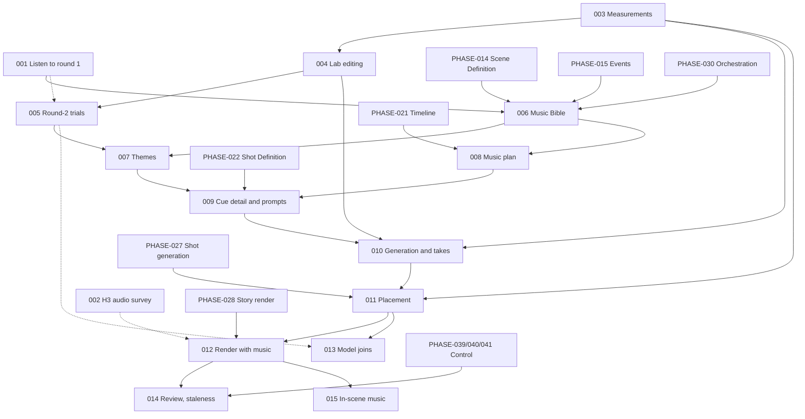

# Vision Studio — Music Integration Phases

The step-by-step roadmap for adding planned, generated music, ambience and sound effects to the story pipeline.

- `Path_ahead.md` (§33, §34) is the source of truth for **what** the finished audio is and **why**.
- `Implementation_phases.md` is the roadmap for everything else. Its conventions (§3.3 to §3.5) and its progress rules (§6) apply here unchanged.
- This document is the source of truth for **music**: the decisions taken, the design every music phase builds on, the order of the work, and how far we have got.

Written 2026-10-23 from a design discussion with the owner, a review of the repository, the GPU server's API document (0.18.0, as stored in the app's database) and the round-1 Music Lab trials (`music_lab_trials/`, 84 runs, of which the owner had heard group B when this was written).

**This document replaces PHASE-034, PHASE-035 and PHASE-036 of `Implementation_phases.md`.** Those three phases planned a supplied track, a single planner call and a deferred generation phase. The design below goes much further. MUSIC-001 marks those three phases "Dropped: replaced by `Music_implementation_phases.md`" (§6.4 of that document: ids are never renumbered).

---

## How to use this document

### Opus → Sonnet workflow

1. Pick a phase whose status is **Not Started** and whose hard dependencies are met (see [§5 Phase overview](#5-phase-overview) and rule MD-18 for dependencies on `Implementation_phases.md`).
2. Give Opus `Path_ahead.md`, `Implementation_phases.md`, this document, and a request such as:

   > Plan **MUSIC-0XX — <title>** only. Respect its Scope and Out of scope, the music decisions in §3 and the design in §4 of `Music_implementation_phases.md`, the conventions and default decisions in §3.3 to §3.5 of `Implementation_phases.md`, and the Completion notes of every phase it depends on (in both documents). Resolve every "Planning decides" item explicitly in the plan. Do not pull work from later phases. List the files to change, any migration, the API and UI changes, the settings, and how each Verification criterion will be checked.

3. Give the resulting plan to Sonnet for execution.
4. When the phase is done, update it as described in [§7 Progress tracking](#7-progress-tracking). Fill in its **Completion notes** carefully: later music phases read them to learn the real names of tables, job types, settings and endpoints.

### Reading a phase

Every phase has the same fields as in `Implementation_phases.md`: Objective, Current state (with starting points in the code), Scope, Out of scope, Dependencies, Expected outcome, Verification criteria, Observable improvements, Completion checklist and Completion notes. Items marked **Planning decides** are left open on purpose and must be settled in the plan.

Manual phases (MUSIC-001, MUSIC-002, MUSIC-005) are done by the owner, with the agent preparing material and recording results, like PHASE-001.

---

## Table of contents

1. [Goal](#1-goal)
2. [Current state](#2-current-state)
3. [Decisions](#3-decisions)
4. [Design of the music system](#4-design-of-the-music-system)
5. [Phase overview](#5-phase-overview)
6. [Detailed phase definitions](#6-detailed-phase-definitions)
7. [Progress tracking](#7-progress-tracking)
8. [Open questions and risks](#8-open-questions-and-risks)
- [Appendix A — Verification material](#appendix-a--verification-material)
- [Appendix B — Round-1 listening log (filled by MUSIC-001)](#appendix-b--round-1-listening-log-filled-by-music-001)
- [Appendix C — Round-2 trial plan (run by MUSIC-005)](#appendix-c--round-2-trial-plan-run-by-music-005)
- [Appendix D — Progress log](#appendix-d--progress-log)
- [Appendix E — Document change log](#appendix-e--document-change-log)

---

## 1. Goal

A finished story video should have music that gives the story its soul, not stock background sound:

- a **musical identity** for the whole story (a "music character"), with themes for the characters, places or ideas that matter, reinterpreted as the story's emotions change;
- music that **starts, swells, stops and falls silent at the right story moments**, not at random places or at every cut;
- **continuous sound across shots**: ambience beds (rain, wind, room tone) and off-screen sounds (thunder, a distant fox) that H3 cannot make because it works one shot at a time;
- **no audible seams** where separately generated pieces meet;
- music that sits **under** narration and dialogue, and a finished mix at a consistent loudness.

All of it must run **automatically** by default, like the rest of the pipeline, with optional pauses where the owner reviews the plan as text and picks audio by ear.

---

## 2. Current state

### 2.1 What exists

- **Music Lab** (project-independent; migration `0057`, table `lab_music_run`, job types `lab_music` and `write_lab_music_prompt`). It makes audio from text only, with five models: ACE-Step 1.5, YuE2, Stable Audio 3, Stable Audio Open and LTX audio. The language model drafts each model's fields from a brief. A person rates each run Good, Usable or Bad, with a note. Starting points: `services/music_models.py` (fields, limits, kinds, licences), `providers/music_generator.py` (endpoints and request bodies; its docstring says the editing endpoints "come later"), `services/music_prompt_writer.py`, `services/music_prompt_profiles.py`, `services/music_lab.py`, `jobs/generate_lab_music.py`, `jobs/write_lab_music_prompt.py`, `api/music_lab.py`.
- **GPU server editing endpoints** (API 0.18.0), none called by the app yet:
  - `POST /v1/ace-step15/music/repaint`: regenerates one window (`repaint_start`, optional `repaint_end`) of an uploaded recording and keeps the rest. Up to 600 s. It does not say whether the window may go past the end of the recording.
  - `POST /v1/ace-step15/music/cover`: restyles an uploaded recording and keeps its structure. `cover_strength` runs from 1.0 (very close) through 0.5 (balanced) to about 0.2 (loose style transfer). The output is as long as the source.
  - `POST /v1/stable-audio3/audio/inpaint`: regenerates a window (`mask_start`, `mask_end`) **or extends** a recording past its end. Up to 380 s. The surrounding audio matters more than the prompt.
  - `POST /v1/stable-audio3/audio/transform`: audio-to-audio with `init_noise_level` (0 keeps the source, about 0.6 is a style shift).
  - `POST /v1/stable-audio-open/audio/transform`: the same idea, first 47 s only.
  - Every editing call takes `source_audio_asset_id` from `POST /v1/uploads`. `providers/gpu_server.upload_file` already uploads files for H3.
  - The stored 0.18.0 snapshot is **pending** approval in the app (Settings → GPU contract). MUSIC-004 checked it: it does **not** block the editing endpoints (RM-12 closed).
- **Story render** (PHASE-028): narration as its own sample-exact layer (`render_commands.narration_track_args`), shot audio moved toward -16 LUFS and ducked by 12 dB under narration (`story_render_plan.duck_windows`, `render_commands.duck_volume_filter`), mixed with `amix normalize=0` and `alimiter=limit=0.97`. The timeline is frozen on the job (`TIMELINE_VERSION = 1`). **There is no music layer and no final loudness normalization**, only a sample-peak limiter.
- **Timing sources**: speech units have measured TTS lengths (PHASE-019). Shot plans (PHASE-020/021) give every shot's start and end, its `source_event_ids` and its `speech_unit_ids`. The scene timeline (`services/scene_timeline.py`) and the story render plan turn these into story seconds and frames. Scene definitions carry `mood.start/middle/end` (PHASE-014). Events carry `sound_event`, `pause` and off-screen dialogue (PHASE-015). Shot definitions say who is in each shot (PHASE-022).
- **Orchestration** (PHASE-030): a step graph in `services/story_pipeline.py` with one `Adapter` per step in `services/story_pipeline_targets.py`. Per-run "Pause after…" pauses for any step. Saved review points (PHASE-041, `services/review_points.py`). Staleness computed on read (PHASE-039).
- **H3 audio**: H3 keeps its own per-shot sounds and is told not to make a score (D-10). PHASE-001 V4 found no score in a quiet scene. The owner's survey (MUSIC-002) found that H3 sound, and even background music, works well inside a shot, but not across shots (MD-24). Whether D-10 should change is open (QM-15).
- **Backend libraries**: no audio-analysis library is installed (no numpy, scipy or librosa). FFmpeg (`services/ffmpeg.py`, including `measure_loudness`) is the only audio tool.
- **GPU pool**: music jobs count in the shared GPU pool (`jobs/pools.py`, slots), where each H3 clip holds 4 GPUs.

### 2.2 What round 1 told us so far

The owner listened to all 84 runs (MUSIC-001, completed 2026-10-24; verdicts in Appendix B):

- **The models do not follow timestamps** (group B). The mood does shift roughly where it was asked, but not clearly, and a requested bang at 34 s did not happen. The music model can follow a broad order of moods, but every precise moment has to come from somewhere else.
- **ACE-Step 1.5 is the music model** and **Stable Audio 3 is the model for sound effects and ambience.**
- **H3 makes good sound and good background music, but only inside one shot** (MUSIC-002). Continuous sound or music across shots does not work from H3. See MD-24 for the routing this gives.

### 2.3 Gaps

| Needed | Exists | Phases |
|---|---|---|
| Knowing which model does what well | Round-1 runs, mostly unheard | 001, 005 |
| Knowing what sound H3 really adds | One quiet-scene check | 002 |
| Measuring audio (silence, loudness curve, sudden sounds, quiet points, endings) | Integrated loudness only | 003 |
| Editing audio (repair, join, extend, restyle) | Endpoints on the server, not in the app | 004, 005 |
| A musical identity for the story | None | 006, 007 |
| Planning where music goes | None | 008, 009 |
| Generating cue audio with takes | Lab only | 010 |
| Exact placement, fades and joins | Sample-exact narration placement only | 011, 013 |
| Music and ambience in the render, final loudness | Narration and shot audio only | 012 |
| Review, staleness, selective regeneration for music | Exists for other stages | 014 |
| In-scene music (radio, speakers) | None | 015 |
| Singing characters | None | 016 (deferred) |

---

## 3. Decisions

These were decided with the owner on 2026-10-23, unless marked **(re-evaluation)**. Re-evaluation items were added while writing this document. They are defaults the owner can change: edit the decision here and record it in Appendix E.

| ID | Decision | Affects |
|---|---|---|
| MD-1 | **Judgment belongs to the model.** GLM-5.3 decides what music plays, where, how long, and how it starts and ends. Code keeps the timeline valid, finds the exact sample inside the window the model chose, runs the generators, applies fades and the mix, and measures facts. Code never chooses music. When code must choose between real candidates, it uses mechanical rules (§4.6), or asks the model (§4.7). More GLM calls are acceptable wherever they improve quality. | All |
| MD-2 | **The model names story moments, never timeline seconds.** A position is an anchor: an id that exists (a speech unit, an event, a shot, a scene), plus a relation (before, on, after, under) and a strictness (tight, loose). The model does see real seconds in its input, and it may give approximate *lengths* (a fade of "about 3 s"). | 008, 009, 011 |
| MD-3 | **Scene music is planned only once exact timings exist**: every speech unit is synthesized and measured, and every scene has a shot plan with a valid timeline. Cue detail also waits for shot definitions (it needs who appears in which shot). The Music Bible and themes need no timings and may run earlier. | 006–009 |
| MD-4 | **Top-down levels, each seeing more of the story and writing less:** level 0 the Music Bible, level 1 the music plan (one or two lines per cue), level 1b critics and a revision, level 2 cue detail, level 3 prompt writing per model (§4.3). | 006, 008, 009 |
| MD-5 | **Four directions at level 0.** GLM writes four clearly different directions for the whole score, a separate GLM call picks one with its reasons, and the chosen one is expanded into the Music Bible. At the review point the owner can choose another. | 006 |
| MD-6 | **The music character.** The Bible names a main theme and a few themes for characters, places or ideas that matter. Each theme gets a canonical recording. **Changed 2026-10-25 (owner):** its emotional versions (grief, fear, anger, tenderness…) start as **fresh text-to-music** with the theme described in the prompt (instrument, tempo, key, the feel of the tune), not as a conversion of the recording. Converting a recording with ACE-Step `cover` or Stable Audio 3 `transform` is not relied on until it is shown to work; it can be added later as an improvement. | 006, 007, 009 |
| MD-7 | **The model decides how music starts and ends** (fade, hard start on a cut or hit, rising out of the ambience, hard stop, musical ending, crossfade, through silence, sting), with a one-line reason. **The join between two cues is decided once, at level 1, for the boundary**, so two neighbours never disagree. | 008, 009, 011 |
| MD-8 | **The music model is trusted for broad structure only** (from round-1 group B, §2.2). Prompts ask for a broad order of moods, never timestamps. Exact moments come from placement (§4.6) and from separate hit sounds placed by code. | 009, 010, 011 |
| MD-9 | **Who makes which sound (confirmed by the owner after listening to round 1, 2026-10-24):** **ACE-Step 1.5** makes the score, the themes and songs. **Stable Audio 3** makes sound effects and ambience that H3 does not make (MD-24). **Stable Audio Open, LTX audio and YuE2 are not used in the pipeline** (they stay in the lab). H3 keeps each shot's own sounds (D-10, see MD-24 for what that now includes). | 001, 007, 009, 010 |
| MD-10 | **The owner is the only judge of sound.** GLM-5.3 takes no audio, and no model is trusted to listen. Automatic runs pick the first take that passes the technical checks (as D-5 does for pictures). GLM may also rank takes from measured facts written as text (§4.8). | 010 |
| MD-11 | **Fully automatic by default; review is optional.** Music gets steps in the same pipeline and optional review points, exactly as `Path_ahead.md` §40 and PHASE-041 describe. The outputs are identical whether or not anyone pauses. The owner can read the plan as text and pick audio at those pauses. | 006–014 |
| MD-12 | **A fallback ladder** when code cannot find a good point: widen the window, switch to a gentler technique, cover the moment, ask GLM to choose among the real candidates code found, then flag it to the owner (§4.7). | 011 |
| MD-13 | **Personal, non-commercial use.** Model and tool licences (YuE2, Stable Audio, madmom, Rubber Band) do not block choices in this document. `Implementation_phases.md` R-7 still applies before anything is published. | All |
| MD-14 | **Singing characters are to be decided** (owner, 2026-10-23). The owner's direction is that H3 must make the picture for lip sync. Whether H3 also invents the song, or is given a sung recording as it is given dialogue, is open. | 016 |
| MD-15 | **Music heard inside the scene** (a radio, a speaker, a TV) comes from ACE-Step and belongs to the scene's sound, not the score. | 015 |
| MD-16 | **The Music Lab gets editing** (`repaint`, `cover`, `inpaint`, `transform`), with results on the lab page and ratings, so trials and later the pipeline share one implementation. | 004 |
| MD-17 | **(re-evaluation) Ambience ownership is decided at render time first.** Telling H3 not to make ambience would change the compiled H3 prompts (PHASE-026). That makes every shot's prompt out of date, and each clip costs 10 to 20 minutes on 4 GPUs (R-1). So the first version keeps H3's own ambience and only lowers it under a Stable Audio bed when the plan says so. The H3 survey (MUSIC-002, done) found no reason to change the H3 prompt for ambience, so this stands. Whether H3's own *music* inside a shot needs handling is a separate open question (QM-15). | 008, 012 |
| MD-18 | **(re-evaluation) Dependencies on `Implementation_phases.md`.** A dependency on a PHASE-0xx counts as met when that phase is **code complete** (In Progress with "code complete", or Completed). Most of those phases are only waiting for the owner's runs, and music phases only read their tables. A music phase's own verification still needs real data from those stages. | All |
| MD-19 | **(re-evaluation) Final loudness normalization is added to the render.** Adding music makes the overall level less predictable, and the render today only limits sample peaks. The finished mix is brought to one integrated loudness with a true-peak ceiling. The targets are settings, and **Planning decides** the starting values (streaming platforms commonly use about -14 LUFS integrated and -1 dBTP). | 012 |
| MD-20 | **(re-evaluation) Hearing music in context.** Takes judged on their own are misleading: a cue that sounds empty alone may be right under a voice. The take review offers an audio-only preview of the scene: narration, shot audio and the candidate cue, mixed with the render's own rules. | 012 |
| MD-21 | **(re-evaluation) Music and ambience can be switched off per project**, and the render works without them. Stories in every speech mode (PHASE-049: narration and dialogue, no dialogue, no narration) are planned the same way. Ducking simply has fewer spans. | 008, 012 |
| MD-22 | **(re-evaluation) Every model decision is stored** (directions, choice and reasons, plan, critiques, cue detail, prompts, seeds, fallback choices), with provenance (D-3), so a run can be inspected and repeated, and a cue the owner likes can be **locked** so nothing regenerates it. | All |
| MD-23 | **(re-evaluation) Feedback loop.** When the owner rejects a take with a note ("too busy under the voice"), GLM rewrites that cue's prompt using the note before the next take. | 010 |
| MD-24 | **Who makes a sound depends on how far it reaches (owner, 2026-10-24, from listening to round 1 and to H3's shot audio).** H3 makes good sound, and even good background music, **inside one shot**. Asking for sound or music that runs continuously across several shots does not work, because each shot is generated on its own. So: (a) a sound that stays inside one shot is **H3's**, asked for through the shot's own sound events; (b) a sound that spans shots (rain, wind, room tone) is **Stable Audio 3's** (ambience bed); (c) a sound that depends heavily on exact timing, such as thunder on a flash, is **H3's too**, so it must be asked for in the shot itself; (d) music that runs across shots is **ACE-Step's** continuous score. Consequence for the plan: a sound of kind (a) or (c) can only be made by H3 if it is asked for **before the shot's prompt is compiled**, which affects the order of steps (QM-16). | 002, 008, 009, 012 |

Conventions inherited from `Implementation_phases.md` without change: provenance and out-of-date computed on read (D-3), JSON answers validated by code (D-7), no automated tests (D-11), GLM-5.3 for every story language-model job (D-12), stories up to about 10 minutes (D-13), and everything in §3.4 and §3.5 (migrations, `DATABASE_STRUCTURE.md`, job handlers, prompts as pure functions in `services/`, `npm run gen:api`, standard checks).

---

## 4. Design of the music system

This section is what every phase builds on. Final names of tables, fields and settings are decided in planning. The shapes here are illustrative.

### 4.1 Layers of the finished audio

```text
Narration      TTS, sample-exact, unchanged (PHASE-028)
Shot audio     H3, per shot: dialogue, sync sounds, time-critical sounds (thunder), its own ambience (D-10, MD-24)
Ambience       Stable Audio 3 beds that span shots, and off-screen point sounds that no shot carries   (new)
Score          ACE-Step cues, continuous where planned, silent where planned    (new)
Hits           short Stable Audio impacts, risers, stings, placed by code       (new)
Source music   ACE-Step music heard inside the scene (radio, speaker)            (new, MUSIC-015)
```

Ambience, hits and source music are "sound" rather than "music", but they are planned together with the score, so that music and ambience are designed as one: rain rising while the music fades, a hit covering a join.

### 4.2 Artifacts

| Artifact | Made by | Holds |
|---|---|---|
| Music Bible (versioned per project) | Level 0 | The four directions, the chosen one and why, and the Bible: concept, sound world (instruments, things to avoid), musical feel (tempo range, major or minor leaning, density), themes with what each stands for and its signature instrument, the arc of the music across the story, restraint rules (how much music, where silence goes), and the ambience signature |
| Themes | MUSIC-007 | Per theme: candidate recordings, the chosen canonical recording, and emotional versions made from it |
| Music plan (versioned per project) | Levels 1 and 1b | The cue list (one or two lines each), the boundaries with their join types, the critiques and the revision |
| Cue detail (per cue, per plan version) | Levels 2 and 3 | Exact anchors, the broad internal order of moods, hit requests, mix notes, the source (text, a theme version, continuation of the previous cue), the model and the prompt wordings |
| Takes (per cue, per theme, per hit) | MUSIC-010 | The audio, its request, seed, measured facts, check result, selection, lock, the owner's verdict and note |
| Placement (per render) | MUSIC-011 | For each placed sound: file, offset, in and out samples, gain, fades, crossfade partner, fallbacks used |

Every artifact records its source, job, version and the exact upstream versions it was built from (D-3).

### 4.3 The model calls

| Level | Sees | Writes |
|---|---|---|
| 0a Directions | Story Bible, character definitions, scene list with definitions (moods) and events, story length | Four directions, a few lines each |
| 0b Choice | The four directions and the same story context | The chosen direction and why (skipped when the owner chooses) |
| 0c Bible | The chosen direction and the story context | The Music Bible |
| 1 Plan | Bible, theme list, the whole condensed timeline **with seconds**: scenes and moods, events, speech units with text, pauses, sound events, shot cuts | Cues and boundaries, one or two lines each, with anchors at event or line level |
| 1b Critics | The plan, the Bible, the condensed timeline | One critique per lens: dramatic fit (does each moment get what it needs), variety and restraint (too much music, the same mood twice in a row, no silence before the big moment), theme use (overuse, missed entrances), joins (will each boundary work). Then a **reviser** call merges the critiques into a new plan. At most `critic_rounds` rounds (Planning decides the default; two suggested, because more rounds tend to drift toward bland choices) |
| 2 Cue detail | Bible, the cue's line, its neighbours' lines and boundary joins, the full events, lines and shots of its span with seconds, who is in each shot, the theme versions available | Exact anchors (start, end, hits), the broad order of moods inside the cue, hit requests, mix notes, fade lengths, the source. It may **push back** ("too short to introduce the theme"), which sends that part of the plan back to level 1 |
| 3 Prompts | The cue detail, the target model's prompt profile (`music_prompt_profiles.py`) | The model's fields, in several genuinely different wordings (one per take) |
| Audit | All cue prompts of the story at once, with the Bible | Drift from the Bible (forbidden instruments, a clashing key next door) and fixes |

All calls use `llm_call.ask_model` with JSON answers validated by code (D-7). Code resolves every id the model names and refuses an answer that names something that does not exist (the standard retry of every story stage).

### 4.4 Anchors

An anchor points at something on the timeline that already has an id and exact times:

```json
{"ref": "unit:su_12", "edge": "end", "relation": "after", "strict": "loose"}
{"ref": "event:evt_4", "edge": "start", "relation": "just_before", "strict": "tight"}
{"ref": "shot:sh_7", "edge": "start", "relation": "on", "strict": "tight"}
```

- `ref`: a speech unit, an event, a shot or a scene, by its stored id. A character's first appearance is expressed as the first shot whose definition includes that character (code can list these for the model).
- `edge`: the start or end of that thing.
- `relation`: before, just_before, on, after, under (somewhere inside it, for example partway through a long narration line).
- `strict`: tight (a fraction of a second; hits and hard stops) or loose (a second or two; entries and fades). The window sizes are settings.

Times of speech units and shots come from the timeline. Events have no time of their own. An event's time is the time of the speech unit that voices it, or the shot that shows it (`source_event_ids`). A `sound_event`'s exact moment inside its shot is only known after the shot exists (§4.6).

### 4.5 Starts, ends and joins

- **Start styles:** fade in under something (a voice, a cut, a sound; the default), hard start on a cut or a hit, rise out of the ambience.
- **End styles:** fade out, hard stop (on a cut or just before a hit, with a few milliseconds of fade so it never clicks), musical ending (the recording's real ending is lined up with the end point: "back-timing"), crossfade into the next cue, end on a sting.
- **Join types** (decided per boundary at level 1):
  - `crossfade`: both cues have spare length ("handles"), overlap by a few seconds, and are crossfaded at a quiet moment or phrase end found in both. The default inside one emotional stretch.
  - `under_cover`: the join is hidden under a narration line (music already lowered), a hard cut, a hit, or an ambience swell.
  - `through_silence`: the first cue fades out, only ambience remains for a moment, and the second enters. For real breaks such as a time jump or a new scene.
  - `hard_cut`: deliberate, on a cut, for shock.
  - `model_join`: the two takes are put end to end and the seam window is repainted, so the model rewrites the join as one piece (MUSIC-013, if round 2 shows it works).
  - `continuation`: the next cue is generated from the end of the previous one (Stable Audio 3 `inpaint` extension, or ACE-Step repaint into appended silence; MUSIC-013, if round 2 shows it works).
- **Prevention before joins:** the level 3 prompt always sees its neighbours' instruments, tempo, key, ending and opening, and keeps to the Bible's sound world. Every cue is loudness-matched. Optionally, all score passes through one shared room reverb, so separate generations sound like one recording space (Planning decides in MUSIC-012).

### 4.6 Finding exact points (code)

For each anchor, code builds a window around the moment the model named and picks the best position in it.

**Candidates** (all measurable):

1. Shot cuts (frame-exact).
2. Gaps between speech units, and silences inside a TTS recording (between sentences, before a key word), found by silence detection. No transcription is needed.
3. Sudden sounds in a shot's H3 audio near a `sound_event` (needs the shot's selected take).
4. Points inside a generated recording: where it changes mood, where it is quiet, where a phrase or the piece ends (MUSIC-003). Beat tracking is not relied on, because much score has no beat.
5. The loudest moment of an effect, such as the crack of thunder. That moment, not the start of the file, is lined up with the anchor.

**Mechanical preferences:**

- Never start or stop music in the middle of a word.
- Prefer a cut or a speech gap.
- A hit goes on the detected sound.
- Music that must stop before a hit stops a few frames before it.

If an anchor falls inside continuous narration, the fallback is a long, very quiet fade under the voice.

**Fitting a recording to its span:**

- Every cue is requested longer than its span, by a setting called the handles.
- *Slide to fit:* if a planned change of mood actually happens 3 s late in the take, code starts the take 3 s earlier so the change lands on the anchor.
- *Back-timing:* for a musical ending, the take's ending is placed on the end anchor and the start is faded in under something.
- ACE-Step's 10 s minimum is met by the handles. A cue shorter than that is generated at 10 s and trimmed.

### 4.7 Fallback ladder

When no candidate fits inside the window, code works down this list. It records the step used, and the owner sees it at review:

1. Widen the window once (by a setting).
2. Switch to a gentler technique for that point: a hard start becomes a quiet fade under the voice, a hard stop with no cut becomes a short fade ending in the next speech gap, a hit with no detectable sound is placed at the event's planned position.
3. Cover the point with a short swell, impact or ambience rise (a hit take).
4. Ask GLM to choose: code lists the real candidates ("no pause within 2 s of evt_7; a cut at 41.2 s; a gap at 44.0 s after the line; or start under the line"), and the model picks one. For the most important anchors (a character's entrance, a climax hit) this can be the normal path. **Planning decides** in MUSIC-011.
5. Flag it to the owner.

### 4.8 Takes, checks and selection

- Each cue, theme and hit gets several takes (a setting). Each take uses a different prompt wording from level 3, not only a different seed.
- **Technical checks** (MUSIC-003 facts):
  - length;
  - leading and trailing silence;
  - clipping and true peak;
  - unexpected long silences;
  - a real ending where the cue asked for one;
  - for an instrumental, nothing that can be checked automatically about vocals, so the instrumental flag is always sent.
- **Selection:**
  - In automatic runs, the first take that passes is selected (MD-10).
  - Optionally, GLM ranks the passing takes from their facts written as text: where the loudness rises, where the measured change points fall against the planned order, how the ending behaves. That's weak, but better than first-passing. **Planning decides** whether it is on by default.
  - At the review point the owner listens, selects, rejects with a note (MD-23) or locks (MD-22).

### 4.9 Mix rules

Starting values are untested and are settings, to be tuned by ear:

- Music sits a set distance under the voice and is ducked under narration **and** dialogue, with its own depth and ramps. These are separate from the shot-audio ducking of PHASE-028.
- It may rise in the gaps between lines where the mix notes say so. That is where narrated video gets its sense of production.
- It dips briefly around important `sound_event`s, so a swell never hides the thump the scene depends on.
- Under a Stable Audio bed, H3's own ambience may be lowered (MD-17).
- The final mix is loudness-normalized with a true-peak ceiling (MD-19).

### 4.10 Where music runs in the pipeline

New steps, each added by its own phase with the `Step` and `Adapter` pattern of PHASE-030:

| Step | Needs | Phase |
|---|---|---|
| `music_bible` | `events` | 006 |
| `music_themes` | `music_bible` | 007 |
| `music_plan` | `shot_plans`, `music_bible` | 008 |
| `music_cues` | `music_plan`, `shot_definitions`, `music_themes` | 009 |
| `music_generation` | `music_cues` | 010 |
| `music_placement` | `music_generation`, `shot_generation` | 011 |
| `render` (existing) | also `music_placement` when music is on | 012 |

Music generation runs beside clip generation. Placement waits for the clips only because hits may sit on H3 sounds.

The review points (MUSIC-014) are after music direction, after themes, after the music plan, and after music takes. Before MUSIC-014, PHASE-030's per-run "Pause after…" already pauses at any of these steps.

---

## 5. Phase overview

Status values and their meaning are those of `Implementation_phases.md` §6.1. **This table and each phase's Status line must both be updated** (§7).

**Progress snapshot** (update when a phase changes status):

- Completed: MUSIC-001 (2026-10-24), MUSIC-002 (2026-10-24), MUSIC-004 (2026-10-25)
- In progress: MUSIC-003 (code complete 2026-10-24; the owner's check of the change points and loudest moments of round-1 runs 13 to 16 by ear is still open)
- MUSIC-005 (review screen ready, wave 1 of 4 run, waves 2 to 4 waiting for the owner)
- MUSIC-006 (code complete 2026-10-25; the owner's S2 run with the real model is still open)
- MUSIC-007 (code complete 2026-10-25; the owner's S2 run with the real model and listening are still open)
- MUSIC-008 (code complete 2026-10-25; the owner's S2 run with the real model is still open)
- MUSIC-009 (code complete 2026-10-25; the owner's S2 run with the real model is still open)
- MUSIC-010 (code complete 2026-10-25; the owner's S2 run with the real GPU and model, and listening, are still open)
- MUSIC-011 (code complete 2026-10-25; the owner's S2 run with the real model, and review of the placement, are still open)
- MUSIC-012 (code complete 2026-10-26; the owner's render of S2, listening and tuning of the mix values are still open)
- Deferred: MUSIC-016 (singing characters, until the owner decides)

| ID | Title | Milestone | Hard dependencies | Status |
|---|---|---|---|---|
| MUSIC-001 | Listen to round 1 and record the model choices (manual) | MM0 | — | Completed |
| MUSIC-002 | Survey what sound H3 adds (manual) | MM0 | PHASE-027 (real takes exist) | Completed |
| MUSIC-003 | Audio measurements | MM0 | — | In Progress (code complete) |
| MUSIC-004 | Editing in the Music Lab | MM0 | 003 | Completed |
| MUSIC-005 | Round-2 trials (manual) | MM0 | 004 (001 recommended) | In Progress (wave 1 run; waves 2 to 4 waiting) |
| MUSIC-006 | Music Bible: four directions, a choice, the Bible | MM1 | 001; PHASE-014, PHASE-015, PHASE-030 | In Progress (code complete; S2 run waiting for the owner) |
| MUSIC-007 | Themes and their emotional versions | MM1 | 006 (005 no longer needed, MD-6) | In Progress (code complete; S2 run and listening waiting for the owner) |
| MUSIC-008 | Music plan with critics | MM2 | 006; PHASE-021 | In Progress (code complete; S2 run waiting for the owner) |
| MUSIC-009 | Cue detail and prompts | MM2 | 007, 008; PHASE-022 | In Progress (code complete; S2 run waiting for the owner) |
| MUSIC-010 | Cue generation, takes and selection | MM3 | 003, 004, 009 | In Progress (code complete; S2 run waiting for the owner) |
| MUSIC-011 | Placement: exact points, fades, joins, fallbacks | MM3 | 003, 010; PHASE-027 | In Progress (code complete; S2 run waiting for the owner) |
| MUSIC-012 | Render with music and ambience, final loudness, preview | MM3 | 011; PHASE-028 | In Progress (code complete; S2 render waiting for the owner) |
| MUSIC-013 | Model-written joins and continuations | MM4 | 005 (positive result), 011 | Not Started |
| MUSIC-014 | Music review points, staleness and selective regeneration | MM4 | 012; PHASE-039, PHASE-040, PHASE-041 | Not Started |
| MUSIC-015 | Music inside the scene (radio, speakers) | MM4 | 012 | Not Started |
| MUSIC-016 | Singing characters | Deferred | MD-14 decision | Deferred (owner decides later) |

**Milestones**

| Milestone | Phases | Result |
|---|---|---|
| MM0 Validation and tools | 001–005 | Model roles confirmed, H3's own sound known, audio measurable and editable, editing methods tested |
| MM1 Musical identity | 006, 007 | A Music Bible and theme recordings with emotional versions |
| MM2 Music plan | 008, 009 | A reviewed cue plan and per-cue prompts anchored to story moments |
| MM3 First story with generated music | 010–012 | **S2 rendered with planned, generated score, ambience and hits, at a consistent loudness** |
| MM4 Polish and control | 013–015 | Seamless joins, review and selective regeneration, in-scene music |

### 5.1 Dependency graph



### 5.2 Parallel work

- **Start immediately:** MUSIC-001 and MUSIC-002 (owner, manual) and MUSIC-003 (agent).
- MUSIC-006 can start once MUSIC-001 is done. It does not wait for the editing work (004, 005).
- MUSIC-008 can be built beside MUSIC-007, because the plan names themes by id and does not need their recordings.
- MUSIC-015 and MUSIC-014 are independent of each other after MUSIC-012.

---

## 6. Detailed phase definitions

### MM0 — Validation and tools

---

### MUSIC-001 — Listen to round 1 and record the model choices (manual)

**Status:** Completed (2026-10-24) · **Milestone:** MM0 · **Vision:** `Path_ahead.md` §34 ("Working decision", open points 1 and 5)

**Objective.** Turn the 84 round-1 runs into recorded decisions: which model makes which kind of sound, how far timing and length are followed, and whether one long piece or several per-scene pieces work better.

**Current state.** The runs exist in the Music Lab, grouped by case id (`[A1]` … `[H3]`). `music_lab_trials/TRACKER.md` lists every case, its runs and the questions to answer. The owner has heard group B (§2.2). The folder is temporary.

**Scope.**
- The owner listens to groups A and C to H, rates each run in the lab, and answers the questions in `TRACKER.md`.
- The agent then copies the conclusions into Appendix B of this document (so they survive when the trial folder is discarded), including run ids and verdicts.
- The decisions to record:
  - the best model per kind (score, stem or theme, sound effect, ambience);
  - Stable Audio 3 or Open for short effects (MD-9);
  - one long piece or per-scene pieces (C1 against C2);
  - whether endings are clean (B3);
  - whether long pieces loop or drift (A4, B4b);
  - seed repeatability (H1b);
  - prompt writer against hand-written prompts (H2, H3).
- Update `services/music_models.KIND_MODELS` order to match the decisions (open point 5 of `Path_ahead.md` §34). A one-line data change.
- Mark PHASE-034, PHASE-035 and PHASE-036 in `Implementation_phases.md` as "Dropped: replaced by `Music_implementation_phases.md`" (its §4 table, the phases' status lines, Appendix D there). Update the "Working decision" of `Path_ahead.md` §34 to point at this document.

**Out of scope.** New trials (005). Pipeline work.

**Dependencies.** None.

**Expected outcome.** Appendix B is filled, MD-9 is confirmed or changed, and the round-1 folder can be discarded.

**Verification criteria.**
- Every case in `TRACKER.md` has notes, and every run has a verdict in the lab.
- Appendix B states a model per kind and answers the long-or-per-scene question with reasons.

**Observable improvements.** Later phases choose models from evidence, not from documentation.

**Completion checklist.**
- [x] Owner listened and rated (all 84 runs have a verdict, except two untouched Stable Audio effect runs, 1 and 2)
- [x] Appendix B filled with conclusions and run ids
- [x] MD-9 confirmed or changed (changed: Stable Audio Open is out; Appendix E row)
- [x] `KIND_MODELS` order updated
- [x] PHASE-034/035/036 marked Dropped; `Path_ahead.md` §34 points here

**Completion notes.**

- **How it was recorded.** The owner listened and saved a verdict (good, usable or bad) on every run card, then told the agent the conclusions in chat. **No run card has a written note**, and `music_lab_trials/TRACKER.md` was not filled in. The agent cannot listen to audio, so every conclusion in Appendix B is the owner's, with the verdict counts read from the `lab_music_run` table (read-only) as evidence.
- **Decisions.** MD-9 confirmed and narrowed (ACE-Step 1.5 for music, Stable Audio 3 for effects and ambience, nothing else in the pipeline). MD-24 added from the same listening.
- **Not answered by the owner, so left open (not guessed):** one long piece against per-scene pieces (QM-2), whether endings at odd lengths are clean, whether long pieces loop, seed repeatability, and the prompt writer against hand-written prompts. The verdicts for those cases are in Appendix B. MUSIC-005 and the first real cue runs will show most of them.
- **Code change.** `services/music_models.KIND_MODELS`: score and stem now list ACE-Step 1.5 first, and effects and ambience list Stable Audio 3 first (the lab's "best first" order; nothing else reads it).
- **Documents changed.** `Implementation_phases.md`: PHASE-034, PHASE-035 and PHASE-036 marked "Dropped" (status lines, §4 table, snapshot, Appendix D). `Path_ahead.md` §34: an update block and open point 5.

---

### MUSIC-002 — Survey what sound H3 adds (manual)

**Status:** Completed (2026-10-24, on the owner's by-ear findings) · **Milestone:** MM0 · **Vision:** `Path_ahead.md` §34 open point 0 and point 2

**Objective.** Learn what H3 actually puts in a shot's audio: which effects, how much ambience, whether it ever adds music in tense scenes. That decides how much ambience and how many hits we add, and whether MD-17 changes.

**Current state.** PHASE-001 V4 found no score in a quiet bedroom scene (runs 95, 96). Real story takes exist for S1 and S2 once the owner has run PHASE-027.

**Scope.**
- The owner listens to the shot audio of S1 and S2 takes, plus at least one deliberately tense shot (a reveal or a scare). For each shot, note:
  - effects present;
  - ambience present and its level;
  - any music or tonal score;
  - whether neighbouring shots' ambience jumps at the cut.
- The agent measures the same takes with FFmpeg (loudness, silence) and records both in Appendix B (a second table).
- Decide:
  - whether MD-17 stays (render-time lowering only), or the H3 prompt should drop ambience in scenes with a bed;
  - whether a music-leak check is needed.

**Out of scope.** Changing the H3 prompt compiler (that would be its own phase, planned before prompt compilation, MD-17).

**Dependencies.** PHASE-027 (real takes).

**Expected outcome.** A short recorded answer: what H3 makes, and what we must add.

**Verification criteria.**
- At least eight shots surveyed, including one tense shot.
- The MD-17 decision recorded in Appendix B and, if it changes, in §3 and Appendix E.

**Observable improvements.** The ambience and hit plan is based on real H3 behaviour.

**Completion checklist.**
- [x] Shots surveyed by ear (the owner's findings; see the notes on what was not done)
- [x] Appendix B findings recorded (the per-shot table was not filled; see the notes)
- [x] MD-17 confirmed (it stands), and MD-24 added

**Completion notes.**

- **Findings (owner, 2026-10-24).** H3 makes good sound and good background music **inside a shot**, mostly without problems. When we tried to make music or sound **continuous across shots** through H3, it did not work well (each shot is generated on its own). So a sound that stays inside one shot can be left to H3, and a sound that spans shots must come from elsewhere. For sounds that span shots, such as rain, **Stable Audio 3** is used. For sounds that depend heavily on exact timing, such as thunder, **H3 itself** is used, so they are requested in the shot.
- **What was not done.** The phase asked for at least eight surveyed shots, including a tense one, a per-shot table and FFmpeg measurements. The owner gave the conclusion by ear without a per-shot table, and the phase was marked complete on that. Appendix B's per-shot table stays empty. The one risk this leaves is QM-15: whether H3's own in-shot music clashes with the ACE-Step score.
- **Consequences recorded.** MD-24 (routing by how far a sound reaches); MD-17 stands; new open questions QM-15 and QM-16 (below); MUSIC-008 and MUSIC-009 are updated to note the ordering problem for sounds that H3 must make.

---

### MUSIC-003 — Audio measurements

**Status:** In Progress (code complete 2026-10-24; waiting for the owner to confirm by ear the change points and loudest moments of round-1 runs 13 to 16) · **Milestone:** MM0 · **Vision:** this document §4.6, §4.8

**Objective.** One pure, reusable way to measure a sound file, used by the lab cards, the take checks, the placement and the take ranking.

**Current state.** `services/ffmpeg.py` measures integrated loudness (`measure_loudness`) and probes streams. No analysis library is installed.

**Scope.**
- A measurement service that returns, for one file:
  - length;
  - leading and trailing silence;
  - integrated loudness;
  - a short-term loudness curve;
  - true peak and clipping;
  - the loudest moment;
  - sudden sounds (onsets) with their times;
  - quiet points;
  - change points (where the sound changes character);
  - whether the file ends with a decay (a real ending) or is cut.
- Silences inside a speech recording (for §4.6 candidates).
- Results stored with the file they describe (Planning decides where) and computed once.
- **Planning decides** whether FFmpeg filters alone are enough (`ebur128`, `astats`, `silencedetect`, `aspectralstats` and similar), or whether a small library is added (for example numpy for change points). Prefer the simplest that gives usable change points on beatless score. Check it against round-1 recordings whose changes the owner has heard (group B).

**Out of scope.** Beat tracking. Vocal separation.

**Dependencies.** None.

**Expected outcome.** Every later phase can ask "where does this get loud, where is it quiet, where does it change, does it end".

**Verification criteria.**
- On round-1 runs 13 and 14 (B1) and 15 and 16 (B2), the reported change points and loudest moments agree with what the owner heard, within about a second.
- On E-group effects, the loudest moment matches the effect's peak.
- On a TTS file with two sentences, the gap between them is found.
- Standard checks (`Implementation_phases.md` §3.5).

**Observable improvements.** Audio stops being a black box to code.

**Completion checklist.**
- [x] Measurement service and its stored results
- [x] Speech-gap detection
- [ ] Checked against round-1 runs and a TTS file (the TTS file, the effects and a video clip are checked; the owner's ears on runs 13 to 16 are still open)
- [x] Docs; standard checks

**Completion notes.**

- **Not marked Completed, and why.** The first Verification criterion asks that the change points and loudest moments of runs 13 to 16 agree with what the owner heard, within about a second. The agent cannot listen, and the times the owner heard were never written down (Appendix B holds verdicts only). The measurements for those four runs are listed below for the owner to confirm, mark off or correct. If the owner's times differ, the thresholds in `audio_analysis.py` are tuned and `ANALYSIS_VERSION` is raised. Until then MUSIC-004 can use the service (the other results are checked), but treat `change_points` as unconfirmed (RM-8).
- **How "Planning decides" was settled.** FFmpeg for decoding and loudness, numpy for the shape of the sound. No librosa, scipy or madmom. numpy 2.5.4 was already installed through `rembg`; it is now a direct dependency (`backend/pyproject.toml`, `uv.lock`). Thresholds are module constants in `audio_analysis.py`, not settings, and each result stores the parameters it used.
- **Where it is stored.** New table `audio_measurement` (migration `0062`, model `AudioMeasurement`), keyed by the file's `sha256` and `analysis_version` (`UNIQUE (sha256, analysis_version)`), with the result in `content` (JSON). Because it is keyed by the content hash, it serves lab runs, speech recordings, H3 takes and later music takes without a migration. Shape: `DATABASE_STRUCTURE.md` §4.56.
- **Modules.**
  - `services/audio_measurements.py`: `measure(session, path, sha256)` returns the result (cached or measured and stored) and raises `MeasurementError` (message fit for the user). Files over 15 minutes are refused. A second request for the same new file reads the first one's row.
  - `services/audio_analysis.py`: pure numpy functions, `analyse(samples)` on mono float samples at 22.05 kHz, plus `ANALYSIS_VERSION` (1), the constants and `PARAMETERS`.
  - `services/ffmpeg.py`: `scan_loudness` (one run of `ebur128`, `ametadata` and `astats`: LUFS, loudness range, true peak, sample peak, the count of samples at the peak, the short-term curve every 0.1 s) and `decode_mono_float`.
- **Endpoint.** `GET /api/lab/music/runs/{id}/measurements` (404 no such run, 409 no audio yet, 422 the file cannot be measured). No UI and no job type; MUSIC-004 shows it on the run cards. `schema.d.ts` is regenerated.
- **Result fields** (all times in seconds from the start): `duration_s`, `leading_silence_s`, `trailing_silence_s`, `silences[{start_s,end_s}]` (inside the sound only), `loudness{integrated_lufs, loudness_range_lu, true_peak_dbtp, sample_peak_dbfs, clipping, clipped_sample_count}`, `short_term_loudness{step_s: 0.5, lufs[]}` (the value at index i is the loudness of the 3 s ending at i × 0.5 s, so the first 6 are null), `loudest_moment{time_s, level_db}` (the loudest 100 ms), `onsets[{time_s, strength}]`, `quiet_points[{time_s, level_db}]`, `change_points[{time_s, strength}]`, `ending{kind: decay or cut, end_level_db, drop_db}`, and `parameters`. Later phases read these names. `strength` is standard deviations above the file's typical value.
- **What was checked (agent, 2026-10-24, on stored round-1 and story files; the code was run directly and the endpoint against a throwaway database and media folder).**
  - **TTS, two gaps found.** `speech_unit_audio` 53 (7.84 s, three sentences): silences at 1.60 to 2.38 s and 4.20 to 4.76 s, the two sentence breaks. `speech_unit_audio` 5 (10.88 s): three silences, at 4.22 to 5.10 s, 5.94 to 6.46 s and 8.12 to 8.64 s.
  - **H3 clip.** `shot_take` 208 (an MP4): its audio stream is measured the same way (32 kHz stereo, loudness -17.1 LUFS, loudest moment 1.21 s).
  - **Effects.** Run 5 (E2, "three slow knocks", Stable Audio 3, rated usable): sound at the very start, then onsets at 1.24, 2.30, 2.64 and 3.18 s, so the model made four or five knocks, not three; loudest moment 0.05 s (the first knock). Run 57 (E5, the "dun dun" sting, rated good): onsets at 0.06, 0.70, 1.06 and 1.44 s, loudest moment 1.49 s. The owner has not confirmed that these are where the peaks are heard.
  - **Synthetic files.** A sine that steps from 300 to 1200 Hz at 4 s gives a change point at 4.00 s and an onset at 4.00 s. A cut sine reads `cut`, the same sine with a fade reads `decay`. A silent file and a file under one frame return empty lists, and a file without sound gives the "no sound" message.
  - **Round-1 runs 13 to 16, for the owner to confirm.** Run 13 (Stable Audio 3, B1, 60 s): loudest 45.87 s, one change point 54.8 s, one onset 43.0 s, ends in a decay. Run 14 (ACE-Step, B1): loudest 4.19 s, change points 16.4, 19.8 and 52.1 s, many onsets from 20 to 52 s (a steady pulse), decay. Run 15 (Stable Audio 3, B2, 36 s): a silence 5.58 to 6.04 s, then loudest 6.19 s, change points 6.0, 24.0 and 27.4 s, trailing silence 4.4 s (the plan asked for silence from 33 s), decay. Run 16 (ACE-Step, B2): loudest 17.13 s with an onset at 17.08 s, change points 4.1, 20.2 and 32.2 s, decay.
- **Limits found.** Change-point strengths on beatless score are modest (about 1.5 to 5 standard deviations), as RM-8 feared; a slow change gives a weak peak. Onsets are good to about 50 ms, and a repeating pulse gives many onsets. A quiet fade-in counts as leading silence while it stays 40 dB under the loud level (run 13: 0.98 s). A cut inside a quiet passage reads as a decay. All the thresholds are starting values.
- **Standard checks.** `ruff check` and `ruff format --check` pass, `npm run lint` and `npm run typecheck` pass, the migration applies on a fresh database (`alembic upgrade head`), and `DATABASE_STRUCTURE.md` is updated. The running Docker app has **not** been rebuilt: it still runs the old code until the owner rebuilds it (`docker compose up --build -d`), which applies migration `0062` and installs the code. `alembic check` reports four existing `FLOAT` against `REAL` differences on other tables, none from this phase.

---

### MUSIC-004 — Editing in the Music Lab

**Status:** Completed (2026-10-25) · **Milestone:** MM0 · **Vision:** MD-16

**Objective.** Let the Music Lab repair, extend, join and restyle audio with the GPU server's editing endpoints, so round 2 can test them and later phases reuse the same code.

**Current state.** Text-to-audio only (`providers/music_generator.py`, `jobs/generate_lab_music.py`). `providers/gpu_server.upload_file` uploads files. The endpoints and their fields are listed in §2.1. The stored 0.18.0 API snapshot is pending approval.

**Scope.**
- New lab operations:
  - ACE-Step `repaint` (window start and end) and `cover` (`cover_strength`);
  - Stable Audio 3 `inpaint` (window, or extension past the end) and `transform` (`init_noise_level`);
  - Stable Audio Open `transform`.
- **Sources** for an operation:
  - an earlier lab run;
  - an uploaded file;
  - **a join of two earlier runs**, put end to end with optional silence between or after (made locally with FFmpeg, then uploaded). The join is needed for seam tests (Appendix C, group K).
- The lab run records its source (run ids or upload), the window or strength, and the exact request, like existing runs. It can be rated in the same way.
- MUSIC-003 measurements shown on every run card (length, leading silence, loudest moment, ending).
- Check how the pending 0.18.0 snapshot affects calls to these endpoints (`providers/contract_guard.py`, `music_generator.check_endpoint`), and say in the plan what the owner must approve, if anything.
- The trial helper (`music_lab_trials/trigger.py` or its successor) can start editing cases.
- **Planning decides** whether editing runs live in `lab_music_run` (new columns) or a related table, and how a join source is stored.

**Out of scope.** Pipeline use (010, 013). Removing YuE2 or LTX from the lab.

**Dependencies.** MUSIC-003.

**Expected outcome.** The owner can repaint a window, restyle a theme or extend a bed from the lab page and rate the result.

**Verification criteria.**
- One run of each operation succeeds against the real GPU server (owner's run), and its card shows the source, the settings and the measurements.
- A repaint leaves the audio outside its window unchanged. The agent checks this by comparing samples, allowing for the server's own re-encoding.
- Text-to-audio runs still work.
- Standard checks (`Implementation_phases.md` §3.5).

**Observable improvements.** Editing becomes available for trials and, later, the pipeline.

**Completion checklist.**
- [x] Provider bodies and endpoint checks for the five operations
- [x] Sources: earlier run, upload, join of two runs
- [x] Storage, job, API, lab UI with measurements
- [x] Trial helper can start editing cases
- [x] Docs (`DATABASE_STRUCTURE.md`); standard checks
- [x] Owner runs one of each operation (repaint, cover, inpaint, transform ran on the real server in round-2 wave 1; the owner validated repaint and the other editing on 2026-10-25; Stable Audio Open transform was not run because it leaves the pipeline, MD-9)

**Completion notes.**

- **Not marked Completed, and why.** Two Verification criteria need the real GPU server and paid runs, and the agent does not start those without the owner's go-ahead: one run of each operation, and the check that a repaint leaves the sound outside its window unchanged. Everything that can be checked without the GPU was checked (below). Until the owner has run the five operations and the outside-window number is read from a real result, the status stays In Progress.
- **How "Planning decides" was settled.** Editing runs live in `lab_music_run`: three new nullable columns, `operation`, `source_run_id` and `source_id` (migration `0063`), with a CHECK that a text run has no source and an edit has exactly one. A join (and an uploaded recording) is a row of a new table, `lab_music_source` (`kind` `upload` or `join`, the file under `media/lab/`, and for a join a `recipe` with the two runs, their times in the joined file, the gap and the tail). The seam is not stored: it is `parts[0].end_s + gap_s / 2`. Shape: `DATABASE_STRUCTURE.md` §4.57. The window or the strength is in the run's `fields`, the seed in `params`, so a run reads like every other run. No new job type: an edit is a `lab_music` job.
- **RM-12 (the pending 0.18.0 snapshot).** It does not block. The endpoint checks read the newest recorded OpenAPI snapshot whether or not it is approved, so the owner has nothing to approve for editing. `music_generator.check_endpoint` now takes the endpoint path; `check_edit_endpoints` also checks `/v1/uploads`, because every edit uploads its source first.
- **The five operations** (`services/music_models.py`: `EDIT_FIELDS`, `EDIT_MODELS`, `MAX_SOURCE_S`, `edit_problems`; `providers/music_generator.py`: `EDIT_ENDPOINTS`, `build_edit_body`, `with_source`):
  - ACE-Step 1.5 `repaint` (`/v1/ace-step15/music/repaint`): `repaint_start`, optional `repaint_end`, source at most 600 s; no tempo, key or thinking fields.
  - ACE-Step 1.5 `cover` (`/v1/ace-step15/music/cover`): `cover_strength` from 0 to 1, source at most 600 s.
  - Stable Audio 3 `inpaint` (`/v1/stable-audio3/audio/inpaint`): `mask_start`, `mask_end`, optional `duration` of at most 380 s. A window that starts at the end of the source extends it.
  - Stable Audio 3 `transform` (`/v1/stable-audio3/audio/transform`): `init_noise_level` from 0 to 1, source at most 380 s.
  - Stable Audio Open `transform` (`/v1/stable-audio-open/audio/transform`): `init_noise_level` from 0.05 to 20, `negative_prompt`, source at most 120 s (the server uses only the first 47 s).
  - The checks (the server and the form): a source longer than the model takes is refused; a repaint window must start inside the source and end after it starts and not after the source ends (0.1 s of tolerance); an inpaint window may start at the end, must end after it starts and at most 380 s, and `duration` must be at least its end. A window past the end of an ACE-Step source is refused with a hint to join a silent tail first.
- **Sources** (`services/music_sources.py`, `ffmpeg.join_audio`): `save_upload` takes a WAV, MP3, M4A or FLAC as the raw request body (type decided by the content, at most 200 MB and 600 s, empty and non-audio files refused); `make_join` joins exactly two finished runs with an optional silence between (`gap_s`) and after (`tail_s`), each at most 30 s, in one FFmpeg call to a 48 kHz stereo FLAC. The result was probed: 24-bit (`s32` container, 24 bits per sample).
- **The job** (`jobs/generate_lab_music.py`): the source is uploaded **when the job starts**, not when it is created, because the server deletes an upload that no job uses after 60 minutes; a job that is queued again uploads again. The handler retries the upload once if the server answers "invalid asset reference", and the submit once on a 502. The submitted job input also holds `uploads` and `body`. Polling, download, pre-emption and purge are the existing ones. New phase text: "uploading the source audio".
- **API** (`api/music_lab.py`): `POST /api/lab/music/edits` (202, one run per variant), `GET /api/lab/music/sources`, `POST /api/lab/music/sources/upload?name=` (raw body, 201), `POST /api/lab/music/sources/join` (201). `GET /api/lab/music/models` gains `operations` (label, help, models with their fields and `max_source_s`), and a run gains `operation` and `source` (type, label, url, duration, run or source id, seam). `schema.d.ts` is regenerated. The measurement service gained a limit of two measurements at once (`audio_measurements._slots`), because every card now asks for its measurement.
- **Lab page.** New `components/musicLab/MusicEditPanel.tsx` and `musicEditView.ts`, above the run list: a source (a run number, a saved recording or join, an upload, or a join of two run numbers with gap and tail; a player and the seam), the operation, the model (for transform), the fields of that operation, kind, description, variants and seed. Every run card now shows its run number and one line from its measurements (length, silence at the start, loudest moment, ends by fading or cut off); an edit card shows the operation, its source (with a player for an upload or a join) and the settings; "Edit this run" fills the panel with that run. `FieldInput` of `MusicModelFields.tsx` is shared. The form state lives in `LabPage.tsx` like the other forms.
- **Trial helper.** `music_lab_trials/trigger.py` takes a case with `"type": "edit"`: `source` is `{"run": N}` or `{"join": {"runs": [a, b], "gap_s": 0, "tail_s": 0}}` (a join is made once and its id is kept in `results.json` under `_joins`), plus `operation`, `model`, `fields`, `kind`, `description`, `variants`, `seed`. `cases.json` has no edit case yet: the real round-2 cases belong to MUSIC-005.
- **What was checked (agent, 2026-10-24, throwaway database and media folder; nothing of the real app was touched, no paid GPU call was made).**
  - **Sources.** A join of runs 1 and 2 with a gap and a tail has the right length and seam (for example 10 s + 1.5 s + 6 s + 2 s = 19.5 s, seam 10.75 s) and plays. An upload of a FLAC and of a WAV is accepted; a PNG, an empty file, a wrong content type, a recording over 200 MB and one over 600 s are refused with a clear message; a join with a run that has no audio, or a gap over 30 s, is refused.
  - **Edit validation.** Every refusal listed above was triggered through the endpoint (window outside the source, end before start, no lyrics and not instrumental, missing window start, no source or two sources, strength 2, noise below 0.05, a model that does not do the operation, an inpaint duration shorter than its end, a blank description), and each answered 422 with its message. Valid repaint (2 variants, seed 7), cover (on a join), inpaint with an extension and transform (Stable Audio Open) were accepted.
  - **The whole job, against a stand-in GPU server** (a small script outside the repository that answers the health, API, upload, submit, status, result and purge calls): the source was uploaded, the submitted body had the right fields and `source_audio_asset_id`, the audio was downloaded, stored and listed, and the card shows its source, settings and measurements. A text-to-audio run still works after the change. Because the stand-in is not the real server, it proves the app's side only.
  - **The outside-window comparison** was run once as a throwaway script (it decodes the source and the result to mono at 24 kHz, and compares them outside the window with a 1 s margin on each side). On the stand-in's result the residual outside the window was -200 dB (identical) and inside the window it was -18 dB, so the script tells the two apart. **The real number has to come from a real repaint**; until then the threshold for "unchanged" is not set (a provisional -40 dB is the starting point). The script is not part of the app.
  - **Trial helper.** `--dry-run` printed the exact body of a run source and of a join source ("would join runs [1, 2]"), and a real run of three edit cases against the throwaway app made the join once and reused it.
  - **The lab page** was rendered once in a headless browser against the throwaway app: the panel, the run numbers and the measurement line appear.
- **Standard checks.** `ruff check` and `ruff format --check` pass, `npm run lint` and `npm run typecheck` pass, migration `0063` upgrades, downgrades and upgrades again on a fresh database, and `alembic check` reports the same four existing `FLOAT` against `REAL` differences as before (none from this phase). `DATABASE_STRUCTURE.md` is updated. The running Docker app has **not** been rebuilt: it still runs the old code until the owner rebuilds it (`docker compose up --build -d`), which applies migrations `0062` and `0063` and installs the code.
- **Update from MUSIC-005 (2026-10-24).** The outside-window comparison is now `GET /api/lab/music/runs/{id}/outside-window` and is shown on every repaint and inpaint card. The result is scaled by the best single gain before comparing, because the first real repaint came back 1.0 dB quieter than its source. **First real numbers (round-2 wave 1, the owner's go-ahead):** ACE-Step repaint of run 28, window 30 to 36 s (run 98): outside the window the result is the source at -1.0 dB and then identical, residual -90 dB, so the outside is **unchanged** (only the level moved). Stable Audio 3 inpaint of run 27, same window (run 99): gain +0.05 dB and residual **-23 dB**, so Stable Audio 3 **does alter the sound outside its window**. The -40 dB "unchanged" level separates the two cleanly and stays the threshold, now backed by a real repaint. One real run of ACE-Step cover (92 to 94), Stable Audio 3 transform (95 to 97), repaint (98) and inpaint (99) all succeeded; Stable Audio Open transform was not run (it no longer leaves the lab, MD-9).
- **For the owner.** After the rebuild, run one of each operation from the Music lab (a repaint, a cover, an inpaint with a window and one that extends, a Stable Audio 3 transform, a Stable Audio Open transform), then say so, and the agent compares a repaint's outside with its source and closes the phase. Any finished run can be the source (Appendix C lists the round-1 runs); "Edit this run" on its card fills the panel.

---

### MUSIC-005 — Round-2 trials (manual)

**Status:** In Progress (review screen ready; wave 1 of 4 run; conversion cases deferred) · **Milestone:** MM0 · **Vision:** §4.5, MD-6

**Objective.** Answer the questions the design depends on, using only ACE-Step and Stable Audio:

- Can a theme keep its melody while its emotion changes?
- Can a seam be rewritten?
- Can a cue be extended or given an ending?
- Do starts, endings and effect peaks behave as the placement needs?

**Current state.** Round-1 runs can serve as sources (Appendix C lists them). MUSIC-004 provides editing.

**Scope.**
- The agent prepares the cases of Appendix C (cases file and tracker, as for round 1) and lists the run count and expected GPU use. **The owner starts the paid runs.**
- The owner listens and rates. The agent records the results in Appendix C and answers:
  - the theme-variation method and strengths per emotion (MD-6);
  - whether `model_join` and `continuation` work, and the window lengths needed (MUSIC-013 goes ahead or is dropped);
  - whether endings can be made reliably (back-timing);
  - whether effects have predictable peaks;
  - whether passing neighbour context in prompts gives compatible pieces (K4).
- Round 2b, after the owner has picked an I1 theme: variations of that theme with the chosen method.

**Out of scope.** Pipeline work.

**Dependencies.** MUSIC-004 (MUSIC-001 recommended, so the round uses its model choices).

**Expected outcome.** The open technical questions of §8 are answered with evidence.

**Verification criteria.**
- Every case has a verdict and notes.
- Appendix C states a decision for each question above.

**Observable improvements.** The theme and join phases are built on tested methods.

**Completion checklist.**
- [x] Cases and review screen prepared; run count stated (87 GPU runs)
- [ ] Runs started (after the owner's go-ahead) and rated by the owner
- [ ] Decisions recorded in Appendix C (and §3 or §8 where they change something)
- [ ] Round 2b (theme variations of the chosen theme) run and recorded

**Completion notes.**

- **What was prepared (2026-10-24; the app was rebuilt, migrations 0062 to 0064 applied).** Instead of a tracker file, round 2 has a review screen: Lab > Music > **Round 2 trials**. Each of the 38 cases is a card with what to verify, the source audio, what was done and the prompt in plain words, every output with Good / Usable / Bad and a note, and the owner's Yes / Partly / No answer to the case's question (that answer is what fills the Appendix C results table). The cases live in `music_lab_trials/round2_cases.json` (guide text, prompts, steps) and are started and written to the app by `music_lab_trials/round2.py`. Nothing is started without `--go`.
- **Backend.** Migration `0064` (table `lab_music_trial_case`, `DATABASE_STRUCTURE.md` §4.58); `services/music_trials.py`; `GET/PUT/PATCH /api/lab/music/trials`; `GET /api/lab/music/runs/{id}/outside-window` (case L3 and the number MUSIC-004 still needs: how far the audio outside a repaint or inpaint window differs from its source, after scaling the result by the best single gain; "unchanged" is -40 dB or lower). A join may now be one run plus a silent tail (K2) or two runs crossfaded (K3), `ffmpeg.join_audio(crossfade_s=...)`.
- **Frontend.** `MusicTrialsPanel.tsx`, `musicTrialsView.ts`, and `MusicRunRating.tsx` (the verdict box, the measurement line and the new outside-the-window line, shared with the run list).
- **Runs by wave (87 GPU runs).** Wave 0: the K3 crossfades (free, local). Wave 1, a smoke test of every kind of call (12): I1a, I2-fear, I3-fear, J4a, J4b. Wave 2 (50): the rest of I, J1 to J3, L1, L2. Wave 3 (10): K1, K2, K4. Wave 4 (15): M, plus the L3 summary (free). Round 2b (about 12 runs) waits for the owner's pick of an I1 theme and a winner between I2 and I3.
- **Estimate.** From the 2026-10-23 round-1 jobs the median run took 61 s on ACE-Step and 49 s on Stable Audio 3, so the 37 ACE-Step and 50 Stable Audio 3 runs are about 80 minutes of GPU time one after the other. Editing and long runs may take longer; that is an estimate, not a measurement of these runs. All eight source runs (13, 14, 27 to 30, 74, 75) have audio.
- **Wave 1 ran on 2026-10-24 (12 runs, all succeeded; I1a runs 88 to 91, I2-fear 92 to 94, I3-fear 95 to 97, J4a run 98, J4b run 99).** This is also the first real run of cover, transform, repaint and inpaint (see the MUSIC-004 notes for the outside-window numbers). The other 75 GPU runs are not started: the owner has to look at wave 1 first.
- **Owner's reaction, corrected (2026-10-25).** On 2026-10-24 the owner said the wave-1 results seemed usable overall, including the tone changes; on 2026-10-25 the owner said they are **not sure a recording can actually be converted to horror or another mood yet**, and chose to **use fresh text-to-music for emotional versions to start with and iterate on top of it** (MD-6 and QM-4 changed; Appendix E). The earlier provisional line in Appendix C was replaced. Owner's wave-1 verdicts: I1a one good, three usable; I2-fear and I3-fear the 0.7 setting good, the others usable; J4b usable; J4a not yet rated. Because of the decision, the remaining conversion cases (I2 and I3 for grief, anger and tenderness, 18 runs) are moved out of wave 2 into a deferred wave 5 and are not started. MUSIC-006, 007 and 009 plan emotional theme versions as text-to-music (§4.2 and MUSIC-009's "cue built on a theme version" then means a text prompt that describes the theme); round 2b changes from "conversion of the chosen theme" to nothing for now.
- **Not yet done.** Waves 2 to 4 and the owner's listening. The agent starts the runs only after the owner says so; then the agent fills the Appendix C results table from the owner's answers and notes.

---

### MM1 — Musical identity

---

### MUSIC-006 — Music Bible: four directions, a choice, the Bible

**Status:** In Progress (code complete 2026-10-25; waiting for the owner to run S2 with the real model) · **Milestone:** MM1 · **Vision:** §4.2, §4.3 (levels 0a to 0c), MD-5

**Objective.** Give every story a musical identity, chosen from four directions, that every later music call follows.

**Current state.** The Story Bible stage (PHASE-004, `services/story_bible_writer.py`, `jobs/write_story_bible.py`) is the pattern for a story-level LLM stage. Scene definitions carry moods (PHASE-014), and events carry the story's moments (PHASE-015).

**Scope.**
- Three model calls (§4.3):
  - 0a writes four directions;
  - 0b chooses one with reasons;
  - 0c expands it into the Bible (the fields of §4.2).
- A theme list in the Bible: each theme with what it stands for, its signature instrument, and the emotions it is expected to take. **Planning decides** the cap on themes (main theme plus at most two others suggested; fewer for short stories) and whether it is a setting.
- Storage: versioned per project with provenance (D-3). Each version keeps all four directions, the choice and reasons, and the Bible.
- The owner can choose another direction. Only 0c runs again, and the result is a new version. The owner can also edit the Bible (author text is never overwritten by AI reruns without the owner's action).
- A `music_bible` pipeline step and adapter (PHASE-030 pattern), so a one-click run makes it, and "Pause after…" can stop there.
- A project setting to switch music off (MD-21). When off, the music steps are skipped as complete.
- A panel in the story workspace: the four directions, the chosen one and why, the Bible, **Choose this direction**, **Edit**.

**Out of scope.** Theme audio (007). The plan (008).

**Dependencies.** MUSIC-001; PHASE-014, PHASE-015, PHASE-030 (MD-18).

**Expected outcome.** S2 has four distinct directions, a chosen one and a Bible that reads like a composer's brief.

**Verification criteria.**
- The four directions are clearly different (owner's judgment).
- Choosing another direction makes a new version from that direction without re-running 0a.
- A one-click run makes the Bible, and a second run makes nothing.
- With music off, the step is skipped.
- Standard checks (`Implementation_phases.md` §3.5).

**Observable improvements.** A visible musical identity for each story.

**Completion checklist.**
- [x] Prompts and parsers (0a, 0b, 0c), validation
- [x] Storage with versions and provenance; job type(s)
- [x] Choose another direction; edit
- [x] Pipeline step and adapter; music on/off project setting
- [x] Panel; docs; standard checks
- [ ] Owner runs S2 with the real model (no paid call was made; see the notes)

**Completion notes.**

- **Not marked Completed, and why.** Three Verification criteria need the real story model, which is a paid call the agent does not make without the owner's go-ahead: "the four directions are clearly different (owner's judgment)", "a one-click run makes the Bible" and "choosing another direction makes a new version without re-running 0a". Everything else was checked offline (below). To finish: rebuild with `docker compose up --build -d` (the container applies migration `0065` itself), save S2, run the Story Bible, the three discoveries and the scene steps up to events, then press **Run** on the Music Bible panel. Tell the agent how the four directions read, and mark the phase Completed.
- **How "Planning decides" was settled.** (1) The cap on themes is a **global setting**, `music_max_themes` (group `Music`, whole number 1 to 5, default 3: the main theme plus two). The model decides how many the story needs and is told the cap; the code refuses an answer with more, and a hand edit with more. Exactly one theme is the main one. (2) Music on or off is a **project column**, `project.music_enabled` (`BOOLEAN NOT NULL DEFAULT 1`, migration `0065`): on for every project that exists and every new one (QM-14 answered), changed at any time with `PATCH /api/projects/{id}` and by a switch on the Project settings page. Both were the owner's choices (2026-10-25).
- **Storage.** New table `music_bible` (migration `0065`, model `MusicBible`): `UNIQUE (project_id, version)`, `source` `ai` or `manual`, `job_id`, `inputs` (provenance, D-3), and three JSON columns, `directions` (exactly four, ids `d1` to `d4` set by code), `choice` (`direction_id`, `by` = `ai` or `owner`, `reasons`) and `content` (the Bible). Theme ids `theme_1`, `theme_2`, ... are set by code, the main theme first. A version is never changed. The job type `write_music_bible` was added to the `job.type` CHECK in the same migration. `DATABASE_STRUCTURE.md` Section 4.59 has every field.
- **The Bible's fields (§4.2).** `concept`, `sound_world` (`instruments`, `avoid`), `musical_feel` (`tempo`, `mode_leaning`, `density`), `themes` (each: `id`, `name`, `main`, `stands_for` {`kind` = character, place or idea; `ref` = the id of a character or environment of the project, null for an idea; `description`}, `signature_instrument`, `emotions`), `arc` (one line per scene, in story order), `restraint` (`amount`, `silence_rules`) and `ambience_signature`. MUSIC-007 reads `themes[].signature_instrument` and `emotions`; MUSIC-008 reads `arc`, `restraint` and `ambience_signature`.
- **Modules.** `services/music_bible_writer.py` (prompts, request builders and the checks `check_directions`, `check_choice`, `check_bible`; pure, no database), `services/music_bible.py` (reading, `start_run`, `start_choose`, `save_manual`, `state`, out-of-date reasons), `jobs/write_music_bible.py` (`WriteMusicBibleHandler`, provider `llm`, restart rule `never_rerun`, story model, two attempts per call), `api/music_bible.py`. `jobs/llm_call.ask_model` gained a `keep=` keyword so the paid answers of the earlier calls stay on the job while a later call runs.
- **Calls and modes.** Mode `full` makes three calls (0a four directions, 0b the choice with reasons, 0c the Bible) and saves one row. Mode `expand` (**Choose this direction**) makes only 0c from the directions of the version the owner is looking at, saves a new version with `choice.by = owner` and a reason of "Chosen by the owner.", and leaves 0a and 0b untouched. A failure in 0c does not lose the paid 0a and 0b answers (`job.output.calls`).
- **Endpoints.** `GET /api/projects/{id}/music-bible` (newest version, the list of versions, the job, `out_of_date` with plain-word `reasons`, `needs_confirmation`, `blocked_reason`, `music_enabled`, `max_themes`, and the scenes, characters and places an edit may point to), `GET .../music-bible/versions/{version}`, `POST .../music-bible/run` (202; body `confirm_replace_manual`), `POST .../music-bible/choose` (202; body `version`, `direction_id`), `PUT .../music-bible` (the owner's edit, saved as a `manual` version; the four directions and the choice are kept from the newest). A run needs the saved story, a Story Bible and the events of every scene, and says which is missing (`blocked_reason`, 422).
- **Pipeline.** Step `music_bible` ("Write the Music Bible") sits right after `events`; the pipeline now has **27 steps**. It is done when a version exists and is not out of date, so a second run makes nothing. With `music_enabled` off it is one done target and nothing is made (the `relations` pattern, MD-21). It asks for consent before running over a version the owner wrote or chose (`_CONSENT_STEPS`). "Pause after..." can stop at it. The staleness screen lists an out-of-date Bible but does not offer to accept it.
- **UI.** `components/music/MusicBiblePanel.tsx` (Run or Re-run, the version picker, the job state, the reasons it is out of date, the four direction cards with the chosen one marked with who chose and why, **Choose this direction** on the others, the Bible, **Edit**, and an explanation when music is off) and `MusicBibleEditor.tsx` (lists one per line, add or remove themes, one main theme, the cap, a character or place picker for a theme, one arc line per scene), on the project page in `#pipeline-step-music_bible`; hooks in `api/musicBible.ts`; a **Music** switch in `ProjectSettingsForm` (`settingsDraft.ts`); the job label "Music Bible" in `jobFormat.ts`.
- **Checks run.** `uv run ruff check . && uv run ruff format --check .` pass. `npm run lint && npm run typecheck` pass (`schema.d.ts` regenerated from the app's OpenAPI document). Migration `0065` upgrade, downgrade to `0064` and upgrade again on a throwaway database (`DATA_DIR` set to a temporary folder; the real database was never opened), with the table, index and `music_enabled` default checked. Offline checks of the validators with hand-written answers: three directions instead of four, an unknown chosen direction, an arc line for an unknown scene, a scene left out of the arc, two main themes, no main theme, more themes than the cap, a theme that stands for an id that is not a character or place: each refused with a message that names the field; a good answer gets ids `d1` to `d4` and `theme_1`..., the main theme first, and the arc in story order. A smoke run of the endpoints on the throwaway database: a new project has music on; the Music Bible state says "Save the story first"; `run` is refused with 422; `PATCH` accepts true and false and refuses anything else; the step is listed in the pipeline. No automated tests were added (D-11).
- **Tightened after the first real runs (2026-10-25).** Two Bible answers were refused: a second theme with no `signature_instrument`, and an arc line over its limit. The prompts now end with hard rules (every field in every entry, limits are hard, stay well under them), the Bible's example shows two complete themes and two arc lines, and an arc line is asked for as one short sentence. Each call's second attempt is now told why the first answer was refused (`llm_call.ask_model(..., correct=True)`, opt-in, used only by this job so far). The limits themselves did not change.
- **Not done here, on purpose.** No real model call (see above). The Docker app was not rebuilt. `alembic check` reports an older, unrelated `FLOAT` against `REAL` difference on four `duration_s` columns; nothing from this phase.
- **For the next phases.** Read the newest `music_bible` row: `content.themes`, `content.arc`, `content.restraint`, `content.ambience_signature`, and `choice` for the direction's name. Check `project.music_enabled` before making anything music (a skipped step is done, so the later music steps should do the same). Theme `ref` ties a theme to a character or environment by the id used in the discovery lists.


---

### MUSIC-007 — Themes and their emotional versions

**Status:** In Progress (code complete; S2 run and listening waiting for the owner) · **Milestone:** MM1 · **Vision:** MD-6, §4.2

**Objective.** Record each theme of the Bible once, as a canonical recording, and make the emotional versions the story needs as fresh text-to-music that describes the theme (MD-6, changed 2026-10-25).

**Current state.** The Character Lab's pattern of candidates and a chosen master is the model (PHASE-010, PHASE-016, PHASE-017). Recordings are Music lab runs (`lab_music_run`, `lab_music` job). The measurements exist (MUSIC-003). The conversion operations (MUSIC-004) are **not** used for versions.

**Scope.**
- Per theme: GLM writes the ACE-Step fields of the solo theme from the Bible (level 3 profile). Several candidates are generated (a setting; **Planning decides** the default). The first passing candidate is chosen in automatic runs (MD-10), or the owner picks.
- Per theme and emotion listed in the Bible, a version is made as **fresh text-to-music**: GLM writes a caption for the emotion from the canonical fields, and the recording keeps the canonical tempo, key, time signature and length. Later cues may ask for an emotion not listed, which is then made during cue generation (010).
- A `music_themes` pipeline step and adapter.
- A panel: each theme, its candidates (play, choose), its versions (play, regenerate one).

**Out of scope.** Cues (009, 010). A theme library shared across projects. Conversion of the canonical recording with `cover` or `transform` (a later improvement, MD-6).

**Dependencies.** MUSIC-006. (MUSIC-005's conversion cases no longer gate this phase.)

**Expected outcome.** S2's mother theme exists as a music-box recording, plus fear and grief versions that the owner judges to be the same theme in a different feeling (a text description cannot promise the same melody; see the notes).

**Verification criteria.**
- The owner judges every version to be the same theme in its emotion.
- Choosing another candidate makes the versions out of date, and they are made again from it.
- Standard checks (`Implementation_phases.md` §3.5).

**Observable improvements.** The story has a music character.

**Completion checklist.**
- [x] Theme prompts, candidates, choice
- [x] Emotional versions (text-to-music, MD-6)
- [x] Pipeline step and adapter; panel; docs; standard checks
- [ ] Owner runs S2 with the real model and listens

**Completion notes.**

- **Not marked Completed, and why.** Three Verification criteria need the real story model and the GPU server, which are paid calls the agent does not make without the owner's go-ahead, and a judgment only the owner can make by ear. Everything else was checked offline (below). To finish: rebuild with `docker compose up --build -d` (the container applies migration `0066` itself), make sure the Music Bible of S2 exists, then press **Record the themes** in the Music themes panel. Tell the agent how the candidates and versions sound, and mark the phase Completed.
- **How "Planning decides" was settled.** (1) The number of candidates is a **global setting**, `music_theme_candidates` (group `Music`, whole number 1 to 4, default 3; the owner chose 3). (2) The length of a recording is a global setting, `music_theme_duration_s` (whole seconds, 10 to 60, default 30; ACE-Step makes nothing under 10 s). Both apply the next time a theme is made. (3) Storage reuses the Music lab (the owner's choice): every candidate and version is a `lab_music_run` with a `lab_music` job, so the lab's player, measurements and rating apply, and the runs also show in the Music lab list, grouped as `theme:<id>`.
- **Storage (migration `0066`).** `music_theme` (one immutable row per recording of one theme: `fields`, `inputs` with `theme_sha256`, `chosen_candidate_id`, `chosen_by` = `auto` or `owner`), `music_theme_candidate` (`position`, `lab_run_id`, `seed`, `check_result`) and `music_theme_version` (`candidate_id`, `emotion`, `method` = `text`, `fields`, `lab_run_id`, `seed`, `check_result`). Job type `write_music_theme_prompt` was added to the `job.type` CHECK. `DATABASE_STRUCTURE.md` Sections 4.60 to 4.62 have every field.
- **The method (MD-6).** The theme call writes `caption`, `bpm`, `keyscale` and optionally `time_signature`; code sets `instrumental` (true), the lyrics (`[Instrumental]`), the language (`unknown`) and the length, and refuses an answer with no tempo or key or a caption outside 20 to 512 characters. The versions call writes one caption per missing emotion; each version is the canonical fields with that caption, so tempo, key, time signature and length cannot change. A fresh recording from text will keep the tempo and key and the described instrument, but **not** the exact melody: the owner's "recognises the melody" test of the old criteria became "judges it the same theme in its emotion".
- **Technical check and automatic choice.** When a `lab_music` job stores its audio, the recording is measured (MUSIC-003) and checked: at least 90% of the length asked for, no more than 1 s of silence at the start, no silence longer than 3 s inside, no clipping. The first candidate of the newest recording of a theme that passes is made canonical with an atomic `UPDATE ... WHERE chosen_candidate_id IS NULL`, so two recordings stored together cannot both win and an owner's choice is never replaced. If every candidate fails, the step shows the failure and a run records more candidates (no new model call), up to the pipeline's usual tries.
- **Out of date.** Never stored. A theme row is out of date when the hash of its Bible theme and the Bible's sound world changed (`theme_sha256`; the emotions and the main flag are not in it, so a new emotion only makes a version missing). A version is out of date when it was made from a candidate that is no longer canonical. Choosing another candidate queues the versions job at once. Recording over a canonical recording the owner chose asks for confirmation (`confirm_replace_owner`, 422 without it).
- **Modules.** `services/music_theme_writer.py` (prompts, request builders, `check_theme_answer`, `check_versions_answer`; pure), `services/music_themes.py` (state, `start_run`, `choose`, `regenerate_version`, `save_theme`, `save_versions`, `check_recording`, `on_audio_stored`), `jobs/write_music_theme_prompt.py` (`WriteMusicThemePromptHandler`, provider `llm`, restart rule `never_rerun`, story model, one call, rows saved and the job finished in one transaction), `api/music_themes.py`. `services/music_lab.py` gained `add_run` (one run and its job, used by `create_runs` and by the themes) and `generation_partition`. `jobs/generate_lab_music.py` calls `music_themes.on_audio_stored` once the audio is stored (best effort; an exception is logged and never fails the lab job).
- **Endpoints.** `GET /api/projects/{id}/music-themes` (each theme with its fields, candidates, versions, newest job, `out_of_date`, `reasons`, `needs_confirmation`, `done`, `active`, `action`, `missing_emotions`, and the settings in use), `POST .../music-themes/run` (202; body `confirm_replace_owner`; query `theme_id` for one theme), `POST .../music-themes/{theme_id}/choose` (202; body `candidate_id`) and `POST .../music-themes/{theme_id}/versions/{emotion}/regenerate` (202; a new seed, no model call). Each returns the ids of the jobs it queued.
- **Pipeline.** Step `music_themes` ("Record the themes") sits right after `music_bible`; the pipeline now has **28 steps**. It has one target per theme (`theme:<id>`), done when the theme is chosen and every emotion has a recording, `active` while the prompt job or a recording runs. With music off it is one done target. It asks for consent before replacing an owner's choice (`_CONSENT_STEPS`). The staleness screen lists a changed theme but does not offer to accept it.
- **UI.** `components/music/MusicThemesPanel.tsx` (Record the themes, one card per theme with its status, the fields that were sent, candidate cards with player, measurements, check result and **Choose this one**, version cards with **Make this again**, and a confirmation before replacing an owner's choice) in `#pipeline-step-music_themes` on the project page; hooks in `api/musicThemes.ts`; the job label "Music theme prompt" in `jobFormat.ts`. The lab's rating control (`Verdict`) is **not** shown there: it refreshes only the Music lab's own lists, so on this panel it would not update; rate a theme recording in the Music lab, where it also appears.
- **Checks run.** `uv run ruff check . && uv run ruff format --check .` pass. `npm run lint && npm run typecheck` pass (`schema.d.ts` regenerated from the app's OpenAPI document). Migration `0066` upgrade, downgrade to `0065` and upgrade again on a throwaway database (`DATA_DIR` a temporary folder; the real database was never opened), with `PRAGMA foreign_key_check` empty, integrity ok, and `alembic check` showing only the four older `FLOAT` against `REAL` differences. An offline run of the whole flow through the HTTP API on a throwaway database, with a stand-in for the model's answers and sine-wave files for the sound (no GPU server, no model): both themes need a prompt job; a second press queues nothing; saving gives three candidates each; a 5 s candidate fails its check ("It is 5.0 s long, and 30 s were asked for."); the first passing candidate is chosen automatically and a later one does not replace it; versions are written and recorded and the theme is done; an owner's choice of another candidate makes the versions out of date and queues new ones; they are made again and the theme is done; one version made again adds one run and no model call; an unknown candidate or theme answers 422; a changed Bible theme is out of date and needs consent (422 without it, a job with it); the pipeline target shows it; with music off the step is one done target and a run answers 422; the staleness screen lists the theme. No automated tests were added (D-11).
- **Not done here, on purpose.** No real model or GPU call. The Docker app was not rebuilt. The shared Music lab rating control is not on the panel (above).
- **For the next phases.** Read the newest `music_theme` row of each theme: `fields` (the canonical recording's ACE-Step fields), `chosen_candidate_id` and its `lab_run_id` for the canonical recording, and `music_theme_version` rows whose `candidate_id` equals the chosen one for the versions (`emotion`, `lab_run_id`, `fields`). MUSIC-009's "cue built on a theme version" is a text prompt that reuses a version's `fields` (MD-6). Check `project.music_enabled` first.

---

### MM2 — Music plan

---

### MUSIC-008 — Music plan with critics

**Status:** In Progress (code complete; S2 run waiting for the owner) · **Milestone:** MM2 · **Vision:** §4.3 (levels 1 and 1b), §4.4, §4.5, MD-3, MD-7

**Objective.** Decide, for the whole story, where score, ambience, hits and silence go, what each does, and how each starts, ends and joins its neighbours. One or two lines per cue.

**Current state.** Timelines exist per scene (`services/scene_timeline.py`) and per story (`services/story_render_plan.py`, `story_start_s`). Shot plans list `source_event_ids` and `speech_unit_ids`.

**Scope.**
- Code builds the condensed timeline for the model:
  - scenes with their start and end seconds and moods;
  - events with ids and their times (from their speech unit or shot);
  - speech units with text, speaker and seconds;
  - pauses;
  - sound events;
  - shot cuts;
  - off-screen voices.
- Level 1 writes cues of five kinds:
  - score;
  - ambience bed;
  - point sound (off-screen thunder, a howl);
  - hit;
  - silence (a deliberate absence).

  **Routing (MD-24):** the plan marks each non-score cue with who makes it. Score is ACE-Step's. An ambience bed that spans shots is Stable Audio 3's. A sound that stays inside one shot, or depends on exact timing (thunder on a flash, a door), is **H3's**, and is recorded in the plan as a **sound request for that shot**, not as a cue we generate. **Planning decides** how a plan's H3 sound request reaches the shot (see the ordering note below). Hits that code places on a Stable Audio sound stay for moments no shot carries.

  Each cue has coarse anchors (§4.4), purpose, theme and emotion where relevant, intensity, start style and end style. Boundaries carry their join type (§4.5). In-scene music is a sixth kind left for MUSIC-015.
- Level 1b: critics by lens and a reviser (§4.3), at most `critic_rounds` rounds.
- Code validation:
  - every anchor exists;
  - cues are in order;
  - overlaps only at planned joins;
  - every boundary has a join;
  - coverage and silence are reported as facts.

  A failing answer is retried as in every story stage.
- Storage: versioned per project, with the critiques, the revision and provenance (upstream: the Bible version and every scene's shot plan version and timeline).
- A `music_plan` step and adapter. It runs when every scene has a valid timeline (MD-3).
- A panel: the plan as text (one line per cue) over a simple time strip with scenes and narration, the critiques, **Edit** (the owner edits the text plan; edited plans are validated the same way).

**Ordering problem to settle in planning (QM-16).** The plan needs shot plans (timings), but a sound that H3 must make has to be in the shot's definition and prompt, which come **after** shot plans and are compiled before clips are generated. If the plan comes later than prompt compilation, it can only ask H3 for sounds the story already names as `sound_event`s (which shot definitions already carry as `audio_intent`). The options:
- (a) Run the plan (levels 1 and 1b) **between shot planning and shot definition**, and feed its H3 sound requests into the shot definitions as extra sound intents. This makes `shot_definitions` need `music_plan`, which changes PHASE-022's inputs, and skips cleanly when music is off.
- (b) Keep the plan where it is, and limit H3-made sounds to what the story's own events say. Planned sounds that H3 cannot make fall back to Stable Audio 3 point sounds, placed by code.
- (c) Both: (b) first, and (a) later if (b) loses too much.

**Out of scope.** Exact points (011). Prompts (009). Review points with approve and reject (014).

**Dependencies.** MUSIC-006; PHASE-021.

**Expected outcome.** S2 has a short, readable plan:

- tension under the opening narration;
- silence for the thump;
- the mother's theme as a fragment after "Arjun?";
- the joins named.

**Verification criteria.**
- The plan validates, and every anchor resolves to a time.
- The critics' notes show in the panel, and the revision reflects them.
- An edited plan is stored as a new version.
- Re-planning one scene's shots makes the plan out of date.
- Standard checks (`Implementation_phases.md` §3.5).

**Observable improvements.** A visible music plan the owner can read in a minute.

**Completion checklist.**
- [x] Condensed timeline builder
- [x] Level 1 prompt and parser; critics and reviser; validation
- [x] Storage, provenance, job type(s); step and adapter
- [x] Panel with edit; docs; standard checks
- [ ] Owner runs S2 with the real model

**Completion notes.**

- **Not marked Completed, and why.** The Verification criteria "the critics' notes show in the panel and the revision reflects them" and "the plan validates" need the real story model, which is a paid call the agent does not make without the owner's go-ahead. Everything else was checked offline (below). To finish: rebuild with `docker compose up --build -d` (the container applies migration `0067` itself), make sure S2 has a Music Bible and every scene's shots planned, then press **Run** in the Music plan panel. Read the plan, the critics' notes and the joins, and tell the agent whether it is a plan you would score to; then mark the phase Completed.
- **How "Planning decides" was settled.** (1) **QM-16: option (b)** (owner's answer): the plan stays after shot planning and beside shot definitions. A point sound given to H3 must carry a `sound_request` naming a `sound_event` that its shot already shows (`audio_intent` of the shot definition); any other point sound the model asked H3 for is **rerouted to Stable Audio 3** by code (`maker` changed, `rerouted.reason` says why, and the panel shows it). Option (a) stays open for a later phase. (2) **QM-9: at most two rounds, as a setting**: `music_plan_critic_rounds` (group `Music`, whole number 0 to 3, default 2; the owner chose "four critics and a reviser per round, two rounds"). 0 keeps the first plan. The review also stops early in a round where no critic asks for a change. (3) **Edit is a form** (owner's choice), not a text box: one card per cue with kind, wording, intensity, theme, maker and anchors picked from the story's own scenes, shots, lines and events, and one join per neighbouring pair. (4) **Four lenses**: `dramatic_fit`, `variety_restraint`, `theme_use`, `joins`, one call each per round, then one reviser call that sees only the notes of the critics who asked for a change.
- **The timeline (§4.4).** `services/music_timeline.py` (pure) builds one story-wide structure from each scene's shot-plan timeline (`story_start_s`, measured speech), speech units, events and definition: scenes with their moods, shots, speech units (speaker, `off_screen` when the speaker is not a character of the scene, text cut at 200 characters), events (`time_from` unit or shot; sound events keep their shots) and the gaps of at least 1 s between speech units. References are story-wide, because ids restart in every scene: `scene:<id>`, `shot:<scene>/<shot>`, `unit:<scene>/<unit>`, `event:<scene>/<event>`. `resolve` turns an anchor into nominal seconds (the start or end of the span; the middle for `under`). Exact points stay with MUSIC-011; anchors are coarse (`tight` or `loose`) on purpose.
- **The plan (§4.3, §4.4, §4.5).** Cues are `score` (ACE-Step; may name a Bible theme and an emotion), `bed` and `hit` (Stable Audio 3), `point` (H3 or Stable Audio 3) and `silence`. Spans have `start` and `end` anchors, `point` and `hit` have `at`; every anchor is `{ref, edge, relation (before, just_before, on, after, under), strict}` plus the `seconds` code resolved. `start_style` and `end_style` are for score and bed and are cleared where a boundary joins the cue. Every neighbouring pair of a lane (score, bed) has exactly one boundary with a join: `crossfade`, `under_cover`, `through_silence` or `hard_cut`. `model_join` and `continuation` are refused until MUSIC-013. Code sets the ids `cue_1`, `cue_2`, ... in time order, so the model's own labels never leak. Validation (`music_plan_writer.check_plan`): every ref exists and every theme is in the Bible; cues of one lane are in order and overlap only at a crossfade; a silence overlaps no score; every pair has a boundary; at most 80 cues; every text has a length limit. The same check runs on the model's answers (plan and revision) and on the owner's edit. A failing answer is retried as in every story stage (two attempts).
- **The job.** `write_music_plan` (`jobs/write_music_plan.py`, `WriteMusicPlanHandler`, provider `llm`, restart rule `never_rerun`, story model; one at a time per project). Calls: the plan (a failure stops the job), then per round four critics and, when any asked for a change, a reviser. A critic whose answer cannot be used is recorded as `failed` and counts as no objection; a reviser whose answer cannot be used ends the review and keeps the last plan that passed the checks. So a plan that was paid for and checked is never thrown away. The row and `finish_job` are saved in one transaction. Phase text: "saving the music plan".
- **Storage (migration `0067`).** Table `music_plan` (`version`, `source` ai or manual, `job_id`, `inputs`, `timeline`, `draft`, `rounds`, `content`, `facts`; immutable rows). `inputs` records the Music Bible row and every scene's shot plan, speech units, events and definition rows, and the hash of the timeline. Job type `write_music_plan` was added to the `job.type` CHECK. `DATABASE_STRUCTURE.md` Section 4.63 has every field. Out of date is computed on read, with reasons in plain words, and also when only the timing of the story changed (the timeline hash).
- **Pipeline.** Step `music_plan` ("Plan the music") sits right after `shot_plans` and needs `shot_plans` and `music_bible`; the pipeline now has **29 steps**. One target; with music off it is one done target (MD-21). It asks for consent before replacing a plan the owner wrote (`_CONSENT_STEPS`). The staleness screen lists an out-of-date plan but does not offer to accept it. A plan can be made only when every scene's shot plan is current and has no blocking problem (MD-3) and the Music Bible exists; otherwise `blocked_reason` says which scene to plan first.
- **Endpoints.** `GET /api/projects/{id}/music-plan` (newest version with its `timeline`, `content`, `facts` and `rounds`, the version list, the newest job, `out_of_date`, `reasons`, `needs_confirmation`, `blocked_reason`, `music_enabled`, `critic_rounds`, the current `timeline` and the Bible's `themes` for the editor), `POST .../music-plan/run` (202; body `confirm_replace_manual`), `PUT .../music-plan` (the edited `cues` and `boundaries`; stored as a new `manual` version; 422 with the reason when the check refuses it) and `GET .../music-plan/versions/{version}`.
- **UI.** `components/music/MusicPlanPanel.tsx` (Run or Re-run with a confirmation before replacing the owner's version, version picker, job state, out-of-date reasons, one block per cue with kind, maker, resolved times, purpose, anchors in words, styles, joins and the reroute note, the H3 sound requests, the facts, and each round's critics with their verdict and notes) in `#pipeline-step-music_plan` on the project page after the shot plans; `MusicPlanStrip.tsx` (a time strip with lanes for scenes, speech, score, beds, sounds and silence; hover shows what a block is); `MusicPlanEditor.tsx` (the form); `musicPlanView.ts` (labels and time formats); hooks in `api/musicPlan.ts`; the job label "Music plan" in `jobFormat.ts`.
- **Checks run.** `uv run ruff check . && uv run ruff format --check .` pass. `npm run lint && npm run typecheck` pass (`schema.d.ts` regenerated from the app's OpenAPI document). Migration `0067` upgrade, downgrade to `0066` and upgrade again on a throwaway database (`DATA_DIR` a temporary folder; the real database was never opened), with `alembic check` showing only the four older `FLOAT` against `REAL` differences. Offline runs on a throwaway database with a stand-in for the model's answers and a stand-in for the upstream rows: the check's refusals (unknown ref, unknown theme, missing boundary, `model_join`, out-of-order cues, overlap that is not a crossfade, an H3 point with no sound event being rerouted); the whole job (plan, round 1 with one critic asking for a change, a revision, round 2 with four "ok" so the review stops early: 10 calls); the `PUT` storing a new manual version and refusing a bad reference, a missing boundary and an unknown field; a run after a manual version refused with 422 until `confirm_replace_manual`; and a changed shot plan making the plan out of date with scene-named reasons.
- **Not done here, on purpose.** No real model call. The Docker app was not rebuilt. No tests were added to the repository (D-11). The time strip and the editor were type-checked but not looked at in a browser.
- **For the next phases.** Read the newest `music_plan` row (`content.cues` and `content.boundaries`; the anchors carry nominal `seconds` only, MUSIC-011 makes them exact). `content.sound_requests` lists the H3 sound requests, each naming a shot and a `sound_event`; the shot's own definition already carries that event's `audio_intent`, so nothing was added to the shot prompt. Cues with `rerouted` are Stable Audio 3 point sounds now. MUSIC-009 reads the cues and writes each one's prompt; check `project.music_enabled` first.

---

### MUSIC-009 — Cue detail and prompts

**Status:** In Progress (code complete; S2 run waiting for the owner) · **Milestone:** MM2 · **Vision:** §4.3 (levels 2, 3 and audit), MD-8

**Objective.** Turn each cue's line into exact anchors, a broad internal order, hit requests and mix notes. Then write the model's prompt in several wordings, and check all prompts together against the Bible.

**Current state.** The lab's prompt writer and profiles (`services/music_prompt_writer.py`, `services/music_prompt_profiles.py`) write model fields from a brief. Shot definitions say who is in each shot (PHASE-022).

**Scope.**
- Level 2 per cue (§4.3), in parallel across cues (joins are already fixed at level 1). Code gives it the cue's span in full detail, its neighbours and the first appearances of characters. It may push back. A pushback marks that part of the plan for a level-1 revision, bounded by a setting.
- Level 3 per cue: the model's fields in several different wordings (one per take).
  - **Code** computes the requested length (span plus handles, ACE-Step's 10 s minimum) and chooses the model by cue kind (MD-9).
  - **The model** writes everything creative, including tempo and key for ACE-Step where it wants them fixed.
  - For a cue built on a theme version, the source is still text (MD-6, changed 2026-10-25): code fixes the tempo, key and time signature from that version's recording and the model keeps the theme's tune description in the caption. Every cue is text-to-music.
- Audit: one call over all cue prompts with the Bible. Fixes are applied as a new version of the affected cues.
- Hit requests become small cues of their own (Stable Audio), placed later by code.
- Storage per cue per plan version, with provenance. A `music_cues` step and adapter.
- Panel: per cue, its detail, its anchors resolved to seconds (read only), and its prompts.

**Out of scope.** Generating audio (010). Placement (011).

**Dependencies.** MUSIC-007, MUSIC-008; PHASE-022.

**Expected outcome.** Every S2 cue has anchors that resolve, a broad order such as "sparse, then a slow build, then cut", and prompts in the Bible's sound world.

**Verification criteria.**
- All anchors resolve.
- Requested lengths cover each span plus handles.
- The audit catches a deliberately inserted forbidden instrument (agent check with a faked answer).
- A pushback reaches the plan.
- Standard checks (`Implementation_phases.md` §3.5).

**Observable improvements.** Cue prompts that know their story moment and their neighbours.

**Completion checklist.**
- [x] Level 2 prompt, parser, validation, pushback
- [x] Level 3 wordings; length and model rules in code
- [x] Audit call
- [x] Storage, step and adapter, panel; docs; standard checks
- [ ] Owner runs S2 with the real model

**Completion notes.**

- **Not marked Completed, and why.** The Verification criteria "all anchors resolve" and "prompts in the Bible's sound world" need the real story model, which is a paid call the agent does not make without the owner's go-ahead. Everything else was checked offline (below). To finish: rebuild with `docker compose up --build -d` (the container applies migration `0068` itself), make sure S2 has a current music plan, recorded themes and defined shots, then press **Detail the cues** in the Music cues panel (or run the pipeline). Read each cue's detail and prompts and the audit, and tell the agent whether they are prompts you would generate from; then mark the phase Completed.
- **How "Planning decides" was settled.** (1) **Pushback is handled inside the `music_cues` step** (owner's choice): a cue's level-2 answer may carry an objection; while a revision is still allowed the cue job stops after level 2 and stores the objection with `sent: true`; once every cue job has finished, the step gets a `revise` target that queues `write_music_plan` in mode `pushback` (one reviser call that reads the objections as the notes of one reviewer, lens `cue_detail`); the result is the next plan version with `inputs.pushback = {round, from, notes}` and the cues are detailed again for it in the same run. A revision is allowed only for a plan the model wrote and while `inputs.pushback.round` is below the setting; otherwise the objection is stored with `sent: false` and the cue still gets its prompts. A plan the owner wrote is never replaced by the model, and its objections are only shown. (2) **Three settings, group `Music`:** `music_cue_wordings` (1 to 6, default 3, the wordings per item, which are the takes MUSIC-010 can make; partly answers QM-7), `music_cue_handles_s` (0 to 15, default 4, spare seconds on each side of a cue; partly answers QM-11) and `music_cue_pushback_rounds` (0 to 3, default 1). (3) **A cue built on a theme is text-to-music** (MD-6); see the Scope line.
- **Level 2 (detail).** One `write_music_cue` job per cue of the newest plan, run side by side (`dedupe_key` is the cue id). The model reads the cue's plan line, its neighbours in its lane, the joins at its edges, other cues planned nearby, and the story around its span (10 s on each side: scenes with moods, shots with who is visible, lines, events, gaps, and where each character first appears; `music_cue_writer.span_context`). It answers the cue's exact anchors (an edge that a join fixes keeps the plan's anchor; a free edge moves at most 5 s), fade lengths, the broad order of moods (at most 5 steps, each with an `until` anchor, so the order is words and anchors, never raw seconds, MD-8), up to 3 hit requests and mix notes, and the optional objection. Code checks every anchor against the timeline and gives it its resolved `seconds`.
- **Level 3 (prompts).** One call per item: the cue itself and each hit it asked for, each giving `music_cue_wordings` different wordings. Code chooses the model by cue kind (MD-9: ACE-Step for score, Stable Audio 3 for bed, point and hit), computes the requested length (span plus the handles, at least the model's shortest piece, at most its longest; `length_capped` says when the limit cut it) and fixes the lyrics (`[Instrumental]`) and, for a theme cue, the theme's tempo, key and time signature. A point sound or a hit has no span, so its wordings give its own length (0.5 to 30 s). Wordings are checked like the lab's (`music_models.coerce_fields` and `field_problems`) and must differ from each other; a wording that names something the Bible says to avoid carries a warning. Neighbours are shown as plan lines plus their saved broad order where it already exists. A cue with nothing to generate (a silence, or a sound H3 makes) has no job.
- **The audit.** `audit_music_cues`: one call that reads every item's wordings with the Bible and the cues in story order. It answers `ok` or `change` with fixes; a fix names an item and a wording and gives the creative fields to change (never a theme cue's tempo, key or time signature). It is checked like a new wording and applied as a **new row of each affected cue** (`source` is `audit`), so nothing stored is edited and the fixed wording keeps the problem in `audit`.
- **Storage (migration `0068`).** Tables `music_cue` (one immutable row per cue per plan version: `detail`, `items`, `pushback`, `inputs`) and `music_cue_audit` (`findings`, `result_row_ids`), and the job types `write_music_cue` and `audit_music_cues` in the `job.type` CHECK. `DATABASE_STRUCTURE.md` Sections 4.64 and 4.65 have every field. A row is out of date, with reasons in plain words, when the Music Bible, the theme's recording (or its version for the cue's emotion), a shot definition inside the cue's window or one of the two settings changed since it was made; computed on read. A cue of an older plan version has no row for the newest plan, so it counts as not detailed.
- **Pipeline.** Step `music_cues` ("Detail the music cues") needs `music_plan`, `music_themes` and `shot_definitions`; the pipeline now has **30 steps**. Targets: `cue:v<plan version>:<cue id>` for each cue with something to generate (a cue holding a sent objection counts as done while a revision is allowed), `revise:v<plan version>` only while objections are waiting (waits for every cue target) and `audit:v<plan version>` (waits for every cue target, absent while a revision is pending). Keys carry the plan version so a revised plan starts its cues with fresh tries. With music off it is one done target (MD-21). Nothing in it replaces something the owner wrote, so it is not in `_CONSENT_STEPS`. The staleness screen lists out-of-date cues but does not offer to accept them.
- **Endpoints.** `GET /api/projects/{id}/music-cues` (the plan version, each cue with its plan line, detail, items with wordings and warnings, objection, job, `out_of_date`, `reasons`, and the audit and the settings), `POST .../music-cues/run` (202; optional query `cue_id`) and `POST .../music-cues/audit` (202).
- **UI.** `components/music/MusicCuesPanel.tsx` in `#pipeline-step-music_cues` after the shot definitions: per cue its plan line, status, the detail (anchors resolved to seconds and described by the story, the order of moods as words, fades, mix notes, hits), the requested length with a note when capped, each wording with its fields and warnings, the objection and whether it was sent, and the audit's fixes; buttons Detail the cues, Detail again (one cue) and Audit. `MusicPlanPanel.tsx` shows a revision from the cues' objections as its own round. Hooks in `api/musicCues.ts`; job labels "Music cue detail" and "Music prompt audit".
- **Checks run.** `uv run ruff check . && uv run ruff format --check .` pass. `npm run lint && npm run typecheck` pass (`schema.d.ts` regenerated from the app's OpenAPI document). Migration `0068` upgrade, downgrade to `0067` and upgrade again on a throwaway database (`DATA_DIR` a temporary folder; the real database was never opened). Offline run on a throwaway database with stand-ins for the model's answers and for the upstream rows: the plan; one job for each of the four cues that have something to generate (the H3 sound has none) and a second press merged into the first; a theme cue's tempo, key and time signature taken from the theme's recording and kept in every wording; a hit request becoming its own item with its own length; requested lengths of span plus 2 x 4 s; a cue's objection stored with `sent: true` and no prompts, the audit refused while it waits, the `revise` target waiting for all cue targets, the revision making plan version 2 with `inputs.pushback.round = 1` and a `cue_detail` round, the cues detailed again for version 2, and a second objection stored with `sent: false` while the cue still got its prompts; an audit fix for a forbidden instrument stored as a new row (`source: audit`) that kept the fixed tempo and key, with the audit current; and a changed shot definition and a re-recorded theme each making the affected cues out of date with named reasons. A job whose detail broke a rule (an `until` outside the cue) failed with the rule in its message.
- **Not done here, on purpose.** No real model call. The Docker app was not rebuilt. No tests were added to the repository (D-11). The panel was type-checked but not looked at in a browser. Nothing is generated yet: MUSIC-010 reads the items' wordings.
- **For the next phases.** For each cue of the newest plan read its newest `music_cue` row: `detail` (resolved `start`, `end` or `at`, `span_s`, `fade_in_s`, `fade_out_s`, `internal_order`, `hit_requests`, `mix`) and `items` (the cue and each hit: `model`, `profile`, `requested_s`, `wordings[].fields` ready for the music server apart from the seed). The newest audit's `result_row_ids` are the rows it covered. MUSIC-010 makes one take per wording; MUSIC-011 places the clips with the exact anchors. Check `project.music_enabled` first.

---

### MM3 — First story with generated music

---

### MUSIC-010 — Cue generation, takes and selection

**Status:** In Progress (code complete; S2 run waiting for the owner) · **Milestone:** MM3 · **Vision:** §4.8, MD-10, MD-22, MD-23

**Objective.** Generate every cue, hit and missing theme version as takes, check them, select one per cue automatically, and let the owner pick, reject with a note, or lock.

**Current state.** `jobs/generate_lab_music.py` and MUSIC-004 call the GPU server. The shot-take pattern (PHASE-027, PHASE-029: takes, `validation`, selection of passing takes only, retries) is the template.

**Scope.**
- A GPU job per take (text-to-audio, cover, transform, or extension), in the shared GPU pool. **Planning decides** whether music needs a slot reservation so it is not starved by H3 clips.
- Takes stored per cue with request, seed, wording, measurements (MUSIC-003) and check result (§4.8).
- A failed check retries with the next wording or seed, up to a setting.
- Automatic selection is the first passing take, with optional GLM ranking from facts (Planning decides the default).
- Owner actions:
  - **Select**;
  - **Reject with note**: GLM rewrites the cue's prompt from the note, and a new take is made;
  - **Lock**: never regenerated, and kept selected when the plan changes, as long as its cue still exists. **Planning decides** how a locked cue is matched across plan versions.
- A `music_generation` step and adapter. It runs beside `shot_generation`.
- Panel: per cue, takes with play, facts, check result, select, reject with note, lock.

**Out of scope.** Placement (011). Hearing a take in context (012 adds the preview).

**Dependencies.** MUSIC-003, MUSIC-004, MUSIC-009.

**Expected outcome.** Every S2 cue has a selected take, and the owner can change any of them.

**Verification criteria.**
- Every cue gets takes and a selection.
- A failed check retries and stops at the limit.
- Reject with a note rewrites the prompt (stored) and makes a new take.
- A locked take survives a re-plan that keeps its cue.
- Standard checks (`Implementation_phases.md` §3.5).

**Observable improvements.** Generated music for the whole story.

**Completion checklist.**
- [x] GPU job, takes, measurements, checks, retries
- [x] Automatic selection (ranking not built: the owner chose first passing take only)
- [x] Select, reject with note, lock
- [x] Step and adapter; panel; docs; standard checks
- [ ] Owner generates and picks on S2

**Completion notes.**

- **Not marked Completed, and why.** Generating takes is a paid GPU run and rewriting a rejected prompt is a paid model call. The agent makes neither without the owner's go-ahead, so everything was checked offline with stand-ins (below). To finish: rebuild with `docker compose up --build -d` (the container applies migration `0069` itself), make sure S2 has detailed cues, then press **Make the music** in the Music takes panel (or run the pipeline). Listen to the takes, select, reject one with a note and lock one, then tell the agent; then mark the phase Completed.
- **How "Planning decides" was settled.** (1) **One take per wording, all queued at once** (owner's choice): the number of takes of an item is the number of wordings (`music_cue_wordings`), so QM-7 is answered. (2) **Automatic selection is the first passing take, and GLM ranking is not built** (owner's choice; QM-8). (3) **Retries.** A take that fails its check is made again with the same prompt and a new seed, but only once every take of the round has been stored and none is selected, so a retry is never paid for when a later take passes. Setting `music_take_max_retries` (group `Music`, 0 to 5, default 2) counts the retries of one round. (4) **A lock is carried over to a matching cue of a later plan version** (owner's choice): same kind, theme and emotion, a span overlapping at least half of the longer of the two, a moment (a point sound, or a hit inside a matching cue) within 2 s, and a span no longer than the take's audio; each lock matches one item at most (`match_score`). (5) **No slot reservation for music.** Music jobs are short and no starvation has been seen; RM-7 stays open. (6) **Only text-to-audio takes.** The scope's cover, transform and extension takes belong to later work (a cue built on a theme is text-to-music, MD-6), and the missing theme versions are still made by MUSIC-007's step.
- **Takes.** `services/music_takes.py`. A take is a Music lab run (`music_lab.add_run`, group key `cue:<plan id>/<item id>`, the project named) plus a `music_take` row. The lab's `lab_music` job, player, measurements and rating are the take's own; `jobs/generate_lab_music.py` now calls `music_takes.on_audio_stored` (best effort) next to the theme hook. Reading the state also checks any stored audio the hook missed (`settle`).
- **The check (§4.8).** From the MUSIC-003 measurement: a score or an ambience bed must be at least 90% of the length asked for, start within 1 s of silence, not clip, have no silence of more than 3 s inside it (the theme check's rules) and end within 3 s of silence; where the plan asks for a musical ending it must end with a decay. A point sound or a hit is short, so only its length and clipping are checked. The numbers measured (`facts`) are stored with the check.
- **Selection and retries are one atomic step.** The first passing take is selected by one `UPDATE ... WHERE NOT EXISTS`, so two takes stored at the same moment cannot both win, a locked item is never changed and an owner's choice is never replaced. The selected take is the newest-selected one that is not rejected, and whether it is out of date (the cue was detailed again) is worked out on read from `detail_sha256`; nothing is stored as a flag that can go stale.
- **Owner actions.** *Select* any take with audio made for the cue's current detail, also one that failed its check (this stops the item's retries). *Reject with a note* (1 to 1,000 characters) queues a `rewrite_music_prompt` job: the story model reads the cue's material, the rejected prompt, the facts measured from the rejected sound as sentences (it takes no audio, MD-10) and the note, and writes one new wording that must differ from the rejected text; the new take (round + 1, `wording` null, `feedback` holding the note and the rejected take) is queued in the same transaction that marks the job succeeded. The rejected prompt, the note and the new prompt are all stored (MD-22, MD-23). A rewrite never replaces a selection the owner did not reject (`feedback.claim`). *Lock* the selected take: it is never regenerated, and it stays selected in a later plan version whose cue matches.
- **Storage (migration `0069`).** Table `music_take` and the job type `rewrite_music_prompt` in the `job.type` CHECK. `DATABASE_STRUCTURE.md` Section 4.66 has every field. Two columns go beyond the plan: `detail_sha256` (which version of the cue's detail the take was made for, so an old selection cannot block a new take) and `retry_of_id` (so the retry budget is counted for each round).
- **Pipeline.** Step `music_generation` ("Generate the music") needs `music_cues`; the pipeline now has **31 steps**. One target for each item: `take:v<plan version>:<item id>`, done when the item has a selected take for the cue's current detail (or a lock), consent when making it again would replace a take the owner chose, blocked with the reason when no take passed its check and the retries are used up. With music off, or with nothing to generate, it is one done target (MD-21). It is in `_CONSENT_STEPS`. The staleness screen lists a selection made for an older detail but does not offer to accept it.
- **Endpoints.** `GET /api/projects/{id}/music-takes`, `POST .../music-takes/run` (202; optional query `item_id`; body `confirm_replace_owner`), `POST .../music-takes/{take_id}/select` (204), `POST .../{take_id}/reject` (202, body `note`), `POST` and `DELETE .../{take_id}/lock` (204). A request that cannot be done is a 422 with the reason.
- **UI.** `components/music/MusicTakesPanel.tsx` in `#pipeline-step-music_generation` after the music cues: per cue and hit its status and takes (player, measurements, facts, check result, the prompt that was sent, the owner's note), buttons Make the music, Make (one item), Select, Reject (asks for the note), Lock and Unlock, and a confirmation before replacing a take the owner chose. Hooks in `api/musicTakes.ts`; job label "Music prompt rewrite".
- **Checks run.** `uv run ruff check . && uv run ruff format --check .` pass. `npm run lint && npm run typecheck` pass (`schema.d.ts` regenerated from the app's OpenAPI document). Migration `0069` upgrade, downgrade to `0068` and upgrade again on a throwaway database (`DATA_DIR` a temporary folder; the running app's database was never opened); `alembic check` shows only the SQLite `FLOAT`/`REAL` type notes it shows for older tables. Offline run on that database with stand-ins for the GPU contract check, the audio measurement and the model's answer: one take for each wording of both cues (4 jobs) and a second press queuing nothing; a too-short take failing its check with the reason, no retry while the other take of the round was still being made, the passing take selected automatically and a later one never replacing it; retries stopping at the limit (4 takes, no selection, the reason shown) and the owner selecting a take that failed its check; a reject with an empty note refused, a reject with a note queuing the rewrite job, a second reject refused while it ran, the rewritten prompt stored as a round 2 take that was selected when it passed; a lock refusing regeneration and surviving a re-plan that moved the cue a little (and not one that moved it far), the new plan making takes only for the unlocked cues; a selection made for an older detail reading as out of date, a stale take refused for selection, and the endpoints answering as described.
- **Not done here, on purpose.** No real GPU or model call. The Docker app was not rebuilt. No tests were added to the repository (D-11). The panel was type-checked but not looked at in a browser. Nothing is placed on the timeline yet: MUSIC-011 reads the selected takes.
- **For the next phases.** For each cue of the newest plan read its items' selected takes: the `music_take` rows of the newest plan where `selected_at` is set and `rejected_at` is null (the newest `selected_at` wins), plus a locked take of an earlier plan version that matches the item (`music_takes.state` does this for you). The audio is the take's Music lab run (`lab_run_id`: `path`, `duration_s`, measurements by `sha256`). A take's `fields` are what was sent and `check_result.facts` what was measured. Check `project.music_enabled` first.

---

### MUSIC-011 — Placement: exact points, fades, joins, fallbacks

**Status:** In Progress (code complete; the owner's review of S2's placement is open) · **Milestone:** MM3 · **Vision:** §4.4 to §4.7, MD-1, MD-12

**Objective.** Turn every anchor into an exact sample position, fit each selected take to its span, choose fade and crossfade points, place hits and point sounds on their loudest moment, and handle the cases where nothing fits.

**Current state.** `render_commands.narration_track_args` places audio sample-exact. MUSIC-003 provides candidates inside recordings and speech. H3 takes exist (PHASE-027).

**Scope.**
- A pure placement function over:
  - the timeline;
  - the cue detail;
  - the selected takes' measurements;
  - the speech gaps;
  - the shots' H3 audio measurements near sound events.

  It applies the candidates and preferences of §4.6, slide-to-fit and back-timing, handles, the start, end and join styles of §4.5, and the ladder of §4.7.
- The GLM choice for step 4 of the ladder is a small paid job. **Planning decides** whether it is the normal path for tight anchors on character entrances and climaxes.
- The result is stored per placement run, with every fallback used. A `music_placement` step and adapter (needs `music_generation` and `shot_generation`).
- Panel: the music lane over the timeline (cues as blocks with fades and joins), fallbacks flagged.

**Out of scope.** Mixing and rendering (012). Model-written joins (013).

**Dependencies.** MUSIC-003, MUSIC-010; PHASE-027.

**Expected outcome.** S2's thump lands in silence, the mother's theme enters after "Arjun?" in a speech gap, and every join sits on a quiet moment or under cover.

**Verification criteria.**
- No music start or stop falls inside a word (checked against speech gaps).
- A hit sits on the detected H3 sound within a few frames.
- A deliberately impossible anchor (agent check) walks down the ladder and is flagged.
- Standard checks (`Implementation_phases.md` §3.5).

**Observable improvements.** Music that feels placed by an editor.

**Completion checklist.**
- [x] Placement function (candidates, preferences, fitting, styles, joins)
- [x] Fallback ladder and the GLM choice job
- [x] Storage, step and adapter; music lane panel; docs; standard checks
- [ ] Owner reviews S2's placement

**Completion notes.**

- **Not marked Completed, and why.** Placing needs real selected takes (a paid GPU run, MUSIC-010) and, when anchors remain that code cannot place, one paid model call. The agent made neither, so everything was checked offline with stand-ins (below). To finish: rebuild with `docker compose up --build -d` (the container applies migration `0070` itself), make sure S2 has a selected take for every cue and its shots are generated, then press **Run** in the Music placement panel (or run the pipeline step "Place the music"). Look at the strip and the lists, play a few sounds against the picture, then tell the agent; then mark the phase Completed.
- **How "Planning decides" was settled.** (1) **The model's choice is both ladder step 4 for any anchor and the normal path for important tight anchors** (owner's choice; QM-12). An anchor is *important* when it is the start of a themed score cue at the first shot that shows the theme's character (`stands_for`), or when the cue's intensity is 5 or more. It is **one batched call per run**, listing the real candidates of every anchor that needs a choice, and **no call when nothing needs choosing**. A failed or unusable answer picks nothing: the anchor is flagged and the job still succeeds. (2) **A cover uses only sounds that already exist** (owner's choice): a selected hit take, or a swell of a bed that is already playing, stored as a `mix_requests` entry for MUSIC-012. Placement never queues a GPU job. (3) **Window sizes** (QM-11) are four settings in group `Music`: `music_place_tight_ms` (250), `music_place_loose_ms` (1500), `music_place_widen_pct` (100) and `music_crossfade_ms` (3000); they are tuned by ear on S2.
- **The placer.** `services/music_placer.py` is pure and deterministic: the same input gives the same result, and it does no file or database work. All positions are integer samples at 48 kHz on the render's own frame-rounded timeline. It follows Vision §4.5 to §4.7: candidates and preferences of an anchor (cut, pause in speech, detected H3 sound, then the planned second), centred handles, slide-to-fit (only when the take's change in strength is at least 2.0), back-timing of a take with a musical ending, trimming, loudness match to -20 LUFS (at most 12 dB either way), the fades, and the join styles `crossfade`, `under_cover`, `hard_cut` and `through_silence`. **The ladder:** 0 a point in the window, 1 the window widened, 2 a gentler technique, 3 a cover, 4 the model's choice, 5 flagged. `place(data, choices)` runs twice at most: the first pass returns `pending` anchors, the second takes `{id: candidate id or None}`.
- **The rule that matters most.** No audible start or stop may fall inside a word. A hit and a cover hide a point, so they may land on one; a score or bed edge is moved to a gap, a cut or under a sound, or flagged. Every start or stop that still falls inside speech is listed in `facts.inside_speech`, flagged or not.
- **Measuring.** `services/music_placement.gather` measures (MUSIC-003, `audio_measurements`, no paid call) the selected takes, each narration unit's silences and the onsets of each shot's own audio near the plan's sound events. A narration unit that cannot be measured is treated as speech with no gaps; a clip that cannot be measured gives no onsets. Both are listed in `facts.unmeasured`.
- **Storage (migration `0070`).** Table `music_placement` (immutable, versioned per project; `inputs` and `content`) and the job type `place_music`. `DATABASE_STRUCTURE.md` Section 4.67 has every field. Whether a placement is out of date is worked out on read from `inputs` (the plan, the cue rows' detail hashes, the selected takes, a hash of the render timeline, the settings, the measurement and placer versions).
- **Pipeline.** Step `music_placement` ("Place the music") needs `music_generation` and `shot_generation`; the pipeline now has **32 steps**. One target, done when a placement exists that is not out of date and not blocked. With music off, or with nothing to place, it is one done target (MD-21). It is not a consent step: placing costs at most one small model call and replaces nothing the owner chose. The staleness screen lists a placement made for an older plan, takes, timeline or settings.
- **Endpoints.** `POST /api/projects/{id}/music-placement/run` (202; a 422 with the reason when a take is missing or out of date), `GET .../music-placement` (state: the newest placement, versions, job, out-of-date reasons, why it is blocked) and `GET .../music-placement/versions/{version}`.
- **UI.** `components/music/MusicPlacementPanel.tsx` in `#pipeline-step-music_placement` after the shot takes: a strip with the lanes Scenes, Speech, Cuts, Score, Beds, Sounds, Joins and Flags (fades drawn as ramps, flagged placements in red), then what was checked, the flags, every sound with the ladder step of each edge, the joins, the model's choices and "For the mix". Hooks in `api/musicPlacement.ts`; job label "Music placement".
- **Checks run.** `uv run ruff check . && uv run ruff format --check .` pass. `npm run lint && npm run typecheck` pass (`schema.d.ts` regenerated from the app's OpenAPI document; the new Pydantic model names are unique so FastAPI does not prefix them). Migration `0070` upgrade, downgrade to `0069` and upgrade again on a throwaway database (`DATA_DIR` a temporary folder; the running app's database was never opened). **The three Verification criteria, offline with stand-ins** (throwaway scripts, nothing added to the repository): (1) with narration and dialogue spans, a score start and stop that would fall in a word were moved to a gap or a cut, and the only ones left inside a word were flagged and listed in `facts.inside_speech`; (2) a hit whose take peaks 0.3 s after its start landed with that peak on the measured H3 onset (20.1 s), to the sample; (3) an impossible anchor (a stop with no gap, cut or sound anywhere near) walked the ladder to step 5 and was flagged with the model unavailable, and ended at step 4 when a stand-in answer picked a candidate; the second pass gave the same result for the same answer. The service's helpers (timeline layout, speech spans, sound objects, the timeline summary and hash) were also run on a real render plan built from stand-in scenes.
- **Known simplifications.** (1) A **join** is placed by the code's rules only; it does not use the model's choice (step 4 is for the anchors of a cue's start, stop and moments). (2) A `hard_cut` join does not check that the cut is outside a word. (3) A dialogue span is treated as speech as a whole, because dialogue has no measured gaps yet. (4) "Important" is the rule above; it is a first guess to tune on S2. (5) `gather` was not run end to end against a real project: it needs real takes and shots.
- **Not done here, on purpose.** No real GPU or model call. The Docker app was not rebuilt. No tests were added to the repository (D-11). The panel was type-checked but not looked at in a browser. Nothing is mixed or rendered yet: MUSIC-012 reads the placement.
- **For the next phases.** Read the newest `music_placement` row of the project that is not out of date (`music_placement.state`). `content.placements` gives each sound's file (`lab_run_id`, `sha256`), `story_start_sample`, the part used (`source_in_sample` to `source_out_sample`), fades (`samples`, `shape`) and `match_gain_db`; `content.mix_requests` lists the swells a cover asked the mixer for; `content.h3_sounds` lists sounds the video model makes that stand for a cue; `content.flags` is what is left for the owner. Samples are at 48 kHz on the render's own timeline, so the render needs no conversion. Check `project.music_enabled` first.

---

### MUSIC-012 — Render with music and ambience, final loudness, preview

**Status:** In Progress (code complete; the owner's render of S2 is open) · **Milestone:** MM3 · **Vision:** `Path_ahead.md` §33, §4.9, MD-17, MD-19, MD-20, MD-21

**Objective.** Add the ambience, hit and score layers to the story render with the mix rules, normalize the finished mix, and let the owner hear a take in context before rendering.

**Current state.** `services/story_render_plan.py` builds the frozen timeline (`TIMELINE_VERSION = 1`). `render_commands.story_mix_args` mixes shot audio and narration with a sample-peak limiter. There is no music and no final loudness normalization. `jobs/render_story.py` runs it.

**Scope.**
- Timeline version 2 with the placed layers. Earlier renders stay readable.
- Layers built sample-exact from the placement, with crossfades. **Planning decides** whether each layer is one track built in one pass, or several tracks mixed.
- Mix rules of §4.9:
  - music ducked under narration and dialogue with its own depth and ramps;
  - swells where the mix notes say;
  - dips around sound events;
  - H3 ambience lowered under a bed where planned (MD-17).

  The constants are recorded on the render, as PHASE-028 does.
- Final loudness normalization with a true-peak ceiling, as settings (MD-19). This changes every render, including renders without music.
- Project switches: music on or off, ambience on or off (MD-21). Speech modes work unchanged.
- **Preview in context** (MD-20): an audio-only mix of one scene, or of a cue's span, with a chosen take, using the same rules. Played from the take panel (010) and the music lane (011).
- Rendered output records which plan, takes and placement it used. Out of date is computed on read.

**Out of scope.** Model-written joins (013). In-scene music (015).

**Dependencies.** MUSIC-011; PHASE-028. MUSIC-002 recommended (MD-17).

**Expected outcome.** **Milestone MM3:** S2 plays with its score, ambience and hits, at a consistent loudness, with music under the voices.

**Verification criteria.**
- Music is continuous where planned, silent where planned, and never restarts at a cut.
- It is lower under narration and dialogue.
- The final mix measures at the target loudness and below the true-peak ceiling.
- With music off, the render matches the current output apart from the final normalization.
- A preview plays the scene with the chosen take.
- Standard checks (`Implementation_phases.md` §3.5).

**Observable improvements.** **The first story video with planned, generated music.**

**Completion checklist.**
- [x] Timeline version 2; layers; crossfades
- [x] Mix rules and recorded constants
- [x] Final loudness normalization (settings)
- [x] Music and ambience switches
- [x] Preview in context
- [x] Docs; standard checks
- [ ] Owner renders and watches S2; MM3 recorded in Appendix D

**Completion notes.**

- **Not marked Completed, and why.** The last checklist item is yours: render S2 with its real selected takes and placement, watch it, and tune the mix values by ear. The agent made no real GPU or model call and did not rebuild the Docker app, so everything was checked offline with synthetic sound (below). To finish: rebuild with `docker compose up --build -d` (the container applies migration `0071` itself), make sure S2's music is placed, press **Render** in the Final render panel (or run the pipeline step "Render the video"), listen, and tell the agent; then mark the phase Completed and record MM3 in Appendix D. The mix values (ducking depths, ramps, dips, swells, the loudness target) are **starting values never heard by ear**; the four settings with a range are on the Settings page.
- **How "Planning decides" was settled.** (1) **Layers:** three lanes, each **one** 32-bit float 48 kHz stereo WAV of exactly the story's length, built in one pass: the score, the ambience beds and the sounds (hits and point sounds). Each placed sound is converted to stereo, resampled, cut to the part used (`in_sample`, `length_samples`), set to its loudness-match gain, faded in and out by its recorded fades (equal-power for a crossfade), lowered by its own duck, dips and swells, delayed to its start sample, and the lane is the sum of its sounds (`amix normalize=0`), so a crossfade is exactly the placement's overlap and nothing restarts at a cut. (2) **Ducking:** a score or bed is lowered **-18 dB** (cue says `low`) or **-10 dB** (`medium`) across each spoken stretch, with ramps of 0.4 s; the gap between two spoken stretches releases the music when it is at least **1 s** for a cue that may swell in gaps and **4 s** for one that must hold steady. (3) **Dips:** **-6 dB** from 0.15 s before to 0.5 s after a placed hit or point sound and a sound H3 makes (ramp 0.08 s); the `sounds` lane is never ducked or dipped. (4) **Swells:** **+4 dB** (ramp 0.5 s) on a bed where the placement asked for a swell to cover a join. (5) **The video model's own sound under a bed** (MD-17, the owner's choice): the setting `music_bed_shot_duck_db` (0 to -12, default 0 so nothing changes until you have listened) lowers each shot's sound while a bed plays, never in a line of dialogue (ramp 1 s). (6) **Loudness (MD-19):** a two-pass `loudnorm` (linear when the sound allows it, loudness range 20 LU) brings the pre-master to `render_loudness_lufs` (default -14) under `render_true_peak_db` (default -1); the finished file is measured afterwards and a miss (more than 1 LU, or more than 0.1 dB over the ceiling) is a note on the render, never a failure. It applies to every render, music or not (RM-10). (7) **No shared room reverb** was built: separate takes are joined by the placement's crossfades and covers; it can be added later if S2's score sounds like separate recordings. (8) **The render's gate (the owner's choice):** with music on, Render is refused with the reason (and "place the music, or switch music off") when there is no current placement; with music off, or when the plan has nothing to place, the render is made without music. (9) **Switches (the owner's choice):** `project.music_enabled` stays the master switch; the new `project.ambience_enabled` (migration `0071`) leaves the beds and the point sounds out of the render only, without placing again. It is a switch on the project settings page, disabled while music is off.
- **The render.** `story_render_plan.build_plan` takes the music and the mix settings and records timeline **version 2**: `music` (every heard sound in samples, with its fades, gain and its duck, dip and swell windows in seconds inside the sound), `master`, the music constants and `shots[].bed_duck`. `jobs/render_story.py` has these steps: checking the clips (music files too), measuring levels, placing the narration, placing the music layers, trimming each shot, mixing the sound into a float **pre-master**, measuring it (pass 1), joining and encoding with pass 2, checking the video, measuring the finished sound, saving. The pre-master mix with no music is identical to the mix the render made before (the same graph, with the encode moved to the last step). A render queued before this change fails with "Render again"; stored version 1 renders stay readable.
- **What makes a render out of date, new in this phase.** Another placement version is now current (or the placement is out of date, or music was switched on or off), the ambience switch changed, or a mix or loudness setting changed (a version 1 render is not flagged for the loudness it never had). The reasons are worked out on read from what the render recorded. The pipeline's `render` step now needs `music_placement` as well as `shot_generation`; it is done when music is off or nothing needs placing, so no existing project is blocked.
- **Preview in context (MD-20).** A local job `preview_music_mix` (migration `0071`; its own pool, one at a time) makes a sound-only AAC file of a **scene**, or of a **cue** with 2 s on each side, with the render's own timeline builder, filters and loudness target. A cue can be heard with a take that is **not selected**: the pure placer runs again with that take, reusing the newest placement's stored model choices (matched by the moment's description; one that cannot be matched is left to the code), asks no model and saves nothing. Endpoints `POST` and `GET /api/projects/{id}/music-preview`. In the UI, "Hear it in the story" is on every take that has sound (Music takes panel), and "Hear it in context" per cue and "Hear the scene" per scene are in the Music placement panel; the Final render panel shows each render's placement version, music lanes, ambience and finished loudness with its notes.
- **Checks run.** `ruff check` and `ruff format --check` pass; `npm run lint` and `npm run typecheck` pass (`schema.d.ts` regenerated from the app's OpenAPI document); migration `0071` upgrade, downgrade to `0070` and upgrade again on a throwaway database (`DATA_DIR` a temporary folder); `alembic check` reports only the five `FLOAT`/`REAL` type notes it already reported before this phase and nothing about `0071`. **The Verification criteria, offline** (throwaway scripts, nothing added to the repository; a short synthetic story (12 s, 288 frames) with sine "takes", real FFmpeg, the render handler's own functions with the database parts replaced): (1) the score lane is one continuous sine across a shot cut (largest step across the cut 0.00183, the same as in steady sound), silent before a bed starts and exactly the story's length; (2) the score measured **-18.00 dB** inside narration against outside it and the bed **-10.00 dB** (the setting values); (3) the finished file measured -13.8 LUFS (target -14) with a true peak of -6.2 dBTP (ceiling -1), 288 frames, video and sound 12.0 s; (4) with music off the pre-master is **bit-identical** to the audio the previous `story_mix_args` chain (read from git) makes for the same timeline; (5) a scene preview (4.00 s window, -13.8 LUFS) and a cue preview (10.00 s window, -13.7 LUFS) produced playable `.m4a` files of exactly their window's length.
- **Known simplifications.** (1) **A preview needs the whole story to be renderable**, the same as placing. (2) **A preview's loudness is normalized over its window**, so it is close to, not the same as, its level in the full render. (3) **The database half of the new paths was not run against a real project:** `render_music.gate`, `music_placement.gather` with a take override and `music_preview.build` need real takes, a placement and shots (the checks replaced them with stand-ins); the placer and the choice matching (`_choices_for`) were run on their own. (4) With no placement yet, a preview of a candidate take leaves every model choice to the code. (5) Preview files are stored under the project's media folder and, like every stored file, are never deleted. (6) The local FFmpeg was 8.0 and the Docker image has 7.1.5: the filters used (`adelay` with the `S` suffix, `afade`, `volume` with `eval=frame`, `amix`, `loudnorm`) are in both, but only 8.0 was run. (7) Every mix constant above is untested by ear.
- **Not done here, on purpose.** No real GPU or model call. The Docker app was not rebuilt. No tests were added to the repository (D-11). The new panels and switches were type-checked but not looked at in a browser. Model-written joins (MUSIC-013) and in-scene music (MUSIC-015) are not touched.
- **For the next phases.** Read `story_render.inputs.music` for what a render used and `story_render.levels.master` for what it measured. `story_render_plan.MusicSource` and `render_music.gate` are how code gets the music a render uses; `render_story.build_lanes`, `build_narration` and `measure_master` are the layers the preview shares. MUSIC-014 can treat the music as part of the render's inputs (a placement version and the ambience switch are already recorded and compared). MUSIC-015 can add its processed sounds as another lane.

---

### MM4 — Polish and control

---

### MUSIC-013 — Model-written joins and continuations

**Status:** Not Started · **Milestone:** MM4 · **Vision:** §4.5 (`model_join`, `continuation`)

**Objective.** Where the plan asks for it, let the model write the join itself, or grow the next cue from the end of the previous one, so separate generations sound like one piece.

**Current state.** Depends on round 2 (MUSIC-005, group K). If it showed neither method works, this phase is marked "Dropped" with the reason, and the plan's join types are limited to those of MUSIC-011.

**Scope.**
- `model_join`: the two selected takes are joined at their placed boundary, the seam window (length from round 2) is repainted, and the result replaces both sides inside the window.
- `continuation`: the next cue is generated from the end of the previous selected take (Stable Audio 3 `inpaint` extension, or ACE-Step repaint into appended silence, whichever round 2 favoured). A change of the previous take makes the continuation out of date.
- Join takes are checked, selected and reviewed like any take (010). Placement uses them (011).

**Out of scope.** New join types.

**Dependencies.** MUSIC-005 (positive result), MUSIC-011.

**Expected outcome.** The S2 boundaries marked `model_join` play as one continuous piece.

**Verification criteria.**
- The owner hears no seam on at least two joins.
- Audio outside the seam window is unchanged.
- Standard checks (`Implementation_phases.md` §3.5).

**Observable improvements.** Seamless music across cue boundaries.

**Completion checklist.**
- [ ] `model_join` job and placement use
- [ ] `continuation` generation and staleness
- [ ] Docs; standard checks
- [ ] Owner listens on S2

**Completion notes.** _(fill in)_

---

### MUSIC-014 — Music review points, staleness and selective regeneration

**Status:** Not Started · **Milestone:** MM4 · **Vision:** `Path_ahead.md` §40, §41; MD-11, MD-22

**Objective.** Make music behave like every other stage under review, edits and change: optional saved pauses, approve or reject, narrow out-of-date rules, and regenerating only what changed.

**Current state.** Review points (PHASE-041, `services/review_points.py`), staleness (PHASE-039) and selective regeneration (PHASE-040) exist for the other stages. Music steps can already be paused per run (PHASE-030).

**Scope.**
- Four saved review points:
  - after music direction (`music_bible`);
  - after themes (`music_themes`);
  - after the music plan (`music_plan`, reviewed as text);
  - after music takes (`music_generation`).

  Rejecting a target remakes it. None is enabled by default.
- Narrow staleness:
  - a re-planned scene makes stale only the cues whose span touches it;
  - a vanished anchor makes the plan stale for that cue;
  - a new Bible version makes the themes and plan stale;
  - a new canonical theme makes its versions and the cues built on them stale;
  - a new selected take makes the placement and render stale.
- Selective regeneration through the PHASE-040 adapters. A locked take is never regenerated (MD-22).
- Small timeline changes: **Planning decides** whether a stale cue whose span changed slightly can be re-placed without regeneration (slide or trim), before a new take is made.

**Out of scope.** New editors beyond the music plan text (008).

**Dependencies.** MUSIC-012; PHASE-039, PHASE-040, PHASE-041.

**Expected outcome.** Changing one scene's shots regenerates only that scene's music.

**Verification criteria.**
- With "after music plan" on, a run pauses there, an edit is used, and Continue finishes.
- Re-planning one scene makes only its cues stale and regenerates only them.
- A locked cue survives.
- With no review points, the run is unchanged.
- Standard checks (`Implementation_phases.md` §3.5).

**Observable improvements.** Music that keeps up with edits cheaply.

**Completion checklist.**
- [ ] Review points and review views for the four steps
- [ ] Narrow staleness rules
- [ ] Selective regeneration and locks
- [ ] Docs; standard checks
- [ ] Owner run with a pause and a re-plan

**Completion notes.** _(fill in)_

---

### MUSIC-015 — Music inside the scene (radio, speakers)

**Status:** Not Started · **Milestone:** MM4 · **Vision:** MD-15

**Objective.** Let the plan place music that exists inside the story world, such as a radio, a phone speaker or a TV, so it sounds as if it is in the room, and optionally let it turn into the score.

**Current state.** No cue kind for it. Events may mention a radio or music playing (PHASE-015).

**Scope.**
- A `source` cue kind in the plan (008) and detail (009): which shots it is heard in, and what plays (ACE-Step; English lyrics or instrumental).
- Processing in the render so it sounds in the room: narrower frequency range for a small speaker, room reverb, level by distance. **Planning decides** the processing presets.
- It lives with the scene's sound, not the score, and ducks like shot audio.
- An optional "source to score" join: the in-room processing is removed over a few seconds, so the radio song becomes the score.

**Out of scope.** Singing characters (016).

**Dependencies.** MUSIC-012.

**Expected outcome.** A test story with "the radio was playing an old song" has that song in the room, under the dialogue.

**Verification criteria.**
- The owner hears it as in the room.
- It is heard only in its shots.
- A source-to-score join is smooth.
- Standard checks (`Implementation_phases.md` §3.5).

**Observable improvements.** Music that belongs to the story's world.

**Completion checklist.**
- [ ] Cue kind in plan and detail
- [ ] Processing presets and render integration
- [ ] Source-to-score join
- [ ] Docs; standard checks; owner run

**Completion notes.** _(fill in)_

---

### Deferred

---

### MUSIC-016 — Singing characters

**Status:** Deferred (owner decides later, MD-14) · **Milestone:** Deferred

**Objective.** A character who sings on screen, with lip sync.

**Current state.** Dialogue reaches H3 as TTS audio in partial copy mode. Singing is untested with H3.

**Options to decide between** (owner):

- **(a)** H3 invents the song. This is simplest, but there's no control over melody or words, and no link to the story's themes.
- **(b)** ACE-Step sings it, possibly using the character's theme. The voice is separated from the music and given to H3 as an audio reference, like dialogue. This keeps control, but H3's lip sync on singing is untested, the singing voice won't match the character's speaking voice, and separating the voice needs a tool the app does not have.

**Scope, Dependencies and checks** are written when the owner moves this phase back to Not Started.

**Completion notes.** _(fill in)_

---

## 7. Progress tracking

The rules of `Implementation_phases.md` §6 apply, with this document's own table, log and change log:

1. When a phase changes status, update its Status line in §6, its row in §5, the progress snapshot at the top of §5, and add a row to Appendix D.
2. Tick checklist items as they are done. Write the Completion notes before marking a phase Completed: real names of tables, columns, job types, steps, settings, endpoints, modules and UI components; how each "Planning decides" was settled; deviations and why.
3. If a phase answers an open question in §8, record the answer, date and phase there.
4. **Never renumber.** New phases take the next free id (MUSIC-017, …). A dropped phase keeps its section with "Dropped: reason". Every change of scope, dependencies or order gets a row in Appendix E.
5. When a music phase changes something another document relies on (the render, the pipeline steps, `Path_ahead.md` §33 or §34), note it in that document's change log too.

---

## 8. Open questions and risks

### 8.1 Open questions

| ID | Question | Affects | Answer, or default until answered | Status |
|---|---|---|---|---|
| QM-1 | Best model per kind; Stable Audio 3 or Open for short effects | 001, 009, 010 | **ACE-Step 1.5 for music; Stable Audio 3 for effects and ambience; Open, LTX and YuE2 not used** (MD-9). Evidence in Appendix B. | Answered 2026-10-24 (MUSIC-001) |
| QM-2 | One long piece or per-scene pieces | 001, 008 | Not stated by the owner. Default: cues that follow dramatic turns, joined (§4.5). Round-1 verdicts for C1 against C2 are in Appendix B (both rated mostly good). | Open (decide with the first real cues) |
| QM-3 | Does H3 add music or heavy ambience in tense scenes? Should the H3 prompt drop ambience under a bed? | 002, 012 | H3 makes good sound and music inside a shot; it fails across shots (MD-24). MD-17 stands (no prompt change for ambience). | Answered 2026-10-24 (MUSIC-002) |
| QM-4 | Theme variation method and strengths (ACE-Step `cover` or Stable Audio 3 `transform`) | 005, 007 | **Fresh text-to-music** with the theme described in the prompt | **Answered for now (owner, 2026-10-25):** start from text; the owner is not sure a recording can be converted to another mood yet. `cover` and `transform` stay a later iteration |
| QM-5 | Do `model_join` and `continuation` work, and with what windows? | 005, 013 | Default: `crossfade`, `under_cover`, `through_silence`, `hard_cut` only | Open (MUSIC-005) |
| QM-6 | How many themes per story | 006 | Main theme plus at most two others; fewer for short stories | **Answered (owner, 2026-10-25):** a global setting `music_max_themes`, default 3 (1 to 5). The model decides fewer for short stories; the code enforces one main theme and the cap |
| QM-7 | Takes per cue and theme candidates | 007, 010 | Planning decides (a setting) | **Partly answered (MUSIC-007, MUSIC-009):** theme candidates are `music_theme_candidates` (default 3); wordings per cue item are `music_cue_wordings` (1 to 6, default 3), one per take. **Answered (MUSIC-010):** one take per wording, so the number of takes of an item is `music_cue_wordings`; retries of a failed take are `music_take_max_retries` (default 2) |
| QM-8 | Automatic selection: first passing, or GLM ranking from facts | 010 | First passing (MD-10); ranking optional | **Answered (MUSIC-010, owner's choice):** the first passing take is selected; GLM ranking is not built. It can be added later if the owner finds the first take is often not the best |
| QM-9 | Critic rounds | 008 | At most two | **Answered (MUSIC-008):** four lens critics and a reviser per round, at most two rounds by default, set by the setting `music_plan_critic_rounds` (0 to 3) |
| QM-10 | Loudness targets and music level under the voice | 012 | Planning decides; starting values tuned by ear | **Answered for now (MUSIC-012):** finished sound -14 LUFS with a true-peak ceiling of -1 dBTP (settings `render_loudness_lufs`, `render_true_peak_db`); music under the voice -18 dB (`low`) or -10 dB (`medium`) (settings `music_duck_low_db`, `music_duck_medium_db`); all starting values, to be tuned by ear on S2 |
| QM-11 | Window sizes (tight, loose, widen) and handle length | 009, 011 | Planning decides; tuned by ear | **Handle length answered for now (MUSIC-009):** `music_cue_handles_s`, default 4 s on each side. **Window sizes answered for now (MUSIC-011):** settings `music_place_tight_ms` (250), `music_place_loose_ms` (1500), `music_place_widen_pct` (100); to be tuned by ear on S2 |
| QM-12 | Is GLM's choice the normal path for important anchors? | 011 | Planning decides | **Answered (MUSIC-011, owner's choice):** yes, for the start of a themed cue at the theme's character's first shot and for cues of intensity 5 or more, and also as step 4 of the ladder for any anchor; one batched call per run, none when nothing needs choosing |
| QM-13 | Singing characters | 016 | Deferred (MD-14) | Deferred |
| QM-14 | Is music on by default for new projects? | 006 | On | **Answered (owner, 2026-10-25):** on, for new and existing projects; a switch on the Project settings page (`project.music_enabled`) |
| QM-15 | H3 can make good music inside a shot, but D-10 tells it to make none, because the continuous score is ACE-Step's. Keep suppressing H3 music (clean, one score), or allow it when a cue is confined to one shot (H3 makes that cue, no ACE-Step take needed), or leave it on and duck it under the score? | 008, 009, 012 | Default: keep D-10 (suppress H3 music). The H3 prompt is not changed by any music phase. | Open (owner) |
| QM-16 | How does a sound that H3 must make (thunder on a flash, an in-shot effect) reach the shot's prompt, given that the plan comes after shot planning? See MUSIC-008. | 008, 009 | Default: option (b), H3 makes only the sounds the story's events already name; other planned sounds fall back to Stable Audio 3. | **Answered (MUSIC-008): option (b).** H3 sound requests only name sound events the shot already carries; any other point sound is made by Stable Audio 3 |

### 8.2 Risks

| ID | Risk | Likelihood / impact | Mitigation | Watch in |
|---|---|---|---|---|
| RM-1 | **Music models ignore timing** (already seen in round 1, group B) | Certain / High | Broad structure in prompts only (MD-8); exact moments from placement and separate hits (§4.6) | 009, 011 |
| RM-2 | **Theme versions lose the melody**, so the music character is not recognisable | Medium / High | Round 2 picks the method and strength; the owner checks recognisability; fallback: reuse the canonical recording with repaint, or keep themes to short fragments | 005, 007 |
| RM-3 | **GLM cannot hear**, so prompts may not produce what the plan meant | Certain / Medium | Measured facts as text, different wordings per take, the owner's review and the feedback loop (MD-23) | 009, 010 |
| RM-4 | **Audible seams** between generations | High / High | Prevention through context (§4.5), handles and quiet-point crossfades, joins under cover, model joins if round 2 allows | 011, 013 |
| RM-5 | **H3 adds its own music or loud ambience** under our score | Medium / High | MUSIC-002 survey; prompt change only if needed and planned before prompt compilation (MD-17) | 002, 012 |
| RM-6 | **Review burden**: four directions, theme candidates and several takes per cue | Medium / Medium | Everything runs automatically; review points are optional; preview in context makes each choice quick | 006–014 |
| RM-7 | **GPU contention**: music takes share the GPU pool with H3 clips that hold 4 GPUs each | Medium / Medium | Music jobs are short; no reservation was added in MUSIC-010 (none seen needed; revisit if takes starve behind H3 clips) | 010 |
| RM-8 | **Change-point detection is unreliable on beatless score** | Medium / Medium | Check against round-1 runs the owner has heard (MUSIC-003); fall back to loudness curves and quiet points; slide-to-fit is optional | 003, 011 |
| RM-9 | **Long cues loop or wander** | Medium / Medium | Round-1 A4 and B4b; cue length guidance in level 2; repaint a bad section | 001, 009 |
| RM-10 | **Final loudness normalization changes every existing render's sound** | Certain / Low | Settings; recorded on each render; the owner listens once (MUSIC-012) | 012 |
| RM-11 | **Generated music resembles existing works** | Low / Low (personal use, MD-13) | None required now; revisit before publishing (`Implementation_phases.md` R-7) | — |
| RM-12 | **The 0.18.0 API snapshot is pending approval**, which may block the editing endpoints | Medium / Low | **Closed (MUSIC-004):** the endpoint checks use the newest recorded snapshot whether or not it is approved, so nothing blocks and the owner has nothing to approve | 004 |

---

## Appendix A — Verification material

- **S1 "The Warning"** and **S2** from `Implementation_phases.md` Appendix A. S1 is about 20 seconds with one scene, which is the edge case for a story with a single cue or none. **S2 is the main music story**: two scenes, sound events (the thumps), a pause, an off-screen voice (the mother) and a clear emotional turn.
- **S3 "The Seventh Floor"** when the owner supplies it: multi-scene arcs, themes across scenes, story length.
- **Round-1 lab runs** (stories `ARJUN`, `FL` First Light, `6F` 6Fingers, `E03` English03 in `music_lab_trials/cases.json`), used as sources and references until MUSIC-001 copies the conclusions into Appendix B.
- A **narration-only** story and a **dialogue-only** story (PHASE-049 speech modes), to check that planning and ducking work in each.

---

## Appendix B — Round-1 listening log (filled by MUSIC-001)

**Source and limits.** The owner listened to the runs, saved a verdict on each run card, and stated the conclusions below in chat on 2026-10-24. No run card carries a written note. The agent cannot listen, so the **Answer** column is the owner's, and the **Evidence** column is the verdict counts read from the `lab_music_run` table (good / usable / bad), which rate overall quality, not timing accuracy. `music_lab_trials/TRACKER.md` was not filled in.

**Verdict counts by kind and model:**

| Kind | ACE-Step 1.5 | Stable Audio 3 | Stable Audio Open | LTX audio | YuE2 |
|---|---|---|---|---|---|
| Score (runs 7–36, 80–85) | 11 / 2 / 0 of 13 | 12 / 6 / 0 of 18 | — | — | — |
| Stem (74–79) | 2 / 1 / 0 of 3 | 1 / 2 / 0 of 3 | — | — | — |
| Sound effect (1–6, 47–61) | — | 2 / 3 / 1 of 7 (1 unrated) | 1 / 3 / 2 of 7 (1 unrated) | 0 / 2 / 5 of 7 | — |
| Ambience (17–19, 22–23, 62–73) | — | 2 / 3 / 0 of 5 | 0 / 6 / 0 of 6 | 0 / 6 / 0 of 6 | — |
| Song (37–46, 86–87) | 7 / 0 / 0 of 7 | — | — | — | 5 / 0 / 0 of 5 |

**Conclusions:**

| Question | Answer | Evidence (case, run ids) |
|---|---|---|
| Best model for score | **ACE-Step 1.5** (owner: "for audio generation we use ACE-Step 1.5") | Score: ACE 11 good of 13, Stable Audio 3 12 good of 18 |
| Best model for themes and stems | ACE-Step 1.5 (the same decision; stems rated slightly better) | G1 to G3, runs 74–79 |
| Best model for sound effects | **Stable Audio 3** (owner: "SFX were used for Stable Audio 3") | E-group: SA3 best, LTX worst (5 bad of 7), Open mixed |
| Best model for ambience | **Stable Audio 3** for ambience that spans shots (owner). Ambience inside one shot is H3's (MD-24). | F-group and B3a: SA3 the only model with good ratings (runs 19, 67) |
| Timing and cue adherence | Not followed; changes are vague; no bang at 34 s (owner, group B). Trust broad order only (MD-8). | B1 runs 13–14, B2 runs 15–16 |
| Songs | Both ACE-Step and YuE2 rated good. YuE2 is not used (MD-9), so nothing further was needed. | D-group, runs 37–46, 86, 87 |
| Clean endings at odd lengths | **Not stated by the owner.** Verdicts only: SA3 20 usable, ACE 21 good; SA3 19 good | B3a, B3b |
| Long pieces: loops or drift | **Not stated by the owner.** Verdicts only: 180 s SA3 usable, ACE good; 285 s SA3 good | A4 runs 11–12, B4b run 24 |
| One long piece or per-scene pieces | **Not stated by the owner.** Verdicts only: C1 (runs 25, 26) both good; C2 all ACE good, SA3 two usable (29, 33) | C1 against C2a to C2d (QM-2 stays open) |
| Effect counts and order | **Not stated by the owner.** Verdicts only | E1–E6 |
| Seed repeatability | **Not stated by the owner.** All four H1 runs rated good | H1a runs 80–82, H1b run 83 |
| Prompt writer against hand-written | **Not stated by the owner.** H2 and H3 drafts all rated good | H2 runs 84–85, H3 runs 86–87 |
| Sound and music made by H3 | Good **inside a shot**, mostly no problem. **Continuous across shots: hinders** (owner). | MUSIC-002 |
| Routing by scope | Inside one shot: H3. Spans shots (rain): Stable Audio 3. Time-critical (thunder): H3. (owner) | MD-24 |

**H3 shot-audio survey** (MUSIC-002): the owner gave the findings above by ear. **The per-shot table was not filled**, so it is left empty:

| Shot | Story | Effects heard | Ambience and level | Any music | Jump at the cut | Measured loudness |
|---|---|---|---|---|---|---|
| | | | | | | |

---

## Appendix C — Round-2 trial plan (run by MUSIC-005)

**How it is run (MUSIC-005):** the cases below are written out, with their prompts and plain-word guide text, in `music_lab_trials/round2_cases.json`; `music_lab_trials/round2.py` starts them and the owner reviews them on Lab > Music > Round 2 trials. Case ids there: I1a to I1d, I2-* and I3-* (fear, grief, anger, tenderness), J1a to J4b, K1a to K4, L1 to L3, M1a to M4c.

**How it is run (MUSIC-005):** the cases below are written out, with their prompts and plain-word guide text, in `music_lab_trials/round2_cases.json`; `music_lab_trials/round2.py` starts them and the owner reviews them on Lab > Music > Round 2 trials. Case ids there: I1a to I1d, I2-* and I3-* (fear, grief, anger, tenderness), J1a to J4b, K1a to K4, L1 to L3, M1a to M4c.

ACE-Step 1.5 and Stable Audio 3 only (MD-9; Stable Audio Open is no longer used). Seed 1717 unless a case says otherwise, as in round 1. Source runs are round-1 lab run ids. All runs are paid GPU jobs started by the owner. Run counts are approximate and are confirmed when the cases are prepared.

**I. Music character**
- I1: Four candidate themes for the mother's lullaby, about 25 s each, solo music box and solo piano. ACE-Step and Stable Audio 3, four variants each (16 runs).
- I2: Theme versions with ACE-Step `cover` from run 75 (G1, ACE-Step music box): fear, grief, anger and tenderness at `cover_strength` 0.3, 0.5 and 0.7 (12 runs).
- I3: The same four emotions with Stable Audio 3 `transform` from run 74 (G1, Stable Audio 3) at `init_noise_level` 0.3, 0.5 and 0.7 (12 runs).
- For each: is the melody still recognisable, and does the emotion change?
- Round 2b: repeat I2 or I3 (whichever wins) on the owner's chosen I1 theme.

**J. Starts and endings**
- J1: A cue asked to start at full presence (no swell, no silence). ACE-Step and Stable Audio 3, two prompts each.
- J2: A 30 s cue asked to end with a clear final chord and natural decay. Does the ending land near 30 s?
- J3: A cue asked to continue to the end with no fade and no ending (for handles).
- J4: Repaint (ACE-Step, run 28 C2a) and inpaint (Stable Audio 3, run 27 C2a) the last 6 s into a proper ending.

**K. Joins**
- K1: Join run 28 and run 30 (C2a then C2b, ACE-Step) with no gap. Repaint windows of 4, 8 and 12 s centred on the seam at 36 s. Do the same with Stable Audio 3 inpaint on the joined runs 27 and 29 (6 runs).
- K2: Continuation. Stable Audio 3 `inpaint` extends run 27 from 36 s to 64 s in scene 6's mood. ACE-Step: append 28 s of silence to run 28 and repaint 36 s to 64 s.
- K3: Plain crossfades of 2, 4 and 6 s between C2a and C2b. Local, no GPU cost; the baseline for K1 and K2.
- K4: Generate C2b's scene again with C2a's instruments, tempo, key and ending described in the prompt (ACE-Step, tempo and key fixed), then crossfade. Does context alone give compatible pieces?

**L. Repairs**
- L1: Repaint 0:20–0:28 of run 14 (B1, ACE-Step) asking for the bright swell; inpaint the same on run 13 (Stable Audio 3).
- L2: The same repair with 2, 6 and 10 s windows (both models). How short can a repair be before its edges show?
- L3: A local sample comparison outside the windows. No GPU cost.

**M. Ambience and effects**
- M1: A 120 s rain bed (Stable Audio 3). Then inpaint-extend a 60 s bed to 120 s. Audible loop? Smooth extension?
- M2: Rain growing from light to heavy over 60 s (Stable Audio 3).
- M3: A distant fox howl (5 s), four takes, Stable Audio 3. Measure where the loudest moment falls (MUSIC-003). (Thunder is dropped from this trial: it is H3's, MD-24.)
- M4: A low impact, a riser into a hit (4 s), and a cymbal swell, Stable Audio 3. Does the riser peak at its end?

**Results** (filled after listening):

| Question | Decision | Evidence |
|---|---|---|
| Theme variation method and strengths per emotion (QM-4) | **Start with fresh text-to-music** (owner, 2026-10-25). The owner is not sure a recording can be turned into horror or another mood yet, so conversion is not the method for now; iterate later if needed. | Wave 1, fear only: ACE-Step `cover` runs 92 (0.3) usable, 93 (0.5) usable, 94 (0.7) good; Stable Audio 3 `transform` runs 95 (0.3) usable, 96 (0.5) usable, 97 (0.7) good. The other emotions (I2, I3: grief, anger, tenderness) are not run |
| `model_join` works? Window length (QM-5) | | |
| `continuation` works? Which model (QM-5) | | |
| Endings reliable enough for back-timing | | |
| Effects have predictable peaks | | |
| Context in prompts gives compatible neighbours (K4) | | |

---

## Appendix D — Progress log

| Date | Phase | Event | Notes |
|---|---|---|---|
| 2026-10-23 | — | Document created | 16 phases defined (MUSIC-001 to MUSIC-016); MUSIC-016 deferred. Replaces PHASE-034, PHASE-035 and PHASE-036 of `Implementation_phases.md` (to be marked Dropped by MUSIC-001). |
| 2026-10-24 | MUSIC-001 | Completed | The owner listened to round 1. ACE-Step 1.5 for music, Stable Audio 3 for effects and ambience (MD-9). Verdict counts and conclusions in Appendix B. `KIND_MODELS` reordered; PHASE-034/035/036 marked Dropped; `Path_ahead.md` §34 updated. Several questions left open because the owner did not state a finding (Appendix B). |
| 2026-10-24 | MUSIC-002 | Completed | The owner's findings: H3 sound and music work inside a shot, not across shots; rain-like sounds go to Stable Audio 3, timing-critical sounds such as thunder to H3 (MD-24). Per-shot table not filled. New open questions QM-15 and QM-16. |
| 2026-10-24 | MUSIC-003 | In Progress (code complete) | Measurement service (`audio_measurements`, `audio_analysis`, `ffmpeg.scan_loudness`), table `audio_measurement` (migration `0062`) and `GET /api/lab/music/runs/{id}/measurements`. Checked on TTS, effects, an H3 clip and synthetic files. Waiting for the owner to confirm the change points and loudest moments of runs 13 to 16 by ear. Docker app not rebuilt. |
| 2026-10-24 | MUSIC-004 | In Progress (code complete) | Five editing operations (ACE-Step repaint and cover, Stable Audio 3 inpaint and transform, Stable Audio Open transform) with three kinds of source (a run, an upload, a join of two runs). Migration `0063` (`lab_music_source`; `operation`, `source_run_id`, `source_id` on `lab_music_run`), `services/music_sources.py`, `ffmpeg.join_audio`, `POST /api/lab/music/edits` and the sources endpoints, `MusicEditPanel`, measurements on every card, trial helper edit cases. RM-12 closed. Checked offline against a stand-in GPU server. Waiting for the owner's run of each operation on the real server and the outside-window number of a real repaint. Docker app not rebuilt. |
| 2026-10-24 | MUSIC-005 | In Progress (prepared) | 38 round-2 cases (Appendix C, 87 GPU runs, a few local) and the review screen Lab > Music > Round 2 trials: what to verify, source audio, what was done, outputs with Good/Usable/Bad, the owner's answer per case. Migration `0064` (`lab_music_trial_case`), `/api/lab/music/trials`, `/runs/{id}/outside-window`, joins with a crossfade or a silent tail, `music_lab_trials/round2.py` and `round2_cases.json`. Docker app rebuilt (revision 0064). Wave 1 (12 runs, all succeeded) started with the owner's go-ahead; waves 2 to 4 (75 runs) wait for the owner. |
| 2026-10-25 | MUSIC-004 | Completed | The owner validated repaint and the other editing. Real runs in round-2 wave 1: ACE-Step repaint leaves the sound outside the window unchanged (only 1 dB quieter); Stable Audio 3 inpaint changes it (-23 dB). |
| 2026-10-25 | MUSIC-005 | In Progress | The owner is not sure a recording can be converted to another mood yet, so emotional theme versions start as fresh text-to-music (MD-6, QM-4 changed). Conversion cases for grief, anger and tenderness (18 runs) deferred to wave 5. Waves 2 to 4 still wait for the owner. |
| 2026-10-25 | MUSIC-006 | In Progress (code complete) | Music Bible: four directions, a choice with reasons and the Bible (three calls, or only the Bible when the owner chooses another direction). Table `music_bible` and `project.music_enabled` (migration `0065`), job type `write_music_bible`, setting `music_max_themes`, `/api/projects/{id}/music-bible`, pipeline step `music_bible` (27 steps), `MusicBiblePanel`, a Music switch on the project settings. Checked offline; no paid call made. Docker app not rebuilt. Waiting for the owner to run S2 with the real model. |
| 2026-10-25 | MUSIC-007 | In Progress (code complete) | Themes and emotional versions as fresh text-to-music (MD-6). Tables `music_theme`, `music_theme_candidate` and `music_theme_version` (migration `0066`), job type `write_music_theme_prompt`, settings `music_theme_candidates` (3) and `music_theme_duration_s` (30), `/api/projects/{id}/music-themes`, pipeline step `music_themes` (28 steps), `MusicThemesPanel`. Recordings are Music lab runs. Checked offline against stand-ins; no paid call made. Docker app not rebuilt. Waiting for the owner to run S2 with the real model and listen. |
| 2026-10-25 | MUSIC-008 | In Progress (code complete) | Music plan with four lens critics and a reviser. Table `music_plan` (migration `0067`), job type `write_music_plan`, setting `music_plan_critic_rounds` (default 2), pipeline step `music_plan` after `shot_plans` (29 steps), panel with a time strip and a form editor. QM-9 and QM-16 answered. The owner's S2 run with the real model is open. |
| 2026-10-25 | MUSIC-009 | In Progress (code complete) | Cue detail and prompts. Tables `music_cue` and `music_cue_audit` (migration `0068`), job types `write_music_cue` and `audit_music_cues`, settings `music_cue_wordings` (3), `music_cue_handles_s` (4) and `music_cue_pushback_rounds` (1), pipeline step `music_cues` (30 steps) with cue, revise and audit targets, and a panel. A cue built on a theme is text-to-music with the theme's tempo, key and time signature fixed. The owner's S2 run with the real model is open. |
| 2026-10-25 | MUSIC-010 | In Progress (code complete) | Cue generation, takes and selection. Table `music_take` (migration `0069`), job type `rewrite_music_prompt`, setting `music_take_max_retries` (2), pipeline step `music_generation` (31 steps) with a target per item, endpoints and a panel. One take per wording, the first passing take selected automatically, retries of failed takes, reject with a note, lock carried across plan versions by overlap. The owner's S2 run with the real GPU and model is open. |
| 2026-10-25 | MUSIC-011 | In Progress (code complete) | Placement: exact points, fades, joins, fallbacks. Table `music_placement` (migration `0070`), job type `place_music`, settings `music_place_tight_ms` (250), `music_place_loose_ms` (1500), `music_place_widen_pct` (100) and `music_crossfade_ms` (3000), pipeline step `music_placement` (32 steps), endpoints and a panel with a timeline strip. A pure placer in samples at 48 kHz with the fallback ladder; one batched model choice per run, only when needed; covers use existing sounds only. The owner's S2 run with the real model is open. |
| 2026-10-26 | MUSIC-012 | In Progress (code complete) | Render with music and ambience, final loudness, preview. Timeline version 2 (music lanes, ducks, dips, swells, `master`), a two-pass `loudnorm` for every render (settings `render_loudness_lufs` -14, `render_true_peak_db` -1), settings `music_duck_low_db` (-18), `music_duck_medium_db` (-10) and `music_bed_shot_duck_db` (0), `project.ambience_enabled`, job type `preview_music_mix` (migration `0071`), Render refused without a current placement while music is on, the `render` step needs `music_placement`, endpoints and buttons for the preview. The owner's render of S2 and listening are open. |

---

## Appendix E — Document change log

| Date | Change | Reason |
|---|---|---|
| 2026-10-26 | **MUSIC-012 code complete; QM-10 answered for now.** Finished sound -14 LUFS with a -1 dBTP ceiling, music -18 dB or -10 dB under the voice (all settings, all starting values); Render is refused with music on and no current placement; `project.music_enabled` stays the master switch and the new `project.ambience_enabled` leaves the beds and point sounds out of the render; H3's own sound under a bed is a setting that is 0 by default; no shared room reverb was built. The loudness normalization applies to every render (RM-10). | The owner chose the render gate, the two switches and the H3-under-bed rule during MUSIC-012 planning. |
| 2026-10-25 | **MUSIC-011 code complete; QM-11 window sizes and QM-12 answered.** The model's choice is both step 4 of the ladder for any anchor and the normal path for important tight anchors (one batched call per run, none when nothing needs choosing); a cover uses only existing sounds (a selected hit take, or a swell of a bed that is playing) and never queues a GPU job; window sizes and the crossfade length are settings. | The owner chose the model's role and the cover rule during MUSIC-011 planning. |
| 2026-10-25 | **MUSIC-010 code complete; QM-7 and QM-8 answered, RM-7 left open.** One take per wording; the first passing take is selected and GLM ranking is not built; a failed take is retried with a new seed (setting `music_take_max_retries`, default 2); a lock carries over to a matching cue of a later plan by overlap. The scope's cover, transform and extension takes are not part of this phase (text-to-music only, MD-6). | The owner chose all three behaviours during MUSIC-010 planning; the scope note follows MD-6. |
| 2026-10-25 | **MUSIC-009 code complete; QM-7 and QM-11 partly answered.** Cue wordings per item (default 3), handle length (default 4 s) and objection rounds (default 1) are settings; an objection from a cue is handled inside the `music_cues` step by one revision of the plan; the scope line "cover or transform" for a cue built on a theme is corrected to text-to-music with the theme's tempo, key and time signature fixed (MD-6). | The owner chose the pushback handling and the defaults during MUSIC-009 planning; the scope correction follows MD-6. |
| 2026-10-25 | **MUSIC-008 code complete; QM-9 and QM-16 answered.** The music plan has at most two review rounds by default (setting `music_plan_critic_rounds`), four lens critics and a reviser per round; H3 sound requests only name sound events the shot already carries (option b), other point sounds go to Stable Audio 3; the owner edits the plan in a form. | The owner chose all three during MUSIC-008 planning. |
| 2026-10-25 | **QM-6 and QM-14 answered; MUSIC-006 code complete.** Theme cap is a setting (`music_max_themes`, default 3); music is on by default and can be switched off per project. | The owner chose both during MUSIC-006 planning. |
| 2026-10-25 | **MUSIC-007 code complete.** Candidates per theme (default 3) and recording length (default 30 s) are settings; theme recordings reuse the Music lab; emotional versions are text-to-music, so the owner's check is "the same theme in its emotion", not "the same melody". | The owner chose the storage and the candidate count during MUSIC-007 planning; MD-6 was changed earlier the same day. |
| 2026-10-25 | **MD-6 changed, QM-4 answered for now:** emotional versions of a theme start as fresh text-to-music with the theme described in the prompt; `cover` and `transform` conversion is a later iteration. MUSIC-004 marked Completed. | The owner validated the editing operations but is not sure a recording can be converted to horror or another mood yet. |
| 2026-10-24 | **MD-9 changed and MD-24 added from the owner's listening:** Stable Audio Open, LTX audio and YuE2 leave the pipeline; sound is routed by how far it reaches (inside one shot: H3; spans shots: Stable Audio 3; time-critical such as thunder: H3). MD-17 confirmed. MUSIC-001 and MUSIC-002 completed. MUSIC-008 notes the routing and the ordering problem it creates. QM-1 and QM-3 answered; QM-15 and QM-16 added. Round-2 trial M3 drops thunder; Stable Audio Open dropped from Appendix C. | Owner listened to round 1 and the H3 shots. |
| 2026-10-23 | Initial version: decisions MD-1 to MD-16 from the owner's design discussion, and MD-17 to MD-23 added on re-evaluation; design §4; phases MUSIC-001 to MUSIC-016; round-2 trial plan. | Owner asked for a music-specific roadmap that follows the Opus plan, Sonnet execute workflow. |
