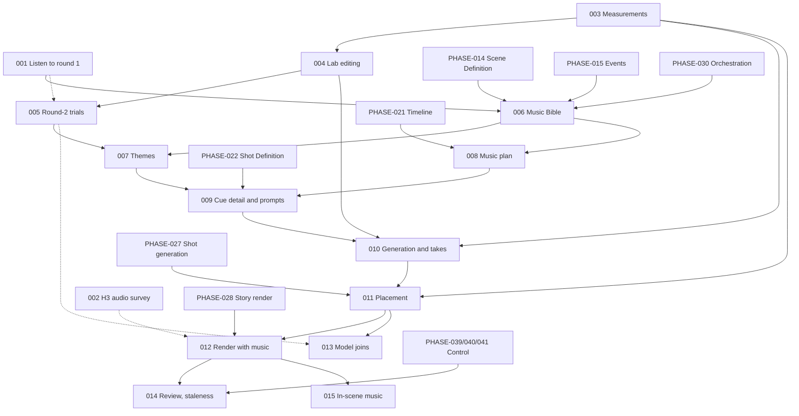

# Vision Studio — Music Integration Phases

The step-by-step roadmap for adding planned, generated music, ambience and sound effects to the story pipeline.

- `Path_ahead.md` (§33, §34) is the source of truth for **what** the finished audio is and **why**.
- `Implementation_phases.md` is the roadmap for everything else. Its conventions (§3.3 to §3.5) and its progress rules (§6) apply here unchanged.
- This document is the source of truth for **music**: the decisions taken, the design every music phase builds on, the order of the work, and how far we have got.

Written 2026-10-23 from a design discussion with the owner, a review of the repository, the GPU server's API document (0.18.0, as stored in the app's database) and the round-1 Music Lab trials (`music_lab_trials/`, 84 runs, of which the owner had heard group B when this was written).

**This document replaces PHASE-034, PHASE-035 and PHASE-036 of `Implementation_phases.md`.** Those three phases planned a supplied track, a single planner call and a deferred generation phase. The design below goes much further. MUSIC-001 marks those three phases "Dropped: replaced by `Music_implementation_phases.md`" (§6.4 of that document: ids are never renumbered).

---

## How to use this document

### Opus → Sonnet workflow

1. Pick a phase whose status is **Not Started** and whose hard dependencies are met (see [§5 Phase overview](#5-phase-overview) and rule MD-18 for dependencies on `Implementation_phases.md`).
2. Give Opus `Path_ahead.md`, `Implementation_phases.md`, this document, and a request such as:

   > Plan **MUSIC-0XX — <title>** only. Respect its Scope and Out of scope, the music decisions in §3 and the design in §4 of `Music_implementation_phases.md`, the conventions and default decisions in §3.3 to §3.5 of `Implementation_phases.md`, and the Completion notes of every phase it depends on (in both documents). Resolve every "Planning decides" item explicitly in the plan. Do not pull work from later phases. List the files to change, any migration, the API and UI changes, the settings, and how each Verification criterion will be checked.

3. Give the resulting plan to Sonnet for execution.
4. When the phase is done, update it as described in [§7 Progress tracking](#7-progress-tracking). Fill in its **Completion notes** carefully: later music phases read them to learn the real names of tables, job types, settings and endpoints.

### Reading a phase

Every phase has the same fields as in `Implementation_phases.md`: Objective, Current state (with starting points in the code), Scope, Out of scope, Dependencies, Expected outcome, Verification criteria, Observable improvements, Completion checklist and Completion notes. Items marked **Planning decides** are left open on purpose and must be settled in the plan.

Manual phases (MUSIC-001, MUSIC-002, MUSIC-005) are done by the owner, with the agent preparing material and recording results, like PHASE-001.

---

## Table of contents

1. [Goal](#1-goal)
2. [Current state](#2-current-state)
3. [Decisions](#3-decisions)
4. [Design of the music system](#4-design-of-the-music-system)
5. [Phase overview](#5-phase-overview)
6. [Detailed phase definitions](#6-detailed-phase-definitions)
7. [Progress tracking](#7-progress-tracking)
8. [Open questions and risks](#8-open-questions-and-risks)
- [Appendix A — Verification material](#appendix-a--verification-material)
- [Appendix B — Round-1 listening log (filled by MUSIC-001)](#appendix-b--round-1-listening-log-filled-by-music-001)
- [Appendix C — Round-2 trial plan (run by MUSIC-005)](#appendix-c--round-2-trial-plan-run-by-music-005)
- [Appendix D — Progress log](#appendix-d--progress-log)
- [Appendix E — Document change log](#appendix-e--document-change-log)

---

## 1. Goal

A finished story video should have music that gives the story its soul, not stock background sound:

- a **musical identity** for the whole story (a "music character"), with themes for the characters, places or ideas that matter, reinterpreted as the story's emotions change;
- music that **starts, swells, stops and falls silent at the right story moments**, not at random places or at every cut;
- **continuous sound across shots**: ambience beds (rain, wind, room tone) and off-screen sounds (thunder, a distant fox) that H3 cannot make because it works one shot at a time;
- **no audible seams** where separately generated pieces meet;
- music that sits **under** narration and dialogue, and a finished mix at a consistent loudness.

All of it must run **automatically** by default, like the rest of the pipeline, with optional pauses where the owner reviews the plan as text and picks audio by ear.

---

## 2. Current state

### 2.1 What exists

- **Music Lab** (project-independent; migration `0057`, table `lab_music_run`, job types `lab_music` and `write_lab_music_prompt`). It makes audio from text only, with five models: ACE-Step 1.5, YuE2, Stable Audio 3, Stable Audio Open and LTX audio. The language model drafts each model's fields from a brief. A person rates each run Good, Usable or Bad, with a note. Starting points: `services/music_models.py` (fields, limits, kinds, licences), `providers/music_generator.py` (endpoints and request bodies; its docstring says the editing endpoints "come later"), `services/music_prompt_writer.py`, `services/music_prompt_profiles.py`, `services/music_lab.py`, `jobs/generate_lab_music.py`, `jobs/write_lab_music_prompt.py`, `api/music_lab.py`.
- **GPU server editing endpoints** (API 0.18.0), none called by the app yet:
  - `POST /v1/ace-step15/music/repaint`: regenerates one window (`repaint_start`, optional `repaint_end`) of an uploaded recording and keeps the rest. Up to 600 s. It does not say whether the window may go past the end of the recording.
  - `POST /v1/ace-step15/music/cover`: restyles an uploaded recording and keeps its structure. `cover_strength` runs from 1.0 (very close) through 0.5 (balanced) to about 0.2 (loose style transfer). The output is as long as the source.
  - `POST /v1/stable-audio3/audio/inpaint`: regenerates a window (`mask_start`, `mask_end`) **or extends** a recording past its end. Up to 380 s. The surrounding audio matters more than the prompt.
  - `POST /v1/stable-audio3/audio/transform`: audio-to-audio with `init_noise_level` (0 keeps the source, about 0.6 is a style shift).
  - `POST /v1/stable-audio-open/audio/transform`: the same idea, first 47 s only.
  - Every editing call takes `source_audio_asset_id` from `POST /v1/uploads`. `providers/gpu_server.upload_file` already uploads files for H3.
  - The stored 0.18.0 snapshot is **pending** approval in the app (Settings → GPU contract). MUSIC-004 checks how that affects new endpoints.
- **Story render** (PHASE-028): narration as its own sample-exact layer (`render_commands.narration_track_args`), shot audio moved toward -16 LUFS and ducked by 12 dB under narration (`story_render_plan.duck_windows`, `render_commands.duck_volume_filter`), mixed with `amix normalize=0` and `alimiter=limit=0.97`. The timeline is frozen on the job (`TIMELINE_VERSION = 1`). **There is no music layer and no final loudness normalization**, only a sample-peak limiter.
- **Timing sources**: speech units have measured TTS lengths (PHASE-019). Shot plans (PHASE-020/021) give every shot's start and end, its `source_event_ids` and its `speech_unit_ids`. The scene timeline (`services/scene_timeline.py`) and the story render plan turn these into story seconds and frames. Scene definitions carry `mood.start/middle/end` (PHASE-014). Events carry `sound_event`, `pause` and off-screen dialogue (PHASE-015). Shot definitions say who is in each shot (PHASE-022).
- **Orchestration** (PHASE-030): a step graph in `services/story_pipeline.py` with one `Adapter` per step in `services/story_pipeline_targets.py`. Per-run "Pause after…" pauses for any step. Saved review points (PHASE-041, `services/review_points.py`). Staleness computed on read (PHASE-039).
- **H3 audio**: H3 keeps its own per-shot sounds and is told not to make a score (D-10). PHASE-001 V4 found no score in a quiet scene. A tense scene has not been checked.
- **Backend libraries**: no audio-analysis library is installed (no numpy, scipy or librosa). FFmpeg (`services/ffmpeg.py`, including `measure_loudness`) is the only audio tool.
- **GPU pool**: music jobs count in the shared GPU pool (`jobs/pools.py`, slots), where each H3 clip holds 4 GPUs.

### 2.2 What round 1 told us so far

The owner listened to group B (timing): **the models do not follow timestamps.** The mood does shift roughly where it was asked, but not clearly, and a requested bang at 34 s did not happen. The music model can follow a broad order of moods, but every precise moment has to come from somewhere else. The other groups have not been heard yet (MUSIC-001).

### 2.3 Gaps

| Needed | Exists | Phases |
|---|---|---|
| Knowing which model does what well | Round-1 runs, mostly unheard | 001, 005 |
| Knowing what sound H3 really adds | One quiet-scene check | 002 |
| Measuring audio (silence, loudness curve, sudden sounds, quiet points, endings) | Integrated loudness only | 003 |
| Editing audio (repair, join, extend, restyle) | Endpoints on the server, not in the app | 004, 005 |
| A musical identity for the story | None | 006, 007 |
| Planning where music goes | None | 008, 009 |
| Generating cue audio with takes | Lab only | 010 |
| Exact placement, fades and joins | Sample-exact narration placement only | 011, 013 |
| Music and ambience in the render, final loudness | Narration and shot audio only | 012 |
| Review, staleness, selective regeneration for music | Exists for other stages | 014 |
| In-scene music (radio, speakers) | None | 015 |
| Singing characters | None | 016 (deferred) |

---

## 3. Decisions

These were decided with the owner on 2026-10-23, unless marked **(re-evaluation)**. Re-evaluation items were added while writing this document. They are defaults the owner can change: edit the decision here and record it in Appendix E.

| ID | Decision | Affects |
|---|---|---|
| MD-1 | **Judgment belongs to the model.** GLM-5.3 decides what music plays, where, how long, and how it starts and ends. Code keeps the timeline valid, finds the exact sample inside the window the model chose, runs the generators, applies fades and the mix, and measures facts. Code never chooses music. When code must choose between real candidates, it uses mechanical rules (§4.6), or asks the model (§4.7). More GLM calls are acceptable wherever they improve quality. | All |
| MD-2 | **The model names story moments, never timeline seconds.** A position is an anchor: an id that exists (a speech unit, an event, a shot, a scene), plus a relation (before, on, after, under) and a strictness (tight, loose). The model does see real seconds in its input, and it may give approximate *lengths* (a fade of "about 3 s"). | 008, 009, 011 |
| MD-3 | **Scene music is planned only once exact timings exist**: every speech unit is synthesized and measured, and every scene has a shot plan with a valid timeline. Cue detail also waits for shot definitions (it needs who appears in which shot). The Music Bible and themes need no timings and may run earlier. | 006–009 |
| MD-4 | **Top-down levels, each seeing more of the story and writing less:** level 0 the Music Bible, level 1 the music plan (one or two lines per cue), level 1b critics and a revision, level 2 cue detail, level 3 prompt writing per model (§4.3). | 006, 008, 009 |
| MD-5 | **Four directions at level 0.** GLM writes four clearly different directions for the whole score, a separate GLM call picks one with its reasons, and the chosen one is expanded into the Music Bible. At the review point the owner can choose another. | 006 |
| MD-6 | **The music character.** The Bible names a main theme and a few themes for characters, places or ideas that matter. Each theme gets a canonical recording, and its emotional versions (grief, fear, anger, tenderness…) are made from that recording, not from text alone. The method (ACE-Step `cover` or Stable Audio 3 `transform`) is chosen from round-2 results. | 006, 007, 009 |
| MD-7 | **The model decides how music starts and ends** (fade, hard start on a cut or hit, rising out of the ambience, hard stop, musical ending, crossfade, through silence, sting), with a one-line reason. **The join between two cues is decided once, at level 1, for the boundary**, so two neighbours never disagree. | 008, 009, 011 |
| MD-8 | **The music model is trusted for broad structure only** (from round-1 group B, §2.2). Prompts ask for a broad order of moods, never timestamps. Exact moments come from placement (§4.6) and from separate hit sounds placed by code. | 009, 010, 011 |
| MD-9 | **Who makes which sound:** H3 keeps each shot's own sounds (D-10, unchanged). **ACE-Step 1.5** makes the score and the themes. **Stable Audio 3** makes ambience beds and longer or evolving effects. **Stable Audio Open** is the candidate for short effects (confirmed or changed by MUSIC-001). YuE2 and LTX audio stay in the lab only. | 001, 007, 009, 010 |
| MD-10 | **The owner is the only judge of sound.** GLM-5.3 takes no audio, and no model is trusted to listen. Automatic runs pick the first take that passes the technical checks (as D-5 does for pictures). GLM may also rank takes from measured facts written as text (§4.8). | 010 |
| MD-11 | **Fully automatic by default; review is optional.** Music gets steps in the same pipeline and optional review points, exactly as `Path_ahead.md` §40 and PHASE-041 describe. The outputs are identical whether or not anyone pauses. The owner can read the plan as text and pick audio at those pauses. | 006–014 |
| MD-12 | **A fallback ladder** when code cannot find a good point: widen the window, switch to a gentler technique, cover the moment, ask GLM to choose among the real candidates code found, then flag it to the owner (§4.7). | 011 |
| MD-13 | **Personal, non-commercial use.** Model and tool licences (YuE2, Stable Audio, madmom, Rubber Band) do not block choices in this document. `Implementation_phases.md` R-7 still applies before anything is published. | All |
| MD-14 | **Singing characters are to be decided** (owner, 2026-10-23). The owner's direction is that H3 must make the picture for lip sync. Whether H3 also invents the song, or is given a sung recording as it is given dialogue, is open. | 016 |
| MD-15 | **Music heard inside the scene** (a radio, a speaker, a TV) comes from ACE-Step and belongs to the scene's sound, not the score. | 015 |
| MD-16 | **The Music Lab gets editing** (`repaint`, `cover`, `inpaint`, `transform`), with results on the lab page and ratings, so trials and later the pipeline share one implementation. | 004 |
| MD-17 | **(re-evaluation) Ambience ownership is decided at render time first.** Telling H3 not to make ambience would change the compiled H3 prompts (PHASE-026). That makes every shot's prompt out of date, and each clip costs 10 to 20 minutes on 4 GPUs (R-1). So the first version keeps H3's own ambience and only lowers it under a Stable Audio bed when the plan says so. Changing the H3 prompt is decided only after the H3 audio survey (MUSIC-002), and if adopted it must be planned **before** prompt compilation. | 002, 008, 012 |
| MD-18 | **(re-evaluation) Dependencies on `Implementation_phases.md`.** A dependency on a PHASE-0xx counts as met when that phase is **code complete** (In Progress with "code complete", or Completed). Most of those phases are only waiting for the owner's runs, and music phases only read their tables. A music phase's own verification still needs real data from those stages. | All |
| MD-19 | **(re-evaluation) Final loudness normalization is added to the render.** Adding music makes the overall level less predictable, and the render today only limits sample peaks. The finished mix is brought to one integrated loudness with a true-peak ceiling. The targets are settings, and **Planning decides** the starting values (streaming platforms commonly use about -14 LUFS integrated and -1 dBTP). | 012 |
| MD-20 | **(re-evaluation) Hearing music in context.** Takes judged on their own are misleading: a cue that sounds empty alone may be right under a voice. The take review offers an audio-only preview of the scene: narration, shot audio and the candidate cue, mixed with the render's own rules. | 012 |
| MD-21 | **(re-evaluation) Music and ambience can be switched off per project**, and the render works without them. Stories in every speech mode (PHASE-049: narration and dialogue, no dialogue, no narration) are planned the same way. Ducking simply has fewer spans. | 008, 012 |
| MD-22 | **(re-evaluation) Every model decision is stored** (directions, choice and reasons, plan, critiques, cue detail, prompts, seeds, fallback choices), with provenance (D-3), so a run can be inspected and repeated, and a cue the owner likes can be **locked** so nothing regenerates it. | All |
| MD-23 | **(re-evaluation) Feedback loop.** When the owner rejects a take with a note ("too busy under the voice"), GLM rewrites that cue's prompt using the note before the next take. | 010 |

Conventions inherited from `Implementation_phases.md` without change: provenance and out-of-date computed on read (D-3), JSON answers validated by code (D-7), no automated tests (D-11), GLM-5.3 for every story language-model job (D-12), stories up to about 10 minutes (D-13), and everything in §3.4 and §3.5 (migrations, `DATABASE_STRUCTURE.md`, job handlers, prompts as pure functions in `services/`, `npm run gen:api`, standard checks).

---

## 4. Design of the music system

This section is what every phase builds on. Final names of tables, fields and settings are decided in planning. The shapes here are illustrative.

### 4.1 Layers of the finished audio

```text
Narration      TTS, sample-exact, unchanged (PHASE-028)
Shot audio     H3, per shot: dialogue, sync sounds, its own ambience (D-10)
Ambience       Stable Audio beds that span shots, and off-screen point sounds   (new)
Score          ACE-Step cues, continuous where planned, silent where planned    (new)
Hits           short Stable Audio impacts, risers, stings, placed by code       (new)
Source music   ACE-Step music heard inside the scene (radio, speaker)            (new, MUSIC-015)
```

Ambience, hits and source music are "sound" rather than "music", but they are planned together with the score, so that music and ambience are designed as one: rain rising while the music fades, a hit covering a join.

### 4.2 Artifacts

| Artifact | Made by | Holds |
|---|---|---|
| Music Bible (versioned per project) | Level 0 | The four directions, the chosen one and why, and the Bible: concept, sound world (instruments, things to avoid), musical feel (tempo range, major or minor leaning, density), themes with what each stands for and its signature instrument, the arc of the music across the story, restraint rules (how much music, where silence goes), and the ambience signature |
| Themes | MUSIC-007 | Per theme: candidate recordings, the chosen canonical recording, and emotional versions made from it |
| Music plan (versioned per project) | Levels 1 and 1b | The cue list (one or two lines each), the boundaries with their join types, the critiques and the revision |
| Cue detail (per cue, per plan version) | Levels 2 and 3 | Exact anchors, the broad internal order of moods, hit requests, mix notes, the source (text, a theme version, continuation of the previous cue), the model and the prompt wordings |
| Takes (per cue, per theme, per hit) | MUSIC-010 | The audio, its request, seed, measured facts, check result, selection, lock, the owner's verdict and note |
| Placement (per render) | MUSIC-011 | For each placed sound: file, offset, in and out samples, gain, fades, crossfade partner, fallbacks used |

Every artifact records its source, job, version and the exact upstream versions it was built from (D-3).

### 4.3 The model calls

| Level | Sees | Writes |
|---|---|---|
| 0a Directions | Story Bible, character definitions, scene list with definitions (moods) and events, story length | Four directions, a few lines each |
| 0b Choice | The four directions and the same story context | The chosen direction and why (skipped when the owner chooses) |
| 0c Bible | The chosen direction and the story context | The Music Bible |
| 1 Plan | Bible, theme list, the whole condensed timeline **with seconds**: scenes and moods, events, speech units with text, pauses, sound events, shot cuts | Cues and boundaries, one or two lines each, with anchors at event or line level |
| 1b Critics | The plan, the Bible, the condensed timeline | One critique per lens: dramatic fit (does each moment get what it needs), variety and restraint (too much music, the same mood twice in a row, no silence before the big moment), theme use (overuse, missed entrances), joins (will each boundary work). Then a **reviser** call merges the critiques into a new plan. At most `critic_rounds` rounds (Planning decides the default; two suggested, because more rounds tend to drift toward bland choices) |
| 2 Cue detail | Bible, the cue's line, its neighbours' lines and boundary joins, the full events, lines and shots of its span with seconds, who is in each shot, the theme versions available | Exact anchors (start, end, hits), the broad order of moods inside the cue, hit requests, mix notes, fade lengths, the source. It may **push back** ("too short to introduce the theme"), which sends that part of the plan back to level 1 |
| 3 Prompts | The cue detail, the target model's prompt profile (`music_prompt_profiles.py`) | The model's fields, in several genuinely different wordings (one per take) |
| Audit | All cue prompts of the story at once, with the Bible | Drift from the Bible (forbidden instruments, a clashing key next door) and fixes |

All calls use `llm_call.ask_model` with JSON answers validated by code (D-7). Code resolves every id the model names and refuses an answer that names something that does not exist (the standard retry of every story stage).

### 4.4 Anchors

An anchor points at something on the timeline that already has an id and exact times:

```json
{"ref": "unit:su_12", "edge": "end", "relation": "after", "strict": "loose"}
{"ref": "event:evt_4", "edge": "start", "relation": "just_before", "strict": "tight"}
{"ref": "shot:sh_7", "edge": "start", "relation": "on", "strict": "tight"}
```

- `ref`: a speech unit, an event, a shot or a scene, by its stored id. A character's first appearance is expressed as the first shot whose definition includes that character (code can list these for the model).
- `edge`: the start or end of that thing.
- `relation`: before, just_before, on, after, under (somewhere inside it, for example partway through a long narration line).
- `strict`: tight (a fraction of a second; hits and hard stops) or loose (a second or two; entries and fades). The window sizes are settings.

Times of speech units and shots come from the timeline. Events have no time of their own. An event's time is the time of the speech unit that voices it, or the shot that shows it (`source_event_ids`). A `sound_event`'s exact moment inside its shot is only known after the shot exists (§4.6).

### 4.5 Starts, ends and joins

- **Start styles:** fade in under something (a voice, a cut, a sound; the default), hard start on a cut or a hit, rise out of the ambience.
- **End styles:** fade out, hard stop (on a cut or just before a hit, with a few milliseconds of fade so it never clicks), musical ending (the recording's real ending is lined up with the end point: "back-timing"), crossfade into the next cue, end on a sting.
- **Join types** (decided per boundary at level 1):
  - `crossfade`: both cues have spare length ("handles"), overlap by a few seconds, and are crossfaded at a quiet moment or phrase end found in both. The default inside one emotional stretch.
  - `under_cover`: the join is hidden under a narration line (music already lowered), a hard cut, a hit, or an ambience swell.
  - `through_silence`: the first cue fades out, only ambience remains for a moment, and the second enters. For real breaks such as a time jump or a new scene.
  - `hard_cut`: deliberate, on a cut, for shock.
  - `model_join`: the two takes are put end to end and the seam window is repainted, so the model rewrites the join as one piece (MUSIC-013, if round 2 shows it works).
  - `continuation`: the next cue is generated from the end of the previous one (Stable Audio 3 `inpaint` extension, or ACE-Step repaint into appended silence; MUSIC-013, if round 2 shows it works).
- **Prevention before joins:** the level 3 prompt always sees its neighbours' instruments, tempo, key, ending and opening, and keeps to the Bible's sound world. Every cue is loudness-matched. Optionally, all score passes through one shared room reverb, so separate generations sound like one recording space (Planning decides in MUSIC-012).

### 4.6 Finding exact points (code)

For each anchor, code builds a window around the moment the model named and picks the best position in it.

**Candidates** (all measurable):

1. Shot cuts (frame-exact).
2. Gaps between speech units, and silences inside a TTS recording (between sentences, before a key word), found by silence detection. No transcription is needed.
3. Sudden sounds in a shot's H3 audio near a `sound_event` (needs the shot's selected take).
4. Points inside a generated recording: where it changes mood, where it is quiet, where a phrase or the piece ends (MUSIC-003). Beat tracking is not relied on, because much score has no beat.
5. The loudest moment of an effect, such as the crack of thunder. That moment, not the start of the file, is lined up with the anchor.

**Mechanical preferences:**

- Never start or stop music in the middle of a word.
- Prefer a cut or a speech gap.
- A hit goes on the detected sound.
- Music that must stop before a hit stops a few frames before it.

If an anchor falls inside continuous narration, the fallback is a long, very quiet fade under the voice.

**Fitting a recording to its span:**

- Every cue is requested longer than its span, by a setting called the handles.
- *Slide to fit:* if a planned change of mood actually happens 3 s late in the take, code starts the take 3 s earlier so the change lands on the anchor.
- *Back-timing:* for a musical ending, the take's ending is placed on the end anchor and the start is faded in under something.
- ACE-Step's 10 s minimum is met by the handles. A cue shorter than that is generated at 10 s and trimmed.

### 4.7 Fallback ladder

When no candidate fits inside the window, code works down this list. It records the step used, and the owner sees it at review:

1. Widen the window once (by a setting).
2. Switch to a gentler technique for that point: a hard start becomes a quiet fade under the voice, a hard stop with no cut becomes a short fade ending in the next speech gap, a hit with no detectable sound is placed at the event's planned position.
3. Cover the point with a short swell, impact or ambience rise (a hit take).
4. Ask GLM to choose: code lists the real candidates ("no pause within 2 s of evt_7; a cut at 41.2 s; a gap at 44.0 s after the line; or start under the line"), and the model picks one. For the most important anchors (a character's entrance, a climax hit) this can be the normal path. **Planning decides** in MUSIC-011.
5. Flag it to the owner.

### 4.8 Takes, checks and selection

- Each cue, theme and hit gets several takes (a setting). Each take uses a different prompt wording from level 3, not only a different seed.
- **Technical checks** (MUSIC-003 facts):
  - length;
  - leading and trailing silence;
  - clipping and true peak;
  - unexpected long silences;
  - a real ending where the cue asked for one;
  - for an instrumental, nothing that can be checked automatically about vocals, so the instrumental flag is always sent.
- **Selection:**
  - In automatic runs, the first take that passes is selected (MD-10).
  - Optionally, GLM ranks the passing takes from their facts written as text: where the loudness rises, where the measured change points fall against the planned order, how the ending behaves. That's weak, but better than first-passing. **Planning decides** whether it is on by default.
  - At the review point the owner listens, selects, rejects with a note (MD-23) or locks (MD-22).

### 4.9 Mix rules

Starting values are untested and are settings, to be tuned by ear:

- Music sits a set distance under the voice and is ducked under narration **and** dialogue, with its own depth and ramps. These are separate from the shot-audio ducking of PHASE-028.
- It may rise in the gaps between lines where the mix notes say so. That is where narrated video gets its sense of production.
- It dips briefly around important `sound_event`s, so a swell never hides the thump the scene depends on.
- Under a Stable Audio bed, H3's own ambience may be lowered (MD-17).
- The final mix is loudness-normalized with a true-peak ceiling (MD-19).

### 4.10 Where music runs in the pipeline

New steps, each added by its own phase with the `Step` and `Adapter` pattern of PHASE-030:

| Step | Needs | Phase |
|---|---|---|
| `music_bible` | `events` | 006 |
| `music_themes` | `music_bible` | 007 |
| `music_plan` | `shot_plans`, `music_bible` | 008 |
| `music_cues` | `music_plan`, `shot_definitions`, `music_themes` | 009 |
| `music_generation` | `music_cues` | 010 |
| `music_placement` | `music_generation`, `shot_generation` | 011 |
| `render` (existing) | also `music_placement` when music is on | 012 |

Music generation runs beside clip generation. Placement waits for the clips only because hits may sit on H3 sounds.

The review points (MUSIC-014) are after music direction, after themes, after the music plan, and after music takes. Before MUSIC-014, PHASE-030's per-run "Pause after…" already pauses at any of these steps.

---

## 5. Phase overview

Status values and their meaning are those of `Implementation_phases.md` §6.1. **This table and each phase's Status line must both be updated** (§7).

**Progress snapshot** (update when a phase changes status):

- Completed: none
- In progress: none
- Ready: MUSIC-001, MUSIC-002, MUSIC-003
- Deferred: MUSIC-016 (singing characters, until the owner decides)

| ID | Title | Milestone | Hard dependencies | Status |
|---|---|---|---|---|
| MUSIC-001 | Listen to round 1 and record the model choices (manual) | MM0 | — | Not Started |
| MUSIC-002 | Survey what sound H3 adds (manual) | MM0 | PHASE-027 (real takes exist) | Not Started |
| MUSIC-003 | Audio measurements | MM0 | — | Not Started |
| MUSIC-004 | Editing in the Music Lab | MM0 | 003 | Not Started |
| MUSIC-005 | Round-2 trials (manual) | MM0 | 004 (001 recommended) | Not Started |
| MUSIC-006 | Music Bible: four directions, a choice, the Bible | MM1 | 001; PHASE-014, PHASE-015, PHASE-030 | Not Started |
| MUSIC-007 | Themes and their emotional versions | MM1 | 005, 006 | Not Started |
| MUSIC-008 | Music plan with critics | MM2 | 006; PHASE-021 | Not Started |
| MUSIC-009 | Cue detail and prompts | MM2 | 007, 008; PHASE-022 | Not Started |
| MUSIC-010 | Cue generation, takes and selection | MM3 | 003, 004, 009 | Not Started |
| MUSIC-011 | Placement: exact points, fades, joins, fallbacks | MM3 | 003, 010; PHASE-027 | Not Started |
| MUSIC-012 | Render with music and ambience, final loudness, preview | MM3 | 011; PHASE-028 | Not Started |
| MUSIC-013 | Model-written joins and continuations | MM4 | 005 (positive result), 011 | Not Started |
| MUSIC-014 | Music review points, staleness and selective regeneration | MM4 | 012; PHASE-039, PHASE-040, PHASE-041 | Not Started |
| MUSIC-015 | Music inside the scene (radio, speakers) | MM4 | 012 | Not Started |
| MUSIC-016 | Singing characters | Deferred | MD-14 decision | Deferred (owner decides later) |

**Milestones**

| Milestone | Phases | Result |
|---|---|---|
| MM0 Validation and tools | 001–005 | Model roles confirmed, H3's own sound known, audio measurable and editable, editing methods tested |
| MM1 Musical identity | 006, 007 | A Music Bible and theme recordings with emotional versions |
| MM2 Music plan | 008, 009 | A reviewed cue plan and per-cue prompts anchored to story moments |
| MM3 First story with generated music | 010–012 | **S2 rendered with planned, generated score, ambience and hits, at a consistent loudness** |
| MM4 Polish and control | 013–015 | Seamless joins, review and selective regeneration, in-scene music |

### 5.1 Dependency graph



### 5.2 Parallel work

- **Start immediately:** MUSIC-001 and MUSIC-002 (owner, manual) and MUSIC-003 (agent).
- MUSIC-006 can start once MUSIC-001 is done. It does not wait for the editing work (004, 005).
- MUSIC-008 can be built beside MUSIC-007, because the plan names themes by id and does not need their recordings.
- MUSIC-015 and MUSIC-014 are independent of each other after MUSIC-012.

---

## 6. Detailed phase definitions

### MM0 — Validation and tools

---

### MUSIC-001 — Listen to round 1 and record the model choices (manual)

**Status:** Not Started · **Milestone:** MM0 · **Vision:** `Path_ahead.md` §34 ("Working decision", open points 1 and 5)

**Objective.** Turn the 84 round-1 runs into recorded decisions: which model makes which kind of sound, how far timing and length are followed, and whether one long piece or several per-scene pieces work better.

**Current state.** The runs exist in the Music Lab, grouped by case id (`[A1]` … `[H3]`). `music_lab_trials/TRACKER.md` lists every case, its runs and the questions to answer. The owner has heard group B (§2.2). The folder is temporary.

**Scope.**
- The owner listens to groups A and C to H, rates each run in the lab, and answers the questions in `TRACKER.md`.
- The agent then copies the conclusions into Appendix B of this document (so they survive when the trial folder is discarded), including run ids and verdicts.
- The decisions to record:
  - the best model per kind (score, stem or theme, sound effect, ambience);
  - Stable Audio 3 or Open for short effects (MD-9);
  - one long piece or per-scene pieces (C1 against C2);
  - whether endings are clean (B3);
  - whether long pieces loop or drift (A4, B4b);
  - seed repeatability (H1b);
  - prompt writer against hand-written prompts (H2, H3).
- Update `services/music_models.KIND_MODELS` order to match the decisions (open point 5 of `Path_ahead.md` §34). A one-line data change.
- Mark PHASE-034, PHASE-035 and PHASE-036 in `Implementation_phases.md` as "Dropped: replaced by `Music_implementation_phases.md`" (its §4 table, the phases' status lines, Appendix D there). Update the "Working decision" of `Path_ahead.md` §34 to point at this document.

**Out of scope.** New trials (005). Pipeline work.

**Dependencies.** None.

**Expected outcome.** Appendix B is filled, MD-9 is confirmed or changed, and the round-1 folder can be discarded.

**Verification criteria.**
- Every case in `TRACKER.md` has notes, and every run has a verdict in the lab.
- Appendix B states a model per kind and answers the long-or-per-scene question with reasons.

**Observable improvements.** Later phases choose models from evidence, not from documentation.

**Completion checklist.**
- [ ] Owner listened and rated (groups A, C to H; B already heard)
- [ ] Appendix B filled with conclusions and run ids
- [ ] MD-9 confirmed or changed (Appendix E row if changed)
- [ ] `KIND_MODELS` order updated
- [ ] PHASE-034/035/036 marked Dropped; `Path_ahead.md` §34 points here

**Completion notes.** _(fill in)_

---

### MUSIC-002 — Survey what sound H3 adds (manual)

**Status:** Not Started · **Milestone:** MM0 · **Vision:** `Path_ahead.md` §34 open point 0 and point 2

**Objective.** Learn what H3 actually puts in a shot's audio: which effects, how much ambience, whether it ever adds music in tense scenes. That decides how much ambience and how many hits we add, and whether MD-17 changes.

**Current state.** PHASE-001 V4 found no score in a quiet bedroom scene (runs 95, 96). Real story takes exist for S1 and S2 once the owner has run PHASE-027.

**Scope.**
- The owner listens to the shot audio of S1 and S2 takes, plus at least one deliberately tense shot (a reveal or a scare). For each shot, note:
  - effects present;
  - ambience present and its level;
  - any music or tonal score;
  - whether neighbouring shots' ambience jumps at the cut.
- The agent measures the same takes with FFmpeg (loudness, silence) and records both in Appendix B (a second table).
- Decide:
  - whether MD-17 stays (render-time lowering only), or the H3 prompt should drop ambience in scenes with a bed;
  - whether a music-leak check is needed.

**Out of scope.** Changing the H3 prompt compiler (that would be its own phase, planned before prompt compilation, MD-17).

**Dependencies.** PHASE-027 (real takes).

**Expected outcome.** A short recorded answer: what H3 makes, and what we must add.

**Verification criteria.**
- At least eight shots surveyed, including one tense shot.
- The MD-17 decision recorded in Appendix B and, if it changes, in §3 and Appendix E.

**Observable improvements.** The ambience and hit plan is based on real H3 behaviour.

**Completion checklist.**
- [ ] Shots surveyed by ear and measured
- [ ] Appendix B second table filled
- [ ] MD-17 confirmed or changed

**Completion notes.** _(fill in)_

---

### MUSIC-003 — Audio measurements

**Status:** Not Started · **Milestone:** MM0 · **Vision:** this document §4.6, §4.8

**Objective.** One pure, reusable way to measure a sound file, used by the lab cards, the take checks, the placement and the take ranking.

**Current state.** `services/ffmpeg.py` measures integrated loudness (`measure_loudness`) and probes streams. No analysis library is installed.

**Scope.**
- A measurement service that returns, for one file:
  - length;
  - leading and trailing silence;
  - integrated loudness;
  - a short-term loudness curve;
  - true peak and clipping;
  - the loudest moment;
  - sudden sounds (onsets) with their times;
  - quiet points;
  - change points (where the sound changes character);
  - whether the file ends with a decay (a real ending) or is cut.
- Silences inside a speech recording (for §4.6 candidates).
- Results stored with the file they describe (Planning decides where) and computed once.
- **Planning decides** whether FFmpeg filters alone are enough (`ebur128`, `astats`, `silencedetect`, `aspectralstats` and similar), or whether a small library is added (for example numpy for change points). Prefer the simplest that gives usable change points on beatless score. Check it against round-1 recordings whose changes the owner has heard (group B).

**Out of scope.** Beat tracking. Vocal separation.

**Dependencies.** None.

**Expected outcome.** Every later phase can ask "where does this get loud, where is it quiet, where does it change, does it end".

**Verification criteria.**
- On round-1 runs 13 and 14 (B1) and 15 and 16 (B2), the reported change points and loudest moments agree with what the owner heard, within about a second.
- On E-group effects, the loudest moment matches the effect's peak.
- On a TTS file with two sentences, the gap between them is found.
- Standard checks (`Implementation_phases.md` §3.5).

**Observable improvements.** Audio stops being a black box to code.

**Completion checklist.**
- [ ] Measurement service and its stored results
- [ ] Speech-gap detection
- [ ] Checked against round-1 runs and a TTS file
- [ ] Docs; standard checks

**Completion notes.** _(fill in)_

---

### MUSIC-004 — Editing in the Music Lab

**Status:** Not Started · **Milestone:** MM0 · **Vision:** MD-16

**Objective.** Let the Music Lab repair, extend, join and restyle audio with the GPU server's editing endpoints, so round 2 can test them and later phases reuse the same code.

**Current state.** Text-to-audio only (`providers/music_generator.py`, `jobs/generate_lab_music.py`). `providers/gpu_server.upload_file` uploads files. The endpoints and their fields are listed in §2.1. The stored 0.18.0 API snapshot is pending approval.

**Scope.**
- New lab operations:
  - ACE-Step `repaint` (window start and end) and `cover` (`cover_strength`);
  - Stable Audio 3 `inpaint` (window, or extension past the end) and `transform` (`init_noise_level`);
  - Stable Audio Open `transform`.
- **Sources** for an operation:
  - an earlier lab run;
  - an uploaded file;
  - **a join of two earlier runs**, put end to end with optional silence between or after (made locally with FFmpeg, then uploaded). The join is needed for seam tests (Appendix C, group K).
- The lab run records its source (run ids or upload), the window or strength, and the exact request, like existing runs. It can be rated in the same way.
- MUSIC-003 measurements shown on every run card (length, leading silence, loudest moment, ending).
- Check how the pending 0.18.0 snapshot affects calls to these endpoints (`providers/contract_guard.py`, `music_generator.check_endpoint`), and say in the plan what the owner must approve, if anything.
- The trial helper (`music_lab_trials/trigger.py` or its successor) can start editing cases.
- **Planning decides** whether editing runs live in `lab_music_run` (new columns) or a related table, and how a join source is stored.

**Out of scope.** Pipeline use (010, 013). Removing YuE2 or LTX from the lab.

**Dependencies.** MUSIC-003.

**Expected outcome.** The owner can repaint a window, restyle a theme or extend a bed from the lab page and rate the result.

**Verification criteria.**
- One run of each operation succeeds against the real GPU server (owner's run), and its card shows the source, the settings and the measurements.
- A repaint leaves the audio outside its window unchanged. The agent checks this by comparing samples, allowing for the server's own re-encoding.
- Text-to-audio runs still work.
- Standard checks (`Implementation_phases.md` §3.5).

**Observable improvements.** Editing becomes available for trials and, later, the pipeline.

**Completion checklist.**
- [ ] Provider bodies and endpoint checks for the five operations
- [ ] Sources: earlier run, upload, join of two runs
- [ ] Storage, job, API, lab UI with measurements
- [ ] Trial helper can start editing cases
- [ ] Docs (`DATABASE_STRUCTURE.md`); standard checks
- [ ] Owner runs one of each operation

**Completion notes.** _(fill in)_

---

### MUSIC-005 — Round-2 trials (manual)

**Status:** Not Started · **Milestone:** MM0 · **Vision:** §4.5, MD-6

**Objective.** Answer the questions the design depends on, using only ACE-Step and Stable Audio:

- Can a theme keep its melody while its emotion changes?
- Can a seam be rewritten?
- Can a cue be extended or given an ending?
- Do starts, endings and effect peaks behave as the placement needs?

**Current state.** Round-1 runs can serve as sources (Appendix C lists them). MUSIC-004 provides editing.

**Scope.**
- The agent prepares the cases of Appendix C (cases file and tracker, as for round 1) and lists the run count and expected GPU use. **The owner starts the paid runs.**
- The owner listens and rates. The agent records the results in Appendix C and answers:
  - the theme-variation method and strengths per emotion (MD-6);
  - whether `model_join` and `continuation` work, and the window lengths needed (MUSIC-013 goes ahead or is dropped);
  - whether endings can be made reliably (back-timing);
  - whether effects have predictable peaks;
  - whether passing neighbour context in prompts gives compatible pieces (K4).
- Round 2b, after the owner has picked an I1 theme: variations of that theme with the chosen method.

**Out of scope.** Pipeline work.

**Dependencies.** MUSIC-004 (MUSIC-001 recommended, so the round uses its model choices).

**Expected outcome.** The open technical questions of §8 are answered with evidence.

**Verification criteria.**
- Every case has a verdict and notes.
- Appendix C states a decision for each question above.

**Observable improvements.** The theme and join phases are built on tested methods.

**Completion checklist.**
- [ ] Cases and tracker prepared; run count stated
- [ ] Owner ran and rated round 2
- [ ] Decisions recorded in Appendix C (and §3 or §8 where they change something)
- [ ] Round 2b (theme variations of the chosen theme) run and recorded

**Completion notes.** _(fill in)_

---

### MM1 — Musical identity

---

### MUSIC-006 — Music Bible: four directions, a choice, the Bible

**Status:** Not Started · **Milestone:** MM1 · **Vision:** §4.2, §4.3 (levels 0a to 0c), MD-5

**Objective.** Give every story a musical identity, chosen from four directions, that every later music call follows.

**Current state.** The Story Bible stage (PHASE-004, `services/story_bible_writer.py`, `jobs/write_story_bible.py`) is the pattern for a story-level LLM stage. Scene definitions carry moods (PHASE-014), and events carry the story's moments (PHASE-015).

**Scope.**
- Three model calls (§4.3):
  - 0a writes four directions;
  - 0b chooses one with reasons;
  - 0c expands it into the Bible (the fields of §4.2).
- A theme list in the Bible: each theme with what it stands for, its signature instrument, and the emotions it is expected to take. **Planning decides** the cap on themes (main theme plus at most two others suggested; fewer for short stories) and whether it is a setting.
- Storage: versioned per project with provenance (D-3). Each version keeps all four directions, the choice and reasons, and the Bible.
- The owner can choose another direction. Only 0c runs again, and the result is a new version. The owner can also edit the Bible (author text is never overwritten by AI reruns without the owner's action).
- A `music_bible` pipeline step and adapter (PHASE-030 pattern), so a one-click run makes it, and "Pause after…" can stop there.
- A project setting to switch music off (MD-21). When off, the music steps are skipped as complete.
- A panel in the story workspace: the four directions, the chosen one and why, the Bible, **Choose this direction**, **Edit**.

**Out of scope.** Theme audio (007). The plan (008).

**Dependencies.** MUSIC-001; PHASE-014, PHASE-015, PHASE-030 (MD-18).

**Expected outcome.** S2 has four distinct directions, a chosen one and a Bible that reads like a composer's brief.

**Verification criteria.**
- The four directions are clearly different (owner's judgment).
- Choosing another direction makes a new version from that direction without re-running 0a.
- A one-click run makes the Bible, and a second run makes nothing.
- With music off, the step is skipped.
- Standard checks (`Implementation_phases.md` §3.5).

**Observable improvements.** A visible musical identity for each story.

**Completion checklist.**
- [ ] Prompts and parsers (0a, 0b, 0c), validation
- [ ] Storage with versions and provenance; job type(s)
- [ ] Choose another direction; edit
- [ ] Pipeline step and adapter; music on/off project setting
- [ ] Panel; docs; standard checks
- [ ] Owner runs S2 with the real model

**Completion notes.** _(fill in)_

---

### MUSIC-007 — Themes and their emotional versions

**Status:** Not Started · **Milestone:** MM1 · **Vision:** MD-6, §4.2

**Objective.** Record each theme of the Bible once, as a canonical recording, and make the emotional versions the story needs from that recording.

**Current state.** The Character Lab's pattern of candidates, a chosen master and derived variants is the model (PHASE-010, PHASE-016, PHASE-017). The editing operations exist (MUSIC-004). The method comes from round 2 (MUSIC-005).

**Scope.**
- Per theme: GLM writes the solo-theme prompt from the Bible (level 3 profile). Several candidates are generated (a setting; **Planning decides** the default). The first passing candidate is chosen in automatic runs (MD-10), or the owner picks.
- Per theme and emotion listed in the Bible, a version is made from the canonical recording with the round-2 method and strength. GLM writes the restyle caption. Later cues may ask for an emotion not listed, which is then made during cue generation (010).
- A `music_themes` pipeline step and adapter.
- A panel: each theme, its candidates (play, choose), its versions (play, regenerate one).

**Out of scope.** Cues (009, 010). A theme library shared across projects.

**Dependencies.** MUSIC-005 (method), MUSIC-006.

**Expected outcome.** S2's mother theme exists as a music-box recording, plus fear and grief versions that the owner recognises as the same melody.

**Verification criteria.**
- The owner recognises the melody in every version.
- Choosing another candidate makes the versions out of date, and they are made again from it.
- Standard checks (`Implementation_phases.md` §3.5).

**Observable improvements.** The story has a music character.

**Completion checklist.**
- [ ] Theme prompts, candidates, choice
- [ ] Emotional versions from the canonical recording
- [ ] Pipeline step and adapter; panel; docs; standard checks
- [ ] Owner listens on S2

**Completion notes.** _(fill in)_

---

### MM2 — Music plan

---

### MUSIC-008 — Music plan with critics

**Status:** Not Started · **Milestone:** MM2 · **Vision:** §4.3 (levels 1 and 1b), §4.4, §4.5, MD-3, MD-7

**Objective.** Decide, for the whole story, where score, ambience, hits and silence go, what each does, and how each starts, ends and joins its neighbours. One or two lines per cue.

**Current state.** Timelines exist per scene (`services/scene_timeline.py`) and per story (`services/story_render_plan.py`, `story_start_s`). Shot plans list `source_event_ids` and `speech_unit_ids`.

**Scope.**
- Code builds the condensed timeline for the model:
  - scenes with their start and end seconds and moods;
  - events with ids and their times (from their speech unit or shot);
  - speech units with text, speaker and seconds;
  - pauses;
  - sound events;
  - shot cuts;
  - off-screen voices.
- Level 1 writes cues of five kinds:
  - score;
  - ambience bed;
  - point sound (off-screen thunder, a howl);
  - hit;
  - silence (a deliberate absence).

  Each cue has coarse anchors (§4.4), purpose, theme and emotion where relevant, intensity, start style and end style. Boundaries carry their join type (§4.5). In-scene music is a sixth kind left for MUSIC-015.
- Level 1b: critics by lens and a reviser (§4.3), at most `critic_rounds` rounds.
- Code validation:
  - every anchor exists;
  - cues are in order;
  - overlaps only at planned joins;
  - every boundary has a join;
  - coverage and silence are reported as facts.

  A failing answer is retried as in every story stage.
- Storage: versioned per project, with the critiques, the revision and provenance (upstream: the Bible version and every scene's shot plan version and timeline).
- A `music_plan` step and adapter. It runs when every scene has a valid timeline (MD-3).
- A panel: the plan as text (one line per cue) over a simple time strip with scenes and narration, the critiques, **Edit** (the owner edits the text plan; edited plans are validated the same way).

**Out of scope.** Exact points (011). Prompts (009). Review points with approve and reject (014).

**Dependencies.** MUSIC-006; PHASE-021.

**Expected outcome.** S2 has a short, readable plan:

- tension under the opening narration;
- silence for the thump;
- the mother's theme as a fragment after "Arjun?";
- the joins named.

**Verification criteria.**
- The plan validates, and every anchor resolves to a time.
- The critics' notes show in the panel, and the revision reflects them.
- An edited plan is stored as a new version.
- Re-planning one scene's shots makes the plan out of date.
- Standard checks (`Implementation_phases.md` §3.5).

**Observable improvements.** A visible music plan the owner can read in a minute.

**Completion checklist.**
- [ ] Condensed timeline builder
- [ ] Level 1 prompt and parser; critics and reviser; validation
- [ ] Storage, provenance, job type(s); step and adapter
- [ ] Panel with edit; docs; standard checks
- [ ] Owner runs S2 with the real model

**Completion notes.** _(fill in)_

---

### MUSIC-009 — Cue detail and prompts

**Status:** Not Started · **Milestone:** MM2 · **Vision:** §4.3 (levels 2, 3 and audit), MD-8

**Objective.** Turn each cue's line into exact anchors, a broad internal order, hit requests and mix notes. Then write the model's prompt in several wordings, and check all prompts together against the Bible.

**Current state.** The lab's prompt writer and profiles (`services/music_prompt_writer.py`, `services/music_prompt_profiles.py`) write model fields from a brief. Shot definitions say who is in each shot (PHASE-022).

**Scope.**
- Level 2 per cue (§4.3), in parallel across cues (joins are already fixed at level 1). Code gives it the cue's span in full detail, its neighbours and the first appearances of characters. It may push back. A pushback marks that part of the plan for a level-1 revision, bounded by a setting.
- Level 3 per cue: the model's fields in several different wordings (one per take).
  - **Code** computes the requested length (span plus handles, ACE-Step's 10 s minimum) and chooses the model by cue kind (MD-9).
  - **The model** writes everything creative, including tempo and key for ACE-Step where it wants them fixed.
  - For a cue built on a theme version, the source is that recording (cover or transform); otherwise text-to-audio.
- Audit: one call over all cue prompts with the Bible. Fixes are applied as a new version of the affected cues.
- Hit requests become small cues of their own (Stable Audio), placed later by code.
- Storage per cue per plan version, with provenance. A `music_cues` step and adapter.
- Panel: per cue, its detail, its anchors resolved to seconds (read only), and its prompts.

**Out of scope.** Generating audio (010). Placement (011).

**Dependencies.** MUSIC-007, MUSIC-008; PHASE-022.

**Expected outcome.** Every S2 cue has anchors that resolve, a broad order such as "sparse, then a slow build, then cut", and prompts in the Bible's sound world.

**Verification criteria.**
- All anchors resolve.
- Requested lengths cover each span plus handles.
- The audit catches a deliberately inserted forbidden instrument (agent check with a faked answer).
- A pushback reaches the plan.
- Standard checks (`Implementation_phases.md` §3.5).

**Observable improvements.** Cue prompts that know their story moment and their neighbours.

**Completion checklist.**
- [ ] Level 2 prompt, parser, validation, pushback
- [ ] Level 3 wordings; length and model rules in code
- [ ] Audit call
- [ ] Storage, step and adapter, panel; docs; standard checks
- [ ] Owner runs S2 with the real model

**Completion notes.** _(fill in)_

---

### MM3 — First story with generated music

---

### MUSIC-010 — Cue generation, takes and selection

**Status:** Not Started · **Milestone:** MM3 · **Vision:** §4.8, MD-10, MD-22, MD-23

**Objective.** Generate every cue, hit and missing theme version as takes, check them, select one per cue automatically, and let the owner pick, reject with a note, or lock.

**Current state.** `jobs/generate_lab_music.py` and MUSIC-004 call the GPU server. The shot-take pattern (PHASE-027, PHASE-029: takes, `validation`, selection of passing takes only, retries) is the template.

**Scope.**
- A GPU job per take (text-to-audio, cover, transform, or extension), in the shared GPU pool. **Planning decides** whether music needs a slot reservation so it is not starved by H3 clips.
- Takes stored per cue with request, seed, wording, measurements (MUSIC-003) and check result (§4.8).
- A failed check retries with the next wording or seed, up to a setting.
- Automatic selection is the first passing take, with optional GLM ranking from facts (Planning decides the default).
- Owner actions:
  - **Select**;
  - **Reject with note**: GLM rewrites the cue's prompt from the note, and a new take is made;
  - **Lock**: never regenerated, and kept selected when the plan changes, as long as its cue still exists. **Planning decides** how a locked cue is matched across plan versions.
- A `music_generation` step and adapter. It runs beside `shot_generation`.
- Panel: per cue, takes with play, facts, check result, select, reject with note, lock.

**Out of scope.** Placement (011). Hearing a take in context (012 adds the preview).

**Dependencies.** MUSIC-003, MUSIC-004, MUSIC-009.

**Expected outcome.** Every S2 cue has a selected take, and the owner can change any of them.

**Verification criteria.**
- Every cue gets takes and a selection.
- A failed check retries and stops at the limit.
- Reject with a note rewrites the prompt (stored) and makes a new take.
- A locked take survives a re-plan that keeps its cue.
- Standard checks (`Implementation_phases.md` §3.5).

**Observable improvements.** Generated music for the whole story.

**Completion checklist.**
- [ ] GPU job, takes, measurements, checks, retries
- [ ] Automatic selection (and ranking if on)
- [ ] Select, reject with note, lock
- [ ] Step and adapter; panel; docs; standard checks
- [ ] Owner generates and picks on S2

**Completion notes.** _(fill in)_

---

### MUSIC-011 — Placement: exact points, fades, joins, fallbacks

**Status:** Not Started · **Milestone:** MM3 · **Vision:** §4.4 to §4.7, MD-1, MD-12

**Objective.** Turn every anchor into an exact sample position, fit each selected take to its span, choose fade and crossfade points, place hits and point sounds on their loudest moment, and handle the cases where nothing fits.

**Current state.** `render_commands.narration_track_args` places audio sample-exact. MUSIC-003 provides candidates inside recordings and speech. H3 takes exist (PHASE-027).

**Scope.**
- A pure placement function over:
  - the timeline;
  - the cue detail;
  - the selected takes' measurements;
  - the speech gaps;
  - the shots' H3 audio measurements near sound events.

  It applies the candidates and preferences of §4.6, slide-to-fit and back-timing, handles, the start, end and join styles of §4.5, and the ladder of §4.7.
- The GLM choice for step 4 of the ladder is a small paid job. **Planning decides** whether it is the normal path for tight anchors on character entrances and climaxes.
- The result is stored per placement run, with every fallback used. A `music_placement` step and adapter (needs `music_generation` and `shot_generation`).
- Panel: the music lane over the timeline (cues as blocks with fades and joins), fallbacks flagged.

**Out of scope.** Mixing and rendering (012). Model-written joins (013).

**Dependencies.** MUSIC-003, MUSIC-010; PHASE-027.

**Expected outcome.** S2's thump lands in silence, the mother's theme enters after "Arjun?" in a speech gap, and every join sits on a quiet moment or under cover.

**Verification criteria.**
- No music start or stop falls inside a word (checked against speech gaps).
- A hit sits on the detected H3 sound within a few frames.
- A deliberately impossible anchor (agent check) walks down the ladder and is flagged.
- Standard checks (`Implementation_phases.md` §3.5).

**Observable improvements.** Music that feels placed by an editor.

**Completion checklist.**
- [ ] Placement function (candidates, preferences, fitting, styles, joins)
- [ ] Fallback ladder and the GLM choice job
- [ ] Storage, step and adapter; music lane panel; docs; standard checks
- [ ] Owner reviews S2's placement

**Completion notes.** _(fill in)_

---

### MUSIC-012 — Render with music and ambience, final loudness, preview

**Status:** Not Started · **Milestone:** MM3 · **Vision:** `Path_ahead.md` §33, §4.9, MD-17, MD-19, MD-20, MD-21

**Objective.** Add the ambience, hit and score layers to the story render with the mix rules, normalize the finished mix, and let the owner hear a take in context before rendering.

**Current state.** `services/story_render_plan.py` builds the frozen timeline (`TIMELINE_VERSION = 1`). `render_commands.story_mix_args` mixes shot audio and narration with a sample-peak limiter. There is no music and no final loudness normalization. `jobs/render_story.py` runs it.

**Scope.**
- Timeline version 2 with the placed layers. Earlier renders stay readable.
- Layers built sample-exact from the placement, with crossfades. **Planning decides** whether each layer is one track built in one pass, or several tracks mixed.
- Mix rules of §4.9:
  - music ducked under narration and dialogue with its own depth and ramps;
  - swells where the mix notes say;
  - dips around sound events;
  - H3 ambience lowered under a bed where planned (MD-17).

  The constants are recorded on the render, as PHASE-028 does.
- Final loudness normalization with a true-peak ceiling, as settings (MD-19). This changes every render, including renders without music.
- Project switches: music on or off, ambience on or off (MD-21). Speech modes work unchanged.
- **Preview in context** (MD-20): an audio-only mix of one scene, or of a cue's span, with a chosen take, using the same rules. Played from the take panel (010) and the music lane (011).
- Rendered output records which plan, takes and placement it used. Out of date is computed on read.

**Out of scope.** Model-written joins (013). In-scene music (015).

**Dependencies.** MUSIC-011; PHASE-028. MUSIC-002 recommended (MD-17).

**Expected outcome.** **Milestone MM3:** S2 plays with its score, ambience and hits, at a consistent loudness, with music under the voices.

**Verification criteria.**
- Music is continuous where planned, silent where planned, and never restarts at a cut.
- It is lower under narration and dialogue.
- The final mix measures at the target loudness and below the true-peak ceiling.
- With music off, the render matches the current output apart from the final normalization.
- A preview plays the scene with the chosen take.
- Standard checks (`Implementation_phases.md` §3.5).

**Observable improvements.** **The first story video with planned, generated music.**

**Completion checklist.**
- [ ] Timeline version 2; layers; crossfades
- [ ] Mix rules and recorded constants
- [ ] Final loudness normalization (settings)
- [ ] Music and ambience switches
- [ ] Preview in context
- [ ] Docs; standard checks
- [ ] Owner renders and watches S2; MM3 recorded in Appendix D

**Completion notes.** _(fill in)_

---

### MM4 — Polish and control

---

### MUSIC-013 — Model-written joins and continuations

**Status:** Not Started · **Milestone:** MM4 · **Vision:** §4.5 (`model_join`, `continuation`)

**Objective.** Where the plan asks for it, let the model write the join itself, or grow the next cue from the end of the previous one, so separate generations sound like one piece.

**Current state.** Depends on round 2 (MUSIC-005, group K). If it showed neither method works, this phase is marked "Dropped" with the reason, and the plan's join types are limited to those of MUSIC-011.

**Scope.**
- `model_join`: the two selected takes are joined at their placed boundary, the seam window (length from round 2) is repainted, and the result replaces both sides inside the window.
- `continuation`: the next cue is generated from the end of the previous selected take (Stable Audio 3 `inpaint` extension, or ACE-Step repaint into appended silence, whichever round 2 favoured). A change of the previous take makes the continuation out of date.
- Join takes are checked, selected and reviewed like any take (010). Placement uses them (011).

**Out of scope.** New join types.

**Dependencies.** MUSIC-005 (positive result), MUSIC-011.

**Expected outcome.** The S2 boundaries marked `model_join` play as one continuous piece.

**Verification criteria.**
- The owner hears no seam on at least two joins.
- Audio outside the seam window is unchanged.
- Standard checks (`Implementation_phases.md` §3.5).

**Observable improvements.** Seamless music across cue boundaries.

**Completion checklist.**
- [ ] `model_join` job and placement use
- [ ] `continuation` generation and staleness
- [ ] Docs; standard checks
- [ ] Owner listens on S2

**Completion notes.** _(fill in)_

---

### MUSIC-014 — Music review points, staleness and selective regeneration

**Status:** Not Started · **Milestone:** MM4 · **Vision:** `Path_ahead.md` §40, §41; MD-11, MD-22

**Objective.** Make music behave like every other stage under review, edits and change: optional saved pauses, approve or reject, narrow out-of-date rules, and regenerating only what changed.

**Current state.** Review points (PHASE-041, `services/review_points.py`), staleness (PHASE-039) and selective regeneration (PHASE-040) exist for the other stages. Music steps can already be paused per run (PHASE-030).

**Scope.**
- Four saved review points:
  - after music direction (`music_bible`);
  - after themes (`music_themes`);
  - after the music plan (`music_plan`, reviewed as text);
  - after music takes (`music_generation`).

  Rejecting a target remakes it. None is enabled by default.
- Narrow staleness:
  - a re-planned scene makes stale only the cues whose span touches it;
  - a vanished anchor makes the plan stale for that cue;
  - a new Bible version makes the themes and plan stale;
  - a new canonical theme makes its versions and the cues built on them stale;
  - a new selected take makes the placement and render stale.
- Selective regeneration through the PHASE-040 adapters. A locked take is never regenerated (MD-22).
- Small timeline changes: **Planning decides** whether a stale cue whose span changed slightly can be re-placed without regeneration (slide or trim), before a new take is made.

**Out of scope.** New editors beyond the music plan text (008).

**Dependencies.** MUSIC-012; PHASE-039, PHASE-040, PHASE-041.

**Expected outcome.** Changing one scene's shots regenerates only that scene's music.

**Verification criteria.**
- With "after music plan" on, a run pauses there, an edit is used, and Continue finishes.
- Re-planning one scene makes only its cues stale and regenerates only them.
- A locked cue survives.
- With no review points, the run is unchanged.
- Standard checks (`Implementation_phases.md` §3.5).

**Observable improvements.** Music that keeps up with edits cheaply.

**Completion checklist.**
- [ ] Review points and review views for the four steps
- [ ] Narrow staleness rules
- [ ] Selective regeneration and locks
- [ ] Docs; standard checks
- [ ] Owner run with a pause and a re-plan

**Completion notes.** _(fill in)_

---

### MUSIC-015 — Music inside the scene (radio, speakers)

**Status:** Not Started · **Milestone:** MM4 · **Vision:** MD-15

**Objective.** Let the plan place music that exists inside the story world, such as a radio, a phone speaker or a TV, so it sounds as if it is in the room, and optionally let it turn into the score.

**Current state.** No cue kind for it. Events may mention a radio or music playing (PHASE-015).

**Scope.**
- A `source` cue kind in the plan (008) and detail (009): which shots it is heard in, and what plays (ACE-Step; English lyrics or instrumental).
- Processing in the render so it sounds in the room: narrower frequency range for a small speaker, room reverb, level by distance. **Planning decides** the processing presets.
- It lives with the scene's sound, not the score, and ducks like shot audio.
- An optional "source to score" join: the in-room processing is removed over a few seconds, so the radio song becomes the score.

**Out of scope.** Singing characters (016).

**Dependencies.** MUSIC-012.

**Expected outcome.** A test story with "the radio was playing an old song" has that song in the room, under the dialogue.

**Verification criteria.**
- The owner hears it as in the room.
- It is heard only in its shots.
- A source-to-score join is smooth.
- Standard checks (`Implementation_phases.md` §3.5).

**Observable improvements.** Music that belongs to the story's world.

**Completion checklist.**
- [ ] Cue kind in plan and detail
- [ ] Processing presets and render integration
- [ ] Source-to-score join
- [ ] Docs; standard checks; owner run

**Completion notes.** _(fill in)_

---

### Deferred

---

### MUSIC-016 — Singing characters

**Status:** Deferred (owner decides later, MD-14) · **Milestone:** Deferred

**Objective.** A character who sings on screen, with lip sync.

**Current state.** Dialogue reaches H3 as TTS audio in partial copy mode. Singing is untested with H3.

**Options to decide between** (owner):

- **(a)** H3 invents the song. This is simplest, but there's no control over melody or words, and no link to the story's themes.
- **(b)** ACE-Step sings it, possibly using the character's theme. The voice is separated from the music and given to H3 as an audio reference, like dialogue. This keeps control, but H3's lip sync on singing is untested, the singing voice won't match the character's speaking voice, and separating the voice needs a tool the app does not have.

**Scope, Dependencies and checks** are written when the owner moves this phase back to Not Started.

**Completion notes.** _(fill in)_

---

## 7. Progress tracking

The rules of `Implementation_phases.md` §6 apply, with this document's own table, log and change log:

1. When a phase changes status, update its Status line in §6, its row in §5, the progress snapshot at the top of §5, and add a row to Appendix D.
2. Tick checklist items as they are done. Write the Completion notes before marking a phase Completed: real names of tables, columns, job types, steps, settings, endpoints, modules and UI components; how each "Planning decides" was settled; deviations and why.
3. If a phase answers an open question in §8, record the answer, date and phase there.
4. **Never renumber.** New phases take the next free id (MUSIC-017, …). A dropped phase keeps its section with "Dropped: reason". Every change of scope, dependencies or order gets a row in Appendix E.
5. When a music phase changes something another document relies on (the render, the pipeline steps, `Path_ahead.md` §33 or §34), note it in that document's change log too.

---

## 8. Open questions and risks

### 8.1 Open questions

| ID | Question | Affects | Answer, or default until answered | Status |
|---|---|---|---|---|
| QM-1 | Best model per kind; Stable Audio 3 or Open for short effects | 001, 009, 010 | Default MD-9 | Open (MUSIC-001) |
| QM-2 | One long piece or per-scene pieces | 001, 008 | Default: cues that follow dramatic turns, joined (§4.5) | Open (MUSIC-001) |
| QM-3 | Does H3 add music or heavy ambience in tense scenes? Should the H3 prompt drop ambience under a bed? | 002, 012 | Default MD-17: render-time lowering only | Open (MUSIC-002) |
| QM-4 | Theme variation method and strengths (ACE-Step `cover` or Stable Audio 3 `transform`) | 005, 007 | None until round 2 | Open (MUSIC-005) |
| QM-5 | Do `model_join` and `continuation` work, and with what windows? | 005, 013 | Default: `crossfade`, `under_cover`, `through_silence`, `hard_cut` only | Open (MUSIC-005) |
| QM-6 | How many themes per story | 006 | Main theme plus at most two others; fewer for short stories | Open (MUSIC-006 planning) |
| QM-7 | Takes per cue and theme candidates | 007, 010 | Planning decides (a setting) | Open |
| QM-8 | Automatic selection: first passing, or GLM ranking from facts | 010 | First passing (MD-10); ranking optional | Open (MUSIC-010 planning) |
| QM-9 | Critic rounds | 008 | At most two | Open (MUSIC-008 planning) |
| QM-10 | Loudness targets and music level under the voice | 012 | Planning decides; starting values tuned by ear | Open (MUSIC-012) |
| QM-11 | Window sizes (tight, loose, widen) and handle length | 009, 011 | Planning decides; tuned by ear | Open (MUSIC-011) |
| QM-12 | Is GLM's choice the normal path for important anchors? | 011 | Planning decides | Open (MUSIC-011) |
| QM-13 | Singing characters | 016 | Deferred (MD-14) | Deferred |
| QM-14 | Is music on by default for new projects? | 006 | On | Open |

### 8.2 Risks

| ID | Risk | Likelihood / impact | Mitigation | Watch in |
|---|---|---|---|---|
| RM-1 | **Music models ignore timing** (already seen in round 1, group B) | Certain / High | Broad structure in prompts only (MD-8); exact moments from placement and separate hits (§4.6) | 009, 011 |
| RM-2 | **Theme versions lose the melody**, so the music character is not recognisable | Medium / High | Round 2 picks the method and strength; the owner checks recognisability; fallback: reuse the canonical recording with repaint, or keep themes to short fragments | 005, 007 |
| RM-3 | **GLM cannot hear**, so prompts may not produce what the plan meant | Certain / Medium | Measured facts as text, different wordings per take, the owner's review and the feedback loop (MD-23) | 009, 010 |
| RM-4 | **Audible seams** between generations | High / High | Prevention through context (§4.5), handles and quiet-point crossfades, joins under cover, model joins if round 2 allows | 011, 013 |
| RM-5 | **H3 adds its own music or loud ambience** under our score | Medium / High | MUSIC-002 survey; prompt change only if needed and planned before prompt compilation (MD-17) | 002, 012 |
| RM-6 | **Review burden**: four directions, theme candidates and several takes per cue | Medium / Medium | Everything runs automatically; review points are optional; preview in context makes each choice quick | 006–014 |
| RM-7 | **GPU contention**: music takes share the GPU pool with H3 clips that hold 4 GPUs each | Medium / Medium | Music jobs are short; Planning decides a reservation if takes starve (MUSIC-010) | 010 |
| RM-8 | **Change-point detection is unreliable on beatless score** | Medium / Medium | Check against round-1 runs the owner has heard (MUSIC-003); fall back to loudness curves and quiet points; slide-to-fit is optional | 003, 011 |
| RM-9 | **Long cues loop or wander** | Medium / Medium | Round-1 A4 and B4b; cue length guidance in level 2; repaint a bad section | 001, 009 |
| RM-10 | **Final loudness normalization changes every existing render's sound** | Certain / Low | Settings; recorded on each render; the owner listens once (MUSIC-012) | 012 |
| RM-11 | **Generated music resembles existing works** | Low / Low (personal use, MD-13) | None required now; revisit before publishing (`Implementation_phases.md` R-7) | — |
| RM-12 | **The 0.18.0 API snapshot is pending approval**, which may block the editing endpoints | Medium / Low | MUSIC-004 checks it and names the owner's approval step | 004 |

---

## Appendix A — Verification material

- **S1 "The Warning"** and **S2** from `Implementation_phases.md` Appendix A. S1 is about 20 seconds with one scene, which is the edge case for a story with a single cue or none. **S2 is the main music story**: two scenes, sound events (the thumps), a pause, an off-screen voice (the mother) and a clear emotional turn.
- **S3 "The Seventh Floor"** when the owner supplies it: multi-scene arcs, themes across scenes, story length.
- **Round-1 lab runs** (stories `ARJUN`, `FL` First Light, `6F` 6Fingers, `E03` English03 in `music_lab_trials/cases.json`), used as sources and references until MUSIC-001 copies the conclusions into Appendix B.
- A **narration-only** story and a **dialogue-only** story (PHASE-049 speech modes), to check that planning and ducking work in each.

---

## Appendix B — Round-1 listening log (filled by MUSIC-001)

**Conclusions** (copied from `music_lab_trials/TRACKER.md` after listening):

| Question | Answer | Evidence (case, run ids) |
|---|---|---|
| Best model for score | | |
| Best model for themes and stems | | |
| Best model for short effects (Stable Audio 3 or Open) | | |
| Best model for ambience | | |
| Timing and cue adherence | Not followed; changes are vague; no bang at 34 s (owner, group B) | B1 runs 13–14, B2 runs 15–16 |
| Clean endings at odd lengths | | B3a, B3b |
| Long pieces: loops or drift | | A4, B4b |
| One long piece or per-scene pieces | | C1 against C2a–C2d |
| Effect counts and order | | E1–E6 |
| Seed repeatability | | H1a, H1b |
| Prompt writer against hand-written | | H2, H3 |

**H3 shot-audio survey** (filled by MUSIC-002):

| Shot | Story | Effects heard | Ambience and level | Any music | Jump at the cut | Measured loudness |
|---|---|---|---|---|---|---|
| | | | | | | |

---

## Appendix C — Round-2 trial plan (run by MUSIC-005)

ACE-Step 1.5 and Stable Audio (3, and Open for short effects) only. Seed 1717 unless a case says otherwise, as in round 1. Source runs are round-1 lab run ids. All runs are paid GPU jobs started by the owner. Run counts are approximate and are confirmed when the cases are prepared.

**I. Music character**
- I1: Four candidate themes for the mother's lullaby, about 25 s each, solo music box and solo piano. ACE-Step and Stable Audio 3, four variants each (16 runs).
- I2: Theme versions with ACE-Step `cover` from run 75 (G1, ACE-Step music box): fear, grief, anger and tenderness at `cover_strength` 0.3, 0.5 and 0.7 (12 runs).
- I3: The same four emotions with Stable Audio 3 `transform` from run 74 (G1, Stable Audio 3) at `init_noise_level` 0.3, 0.5 and 0.7 (12 runs).
- For each: is the melody still recognisable, and does the emotion change?
- Round 2b: repeat I2 or I3 (whichever wins) on the owner's chosen I1 theme.

**J. Starts and endings**
- J1: A cue asked to start at full presence (no swell, no silence). ACE-Step and Stable Audio 3, two prompts each.
- J2: A 30 s cue asked to end with a clear final chord and natural decay. Does the ending land near 30 s?
- J3: A cue asked to continue to the end with no fade and no ending (for handles).
- J4: Repaint (ACE-Step, run 28 C2a) and inpaint (Stable Audio 3, run 27 C2a) the last 6 s into a proper ending.

**K. Joins**
- K1: Join run 28 and run 30 (C2a then C2b, ACE-Step) with no gap. Repaint windows of 4, 8 and 12 s centred on the seam at 36 s. Do the same with Stable Audio 3 inpaint on the joined runs 27 and 29 (6 runs).
- K2: Continuation. Stable Audio 3 `inpaint` extends run 27 from 36 s to 64 s in scene 6's mood. ACE-Step: append 28 s of silence to run 28 and repaint 36 s to 64 s.
- K3: Plain crossfades of 2, 4 and 6 s between C2a and C2b. Local, no GPU cost; the baseline for K1 and K2.
- K4: Generate C2b's scene again with C2a's instruments, tempo, key and ending described in the prompt (ACE-Step, tempo and key fixed), then crossfade. Does context alone give compatible pieces?

**L. Repairs**
- L1: Repaint 0:20–0:28 of run 14 (B1, ACE-Step) asking for the bright swell; inpaint the same on run 13 (Stable Audio 3).
- L2: The same repair with 2, 6 and 10 s windows (both models). How short can a repair be before its edges show?
- L3: A local sample comparison outside the windows. No GPU cost.

**M. Ambience and effects**
- M1: A 120 s rain bed (Stable Audio 3). Then inpaint-extend a 60 s bed to 120 s. Audible loop? Smooth extension?
- M2: Rain growing from light to heavy over 60 s (Stable Audio 3).
- M3: Distant thunder (6 s) and a distant fox howl (5 s), four takes each, Stable Audio 3 and Open. Measure where the loudest moment falls (MUSIC-003).
- M4: A low impact, a riser into a hit (4 s), and a cymbal swell. Stable Audio 3 and Open. Does the riser peak at its end?

**Results** (filled after listening):

| Question | Decision | Evidence |
|---|---|---|
| Theme variation method and strengths per emotion (QM-4) | | |
| `model_join` works? Window length (QM-5) | | |
| `continuation` works? Which model (QM-5) | | |
| Endings reliable enough for back-timing | | |
| Effects have predictable peaks | | |
| Context in prompts gives compatible neighbours (K4) | | |

---

## Appendix D — Progress log

| Date | Phase | Event | Notes |
|---|---|---|---|
| 2026-10-23 | — | Document created | 16 phases defined (MUSIC-001 to MUSIC-016); MUSIC-016 deferred. Replaces PHASE-034, PHASE-035 and PHASE-036 of `Implementation_phases.md` (to be marked Dropped by MUSIC-001). |

---

## Appendix E — Document change log

| Date | Change | Reason |
|---|---|---|
| 2026-10-23 | Initial version: decisions MD-1 to MD-16 from the owner's design discussion, and MD-17 to MD-23 added on re-evaluation; design §4; phases MUSIC-001 to MUSIC-016; round-2 trial plan. | Owner asked for a music-specific roadmap that follows the Opus plan, Sonnet execute workflow. |
